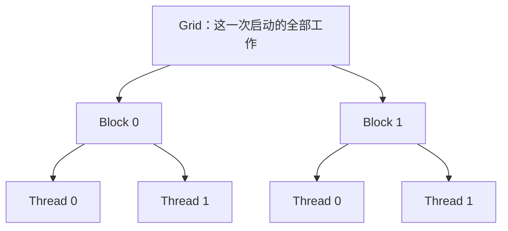
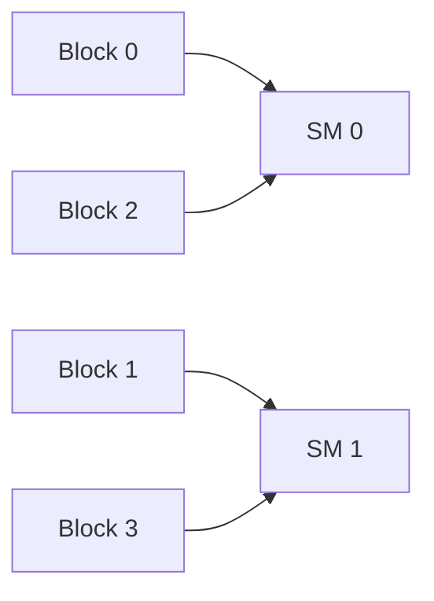

# 04 线程、Block、Grid、Warp 与 SIMT

> 本章要解决的核心问题：我只写了一份 kernel，GPU 到底怎样让很多线程执行它？线程、线程块、warp、SM 和 CUDA core 又分别属于哪一层？
>
> 本章基于 NVIDIA CUDA 的 SIMT 编程模型。先读完第 3 章，能够独立启动一个小 kernel；不要求预先掌握 GPU 微架构。

## 4.0 先看清两张图，不把“任务组织”和“硬件组织”混成一张

上一章写过：

```cpp
hello_kernel<<<2, 4>>>();
```

这告诉 CUDA：本次工作有 2 个 block，每个 block 4 个线程。它没有说“使用 2 个 SM，每个 SM 开启 4 个 CUDA core”。

先把所有名字分到两边：

| 逻辑工作：程序描述了什么 | 硬件资源：由什么来执行 |
|---|---|
| kernel：每个线程要执行的函数 | GPU：设备整体 |
| grid：一次启动组织的全部 block | SM：GPU 内的多处理器 |
| block：可紧密协作的一组线程 | warp 调度器、寄存器、执行管线等 |
| thread：具体执行实例 | 算术、访存、特殊运算等硬件单元 |
| warp：block 内按规则组织的一组线程 | 硬件按 warp 的线程组织发射工作 |

两边存在映射，但没有简单的“一个线程就是一个 core，一块 block 就是一块 SM”的固定等号。

本章先建立逻辑层，再说明硬件怎样承载它。每次概念变多时，都回到这个问题：**我现在是在说一个任务的身份，还是一份执行资源？**

## 4.1 Thread：kernel 的一次线程执行，而不是整个 GPU 只执行一次

### 4.1.1 相同源码，不同执行状态

先看没有内存共享的片段：

```cpp
__global__ void example() {
    int id = static_cast<int>(threadIdx.x);
    int x = id + 10;
    int y = 2 * x;
}
```

这个片段没有可观察输出，真实编译时计算可能被消除；这里先只讨论语义。若由 4 个线程执行：

| 线程 | 自己的 id | 自己的 x | 自己的 y |
|---|---|---|---|
| 0 | 0 | 10 | 20 |
| 1 | 1 | 11 | 22 |
| 2 | 2 | 12 | 24 |
| 3 | 3 | 13 | 26 |

x 和 y 是每个线程各自的局部变量。不是第一个线程先把唯一一个 x 写成 10，然后其他线程抢着把它改成 11、12、13。

一个线程可以有很多局部变量、循环和函数调用。源码里出现一个局部名字，不能据此推断只有一份运行时状态。

### 4.1.2 “每线程私有”不等于“每线程有一整块专属 GPU”

私有状态说明其他线程不会因为使用相同变量名就自动访问它，并不意味着这个线程独占一个物理核心直到结束。

以后你会看到成千上万个逻辑线程使用数量有限的执行单元。要理解这种复用，先把“线程的状态仍然保留”和“此刻正在执行一条指令”区分开。

## 4.2 Block 和 Grid：谁能合作，工作怎样被切成小组

### 4.2.1 Thread、block、grid 的包含关系



图里两个 Thread 0 不是同一个线程。它们分别属于不同 block，就像两个班级都可以有“1 号学生”。

grid 也不是硬件上的一块永久区域。同一个 kernel 可以启动多次，每次使用不同规模；每次启动有自己的工作实例。

### 4.2.2 已经有 thread，为什么还需要 block

block 提供一个有明确范围的协作小组。其线程可以通过该 block 的 shared memory 交换数据，使用块内同步协调阶段。

例如，让 256 个线程共同处理一小块数据：

```text
各线程读自己负责的部分
            ↓
放进这个 block 的共享临时区
            ↓
等待本组需要的写入完成
            ↓
继续利用临时区的数据计算
```

这里需要知道“等待的是哪一组线程”“共享临时区属于哪一组”。block 就提供这个边界。第 10 章会把这张图变成完整 stencil 程序。

block 不是为了让程序员先猜 GPU 有几个 SM，再把每个 block 固定绑到某个 SM。

### 4.2.3 Grid 可以比硬件一次容纳的工作大得多

假设有很多待处理的数据，可以启动很多 block。它们不必全部同时驻留在 GPU 上，尚未获得资源的 block 可以等待后续调度。

这种组织让相同算法既能在较小 GPU 上运行，也能利用较大 GPU 的更多资源。关键前提是普通 block 之间不能依赖某个固定的先后调度次序。逻辑层级和基本映射见 [CUDA SIMT kernel 编写指南](https://docs.nvidia.com/cuda/cuda-programming-guide/02-basics/writing-cuda-kernels.html)。

## 4.3 SM：承载 block 和 warp 的硬件执行资源

### 4.3.1 SM 是什么

SM 是 Streaming Multiprocessor 的缩写，通常译为流式多处理器。一个 NVIDIA GPU 包含多个 SM，每个 SM 内部还有调度、寄存器、访存和计算等资源。

本书把它画成这样的概念盒子：

```text
GPU
├─ SM 0
│  ├─ warp 调度与指令发射相关资源
│  ├─ 寄存器等线程状态存储
│  ├─ shared memory / L1 等片上存储资源
│  └─ 算术、访存与其他执行单元
├─ SM 1
│  └─ ...
└─ 其他 SM
```

这不是某一代 GPU 的精确晶体管布局图。不同架构的资源数量、组织和吞吐量会变，程序不应该靠这张简图假定所有 GPU 的参数相同。

### 4.3.2 一个普通 block 在一个 SM 上执行

在本章普通 thread-block 模型中，一个 block 的线程放在同一个 SM 上执行，不把同一 block 的前半线程放在 SM 0、后半线程放在 SM 1。

这使同组线程能够利用相近的片上资源协作。但它不表示一个 SM 只能放一个 block：

```text
某一时刻的可能安排（只作示意）
SM 0：Block 0 + Block 3
SM 1：Block 1 + Block 2
尚未获得资源：Block 4、Block 5
```

一个 SM 能同时驻留多少 block，受线程、warp、寄存器、shared memory 和设备限制等共同影响。本章先知道“可能多个”；第 19 章再算具体的 occupancy。

### 4.3.3 blockIdx 不是 SM 编号

下面是一种**可能而非规定**的映射：



不能由此写出：

```text
blockIdx.x % SM数量 = 当前 SM 编号
```

这不是 CUDA 保证的公式。调度由设备的执行机制处理，受资源和运行时状态等影响。普通启动配置主要给出逻辑规模，而非用户手工指定每个 block 落在哪个 SM。

不要理解成“Runtime 把每个 block 固定分派到某个 SM”。准确的学习模型是：主机提交 grid，GPU 的调度和执行资源承载 block，程序不能依赖固定映射。

## 4.4 Warp：一个 block 内的 32 线程分组

### 4.4.1 Warp 不是另一种 GPU 核心

本书依据的 NVIDIA CUDA SIMT 模型中，一个 warp 包含最多 32 个实际存在的线程，具有 32 个 lane 位置。warp 是线程执行的组织单位，不是一个独立物理处理器。

一维 block 内，相邻递增线程编号按 32 分组：

```text
threadIdx.x:
 0 ... 31 | 32 ... 63 | 64 ... 95 | 96 ...
  warp 0  |  warp 1   |  warp 2   | warp 3 ...
```

lane 是线程在其 warp 内的位置，编号从 0 到 31。warp 编号和 lane 编号不要混为一谈：

```text
threadIdx.x = 35
warp_in_block = 35 / 32 = 1
lane          = 35 % 32 = 3
```

它是 block 内第二个 warp 的第 4 个 lane 位置。这里 / 是整数除法，% 是取余。

### 4.4.2 warpSize 和启动线程数分别是谁决定的

设备代码中的 `warpSize` 是 CUDA 提供的 warp 大小值，本章使用的 NVIDIA 模型为 32。`blockDim.x` 则来自这次启动选择的 block x 大小。

因此：

```cpp
kernel<<<1, 80>>>();
```

不会创造一个 80 线程 warp，而是启动一个 80 线程 block，再由它组成若干 warp。

### 4.4.3 手算 80 个线程

```text
warp 0：thread  0—31    32 个线程
warp 1：thread 32—63    32 个线程
warp 2：thread 64—79    16 个线程，另外 16 个 lane 位置没有对应线程
```

warp 数量是：

$$
W = \left\lceil \frac{T}{32} \right\rceil
$$

T 是单个 block 的线程总数；上取整符号表示“只要还有剩余线程，就还需要一个分组”。

对本章的小正整数，也可写：

```cpp
int warps_per_block = (threads + 31) / 32;
```

式子中的 +31 是为了用整数除法实现上取整，不是额外启动 31 个线程。

| block 线程数 T | warp 数量 | 最后一个 warp 中实际线程数 |
|---|---|---|
| 1 | 1 | 1 |
| 32 | 1 | 32 |
| 40 | 2 | 8 |
| 80 | 3 | 16 |
| 100 | 4 | 4 |
| 256 | 8 | 32 |

warp 组织与硬件多线程规则见 [CUDA 高级 kernel 编程说明](https://docs.nvidia.com/cuda/cuda-programming-guide/03-advanced/advanced-kernel-programming.html)。

### 4.4.4 两个 block 的尾部线程不会拼成同一个 warp

这个细节非常重要：

```text
Block 0，40 线程：32 + 8 → 2 个 warp
Block 1，40 线程：32 + 8 → 2 个 warp
总计 80 个线程，但分为 4 个 warp，而不是 3 个
```

warp 的分组边界在 block 内。Block 0 最后 8 个线程，不会与 Block 1 前 24 个线程拼成一个 warp。

因此，总 warp 数一般要先算每 block 的分组，再乘 block 数，而不是把整个 grid 的线程总量简单除以 32。

## 4.5 实验一：同时观察 block、线程、全局索引、warp 和 lane

本节只做身份观察，不进行跨线程通信，所以不会把 shared memory 或 shuffle 提前塞进来。

**完整文件：`inspect_layout.cu`，配套目录 `code/04_execution_model/`。**

```cpp
#include <cuda_runtime.h>
#include <cstdio>
#include <iostream>

__global__ void inspect_layout() {
    unsigned int tid = threadIdx.x;
    unsigned int block = blockIdx.x;
    unsigned int global_id = block * blockDim.x + tid;
    unsigned int warp_in_block = tid / warpSize;
    unsigned int lane = tid % warpSize;

    printf("block=%u tid=%u global=%u warp=%u lane=%u\n",
           block, tid, global_id, warp_in_block, lane);
}

int main() {
    const int blocks = 2;
    const int threads = 40;
    inspect_layout<<<blocks, threads>>>();

    cudaError_t err = cudaGetLastError();
    if (err != cudaSuccess) {
        std::cerr << "launch: " << cudaGetErrorString(err) << '\n';
        return 1;
    }
    err = cudaDeviceSynchronize();
    if (err != cudaSuccess) {
        std::cerr << "execution: " << cudaGetErrorString(err) << '\n';
        return 1;
    }

    std::cout << "PASS launch: 2 blocks, 40 threads each; inspect 80 records.\n";
    return 0;
}
```

在文件目录运行：

```bash
nvcc -std=c++17 inspect_layout.cu -o inspect_layout
./inspect_layout
```

必要时按第 3 章加入你确认过的目标架构。成功时应有 80 条线程记录和最后的主机完成提示。这里挑出几条按身份排序展示，真实输出顺序可以不同：

```text
block=0 tid=0 global=0 warp=0 lane=0
block=0 tid=31 global=31 warp=0 lane=31
block=0 tid=32 global=32 warp=1 lane=0
block=0 tid=39 global=39 warp=1 lane=7
block=1 tid=0 global=40 warp=0 lane=0
block=1 tid=31 global=71 warp=0 lane=31
block=1 tid=32 global=72 warp=1 lane=0
block=1 tid=39 global=79 warp=1 lane=7
```

这些是完整 80 条中的节选，不是程序应该只输出八行。

### 4.5.1 每一个新变量的计算都可以回到表上

```cpp
unsigned int global_id = block * blockDim.x + tid;
unsigned int warp_in_block = tid / warpSize;
unsigned int lane = tid % warpSize;
```

- global_id 给这个一维示例中的全部线程一个连续编号。
- warp_in_block 只表示当前 block 内的 warp 编号；不表示硬件调度器的物理槽位。
- lane 表示当前 warp 内的位置。

Block 1 的 tid=0，global_id=40，但 lane=0。若错误地用 `global_id % 32` 计算 lane，会得到 8，说明跨 block 混合分组了。

### 4.5.2 先分清“重置”和“偏移”

| 量 | 到下一 block 时 |
|---|---|
| tid | 在新 block 中从 0 重新编号 |
| warp_in_block | 在新 block 中从 0 重新编号 |
| lane | 每个 warp 内从 0 重新编号 |
| global_id | 在本例人为构造的全局连续编号中继续增长 |

这些公式只按本例的一维 grid 和 block 写。二维 block 的线性线程编号要先按 x 最快变化的顺序展开，不能只用 threadIdx.x 推算整个 block 的 warp；第 6 章会推导。

### 4.5.3 这个程序证明什么，不证明什么

它可以让你核对逻辑身份的计算和打印结果，不能由此观察“哪个 SM 在第几个周期执行了哪个 lane”。

源码最后的 PASS launch 仅表示启动和同步未报告错误；要核对 80 条身份记录，请按公式手查或运行配套输出检查器。不要把没有性能工具的 printf 实验包装成硬件调度实测。

> **检查点 A**
>
> 两个 40-thread block 中，global_id=40 的线程属于哪个 block、哪个 warp、哪个 lane？为什么不能用 global_id/32 作为全局真实 warp 分组的通用公式？


## 4.6 SIMT：一组线程执行共同的指令，各自使用自己的数据

SIMT 的全称是 Single Instruction, Multiple Threads，中文通常译为“单指令、多线程”。先不要把它当成需要背诵的缩写，回到一个熟悉的 kernel：

```cpp
__global__ void arithmetic() {
    int x = static_cast<int>(threadIdx.x);
    int y = x + 2;
    int z = y * 3;
    printf("tid=%u z=%d\n", threadIdx.x, z);
}
```

假设启动一个有 32 个线程的 block。下面只画这个 warp 的前四个 lane；不是说 warp 变成了四个线程。

| 操作阶段 | lane 0 的私有数据 | lane 1 的私有数据 | lane 2 的私有数据 | lane 3 的私有数据 |
|---|---|---|---|---|
| 从各自编号得到 x | 0 | 1 | 2 | 3 |
| 各自计算 y=x+2 | 2 | 3 | 4 | 5 |
| 各自计算 z=y*3 | 6 | 9 | 12 | 15 |

读到“加 2”这一步时，你可以把它理解成：参与这条指令的线程，分别拿出自己的操作数做同一种操作。lane 0 不是先把 2 算出来再传给 lane 1；四个 y 也不是同一个变量。

SIMT 给程序员呈现的是许多个线程。你写的是“我这个线程应该做什么”，GPU 再把线程按 warp 组织执行。这正是写向量加法时只需要描述一个元素加法的基础。

### 4.6.1 “同一条指令”不等于“同一个数值”

同一个加法操作可以处理不同数据：

```text
lane 0：a[0] + b[0]
lane 1：a[1] + b[1]
lane 2：a[2] + b[2]
...
```

这里相同的是操作，变化的是每个线程计算出的地址与取得的数据。CUDA 不会因为线程执行同一份 kernel，就自动让它们全读 a[0]。反过来，如果你真的写死 a[0]，它也不会自动替你改成 a[threadIdx.x]。

### 4.6.2 不要把一行 C++ 当成一条机器指令

上面的表是帮助理解的数据流，不是反汇编结果。一行 C++ 可以生成多条指令，多行表达式也可能被合并、折叠或删除。例如没有可观察输出的计算可能消失。

因此，“程序有十行，所以 GPU 用十个周期完成”没有依据。后面学习性能时，我们才把源码、编译结果和实测联系起来。

SIMT 与显式向量编程的一个重要区别是：CUDA 程序中保留每个线程的状态和控制流表达能力，而不是要求你先把所有操作数手工包装成一个向量类型。这是理解模型的区别，不表示硬件无需成组执行。[NVIDIA：使用 warp 级原语](https://developer.nvidia.com/blog/using-cuda-warp-level-primitives/)

## 4.7 warp 到底占几个 CUDA core

这个问题不能用“永远占一个”或“永远占 32 个”回答。要先区分：

| 名称 | 本章应怎样理解 |
|---|---|
| thread | 一个逻辑执行实例，有自己的数据和执行状态 |
| warp | block 内线程的执行分组 |
| SM | 接收并执行 block 的硬件多处理器 |
| CUDA core | NVIDIA 描述计算硬件时使用的术语，通常涉及算术执行单元，不是一个完整的软件线程 |
| warp scheduler | SM 内决定哪些就绪 warp 可以发射指令的调度硬件 |
| load/store、特殊函数、Tensor 等单元 | 执行不同类型操作的其他硬件资源，不应全部统称为同一种 core |

一个线程不是一个小人，永久坐在编号相同的 CUDA core 上。某个 warp 的加法指令、访存指令和特殊函数操作，也不必通过同一种硬件单元完成。

更准确的入门图景是：

```text
warp 的线程状态被保存在 SM 的资源中
                ↓
调度器挑选可发射的指令
                ↓
对应类型的执行单元处理各 lane 的操作
                ↓
结果写回，后续指令在依赖满足时继续
```

发射、执行、完成是不同阶段。“warp 有 32 个 lane”不保证每一种指令都在同一个周期处理完 32 个 lane。指令类型、执行通路宽度、吞吐率和延迟会随架构变化。

所以这些推导都不成立：

- 一张卡有 80 个 SM，因此只能运行 80 个线程。
- 一个 SM 有若干 CUDA core，因此同一时刻只能保留相同数量的线程状态。
- 一个 warp 有 32 个线程，因此任何 SM 的 CUDA core 数必然是 32。
- 看到一个 warp 的 printf 连续出现，就证明它独占某个物理 core。

硬件规格需要查具体架构。比如 Hopper 调优指南就分别描述算术能力、驻留限制、寄存器和 shared memory，而不是用一个 core 数字代替所有资源。[Hopper 调优指南](https://docs.nvidia.com/cuda/hopper-tuning-guide/index.html)

## 4.8 分支分歧：同一个 warp 中，线程选择了不同路径

现在研究：

```cpp
if (threadIdx.x % 2 == 0) {
    // 路径 A
} else {
    // 路径 B
}
```

% 是取余；除以 2 余数为 0 表示偶数。在同一个 warp 中，偶数 lane 选择 A，奇数 lane 选择 B。

下面仍只截取前八个 lane，真实 warp 有 32 个 lane 位置：

```text
lane：             0 1 2 3 4 5 6 7 ...
选择路径：         A B A B A B A B ...
处理 A 路径时：    ● · ● · ● · ● · ...
处理 B 路径时：    · ● · ● · ● · ● ...
```

● 表示这条路径上参与相关操作的线程，· 表示不参与这条路径上的操作。暂时不参与不是线程被删除，不是它的变量被清空，也不是该线程已经执行完整个 kernel。

如果机器码确实采用分支，并且同一 warp 的线程走不同路径，硬件需要以参与线程不同的方式处理这些路径，通常不能像整组线程执行相同工作那样有效利用执行资源。但不要从这个示意图推断“必定 A 先、B 后”，也不要机械地断言“一定慢两倍”。

### 4.8.1 分歧是按 warp 判断，不是按整个 block 判断

假设一个 block 有 256 个线程：

```cpp
if (threadIdx.x < 32) {
    // A
} else {
    // B
}
```

warp 0 中的 0—31 全选 A；warp 1—7 的线程全选 B。不同 warp 可以走不同路径，这个条件没有在任一 warp 内把线程分成两组。

再改成：

```cpp
if (threadIdx.x < 16) {
    // A
} else {
    // B
}
```

warp 0 的 0—15 选 A，16—31 选 B；它出现逻辑上的路径分歧。其他 warp 全选 B。

| 条件，block 有 256 个线程 | 被条件分成两组的 warp |
|---|---|
| tid < 32 | 无 |
| tid < 16 | warp 0 |
| tid % 2 == 0 | 所有八个 warp |

### 4.8.2 有 if 不一定有昂贵的机器分支

编译器可能使用谓词执行、选择指令等实现较短条件。所谓谓词，可以先粗略理解为“只有条件满足的线程才提交这次操作的效果”，不必真的跳转到长段代码。

因此，源码中的 if 是程序语义；最终是否生成分支、是否发生特定执行开销，需要看编译结果与测量。不要为了删掉 if，写出更难懂、计算更多或越界的代码。边界检查首先保证正确性。

## 4.9 实验二：比较按 warp 分组和按奇偶分组

这个实验不测速度，而是验证“每个线程到底选择了哪一条路径”。

**完整文件：`branch_paths.cu`，配套目录 `code/04_execution_model/`。**

```cpp
#include <cuda_runtime.h>
#include <cstdio>
#include <iostream>

__global__ void branch_paths(int mode) {
    unsigned int tid = threadIdx.x;
    bool choose_a;
    if (mode == 0) {
        choose_a = (tid < 32);
    } else {
        choose_a = ((tid % 2) == 0);
    }

    int value;
    char path;
    if (choose_a) {
        value = static_cast<int>(tid) + 100;
        path = 'A';
    } else {
        value = static_cast<int>(tid) + 200;
        path = 'B';
    }

    printf("mode=%d tid=%u warp=%u lane=%u path=%c value=%d\n",
           mode, tid, tid / warpSize, tid % warpSize, path, value);
}

int main() {
    for (int mode = 0; mode < 2; ++mode) {
        branch_paths<<<1, 64>>>(mode);

        cudaError_t err = cudaGetLastError();
        if (err != cudaSuccess) {
            std::cerr << "launch mode=" << mode << ": "
                      << cudaGetErrorString(err) << '\n';
            return 1;
        }
        err = cudaDeviceSynchronize();
        if (err != cudaSuccess) {
            std::cerr << "execution mode=" << mode << ": "
                      << cudaGetErrorString(err) << '\n';
            return 1;
        }
    }

    std::cout << "PASS launch: two modes; inspect 128 records.\n";
    return 0;
}
```

编译运行：

```bash
nvcc -std=c++17 branch_paths.cu -o branch_paths
./branch_paths
```

main 中 mode 是 CPU 循环变量。每次启动时，把当前整数值按值传入 kernel：

- mode=0：tid<32 走 A，其余走 B。
- mode=1：偶数 tid 走 A，奇数 tid 走 B。

两个模式分别启动一个 64-thread block，也就是两个 warp。每次启动后都同步，确认该次执行成功后，CPU 才进入下一轮。

### 4.9.1 先手算几行，再运行

| mode | tid | warp | lane | 路径 | value |
|---|---|---|---|---|---|
| 0 | 0 | 0 | 0 | A | 100 |
| 0 | 31 | 0 | 31 | A | 131 |
| 0 | 32 | 1 | 0 | B | 232 |
| 0 | 63 | 1 | 31 | B | 263 |
| 1 | 0 | 0 | 0 | A | 100 |
| 1 | 1 | 0 | 1 | B | 201 |
| 1 | 32 | 1 | 0 | A | 132 |
| 1 | 63 | 1 | 31 | B | 263 |

mode=0 的两个 warp 各自只有一种路径；mode=1 的两个 warp 内都有两种路径。两个模式都计算 64 个结果，不是分歧以后只剩一半线程。

`char path` 保存一个字符，单引号 'A' 与双引号 "A" 的字符串不同；printf 中 %c 打印字符。choose_a 是每个线程自己的 bool，不是全 block 共享一个开关。

### 4.9.2 怎么确认没有漏线程

总共应该有 128 条 mode 记录，最后有一条 PASS launch。每个模式中 tid=0—63 各出现一次。它们在同次 kernel 内的打印顺序不应当被当成答案的一部分。

在教材根目录执行：

```bash
python3 scripts/verify_cuda_intro.py --chapter 04 --static-only
python3 scripts/verify_cuda_intro.py --chapter 04
```

第一条仅核对教材与源码等静态内容；第二条才会查找 nvcc、临时编译、实际执行两个程序并逐条核对输出。没有 GPU 或 nvcc 时，不能把第一条的通过说成 GPU 实验通过。可用 `--arch sm_XX` 指定实际支持的架构，XX 必须替换成第 2 章确认的值，不能原样照抄。

### 4.9.3 为什么不能拿这两个程序比较分歧性能

printf 开销大，而且它会影响执行行为；两个模式的简单计算还可能被编译器转换成选择操作。这份源码是“逻辑路径观察实验”，不是“证明分歧恰好慢多少”的基准。

现阶段先做到预测输出。性能实验需要去掉设备打印、充分重复、用合适的计时方法，并查看实际生成的指令；后面性能章节再做。

## 4.10 已经启动，不等于全部线程同时在硬件上驻留

用餐厅比喻时，最容易犯的错是把“发出了 100 桌的订单”理解成“餐厅一定有 100 张空桌”。同理，grid 有很多 block，不要求 GPU 同时容纳它们全部。

本章使用下面几个词，帮助区分状态；这是教学用的简化过程，不是 CUDA 暴露给程序的状态枚举：

```text
CPU 提交 kernel
    ↓
等待 GPU 开始处理这次工作
    ↓
部分 block 获得 SM 资源，成为驻留 block
    ↓
驻留 block 中的 warp 等待或满足执行条件
    ↓
调度器发射就绪 warp 的指令
    ↓
各 block 完成并释放资源，其他 block 获得运行机会
```

“驻留”指它的执行状态已经占用 SM 的相应资源。“就绪”表示下一步所需条件已满足，可以考虑发射；驻留的 warp 不一定总是就绪。例如，它可能等待一条先前发出的内存读取返回。

### 4.10.1 GPU 用其他工作覆盖等待

假设某 SM 上已经有若干驻留 warp：

| 时刻 | warp A | warp B | warp C | 调度器可能做的事 |
|---|---|---|---|---|
| t0 | 发出读取 | 就绪 | 就绪 | 发射 A 的访存指令 |
| t1 | 等待读取结果 | 就绪 | 就绪 | 发射 B 的可执行指令 |
| t2 | 仍在等待 | 等待自身依赖 | 就绪 | 发射 C 的可执行指令 |
| t3 | 数据返回、重新就绪 | 可能就绪 | 可能就绪 | 从可发射的候选中选择 |

这只是可能过程，不是固定轮询顺序，也不是一个格子恰好等于一个周期。

驻留 warp 的上下文由硬件资源保存，不能照搬“CPU 操作系统每切换一个线程，都保存恢复整份进程上下文”的想象。增加独立工作有机会覆盖等待，但前提是资源装得下、后续工作真的就绪。它不是无条件加线程就更快。

### 4.10.2 为什么不能把所有线程塞进一个 block

比较：

```cpp
kernel<<<100, 256>>>();  // 总线程数 25600，每 block 256 个
kernel<<<1, 25600>>>(); // 总线程数同样 25600，但单 block 太大
```

这两种启动不是等价分组。第二种超过当前 CUDA GPU 的单 block 线程上限；实际限制应查询第 2 章的 maxThreadsPerBlock 等字段，不能靠“全卡 core 很多”绕过。

第一种也不保证 100 个 block 全部同时驻留。它只是在维度等条件合法时提交 100 个可调度 block；是否能启动还受每 block 的寄存器、shared memory 等资源要求影响。

一个大数组通常交给多个 block，而不是为每个元素都向一个无限大的 block 加线程。第 5 章会把这条原则写成通用代码。

## 4.11 有了 warp，为什么还需要 block

warp 侧重执行组织；block 还定义了非常重要的协作边界。

设一个任务要由 128 个线程合作，把局部结果写入一块共享空间，再由其中一些线程继续处理。它跨越四个 warp。仅知道“每32线程是一组”不够，我们还需要：

1. 这些线程属于哪个协作组？
2. 它们共享哪一块 shared memory？
3. 谁必须等谁到齐，才能读取别人写的数据？

普通 CUDA block 为这些操作提供边界。第 10 章会具体使用 shared memory 和 `__syncthreads()`，现在只记住：warp 并不能替代 block。

### 4.11.1 不同普通 block 不能随便互相等

假设 GPU 当前只能容纳两个 block；grid 里提交了 A、B、C。A、B 已经驻留，它们都忙等“C 已经完成”的标志，但 C 要等资源释放才能运行。

```text
资源槽 1：A，等待 C
资源槽 2：B，等待 C
待运行：C，等待资源槽
```

在这种安排下，A、B 不退出，C 就可能无法开始。这是为什么不能把“写一个全局变量循环检查”当成普通 grid 的通用全局屏障。即使把内存可见性处理对了，也没有解决进度依赖。

初学时，把有全局阶段依赖的工作分成两次 kernel，按同一 stream 的先后顺序提交，是更容易推理的方案。特殊的 cooperative launch 或 cluster 有额外能力与前提，不能反推普通 block 自动具备它们。

这并不表示普通 block 之间绝对不能使用原子操作等手段交流，而是说明：任何通信方案都必须单独证明内存正确性与执行进度，不能假设所有 block 同时驻留。[CUDA 编程模型](https://docs.nvidia.com/cuda/cuda-programming-guide/01-introduction/programming-model.html)

## 4.12 同一个 warp，不等于可以省略同步

学到 SIMT 后，常见的危险推理是：

> “我们在同一个 warp，所以我的写入肯定已经被其他 lane 看到了。”

不成立。执行组织、程序顺序、内存可见性和通信同步不是同一个概念。

从计算能力 7.0 开始，NVIDIA 引入 Independent Thread Scheduling，即独立线程调度。它允许比旧式“整 warp 一个共同进度”的直觉更细的线程执行安排。你仍然需要理解 warp，但不能据此依赖没有明确同步的隐式 warp 同步行为。[高级 kernel 编程：SIMT 与独立线程调度](https://docs.nvidia.com/cuda/cuda-programming-guide/03-advanced/advanced-kernel-programming.html)

先建立两个路标：

| 原语 | 以后主要解决什么问题 | 现在不能误用的地方 |
|---|---|---|
| __syncthreads() | block 内符合要求的线程会合与内存顺序 | 不是全 grid 屏障，不能随便只让部分线程走到它 |
| __syncwarp(mask) | mask 指定的 warp 参与线程之间同步与内存顺序 | mask、参与者与调用方式必须满足接口约束，不是随手填一个数字 |

本章两个实验只计算各自私有变量，不读取同组其他线程写的共享结果，因此不需要用这两个原语来组织设备线程通信。main 里的 cudaDeviceSynchronize 则是 CPU 等待设备工作完成，作用层级又不同。

完整的屏障参与规则、mask、shuffle 和部分 warp，留到第 10、12 章配合确实需要通信的算法学习。现在不必硬背每个接口，却必须先删掉“同 warp 永远可以省同步”的错误前提。

## 4.13 进阶路标：thread block cluster

阅读新版本官方指南时，你会遇到比 block 多一层的 thread block cluster。它在计算能力 9.0 起的支持设备上提供额外的 block 协作能力，设备是否支持还应查询相应属性。

先看层次：

```text
普通主线：grid → block → thread
可选扩展：grid → cluster → block → thread
执行分组：每个 block 内的 thread 仍组成 warp
```

cluster 内的 block 可以在同一个 GPC（Graphics Processing Cluster，硬件上的一组处理资源）中协同调度，并使用相应的同步和分布式 shared memory 能力。它们不必全部挤在同一个 SM；“cluster 中有多个 block”并没有取消“单个 block 在一个 SM 上执行”的基本模型。

这里的分布式 shared memory 不是说所有普通 block 的 shared memory 默认都互相可见。必须采用支持的 cluster 启动和相应编程接口。即便使用 cluster，gridDim 仍然表示 grid 中的 block 数，而不是自动改成 cluster 数。

本章不把 cluster 当成初学 kernel 的必需语法。先用普通 block 写正确的向量运算、归约和矩阵乘法，再学习这种有硬件前提的扩展，概念会更稳。[CUDA 编程模型中的 thread block cluster](https://docs.nvidia.com/cuda/cuda-programming-guide/01-introduction/programming-model.html)

## 4.14 写下一段 kernel 前，你现在应该会做哪些决定

先回答任务问题，再决定启动配置：

1. 我要处理多少数据？例如数组有 n 个元素。
2. 一个线程负责什么？例如只计算一个下标 i。
3. 一个 block 放多少线程？先选设备允许的合理值。
4. 要多少个 block 才能覆盖数据？
5. 最后一个 block 多出来的线程怎么安全处理？
6. 不同线程是否需要交换结果？如果需要，协作范围是什么？

现在只有第 3 点有一个经验起点：对不少常规 kernel，128—256 线程/block 可以作为初步试验范围，随后测量和调整；它不是所有算法的最优值。block 大小、寄存器、shared memory、访存模式和算法结构都影响结果。[CUDA Best Practices：线程与 block 经验规则](https://docs.nvidia.com/cuda/cuda-c-best-practices-guide/index.html#thread-and-block-heuristics)

尤其不要把 n 和 blockDim.x 绑死：

```text
n = 数据一共有多少个元素
blockDim.x = 这次启动每个 block 分配多少线程
```

一个是问题规模，一个是执行分组选择。更不能因为数据有一百万个元素，就写一百万线程的单 block。

## 4.15 练习：先手算，再改程序，最后解释原因

答案见 [附录-C-练习答案](<附录-C-练习答案.md>) 的第 4 章。不要只看结论，要写出每个数字的来历。

### 练习 1：给名词分类

thread、block、grid、warp、SM、CUDA core，哪些描述逻辑组织，哪些描述硬件？为什么 warp 虽与硬件执行紧密相关，仍不能直接当成一个物理 core？

### 练习 2：完整与不完整 warp

一个 block 分别有 1、32、40、80、100、256 个线程，各有多少个 warp？最后一个 warp 中有多少实际线程？

### 练习 3：分组边界

比较 1 个 80-thread block 与 2 个 40-thread block。它们线程总数相同，warp 总数是否相同？为什么？

### 练习 4：找到一个线程

对 inspect_layout 的启动，手算 block=1、tid=35 的 global、warp、lane。再解释为什么用 global%32 得到的结果不对。

### 练习 5：分支路径

一个 256-thread block 中，分别用 tid<32、tid<16、tid%2==0 作为 if 条件。哪些 warp 的线程会选择不同路径？这能直接证明实际慢几倍吗？

### 练习 6：读懂私有变量

32 个线程运行 4.6 的 arithmetic。lane 7 的 x、y、z 各是多少？lane 0 改变自己的 x，会不会自动改变 lane 7 的 x？

### 练习 7：启动与驻留

GPU 假设有两个 SM，每个 SM 在当前 kernel 的资源要求下只能容纳两个 block。提交十个 block，是否一定非法？是否十个都同时驻留？能否预测 block 7 一定在哪个 SM 上？

### 练习 8：识别错误的全局等待

在 4.11 的 A、B 等待 C 场景里，仅把标志变量改成原子变量，是否就能保证没有停滞？缺少的是哪一种保证？

### 练习 9：改实验一

把 threads 从 40 依次改成 32、80、100，blocks 保持 2。先写出总记录数、总 warp 数和每个 block 最后一个线程的 lane，再实际运行验证。若使用自动检查器，也必须同步修改它的预期，而不是让原始 40-thread 检查器验收新配置。

### 练习 10：改实验二

把 mode=1 的条件改为 tid%4<2，其余不变。列出 tid=0—7 的路径和值，并分析两个 warp 是否都有逻辑路径分歧。

### 练习 11：同步层级

说明 cudaDeviceSynchronize、__syncthreads、__syncwarp 分别处在哪种协作层级。为什么第一种不能直接写进这里的普通 kernel 充当跨 block 屏障？

### 练习 12：给“CUDA core 数决定线程数”纠错

有人说：“GPU 有 N 个 CUDA core，所以 kernel 最多启动 N 个线程，每个线程绑定一个 core。”至少从逻辑启动规模、资源驻留、指令执行三个方面解释错误。

### 练习 13：cluster 边界

使用 cluster 后，block 是否被取消？gridDim 是否改成 cluster 数？没有采用 cluster 接口的普通 block，是否自动共享彼此的 shared memory？

## 4.16 本章小结与进入下一章的门槛

本章最重要的不是记住六个英文名词，而是建立三层不同的问题：

```text
工作如何编号：grid、block、thread
线程如何成组执行：warp、lane、SIMT
工作在哪里执行：SM 及其各类硬件资源
```

你应当能够手算一个线程的身份，解释分支是否在同一 warp 内分开，区分“提交了很多线程”与“这些线程正在同时驻留”，并知道哪些通信不能依靠隐式同步。

如果暂时记不住某个硬件规格，不影响继续；如果仍把 block 当成 SM 的固定别名，或把 warp 当成 CUDA core，请先重做练习 1—4。下一章会把这些身份变成数组下标，写出有内存分配、数据传输、kernel、结果验证和资源释放的完整向量加法。
