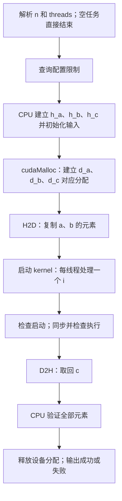

# 05 一维索引与向量运算

> 本章目标：不是背下一段向量加法，而是能够从空文件写出一个有输入、GPU 计算、输出和验证的 CUDA 程序。
>
> 阅读前提：第 1 章的数组、指针、函数与 vector；第 3 章的 kernel 启动；第 4 章的 block 和线程编号。不要求提前掌握类封装、模板或性能优化。

## 5.0 把“我不知道怎么开始”变成三个小问题

给你两个各有 n 个浮点数的数组 a、b，希望计算同样长度的数组 c：

$$
c_i=a_i+b_i,\qquad 0\leq i<n
$$

下标 i 表示第几个元素，从 0 开始；n 表示元素总数，不是最后一个下标。

暂时只问三件事：

1. 每个结果如何计算？把同一下标的两个数相加。
2. 每个线程负责哪个结果？用线程身份算出下标 i。
3. 数据怎样到达计算它的地方？分配设备内存、复制输入、计算、复制输出。

GPU 不会替你决定数组的意义。变量叫 a、input 还是 temperatures，不影响它的计算；这些名字是你给问题建立的描述。

本章分三站：

| 实验 | 是否需要 GPU | 单独学会什么 |
|---|---|---|
| index_map.cpp | 否 | 手算编号、向上取整、边界检查 |
| memory_roundtrip.cu | 是，但不启动 kernel | 地址、分配、复制、释放 |
| vector_add.cu | 是 | 把前两站组合成完整计算并验证 |

所有文件在 `code/05_vector_add/`。先做小规模实验，再扩大 n；不要第一次运行就用一百万行打印淹没自己。

## 5.1 先把数学写成普通 CPU 程序

取 n=4：

```text
下标 i：  0    1    2    3
a：       0   0.5   1   1.5
b：       0    2    4    6
c：       0   2.5   5   7.5
```

CPU 循环是：

```cpp
for (int i = 0; i < n; ++i) {
    c[i] = a[i] + b[i];
}
```

计算 c[3] 不需要先知道 c[2]。各次循环读取 a、b 的相应元素，写入 c 的不同位置，因此这些计算可以独立安排。

这点不能推广到所有循环。例如：

```cpp
for (int i = 1; i < n; ++i) {
    c[i] = c[i - 1] + a[i];
}
```

后一轮依赖前一轮新算出的 c。直接让很多线程同时执行各个 i，可能读到尚未生成的结果。后面 scan 章节会为这类问题重新设计算法。

**把循环改成 CUDA 之前，先检查每轮之间有没有数据依赖。**并行化不是只替换 for 的语法。

## 5.2 一个线程负责一个元素，循环变量从哪里来

CPU 循环中，单个执行流程不断改变 i：

```text
先 i=0 → 再 i=1 → 再 i=2 → ...
```

本章的 GPU 方案则是让每个线程算一个固定 i：

```text
线程甲：我的 i=0，只负责 c[0]
线程乙：我的 i=1，只负责 c[1]
线程丙：我的 i=2，只负责 c[2]
...
```

线程之间没有共享一个会不停递增的 i。kernel 中的 i 是各线程的私有局部变量，回顾第 4 章。

下面是“一维 grid + 一维 block”下的编号公式：

```cpp
int i = blockIdx.x * blockDim.x + threadIdx.x;
```

拆成两部分：

```text
blockIdx.x * blockDim.x = 排在当前 block 前面的完整线程组占了多少位置
threadIdx.x            = 当前线程在本 block 里的位置
两者相加               = 当前线程负责的全局下标
```

这里的“排在前面”是**编号上的前面**，不是执行时间先后。Block 2 可以先于 Block 1 运行，但编号公式仍然一样。

### 5.2.1 为什么只写 threadIdx.x 不够

设每 block 有 4 个线程：

| blockIdx.x | threadIdx.x | 正确 i | 如果只用 threadIdx.x |
|---|---|---|---|
| 0 | 0—3 | 0—3 | 0—3 |
| 1 | 0—3 | 4—7 | 又是 0—3 |
| 2 | 0—3 | 8—11 | 又是 0—3 |

漏掉 block 偏移会让多个 block 重复访问前几个元素，后面的元素没有被正确处理；还可能让多个线程写同一位置。即使这些线程恰巧打算写相同数值，也不能把这种重复写当成合法且正确的任务映射。

### 5.2.2 为什么乘 blockDim.x，而不是 gridDim.x

blockDim.x 是“每组有几个线程”，gridDim.x 是“一共有几组”。要跳过前面的 block，就应乘每组的大小。

例如 3 个 block、每组 4 个线程，Block 2 起点是 2×4=8。若写 2×3=6，就错误地把“组数”当成“组大小”。

## 5.3 n=10、每组 4 个线程：多出来的两个线程怎么办

n=10，合法下标是 0—9。我们不能只启动两个 4-thread block，因为它们只能覆盖 0—7。应启动三个：

| block | tid | i | 是否 i<n | 应做的事 |
|---|---|---|---|---|
| 0 | 0 | 0 | 是 | 写 c[0] |
| 0 | 1 | 1 | 是 | 写 c[1] |
| 0 | 2 | 2 | 是 | 写 c[2] |
| 0 | 3 | 3 | 是 | 写 c[3] |
| 1 | 0 | 4 | 是 | 写 c[4] |
| 1 | 1 | 5 | 是 | 写 c[5] |
| 1 | 2 | 6 | 是 | 写 c[6] |
| 1 | 3 | 7 | 是 | 写 c[7] |
| 2 | 0 | 8 | 是 | 写 c[8] |
| 2 | 1 | 9 | 是 | 写 c[9] |
| 2 | 2 | 10 | 否 | 不访问数组 |
| 2 | 3 | 11 | 否 | 不访问数组 |

边界保护必须包住访存：

```cpp
if (i < n) {
    c[i] = a[i] + b[i];
}
```

不能先读 a[i]，再判断 i 是否越界；错误访问已经发生。也不能写 i<=n，因为 a[n] 是长度为 n 的数组之外的位置。

“启动了 12 个线程”和“数组有 10 个元素”并不矛盾。只要后两个线程不访问不存在的元素，这种覆盖方式就是本章需要的行为。

### 5.3.1 为什么不依赖显存里“旁边恰好还有空间”

分配 n 个元素只授权程序访问那 n 个元素。即使越界一次没有崩溃，也不表示访问合法。它可能碰到同一分配区域外的数据，或在不同构建、设备和输入下才暴露。

正确性来自范围推理、验证和检查工具，不是来自“这次没报错”。

### 5.3.2 尾部边界分支和分歧

最后一个 block 中可能只有部分线程工作。不要为了避免分支分歧删掉必要的范围判断。先保证读写有效，再研究性能。这个问题与第 4 章的 if 和 warp 概念在这里连接起来。

官方入门指南也使用按元素分工和边界保护，但本章会继续补齐数据、检查和资源生命周期。[CUDA C++ 入门：索引和边界](https://docs.nvidia.com/cuda/cuda-programming-guide/02-basics/intro-to-cuda-cpp.html)

## 5.4 向上取整：不是神秘公式

设每个 block 放 T 个线程，需要 B 个 block：

$$
B=\left\lceil n/T\right\rceil
$$

n 是元素数，T 是每组线程数，B 是组数；上取整表示只要有余数，就再加一组。

当 n=10、T=4 时，整数除法 10/4 得到 2，余数 10%4 得到 2，说明还剩两个元素。所以 B=3。

本章源码使用：

```cpp
int blocks = n / threads + (n % threads != 0);
```

括号里的比较得到 bool；参与加法时 true 转成 1，false 转成 0。也就是“完整组数 + 有没有残余”。

常见的等价写法是：

```cpp
int blocks = (n + threads - 1) / threads;
```

它要求 n 非负、threads 为正，并且加法不会溢出。第一种写法避免了 n+threads-1 这一项可能溢出的加法，但不自动解决所有后续整数范围问题。

| n | threads | 完整组数 | 余数 | blocks | 总线程位置 |
|---|---|---|---|---|---|
| 0 | 4 | 0 | 0 | 0 | 不启动 |
| 1 | 4 | 0 | 1 | 1 | 4 |
| 8 | 4 | 2 | 0 | 2 | 8 |
| 10 | 4 | 2 | 2 | 3 | 12 |
| 1000 | 256 | 3 | 232 | 4 | 1024 |
| 1024 | 256 | 4 | 0 | 4 | 1024 |

n=0 时，程序直接处理空任务，不发起零 block 的 kernel 启动。threads=0 则不是空任务，而是错误配置，必须在除法之前拒绝。

## 5.5 实验一：不用 GPU，模拟线程身份

**完整文件：`index_map.cpp`。**

```cpp
#include <iostream>

int main() {
    const int n = 10;
    const int threads = 4;
    const int blocks = n / threads + (n % threads != 0);

    for (int block = 0; block < blocks; ++block) {
        for (int tid = 0; tid < threads; ++tid) {
            const int i = block * threads + tid;
            std::cout << "block=" << block << " tid=" << tid
                      << " i=" << i;
            if (i < n) {
                std::cout << " work\n";
            } else {
                std::cout << " skip\n";
            }
        }
    }
    std::cout << "CPU model: n=" << n << " blocks=" << blocks
              << " slots=" << blocks * threads << '\n';
}
```

在文件目录编译运行：

```bash
g++ -std=c++17 -Wall -Wextra index_map.cpp -o index_map
./index_map
```

它是普通 C++，用 g++，不需要 nvcc。真实输出应列出 12 条身份记录，最后是：

```text
CPU model: n=10 blocks=3 slots=12
```

其中 i=0—9 标为 work，i=10、11 标为 skip。代码用 CPU 两层循环枚举身份，只是为了检查编号；不是模拟真实 GPU 的调度顺序、warp 发射或速度。

请先改 n=9，再改 n=8。你应能在运行前预测 skip 分别出现 3 次和 0 次。如果做不到，先回到 5.3 的表，不必急着学内存 API。

## 5.6 同样是 float*，为什么要区分 h_a 和 d_a

本章选择**显式设备内存管理**作为主要练习方式：

```text
CPU 一侧：h_a、h_b 提供输入，h_c 接收输出
GPU 一侧：d_a、d_b 对应设备输入，d_c 对应设备输出
```

h_、d_ 是命名习惯，不是 C++ 关键字。把 d_a 改名为 banana，不会改变分配所在的内存。

### 5.6.1 指针变量和它指向的数组是两件事

main 中声明：

```cpp
float* d_a = nullptr;
```

这只创建一个主机代码使用的指针变量，并把它设为空。它没有创建 n 个 float，也没有把某块 CPU 数组转成 GPU 数组。

分配后可以这样画：

```text
CPU 的 main 中                        CUDA 分配的设备存储
d_a：保存一个设备地址值 ────────────→ [元素0][元素1]...[元素n-1]
```

CPU 可以保存和传递这个地址值；“能保存地址”不表示本章允许 CPU 直接写 d_a[0]。本章通过 CUDA 复制接口与设备存储交换数据。

相比之下：

```cpp
std::vector<float> h_a(n);
```

建立一个主机容器及其 n 个 float 元素。对这种构造方式，float 元素初始为 0；我们仍会显式填入题目所需数据。h_a.data() 取得它连续元素区的首地址，不复制任何元素。

### 5.6.2 不要把本章模型误写成所有系统的绝对限制

CUDA 有 managed memory、映射内存，以及支持 HMM/ATS 的系统。普通系统分配能否被 GPU 访问，取决于系统能力和分配方式。

所以正确规则不是“任何主机地址在任何 CUDA 系统都绝不可能被 GPU 访问”，而是“必须知道该地址对应的内存是否对当前访问者有效”。本章不依赖特殊系统能力，始终使用独立设备分配与显式复制。统一地址空间也不等于任意处理器都能任意访问所有分配。[CUDA：统一内存与系统内存](https://docs.nvidia.com/cuda/cuda-programming-guide/02-basics/understanding-memory.html)

## 5.7 分配大小：元素、字节、sizeof 和取地址

n=10 个 float，每个 float 在 CUDA 中为 4 字节，因此每个数组需要 40 字节：

```cpp
const std::size_t bytes = static_cast<std::size_t>(n) * sizeof(float);
```

逐项解释：

| 表达式 | 含义 |
|---|---|
| n | 元素数量 |
| sizeof(float) | 一个 float 占的字节数 |
| static_cast<std::size_t>(n) | 把已验证非负的 n 转成用于大小计算的整数类型 |
| 两者相乘 | 整个连续元素区需要的字节数 |
| bytes | 只是我们选的变量名，CUDA 不会凭名字推断它的单位 |

把 n 写成字节参数，相当于只分配 10 字节，而后续打算写 10 个 float。指针类型不会自动让 cudaMalloc 把数量乘 4。

### 5.7.1 为什么 sizeof(d_a) 不能表示数组大小

d_a 是指针，所以 sizeof(d_a) 测量的是指针本身的大小，不是它指向的设备分配的长度。它可能只有 8 字节，而设备数组可以有几百万字节。

对编译期定长数组 `float input[4]`，sizeof(input) 则能得到整个数组的字节数，因而实验二可以这样写。数组作为普通指针传入函数后，再对形参取 sizeof，就不再得到原数组长度。第 1 章的数组与指针区别，在这里直接影响显存是否越界。

### 5.7.2 cudaMalloc 为什么写 &d_a

```cpp
cudaError_t status = cudaMalloc(&d_a, bytes);
```

这个调用有两种“输出”：

- 返回值 status 是错误状态，说明操作是否成功。
- 第一个参数让函数在成功后把新地址写进 d_a。

回顾普通指针：

```text
d_a   ：指针变量当前保存的地址值
&d_a  ：指针变量本身的位置，函数可以通过它修改 d_a
*d_a  ：尝试访问 d_a 指向的一个 float；不是本章 CPU 该做的操作
```

CUDA C++ 头文件提供便利重载，示例可直接传 float**；底层通用接口常显示 void**。这不表示 C++ 允许把任意多级指针不加考虑地互相转换。这里先使用 CUDA C++ 的写法，不需要为编译通过到处添加强制转换。

cudaMalloc 只分配存储，**不把内容自动清零**。d_a 的输入随后靠复制填入；d_c 的合法元素会被 kernel 逐一覆盖，因此这里不必先清零 d_c。[CUDA Runtime 内存接口](https://docs.nvidia.com/cuda/cuda-runtime-api/group__CUDART__MEMORY.html)

## 5.8 复制：先目的地，再来源；传的是数据，不是重命名

本章的调用模式是：

```cpp
cudaMemcpy(destination, source, bytes, direction);
```

读成：“从 source 开始取 bytes 字节，写到 destination；direction 描述方向”。

```cpp
cudaMemcpy(d_a, h_a.data(), bytes, cudaMemcpyHostToDevice);
```

| 位置 | 本例值 | 意义 |
|---|---|---|
| 1 | d_a | 设备目的地 |
| 2 | h_a.data() | 主机来源 |
| 3 | bytes | 复制的字节数 |
| 4 | cudaMemcpyHostToDevice | 主机到设备，常缩写 H2D |

拷回结果则是：

```cpp
cudaMemcpy(h_c.data(), d_c, bytes, cudaMemcpyDeviceToHost);
```

现在目的地在主机，来源在设备，方向为 D2H。direction 不是一个能替你交换前两个参数的开关；参数和方向必须一致。

### 5.8.1 指针赋值为什么不是数据复制

```cpp
float* another = d_a;
```

只让另一个指针持有同一地址，指向同一个设备分配。没有生成第二份数组。

同理，写 `d_a = h_a.data();` 不会把主机数据搬到原设备分配；反而覆盖 d_a，可能失去原分配的地址。对本章程序，应使用复制接口，不要用改指针值冒充复制。

### 5.8.2 复制不会建立永久自动更新关系

完成输入复制并满足相关完成要求后，设备输入是当次复制的数据。之后 CPU 改 h_a，不会因为两个数组曾复制过，就自动更新独立的 d_a；需要按正确顺序重新复制。

为了先学清数据流，本章不在复制未完成时修改输入，也不让 CPU 和 GPU 同时修改同一份内存。并发规则与异步复制后面再学。

### 5.8.3 关于“cudaMemcpy 返回就全部完成”的准确边界

不要把所有方向、所有内存类型的同步行为概括成一句话。本章的设备到主机 cudaMemcpy 成功返回后，结果复制已完成，CPU 可以检查 h_c。普通可分页主机内存到设备的复制则可能经中转缓冲，返回时不必已完成最后的 DMA。

本章所有复制和 kernel 都按同一默认 stream 的顺序提交，因此后续 kernel 不会越过它前面的输入复制；又显式同步检查 kernel，再取回输出。这套顺序可以正确使用，不需要先掌握全部 DMA 细节。[Runtime API 的同步行为](https://docs.nvidia.com/cuda/cuda-runtime-api/api-sync-behavior.html)


## 5.9 实验二：不计算，先确认数据可以安全往返

**完整文件：`memory_roundtrip.cu`。**

```cpp
#include <cuda_runtime.h>
#include <cstddef>
#include <iostream>

bool check(cudaError_t status, const char* operation) {
    if (status == cudaSuccess) return true;
    std::cerr << operation << ": " << cudaGetErrorString(status) << '\n';
    return false;
}

int main() {
    const int n = 4;
    float input[n] = {1.0f, 2.0f, 3.0f, 4.0f};
    float output[n] = {};
    const std::size_t bytes = sizeof(input);
    float* device = nullptr;
    bool ok = false;

    do {
        if (!check(cudaMalloc(&device, bytes), "allocate")) break;
        if (!check(cudaMemcpy(device, input, bytes, cudaMemcpyHostToDevice),
                   "copy to device")) break;
        if (!check(cudaMemcpy(output, device, bytes, cudaMemcpyDeviceToHost),
                   "copy to host")) break;

        ok = true;
        for (int i = 0; i < n; ++i) {
            std::cout << "i=" << i << " input=" << input[i]
                      << " output=" << output[i] << '\n';
            if (output[i] != input[i]) ok = false;
        }
    } while (false);

    if (device != nullptr) {
        if (!check(cudaFree(device), "free")) ok = false;
    }
    if (!ok) {
        std::cerr << "FAIL memory roundtrip\n";
        return 1;
    }
    std::cout << "PASS memory roundtrip: 4 elements; no kernel launched\n";
    return 0;
}
```

编译运行：

```bash
nvcc -std=c++17 memory_roundtrip.cu -o memory_roundtrip
./memory_roundtrip
```

预期：

```text
i=0 input=1 output=1
i=1 input=2 output=2
i=2 input=3 output=3
i=3 input=4 output=4
PASS memory roundtrip: 4 elements; no kernel launched
```

这个实验用了 CUDA 分配和复制，但没有 `<<<...>>>`，所以没有执行我们自己写的 kernel。能正确往返，证明此例的数据复制链路和结果符合预期，不证明向量加法 kernel 正确。

### 5.9.1 check 只是普通函数，不是 CUDA 魔法

```cpp
bool check(cudaError_t status, const char* operation)
```

status 接收 API 返回的状态；operation 是人为写的操作标签，便于出错时定位。成功返回 true；失败打印信息并返回 false。

调用：

```cpp
if (!check(cudaMalloc(&device, bytes), "allocate")) break;
```

先运行 cudaMalloc，再把状态传给 check，最后由 ! 把真假取反。只有检查失败时，条件才为真，才执行 break。它不是“如果申请成功就退出”。

第 3 章直接写 if(status!=cudaSuccess)；这里把重复的打印部分提成函数，不改变错误判断的本质。

### 5.9.2 do...while(false) 为什么不是死循环

```cpp
do {
    // 一系列需要按顺序成功的操作
} while (false);

// 统一清理资源
```

do 的函数体先执行一次；末尾条件 false，所以不重复。体内的 break 可以提前离开这一段，来到后面的清理代码。

这样，第二次复制出错时，不会继续验证没复制好的 output；已经申请的 device 仍会进入释放步骤。此处只是一种显式组织错误路径的方式，不是推荐所有项目都写成这样。以后可以使用资源对象和 RAII，现在先看清“谁分配、谁释放”。

注意：有嵌套循环时，break 只退出最近的一层循环。后面验证数组的 for 里出现 break，只结束验证循环，而不是直接退出 main。

### 5.9.3 ok 为何一开始是 false

只有走到验证阶段且所有结果都符合预期，ok 才保留为 true。分配或复制中途失败时，它仍为 false，不会误打印 PASS。

最后还检查 cudaFree 的返回值。即便计算结果对了，释放报告错误，也不会把这次执行标为完全成功。如果设备已处于不可恢复错误状态，清理可能也失败；打印错误不等于自动修复设备状态。第 7 章会继续分析。

## 5.10 把计算补进来：先读 kernel，再读 main

向量加法 kernel：

```cpp
__global__ void vector_add(const float* a, const float* b, float* c, int n) {
    const int i = blockIdx.x * blockDim.x + threadIdx.x;
    if (i < n) {
        c[i] = a[i] + b[i];
    }
}
```

这段代码没有必要显式写 for 遍历所有 n。本章把一次循环迭代交给一个线程；若每个线程都重新循环 0—n-1，就会重复工作并发生写冲突。

### 5.10.1 参数逐个解释

| 参数 | 每个线程收到什么 | 能通过这个名字做什么 |
|---|---|---|
| const float* a | 设备输入 a 的首地址值 | 读取 a[i]，不能通过 a 写元素 |
| const float* b | 设备输入 b 的首地址值 | 读取 b[i] |
| float* c | 设备输出 c 的首地址值 | 写入自己的 c[i] |
| int n | 本次长度的整数副本 | 判断 i 是否有效 |

const float* 限制通过该指针修改元素，不表示硬件自动把数组放进 constant memory，也不保证指针与别的参数绝不别名。我们为 a、b、c 单独分配，明确它们是三份不同存储。

### 5.10.2 三个地址参数会不会每线程复制整份数组

不会。kernel 启动传递这些参数值；地址值告诉线程去哪读写，长度告诉它处理范围。启动参数传递不是隐式的 n 个元素复制。

可以这样想：

```text
CPU main 的 d_a 地址值 ──按值传参──→ 各线程参数 a
                                             │
                                             └─都定位同一设备输入数组
                                                但各自用不同 i 读取
```

每个线程有自己的参数变量与局部 i，不代表设备数组因此变成几千份。若在 kernel 中改变局部指针 a 的值，也不会自动改掉 main 中的 d_a。

### 5.10.3 n 是否必须叫 n

不必。kernel 写 vector_length，主机写 count，只要调用时对应传入相同意义的整数即可：

```cpp
// 假设 count 是主机定义并验证过的元素数量
vector_add<<<blocks, threads>>>(d_a, d_b, d_c, count);
```

CUDA 不根据变量名匹配参数，而根据函数签名与实参顺序。本章都叫 n，是为了减少不必要的命名变化。

## 5.11 完整向量加法：可以改规模，并且检验失败路径

**完整文件：`vector_add.cu`。**第一次阅读时先看 kernel，再从 main 的 n、threads 看起。parse_integer 是命令参数的辅助函数，5.12 会拆开解释。

```cpp
#include <cuda_runtime.h>
#include <cstddef>
#include <cmath>
#include <iostream>
#include <limits>
#include <string>
#include <vector>

__global__ void vector_add(const float* a, const float* b, float* c, int n) {
    const int i = blockIdx.x * blockDim.x + threadIdx.x;
    if (i < n) {
        c[i] = a[i] + b[i];
    }
}

bool check(cudaError_t status, const char* operation) {
    if (status == cudaSuccess) return true;
    std::cerr << operation << ": " << cudaGetErrorString(status) << '\n';
    return false;
}

bool parse_integer(const char* text, int minimum, int maximum, int& result) {
    if (*text == '\0') return false;
    int value = 0;
    for (const char* p = text; *p != '\0'; ++p) {
        if (*p < '0' || *p > '9') return false;
        const int digit = *p - '0';
        if (value > (maximum - digit) / 10) return false;
        value = value * 10 + digit;
    }
    if (value < minimum || value > maximum) return false;
    result = value;
    return true;
}

int main(int argc, char** argv) {
    int n = 1048576;
    int threads = 256;
    const int max_n = 1048576;
    bool inject_nan = false;

    if (argc > 4
        || (argc >= 2 && !parse_integer(argv[1], 0, max_n, n))
        || (argc >= 3 && !parse_integer(argv[2], 1, 1024, threads))
        || (argc == 4 && std::string(argv[3]) != "--inject-nan")) {
        std::cerr << "Usage: vector_add [n:0..1048576] [threads:1..1024]"
                     " [--inject-nan]\n";
        return 2;
    }
    inject_nan = (argc == 4);
    if (n == 0) {
        if (inject_nan) {
            std::cerr << "Cannot inject NaN into an empty output\n";
            return 2;
        }
        std::cout << "PASS: 0 elements (no GPU work)\n";
        return 0;
    }

    int device_id = 0;
    cudaDeviceProp properties{};
    if (!check(cudaGetDevice(&device_id), "current device")
        || !check(cudaGetDeviceProperties(&properties, device_id), "device properties")) {
        return 1;
    }
    if (threads > properties.maxThreadsPerBlock
        || threads > properties.maxThreadsDim[0]) {
        std::cerr << "threads exceeds this device's one-dimensional block limit\n";
        return 2;
    }

    const int blocks = n / threads + (n % threads != 0);
    if (blocks > properties.maxGridSize[0]) {
        std::cerr << "grid exceeds this device's x limit\n";
        return 2;
    }
    const std::size_t bytes = static_cast<std::size_t>(n) * sizeof(float);
    std::vector<float> h_a(n), h_b(n), h_c(n);
    for (int i = 0; i < n; ++i) {
        h_a[i] = 0.5f * i;
        h_b[i] = 2.0f * i;
    }

    float* d_a = nullptr;
    float* d_b = nullptr;
    float* d_c = nullptr;
    bool ok = false;
    std::cout << "n=" << n << " threads=" << threads
              << " blocks=" << blocks << " slots=" << blocks * threads
              << " bytes_per_array=" << bytes << '\n';

    do {
        if (!check(cudaMalloc(&d_a, bytes), "allocate a")) break;
        if (!check(cudaMalloc(&d_b, bytes), "allocate b")) break;
        if (!check(cudaMalloc(&d_c, bytes), "allocate c")) break;
        if (!check(cudaMemcpy(d_a, h_a.data(), bytes, cudaMemcpyHostToDevice),
                   "copy a to device")) break;
        if (!check(cudaMemcpy(d_b, h_b.data(), bytes, cudaMemcpyHostToDevice),
                   "copy b to device")) break;

        vector_add<<<blocks, threads>>>(d_a, d_b, d_c, n);
        if (!check(cudaGetLastError(), "launch")) break;
        if (!check(cudaDeviceSynchronize(), "execute")) break;
        if (!check(cudaMemcpy(h_c.data(), d_c, bytes, cudaMemcpyDeviceToHost),
                   "copy c to host")) break;

        if (inject_nan) {
            h_c[n / 2] = std::numeric_limits<float>::quiet_NaN();
            std::cerr << "Injected NaN into host validation input\n";
        }
        ok = true;
        for (int i = 0; i < n; ++i) {
            const float expected = h_a[i] + h_b[i];
            const float actual = h_c[i];
            if (!std::isfinite(expected) || !std::isfinite(actual)
                || std::fabs(actual - expected) > 1e-5f) {
                std::cerr << "mismatch at " << i << ": actual=" << actual
                          << " expected=" << expected << '\n';
                ok = false;
                break;
            }
        }
        if (ok && n <= 16) {
            for (int i = 0; i < n; ++i) {
                std::cout << "i=" << i << " a=" << h_a[i]
                          << " b=" << h_b[i] << " c=" << h_c[i] << '\n';
            }
        }
    } while (false);

    if (d_c != nullptr) {
        if (!check(cudaFree(d_c), "free c")) ok = false;
    }
    if (d_b != nullptr) {
        if (!check(cudaFree(d_b), "free b")) ok = false;
    }
    if (d_a != nullptr) {
        if (!check(cudaFree(d_a), "free a")) ok = false;
    }
    if (!ok) return 1;
    std::cout << "PASS: " << n << " elements\n";
    return 0;
}
```

代码稍长，因为它包含参数检查、资源释放与结果验证。真正描述“一线程做什么”的部分仍只有索引、边界和加法；不要把周边安全代码误认为并行算法本身很复杂。

### 5.11.1 编译命令从文件目录执行

```bash
nvcc -std=c++17 vector_add.cu -o vector_add
./vector_add 10 4
```

- nvcc：处理包含 CUDA kernel 和主机 C++ 的源文件。
- -std=c++17：选择本书使用的 C++ 语言标准。
- vector_add.cu：这次要编译的源文件。
- -o vector_add：输出可执行文件名。
- ./vector_add：执行当前目录里的这个程序。
- 10 和 4：传给程序的运行参数，不是编译器选项。

Windows 对应可写：

```powershell
nvcc -std=c++17 vector_add.cu -o vector_add.exe
.\vector_add.exe 10 4
```

运行参数变化不必重新编译；修改 .cu 源码则需要重新编译。命令行里的 10 不会自动找到源码中任何叫 n 的变量，是 main 的解析代码明确把它读成 n。

本章省略 -O2 与 -lineinfo，以免把正确运行和性能构建混在一起。第 3 章介绍的选项仍可按需要添加；-O 主要控制主机优化，-lineinfo 提供设备行号信息，不自动打印变量。

### 5.11.2 第一次预期看到什么

n=10、threads=4 时：

```text
n=10 threads=4 blocks=3 slots=12 bytes_per_array=40
i=0 a=0 b=0 c=0
i=1 a=0.5 b=2 c=2.5
i=2 a=1 b=4 c=5
i=3 a=1.5 b=6 c=7.5
i=4 a=2 b=8 c=10
i=5 a=2.5 b=10 c=12.5
i=6 a=3 b=12 c=15
i=7 a=3.5 b=14 c=17.5
i=8 a=4 b=16 c=20
i=9 a=4.5 b=18 c=22.5
PASS: 10 elements
```

这些行由 CPU 在复制回结果后打印，因此按 i 递增。它不表示 GPU 线程一定按 i 递增完成。

blocks=3、slots=12 描述线程配置；bytes_per_array=40 描述每份数组，不是三份设备数组总和。三份设备数组的请求字节数合计 120；主机数组也有自己的存储。实际驱动开销不能仅由这 120 字节推断。

### 5.11.3 再扩大规模

```bash
./vector_add 1000 256
./vector_add
```

第一个运行应显示 blocks=4、slots=1024、bytes_per_array=4000，最后 PASS: 1000 elements。第二个采用默认 n=1048576、threads=256，最后 PASS: 1048576 elements。

代码只在 n<=16 时逐项打印，但**所有规模都逐项验证**。关闭大数组打印是控制输出量，不是只检查前16项。

本章限制 n<=1048576 是教学程序的输入范围，**不是 CUDA 最大数组长度**。限定范围让 int 索引、blocks*threads 和大小计算在此处容易证明安全。真正处理更大数据时，要重新设计索引类型、溢出检查和启动策略。

## 5.12 读懂运行参数：argc、argv、字符与整数

运行：

```bash
./vector_add 1000 128
```

main 收到：

```text
argc = 3
argv[0] = "./vector_add" 这一类程序名/路径字符串
argv[1] = "1000"
argv[2] = "128"
```

argc 是参数项数，包含程序名。argv 指向一组字符串指针；`char** argv` 可以先理解为“通过 argv[k] 取得第 k 项字符串”。

"1000" 是字符组成的文本，不是 int 1000。parse_integer 负责转换并限制范围。

### 5.12.1 从字符转换到数值

对于字符序列 "128"：

```text
初值 value=0
读到 '1'：0×10+1=1
读到 '2'：1×10+2=12
读到 '8'：12×10+8=128
```

`*p - '0'` 把数字字符变成数值；在做减法之前，代码已确认它位于 '0'—'9'。

`'\0'` 是字符串结束字符，不是可见的数字 '0'。指针 p 每次 ++，移到下一个字符。text 的原始值没有被改；p 是用它初始化的局部指针副本。

### 5.12.2 为什么不先乘完再检查

```cpp
if (value > (maximum - digit) / 10) return false;
```

这一步检查下一次 value*10+digit 是否将超过允许上限，在可能溢出的乘法之前拒绝过长输入。本程序的 maximum 固定为 1024 或 1048576，均大于单个数字，并且远小于 int 的上限。

这是限定场景下的简易十进制解析器，不接受符号、小数点、指数或内部空格。实际工程也可使用标准库转换函数，但要同样检查错误、尾随字符和范围。

形参 `int& result` 是第 1 章讲的引用。只有全部检查成功，才执行 result=value；调用者的 n 或 threads 才被更新。

### 5.12.3 短路求值如何防止读不存在的参数

```cpp
argc >= 2 && !parse_integer(argv[1], 0, max_n, n)
```

&& 左边为 false 时，右边不执行。因此没有 argv[1] 时，不会越界读取它。最外层 || 也是短路：遇到足以判为错误的条件后，不继续求值后面的表达式。

练习时可以先把每个条件拆成单独 if 来读。组合条件只是减少重复的 Usage 打印，不是新增 CUDA 概念。

### 5.12.4 空任务和错误配置不是一回事

```bash
./vector_add 0 256
./vector_add 10 0
./vector_add -1 256
./vector_add 10x 256
```

第一个是合法空任务，返回 0 并注明没有 GPU 工作；后三个是无效输入，返回 2。n=0 的 PASS 不能证明 GPU 已经工作，因为程序故意在任何设备查询之前返回。

当 n>0 时，程序还查询当前设备的 block 与 grid 限制，避免只凭“1024 看起来常见”就接受设备不支持的配置。程序预检查不能代替实际 launch 检查；kernel 的资源需求仍可能导致启动失败。

## 5.13 从输入到结果：沿着时间线重新读 main



### 5.13.1 输入为什么只复制 a、b

kernel 从 a、b 读取数据，而 c[i] 被直接赋值覆盖。因此 d_c 的旧内容没有用，不必把 h_c 的初始零复制过去。

如果写的是 `c[i] += a[i]`，含义变为“读取旧 c 再相加”。这时就必须先初始化 d_c。= 与 += 只差一个字符，但改变了算法的数据依赖。

### 5.13.2 默认 stream 的顺序不是全设备每一步都停一下

本程序没有创建额外 stream，采用同一默认 stream 的有序工作流。你可以先按“输入复制在前，kernel 在后”理解依赖，不必把每一行都想成一次全设备屏障。

为了易于诊断，本章保留显式 cudaDeviceSynchronize，单独检查 kernel 执行错误。取回结果的复制也有自己的检查。工程里可以调整同步粒度，但不能在不了解依赖时随意删掉同步。

### 5.13.3 为什么不需要 __syncthreads

每个有效线程只写自己的 c[i]，也不读取其他线程刚写的 c。它们之间没有需要 block 屏障协调的阶段。

`__syncthreads()` 不会让 CPU 更早拿到数据，也不是“每个 kernel 都要加”的固定结尾。CPU 等待设备完成，与 block 内线程互相等待是不同问题。

### 5.13.4 错误路径仍要收尾

若 d_a 分配成功、d_b 分配失败，控制流离开 do 块，后面只对非空指针调用 cudaFree。若验证失败，ok=false，仍然走清理代码，最后返回 1。

这一结构处理我们显式检查到的失败。它不宣称覆盖进程被终止、未处理的主机异常或损坏的设备上下文等所有情况；正式库需要更系统的资源管理。本章特意在 GPU 分配之前创建主机 vector，避免主机数组创建失败时已经持有这三份设备分配。

## 5.14 结果验证：PASS 必须有依据

初始化公式：

```cpp
h_a[i] = 0.5f * i;
h_b[i] = 2.0f * i;
```

0.5f 和 2.0f 的 f 表示 float 字面值。代码在 CPU 上用相同输入算 expected，再与复制回的 actual 比较。

对这里受限的非负整数 i 与这些简单二进制可精确表示的系数，结果范围很好控制；但不要把本章固定 1e-5 的容差当作所有数值算法的万能标准。归约、矩阵乘法和 Softmax 需要结合规模、数值范围和运算顺序设计误差标准。

### 5.14.1 NaN 为什么能骗过只看大于号的检查

旧式检查常写：

```cpp
if (std::fabs(actual - expected) > tolerance) {
    // 失败
}
```

若 actual 是 NaN，差值与 fabs 结果也是 NaN；NaN 与 tolerance 做 > 比较得到 false。程序可能错误地继续，最后打印 PASS。

因此本程序先拒绝非有限数：

```cpp
!std::isfinite(expected) || !std::isfinite(actual)
```

再比较误差。isfinite 对普通有限数为 true，对 NaN 和无穷大为 false。检查 expected 也是为了防止参考计算本身出了问题。

这里选择把任何非有限结果判为失败，是因为本章测试输入预期只产生有限结果。别的应用若有意允许无穷大，验证规则需要另外设计。

### 5.14.2 故障注入：检验检查器真的会报警

运行：

```bash
./vector_add 10 4 --inject-nan
echo $?
```

本程序完成 GPU 计算和结果复制后，主动把主机 h_c[5] 改成 NaN。它应报告注入、报告 mismatch at 5，并以 1 退出，不能打印 PASS。不同环境对 NaN 的文本拼写可能不同，不要把大小写当成算法问题。

这证明**主机验证器可以拒绝这类坏数据**，不表示 GPU 曾经算出 NaN，也不是在故意制造 GPU 越界。故障注入只破坏本程序自己的结果副本。

PowerShell 查看刚运行的原生程序退出码用 `$LASTEXITCODE`。应在运行后立即查看，避免后续命令覆盖你要检查的状态。

### 5.14.3 从一个样本走向测试组

建议至少覆盖：

| 类型 | n 与 threads | 要防止的问题 |
|---|---|---|
| 空任务 | 0、256 | 零 block 启动 |
| 单元素 | 1、32 | 极小规模边界 |
| 少一个 | 31、32 | 最后线程越界 |
| 恰好整除 | 32、32 | 整除时不多启动一组 |
| 多一个 | 33、32 | 少算尾部元素 |
| 非规则规模 | 1000、256 | 大部分教材样例以外的尾部 |
| 多种分组 | 1000、64/128/256/512 | 把分组选择误当成算法含义 |
| 验证器坏数据 | 10、4、--inject-nan | NaN 漏检 |

某个 block 大小必须先符合设备限制。不要为了测试而在生产共享 GPU 上反复制造非法访问；第 7 章会在受控案例中介绍 Compute Sanitizer。


## 5.15 从空文件独立写：按依赖顺序搭积木

不要把 main 当成必须一次写完的长段落。按下面顺序，每一步都可以单独核对。

### 第一步：明确输入和输出

先写一句话：“输入是两个长度为 n 的 float 数组，输出是同长度的逐元素和。”明确 n 从常量还是运行参数取得，并规定本程序支持的范围。

接着写 CPU 初始化和参考公式；你如果连 expected 都不能算，就还没有明确题意。

### 第二步：在纸上分配线程工作

写出：

```text
每线程：一个元素
全局索引：blockIdx.x*blockDim.x+threadIdx.x
范围：i<n
读：a[i]、b[i]
写：c[i]
```

用 n=10、threads=4 画表，确认既无遗漏也无重叠，然后才写 kernel。

### 第三步：给每份数据标注归属

```text
h_a/h_b：CPU 输入
d_a/d_b：GPU 输入副本
d_c：GPU 输出
h_c：CPU 接收结果
```

对每个箭头写清方向和字节数。能画出这张图后，cudaMemcpy 的目的/来源顺序就不再是纯记忆。

### 第四步：把实验二扩展成三份设备数组

先分配，再复制两个输入。成功后才允许 kernel 使用这些地址。每多一份分配，就同时写好相应释放代码，不把清理留到最后凭记忆补。

### 第五步：启动并分开检查

选择合法 threads，算 blocks，启动。紧接着检查启动，再检查同步完成；失败时不要验证尚未得到的输出。

### 第六步：取回、验证、清理

复制结果，验证所有合法元素，释放已分配资源，最后依据完整流程决定退出码。PASS 放在这些步骤之后，而不是放在 kernel 调用下一行。

### 第七步：换题，检验你是否真正掌握

把加法改成缩放或 SAXPY。问自己：谁是输入、谁被覆盖、要不要先复制旧输出值、CPU 参考是否仍保留原始输入？这比把 n 从一百万改成两百万更能检查理解。

## 5.16 两种变形：Scale 与 SAXPY

### 5.16.1 Scale：原地缩放

数学：

$$
x_i \leftarrow \alpha x_i
$$

α 是每个元素共用的一个系数。例如 α=3，x=[1,2,3]，输出=[3,6,9]。

kernel：

```cpp
__global__ void scale(float* x, float alpha, int n) {
    int i = blockIdx.x * blockDim.x + threadIdx.x;
    if (i < n) x[i] *= alpha;
}
```

与向量加法不同，它读写同一个 x，所以**必须先把 x 的原始值复制到设备**。不能只分配未初始化的 d_x 就执行乘法。

主机验证时应保留原始输入，例如：

```cpp
std::vector<float> original = h_x;  // vector 的数据副本
```

把结果复制回 h_x 后，expected 用 alpha*original[i] 算。若用已经变成结果的 h_x 再乘 alpha，就把参考也改错了。

### 5.16.2 SAXPY：乘一个标量，再加到 y 上

SAXPY 常读作“单精度的 a×x 加 y”，数学是：

$$
y_i \leftarrow \alpha x_i+y_i
$$

α=2、x=[1,2,3]、旧 y=[10,20,30]，新 y=[12,24,36]。

```cpp
__global__ void saxpy(const float* x, float* y, float alpha, int n) {
    int i = blockIdx.x * blockDim.x + threadIdx.x;
    if (i < n) y[i] = alpha * x[i] + y[i];
}
```

x 只读，y 既读又写。因此输入复制需要 x 和旧 y；输出复制只取回 y。不能因为 y 被称为“输出”就忘了复制它的初始值。

这里的表达式可能涉及编译器的浮点融合等行为。初学手算用小整数便于验证，后面浮点与性能章节再解释一般输入的误差边界。

本节 kernel 是完整主机程序的替换练习，不是可单独执行的文件。请以 5.11 的完整生命周期为模板改写；答案会列出需要同步调整的输入、传输和参考步骤。

## 5.17 常见失败：从症状定位到对应阶段

| 症状 | 优先检查 | 不该做什么 |
|---|---|---|
| 最后少几个结果 | blocks 是否用了向下取整，kernel 是否覆盖尾部 | 只把 n 改成整除规模掩盖问题 |
| 多个 block 似乎只算前几个元素 | 是否漏掉 blockIdx.x*blockDim.x | 用 printf 的顺序判断执行是否丢线程 |
| invalid argument / 配置错误 | bytes、方向、指针和启动维度；看具体操作标签 | 直接忽略 API 返回值 |
| illegal memory access | i<n 是否包住了全部访问，分配是否按字节正确计算 | 假设没崩溃就是合法 |
| 程序结束前输出仍是旧值 | 是否真的取回 d_c，方向是否正确，相关工作是否完成 | 在 CPU 直接解引用普通设备分配 |
| NaN 仍显示 PASS | 验证有没有 isfinite | 把容差继续放大 |
| n=0 显示 PASS | 看提示是否明确 no GPU work | 把空任务当成设备验收 |
| 小规模 GPU 比 CPU 慢 | 启动、复制和分配可能占主要时间 | 在未计时前宣称 GPU 必然更快 |

本章不做性能结论。当前程序每次重新分配、复制和释放，适合学习完整流程，不一定是实际应用最有效率的组织方式。第 9 章将把 kernel 时间、传输时间和端到端时间分开测量。

## 5.18 练习与验收

答案见 [附录-C-练习答案](<附录-C-练习答案.md>) 第 5 章。建议先完成 1—8，再做改程序题。

1. n=10 的合法下标为什么到 9？n 表示最后下标还是元素数？
2. n=10、threads=4，列出 Block 2 的四个线程身份和是否访存。
3. n=1000、threads=256，算出 blocks、总线程位置、跳过位置数。把 threads 改成 128 后重算。
4. 如果索引写成 blockIdx.x*gridDim.x+threadIdx.x，会有什么问题？用 3×4 的配置举例。
5. n=10 个 float 需要多少 bytes？sizeof(d_a) 为什么不是这个值？三份独立设备数组共请求多少元素字节？
6. 解释 d_a、&d_a、d_a[0]。cudaMalloc 为什么要 &d_a，而 cudaMemcpy 的目的地为什么要 d_a？
7. 写出 a 的 H2D 和 c 的 D2H 复制调用，逐个解释四个参数。指针赋值能否替代它们？
8. 为什么 vector_add 不复制 h_c 的初始零，而 SAXPY 必须复制旧 y？
9. 分别运行 n=0、1、31、32、33、1000；能否只凭 n=0 的 PASS 证明设备正常？
10. 给结果注入 NaN。为什么只写 fabs(error)>tol 可能漏检？本程序应返回哪个退出码？
11. 基于完整程序实现原地 Scale，系数取 3，n=10。保留原始输入，说明一共需要几个设备数组、几次数据复制。
12. 实现 SAXPY，α=2，x[i]=i+1，旧 y[i]=10*(i+1)，n=10。验证期望为 12*(i+1)，并说明 const 用在哪个参数。
13. 把 threads 改成设备支持的 64、128、256、512。为什么结果应不变？这是否意味着耗时也相同？
14. 在一份专门实验副本中删除边界检查，用 n=33、threads=32 和 Compute Sanitizer 检查。只在已授权的练习 GPU 上做，不把错误版本替换为默认示例；第 7 章会详解报告。为什么不应期待普通运行每次都崩溃？
15. 假设第二次设备分配失败，或第 5 个结果验证失败，分别画出控制流怎样到达清理。为什么成功申请的数组不能靠一个普通指针离开作用域就自动释放？

### 本章配套检查

在教材根目录：

```bash
python3 scripts/verify_chapter05.py --static-only
python3 scripts/verify_chapter05.py --cpu-only
python3 scripts/verify_chapter05.py
```

三种模式分别是静态内容检查、用普通 C++ 编译器运行索引模型、用 nvcc 构建并实际验证本章全部程序。可用 --build-only 只编译而不运行设备工作；编译器路径与目标架构参数见配套 README。

当前编辑环境没有可用的 C++/CUDA 编译器。本书提供预期输出和验收代码，不把静态检查或人工测试数据冒充真实 GPU 结果。遇到工具链或设备不可用，应记录 NOT RUN，不打印虚假的通过。

## 5.19 本章小结：你已经具备一个完整程序的骨架

现在应能独立说明：

```text
题目：每个输出依赖什么输入
分工：每个线程负责哪个下标
边界：没有对应元素的线程不能访存
数据：主机与设备分配、地址和副本分别是什么
顺序：复制输入 → kernel → 取回输出
证据：检查 API、验证所有元素、测试异常输入
生命周期：分配成功以后，在收尾阶段释放
```

如果仍不知道怎么下笔，先照 5.15 写出自己的七步文字方案，再转成代码。能解释自己写的每个参数，比记住整个文件更重要。

下一章：[06-二维索引与图像网格](<06-二维索引与图像网格.md>)。一维索引会变成行与列，但输入、分工、边界、验证和生命周期这套思路保持不变。
