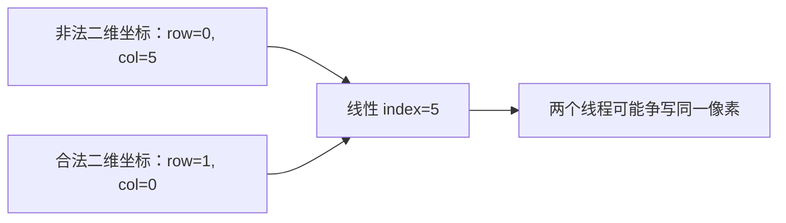

# 06 二维索引与图像网格

> 本章目标：把一维向量程序扩展成二维图像处理。能从一个像素的行列位置，推出负责它的线程、实际内存地址和合法范围，并用完整程序验证。
>
> 本章只处理自己生成的小矩阵，不要求安装图片库。重点是 CUDA 数据与线程的对应关系，不是 PNG/JPEG 解码。

## 6.0 二维其实有三套不同坐标

上一章 i 同时代表“一个线程负责的位置”和“数组偏移”，很容易让人以为以后所有编号都是同一个数。本章先明确三套对象：

| 对象 | 坐标或编号 | 谁决定它 |
|---|---|---|
| 图像 | row、col | 数据的高度、宽度和坐标约定 |
| CUDA 线程 | blockIdx、threadIdx | grid 与 block 的启动配置 |
| 数组存储 | index 或字节地址 | 行跨度、元素类型、通道布局 |

三套东西通过公式连接，但不能互换名字。例如图像一行 37 个像素，不表示 blockDim.x 必须等于 37；block 有 16 列线程，也不表示图片每行只有16个像素。

本章先用连续灰度图把公式建立起来，再把 RGB 通道和 pitch 加入模型。配套目录是 `code/06_image_grid/`：

- grid_map.cpp：CPU 上检查二维覆盖。
- invert.cu：多个尺寸的灰度反相。
- rgb_invert.cu：交错 RGB 数据的完整实验。
- pitched_scale.cu：按实际行字节跨度访问 float 矩阵。

## 6.1 从一张 5×3 的表格开始

约定 width=5 表示每行 5 列，height=3 表示一共有 3 行。写“5×3 图像”时，本章按“宽×高”，不是“行数×列数”。

```text
                 col →
           0    1    2    3    4
row 0      A    B    C    D    E
row 1      F    G    H    I    J
row 2      K    L    M    N    O
```

row、col 都从 0 开始。最右下角是 row=2、col=4，不是 row=3、col=5。

我们把列对应 x，行对应 y：

```text
x → 水平方向 → col → width
y → 垂直方向 → row → height
```

这是一种方便且常用的约定，不是坐标轴名称本身携带了图像含义。关键是全程序始终一致。

## 6.2 行优先存储：换行是解释方式，不是内存里放一个换行符

把刚才表格按行依次排列：

```text
内存元素偏移：
 0  1  2  3  4 | 5  6  7  8  9 | 10 11 12 13 14
 A  B  C  D  E | F  G  H  I  J |  K  L  M  N  O
     第0行            第1行             第2行
```

这就是本章的 row-major，行优先、紧密连续布局。竖线只帮助阅读，不占数组元素。

对 row=1、col=3 的 I：

```text
前面完整一行：1×5=5 个元素
本行向右偏移：3 个元素
index=5+3=8
```

因此：

```cpp
int index = row * width + col;
```

这里乘 width，是因为跳过一行需要跳过“每行有多少元素”。height 是行数，不是行的跨度。

### 6.2.1 反向转换

在紧密连续、每像素一个元素的布局下：

```cpp
int row = index / width;
int col = index % width;
```

例如 index=13、width=5，得到 row=2、col=3，对应 N。整数除法给完整行数，余数给当前行内偏移。

这些公式的前提包括 width>0 和 index 在合法范围内。后面如果每像素三个通道或每行有 padding，就要先明确 index 的单位，不能盲目套用。

### 6.2.2 数组偏移不总是字节偏移

```cpp
float* p;          // 假设已指向有效的 float 数组
// p + 8：跳过 8 个 float，而不是 8 个字节
```

当元素是 unsigned char 时，一个元素就是一个字节，数字容易碰巧相等；换成 float 后一个元素为4字节，错误就会暴露。所有索引公式先写清单位，比记忆某一段代码可靠。

## 6.3 dim3：用三个整数描述尺寸，不会创建三维数组

```cpp
dim3 block(4, 2);
```

这建立一个名为 block 的尺寸对象：

```text
block.x=4
block.y=2
block.z=1
```

未指定的维度默认1。这里每 block 有4×2×1=8个线程，不是4+2=6，也不是“只有两个线程”。

dim3 是 CUDA 提供的类型；小括号提供初始化值。你不必在这里先学会实现 C++ 构造函数，先能读取它的 x/y/z 字段即可。

```cpp
dim3 block(16, 16);
dim3 grid(3, 2);
invert<<<grid, block>>>(...);
```

表示6个 block，每个256个线程，共1536个逻辑线程位置。它没有分配图像内存，更不会自动生成一个16×16的 C++ 数组。

### 6.3.1 启动两个参数分别控制谁

| 配置 | 在 kernel 内对应 | 单位 |
|---|---|---|
| grid.x、grid.y | gridDim.x、gridDim.y | block 数 |
| block.x、block.y | blockDim.x、blockDim.y | 每 block 各方向线程数 |
| blockIdx.x、blockIdx.y | 当前 block 的坐标 | 从0开始的 block 编号 |
| threadIdx.x、threadIdx.y | 当前线程在本 block 的坐标 | 从0开始的局部线程编号 |

图像 width、height 是另外传入的普通参数。二者即便数值相近，也不属于同一套定义。[CUDA：多维线程与 block](https://docs.nvidia.com/cuda/cuda-programming-guide/02-basics/writing-cuda-kernels.html)

## 6.4 先确定全局行列，再计算数组下标

一维公式在两个轴上各用一次：

```cpp
int col = blockIdx.x * blockDim.x + threadIdx.x;
int row = blockIdx.y * blockDim.y + threadIdx.y;
```

然后：

```cpp
if (row < height && col < width) {
    int index = row * width + col;
    // 使用 index 访问图像
}
```

不要把第一个公式直接写成数组偏移。col 只是在本行哪一列，row 告诉你还需跳过几整行。

### 6.4.1 把四个 block 贴到 5×3 图像上

选择 block(4,2)，grid(2,2)：

```text
             col 0 1 2 3 | col 4 5 6 7
row 0             B00   |     B10
row 1             B00   |     B10
                    ----+----
row 2             B01   |     B11
row 3             B01   |     B11
```

B10 代表 blockIdx=(1,0)，不是第十个 block。图像只到 col=4、row=2；右边 col=5、6、7 和最下面 row=3 都是多出的线程位置。

手算右下 block(1,1) 的线程(0,0)：

```text
col=1×4+0=4
row=1×2+0=2
index=2×5+4=14
```

这正好负责最右下像素 O。该 block 的线程(1,0) 得到 col=5，必须跳过。

### 6.4.2 grid 每个维度都单独向上取整

```cpp
dim3 grid((width + block.x - 1) / block.x,
          (height + block.y - 1) / block.y);
```

x 方向覆盖 width，除以 block.x；y 方向覆盖 height，除以 block.y。不能把两个分母写反。

5×3、block4×2：grid2×2，共4×8=32线程位置；有效像素15，跳过17。

37×23、block16×16：grid3×2，共6×256=1536线程位置；有效像素851，跳过685。这里的685是整个覆盖矩形中无对应像素的位置总数，不是只在最后一个 warp 里。

### 6.4.3 总线程数多于像素数不是分配大小

显存只需分配有效像素的数据，不必为所有1536个线程位置都分配像素。保护条件让多出来的线程不访问数组。若你真的扩大图像缓冲到启动覆盖矩形，还必须重新定义行跨度；那已经是另一个布局，不应偷偷改变本例定义。

## 6.5 为什么只判断 index<width*height 不够

以 width=5、height=3 为例，一个本不合法的坐标 row=0、col=5：

```text
index=0×5+5=5
index<15 成立
```

但 col=5 已越过第0行右边界。index=5 恰好是合法坐标 row=1、col=0 的位置。

于是错误线程可能落入**分配范围内的错误像素**，还可能与真正负责该像素的线程重复写。内存检查工具不一定把这种逻辑映射错误报告为越过分配边界。



正确的二维任务要先分别限制 row 和 col，再线性化。尤其是卷积、邻域处理和带边界条件的算法，不能让“内存地址还在大数组里”代替“坐标合法”。

## 6.6 实验一：CPU 枚举二维线程位置

**完整文件：`grid_map.cpp`。**

```cpp
#include <iostream>

int main() {
    const int width = 5, height = 3;
    const int block_x = 4, block_y = 2;
    const int grid_x = (width + block_x - 1) / block_x;
    const int grid_y = (height + block_y - 1) / block_y;
    int valid = 0;
    int skipped = 0;
    for (int by = 0; by < grid_y; ++by) {
        for (int bx = 0; bx < grid_x; ++bx) {
            for (int ty = 0; ty < block_y; ++ty) {
                for (int tx = 0; tx < block_x; ++tx) {
                    const int col = bx * block_x + tx;
                    const int row = by * block_y + ty;
                    std::cout << "block=(" << bx << ',' << by << ") thread=("
                              << tx << ',' << ty << ") row=" << row << " col=" << col;
                    if (row < height && col < width) {
                        std::cout << " index=" << row * width + col << '\n';
                        ++valid;
                    } else {
                        std::cout << " skip\n";
                        ++skipped;
                    }
                }
            }
        }
    }
    std::cout << "CPU grid model: valid=" << valid << " skipped=" << skipped << '\n';
    return (valid == width * height && skipped == 17) ? 0 : 1;
}
```

编译：

```bash
g++ -std=c++17 -Wall -Wextra grid_map.cpp -o grid_map
./grid_map
```

应输出32条坐标记录，其中15条带 index，17条标为 skip；最后：

```text
CPU grid model: valid=15 skipped=17
```

局部示例：

```text
block=(1,0) thread=(0,0) row=0 col=4 index=4
block=(1,0) thread=(1,0) row=0 col=5 skip
block=(1,1) thread=(0,0) row=2 col=4 index=14
```

这些只是节选。该程序按 CPU 四层循环的顺序输出，不模拟 GPU block 的真实调度。

最后一行 `condition ? 0 : 1` 是条件运算符：条件为真返回0，否则返回1。这里简单确认总覆盖数；配套检查器还会确认每个合法 index 恰好出现一次，防止仅靠总数漏掉“重复一次、缺少一次”。

## 6.7 图像像素类型与反相运算

本章灰度像素用 unsigned char，值域为0—255。0表示黑，255表示白，中间值表示灰度。反相定义为：

$$
\text{output}=255-\text{input}
$$

例如0变255，64变191，255变0。这里是数值上的灰度反相，没有引入色彩空间、曝光或图像编码细节。

```cpp
output[i] = static_cast<unsigned char>(255 - input[i]);
```

表达式先按整数运算规则计算差值；结果仍在0—255范围内，再转换回像素类型。

### 6.7.1 为什么直接打印像素可能出现奇怪字符

```cpp
std::cout << output[i];
```

unsigned char 在流输出中通常按字符处理。想观察数值，转换成 int：

```cpp
std::cout << static_cast<int>(output[i]);
```

这只改变打印时选择的类型，不修改数组中的像素。

### 6.7.2 为什么生成非均匀输入

本例：

```cpp
input[row * width + col] =
    static_cast<unsigned char>((row * 17 + col * 3) % 256);
```

行和列都影响数值，且变化不同。5×3 输入是：

```text
 0  3  6  9 12
17 20 23 26 29
34 37 40 43 46
```

反相输出：

```text
255 252 249 246 243
238 235 232 229 226
221 218 215 212 209
```

若所有输入都为0，很多行列交换或复制错误可能仍得到全255，看不出哪里映射错了。测试数据需要能区分不同位置。

## 6.8 实验二：完整灰度反相与八组测试

**完整文件：`invert.cu`。**

```cpp
#include <cuda_runtime.h>
#include <cstddef>
#include <iostream>
#include <vector>

__global__ void invert(const unsigned char* input, unsigned char* output,
                       int width, int height) {
    const int col = blockIdx.x * blockDim.x + threadIdx.x;
    const int row = blockIdx.y * blockDim.y + threadIdx.y;
    if (row < height && col < width) {
        const int i = row * width + col;
        output[i] = static_cast<unsigned char>(255 - input[i]);
    }
}

bool check(cudaError_t status, const char* operation) {
    if (status == cudaSuccess) return true;
    std::cerr << operation << ": " << cudaGetErrorString(status) << '\n';
    return false;
}

bool run_case(int width, int height, dim3 block) {
    if (width < 0 || height < 0 || width > 4096 || height > 4096
        || block.x == 0 || block.y == 0 || block.z != 1) {
        std::cerr << "Invalid dimensions\n";
        return false;
    }
    if (width == 0 || height == 0) {
        std::cout << "PASS empty: " << width << " x " << height << " (no GPU work)\n";
        return true;
    }
    int device = 0;
    cudaDeviceProp properties{};
    if (!check(cudaGetDevice(&device), "device")
        || !check(cudaGetDeviceProperties(&properties, device), "properties")) return false;
    const std::size_t block_threads = static_cast<std::size_t>(block.x) * block.y;
    if (block.x > static_cast<unsigned>(properties.maxThreadsDim[0])
        || block.y > static_cast<unsigned>(properties.maxThreadsDim[1])
        || block_threads > static_cast<std::size_t>(properties.maxThreadsPerBlock)) {
        std::cerr << "Block exceeds device limits\n";
        return false;
    }
    const dim3 grid((width + block.x - 1) / block.x,
                    (height + block.y - 1) / block.y);
    if (grid.x > static_cast<unsigned>(properties.maxGridSize[0])
        || grid.y > static_cast<unsigned>(properties.maxGridSize[1])) {
        std::cerr << "Grid exceeds device limits\n";
        return false;
    }

    const std::size_t count = static_cast<std::size_t>(width) * height;
    const std::size_t bytes = count * sizeof(unsigned char);
    std::vector<unsigned char> input(count), output(count);
    for (int row = 0; row < height; ++row) {
        for (int col = 0; col < width; ++col) {
            input[row * width + col] = static_cast<unsigned char>((row * 17 + col * 3) % 256);
        }
    }

    unsigned char* d_input = nullptr;
    unsigned char* d_output = nullptr;
    bool ok = false;
    do {
        if (!check(cudaMalloc(&d_input, bytes), "allocate input")) break;
        if (!check(cudaMalloc(&d_output, bytes), "allocate output")) break;
        if (!check(cudaMemcpy(d_input, input.data(), bytes, cudaMemcpyHostToDevice), "H2D")) break;
        invert<<<grid, block>>>(d_input, d_output, width, height);
        if (!check(cudaGetLastError(), "launch")) break;
        if (!check(cudaDeviceSynchronize(), "execute")) break;
        if (!check(cudaMemcpy(output.data(), d_output, bytes, cudaMemcpyDeviceToHost), "D2H")) break;

        ok = true;
        for (std::size_t i = 0; i < count; ++i) {
            const unsigned char expected = static_cast<unsigned char>(255 - input[i]);
            if (output[i] != expected) {
                std::cerr << "mismatch row=" << i / width << " col=" << i % width
                          << " actual=" << static_cast<int>(output[i])
                          << " expected=" << static_cast<int>(expected) << '\n';
                ok = false;
                break;
            }
        }
        if (ok && width == 5 && height == 3) {
            for (int row = 0; row < height; ++row) {
                std::cout << "row=" << row << ':';
                for (int col = 0; col < width; ++col) {
                    std::cout << ' ' << static_cast<int>(output[row * width + col]);
                }
                std::cout << '\n';
            }
        }
    } while (false);

    if (d_output != nullptr && !check(cudaFree(d_output), "free output")) ok = false;
    if (d_input != nullptr && !check(cudaFree(d_input), "free input")) ok = false;
    if (ok) {
        std::cout << "PASS: " << width << " x " << height
                  << " image; block=" << block.x << 'x' << block.y
                  << " grid=" << grid.x << 'x' << grid.y << '\n';
    }
    return ok;
}

int main() {
    bool ok = true;
    if (!run_case(0, 3, dim3(4, 2))) ok = false;
    if (!run_case(5, 3, dim3(4, 2))) ok = false;
    if (!run_case(1, 1, dim3(16, 16))) ok = false;
    if (!run_case(17, 1, dim3(16, 16))) ok = false;
    if (!run_case(1, 17, dim3(16, 16))) ok = false;
    if (!run_case(16, 16, dim3(16, 16))) ok = false;
    if (!run_case(37, 23, dim3(16, 16))) ok = false;
    if (!run_case(37, 23, dim3(32, 8))) ok = false;
    return ok ? 0 : 1;
}
```

编译运行：

```bash
nvcc -std=c++17 invert.cu -o invert
./invert
```

main 依次执行8组固定测试，不读取运行参数；要增加新尺寸，在 main 中加入新的 run_case，再重新编译。不要把上一章的 `./vector_add 10 4` 参数习惯误以为所有可执行程序都会自动支持。

其中5×3会打印完整三行结果；37×23的两组应分别显示：

```text
PASS: 37 x 23 image; block=16x16 grid=3x2
PASS: 37 x 23 image; block=32x8 grid=2x3
```

这些是预期记录，不是当前编辑环境的 GPU 实测日志。

### 6.8.1 run_case 把一次完整实验包装成函数

width、height 和 block 按值传给 run_case；函数负责查询配置限制、建立输入、分配、复制、启动、检查、验证和释放，最后以 bool 返回本组是否成功。

主机 main 多次调用同一函数，不意味着几个图像测试并发。每次函数内部都等 kernel 完成并清理，返回后才开始下一次。

尺寸被限制为0—4096，这是本教学程序的范围，不是CUDA图像大小上限。它让 row*width、row*17+col*3 等 int 运算保持容易验证的范围。block 的每轴和总线程数分别检查；合法维度不代替 launch 错误检查。

### 6.8.2 主机初始化用行列，验证用线性下标

输入按 row、col 两层循环生成。验证逐一遍历 count 个元素，发现不匹配时再用 i/width、i%width 还原坐标。

两种视角指向同一份紧密连续布局。打印出错的行列，比只看到某个巨大的字节地址更容易判断是宽度、边界还是数据本身的问题。

### 6.8.3 为什么返回失败后仍继续其余测试

main 中每一行都独立调用 run_case。如果某组失败，ok 变false，不会被后来成功的测试改回true；最后整个程序返回1。

设备严重错误后，后续调用也可能继续报错。这个小程序的作用是保留失败标志，不是恢复损坏的 CUDA 上下文。做工具诊断时可以单独保留最早失败的用例，减少后续错误噪声；第7章会讲。


## 6.9 二维 block 里的 warp 怎样分组

第4章一维 block 用 threadIdx.x/32 和 %32 计算 warp 与 lane。二维时必须先得到 **block 内的线性线程编号**：

```cpp
int local_tid = threadIdx.y * blockDim.x + threadIdx.x;
int warp_in_block = local_tid / warpSize;
int lane = local_tid % warpSize;
```

x 最快变化，随后是 y。三维时再增加 z 层：

```cpp
int local_tid = threadIdx.x
              + blockDim.x * (threadIdx.y + blockDim.y * threadIdx.z);
```

这不是图像 index 的公式。local_tid 使用 block 的尺寸，图像 index 使用图像的行跨度。

### 6.9.1 block(16,16) 的前两个 warp

| warp | lane 范围 | threadIdx.y | threadIdx.x |
|---|---|---|---|
| 0 | 0—15 | 0 | 0—15 |
| 0 | 16—31 | 1 | 0—15 |
| 1 | 0—15 | 2 | 0—15 |
| 1 | 16—31 | 3 | 0—15 |

一个 warp 跨了这个 block 的两行线程。不是“每一行16线程就形成一个16线程 warp”。

对 threadIdx=(3,1)，local_tid=1×16+3=19，所以warp=0、lane=19。只看 threadIdx.x 会错误得到lane=3。

### 6.9.2 block(32,8) 的前两个 warp

warp 0 是 y=0、x=0—31；warp 1 是 y=1、x=0—31。每组刚好覆盖一行32线程。

两种配置都是256线程/block，也都是8个warp，但同一个warp映射到图像的位置不同。配置形状影响地址模式；线程总数相同不代表访存行为完全相同。

### 6.9.3 不要用图像 index 推算 lane

width=37、block(16,16)时，block(0,0)中的thread(0,1)有：

```text
local_tid=1×16+0=16 → lane=16
图像 index=1×37+0=37 → index%32=5
```

正确lane是16，不是5。数据数组的行宽与线程分组行宽来自不同对象。这是区分三套坐标的直接检验。

线程线性化与warp组织的基础规则见 [CUDA 的线程层次说明](https://docs.nvidia.com/cuda/cuda-programming-guide/02-basics/writing-cuda-kernels.html)。

## 6.10 为什么常把 x 对应连续列：合并访存的第一幅图

假设图像是紧密连续的行优先布局。相邻列的数据地址也相邻，因此让相邻lane处理相邻列，通常更有利于合并全局内存访问。

先只看地址序列，不背事务数量：

```text
连续列：index 0, 1, 2, 3, ...
隔行取：index 0, width, 2*width, 3*width, ...
```

第一种访问更集中；第二种可能散布到更多内存区域。不过不能只凭“相邻”就算出所有架构上的固定事务数，类型大小、地址对齐、有效lane与缓存等都会影响结果。

### 6.10.1 16×16 不是完全连续的一条32元素访问

width=37 时，block(0,0)的warp0访问：

```text
前16个lane：0—15
后16个lane：37—52
```

两段内部连续，中间跳过当前block没有负责的列。32×8的完整首行warp则可访问0—31。这里解释的是映射差异，不是在宣称32×8对所有图像算法必胜。

换成卷积、共享内存分块或不同寄存器需求，最优形状可能不同。正式性能比较要用后续章节的计时和分析工具。[CUDA Best Practices：全局内存合并访问](https://docs.nvidia.com/cuda/cuda-c-best-practices-guide/index.html#coalesced-access-to-global-memory)

### 6.10.2 交换 x/y 能不能写正确

可以，但你必须同时改坐标定义、grid覆盖和索引逻辑。只是交换变量名，不等于正确转置图像；转置是改变输入输出位置关系的另一种操作，第15章会单独学习。

本章采用 x→col，是为了保持连续列方向与最快变化的线程x方向一致，降低初学时的混乱。它不是一道禁止其他映射的语法规定。

## 6.11 测试二维代码，为什么特意不用正方形

如果 width=height，把错误的 row*height+col 写进去可能与正确公式数值相同，测试看不出错。block.x=block.y 时，交换两个除数也可能被掩盖。

所以我们故意同时使用：

| 用例 | 暴露什么 |
|---|---|
| 5×3，block4×2 | 宽高不同、block边长不同，能完整手算 |
| 1×1 | 最小非空图像 |
| 17×1 | 只跨x方向边界 |
| 1×17 | 只跨y方向边界 |
| 16×16，block16×16 | 整除基线 |
| 37×23，block16×16 | 两个方向都有尾部 |
| 37×23，block32×8 | 改变形状后覆盖仍正确 |
| 0×3 | 空任务不启动 |

每个有效像素既要有结果，也要由合法映射恰好覆盖一次。只检查 count 个结果“碰巧等于预期”，不一定能发现重复写同样值的竞态；CPU身份模型可以先证明映射，GPU结果与工具检查再提供其他证据。

## 6.12 阈值运算：二维分工不变，单像素函数改变

定义一个简单二值化规则：

```text
input < 128 → output=0
input ≥ 128 → output=255
```

kernel：

```cpp
__global__ void threshold(const unsigned char* input, unsigned char* output,
                          int width, int height) {
    int col = blockIdx.x * blockDim.x + threadIdx.x;
    int row = blockIdx.y * blockDim.y + threadIdx.y;
    if (row < height && col < width) {
        int i = row * width + col;
        output[i] = (input[i] < 128) ? 0 : 255;
    }
}
```

要在完整程序中换算法，除了改kernel与启动名称，还要改CPU expected。参考仍写255-input[i]，就会拿反相结果去验收阈值结果。

测试输入必须包括127和128：前者输出0，后者输出255。仅使用0和255虽然也有用，却无法发现阈值边界的<与<=差异。

这是像素独立算法，仍不需要共享内存或block屏障。不要为了“更像CUDA”而添加没有依赖需求的同步。

## 6.13 RGB：每个像素三个分量，先问布局再写索引

灰度中，一个像素一个元素；RGB中，每像素有红、绿、蓝三个分量。

本节使用交错布局：

```text
像素0           像素1           像素2
 R0 G0 B0 |      R1 G1 B1 |      R2 G2 B2 | ...
  0  1  2         3  4  5         6  7  8     ← 分量数组下标
```

对row、col，先求像素编号：

```cpp
int pixel = row * width + col;
```

然后求该像素第一个分量：

```cpp
int base = pixel * 3;
```

最后访问base+channel，channel取0、1、2。例如width=5、row=1、col=2，pixel=7，base=21；R、G、B在21、22、23。

### 6.13.1 线程数不是必须乘3

本例一个线程负责一个像素，在该线程内用一个长度3的循环处理通道。宽高仍按像素计算；数据分配则是width×height×3个unsigned char。

也可以设计每线程一个分量的方案，但那会改变分工。本章先选更直观的逐像素方案，不把“通道数”直接塞进block.z就完事。

### 6.13.2 交错布局不等于平面布局

另一个常见布局是：

```text
R0 R1 R2 ... | G0 G1 G2 ... | B0 B1 B2 ...
```

这时channel的偏移为channel×width×height，而不是pixel×3。RGBA、BGR、带行padding的图像也有各自约定。设备只看到字节，不会识别你的变量名叫rgb就自动修正布局。

## 6.14 实验三：完整交错 RGB 反相

**完整文件：`rgb_invert.cu`。**

```cpp
#include <cuda_runtime.h>
#include <cstddef>
#include <iostream>
#include <vector>

__global__ void invert_rgb(const unsigned char* input, unsigned char* output,
                           int width, int height) {
    const int col = blockIdx.x * blockDim.x + threadIdx.x;
    const int row = blockIdx.y * blockDim.y + threadIdx.y;
    if (row < height && col < width) {
        const int base = (row * width + col) * 3;
        for (int channel = 0; channel < 3; ++channel) {
            output[base + channel] = static_cast<unsigned char>(255 - input[base + channel]);
        }
    }
}

bool check(cudaError_t status, const char* operation) {
    if (status == cudaSuccess) return true;
    std::cerr << operation << ": " << cudaGetErrorString(status) << '\n';
    return false;
}

int main() {
    const int width = 5, height = 3, channels = 3;
    const std::size_t count = static_cast<std::size_t>(width) * height * channels;
    const std::size_t bytes = count * sizeof(unsigned char);
    std::vector<unsigned char> input(count), output(count);
    for (int i = 0; i < width * height; ++i) {
        input[3*i] = static_cast<unsigned char>(i);
        input[3*i+1] = static_cast<unsigned char>(50+i);
        input[3*i+2] = static_cast<unsigned char>(100+i);
    }
    unsigned char* d_input = nullptr;
    unsigned char* d_output = nullptr;
    bool ok = false;
    do {
        if (!check(cudaMalloc(&d_input, bytes), "allocate input")) break;
        if (!check(cudaMalloc(&d_output, bytes), "allocate output")) break;
        if (!check(cudaMemcpy(d_input, input.data(), bytes, cudaMemcpyHostToDevice), "H2D")) break;
        const dim3 block(4, 2), grid(2, 2);
        invert_rgb<<<grid, block>>>(d_input, d_output, width, height);
        if (!check(cudaGetLastError(), "launch")) break;
        if (!check(cudaDeviceSynchronize(), "execute")) break;
        if (!check(cudaMemcpy(output.data(), d_output, bytes, cudaMemcpyDeviceToHost), "D2H")) break;
        ok = true;
        for (std::size_t i = 0; i < count; ++i) {
            if (output[i] != static_cast<unsigned char>(255 - input[i])) {
                std::cerr << "mismatch component=" << i << '\n';
                ok = false;
                break;
            }
        }
        if (ok) {
            for (int i = 0; i < width * height; ++i) {
                std::cout << "pixel=" << i
                          << " R=" << static_cast<int>(output[3*i])
                          << " G=" << static_cast<int>(output[3*i+1])
                          << " B=" << static_cast<int>(output[3*i+2]) << '\n';
            }
        }
    } while (false);
    if (d_output != nullptr && !check(cudaFree(d_output), "free output")) ok = false;
    if (d_input != nullptr && !check(cudaFree(d_input), "free input")) ok = false;
    if (!ok) return 1;
    std::cout << "PASS RGB: 5 x 3 pixels, 45 components\n";
    return 0;
}
```

编译运行：

```bash
nvcc -std=c++17 rgb_invert.cu -o rgb_invert
./rgb_invert
```

本例固定5×3像素、45个分量，使用grid2×2、block4×2。固定grid是我们已手算的覆盖结果；若改宽高，必须重新按6.4计算grid，不能只改数据分配。

输入像素i是(R=i,G=50+i,B=100+i)，因此输出应为：

```text
pixel=0 R=255 G=205 B=155
pixel=1 R=254 G=204 B=154
...
pixel=14 R=241 G=191 B=141
PASS RGB: 5 x 3 pixels, 45 components
```

中间省略号只是书里的节选，程序会输出全部15个像素。三个通道初值不同，让R/G/B被交换的错误更容易被发现。

kernel 的channel循环属于一个线程的顺序工作，不会创建三个新CUDA线程。三个通道都由当前线程写，不需要它们之间加block同步。

## 6.15 Pitch：一行数据有多宽，与下一行隔多远可以不同

到目前为止，紧密连续的float矩阵每行width个元素，行跨度为width×sizeof(float)字节。

实际分配或外部图像库可能在每行末尾加入padding。举一个**人为假设**的例子：每行5个float，有效数据20字节，但下一行从32字节后开始：

```text
第0行： [5个float，共20字节] [padding 12字节]
第1行： [5个float，共20字节] [padding 12字节]
第2行： [5个float，共20字节] [padding 12字节]
         每行起点相隔32字节，这个跨度就是pitch
```

这里32只是讲解数字，不是cudaMallocPitch必定返回的结果。真实pitch要读API写回的值，不能写死128、256等猜测值。

### 6.15.1 地址公式分两步，单位不能混

```text
行首字节地址 = base字节地址 + row×pitch_bytes
元素字节地址 = 行首字节地址 + col×sizeof(T)
```

假设pitch=32、T=float、row=2、col=3，字节偏移为2×32+3×4=76。错误地用紧密连续公式(2×5+3)×4，会得到52，落在别处。

C++写法：

```cpp
char* row_bytes = reinterpret_cast<char*>(base) + row * pitch;
float* row_values = reinterpret_cast<float*>(row_bytes);
float value = row_values[col];
```

reinterpret_cast在这里把地址以另一种指针类型表达，**不转换或复制数组内容**。先按char的一字节单位移动到行首，再按float元素访问列。合法性依赖行首对齐及真实分配布局，不能借强制转换让任意地址变得合法。

### 6.15.2 cudaMallocPitch 有两个输出

```cpp
cudaMallocPitch(&d_input, &input_pitch, row_bytes, height);
```

它回写设备地址与实际pitch。第三个参数是有效行宽的**字节数**；第四个是行数。对于5列float，第三个参数是20，不是5。

实际申请可以包含padding，目的之一是保持合适的行地址对齐。输入和输出分别申请时，分别保留各自pitch；不能假定它们必然相等。[Runtime：cudaMallocPitch](https://docs.nvidia.com/cuda/cuda-runtime-api/group__CUDART__MEMORY.html)

### 6.15.3 为什么不能用一次紧密cudaMemcpy拷回所有有效像素

若直接从base连续复制width×height×sizeof(T)字节，源数据包含行间padding，会把padding混进结果，并漏掉后面一些有效数据。源和目标每行的起点不再使用同一个跨度。

cudaMemcpy2D允许明确描述两边的行跨度：

```cpp
cudaMemcpy2D(dst, dst_pitch,
             src, src_pitch,
             row_bytes, height,
             direction);
```

dst_pitch、src_pitch、row_bytes都是字节单位；height是行数。row_bytes不能超过任一方pitch。

```text
主机第0行 ─────────→ 设备第0行有效区
主机第1行 ─────────→ 设备第1行有效区
主机第2行 ─────────→ 设备第2行有效区
                      行间padding不复制为像素
```

本节使用普通unsigned char/float线性分配与pitch接口，不涉及cudaArray；名字里有“二维”不表示所有CUDA二维存储API可以互换。[Runtime：cudaMemcpy2D 的参数与约束](https://docs.nvidia.com/cuda/cuda-runtime-api/group__CUDART__MEMORY.html)

## 6.16 实验四：带 pitch 的 float 矩阵缩放

这一节是本章进阶部分。若前面的行列映射还不熟，可以先完成6.19的基础练习，再回来；不用为了读下一章而死记指针转换。

**完整文件：`pitched_scale.cu`。**

```cpp
#include <cuda_runtime.h>
#include <cmath>
#include <cstddef>
#include <iostream>
#include <vector>

__global__ void scale_rows(const float* input, std::size_t input_pitch,
                           float* output, std::size_t output_pitch,
                           int width, int height) {
    const int col = blockIdx.x * blockDim.x + threadIdx.x;
    const int row = blockIdx.y * blockDim.y + threadIdx.y;
    if (row < height && col < width) {
        const char* in_bytes = reinterpret_cast<const char*>(input) + row * input_pitch;
        char* out_bytes = reinterpret_cast<char*>(output) + row * output_pitch;
        const float* in_row = reinterpret_cast<const float*>(in_bytes);
        float* out_row = reinterpret_cast<float*>(out_bytes);
        out_row[col] = 2.0f * in_row[col];
    }
}

bool check(cudaError_t status, const char* operation) {
    if (status == cudaSuccess) return true;
    std::cerr << operation << ": " << cudaGetErrorString(status) << '\n';
    return false;
}

int main() {
    const int width = 5, height = 3;
    const std::size_t row_bytes = width * sizeof(float);
    std::vector<float> input(width * height), output(width * height);
    for (int row = 0; row < height; ++row) {
        for (int col = 0; col < width; ++col) input[row * width + col] = row * 10.0f + col;
    }
    float* d_input = nullptr;
    float* d_output = nullptr;
    std::size_t input_pitch = 0, output_pitch = 0;
    bool ok = false;
    do {
        if (!check(cudaMallocPitch(&d_input, &input_pitch, row_bytes, height), "allocate input")) break;
        if (!check(cudaMallocPitch(&d_output, &output_pitch, row_bytes, height), "allocate output")) break;
        std::cout << "row_bytes=" << row_bytes << " input_pitch=" << input_pitch
                  << " output_pitch=" << output_pitch << '\n';
        if (!check(cudaMemcpy2D(d_input, input_pitch, input.data(), row_bytes,
                               row_bytes, height, cudaMemcpyHostToDevice), "H2D rows")) break;
        const dim3 block(4, 2);
        const dim3 grid((width + block.x - 1) / block.x, (height + block.y - 1) / block.y);
        scale_rows<<<grid, block>>>(d_input, input_pitch, d_output, output_pitch, width, height);
        if (!check(cudaGetLastError(), "launch")) break;
        if (!check(cudaDeviceSynchronize(), "execute")) break;
        if (!check(cudaMemcpy2D(output.data(), row_bytes, d_output, output_pitch,
                               row_bytes, height, cudaMemcpyDeviceToHost), "D2H rows")) break;

        ok = true;
        for (int i = 0; i < width * height; ++i) {
            if (!std::isfinite(output[i]) || output[i] != 2.0f * input[i]) {
                std::cerr << "mismatch index=" << i << '\n';
                ok = false;
                break;
            }
        }
        if (ok) {
            for (int row = 0; row < height; ++row) {
                std::cout << "row=" << row << ':';
                for (int col = 0; col < width; ++col) std::cout << ' ' << output[row * width + col];
                std::cout << '\n';
            }
        }
    } while (false);
    if (d_output != nullptr && !check(cudaFree(d_output), "free output")) ok = false;
    if (d_input != nullptr && !check(cudaFree(d_input), "free input")) ok = false;
    if (!ok) return 1;
    std::cout << "PASS pitched scale: 5 x 3\n";
    return 0;
}
```

编译运行：

```bash
nvcc -std=c++17 pitched_scale.cu -o pitched_scale
./pitched_scale
```

第一行会显示row_bytes=20，以及真实input_pitch、output_pitch。这两个数由运行环境决定，书里不预设固定值。随后应有：

```text
row=0: 0 2 4 6 8
row=1: 20 22 24 26 28
row=2: 40 42 44 46 48
PASS pitched scale: 5 x 3
```

输入每行row*10+col，kernel乘2；所有值在此例范围内都便于精确检查。主机仍然用紧密vector存储，GPU使用实际pitch。这正好检验两边行跨度不应混用。

### 6.16.1 H2D 与 D2H 的参数对照

| 方向 | 目的地址/跨度 | 来源地址/跨度 | 每行复制 |
|---|---|---|---|
| H2D | d_input、input_pitch | input.data()、row_bytes | row_bytes，共height行 |
| D2H | output.data()、row_bytes | d_output、output_pitch | row_bytes，共height行 |

数据单位始终一致后，长参数列表就可以通过表格核对，不需要靠猜。每个cudaMemcpy2D也像其他API一样检查返回值。

### 6.16.2 kernel为什么传入两个pitch

输入行首按input_pitch走，输出行首按output_pitch走。哪怕一次实验恰巧数值相等，也不应该把一个参数删掉并假设永远相同。

本例不读取padding，也不验证padding值。padding不是额外矩阵元素，不要循环到pitch/sizeof(float)去给它分配有意义的“列编号”。

## 6.17 以后看到三维和子图时，继续按同一原则分析

三维数据可按层、行、列组织。若紧密连续，每层height×width个元素：

```text
index = (z×height + row)×width + col
```

但如果有行pitch或层跨度，就必须分别使用真实stride，而不是继续假设紧密排列。

图像中的子区域也类似。截取一个小窗口不必真的复制出一块新紧密数组；它可能只是一个起点地址，加上原图的行跨度。因此“子图宽度”不一定等于“行跨度”。

当前只需记住：**逻辑形状告诉你哪些坐标合法，stride告诉你这些坐标在内存里怎么走。**后面的矩阵、转置、卷积和张量都会反复使用这一区分。

## 6.18 从空文件设计二维 kernel 的顺序

1. 写清width、height、channels以及每个元素类型。
2. 指定布局：紧密行优先、RGB交错，还是带pitch。
3. 决定一个线程负责一个像素、一个分量，还是一块小区域。
4. 用block和thread身份算全局坐标。
5. 在访存前分别检查所有逻辑维度。
6. 把合法坐标转换成元素偏移或字节地址。
7. 写单像素计算，再补完整主机生命周期。
8. 用不对称、不能整除的小尺寸验证，再扩大规模。

这八步里，只有第4步明显是CUDA特有的。数据布局、范围和验证同样属于普通C++程序应当明确的内容；不要看到二维就先寻找一个复杂库来替你猜布局。

## 6.19 练习与验收

答案见 [附录-C-练习答案](<附录-C-练习答案.md>) 第6章。

1. 画出5×3紧密行优先矩阵，求row=2、col=3的index；再把index=8还原为行列。
2. block(4,2)、grid(2,2)有几个block、每组几个线程、总共几个线程位置？有效5×3图像会跳过多少位置？
3. 计算block(1,1)、thread(0,0)与thread(1,0)的全局行列，分别判断是否有效。
4. 用row=0、col=5证明“index<15”不能代替二维边界。为什么某些工具不会把这个地址报告为越过分配？
5. 对37×23分别使用block16×16与32×8，计算grid、总位置和跳过位置。哪个配置更快能否只靠这些数字确定？
6. block16×16中，thread(3,1)的local_tid、warp、lane分别是多少？width=37时它的图像index是否等于local_tid？
7. 把反相改成阈值128。设计包含127、128的输入，更新CPU参考并验证。
8. 解释unsigned char打印成字符的原因，写出打印数字的表达式。
9. 对width=5、row=1、col=2，求RGB交错布局的R/G/B下标。若是三个平面，G分量下标是多少？
10. 修改完整RGB例子为width=7、height=2。哪些数量和grid需要更新？只把bytes乘3但忘改kernel索引会怎样？
11. 假设float矩阵width=5、pitch=32，求row=2、col=3的字节偏移；若是紧密连续布局，偏移又是多少？
12. 在pitched_scale中解释两次cudaMemcpy2D的七个参数。为什么输入输出pitch应分别保留？
13. 故意把row*width+col改成row*height+col，只在CPU模型中观察5×3的映射。再说明为什么正方形输入可能掩盖错误，不必实际制造GPU非法访存。
14. 若一个图像视图指向原图的中间矩形，为何它的width不一定等于行stride？从“形状”和“存储”分别回答。

在教材根目录验证：

```bash
python3 scripts/verify_chapter06.py --static-only
python3 scripts/verify_chapter06.py --cpu-only
python3 scripts/verify_chapter06.py
```

静态模式不编译，CPU模式只运行编号模型，默认模式构建并验证4个完整程序。具体编译器与架构参数见配套README。没有工具链时必须记录NOT RUN，不能把人工样例当作GPU实测。

## 6.20 本章小结

把任何一个地址计算分成以下过程：

```text
线程身份
   ↓ 启动配置决定的映射
逻辑 row、col、channel
   ↓ 合法范围检查
数据布局决定的 index 或字节地址
   ↓
读取、计算、写入
```

线程分组宽度用blockDim.x，图像紧密行宽用width，带padding的行跨度用pitch；三者不必相等。能解释这一点，就已经跨过二维CUDA初学中最常见的混淆。

下一章：[07-错误检查与Compute-Sanitizer](<07-错误检查与Compute-Sanitizer.md>)。我们会故意设计小错误，学习把工具报告、代码位置、线程身份和数据范围连起来。
