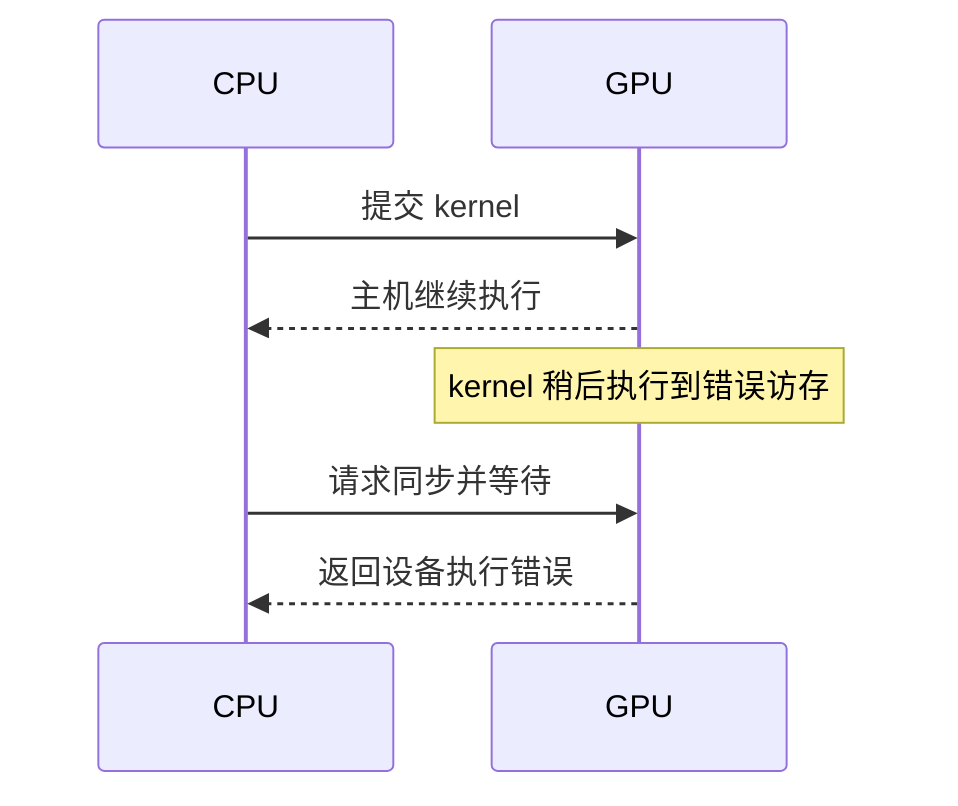
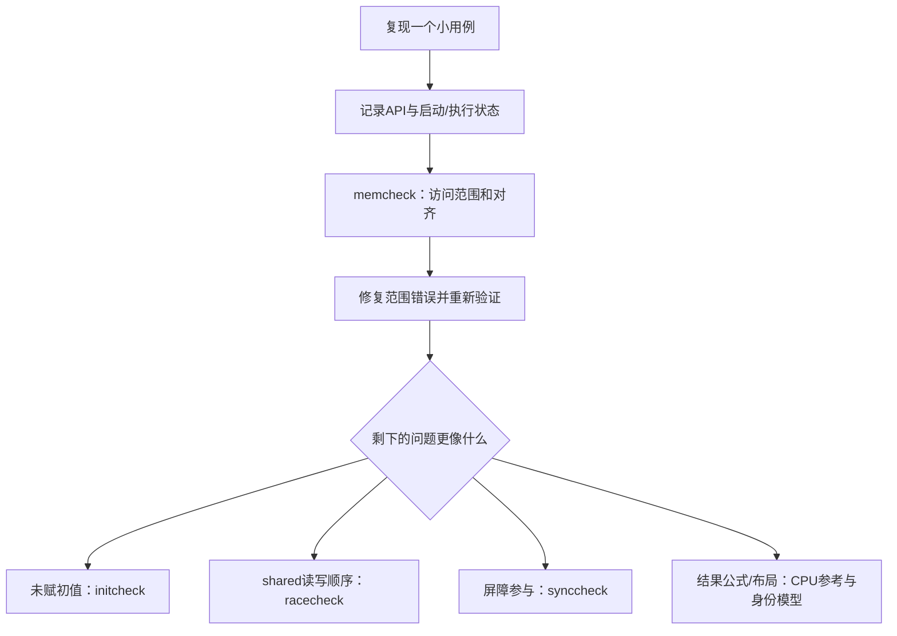

# 07 错误检查与 Compute Sanitizer

> 本章目标：面对错误时，不再反复猜测或只改参数，而是能够回答“哪一层出错、何时发现、哪个线程访问了什么、修复后怎样证明”。
>
> 本章有故意错误的教学源码。默认只运行修复版；错误版必须显式选择。只在你有权限的独立练习 GPU 上执行，不在承载重要任务的共享设备上随意测试越界或非法同步。

## 7.0 写程序与证明程序正确，是两条需要一起走的线

前两章已经逐项检查结果。为什么还需要工具？

因为“输出碰巧正确”和“执行过程合法”不是同一个结论。两个线程错误地写同一位置，最终数值可能仍符合预期；越界写也可能暂时没碰坏你正在检查的结果。

反过来，内存工具没有报错，也不说明算法答对了题。把反相公式错写成input，内存访问完全合法，数学结果仍然不对。

本章同时保留三类证据：

| 证据 | 回答什么 |
|---|---|
| API与执行状态 | CUDA 是否报告调用、启动或执行失败 |
| 工具诊断 | 当前运行是否触发工具可检测的访问、初始化、竞争或同步问题 |
| CPU参考与不变量 | 计算结果是否满足题目定义 |

三者不是互相替代的“最高级检测”。它们观察的对象不同。

## 7.1 先区分五种错误，不要看到 CUDA 就都怪显卡

### 7.1.1 编译与链接错误

例如拼错函数名、少一个分号、没有链接某个实现。程序还没有运行，不可能靠cudaDeviceSynchronize修复。先读编译器第一条真正错误及其文件位置，不要被后续连锁错误淹没。

### 7.1.2 运行环境或主机参数错误

驱动不可用、当前作业看不到GPU、请求的参数不合法、申请资源失败等。第2章的设备查询和第5章的输入检查就是第一道分界线。

### 7.1.3 kernel 启动错误

配置超过单block线程限制，或kernel所需资源不能满足等。通常在启动附近通过错误查询发现。这时要先检查配置，不要直接研究数学公式。

### 7.1.4 设备执行错误

kernel已经开始工作，随后执行了非法访问等操作。由于主机提交通常异步，错误可能在稍后的同步或其他Runtime调用中才显现。

### 7.1.5 算法与数值错误

访问合法、API全部成功，但答案错误。例如行列混用，少处理尾部，把求和写成减法，或浮点误差超出合理范围。必须用参考结果和不变量发现，不能只看cudaSuccess。

遇到问题时先分类，不必第一次就知道根因；分类的作用是缩小下一步检查范围。

## 7.2 报错的位置，不一定是造成错误的位置

想象下面时间线：



CPU在cudaDeviceSynchronize处发现错误，不代表同步函数自己生成了错误地址。同样，某些Runtime接口可能报告之前异步工作的错误。

### 7.2.1 怎样把“发现点”缩小到最近一次工作

学习和诊断阶段：

```cpp
kernel<<<grid, block>>>(args);
check(cudaGetLastError(), "launch");
check(cudaDeviceSynchronize(), "execute");
```

真实程序应在check失败后停止后续依赖该结果的操作，这里只展示两种检查的放置位置。

如果一个大程序连续启动十个kernel后才同步，定位范围就是此前一段工作；暂时在可疑kernel后加同步，有助于缩小范围。修复后再恢复合适的异步依赖，不把调试用全设备同步永久加在每次启动后当成性能方案。

### 7.2.2 检查返回值不等于错误已经恢复

打印一行日志，或读取最后错误状态，并不会修复损坏的数据、失效的分配或不可恢复的执行状态。非法访存后，继续发起工作可能看到更多连锁报错。

优先保存最早的相关错误，修复根因并用新进程重跑。不要靠不断调用cudaGetLastError或清空日志“把红字弄没”就认为修好了。

## 7.3 cudaPeekAtLastError 与 cudaGetLastError 到底差在哪

两者都用于查询Runtime维护的最后错误状态，作用与调用它们的主机线程相关；它们不是等待GPU完成的函数。

| 调用 | 查询 | 是否清除该最后错误记录 |
|---|---|---|
| cudaPeekAtLastError | 是 | 否 |
| cudaGetLastError | 是 | 是，将记录重置为cudaSuccess |
| cudaDeviceSynchronize | 等待此前设备工作并报告状态 | 不应把它理解为上一种查询的同义词 |

“清除记录”不等于“恢复所有设备错误”。它也不是跨所有CPU线程收集全部错误的全局日志系统。[CUDA Runtime 错误处理接口](https://docs.nvidia.com/cuda/cuda-runtime-api/group__CUDART__ERROR.html)

### 7.3.1 独立启动错误实验

本章debug_cases的launch-bad模式查询实际maxThreadsPerBlock，再使用比它多1的线程数启动一个空kernel。这个配置应被拒绝。

程序按顺序保存：

```text
peek → 第一次get → 第二次get → synchronize
```

预期peek和第一次get看到同一启动错误；第二次get看到记录已清除。在没有提交其他工作的这个独立进程中，后续同步可能成功，因为根本没有该次合法kernel在执行。

这说明“同步成功”不能补救忽略启动错误的问题。实验将各状态都打印出来，不把错误字符串的固定拼写当成跨版本不变的接口。

### 7.3.2 为什么不把启动检查写到很多行后

后面又执行CUDA调用，会让日志难以归属。先在启动后就检查，再在明确的完成点检查执行，把错误与最近的操作标签关联起来。多stream和多主机线程程序还需要更细粒度的归属，后续章节再展开。

## 7.4 本章的错误实验台：先看运行约定

主文件 `code/07_debug/debug_cases.cu` 支持五组模式：

| 模式前缀 | 错误版本 | 修复版本 |
|---|---|---|
| oob | 尾部线程越界写 | i<n保护 |
| init | 读取未初始化的设备输入 | 先复制输入41 |
| race | shared写后跨线程读，缺少同步 | 全block同步后读 |
| sync | 部分线程进入block屏障 | 所有线程进入同一屏障 |
| launch | 超过设备单block线程上限 | 单线程合法启动 |

编译：

```bash
nvcc -std=c++17 -lineinfo code/07_debug/debug_cases.cu -o debug_cases
```

在教材根目录运行这条命令。-lineinfo让设备机器码与源码位置保持关联，便于报告指出行号；它不是开启printf，也不等同于-G的完整设备调试构建。

正常运行：

```bash
./debug_cases
./debug_cases race-good
```

默认oob-good。选择错误模式但不加显式标志时：

```bash
./debug_cases oob-bad
```

程序会拒绝，并返回2，不执行错误kernel。真正执行错误案例必须带--run-broken，并使用相应检查工具。这个标志只是教材提供的防误触，不是隔离技术，也不替代设备使用权限。

## 7.5 完整实验源码：相同问题的坏版与好版

先定位与你正在学的模式相关的kernel和分支，不要求一次背完main。fixed是每次启动按值传入的bool；本实验同一kernel的所有线程收到相同fixed，不是每线程随机选择好坏版本。

**完整文件：`debug_cases.cu`。**

```cpp
#include <cuda_runtime.h>
#include <iostream>
#include <string>
#include <vector>

__global__ void write_indices(int* output, int n, bool fixed) {
    const int i = blockIdx.x * blockDim.x + threadIdx.x;
    if (!fixed || i < n) output[i] = i;
}

__global__ void read_value(const int* input, int* output) {
    output[0] = input[0] + 1;
}

__global__ void exchange_shared(int* output, bool fixed) {
    __shared__ volatile int values[64];
    const int tid = threadIdx.x;
    values[tid] = tid;
    if (fixed) __syncthreads();
    output[tid] = values[63 - tid];
}

__global__ void conditional_barrier(int* output, bool fixed) {
    const int tid = threadIdx.x;
    if (fixed || tid < 48) __syncthreads();
    output[tid] = tid;
}

__global__ void empty_kernel() {}

bool check(cudaError_t status, const char* operation) {
    if (status == cudaSuccess) return true;
    std::cerr << operation << ": " << cudaGetErrorString(status) << '\n';
    return false;
}

int main(int argc, char** argv) {
    const std::string mode = argc >= 2 ? argv[1] : "oob-good";
    const bool fixed = mode == "oob-good" || mode == "init-good"
                    || mode == "race-good" || mode == "sync-good" || mode == "launch-good";
    const bool broken = mode == "oob-bad" || mode == "init-bad"
                     || mode == "race-bad" || mode == "sync-bad" || mode == "launch-bad";
    if ((!fixed && !broken) || argc > 3
        || (broken && (argc != 3 || std::string(argv[2]) != "--run-broken"))
        || (fixed && argc == 3)) {
        std::cerr << "Use: debug_cases {oob,init,race,sync,launch}-{good,bad}"
                     " [--run-broken for bad only]\n";
        return 2;
    }
    if (broken) {
        std::cerr << "WARNING: intentional error; run under the selected sanitizer"
                     " on an authorized practice GPU\n";
    }
    if (mode == "launch-good" || mode == "launch-bad") {
        int device = 0;
        cudaDeviceProp properties{};
        if (!check(cudaGetDevice(&device), "device")
            || !check(cudaGetDeviceProperties(&properties, device), "properties")) return 1;
        const int threads = fixed ? 1 : properties.maxThreadsPerBlock + 1;
        empty_kernel<<<1, threads>>>();
        const cudaError_t peek = cudaPeekAtLastError();
        const cudaError_t first = cudaGetLastError();
        const cudaError_t second = cudaGetLastError();
        const cudaError_t sync = cudaDeviceSynchronize();
        std::cout << "peek: " << cudaGetErrorString(peek)
                  << "\nfirst get: " << cudaGetErrorString(first)
                  << "\nsecond get: " << cudaGetErrorString(second)
                  << "\nsynchronize: " << cudaGetErrorString(sync) << '\n';
        if (!fixed) {
            if (peek == cudaSuccess || first != peek || second != cudaSuccess) return 1;
            std::cout << "OBSERVED expected launch rejection; not a successful kernel\n";
            return 0;
        }
        if (peek != cudaSuccess || first != cudaSuccess
            || second != cudaSuccess || sync != cudaSuccess) return 1;
        std::cout << "PASS launch-good\n";
        return 0;
    }

    const bool init_case = mode == "init-good" || mode == "init-bad";
    const bool oob_case = mode == "oob-good" || mode == "oob-bad";
    const bool race_case = mode == "race-good" || mode == "race-bad";
    const int count = init_case ? 1 : (oob_case ? 33 : 64);
    std::vector<int> output(count, -1);
    int* d_output = nullptr;
    int* d_input = nullptr;
    bool ok = false;
    do {
        if (!check(cudaMalloc(&d_output, count * sizeof(int)), "allocate output")) break;
        if (init_case) {
            if (!check(cudaMalloc(&d_input, sizeof(int)), "allocate input")) break;
            if (fixed) {
                const int value = 41;
                if (!check(cudaMemcpy(d_input, &value, sizeof(int), cudaMemcpyHostToDevice),
                           "initialize input")) break;
            }
            read_value<<<1, 1>>>(d_input, d_output);
        } else if (oob_case) {
            write_indices<<<2, 32>>>(d_output, count, fixed);
        } else if (race_case) {
            exchange_shared<<<1, 64>>>(d_output, fixed);
        } else {
            conditional_barrier<<<1, 64>>>(d_output, fixed);
        }
        if (!check(cudaGetLastError(), "launch")) break;
        if (!check(cudaDeviceSynchronize(), "execute")) break;
        if (!check(cudaMemcpy(output.data(), d_output, count * sizeof(int),
                              cudaMemcpyDeviceToHost), "copy output")) break;
        ok = true;
        if (fixed) {
            for (int i = 0; i < count; ++i) {
                const int expected = init_case ? 42 : (race_case ? 63 - i : i);
                if (output[i] != expected) {
                    std::cerr << "mismatch index=" << i << " actual=" << output[i]
                              << " expected=" << expected << '\n';
                    ok = false;
                    break;
                }
            }
        }
    } while (false);
    if (d_input != nullptr && !check(cudaFree(d_input), "free input")) ok = false;
    if (d_output != nullptr && !check(cudaFree(d_output), "free output")) ok = false;
    if (!ok) return 1;
    if (fixed) {
        std::cout << "PASS " << mode << ": " << count << " checked elements\n";
    } else {
        std::cout << "BAD CASE completed; exit 0 is not correctness evidence\n";
    }
    return 0;
}
```

### 7.5.1 为什么坏版结束了也不打印PASS

对错误模式，程序即使执行返回0，也只提示“坏案例结束，不是正确性证据”。检查工具可能发现程序自己没有发现的问题，这正是本章要学习的现象。

好版则逐项比较结果，任何不匹配或API失败都使本次运行失败。不要把“脚本成功触发目标错误”与“这个坏程序正确”混淆。

### 7.5.2 为什么每个坏案例单独启动一个进程

这样一个案例的设备错误不污染后一个案例的状态，日志也更清楚。测试工具若超时或无法注入检测，需要保留报告并停止，不把反复重试同一个危险执行当成排错方法。

## 7.6 Memcheck：先检查访问是否合法

n=33，启动2个32-thread block，共64线程。坏版无边界保护：

```text
i=0—32：在33个int分配内
i=33—63：超出分配范围
```

运行坏版：

```bash
compute-sanitizer --tool memcheck --padding 32 --error-exitcode 99 ./debug_cases oob-bad --run-broken
```

再运行修复版：

```bash
compute-sanitizer --tool memcheck --padding 32 --error-exitcode 99 ./debug_cases oob-good
```

padding是在工具支持的分配周围增加检测辅助空间，帮助暴露跨相邻分配的溢出，不是给程序增加可合法写入的元素。它改变检测运行，不是代码修复。

### 7.6.1 把典型报告读成一个可计算的问题

报告通常包括这些信息：

| 报告字段 | 你要追问什么 |
|---|---|
| 非法全局写与访问字节数 | 是读还是写，类型占几字节 |
| kernel/源码文件/行号 | 哪条表达式发出访问 |
| block与thread坐标 | 代入哪一个线程身份 |
| 地址与分配范围 | 元素偏移和字节偏移是否越界 |
| 错误汇总 | 当前执行发现了多少，而非算法绝对错误数 |

假设报告指向Block 1、Thread 1，代入i=1×32+1=33；int占4字节，该线程试图从分配起点偏移132字节处写入4字节。33个int的有效字节偏移是0—131，所以它正好从末尾之后开始写。

这比只记住某个十六进制地址更有用：公式能指导修复，地址只是本次运行的定位信息。

### 7.6.2 修复在哪里

```cpp
if (i < n) output[i] = i;
```

判断应在访问之前。本实验fixed=true时执行的就是这条规则。修复后既要工具没有报告错误，也要程序验证0—32各个输出等于相应i。

Memcheck还提供错位访问、泄漏等检查，具体能力与选项要按本地版本确认。它不是识别所有“逻辑上写错位置”的证明器；第6章的行列别名错误仍需要任务语义检查。[Compute Sanitizer 官方说明](https://docs.nvidia.com/compute-sanitizer/ComputeSanitizer/index.html)

### 7.6.3 为什么设置error-exitcode

若应用自己返回0，默认工具退出策略不一定把检测到的错误作为你想要的非零退出码。--error-exitcode 99明确指定“应用成功但检测发现问题”的退出码。

若应用本身已经失败，工具可能保留其失败状态。因此验收错误案例不能只检查“退出码恰好99”，更不能只检查“任何非零都算发现越界”。还必须在日志中找到本案例预期的错误类别。

命令拼错、驱动不可用、工具无法连接目标进程也会失败；这些不是成功复现了越界。


## 7.7 Initcheck：申请到内存，不等于已经给它赋值

坏版init-bad申请一个int作为输入，却没有写入有效初值，就让GPU计算input[0]+1。

cudaMalloc不负责清零。你某次看到结果是1、42或其他值，不能用它猜“初始显存一般是什么”。读取未初始化数据本身就不符合算法所需前提。

先确认访问范围合法，再运行：

```bash
compute-sanitizer --tool memcheck --error-exitcode 99 ./debug_cases init-good
compute-sanitizer --tool initcheck --error-exitcode 99 ./debug_cases init-bad --run-broken
compute-sanitizer --tool initcheck --error-exitcode 99 ./debug_cases init-good
```

修复版先把主机整数41复制到设备，然后计算出42。初始化一个输入，不等于把所有输出都预先清零；本例输出是完整赋值，仍不需要读取旧输出。

### 7.7.1 默认检查哪一种内存

当前官方文档中initcheck默认检查device global memory；较新版本还支持用--initcheck-address-space选择shared或all。不要看到工具名就以为你安装的任何版本都默认检查全部地址空间。

本章基础实验只依赖默认global检查。若后续要检查shared初始化，先用本地工具帮助确认选项存在，再参考对应版本文档。工具升级带来的能力变化应明确标注，不把它写成所有旧Toolkit的固定功能。

### 7.7.2 初始化不是“随便填点东西”

如果算法需要x=41，cudaMemset填零虽然避免未初始化，却改变了题目输入。正确初始化要与算法约定一致。

此外，cudaMemset按字节设置值，不是给float数组逐元素赋任意浮点数。例如不能用cudaMemset(d,1,bytes)理解成“每个float都是1.0”。第8章会用字节图进一步说明。

## 7.8 Racecheck：把“别人应该写完了”改成明确依赖

先补本节最低限度的shared概念：

```cpp
__shared__ volatile int values[64];
```

这是当前block的一份共享数组，不是每线程各有64个int。64个线程各写values[tid]，随后各读values[63-tid]。

例如：

```text
线程0 写values[0]，再读values[63]
线程63写values[63]，再读values[0]
```

线程0什么时候能确定63已经写好？仅靠“在同一个block”不行，必须有正确的同步。

### 7.8.1 坏版缺的不是循环，而是写入到读取之间的屏障

坏版：

```text
各线程写自己的位置
没有同步
各线程立即读其他线程的位置
```

好版：

```text
各线程写自己的位置
全block在同一个屏障会合
各线程读取其他线程已经写好的位置
```

程序用fixed控制是否执行__syncthreads。fixed对所有线程相同，因此好版所有线程都会参加同一个屏障。

这里的volatile用于让这个很小的教学数组明确发生相应访问，**不是线程同步工具，也不代替屏障或原子操作**。不要把加volatile当成通用竞争修复方法。

### 7.8.2 运行与预期

```bash
compute-sanitizer --tool memcheck --error-exitcode 99 ./debug_cases race-good
compute-sanitizer --tool racecheck --racecheck-report all --error-exitcode 99 ./debug_cases race-bad --run-broken
compute-sanitizer --tool racecheck --racecheck-report all --error-exitcode 99 ./debug_cases race-good
```

坏版应在工具能够观察到该访问问题时报告shared访问hazard；好版应无此报告，并验证output[tid]=63-tid。

为什么特意用64线程？它跨两个warp，便于打破“同一block里大家都天然同时完成前一行”的错觉。但即使只有一个warp，也不能依靠隐式同步写这种通信代码。

### 7.8.3 RAW、WAR、WAW不是新的CUDA语法

它们是描述相关读写的缩写：

| 名称 | 按程序需求看，哪种访问需要排在前面 |
|---|---|
| RAW，读依赖先前写 | 先把新值写好，再读它 |
| WAR，写不能越过先前读 | 先用完旧值，再覆盖它 |
| WAW，两次写的冲突 | 明确哪次写应保留，或避免多个写者 |

本章交换实验主要关心“读别人写入的值之前有没有正确顺序”。工具具体列出哪类hazard、多少条，会受执行与报告聚合影响，不要求所有机器打印完全相同的条数。

### 7.8.4 Racecheck不是全局内存竞争的万能检测器

考虑：

```cpp
__global__ void bad_count(int* count) {
    *count += 1;
}
```

多个线程同时读、加一、写回可能丢失更新。它需要原子更新或其他正确算法设计，但racecheck的核心检测对象是shared memory访问hazard。对这个global计数例子，即使racecheck没报告，也不能判定没有竞争。

第13章会学习atomicAdd与直方图；现在先明白工具有覆盖边界，不要把一个工具的干净报告当成所有并发问题都不存在。

## 7.9 Synccheck：屏障需要正确的参与者

本实验sync-bad让一个64-thread block中tid<48的线程调用__syncthreads，而其余线程不参加这一条件内的屏障，随后全部线程继续执行输出。

这不是“48个线程临时组成一个小block”。它是错误使用原有64-thread block的屏障。

```text
线程0—47：   进入条件内屏障
线程48—63：  跳过该屏障
```

修复版fixed=true，所有线程到达同一个屏障。

### 7.9.1 先在工具下测试，不靠“是否卡住”判断

```bash
compute-sanitizer --tool synccheck --error-exitcode 99 ./debug_cases sync-bad --run-broken
compute-sanitizer --tool synccheck --error-exitcode 99 ./debug_cases sync-good
```

错误同步可能产生诊断、异常或停滞；不要把“没有卡住”当成正确。具体报告与支持能力取决于架构、编译结果和工具版本。配套脚本设置了运行超时；超时会记录失败，不伪装成“成功发现同步错误”。

若错误版本没有出现预期诊断，先保留工具版本、架构、编译命令和日志，确认实际编译的代码与所选模式。不要为了让测试绿灯，直接删掉对目标错误类别的检查。

### 7.9.2 同步应该围住需要协调的阶段

常见结构：

```cpp
if (thread_should_write) {
    // 写入自己负责的数据
}
__syncthreads();
if (thread_should_read) {
    // 读取已经准备好的数据
}
```

这只是结构示意，不是任何条件组合都合法：还必须确认每次读取的元素确实被某个参与线程初始化，所有需参加的线程按规定到达同一个屏障，没有提前退出破坏阶段约定。

第10章的shared分块会把这条规则用于真实算法。本章先认识错在哪里，不要求立刻独立写复杂共享内存kernel。

### 7.9.3 工具无报告也不能替你证明所有同步协议

工具可检测特定非法用法，但不覆盖任意自定义协议、跨block进度依赖或所有mask参与错误。第4章讲过的“驻留block忙等尚未运行block”还需要单独分析进度，不能指望一个普通屏障检查器解决所有死锁。

## 7.10 工具如何选：先范围合法，再分析初始化与通信



不要在明显越界还没修好时解释大量后续hazard：后面的行为可能已经没有可靠前提。

工具检测会增加开销并影响执行时序，不能把检查器下的运行时间拿来当正常性能数据。通过后还要用正常构建运行参考测试；并发错误有时在某种时序下被暂时掩盖。

### 7.10.1 什么叫“这组工具测试通过”

对好版：

1. 工具确实启动并检查了目标程序。
2. 程序以成功状态退出，并完成本例预期结果验证。
3. 工具汇总没有对应错误或hazard。
4. 没有被悄悄跳过的unsupported、连接失败或超时。

对坏版：

1. 明确执行了选定的坏模式。
2. 报告出现预期类别，例如global越界写或shared访问hazard。
3. 错误汇总为非零，并且整体运行按设计返回失败状态。
4. 不是只有“编译失败”“无设备”或“参数拼错”。

第二组叫“成功检测到故意错误”，不能称为“坏程序运行正确”。

## 7.11 学会记录一个别人能复现的错误

一次有用的记录至少包含：

```text
源文件与本次修改：
输入规模与数据构造：
编译命令：
运行命令：
GPU、驱动、Toolkit、工具版本：
第一个相关错误及其线程/block坐标：
预期结果：
实际结果：
已做的最小修复：
修复前后使用的同一测试：
```

不需要贴几万行线程打印。先保留完整日志，再挑关键段解释。截图可能方便交流，但可搜索文本更适合追踪源码位置与错误条件。

最小化时，每次只移除一种不相关功能，保证错误仍能复现。把会报错的输入顺手换成整除尺寸，虽然输出变干净，却可能只是绕过问题。

## 7.12 数值检查器也需要被测试

前两章使用固定误差或精确比较。本节把常见“绝对误差+相对误差”写成可运行CPU例子：

$$
|g-e|\leq a+r|e|
$$

g为实际结果，e为参考结果，a为绝对容差，r为相对容差。

绝对容差处理接近0的参考值；相对容差让允许差异随数值规模调整。例如参考100000，误差1所占比例约为十万分之一；参考0时不能靠除以参考值比较比例。

这只是常用比较规则，不是自动证明浮点算法稳定。a、r需要由算法、数据范围和精度要求决定；不能看到测试失败就无限放宽。

**完整文件：`numeric_check.cpp`。**

```cpp
#include <cmath>
#include <iostream>
#include <limits>

bool close(float got, float expected, float atol, float rtol) {
    if (!std::isfinite(got) || !std::isfinite(expected)
        || !std::isfinite(atol) || !std::isfinite(rtol)
        || atol < 0 || rtol < 0) return false;
    const double difference = std::fabs(static_cast<double>(got) - expected);
    const double allowed = static_cast<double>(atol)
                         + static_cast<double>(rtol) * std::fabs(static_cast<double>(expected));
    return difference <= allowed;
}

int main() {
    struct Case {
        const char* name;
        float got, expected, atol, rtol;
        bool wanted;
    };
    const float nan = std::numeric_limits<float>::quiet_NaN();
    const float inf = std::numeric_limits<float>::infinity();
    const Case cases[] = {
        {"exact", 2.0f, 2.0f, 0.0f, 0.0f, true},
        {"near_zero", 1e-7f, 0.0f, 1e-6f, 1e-5f, true},
        {"relative", 100001.0f, 100000.0f, 1e-6f, 2e-5f, true},
        {"too_far", 2.0f, 1.0f, 1e-6f, 1e-5f, false},
        {"nan", nan, 1.0f, 1e-6f, 1e-5f, false},
        {"infinity", inf, inf, 1e-6f, 1e-5f, false},
        {"negative_tolerance", 1.0f, 1.0f, -1.0f, 0.0f, false},
        {"invalid_tolerance", 1.0f, 1.0f, inf, 0.0f, false},
    };
    bool ok = true;
    for (const Case& test : cases) {
        const bool result = close(test.got, test.expected, test.atol, test.rtol);
        std::cout << test.name << ": accepted=" << result << '\n';
        if (result != test.wanted) ok = false;
    }
    if (!ok) return 1;
    std::cout << "PASS numeric checker: 8 CPU cases\n";
    return 0;
}
```

编译运行：

```bash
g++ -std=c++17 -Wall -Wextra code/07_debug/numeric_check.cpp -o numeric_check
./numeric_check
```

八组accepted结果应依次为1、1、1、0、0、0、0、0，最后显示8组CPU检查通过。这里接受的是“数值对是否满足规则”，不是说accepted=0就代表测试程序失败；后五组本来就应该被拒绝。

### 7.12.1 为什么先检查finite与容差

本例只接受有限的输入结果，拒绝NaN、无穷大和非法容差。即使got与expected都是无穷大，也返回false，这是本章针对应产生有限结果的任务所采用的规则。

如果应用有意允许无穷大，要明确定义另外的比较策略，不能删掉检查后靠NaN的比较行为碰运气。

### 7.12.2 为什么差值转成double再算

两个有限float相减，结果可能超出float范围。先把一个操作数转成double，使差值在double中计算，可避免这一比较器里不必要的float中间溢出。

这不会提高原GPU结果的精度，也不能补回已经丢失的有效数字，只是让检查器自己的计算更稳妥。

### 7.12.3 结构体与范围循环在做什么

Case把名字、输入、容差和预期真假放在一起；cases数组就是八组测试数据。范围for每次取一组，const Case&表示只读引用，不复制并修改原测试数据。

这是第1章的结构、数组和引用知识在测试中的应用，没有新增GPU概念。你也可以先手工调用close八次得到同样结果。

## 7.13 CUDA-GDB：什么时候需要单步看变量

当你已缩小到某个kernel，想看特定线程的参数、局部变量和代码位置，可使用支持该平台的CUDA-GDB。Linux练习环境中先确认命令可用：

```bash
command -v cuda-gdb
```

调试构建：

```bash
nvcc -std=c++17 -O0 -g -G code/07_debug/debug_cases.cu -o debug_cases_debug
cuda-gdb ./debug_cases_debug
```

-g提供主机调试信息，-G提供设备调试信息并通常改变设备优化行为，-O0对应主机优化控制。它们不会自动打印变量。

### 7.13.1 一次最小会话

进入调试器后输入：

```text
break write_indices
run oob-good
info cuda threads
print n
print fixed
next
print i
continue
quit
```

break设置函数断点；run带参数启动；info cuda threads查看当前CUDA线程信息；print观察当前焦点中的变量；next前进到下一源码位置；continue继续。

如果停在i初始化之前，应先执行到初始化之后再读取i。优化或源码位置映射也可能使变量不可用；不要把“调试器看不到变量”直接当成“源码中没有该变量”。

### 7.13.2 当前线程焦点会影响你看到的值

不同线程的i不同。调试器中的线程选择不是重新创建线程，而是改变你观察哪一个已有执行实例。可以通过CUDA专用线程/block/warp命令查看和选择焦点，具体语法以本地版本为准。

设备单步还涉及warp活动线程，不应把它想成只有当前lane在真空里执行、其他lane绝对不受影响。CUDA-GDB官方文档说明了这些与普通CPU单步不同的规则。[CUDA-GDB：线程观察与单步](https://docs.nvidia.com/cuda/cuda-gdb/index.html)

### 7.13.3 不默认用管理员权限解决调试问题

容器权限、作业调度、系统调试策略和支持架构都可能影响工具运行。先保存错误，核对文档和你被授予的环境权限；不要直接关闭系统安全限制或影响别人的GPU进程。

调试构建解决问题后，重新用正常优化配置编译，重跑同一组结果和工具测试。调试版能工作不自动证明正常构建没有问题。

## 7.14 旧式错误宏怎样理解，不必急着学复杂封装

全书一些尚未重写的示例使用公共CUDA_CHECK宏。它大致把API返回值交给一个函数，失败时输出表达式、文件和行号，再结束进程。

宏不是设备指令，也不会让一个本来异步的API自动变成同步。CUDA_CHECK_KERNEL恰好在宏内部组合了启动检查和同步检查，所以它才具有那两步的效果。

第5—7章采用普通check函数与显式清理，方便看见失败后的路径。不要误认为std::exit会像从main正常返回一样自动析构所有局部对象；正式资源封装将在第8章从需求逐步引入。

## 7.15 保留的小型越界文件：独立复现，不混入正常验收

为了让读者能在更短源码中观察相同问题，保留独立文件broken_oob.cu。它没有修复分支，默认拒绝执行；日常练习优先使用debug_cases的good模式。

**完整文件：`broken_oob.cu`。**

```cpp
#include <cuda_runtime.h>
#include <iostream>
#include <string>

__global__ void broken(int* data, int n) {
    const int i = blockIdx.x * blockDim.x + threadIdx.x;
    data[i] = i;  // Deliberate bug: missing i < n.
}

bool check(cudaError_t status, const char* operation) {
    if (status == cudaSuccess) return true;
    std::cerr << operation << ": " << cudaGetErrorString(status) << '\n';
    return false;
}

int main(int argc, char** argv) {
    if (argc != 2 || std::string(argv[1]) != "--run-broken") {
        std::cerr << "Refusing intentional out-of-bounds demo without --run-broken\n";
        return 2;
    }
    std::cerr << "WARNING: intentional out-of-bounds demo; use memcheck\n";
    const int n = 33;
    int* data = nullptr;
    bool ok = false;
    do {
        if (!check(cudaMalloc(&data, n * sizeof(int)), "allocate")) break;
        broken<<<2, 32>>>(data, n);
        if (!check(cudaGetLastError(), "launch")) break;
        if (!check(cudaDeviceSynchronize(), "execute")) break;
        ok = true;
    } while (false);
    if (data != nullptr && !check(cudaFree(data), "free")) ok = false;
    if (!ok) return 1;
    std::cout << "BAD CASE completed; inspect sanitizer diagnostics\n";
    return 0;
}
```

编译与受控运行：

```bash
nvcc -std=c++17 -lineinfo code/07_debug/broken_oob.cu -o broken_oob
compute-sanitizer --tool memcheck --padding 32 --error-exitcode 99 ./broken_oob --run-broken
```

它不加入默认正常CTest。修复练习请复制出另一个文件或使用debug_cases oob-good对照，不把“故意留错”的版本误当成推荐代码。

## 7.16 练习：每题都写出证据链

答案见 [附录-C-练习答案](<附录-C-练习答案.md>) 第7章。

1. 编译器报未定义函数、cudaMalloc失败、launch配置错误、设备越界、结果公式错误分别属于哪一层？
2. 为什么错误可能在cudaMemcpy或cudaDeviceSynchronize处才被发现？怎样临时缩小可疑kernel范围？
3. 在launch-bad中，peek、第一次get、第二次get分别说明什么？第二次get成功能证明kernel执行成功吗？
4. n=33、block32×2，Block1的Thread1访问哪个元素与字节范围？应把边界检查放在哪里？
5. 一个坏程序普通运行返回0、memcheck检测有错误，这两者矛盾吗？--error-exitcode 99解决什么问题？
6. init-bad为什么错误？用cudaMemset随便填1能否等价替代算法需要的41？
7. 写出shared交换实验中线程0和63的写/读位置，解释屏障为何放在写之后、读之前。
8. 为什么volatile不能替代__syncthreads？racecheck没有报告global计数竞争能证明计数安全吗？
9. sync-bad为何不是合法的48-thread block？如果把屏障移到条件外，还需检查哪些初始化与参与条件？
10. 解释绝对与相对容差各自解决什么问题。给出只用相对误差、参考为0时的困难。
11. 改numeric_check增加一组应通过和一组应失败的用例，保留NaN、无穷大和非法容差测试。
12. 用CUDA-GDB观察两个不同线程的i。为什么切换观察焦点不等于GPU只运行了你选的那一个线程？
13. 记录一次修复前后的同一输入、同一编译配置、同一工具测试；如果工具没启动成功，应写PASS、FAIL还是NOT RUN？
14. 为什么不应把故意错误模式加入默认正常CTest？“预期检测到错误”的测试需要额外核对什么？

## 7.17 实验核对与本章完成标准

按照 7.4 的命令编译 `debug_cases.cu`，先运行五个 good 模式；再按 7.6—7.9 的命令用对应的 Compute Sanitizer 工具检查修复版。CPU 数值比较实验按 7.12 单独编译运行。

准备在已授权的练习 GPU 上观察故意错误时，再按对应小节的命令选择 bad 模式并加 `--run-broken`。不要批量运行不理解的故障案例，也不要将它们加入默认正常测试。

对坏版，不只看退出码：应确认工具成功启动、报告对应错误类别、汇总确有错误；对修复版，则要求结果正确且相应工具未报告错误。若缺少工具、编译器或设备，保存原因并记录“未运行”。编译及检测命令集中在 [案例目录](code/07_debug/README.md)。

本章完成后，你应当能建立这条排错链：

```text
最小输入与明确预期
  → 检查调用/启动/执行状态
  → 选择能观察目标问题的工具
  → 报告中的线程坐标代入地址公式
  → 修复根因而非压制报错
  → 同一输入重复验证
  → 扩展边界与正常构建测试
```

下一章：[08-显存-拷贝-统一内存与RAII（尚未发布）](README.md#后续章节)。我们会在已经理解分配、地址和释放的基础上，继续讨论内存类型、复制行为和资源管理，不把类封装当成零基础必须先跨越的门槛。
