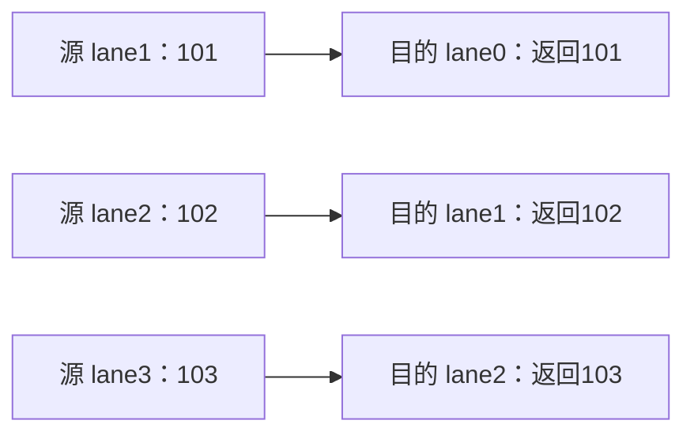
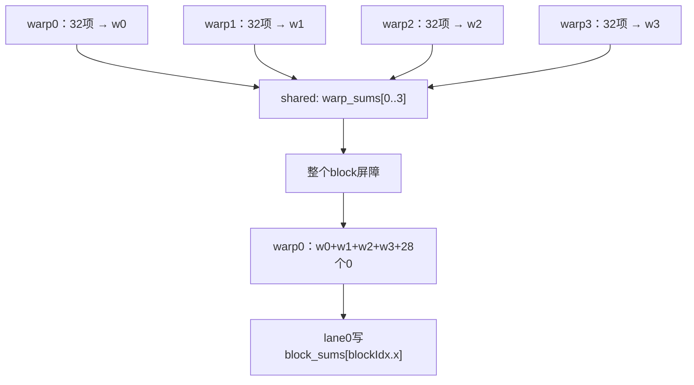

# 12 Warp 通信、掩码与分支

本章从“一个线程怎样认出自己在 warp 中的位置”开始，逐步学习 mask、vote、shuffle、warp 归约、warp 范围 shared memory 同步、两级 block 归约和分支发散。所有技巧都围绕同一个核心问题：哪些 lane 参加、每个 lane 从谁那里取值、哪些输出位置有效。

## 12.0 从 shared 通信走向 warp 通信

上一章的 block 归约反复做三件事：把线程自己的数放入 shared 数组，等待所有参与线程写好，然后读取别人留下的数。现在我们只研究同一个 warp 内的线程之间能否更直接地传递一个值。

先不要预设“更直接就一定更快”。本章的第一目标是把参与者和数据来源讲清楚。性能对比应放到正确实现之后，使用第 9、11 章的计时方法。

例如 lane 0 想得到 lane 1 当前持有的整数 101。下面是两条不同通信路线：

```text
shared 路线：
lane 1 的局部值 → shared[1] → 建立写读顺序 → lane 0 读取 shared[1]

shuffle 路线：
lane 1 在这次 shuffle 提供的值 → lane 0 的返回值
```

第二条路线没有要求你声明 shared 数组。它仍然有“谁参与这次调用、源线程提供了哪个值”的规则，不是任意线程读取任意人的任意寄存器。

本章前半段路线：

```text
线程线性编号 → warp 内 lane → 用位表示集合
            → 参与者与条件结果的区别
            → 一次 shuffle 的源与目的
            → ballot/vote → warp 归约
```

你现在只需保留三个问题：我在本 warp 的编号是什么？这一操作约定哪些线程参加？我要读的源线程是否确实在这次操作提供了值？

## 12.1 Lane：先把线程名字和数据索引分开

lane 是线程在所属 warp 内的位置编号。本章案例明确使用 32-lane warp；GPU 程序查询设备并检查 warpSize=32。lane 不是线程负责的数组索引，不是“GPU 的第几颗核心”，也不是全局唯一编号。

### 12.1.1 一维 block 的最简单情况

对一维 block，先用普通整数除法与取余：

```cpp
int warp_in_block = threadIdx.x / 32;
int lane = threadIdx.x % 32;
```

线程 35 位于本 block 的 warp 1，lane 为 3。线程 67 位于 warp 2，lane 仍为 3。每个 warp 都有自己的 lane 0、lane 1……，不会把整个 grid 排成只有一个 lane 0 的序列。

| block 内线程号 | warp_in_block | lane |
|---|---|---|
| 0 | 0 | 0 |
| 31 | 0 | 31 |
| 32 | 1 | 0 |
| 35 | 1 | 3 |
| 63 | 1 | 31 |
| 64 | 2 | 0 |

为什么先写 %32，而不一上来写 &31？前者直接表达“除以 32 的余数”。后者在这个非负整数与 2 的幂条件下也可表达相同结果，但会把还没学过的位运算挤进第一行。先理解编号，再学习简写。

### 12.1.2 二维 block 不能只看 threadIdx.x

第 6 章已经用过线程线性化。对二维 block：

```cpp
int linear = threadIdx.x + blockDim.x * threadIdx.y;
int warp_in_block = linear / 32;
int lane = linear % 32;
```

例如 blockDim=(16,3)，共 48 个线程。x=0..15、y=0 和 x=0..15、y=1 一起组成第一个完整 warp：

```text
y=0: x=0 ...15 → linear= 0 ...15 → warp0 lane= 0 ...15
y=1: x=0 ...15 → linear=16 ...31 → warp0 lane=16 ...31
y=2: x=0 ...15 → linear=32 ...47 → warp1 lane= 0 ...15
```

如果直接写 threadIdx.x%32，y=0 和 y=1 的线程会重复得到 0..15；这不是它们的真实 lane。

三维时在同样的 x 最快变化顺序上加一层：

```cpp
int linear = threadIdx.x
           + blockDim.x * (threadIdx.y + blockDim.y * threadIdx.z);
```

以上小尺寸用 int 足够；大范围全局索引仍需重新检查乘法和类型，不能把这个教学表达式当作任意规模都不会溢出的保证。

### 12.1.3 Warp 不跨 block 补齐

假设两个 block 各有 48 个线程。每块均有一个完整 warp 和一个只有 16 个实际线程位置的末尾 warp。block 0 剩下的 16 个线程不会与 block 1 的前 16 个线程合成一个 warp。

如果要给输出记录分配全局唯一的“warp 槽位”，一种适用于本例一维 grid 的编号是：

```cpp
int warps_per_block = (threads_per_block + 31) / 32;
int warp_record = blockIdx.x * warps_per_block + warp_in_block;
```

这里向上取整，所以每块预留 2 个记录位置。一共 4 份记录，对应 4 个不同 warp。

注意不要误用 global_thread/32。block 1 的第一个线程 global_thread=48，48/32=1，但记录槽 1 已属于 block 0 的尾部 warp。编号冲突会使本应独立的 warp 写到同一个位置。

这也是为什么后面的教学 GPU 程序先使用完整、固定的 32 线程 block：把身份、通信规则和尾部数据拆开学习，避免几个边界同时变化。执行模型复习见[线程、Block、Grid、Warp 与 SIMT](04-线程-Block-Grid-Warp与SIMT.md)。

### 12.1.4 三个容易混淆的“尾部”

| 情况 | 例子 | 能否认为有 32 个线程提供值 |
|---|---|---|
| 数据不足，但启动了完整 warp | n=10，block 有 32 线程，越界位置填 0 | 可以，前提是 32 个线程都继续参加调用 |
| block 本来就只有 10 个线程 | launch 的 blockDim.x=10 | 不可以，不能靠一个掩码产生 22 个线程 |
| warp 中部分线程绕过某次调用 | 32 线程里只有 lane<10 执行 shuffle | 必须按实际参与协议分析源，不能当成完整 warp |

“只有 10 个有效输入”本身不说明全掩码是否安全。必须继续追问：剩余线程是提供单位元、没有被创建，还是走了别的路径？这个区别会贯穿整个章节。

## 12.2 Mask：一个整数怎样表示一组 lane

mask 在本章是一个位集合。32 个位置，每个位置只有 0 或 1；第 k 位用来描述 lane k。它不是数组地址，也不是“参加了多少人”的计数。

### 12.2.1 从八个灯理解最低几位

先看一个只有低 8 位非零的例子：

```text
lane:     7 6 5 4 3 2 1 0
是否选中: 0 1 0 1 0 1 0 1
```

这个集合是 {0,2,4,6}。二进制常写成 01010101，十六进制是 0x55，十进制是 85。三种写法表示同一个数，不是三份不同的数据。

二进制一般把高位写在左、低位写在右，因此 lane 0 对应最右边的一位。不要照着从左往右的阅读习惯，把最左边误认为 lane 0。

0x 的意思是“后面采用十六进制表示”。每个十六进制数字对应 4 个二进制位；f 表示二进制 1111。于是：

```text
0x0000000f = 低 4 位为 1
0x000000ff = 低 8 位为 1
0xffffffff = 32 位全为 1
```

u 后缀表示无符号整数常量。本章用 0xffffffffu，避免把最高位和有符号负数语义混在一起。

### 12.2.2 左移、按位与、按位或分别做什么

std::uint32_t 表示恰好 32 位的无符号整数类型。下面的 1 从最低位开始，把它左移 lane 个位置：

```cpp
std::uint32_t bit = std::uint32_t{1} << lane;
```

lane=3 时，bit 的低 8 位为 00001000。这里 << 是整数左移；在 std::cout<<value 里，相同符号由输出流重载成插入操作。先看左右操作数是什么类型，才能判断含义。

判断成员：

```cpp
bool selected = (mask & bit) != 0;
```

& 是按位与：两边同一位置都为 1，结果该位才为 1。mask&bit 把除目标位以外的位置清掉；非零就表示目标 lane 在集合中。不要把它与 && 的逻辑“并且”混用。

添加成员：

```cpp
mask |= bit;
```

这等价于 mask=mask|bit。| 是按位或：任意一边该位为 1，结果就为 1。已经包含某个 lane 时再设置一次，不会多出一个成员。它不是“把计数再加一”。

本章所有移位位置均限定 0..31。不写 1u<<32；移位量达到类型位宽不合法。需要 32 位全 1 时直接用明确常量或类型最大值，而不是把“低 k 位公式”不加判断地套到 k=32。

### 12.2.3 集合大小与集合内排名

对于 mask=0x55，成员数量是 4，不是 85。数一共有多少个 1 的操作叫 population count，简称 popcount。GPU 内置 __popc 接受 unsigned 并返回其中 1 位的数量；本节 CPU 用循环实现以便看清规则，暂不调用 CUDA。

若想知道 lane 4 是选中成员里的第几位，可以先数它前面低编号成员的数量：

```text
选中成员：0 2 4 6
排名：    0 1 2 3

lane4 前面的低 4 位：00001111
selected：           01010101
按位与：             00000101
有两个 1 → rank=2
```

“rank=2”与“lane=4”不是同一个编号。mask 只表达成员，不会自动把 lane4 的硬件编号改成2。以后处理稀疏集合时，必须特别留意“成员排名”和“源 lane 编号”的区别。

### 12.2.4 完整 CPU 模型

code/12_warp/lane_mask_model.cpp：

```cpp
#include <bitset>
#include <cstdint>
#include <iomanip>
#include <initializer_list>
#include <iostream>

int count_bits(std::uint32_t value) {
    int count = 0;
    for (int bit = 0; bit < 32; ++bit) {
        if ((value & (std::uint32_t{1} << bit)) != 0) ++count;
    }
    return count;
}

int main() {
    constexpr int dim_x = 16, dim_y = 3, block_count = 2;
    constexpr int threads_per_block = dim_x * dim_y;
    constexpr int warps_per_block = (threads_per_block + 31) / 32;
    int records = 0;
    for (int block = 0; block < block_count; ++block) {
        for (int y = 0; y < dim_y; ++y) {
            for (int x = 0; x < dim_x; ++x) {
                const int linear = x + dim_x * y;
                const int lane = linear % 32;
                const int warp_in_block = linear / 32;
                const int global_thread = block * threads_per_block + linear;
                const int warp_record = block * warps_per_block + warp_in_block;
                if (linear < 0 || linear >= threads_per_block || lane < 0 || lane >= 32 ||
                    warp_record < 0 || warp_record >= block_count * warps_per_block) return 1;
                if (linear == 0 || linear == 15 || linear == 16 ||
                    linear == 31 || linear == 32 || linear == 47) {
                    std::cout << "block=" << block << " x=" << x << " y=" << y
                              << " linear=" << linear << " lane=" << lane
                              << " warp_in_block=" << warp_in_block
                              << " global_thread=" << global_thread
                              << " warp_record=" << warp_record << '\n';
                }
                ++records;
            }
        }
    }
    std::uint32_t selected = 0;
    for (int lane : {0, 2, 4, 6}) selected |= std::uint32_t{1} << lane;
    if (selected != 0x55u || count_bits(selected) != 4) return 1;
    std::cout << "mask=0x" << std::hex << selected << std::dec
              << " binary=" << std::bitset<32>(selected)
              << " count=" << count_bits(selected) << '\n';
    for (int lane : {0, 2, 4, 6}) {
        const std::uint32_t lower = (std::uint32_t{1} << lane) - 1u;
        const int rank = count_bits(selected & lower);
        if (rank != lane / 2) return 1;
        std::cout << "selected_lane=" << lane << " rank=" << rank << '\n';
    }
    if (records != 96) return 1;
    std::cout << "PASS CPU lane/mask model; no CUDA scheduling observed\n";
    return 0;
}
```

它没有创建 GPU 线程。前半段用普通循环生成两个 16×3 block 的身份，后半段操作一个 32 位整数集合；所有“warp”都是我们在 CPU 中计算的数学编号。

新增的 std::bitset<32>(selected) 只负责把数字显示为 32 个二进制字符。它不是 CUDA mask API。std::hex 和 std::dec 分别切换整数的十六进制/十进制显示，切回 dec 是为了让后面的 rank 不意外按十六进制打印。

从教材根目录：

```bash
g++ -std=c++17 -O2 code/12_warp/lane_mask_model.cpp -o lane_mask_model
./lane_mask_model
```

程序只打印每块的 6 个代表身份，而不是打印所有 96 行；最后仍检查确实访问了 96 个数学线程位置。例如应出现：

```text
block=0 x=0 y=1 linear=16 lane=16 warp_in_block=0 global_thread=16 warp_record=0
block=0 x=0 y=2 linear=32 lane=0 warp_in_block=1 global_thread=32 warp_record=1
block=1 x=0 y=0 linear=0 lane=0 warp_in_block=0 global_thread=48 warp_record=2
mask=0x55 binary=00000000000000000000000001010101 count=4
selected_lane=0 rank=0
selected_lane=2 rank=1
selected_lane=4 rank=2
selected_lane=6 rank=3
PASS CPU lane/mask model; no CUDA scheduling observed
```

这些是节选的预期行，不是已经执行的日志。检查身份时，重点对比 y=1 的 lane 与 block=1 的 warp_record。

### 12.2.5 小练习：先不碰 GPU

1. 把成员改成 {1,4,7}，手算最低 8 位、十六进制、成员数量和每位 rank。
2. 将 dim_x 改成 8、dim_y 改成 5，一块共有多少线程、多少 warp 记录位置？最后一个 warp 有多少实际线程位置？
3. 如果只打印 global_thread/32，会在哪些位置混淆 block 边界？

自检：第一题最低 8 位是 10010010，即 0x92，共 3 个成员；第二题为 40 线程、2 个 warp 位置，末尾 8 个线程位置。改变模型配置时，还要同步修改最后 records=96 的专用验收条件，不能只改常量后把失败当成索引公式错了。

## 12.3 参与掩码不是条件结果，也不是自动修复器

到目前为止，mask只是一个数学集合。把它交给CUDA warp原语时，就多了一份调用协议。

本章前几个GPU实验始终启动一个完整的32线程block；全部线程都执行同一组原语，使用同一个full=0xffffffffu。这个常量之所以在这些程序中合适，是因为启动形状和控制流保证了参与者，不是因为“全1总是最保险”。

### 12.3.1 先问“哪些线程应参加”，再写 mask

对同一参与集合，线程要在对应调用中使用匹配的掩码；调用者自己的位应在掩码中，掩码指定且尚未退出的其他线程也要遵守这次调用的协议。shuffle若请求另一个lane提供值，还需要那个源线程实际参与该次操作。[CUDA warp原语约束](https://docs.nvidia.com/cuda/cuda-programming-guide/05-appendices/cpp-language-extensions.html#warp-sync-intrinsic-constraints)

可以把它看成“点名名单”，但不能过度类比：一个名单不是一块数组，名单上的第3个人未必是lane3；修改名单也不会改变硬件lane编号。

本章采用便于验证的更具体约定：

```text
启动一个完整 warp
所有 32 个线程保留在同一教学流程
所有人都执行每次 shuffle
每次都传 full
先不做线程提前退出或稀疏子集通信
```

这是一条简单的正确使用路线，不是说CUDA只能处理完整warp。后面再逐步增加子集和不同控制流，届时重新检查协议。

### 12.3.2 别把“选择结果”直接当作下一次调用的参与者

例如想找“数值大于0的线程”，需要区分：

```text
全体参加判断的线程 → 每人提供 true/false → 得到满足条件的成员集合
      participants                            selected
```

参与判断的人可以比满足条件的人多。以投票作类比：所有人都参与投票，赞成者只占一部分。获得赞成者名单之后，要不要只让这些人参加另一轮通信，是第二个设计决定。

后面__ballot_sync会用于生成条件结果集合。不要认为它“关掉了”不满足条件的线程；它返回一个整数，不负责把线程从kernel里删除。

### 12.3.3 __activemask不是“这个分支所有成员”的可靠报名表

__activemask()给的是调用点的活动线程快照。它不等待其他线程到达，也不保证收集到程序逻辑上将执行同一分支的所有线程；不能在if里面随手调用它，就宣称拿到了整个条件子集。[NVIDIA warp原语文章](https://developer.nvidia.com/blog/using-cuda-warp-level-primitives/)

想象一次分批到达：这一瞬间看到的人，与最终应参加活动的人，并不一定相同。这个比喻只用来提醒“瞬时状态”与“算法需要的集合”不同，不用于预测硬件实际分几批执行。

我们不会让第一份GPU程序打印__activemask并要求结果永远等于某个固定数字。实验的正确参与关系应来自我们能证明的启动与控制流，而不是碰巧一次打印出来的活动状态。

### 12.3.4 线程私有 value不是同一份变量

每个线程都写：

```cpp
int value = 100 + lane;
```

它表示32个线程各有自己的value。lane0的值为100，lane1的值为101。相同源码名字不表示所有线程共享同一个C++对象。

shuffle中传入value，是每个线程提供自己这一份数值；返回值也各自回到调用线程。用这层理解，就不容易把shuffle误读成“在32个线程中随便挑一个全局变量”。

“寄存器通信”是常见概念描述；实际寄存器分配和可能的spill仍由编译器与资源条件决定。本章不以源码里出现一个局部变量就证明它始终占用某个固定物理寄存器。

## 12.4 一次 shuffle 到底把谁的值给了谁

先只研究一次调用，不做循环求和。输入约定为value=100+lane，全部32线程都参与。下面每个API调用都重新传入同一份原始value，不会使用前一次调用的返回值。

### 12.4.1 定点广播：让所有人读 lane0

```cpp
int from_zero = __shfl_sync(full, value, 0);
```

四个部分依次读：

|部分|含义|
|---|---|
|__shfl_sync|带参与同步的直接索引shuffle|
|full|这一次谁参与|
|value|每个参与线程自己提供的数值|
|0|在默认32宽度内，请求lane0作为源|

因此所有参与者的from_zero都是100。lane1自己的value仍是101，没有被改掉；另一个局部变量from_zero保存了返回值。

这里的0不是global数组下标，也不是设备编号。若另一个warp也执行同样代码，它读的是那个warp自己的lane0，而不是跨warp读取本例的lane0。

### 12.4.2 down表示从更大的 lane 编号取值

```cpp
int down_one = __shfl_down_sync(full, value, 1);
```

从调用者视角理解：“我请求本lane编号加1的源”。lane0读lane1的101，lane1读lane2的102。



箭头从提供数据的线程指向接收返回值的线程。不要画成“lane0的100流进lane0但变成101”，那会掩盖真正的源。

源超过默认32宽度的上边界时，down返回调用线程自己的value。因此lane31的down_one为131，而不是0，不是100，也不是访问所谓lane32。[Shuffle接口](https://docs.nvidia.com/cuda/cuda-programming-guide/05-appendices/cpp-language-extensions.html#warp-shuffle-functions)

边界返回本线程值，与“源编号在合法范围但源线程没有参与”是不同情况。后者不能按边界规则理解成返回自己或自动补0。

### 12.4.3 up和xor：换一种源编号公式

up从较小的lane编号读取：

```cpp
int up_one = __shfl_up_sync(full, value, 1);
```

lane3读lane2的102；lane0没有更低源，保留自己的100。

xor版本：

```cpp
int partner = __shfl_xor_sync(full, value, 1);
```

这一次源lane=自己的lane编号按位异或1。异或的位规则是“不同为1，相同为0”。只与最低位的1异或，就翻转奇偶位：

```text
lane0(00000) ↔ lane1(00001)
lane2(00010) ↔ lane3(00011)
lane4(00100) ↔ lane5(00101)
...
lane30 ↔ lane31
```

partner因此取得成对邻居的值。它不是“往右找下一个符合mask的线程”；如果成员很稀疏，这个物理lane编号公式仍不会自动压缩空位。

### 12.4.4 width控制编号分段，不是参与人数

直接索引shuffle的第四参数width默认为warpSize。下面明确传8：

```cpp
int group_zero = __shfl_sync(full, value, 0, 8);
```

仍由全部32线程参加，但每8个连续lane形成一个编号子段，srcLane=0指子段起点：

```text
物理 lane  0.. 7 → 子段0 → 读物理 lane 0 → 100
物理 lane  8..15 → 子段1 → 读物理 lane 8 → 108
物理 lane 16..23 → 子段2 → 读物理 lane16 → 116
物理 lane 24..31 → 子段3 → 读物理 lane24 → 124
```

width必须选合法的2的幂，这里只使用8和默认32。不能因为有10个有效输入就传width=10，也不能因为mask有4个1就以为“width自动变4”。

分清参数：

```text
mask：哪些 lane 参加这次原语
width：这类 shuffle 怎样划分源编号子段
srcLane / delta / laneMask：按哪条规则计算源
value：每位调用者提供的数据
```

第一次学习不要同时改变四个参数。先保持full和已知value，只改变一种源编号规则。

### 12.4.5 完整 GPU 路线实验

code/12_warp/shuffle_routes.cu：

```cpp
#include <cuda_runtime.h>
#include <array>
#include <iostream>

struct Record {
    int value;
    int from_zero;
    int down_one;
    int up_one;
    int partner;
    int group_zero;
};

__global__ void inspect_routes(Record* records) {
    const int lane = threadIdx.x;
    const unsigned full = 0xffffffffu;
    const int value = 100 + lane;
    Record result;
    result.value = value;
    result.from_zero = __shfl_sync(full, value, 0);
    result.down_one = __shfl_down_sync(full, value, 1);
    result.up_one = __shfl_up_sync(full, value, 1);
    result.partner = __shfl_xor_sync(full, value, 1);
    result.group_zero = __shfl_sync(full, value, 0, 8);
    records[lane] = result;
}

bool check(cudaError_t status, const char* operation) {
    if (status == cudaSuccess) return true;
    std::cerr << operation << ": " << cudaGetErrorString(status) << '\n';
    return false;
}

int main() {
    int device = -1;
    cudaDeviceProp prop = {};
    if (!check(cudaGetDevice(&device), "current device") ||
        !check(cudaGetDeviceProperties(&prop, device), "device properties")) return 1;
    if (prop.warpSize != 32 || prop.maxThreadsPerBlock < 32 || prop.maxThreadsDim[0] < 32) {
        std::cerr << "this lesson requires a complete 32-thread warp\n";
        return 1;
    }
    std::array<Record, 32> records{};
    Record* d_records = nullptr;
    const std::size_t bytes = records.size() * sizeof(Record);
    bool ok = false;
    do {
        if (!check(cudaMalloc(&d_records, bytes), "allocate records") ||
            !check(cudaMemset(d_records, 0xff, bytes), "poison records")) break;
        inspect_routes<<<1, 32>>>(d_records);
        if (!check(cudaGetLastError(), "launch") ||
            !check(cudaDeviceSynchronize(), "wait") ||
            !check(cudaMemcpy(records.data(), d_records, bytes, cudaMemcpyDeviceToHost), "D2H")) break;
        ok = true;
        for (int lane = 0; lane < 32; ++lane) {
            const Record& row = records[lane];
            const int down_source = lane < 31 ? lane + 1 : lane;
            const int up_source = lane > 0 ? lane - 1 : lane;
            const int partner_source = lane % 2 == 0 ? lane + 1 : lane - 1;
            const int group_source = (lane / 8) * 8;
            if (row.value != 100 + lane || row.from_zero != 100 ||
                row.down_one != 100 + down_source || row.up_one != 100 + up_source ||
                row.partner != 100 + partner_source || row.group_zero != 100 + group_source) {
                std::cerr << "route mismatch at lane=" << lane << '\n';
                ok = false;
                break;
            }
            std::cout << "lane=" << lane << " value=" << row.value
                      << " from_zero=" << row.from_zero << " down_one=" << row.down_one
                      << " up_one=" << row.up_one << " partner=" << row.partner
                      << " group_zero=" << row.group_zero << '\n';
        }
    } while (false);
    if (d_records && !check(cudaFree(d_records), "free records")) ok = false;
    if (!ok) return 1;
    std::cout << "PASS 32 shuffle routes; all six fields checked for every lane\n";
    return 0;
}
```

这个程序没有H2D输入复制：100+lane直接在kernel里构造。设备只分配一个输出记录数组，CPU下载后逐条核对。它不是完整数组处理模板；处理真实输入时，仍需要定义输入和传输。

### 12.4.6 逐行看新结构

Record把一个线程的原值与五种通信结果放在一条记录里。std::array<Record,32>是固定32条记录，records[lane]只由这个lane写，没有两个线程争写同一条记录。

使用records.size()*sizeof(Record)计算设备分配与拷贝字节数，不手算“6个int必然恰好24字节”后到处硬编码。结构体布局和填充由编译器决定，这里让sizeof给出所需大小。

Record result是线程自己的局部记录。六个字段全部赋值后才写出；没有读取未赋值的字段。

为什么__shfl_sync放在所有线程都会经过的位置？因为full已经把32位参与者全部列入名单。不能为了只保存lane0的结果，把通信本身也移动到if(lane==0)里面。要分开“谁参加计算”与“谁负责保存最终结果”。

主机的const Record& row是对已下载CPU记录的只读引用，不是CPU直接引用GPU显存。先执行D2H，再进入验证循环，这个顺序不能颠倒。

### 12.4.7 独立参考，不照抄所有设备表达式

CPU参考故意把xor伙伴写成奇偶判断：

```cpp
int partner_source = lane % 2 == 0 ? lane + 1 : lane - 1;
```

如果GPU端不小心把异或参数写成2，CPU参考不会因为机械复制同一个错误而自动跟着改变。其他字段分别按边界与子段公式计算，不只检查最终PASS字符串。

输出先在GPU各自写records，再由CPU按lane=0..31顺序打印。打印顺序是主机循环安排的，不是我们观察到了GPU线程按编号执行。

### 12.4.8 命令与预期行

从教材根目录：

```bash
nvcc -std=c++17 -lineinfo code/12_warp/shuffle_routes.cu -o shuffle_routes
./shuffle_routes
```

nvcc编译.cu，-std=c++17选择语言标准，-lineinfo保留设备源码行号，-o后面是输出程序名。./表示运行当前目录里的程序；不要在运行命令里重复写nvcc。需要指定架构时根据第2章设备信息添加-arch，不盲目复制别人的sm编号。

预期共32条lane记录和最终PASS。几个最有区分力的行：

```text
lane=0 value=100 from_zero=100 down_one=101 up_one=100 partner=101 group_zero=100
lane=7 value=107 from_zero=100 down_one=108 up_one=106 partner=106 group_zero=100
lane=8 value=108 from_zero=100 down_one=109 up_one=107 partner=109 group_zero=108
lane=31 value=131 from_zero=100 down_one=131 up_one=130 partner=130 group_zero=124
PASS 32 shuffle routes; all six fields checked for every lane
```

lane7的down_one来自lane8，因为该调用采用默认width=32；group_zero来自lane0，因为那个调用才显式使用width=8。两列使用不同宽度，不应强行套用同一边界。

### 12.4.9 检查与小修改

```bash
compute-sanitizer --tool memcheck ./shuffle_routes
compute-sanitizer --tool synccheck ./shuffle_routes
```

这些命令当前尚未运行。源lane是否参与也要自己按控制流核对，不能把检测工具没有报告错误当成所有shuffle协议都已获证明。

先做安全修改：把value改成1000+2*lane，同时修改独立CPU参考并预测四条输出；再把group_zero的width改成16，同时修改CPU子段公式。

不要只把launch改成<<<1,10>>>而保留全套32-lane假设。那不是同一实验的更小数据集；它改变了线程参与形状。后面会提供专门处理有效数据尾部的方法。

### 12.4.10 名字里有sync，不代表建立了所有内存顺序

shuffle传递的是各线程在调用处提供的值，不负责让任意shared/global写入都对别人建立所需顺序。用shuffle交换一个int，与先写shared再读别人的shared，是两类通信路径；后者仍应使用合适的__syncwarp或block同步。

不要把“带_sync的warp通信函数”和“通用内存屏障”画等号。本章后面的shared对照将专门展示这一区别；当前路线实验没有shared数组，所以不需要为它额外引入shared写读屏障。

## 12.5 Ballot 与 vote：先确定谁投票，再解释投票结果

这次处理真实输入数组，长度n=37，启动一个64线程block，即两个完整warp。

```text
warp0：i= 0..31，全有输入
warp1：i=32..36，有5项输入；i=37..63，没有输入但线程仍参加投票
```

任务是统计每个warp有多少有效输入、多少正数，判断有没有正数，以及“所有有效输入是否都为正数”。先不移动或压缩数组，只生成容易逐项检查的投票记录。

### 12.5.1 同一warp中，每个线程提供自己的布尔值

输入生成规则为i%7-3，循环出现[-3,-2,-1,0,1,2,3]。kernel先定义：

```cpp
bool valid = i < n;
int value = valid ? input[i] : 0;
bool positive = valid && value > 0;
```

valid只描述当前线程是否有输入元素。条件运算符只有选中的分支会被求值；valid=false时不会读取input[i]。给value填0是本实验的方便选择，positive仍显式带valid，不把“线程存在”和“数据有效”混为一谈。

后面所有64线程都继续执行投票；没有if(i>=n)return。

### 12.5.2 __ballot_sync返回位集合

```cpp
unsigned valid_mask = __ballot_sync(full, valid);
unsigned positive_mask = __ballot_sync(full, positive);
```

full表示本warp的32个线程都参加本次判断。返回集合分别记录谁有有效输入、谁的输入为正数。每个参与线程都取得本warp相同的集合结果，不只lane0得到。

对第二个warp：

```text
物理 lane： 0  1  2  3  4  5 ...31
全局 i：   32 33 34 35 36 37 ...63
输入值：    1  2  3 -3 -2 -- ...--
valid：     1  1  1  1  1  0 ... 0
positive：  1  1  1  0  0  0 ... 0

valid_mask    = 0x1f
positive_mask = 0x07（输出时也可显示为0x7）
```

mask最低位对应本warp的lane0，也就是本例i=32。它不是整个输入数组的第0项；不能试图让一个32位返回值同时记录整个64线程block。

### 12.5.3 __popc计数，__any_sync和__all_sync回答不同问题

```cpp
int count = __popc(positive_mask);
int any = __any_sync(full, positive) != 0;
int all_valid = __all_sync(full, !valid || value > 0) != 0;
```

count回答“有几项正数”，any回答“是否至少一项正数”。一项与十二项都使any为1，不能用any替代数量。

all_valid中的!valid||value>0，是“没有输入的线程不给有效输入条件制造反例；有输入的线程必须提供正值”。对任意参与线程：

|valid|value>0|!valid 或 value>0|解释|
|---|---|---|---|
|false|无关|true|不属于需检查的数据范围|
|true|false|false|发现有效非正数，否定全为正|
|true|true|true|这个有效输入符合要求|

若改成__all_sync(full,positive)，尾部的无效线程会提供false。即使所有有效输入都为正，也不能通过这个不同问题的检查。

如果一整warp都没有有效输入，上述all_valid会为true，这是“没有反例”的逻辑约定。如果你的应用要求“至少有一个有效输入，且全部为正”，还需与valid_count>0合并。这个语义要由任务定义，不由API替你决定。[Warp vote接口](https://docs.nvidia.com/cuda/cuda-programming-guide/05-appendices/cpp-language-extensions.html#warp-vote-functions)

### 12.5.4 正数在线程集合中的排名

对于正数线程，用比自己lane更低的成员数量作为rank：

```cpp
unsigned lower_lanes = (1u << lane) - 1u;
int positive_rank = positive ? __popc(positive_mask & lower_lanes) : -1;
```

lane=0时lower_lanes=0，没有更低的lane；lane=31时仅左移31位，不会发生左移32位的问题。所有lane均处于0..31。

第二个warp的前三个输入是正数，rank分别0、1、2；后两项负数和其他无效线程记-1。这里的-1是程序定义的“不属于正数集合”标记，不是CUDA内置返回约定。

rank以后能帮助把稀疏满足条件的值紧凑地写到某个局部数组，但这里只计算排名。不能仅凭rank就直接写全局输出[rank]：不同warp都有自己的rank0，会互相冲突。跨warp分配输出区间需要后续的原子或scan等方案。

### 12.5.5 完整程序

code/12_warp/vote_records.cu：

```cpp
#include <cuda_runtime.h>
#include <array>
#include <iostream>

struct VoteRecord {
    unsigned valid_mask;
    unsigned positive_mask;
    int valid_count;
    int positive_count;
    int any_positive;
    int all_valid_positive;
    int positive_rank;
};

__global__ void inspect_votes(const int* input, VoteRecord* records, int n) {
    const int i = threadIdx.x;
    const int lane = i % 32;
    const bool valid = i < n;
    const int value = valid ? input[i] : 0;
    const bool positive = valid && value > 0;
    const unsigned full = 0xffffffffu;
    VoteRecord result;
    result.valid_mask = __ballot_sync(full, valid);
    result.positive_mask = __ballot_sync(full, positive);
    result.valid_count = __popc(result.valid_mask);
    result.positive_count = __popc(result.positive_mask);
    result.any_positive = __any_sync(full, positive) != 0;
    result.all_valid_positive = __all_sync(full, !valid || value > 0) != 0;
    const unsigned lower_lanes = (1u << lane) - 1u;
    result.positive_rank = positive ? __popc(result.positive_mask & lower_lanes) : -1;
    records[i] = result;
}

bool check(cudaError_t status, const char* operation) {
    if (status == cudaSuccess) return true;
    std::cerr << operation << ": " << cudaGetErrorString(status) << '\n';
    return false;
}

int main() {
    constexpr int n = 37, threads = 64;
    std::array<int, n> input{};
    for (int i = 0; i < n; ++i) input[i] = i % 7 - 3;
    std::array<VoteRecord, threads> records{};
    int device = -1;
    cudaDeviceProp prop = {};
    if (!check(cudaGetDevice(&device), "current device") ||
        !check(cudaGetDeviceProperties(&prop, device), "device properties")) return 1;
    if (prop.warpSize != 32 || prop.maxThreadsPerBlock < threads || prop.maxThreadsDim[0] < threads) {
        std::cerr << "this lesson requires two complete 32-thread warps\n";
        return 1;
    }
    int* d_input = nullptr;
    VoteRecord* d_records = nullptr;
    bool ok = false;
    do {
        if (!check(cudaMalloc(&d_input, input.size() * sizeof(int)), "allocate input") ||
            !check(cudaMalloc(&d_records, records.size() * sizeof(VoteRecord)), "allocate records") ||
            !check(cudaMemcpy(d_input, input.data(), input.size() * sizeof(int), cudaMemcpyHostToDevice), "H2D") ||
            !check(cudaMemset(d_records, 0xff, records.size() * sizeof(VoteRecord)), "poison records")) break;
        inspect_votes<<<1, threads>>>(d_input, d_records, n);
        if (!check(cudaGetLastError(), "launch") ||
            !check(cudaDeviceSynchronize(), "wait") ||
            !check(cudaMemcpy(records.data(), d_records, records.size() * sizeof(VoteRecord), cudaMemcpyDeviceToHost), "D2H")) break;
        ok = true;
        for (int i = 0; i < threads; ++i) {
            const int warp = i / 32, lane = i % 32, base = warp * 32;
            unsigned valid_mask = 0, positive_mask = 0;
            int valid_count = 0, positive_count = 0, rank = 0;
            for (int source_lane = 0; source_lane < 32; ++source_lane) {
                const int index = base + source_lane;
                if (index >= n) continue;
                valid_mask |= 1u << source_lane;
                ++valid_count;
                if (input[index] > 0) {
                    positive_mask |= 1u << source_lane;
                    ++positive_count;
                    if (source_lane < lane) ++rank;
                }
            }
            if (i >= n || input[i] <= 0) rank = -1;
            const VoteRecord& row = records[i];
            if (row.valid_mask != valid_mask || row.positive_mask != positive_mask ||
                row.valid_count != valid_count || row.positive_count != positive_count ||
                row.any_positive != (positive_count > 0) ||
                row.all_valid_positive != (positive_count == valid_count) ||
                row.positive_rank != rank) {
                std::cerr << "vote mismatch at i=" << i << '\n';
                ok = false;
                break;
            }
            if (lane == 0) {
                std::cout << "warp=" << warp << " valid_mask=0x" << std::hex << row.valid_mask
                          << " positive_mask=0x" << row.positive_mask << std::dec
                          << " valid_count=" << row.valid_count << " positive_count=" << row.positive_count
                          << " any=" << row.any_positive << " all_valid=" << row.all_valid_positive << '\n';
            }
            if (warp == 1 && lane < 5) {
                std::cout << "i=" << i << " value=" << input[i] << " positive_rank=" << row.positive_rank << '\n';
            }
        }
    } while (false);
    if (d_records && !check(cudaFree(d_records), "free records")) ok = false;
    if (d_input && !check(cudaFree(d_input), "free input")) ok = false;
    if (!ok) return 1;
    std::cout << "PASS 64 vote records checked; 37 valid inputs, two complete warps\n";
    return 0;
}
```

这份代码为64个线程各留一条输出记录，不只分配37条。输入容量取决于n，输出容量取决于本实验要保存多少线程记录；两个数组长度由不同任务要求决定。

### 12.5.6 为什么检查64条，而只打印两份集合和五个rank

同一warp的每个参与线程都应取得匹配的投票结果。只查看lane0会漏掉其他线程的写回错误，所以CPU逐一验证64条记录的7个字段。

CPU参考直接遍历同一warp的原始输入，用普通if与循环构建位集合、数量和排名。它没有调用GPU原语，也不靠输出自己的统计再与自己比较。

随后只在lane0打印集合汇总，并额外展示第二个warp前5项的rank。这样终端输出容易读，但验证范围没有缩成只有打印的几行。

主机中这行不会访问input[37]之后的位置：

```cpp
if (i >= n || input[i] <= 0) rank = -1;
```

因为逻辑或||具有短路规则：i>=n成立时，不求值右侧input[i]。若误换成按位或|，就失去这个保护；运算符的区别在真实边界访问中很重要。

### 12.5.7 运行命令和可手算的输出

```bash
nvcc -std=c++17 -lineinfo code/12_warp/vote_records.cu -o vote_records
./vote_records
```

预期完整输出：

```text
warp=0 valid_mask=0xffffffff positive_mask=0xe1c3870 valid_count=32 positive_count=12 any=1 all_valid=0
warp=1 valid_mask=0x1f positive_mask=0x7 valid_count=5 positive_count=3 any=1 all_valid=0
i=32 value=1 positive_rank=0
i=33 value=2 positive_rank=1
i=34 value=3 positive_rank=2
i=35 value=-3 positive_rank=-1
i=36 value=-2 positive_rank=-1
PASS 64 vote records checked; 37 valid inputs, two complete warps
```

第一warp的正数lane集合为{4,5,6,11,12,13,18,19,20,25,26,27}，共12位。可以从最低位分组转成十六进制，独立核对0x0e1c3870；显示时省略最前面的0仍是同一个数。

### 12.5.8 可控修改与检查

先把input[i]统一改为1，并手算结果。第一warp正数数量应32；第二warp应5，两个warp的all_valid都应1。第二warp仍不是32个有效输入，positive_mask也仍只含5位。

再把input[i]统一改为-1：正数数量0，any=0，all_valid=0；所有positive_rank=-1。

保持本例固定n=37与threads=64时，上述两个修改不需要改变输出记录容量。若进一步改n，需要同时审查输入数组、线程数、打印input[i]的条件和CPU参考，不把一次局部修改误当作已支持任意参数。

```bash
compute-sanitizer --tool memcheck ./vote_records
compute-sanitizer --tool synccheck ./vote_records
```

以上仍是待运行命令。ballot/vote的集合结果不意味着任意shared/global通信获得了内存屏障；本例全体先读取只读输入，再写各自输出，不依靠这样的错误假设。


## 12.6 完整 Warp 归约：每轮谁调用 shuffle，谁执行加法

上一章的 shared 归约用 stride=16、8、4、2、1 逐轮缩小有效前缀。现在用同样的32项求和任务，把“从另一个lane取值”改为shuffle。

输入是lane0..31分别持有1..32，总和为：

```text
(1 + 32) × 32 ÷ 2 = 528
```

这里的乘法公式只是这组连续整数的手算参考；真实输入仍应由CPU逐项求参考。

### 12.6.1 一轮必须拆成“通信”和“合并”

安全的教学写法是：

```cpp
const int received = __shfl_down_sync(full, value, offset);
if (lane < offset) {
    value += received;
}
```

第一行由full列出的全部32个线程执行。第二行只有当前仍负责有效部分和的低编号lane执行加法。

不要写成：

```cpp
if (lane < offset) {
    value += __shfl_down_sync(full, value, offset); // full与实际调用者不一致
}
```

后者把完整参与掩码交给原语，却让部分被点名的线程绕过调用。if只控制加法还不够精确；必须看原语本身位于分支内还是分支外。

这也解释了“参加通信”与“拥有有效归约结果”不同。lane31仍参加每轮shuffle，但第一轮起就不再更新自己的value；它的值不是最终和。最终只有lane0持有全部32项之和。

### 12.6.2 第1轮：低16位读取高16位

offset=16时：

|执行加法的lane|原value|读取源lane|received|新value|
|---:|---:|---:|---:|---:|
|0|1|16|17|18|
|1|2|17|18|20|
|…|…|…|…|…|
|15|16|31|32|48|

lane16..31仍调用shuffle，但if为假，不改变自己的value。第一轮以后，lane0..15各代表相隔16的两项。

下一轮offset=8，lane0读取lane8当前的34，所以lane0从18变为52。它读的不是lane8最初的9，而是lane8在上一轮形成的部分和9+25。

这一点与shared树完全相同：每轮的源是上一轮结果。shuffle避免了显式shared数组，但没有取消阶段依赖。

### 12.6.3 五轮后的有效结果范围

每轮以后只有更短前缀值得继续解释为这一棵down树的归约状态：

|完成轮次|offset|仍会在下一轮更新的lane范围|lane0当前值|
|---:|---:|---|---:|
|0|尚未合并|0..31|1|
|1|16|0..15|18|
|2|8|0..7|52|
|3|4|0..3|120|
|4|2|0..1|256|
|5|1|0|528|

表中“有效”不是说其他线程退出或不存在。它只说明哪些局部value继续代表这棵归约树的有用部分和。

lane1最后停在272，并不等于“除lane0以外全部数之和”；lane31仍是32。不要把32个最终局部变量再求一次和。

### 12.6.4 完整逐轮记录程序

code/12_warp/warp_reduce_trace.cu：

```cpp
#include <cuda_runtime.h>
#include <array>
#include <iostream>
#include <vector>

constexpr int lanes = 32;
constexpr int rounds = 6;

__global__ void trace_full_warp(int* trace) {
    const int lane = threadIdx.x;
    const unsigned full = 0xffffffffu;
    int value = lane + 1;
    trace[lane] = value;
    int round = 1;
    for (int offset = 16; offset > 0; offset /= 2) {
        const int received = __shfl_down_sync(full, value, offset);
        if (lane < offset) value += received;
        trace[round * lanes + lane] = value;
        ++round;
    }
}

bool check(cudaError_t status, const char* operation) {
    if (status == cudaSuccess) return true;
    std::cerr << operation << ": " << cudaGetErrorString(status) << '\n';
    return false;
}

int main() {
    int device = -1;
    cudaDeviceProp prop = {};
    if (!check(cudaGetDevice(&device), "current device") ||
        !check(cudaGetDeviceProperties(&prop, device), "device properties")) return 1;
    if (prop.warpSize != lanes || prop.maxThreadsPerBlock < lanes ||
        prop.maxThreadsDim[0] < lanes) {
        std::cerr << "this lesson requires one complete 32-thread warp\n";
        return 1;
    }
    std::array<int, rounds * lanes> trace{};
    int* d_trace = nullptr;
    bool ok = false;
    do {
        if (!check(cudaMalloc(&d_trace, trace.size() * sizeof(int)), "allocate trace") ||
            !check(cudaMemset(d_trace, 0xff, trace.size() * sizeof(int)), "poison trace")) break;
        trace_full_warp<<<1, lanes>>>(d_trace);
        if (!check(cudaGetLastError(), "launch") ||
            !check(cudaDeviceSynchronize(), "wait") ||
            !check(cudaMemcpy(trace.data(), d_trace, trace.size() * sizeof(int),
                              cudaMemcpyDeviceToHost), "D2H")) break;
        std::array<int, lanes> current{}, next{};
        for (int lane = 0; lane < lanes; ++lane) current[lane] = lane + 1;
        ok = true;
        for (int round = 0; round < rounds; ++round) {
            for (int lane = 0; lane < lanes; ++lane) {
                if (trace[round * lanes + lane] != current[lane]) {
                    std::cerr << "trace mismatch round=" << round << " lane=" << lane
                              << " actual=" << trace[round * lanes + lane]
                              << " expected=" << current[lane] << '\n';
                    ok = false;
                    break;
                }
            }
            if (!ok || round == rounds - 1) break;
            const int offset = 16 >> round;
            for (int lane = 0; lane < lanes; ++lane) {
                next[lane] = lane < offset ? current[lane] + current[lane + offset]
                                           : current[lane];
            }
            current = next;
        }
        if (!ok) break;
        const std::array<int, rounds> offsets = {0, 16, 8, 4, 2, 1};
        for (int round = 0; round < rounds; ++round) {
            std::cout << "round=" << round << " offset=" << offsets[round]
                      << " lane0=" << trace[round * lanes]
                      << " lane1=" << trace[round * lanes + 1]
                      << " lane31=" << trace[round * lanes + 31] << '\n';
        }
        if (trace[(rounds - 1) * lanes] != 528) {
            std::cerr << "lane 0 did not receive the full sum\n";
            ok = false;
        }
    } while (false);
    if (d_trace && !check(cudaFree(d_trace), "free trace")) ok = false;
    if (!ok) return 1;
    std::cout << "PASS full-warp reduction trace; lane0 sum=528\n";
    return 0;
}
```

GPU程序保存6×32个整数：初始状态一行，加上5轮之后各一行。每个线程写自己的列；CPU下载后用普通数组快照独立模拟每一轮并核对全部192个值。

CPU模型必须使用current和next两份数组。若按lane从0向31就地修改current，后续位置是否会读到本轮新值取决于遍历方向，模型就不再表达“同一轮都读上一轮快照”。

### 12.6.5 为什么记录全体，而只打印三列

主机打印lane0、lane1、lane31：

```text
round=0 offset=0 lane0=1 lane1=2 lane31=32
round=1 offset=16 lane0=18 lane1=20 lane31=32
round=2 offset=8 lane0=52 lane1=56 lane31=32
round=3 offset=4 lane0=120 lane1=128 lane31=32
round=4 offset=2 lane0=256 lane1=272 lane31=32
round=5 offset=1 lane0=528 lane1=272 lane31=32
PASS full-warp reduction trace; lane0 sum=528
```

这些是预期行，不是实机日志。lane31保持32，能帮助确认条件只包住加法，没有让它退出通信。真正验证仍覆盖全部lane，打印三列只是为了终端可读。

### 12.6.6 命令逐项读

```bash
nvcc -std=c++17 -lineinfo code/12_warp/warp_reduce_trace.cu -o warp_reduce_trace
./warp_reduce_trace
```

- nvcc：驱动CUDA源文件的编译与链接。
- -std=c++17：让主机与CUDA C++源码按C++17语言标准处理。
- -lineinfo：保留设备端源码行号，方便后续检查工具定位；它不会自动打印变量。
- code/...cu：输入源文件。
- -o warp_reduce_trace：把最终可执行文件命名为warp_reduce_trace。
- ./warp_reduce_trace：运行刚生成的程序，./表示当前目录。

不要把第二行写成nvcc ./warp_reduce_trace；运行程序与重新编译是两个动作。

### 12.6.7 Shuffle归约何时需要再广播

down树完成后，只有lane0被本节接口定义为拥有完整结果。若全部lane都需要528，可以再做一次：

```cpp
value = __shfl_sync(full, value, 0);
```

此时每位都从lane0读取。这个广播是额外操作，不能因为所有线程都执行了前面的归约循环，就声称全部局部value自动相同。

另一种xor蝴蝶合并可以让每个lane得到整体结果，但它有不同的数据流与接口目标。先确认最终结果需要由谁使用，再选择算法；“所有lane都有结果”并非免费，也不总是必要。

## 12.7 数据尾部：用完整 Warp 提供单位元

实际数组长度经常不是32的倍数。这里使用最直观的策略：每个block固定启动32个线程，即一个完整warp；没有对应输入的线程提供加法单位元0，但仍参加每一次shuffle。

例如n=35：

```text
block0：i=0..31，32个有效输入
block1：i=32..34，3个有效输入；lane3..31提供0
两个block都实际启动32个线程，都使用full参与通信
```

这不是把输入数组真的扩展到64项，也不会读input[35]之后的位置。

### 12.7.1 边界判断必须在读取前

kernel中的加载：

```cpp
const int i = blockIdx.x * 32 + lane;
const float value = i < n ? input[i] : 0.0f;
```

条件运算符只求值被选中的分支。i>=n的线程得到0，不读取越界地址。随后全部线程调用warp_sum_full(value)。

不要先写float value=input[i]，再在i>=n时改成0。越界读取已经发生，后来的赋值不能把它撤销。

### 12.7.2 单位元与合并运算必须匹配

0适合求和，因为x+0=x。若任务改成全负数组最大值，0会错误地战胜所有输入；应重新选最大值的单位元与非有限数策略。第11章已经展示负无穷最大值填充。

“无效线程提供什么”属于算法定义，不是warp原语自动决定。shuffle只移动你提供的value，不知道哪个值是填充项。

### 12.7.3 一 Warp 一 Block 的教学布局

本节kernel使用：

```cpp
sum_one_warp_per_block<<<partial_count, 32>>>(...);
```

其中partial_count=ceil(n/32)。每个block恰好一个完整warp，lane0写自己的partial[blockIdx.x]。

这种布局不是追求最终性能的通用结论。它的好处是：

- block边界就是warp边界，身份容易验证；
- 所有block都完整启动32线程；
- 每个warp输出恰好一项，没有同block多个warp的第二级合并；
- 可以集中理解尾部数据，而不同时加入shared同步。

后面会把多个warp放入一个block，再讨论它们之间怎样合并。

### 12.7.4 升级后的完整 warp_sum 程序

code/12_warp/warp_sum.cu：

```cpp
#include <cuda_runtime.h>
#include <cmath>
#include <iostream>
#include <limits>
#include <vector>

__device__ float warp_sum_full(float value) {
    const unsigned full = 0xffffffffu;
    for (int offset = 16; offset > 0; offset /= 2) {
        const float received = __shfl_down_sync(full, value, offset);
        const int lane = threadIdx.x % 32;
        if (lane < offset) value += received;
    }
    return value;
}

__global__ void sum_one_warp_per_block(const float* input, float* partial, int n) {
    const int lane = threadIdx.x;
    const int i = blockIdx.x * 32 + lane;
    const float value = i < n ? input[i] : 0.0f;
    const float sum = warp_sum_full(value);
    if (lane == 0) partial[blockIdx.x] = sum;
}

bool check(cudaError_t status, const char* operation) {
    if (status == cudaSuccess) return true;
    std::cerr << operation << ": " << cudaGetErrorString(status) << '\n';
    return false;
}

bool parse_decimal(const char* text, int minimum, int maximum, int& result) {
    if (!text || !*text) return false;
    int value = 0;
    for (const char* p = text; *p; ++p) {
        if (*p < '0' || *p > '9') return false;
        const int digit = *p - '0';
        if (value > (maximum - digit) / 10) return false;
        value = value * 10 + digit;
        if (value > maximum) return false;
    }
    if (value < minimum) return false;
    result = value;
    return true;
}

int main(int argc, char** argv) {
    try {
        int n = 65;
        if (argc != 1 && (argc != 2 || !parse_decimal(argv[1], 0, 1048576, n))) {
            std::cerr << "Usage: warp_sum [n]; n=0..1048576\n";
            return 2;
        }
        if (n == 0) {
            std::cout << "EMPTY sum=0 partial_count=0; no CUDA calls\n";
            return 0;
        }
        constexpr int threads = 32;
        const int partial_count = n / threads + (n % threads != 0);
        int device = -1;
        cudaDeviceProp prop = {};
        if (!check(cudaGetDevice(&device), "current device") ||
            !check(cudaGetDeviceProperties(&prop, device), "device properties")) return 1;
        if (prop.warpSize != threads || prop.maxThreadsPerBlock < threads ||
            prop.maxThreadsDim[0] < threads || partial_count > prop.maxGridSize[0]) {
            std::cerr << "configuration exceeds device limits\n";
            return 1;
        }
        std::vector<float> input(n), partial(partial_count);
        long long expected_total = 0;
        for (int i = 0; i < n; ++i) {
            const int value = i % 11 - 5;
            input[i] = static_cast<float>(value);
            expected_total += value;
        }
        float *d_input = nullptr, *d_partial = nullptr;
        bool ok = false;
        do {
            if (!check(cudaMalloc(&d_input, input.size() * sizeof(float)), "allocate input") ||
                !check(cudaMalloc(&d_partial, partial.size() * sizeof(float)), "allocate partial") ||
                !check(cudaMemcpy(d_input, input.data(), input.size() * sizeof(float),
                                  cudaMemcpyHostToDevice), "H2D") ||
                !check(cudaMemset(d_partial, 0xff, partial.size() * sizeof(float)),
                       "poison partial")) break;
            sum_one_warp_per_block<<<partial_count, threads>>>(d_input, d_partial, n);
            if (!check(cudaGetLastError(), "launch") ||
                !check(cudaDeviceSynchronize(), "wait") ||
                !check(cudaMemcpy(partial.data(), d_partial, partial.size() * sizeof(float),
                                  cudaMemcpyDeviceToHost), "D2H")) break;
            ok = true;
            long long downloaded_total = 0;
            for (int block = 0; block < partial_count; ++block) {
                long long expected_partial = 0;
                const int begin = block * threads;
                const int end = begin + threads < n ? begin + threads : n;
                for (int i = begin; i < end; ++i) expected_partial += static_cast<int>(input[i]);
                if (!std::isfinite(partial[block]) ||
                    static_cast<double>(partial[block]) != static_cast<double>(expected_partial)) {
                    std::cerr << "partial mismatch block=" << block
                              << " actual=" << partial[block]
                              << " expected=" << expected_partial << '\n';
                    ok = false;
                    break;
                }
                downloaded_total += static_cast<long long>(partial[block]);
                std::cout << "block=" << block << " begin=" << begin << " end=" << end
                          << " partial=" << partial[block] << '\n';
            }
            if (ok && downloaded_total != expected_total) {
                std::cerr << "CPU final merge mismatch\n";
                ok = false;
            }
            if (ok) {
                std::cout << "n=" << n << " partial_count=" << partial_count
                          << " sum=" << downloaded_total << '\n';
            }
        } while (false);
        if (d_partial && !check(cudaFree(d_partial), "free partial")) ok = false;
        if (d_input && !check(cudaFree(d_input), "free input")) ok = false;
        if (!ok) return 1;
        std::cout << "PASS one-full-warp-per-block partial sums; CPU final merge checked\n";
        return 0;
    } catch (const std::exception& error) {
        std::cerr << "ERROR: " << error.what() << '\n';
        return 1;
    }
}
```

与旧版全1、固定1024项示例相比，这一版使用非全1输入i%11-5，支持n=0..1048576，并检查每个warp部分和，而不是只检查最终总数。

为什么输入选择小整数但类型仍为float？每个部分和的绝对值很小，整个受限输入的绝对和也小于binary32精确整数范围。本例能用精确相等先检查索引、尾部和通信；它没有证明一般浮点归约都应精确相等。

### 12.7.5 三种长度手算

生成序列前11项为：

```text
-5 -4 -3 -2 -1 0 1 2 3 4 5
```

每11项完整周期和为0。

- n=1：只有-5，所以一个部分和-5，总和-5。
- n=32：两个完整周期加上前10项；前10项和为-5，所以一个部分和-5。
- n=33：block0部分和-5；block1只有i=32，其值为32%11-5=5，所以第二个部分和5，总和0。
- n=65：block0为-5；block1覆盖i=32..63，其和为-4；block2只有i=64，值为4，所以总和-5。

以上应由独立CPU循环再次核对，不要把手算段落硬编码成程序参考。

### 12.7.6 输出边界与数组字节数

n=65时：

```text
input元素数=65，字节数=65×sizeof(float)=260
partial元素数=ceil(65/32)=3，字节数=3×sizeof(float)=12
启动block数=3，每block线程数=32，总启动线程数=96
有效输入线程位置=65，填0线程位置=31
```

“启动了96线程”不表示读取了96个input元素。global输入范围由i<n保护，输出范围由每block仅lane0写一项决定。

### 12.7.7 运行和边界矩阵

```bash
nvcc -std=c++17 -lineinfo code/12_warp/warp_sum.cu -o warp_sum
./warp_sum
./warp_sum 0
./warp_sum 1
./warp_sum 31
./warp_sum 32
./warp_sum 33
./warp_sum 65
```

默认n=65。n=0在主机打印空和并返回，不启动<<<0,32>>>。n=1仍启动一个完整warp，31位提供0。

非法输入应在任何CUDA调用前返回2：

```bash
./warp_sum -1
./warp_sum 1048577
./warp_sum 12x
./warp_sum 1 2
```

程序不接受负号、超范围、尾随字符或多余参数。参数错误与GPU运行错误分别使用2和1，便于脚本区分。

### 12.7.8 为什么先检查每个 partial

假设两个warp的错误分别为+3和-3，CPU最终相加仍可能得到正确总数。只检查最后一个标量会漏掉抵消错误。

本程序对block b用CPU重新求input[32b..min(32b+32,n))，逐项比较partial[b]，再把已经验证的部分和合并。这样更容易把失败定位到具体warp范围。

这仍不是所有可能错误的数学证明。输入模式、多个边界长度、内存检查与代码审查要一起使用；尤其不能只用全1输入，因为重复一项并漏一项可能仍保持数量不变。

### 12.7.9 本节没有完成全 GPU 归约

kernel输出partial_count个部分和，CPU完成最后合并。因此计时时不能把它与第11章“所有阶段都在GPU完成”的实现只比较一次kernel时间后声称是同一任务。

本节目标是学习warp尾部与每warp输出。后面的两级block归约会在GPU里先合并一个block的多个warp；跨block直到单一标量仍可沿第11章多阶段结构继续。

### 12.7.10 Sanitizer 和未运行边界

```bash
compute-sanitizer --tool memcheck ./warp_sum 33
compute-sanitizer --tool synccheck ./warp_sum 33
compute-sanitizer --tool memcheck ./warp_sum 65
```

当前编辑环境没有nvcc和GPU，这些命令尚未执行。静态检查只能确认源码形状、手算模型和镜像一致；不能证明编译器接受代码或硬件执行正确。


## 12.8 稀疏选择：Mask 不会把 Lane 自动压紧

前面的尾部有效输入位于连续前缀lane0..k-1。真实条件可能选出{0,3,7,8,15,21,31}这样的稀疏集合。

一个常见误解是：既然ballot返回selected_mask，就把它传给经典down归约，硬件会把第1、第2、第3个选中成员当成连续lane。mask没有这个功能。

### 12.8.1 物理 lane 与集合内 rank 是两套编号

对选中集合：

```text
物理lane： 0  3  7  8  15  21  31
集合rank： 0  1  2  3   4   5   6
```

__shfl_down_sync(mask,value,16)仍按调用者的lane+16寻找源，不是“向集合中后移16个成员”，也不是“读取rank+16”。

lane0在offset=16时请求物理lane16；lane16不在selected_mask。即使集合中存在lane21或lane31，它们也不会自动搬到lane16的位置。若请求的源没有参与，取值没有定义。

同理，把width设置为8只划分连续8-lane子段，也不会按ballot中的1位重新编号。

### 12.8.2 简单稳妥方案：全 Warp 参加，未选成员提供单位元

当完整warp本来就已启动，可以使用：

```cpp
bool selected = /* 每个lane自己的条件 */;
unsigned selected_mask = __ballot_sync(full, selected);
int contribution = selected ? value : 0;
int total = warp_sum_full(contribution);
```

selected_mask用于记录、计数或后续决策；真正的求和通信仍使用full。没选中的线程不贡献数据，但继续参加每次shuffle并提供单位元0。

这与n尾部填0是同一类责任设计：

```text
线程参与集合：完整32-lane warp
数据贡献集合：任意selected子集
未选线程贡献：加法单位元0
归约源编号：连续物理lane0..31
```

它不会把线程数量压成selected_count，因此不保证对任何数据分布都最优。本节首先得到容易证明的正确版本。

### 12.8.3 完整程序

code/12_warp/sparse_selected_sum.cu：

```cpp
#include <cuda_runtime.h>
#include <array>
#include <iostream>

struct Result {
    unsigned selected_mask;
    int selected_count;
    int sum;
};

__device__ int warp_sum_full(int value) {
    const unsigned full = 0xffffffffu;
    const int lane = threadIdx.x % 32;
    for (int offset = 16; offset > 0; offset /= 2) {
        const int received = __shfl_down_sync(full, value, offset);
        if (lane < offset) value += received;
    }
    return value;
}

__global__ void sum_selected(Result* output) {
    const int lane = threadIdx.x;
    const unsigned full = 0xffffffffu;
    const bool selected = lane == 0 || lane == 3 || lane == 7 || lane == 8 ||
                          lane == 15 || lane == 21 || lane == 31;
    const unsigned selected_mask = __ballot_sync(full, selected);
    const int contribution = selected ? lane + 1 : 0;
    const int total = warp_sum_full(contribution);
    if (lane == 0) {
        output->selected_mask = selected_mask;
        output->selected_count = __popc(selected_mask);
        output->sum = total;
    }
}

bool check(cudaError_t status, const char* operation) {
    if (status == cudaSuccess) return true;
    std::cerr << operation << ": " << cudaGetErrorString(status) << '\n';
    return false;
}

int main() {
    int device = -1;
    cudaDeviceProp prop = {};
    if (!check(cudaGetDevice(&device), "current device") ||
        !check(cudaGetDeviceProperties(&prop, device), "device properties")) return 1;
    if (prop.warpSize != 32 || prop.maxThreadsPerBlock < 32 ||
        prop.maxThreadsDim[0] < 32) {
        std::cerr << "this lesson requires one complete 32-thread warp\n";
        return 1;
    }
    Result result = {};
    Result* d_result = nullptr;
    bool ok = false;
    do {
        if (!check(cudaMalloc(&d_result, sizeof(Result)), "allocate result") ||
            !check(cudaMemset(d_result, 0xff, sizeof(Result)), "poison result")) break;
        sum_selected<<<1, 32>>>(d_result);
        if (!check(cudaGetLastError(), "launch") ||
            !check(cudaDeviceSynchronize(), "wait") ||
            !check(cudaMemcpy(&result, d_result, sizeof(Result),
                              cudaMemcpyDeviceToHost), "D2H")) break;
        constexpr std::array<int, 7> selected = {0, 3, 7, 8, 15, 21, 31};
        unsigned expected_mask = 0;
        int expected_sum = 0;
        for (int lane : selected) {
            expected_mask |= 1u << lane;
            expected_sum += lane + 1;
        }
        ok = result.selected_mask == expected_mask &&
             result.selected_count == static_cast<int>(selected.size()) &&
             result.sum == expected_sum;
        if (!ok) {
            std::cerr << "selected reduction mismatch\n";
            break;
        }
        std::cout << "selected_mask=0x" << std::hex << result.selected_mask << std::dec
                  << " selected_count=" << result.selected_count
                  << " sum=" << result.sum << '\n';
    } while (false);
    if (d_result && !check(cudaFree(d_result), "free result")) ok = false;
    if (!ok) return 1;
    std::cout << "PASS sparse selection via identity values and full-warp communication\n";
    return 0;
}

```

每个被选中的lane贡献lane+1，所以手算：

```text
lane：       0  3  7  8 15 21 31
贡献：       1  4  8  9 16 22 32
总和：1+4+8+9+16+22+32 = 92
```

selected_mask为0x80208189。不要只背十六进制结果；应从每个选中lane设置1u<<lane独立构造并比较。

### 12.8.4 为什么 lane0 没选中时也可以写结果

本例恰好选中lane0，但算法并不要求lane0的数据必须被选中。若删除lane==0这一选择条件，lane0的contribution变为0，它仍作为归约树最终结果的所有者参加通信并写output。

“结果所有者”和“数据贡献者”是两个角色。让一个线程不贡献输入，不代表它不能承载别人的部分和。

相反，如果让lane0提前return，而后面仍使用full，就破坏参与协议。无贡献应填单位元，不应在没有重新设计mask和数据流时退出。

### 12.8.5 __popc 不是归约数值

__popc(selected_mask)得到7，回答“选中多少lane”。它不知道每个lane贡献lane+1，因此不能得到92。

如果任务是统计满足条件的元素数量，popcount本身可能就是所需的warp结果；如果任务是这些元素的和、最大值或一对(value,index)状态，仍需相应合并。

先写清最终量：

```text
count(selected) = 7
sum(value for selected) = 92
```

两者都来自同一个选择集合，但不是同一个运算。

### 12.8.6 编译、预期输出与检查

```bash
nvcc -std=c++17 -lineinfo code/12_warp/sparse_selected_sum.cu -o sparse_selected_sum
./sparse_selected_sum
compute-sanitizer --tool memcheck ./sparse_selected_sum
compute-sanitizer --tool synccheck ./sparse_selected_sum
```

预期：

```text
selected_mask=0x80208189 selected_count=7 sum=92
PASS sparse selection via identity values and full-warp communication
```

当前未实机运行。若修改选择条件，应同时更新CPU选中数组；更好的下一步是把同一条件分别写成GPU谓词与CPU普通循环，避免两边共享硬编码掩码。

### 12.8.7 什么时候需要真正的子组算法

完整warp填单位元容易验证，但有时只想让一个逻辑子组通信，或者线程已经处在不同控制流路径。这时不能只把full改成ballot结果就结束设计。

至少要重新回答：

1. 每个调用者自己的位是否在mask中？
2. 同一调用点哪些尚未退出的线程必须到达？
3. 每个shuffle请求的物理源lane是否参加并提供已定义值？
4. 稀疏成员需要按物理lane处理，还是按集合rank压紧？
5. 各分支使用的mask是否相同或彼此不相交？
6. 是否应改用Cooperative Groups、CUB或显式成员枚举以表达子组？

本章后面介绍库和group对象的角色，但不会把任意稀疏集合的高性能压缩实现塞进第一个shuffle归约。第14章学习scan后，再回看“为每个选中成员分配紧凑位置”会更自然。


## 12.9 __syncwarp：Shared Memory 通信需要自己的顺序

shuffle直接返回另一个lane在原语调用处提供的value。本节换回shared数组：

```cpp
shared[lane] = value;
int neighbor = shared[lane ^ 1];
```

一个线程写shared[k]，另一个线程读同一位置。这里存在跨线程内存通信，必须在写与读之间建立可见性和顺序，不能依赖“同一warp大概同时执行”。

### 12.9.1 __syncwarp 的两个作用边界

对同一个warp中由mask指定的参与线程，__syncwarp(mask)等待相应参与者，并为它们之间的内存访问建立所需顺序。官方文档用它处理同warp线程访问shared或global相同地址时的读写危险。[Warp同步函数](https://docs.nvidia.com/cuda/cuda-programming-guide/05-appendices/cpp-language-extensions.html#warp-synchronization-function)

它的边界同样重要：

- 只协调同一个warp内匹配的参与者；
- mask仍须满足warp同步原语的参与约束；
- 不能让warp0用它等待warp1；
- 不能替代主机等待kernel完成；
- 不会自动修正越界地址或争写设计；
- 纯shuffle值交换不因此变成shared内存访问。

如果通信跨越同block的多个warp，使用适合整个block的同步方案，例如__syncthreads；如果跨block，则需要重新设计kernel边界、全局同步机制或分阶段启动。

### 12.9.2 第一个屏障：先写完，再读邻居

```cpp
shared[lane] = 100 + lane;
__syncwarp(full);
int first = shared[lane ^ 1];
```

lane0读shared[1]=101，lane1读shared[0]=100。异或1把相邻奇偶lane配对。

这里的__syncwarp不是为了“让GPU慢一点”。它表达：所有参与线程在屏障前的shared写入，应该先于屏障后参与线程的相应读取被观察。

即使某次运行删除它仍碰巧输出正确，也不能把偶然结果当作内存模型保证。

### 12.9.3 第二个屏障：读完旧数据，才能覆盖

第一轮读取以后，程序复用同一个shared数组：

```cpp
__syncwarp(full);
shared[lane] = first + 1000;
```

这个屏障保护上一轮的读取不被下一轮写入抢先覆盖。只在第一轮写后放一个屏障，不足以保护循环或多阶段复用。

可以画成：

```text
写初值
  ↓ syncwarp：写→读
读邻居初值
  ↓ syncwarp：读→下一次写
覆盖为新值
  ↓ syncwarp：新写→新读
读邻居新值
```

两次相邻轮次之间常需要两个方向的顺序：生产完成后消费者才能读；消费者读完后空间才能被下一轮生产者复用。第10章block级双屏障原则在warp范围仍然成立，只是参与范围变小。

### 12.9.4 第三次读取为什么得到 1100+lane

每个位置k第二次写入：

```text
shared[k] = first(k) + 1000
          = 100 + (k xor 1) + 1000
```

当前lane再读位置lane xor 1：

```text
second(lane) = shared[lane xor 1]
             = 1100 + ((lane xor 1) xor 1)
             = 1100 + lane
```

因为同一个位与1异或两次回到原值。lane0的first=101，second=1100；lane1的first=100，second=1101。

这个手算同时检查了配对、复用和阶段顺序，比全部输入相同更有区分力。

### 12.9.5 完整程序

code/12_warp/warp_shared_exchange.cu：

```cpp
#include <cuda_runtime.h>
#include <array>
#include <iostream>

struct Exchange {
    int first_neighbor;
    int second_neighbor;
};

__global__ void shared_exchange(Exchange* output) {
    __shared__ int shared[32];
    const int lane = threadIdx.x;
    const unsigned full = 0xffffffffu;

    shared[lane] = 100 + lane;
    __syncwarp(full);
    const int first = shared[lane ^ 1];

    __syncwarp(full);
    shared[lane] = first + 1000;
    __syncwarp(full);
    const int second = shared[lane ^ 1];

    output[lane] = {first, second};
}

bool check(cudaError_t status, const char* operation) {
    if (status == cudaSuccess) return true;
    std::cerr << operation << ": " << cudaGetErrorString(status) << '\n';
    return false;
}

int main() {
    int device = -1;
    cudaDeviceProp prop = {};
    if (!check(cudaGetDevice(&device), "current device") ||
        !check(cudaGetDeviceProperties(&prop, device), "device properties")) return 1;
    if (prop.warpSize != 32 || prop.maxThreadsPerBlock < 32 ||
        prop.maxThreadsDim[0] < 32) {
        std::cerr << "this lesson requires one complete 32-thread warp\n";
        return 1;
    }
    std::array<Exchange, 32> output{};
    Exchange* d_output = nullptr;
    bool ok = false;
    do {
        if (!check(cudaMalloc(&d_output, output.size() * sizeof(Exchange)),
                   "allocate output") ||
            !check(cudaMemset(d_output, 0xff, output.size() * sizeof(Exchange)),
                   "poison output")) break;
        shared_exchange<<<1, 32>>>(d_output);
        if (!check(cudaGetLastError(), "launch") ||
            !check(cudaDeviceSynchronize(), "wait") ||
            !check(cudaMemcpy(output.data(), d_output,
                              output.size() * sizeof(Exchange),
                              cudaMemcpyDeviceToHost), "D2H")) break;
        ok = true;
        for (int lane = 0; lane < 32; ++lane) {
            const int expected_first = 100 + (lane ^ 1);
            const int expected_second = 1100 + lane;
            if (output[lane].first_neighbor != expected_first ||
                output[lane].second_neighbor != expected_second) {
                std::cerr << "exchange mismatch lane=" << lane << '\n';
                ok = false;
                break;
            }
            std::cout << "lane=" << lane
                      << " first_neighbor=" << output[lane].first_neighbor
                      << " second_neighbor=" << output[lane].second_neighbor << '\n';
        }
    } while (false);
    if (d_output && !check(cudaFree(d_output), "free output")) ok = false;
    if (!ok) return 1;
    std::cout << "PASS warp shared exchange; write/read/reuse order checked\n";
    return 0;
}

```

结构体Exchange保存两轮读取。kernel最后的：

```cpp
output[lane] = {first, second};
```

使用列表初始化一次构造两个字段，然后赋给当前lane独占的输出记录。它不是把shared数组整体复制到output，也不会让多个线程写同一记录。

### 12.9.6 预期输出与验证

```bash
nvcc -std=c++17 -lineinfo code/12_warp/warp_shared_exchange.cu -o warp_shared_exchange
./warp_shared_exchange
```

程序输出32条记录。前后几行：

```text
lane=0 first_neighbor=101 second_neighbor=1100
lane=1 first_neighbor=100 second_neighbor=1101
lane=2 first_neighbor=103 second_neighbor=1102
...
lane=30 first_neighbor=131 second_neighbor=1130
lane=31 first_neighbor=130 second_neighbor=1131
PASS warp shared exchange; write/read/reuse order checked
```

CPU逐项计算两个期望字段；等待kernel并D2H后才读取output。最终PASS只在32条记录、CUDA API和资源释放全部成功后打印。

### 12.9.7 检测工具能做什么，不能做什么

```bash
compute-sanitizer --tool racecheck ./warp_shared_exchange
compute-sanitizer --tool synccheck ./warp_shared_exchange
compute-sanitizer --tool memcheck ./warp_shared_exchange
```

racecheck用于发现shared内存数据危险，synccheck用于检查同步原语使用，memcheck检查内存访问。它们是互补工具，不能仅运行其中一个就覆盖所有错误。

不要为了观察错误而把删掉屏障的版本注册为默认测试。若单独做故障实验，应在受限小程序中明确标记故意错误、保存命令与工具报告，再恢复正确实现。

当前环境没有执行以上命令；本节只完成源码、手算和离线模型。

### 12.9.8 为什么 volatile 不能替代参与同步

volatile主要影响编译器对某些内存访问的处理，不能让其他线程必须到达某个阶段，也不能完整表达本节的写→读、读→覆盖顺序。

把shared声明成volatile后删除__syncwarp，程序仍缺少必要的线程协作协议。同步问题应使用同步原语和明确参与集合解决，而不是依赖旧代码中的隐式锁步习惯。

### 12.9.9 什么时候优先 shuffle，什么时候用 shared

|需求|较自然的起点|
|---|---|
|同warp传递一个标量值|shuffle|
|按固定源lane广播局部值|shuffle|
|同warp小型归约|shuffle或库的warp collective|
|需要数组式随机索引或多次复用|shared加正确同步|
|多个warp在同一block交换部分和|shared加block同步|
|跨block合并|多阶段kernel、库或明确全局机制|

这不是绝对性能排名。类型支持、访问形状、资源、可读性和目标GPU都会影响选择。先选择能清楚表达数据责任的版本，再测量。


## 12.10 两级 Block 归约：Warp 内 Shuffle，Warp 间 Shared

现在把多个warp放进同一个block。以B=128为例，一个block有4个warp。每个warp先得到一项warp_sum，再把4项合成一项block_sum。



这是一种分层归约。不同层使用不同通信范围：

|阶段|参与范围|通信位置|同步|
|---|---|---|---|
|每warp的32项|一个warp|shuffle值通信|shuffle参与协议|
|发布warp部分和|每warp lane0|shared[warp]|写者唯一|
|让warp0读取全部部分和|整个block|shared|__syncthreads|
|合并最多32个warp和|warp0|shuffle|warp0的full mask|
|发布block结果|block的thread0|global输出|每block唯一写者|

### 12.10.1 第一层：每个 Warp 独立归约

```cpp
float value = i < n ? input[i] : 0.0f;
float warp_sum = warp_sum_full(value);
if (lane == 0) {
    warp_sums[warp] = warp_sum;
}
```

每个warp都有自己的full掩码语境。warp0的0xffffffffu与warp1的相同整数位型，分别指各自warp的lane0..31，不会把两个warp混成64位集合。

warp编号warp=tid/32，lane=tid%32。warp0 lane0写shared[0]，warp1 lane0写shared[1]。不同写者写不同位置，不需要atomicAdd。

只有lane0的warp_sum代表该warp全部输入。不能让每个lane都写warp_sums[warp]，否则32个线程争写同一位置，而且多数lane的局部值并不是完整和。

### 12.10.2 为什么必须用 __syncthreads

写完warp_sums以后：

```cpp
__syncthreads();
```

下一步由warp0读取其他warp写入的shared位置。__syncwarp只能协调调用者所在的同一warp，不能让warp0等待warp1、warp2、warp3完成写入。

__syncthreads由block中所有未退出线程共同到达。本kernel把它放在任何warp==0、lane==0或i<n分支之外。尾部无效线程虽然贡献0，仍走到block屏障。

危险写法：

```cpp
if (i < n) {
    // ...
    __syncthreads();
}
```

尾部block中，一些线程进入、一些线程不进入，会破坏参与协议。边界保护应控制input读取和贡献值，不应随手包住block同步。

### 12.10.3 第二层：只让 Warp 0 继续

B最多1024，因此一个block最多32个32-lane warp。warp0恰好有32个lane，可以一一加载最多32个warp和：

```cpp
if (warp == 0) {
    float warp_value = lane < warp_count ? warp_sums[lane] : 0.0f;
    float block_sum = warp_sum_full(warp_value);
    if (lane == 0) block_sums[blockIdx.x] = block_sum;
}
```

这里warp0的32个lane全部进入if并调用helper，full是正确的完整warp参与集合。其他warp不属于warp0这次原语的任何一位，它们可以在block屏障后结束。

只有前warp_count个lane从已写shared位置读取；其余lane提供0。不能无条件读取warp_sums[lane]，因为数组虽然分配32项，未由本block实际warp对应写入的位置没有定义的阶段值。

第二层以后不再复用warp_sums，也没有其他warp读取block_sum，因此kernel里不需要再加一个block屏障。同步不是固定模板中的装饰；每次都应由下一次跨线程数据依赖推导。

### 12.10.4 为什么 Shared 数组固定 32 项

```cpp
__shared__ float warp_sums[32];
```

硬件允许的每block最大线程数还要由设备属性核对；本程序参数上限1024意味着最多ceil(1024/32)=32个warp。又因为本版要求B是32的倍数，所以warp_count=B/32，范围1..32。

固定32项占128字节。这里不必按B分配B个float；每个warp只发布一项。若未来设备或接口契约改变，应重新查询限制和修改假设，而不是把32视作所有GPU平台的抽象常数。

### 12.10.5 完整程序

code/12_warp/block_warp_reduce.cu：

```cpp
#include <cuda_runtime.h>
#include <cmath>
#include <iostream>
#include <vector>

__device__ float warp_sum_full(float value) {
    const unsigned full = 0xffffffffu;
    const int lane = threadIdx.x % 32;
    for (int offset = 16; offset > 0; offset /= 2) {
        const float received = __shfl_down_sync(full, value, offset);
        if (lane < offset) value += received;
    }
    return value;
}

__global__ void block_reduce(const float* input, float* block_sums, int n) {
    __shared__ float warp_sums[32];
    const int tid = threadIdx.x;
    const int lane = tid % 32;
    const int warp = tid / 32;
    const int warp_count = blockDim.x / 32;
    const int i = blockIdx.x * blockDim.x + tid;

    const float value = i < n ? input[i] : 0.0f;
    const float warp_sum = warp_sum_full(value);
    if (lane == 0) warp_sums[warp] = warp_sum;

    __syncthreads();

    if (warp == 0) {
        const float warp_value = lane < warp_count ? warp_sums[lane] : 0.0f;
        const float block_sum = warp_sum_full(warp_value);
        if (lane == 0) block_sums[blockIdx.x] = block_sum;
    }
}

bool check(cudaError_t status, const char* operation) {
    if (status == cudaSuccess) return true;
    std::cerr << operation << ": " << cudaGetErrorString(status) << '\n';
    return false;
}

bool parse_decimal(const char* text, int minimum, int maximum, int& result) {
    if (!text || !*text) return false;
    int value = 0;
    for (const char* p = text; *p; ++p) {
        if (*p < '0' || *p > '9') return false;
        const int digit = *p - '0';
        if (value > (maximum - digit) / 10) return false;
        value = value * 10 + digit;
        if (value > maximum) return false;
    }
    if (value < minimum) return false;
    result = value;
    return true;
}

int main(int argc, char** argv) {
    try {
        int n = 1003, threads = 128;
        if (argc != 1 && (argc != 3 ||
            !parse_decimal(argv[1], 0, 1048576, n) ||
            !parse_decimal(argv[2], 32, 1024, threads))) {
            std::cerr << "Usage: block_warp_reduce [n threads]; "
                         "n=0..1048576, threads=32..1024 and multiple of 32\n";
            return 2;
        }
        if (threads % 32 != 0) {
            std::cerr << "threads must be a multiple of 32\n";
            return 2;
        }
        if (n == 0) {
            std::cout << "EMPTY sum=0 block_count=0; no CUDA calls\n";
            return 0;
        }
        const int block_count = n / threads + (n % threads != 0);
        int device = -1;
        cudaDeviceProp prop = {};
        if (!check(cudaGetDevice(&device), "current device") ||
            !check(cudaGetDeviceProperties(&prop, device), "device properties")) return 1;
        if (prop.warpSize != 32 || threads > prop.maxThreadsPerBlock ||
            threads > prop.maxThreadsDim[0] || block_count > prop.maxGridSize[0]) {
            std::cerr << "configuration exceeds device limits\n";
            return 1;
        }

        std::vector<float> input(n), block_sums(block_count);
        long long expected_total = 0;
        for (int i = 0; i < n; ++i) {
            const int value = i % 31 - 15;
            input[i] = static_cast<float>(value);
            expected_total += value;
        }
        float *d_input = nullptr, *d_block_sums = nullptr;
        bool ok = false;
        do {
            if (!check(cudaMalloc(&d_input, input.size() * sizeof(float)),
                       "allocate input") ||
                !check(cudaMalloc(&d_block_sums,
                                  block_sums.size() * sizeof(float)),
                       "allocate block sums") ||
                !check(cudaMemcpy(d_input, input.data(),
                                  input.size() * sizeof(float),
                                  cudaMemcpyHostToDevice), "H2D") ||
                !check(cudaMemset(d_block_sums, 0xff,
                                  block_sums.size() * sizeof(float)),
                       "poison block sums")) break;
            block_reduce<<<block_count, threads>>>(d_input, d_block_sums, n);
            if (!check(cudaGetLastError(), "launch") ||
                !check(cudaDeviceSynchronize(), "wait") ||
                !check(cudaMemcpy(block_sums.data(), d_block_sums,
                                  block_sums.size() * sizeof(float),
                                  cudaMemcpyDeviceToHost), "D2H")) break;
            ok = true;
            long long actual_total = 0;
            for (int block = 0; block < block_count; ++block) {
                const int begin = block * threads;
                const int end = begin + threads < n ? begin + threads : n;
                long long expected = 0;
                for (int i = begin; i < end; ++i) {
                    expected += static_cast<int>(input[i]);
                }
                if (!std::isfinite(block_sums[block]) ||
                    static_cast<double>(block_sums[block]) !=
                    static_cast<double>(expected)) {
                    std::cerr << "block sum mismatch block=" << block << '\n';
                    ok = false;
                    break;
                }
                actual_total += static_cast<long long>(block_sums[block]);
                std::cout << "block=" << block << " begin=" << begin
                          << " end=" << end << " sum=" << block_sums[block] << '\n';
            }
            if (ok && actual_total != expected_total) {
                std::cerr << "CPU final merge mismatch\n";
                ok = false;
            }
            if (ok) {
                std::cout << "n=" << n << " threads=" << threads
                          << " warps_per_block=" << threads / 32
                          << " block_count=" << block_count
                          << " total=" << actual_total << '\n';
            }
        } while (false);
        if (d_block_sums &&
            !check(cudaFree(d_block_sums), "free block sums")) ok = false;
        if (d_input && !check(cudaFree(d_input), "free input")) ok = false;
        if (!ok) return 1;
        std::cout << "PASS two-level warp/block reduction; every block sum checked\n";
        return 0;
    } catch (const std::exception& error) {
        std::cerr << "ERROR: " << error.what() << '\n';
        return 1;
    }
}

```

程序支持n=0..1048576、B=32..1024且为32的倍数。算法不要求B是2的幂：B=96有3个warp，第二层把3项和29个0交给固定32-lane树。

这与第11章简单shared二分树的“B必须为2的幂”不同。硬件限制与算法限制要针对具体实现检查，不能把上一章的参数规则原样复制。

### 12.10.6 B=96 的手算形状

n=200、B=96时：

```text
block0：i=  0.. 95 → 3个完整warp → 3项warp和 → 1项block和
block1：i= 96..191 → 3个完整warp → 3项warp和 → 1项block和
block2：i=192..199 → 8项输入+88个0 → 3项warp和 → 1项block和

block_count=ceil(200/96)=3
输出block_sums长度=3
```

block2仍启动96个线程，三个warp全都完整存在。第二层只有warp0参与，但先前的block屏障由96线程全部到达。

### 12.10.7 参数与拒绝路径

```bash
nvcc -std=c++17 -lineinfo code/12_warp/block_warp_reduce.cu -o block_warp_reduce
./block_warp_reduce
./block_warp_reduce 200 96
./block_warp_reduce 1 32
./block_warp_reduce 33 64
./block_warp_reduce 1003 128
```

非法：

```bash
./block_warp_reduce 100 31
./block_warp_reduce 100 48
./block_warp_reduce 100 1056
./block_warp_reduce -1 128
```

B=48虽然可能不超过某些设备的线程上限，但不是32的倍数；本kernel的尾部线程warp不完整，却仍使用full，因此主机必须拒绝。B=96则合法，不是2的幂也没有问题。

设备查询再检查B是否超过maxThreadsPerBlock、maxThreadsDim[0]，以及block_count是否超过一维grid限制。参数范围检查不能替代实际设备限制，实际设备限制也不能替代算法的32倍数契约。

### 12.10.8 输出仍是每 Block 一项

程序把block_sums下载并由CPU最终合并。它没有把整个输入在一次kernel里跨block同步成一个标量。

原因不是warp优化失败，而是层级边界：

```text
warp shuffle：同一warp
shared + __syncthreads：同一block
不同block：本kernel没有普通block屏障可直接集合
```

要得到全GPU单标量，可以把block_sums作为下一kernel的输入，重复同一类阶段直到1项，或使用库。第11章的A/B双缓冲和current_n更新可以直接复用。

### 12.10.9 验证为什么按 Block 做

CPU对每个block的[begin,end)范围逐项求参考，与block_sums[block]比较，再合并为总和。这样可以发现两个block错误互相抵消。

输入i%31-15提供正数、负数和0；受限范围保证这些整数和可由float精确表达。本例验证数据责任，不代表一般浮点树与串行顺序完全相同。

### 12.10.10 检测矩阵

```bash
compute-sanitizer --tool memcheck ./block_warp_reduce 200 96
compute-sanitizer --tool racecheck ./block_warp_reduce 200 96
compute-sanitizer --tool synccheck ./block_warp_reduce 200 96
compute-sanitizer --tool memcheck ./block_warp_reduce 1003 128
```

B=96用于覆盖非2的幂但完整warp的路径；n=200让最后block有尾部。B=128则检查4-warp常见布局。

当前没有实机执行。静态模型可以验证每项输入恰好进入一个block/warp、第二层容量和参考区间，但不能证明GPU屏障或编译行为。


## 12.11 分支发散：先证明逻辑路径，再讨论代价

SIMT允许每个线程写普通if、for和while。线程有自己的局部状态和控制流；但warp以一组线程执行共同指令。当同一warp内线程因数据条件走不同路径时，硬件需要处理所有实际被选择的路径，并在某一路径执行时让不属于该路径的线程不参与该指令。这称为warp分支发散。[SIMT执行模型](https://docs.nvidia.com/cuda/cuda-programming-guide/03-advanced/advanced-kernel-programming.html#simt-execution-model)

分支发散是性能现象，不是说if语句天然算错。没有跨路径错误通信、数据竞争或越界时，每个线程仍应得到自己分支定义的结果。

### 12.11.1 三件事不要混成“分支慢”

|现象|例子|需要回答|
|---|---|---|
|同warp控制流分歧|偶数lane走A，奇数lane走B|同一warp是否选择多个路径|
|不同warp工作量不均|warp0处理100项，warp1处理10项|各warp任务量是否差异很大|
|尾部lane没有数据|n不是block宽度倍数|线程是否存在、是否仍参加后续协作|
|短if被编译为predication|两个表达式都很短|最终机器代码是否真的含分支|
|内存访问差异|一条路径读连续地址，另一条随机访问|瓶颈是否其实是访存|

仅从源码看到if，不能直接给出减速百分比。编译器可能改写短分支，数据分布可能让全warp走同一路径，其他瓶颈也可能掩盖控制流代价。

本节先记录逻辑路径和结果，不做性能排名。

### 12.11.2 一个 Warp 中的两条逻辑路径

输入规则value=lane%5-2，循环为：

```text
lane余数：0  1  2  3  4
value：  -2 -1  0  1  2
路径：    B  B  B  A  A
```

A路径对value依次加1、2、3，共3次循环，结果value+6。B路径减1..7，共7次循环，结果value-28。

同一32-lane warp内既有A也有B，所以逻辑上发生分歧。positive_mask记录走A的lane：

```text
{3,4,8,9,13,14,18,19,23,24,28,29}
positive_mask = 0x318c6318
positive_count = 12
```

其余20个lane走B。

### 12.11.3 记录迭代次数不等于测得硬件周期

kernel为每个线程保存path、iterations和result。iterations只是源码循环中程序自己加的计数器，回答“这个线程按逻辑执行了几轮循环”。

它不表示：

- warp真实耗费的时钟周期；
- 某路径机器指令数量；
- 编译器是否展开或化简循环；
- GPU是否按你想象的固定先后顺序执行A、B；
- 与无分歧版本相比的加速或减速。

想回答性能问题，需要Release构建、真实输入分布、GPU Event或profiler指标和多个样本。不能把逻辑计数当成计时器。

### 12.11.4 完整程序

code/12_warp/branch_records.cu：

```cpp
#include <cuda_runtime.h>
#include <array>
#include <iostream>

struct BranchRecord {
    int input;
    int path;
    int iterations;
    int result;
    unsigned positive_mask;
    unsigned reconverged_mask;
};

__global__ void record_branch_paths(const int* input, BranchRecord* records) {
    const int lane = threadIdx.x;
    const int value = input[lane];
    const bool positive = value > 0;
    const unsigned full = 0xffffffffu;
    const unsigned positive_mask = __ballot_sync(full, positive);

    int result = value;
    int path = 0;
    int iterations = 0;
    if (positive) {
        path = 1;
        for (int k = 1; k <= 3; ++k) {
            result += k;
            ++iterations;
        }
    } else {
        path = 2;
        for (int k = 1; k <= 7; ++k) {
            result -= k;
            ++iterations;
        }
    }

    const unsigned reconverged_mask = __ballot_sync(full, true);
    records[lane] = {value, path, iterations, result,
                     positive_mask, reconverged_mask};
}

bool check(cudaError_t status, const char* operation) {
    if (status == cudaSuccess) return true;
    std::cerr << operation << ": " << cudaGetErrorString(status) << '\n';
    return false;
}

int main() {
    constexpr int threads = 32;
    std::array<int, threads> input{};
    for (int lane = 0; lane < threads; ++lane) input[lane] = lane % 5 - 2;
    std::array<BranchRecord, threads> records{};
    int device = -1;
    cudaDeviceProp prop = {};
    if (!check(cudaGetDevice(&device), "current device") ||
        !check(cudaGetDeviceProperties(&prop, device), "device properties")) return 1;
    if (prop.warpSize != threads || prop.maxThreadsPerBlock < threads ||
        prop.maxThreadsDim[0] < threads) {
        std::cerr << "this lesson requires one complete 32-thread warp\n";
        return 1;
    }
    int* d_input = nullptr;
    BranchRecord* d_records = nullptr;
    bool ok = false;
    do {
        if (!check(cudaMalloc(&d_input, input.size() * sizeof(int)),
                   "allocate input") ||
            !check(cudaMalloc(&d_records,
                              records.size() * sizeof(BranchRecord)),
                   "allocate records") ||
            !check(cudaMemcpy(d_input, input.data(),
                              input.size() * sizeof(int),
                              cudaMemcpyHostToDevice), "H2D") ||
            !check(cudaMemset(d_records, 0xff,
                              records.size() * sizeof(BranchRecord)),
                   "poison records")) break;
        record_branch_paths<<<1, threads>>>(d_input, d_records);
        if (!check(cudaGetLastError(), "launch") ||
            !check(cudaDeviceSynchronize(), "wait") ||
            !check(cudaMemcpy(records.data(), d_records,
                              records.size() * sizeof(BranchRecord),
                              cudaMemcpyDeviceToHost), "D2H")) break;
        unsigned expected_mask = 0;
        int expected_count = 0;
        for (int lane = 0; lane < threads; ++lane) {
            if (input[lane] > 0) {
                expected_mask |= 1u << lane;
                ++expected_count;
            }
        }
        ok = true;
        for (int lane = 0; lane < threads; ++lane) {
            const bool positive = input[lane] > 0;
            const int expected_path = positive ? 1 : 2;
            const int expected_iterations = positive ? 3 : 7;
            const int expected_result = positive ? input[lane] + 6
                                                 : input[lane] - 28;
            const BranchRecord& row = records[lane];
            if (row.input != input[lane] ||
                row.path != expected_path ||
                row.iterations != expected_iterations ||
                row.result != expected_result ||
                row.positive_mask != expected_mask ||
                row.reconverged_mask != 0xffffffffu) {
                std::cerr << "branch record mismatch lane=" << lane << '\n';
                ok = false;
                break;
            }
            std::cout << "lane=" << lane << " input=" << row.input
                      << " path=" << row.path
                      << " iterations=" << row.iterations
                      << " result=" << row.result << '\n';
        }
        if (ok) {
            std::cout << "positive_mask=0x" << std::hex << expected_mask
                      << std::dec << " positive_count="
                      << expected_count << '\n';
        }
    } while (false);
    if (d_records && !check(cudaFree(d_records), "free records")) ok = false;
    if (d_input && !check(cudaFree(d_input), "free input")) ok = false;
    if (!ok) return 1;
    std::cout << "PASS logical branch records checked; no timing claim\n";
    return 0;
}
```

positive_mask在分支前由全部32线程投票得到。分支内没有warp同步原语，因此两条路径不需要错误地共享一个full调用。

分支结束后的：

```cpp
unsigned reconverged_mask = __ballot_sync(full, true);
```

位于所有线程都会到达的共同程序点；每个线程都用相同full参加，预期得到0xffffffffu。它不是“查询硬件刚才究竟以什么周期重汇合”的探针，而是一个明确的后续warp collective。

### 12.11.5 独立线程调度为什么仍要求显式同步

现代GPU支持更灵活的独立线程调度。它不会允许你依赖“同warp一定在每条普通指令上隐式锁步”来完成内存通信；旧的无同步warp-synchronous代码需要重新检查并使用明确原语。

本章因此一直使用：

- shuffle/vote自身的参与mask来表达值通信；
- __syncwarp表达warp范围的内存顺序；
- __syncthreads表达block中跨warp的shared协作。

不能把独立线程调度理解为“每个lane完全像独立CPU线程，所以warp分歧没有性能影响”；也不能反过来理解为“所有lane每一时刻永远执行同一源码行，所以无需同步”。正确性按CUDA原语契约写，性能再依据实测分析。

### 12.11.6 连续分组不必然消除同 Warp 分歧

在一个warp中：

```cpp
if (lane < 16) path_a();
else path_b();
```

前16位和后16位仍选择不同路径，仍是同warp分歧。与奇偶交错相比，连续形状可能影响具体指令或数据访问，但“是否分歧”的判断都是本warp选择了两条路径。

若有两个warp，并按全局线程号写：

```cpp
if (threadIdx.x < 32) path_a();
else path_b();
```

warp0全走A、warp1全走B，则每个warp内部一致。不同warp走不同代码不是“同一warp分支发散”。

因此优化条件的第一问不是“选中线程看起来是否连续”，而是条件边界是否与warp分组对应。

### 12.11.7 正确性问题常藏在分支里的 Collective

下面不是普通性能问题：

```cpp
if (positive) {
    int x = __shfl_sync(full, value, 0);
}
```

若只有positive子集调用，却传full，参与协议错误。不能因为程序输出偶尔合理，就把它只记为“有分支所以慢”。

可选方案取决于任务：

- 把collective移到所有参与者共同位置，再用条件选择其结果；
- 在分支前构造经过证明的子组mask，并保证源lane与调用点规则；
- 给未贡献线程提供单位元，让完整warp参加；
- 使用Cooperative Groups或CUB表达稳定子组。

先修正确性，再谈减少分歧。

### 12.11.8 编译与预期输出

```bash
nvcc -std=c++17 -lineinfo code/12_warp/branch_records.cu -o branch_records
./branch_records
```

输出32条记录及汇总。代表行：

```text
lane=0 input=-2 path=2 iterations=7 result=-30
lane=3 input=1 path=1 iterations=3 result=7
lane=4 input=2 path=1 iterations=3 result=8
lane=5 input=-2 path=2 iterations=7 result=-30
...
positive_mask=0x318c6318 positive_count=12
PASS logical branch records checked; no timing claim
```

path=1/2是本程序定义的A/B编号，不是CUDA的标准路径编号。CPU根据原输入重新计算每位结果、路径、迭代数和掩码，并检查分支后collective返回full。

### 12.11.9 怎样设计性能实验

当正确性程序通过后，另建性能实验，而不是删掉它的记录和检查后直接计时。

实验至少固定：

1. 同一输入规模、类型和输出任务；
2. 同一编译模式与目标架构；
3. 同样的传输和初始化计时边界；
4. 分歧版与改写版都做数值验证；
5. 多批样本、预热和方法顺序；
6. 输入数据分布及每条路径命中比例；
7. 实际GPU、驱动、Toolkit与时钟环境；
8. profiler指标名称和工具版本。

对照可以包含“全部走A”“全部走B”“同warp混合”“按warp分组”，但它们的数学工作量可能不同。若A做3轮、B做7轮，仅比较运行时间不能把差异全部归因于分歧。

### 12.11.10 Sanitizer 与 Profiler 的分工

```bash
compute-sanitizer --tool memcheck ./branch_records
compute-sanitizer --tool synccheck ./branch_records
```

Sanitizer侧重内存和同步正确性，不给出可信的分支性能排名。Nsight Compute用于收集kernel指标，但具体指标名称和解释可能随版本、架构和section集合变化；运行前应查本机工具帮助和对应版本文档。

不要在Sanitizer下测性能，因为插桩改变执行。也不要仅凭profiler里一个百分比就删分支；要结合源码、输入分布、数值结果和其他瓶颈。


## 12.12 同一 Warp Collective 的三种表达

前面手写原始shuffle是为了看懂数据流。工程代码还可以用Cooperative Groups或CUB表达相同的“32项整数求和，lane0取得结果”。

本节把三种接口放在同一个kernel、同一份输入和同一输出验证中：

```text
raw shuffle           → lane0得到528
thread_block_tile<32> → lane0得到528
cub::WarpReduce<int>  → lane0得到528
```

这只是正确性与接口对照，不是性能比较。一个短程序不能证明哪种方案在所有GPU和工具链上最快。

### 12.12.1 Cooperative Groups 把参与组变成对象

```cpp
namespace cg = cooperative_groups;
cg::thread_block block = cg::this_thread_block();
cg::thread_block_tile<32> tile = cg::tiled_partition<32>(block);
```

第一行给长命名空间起别名。this_thread_block()获得当前线程所属block的group句柄；tiled_partition<32>把父block按一维连续顺序划成32线程tile。

分组本身是collective操作，父group线程必须按接口契约共同参与创建。不能让半个block在分支里创建tile，另一半绕过，再期待得到稳定分组。[Cooperative Groups](https://docs.nvidia.com/cuda/cuda-programming-guide/04-special-topics/cooperative-groups.html)

tile不是另启动的kernel，也不复制32个线程。它是用来表达这一组参与者、组内rank与collective操作的对象。

### 12.12.2 tile.thread_rank 与 lane

本例block只有32线程，因此：

```text
tile.thread_rank() = threadIdx.x = 物理lane，范围0..31
```

但一般代码中group rank是相对于该group的编号。一个128线程block会被划成4个tile，每个tile都有自己的rank0。

使用tile.thread_rank()能让helper更明确地依赖传入group，而不是在函数深处偷偷假设threadIdx.x%32。这种接口表达有助于复用，但不会自动证明调用者创建了正确group。

### 12.12.3 Group 版 Shuffle

```cpp
int received = tile.shfl_down(value, offset);
if (tile.thread_rank() < offset) {
    value += received;
}
```

它与原始版有相同的逐轮树。所有tile成员调用shfl_down，低offset个成员执行加法。最终只有rank0按本函数接口被使用。

把tile对象传给helper：

```cpp
int group_warp_sum(cg::thread_block_tile<32> tile, int value)
```

等于把参与范围写进函数参数。调用者看到签名就知道它要求32线程tile，而不只看到一个普通int函数。

### 12.12.4 CUB 的类型、临时存储与结果所有者

```cpp
using WarpReduce = cub::WarpReduce<int>;
__shared__ typename WarpReduce::TempStorage cub_storage;
int cub_sum = WarpReduce(cub_storage).Sum(value);
```

using为具体类型起别名。cub::WarpReduce是类模板，int表示本次归约的数据类型。TempStorage是该具体collective要求的临时存储类型；不要猜它等于几个int，也不要手写字节布局。

typename告诉C++编译器，依赖于模板类型WarpReduce的TempStorage是一个类型名。这里看起来繁琐，是模板库表达“不同类型和算法可能需要不同存储布局”的方式。

WarpReduce(cub_storage)用shared临时存储构造一次collective对象，Sum(value)让每个参与线程提供一项。这个接口的完整warp结果只保证在lane0有效；其他lane的返回值不应当成完整和使用。[CUB WarpReduce](https://nvidia.github.io/cccl/unstable/cub/api/classcub_1_1WarpReduce.html)

本例只调用一次CUB collective，随后不复用cub_storage。如果在同一warp内连续复用或改作他用，要按安装版本文档要求建立完成顺序，不能看到它是shared就立即覆盖。

### 12.12.5 CUB WarpReduce 与 DeviceReduce 不是同一层

|接口|典型范围|临时空间位置/管理|本章角色|
|---|---|---|---|
|cub::WarpReduce|一个逻辑warp|调用者提供编译期TempStorage，常在shared|kernel内部局部collective|
|cub::BlockReduce|一个block|每block shared TempStorage|可替代手写两级block归约|
|cub::DeviceReduce|整个设备输入范围|查询并提供设备临时空间，或使用相应环境接口|主机发起完整设备算法|

第11章的DeviceReduce::Sum从主机调用，并经历临时设备空间查询；本节WarpReduce在kernel内部由线程共同调用。名字都有Reduce，不表示调用位置、同步范围和资源生命周期相同。

### 12.12.6 完整接口对照程序

code/12_warp/warp_collectives.cu：

```cpp
#include <cuda_runtime.h>
#include <cooperative_groups.h>
#include <cub/cub.cuh>
#include <array>
#include <iostream>

namespace cg = cooperative_groups;

__device__ int raw_warp_sum(int value) {
    const unsigned full = 0xffffffffu;
    const int lane = threadIdx.x % 32;
    for (int offset = 16; offset > 0; offset /= 2) {
        const int received = __shfl_down_sync(full, value, offset);
        if (lane < offset) value += received;
    }
    return value;
}

__device__ int group_warp_sum(cg::thread_block_tile<32> tile, int value) {
    for (int offset = 16; offset > 0; offset /= 2) {
        const int received = tile.shfl_down(value, offset);
        if (tile.thread_rank() < static_cast<unsigned>(offset)) {
            value += received;
        }
    }
    return value;
}

__global__ void compare_collectives(int* results) {
    using WarpReduce = cub::WarpReduce<int>;
    __shared__ typename WarpReduce::TempStorage cub_storage;

    cg::thread_block block = cg::this_thread_block();
    cg::thread_block_tile<32> tile = cg::tiled_partition<32>(block);
    const int value = static_cast<int>(tile.thread_rank()) + 1;

    const int raw = raw_warp_sum(value);
    const int grouped = group_warp_sum(tile, value);
    const int cub_sum = WarpReduce(cub_storage).Sum(value);

    if (tile.thread_rank() == 0) {
        results[0] = raw;
        results[1] = grouped;
        results[2] = cub_sum;
    }
}

bool check(cudaError_t status, const char* operation) {
    if (status == cudaSuccess) return true;
    std::cerr << operation << ": " << cudaGetErrorString(status) << '\n';
    return false;
}

int main() {
    int device = -1;
    cudaDeviceProp prop = {};
    if (!check(cudaGetDevice(&device), "current device") ||
        !check(cudaGetDeviceProperties(&prop, device), "device properties")) return 1;
    if (prop.warpSize != 32 || prop.maxThreadsPerBlock < 32 ||
        prop.maxThreadsDim[0] < 32) {
        std::cerr << "this lesson requires one complete 32-thread warp\n";
        return 1;
    }
    std::array<int, 3> results{};
    int* d_results = nullptr;
    bool ok = false;
    do {
        if (!check(cudaMalloc(&d_results, results.size() * sizeof(int)),
                   "allocate results") ||
            !check(cudaMemset(d_results, 0xff, results.size() * sizeof(int)),
                   "poison results")) break;
        compare_collectives<<<1, 32>>>(d_results);
        if (!check(cudaGetLastError(), "launch") ||
            !check(cudaDeviceSynchronize(), "wait") ||
            !check(cudaMemcpy(results.data(), d_results,
                              results.size() * sizeof(int),
                              cudaMemcpyDeviceToHost), "D2H")) break;
        constexpr int expected = 528;
        ok = results[0] == expected && results[1] == expected &&
             results[2] == expected;
        if (!ok) {
            std::cerr << "collective comparison mismatch\n";
            break;
        }
        std::cout << "raw=" << results[0]
                  << " cooperative_groups=" << results[1]
                  << " cub=" << results[2]
                  << " expected=" << expected << '\n';
    } while (false);
    if (d_results && !check(cudaFree(d_results), "free results")) ok = false;
    if (!ok) return 1;
    std::cout << "PASS three full-warp sum interfaces agree at lane0\n";
    return 0;
}

```

输入value=tile.thread_rank()+1，即1..32。三种方法都在同一次kernel中执行，lane0分别写results[0..2]。

这份程序没有让三种实现并发写同一结果地址。每个字段只有lane0写一次；主机下载后分别与528比较。

### 12.12.7 为什么不能用这份程序做性能排名

三种方法在同一kernel里连续执行，编译器可能内联、消除公共计算或采用不同实现；只测整个kernel也无法分离每种方法的时间。

可信对照应分别构建等价kernel，使用非平凡输入和输出防止无用代码消除，预热、重复、多批统计并验证结果。还要记录：

- Toolkit与CCCL版本；
- 目标GPU架构；
- Release编译选项；
- 输入类型和每线程项目数；
- 是否只测warp局部操作还是完整算法；
- CUB/Cooperative Groups具体接口版本。

本节没有做这些，因此只声明“三个lane0结果一致”。

### 12.12.8 构建与可选 CUB 依赖

```bash
nvcc -std=c++17 -lineinfo code/12_warp/warp_collectives.cu -o warp_collectives
./warp_collectives
```

预期：

```text
raw=528 cooperative_groups=528 cub=528 expected=528
PASS three full-warp sum interfaces agree at lane0
```

Cooperative Groups和CUB随CUDA工具链提供相应头文件，但实际路径和API应以安装的Toolkit/CCCL版本为准。若cub/cub.cuh找不到，先核对CUDA安装和nvcc包含路径，不随便添加-lcub；CUB是头文件模板库，本例没有名为libcub的链接步骤。

根CMake会把本目标放在可关闭的BUILD_CUB_EXAMPLES选项内，使尚未具备CUB头文件的读者仍能构建其他warp基础案例。

### 12.12.9 关于 __reduce_add_sync

CUDA还提供某些warp reduce内建函数，但它们有计算能力和类型限制；当前官方接口中的算术reduce版本面向整数类型，并非拿来替换本章float warp_sum的无条件通用函数。

所以本书没有把：

```cpp
float total = __reduce_add_sync(mask, value);
```

作为跨所有设备与float类型都成立的入门写法。选择接口前必须核对目标架构、数据类型和当前文档，而不是仅凭函数名相似。[Warp reduce函数](https://docs.nvidia.com/cuda/cuda-programming-guide/05-appendices/cpp-language-extensions.html#warp-reduce-functions)

### 12.12.10 库不是跳过基础的理由

学过原始shuffle后，使用CUB不是“偷懒”。成熟collective能减少手写边界和优化细节，但调用者仍负责：

- 传入正确类型和参与线程；
- 提供并正确管理临时存储；
- 只在定义有效的lane使用结果；
- 处理输入尾部、单位元和数值语义；
- 在复用存储前建立顺序；
- 检查kernel启动、完成和输出；
- 用实测决定性能方案。

反过来，也不应因为能手写五行shuffle树，就拒绝经过维护和调优的库。正确的学习顺序是先理解契约，再选择最合适的表达。


## 12.13 Inclusive Scan 预告：每个 Lane 保留自己的前缀

归约把一组输入缩成一个结果。scan保留每个位置的前缀结果。

对[1,2,3,4,5,6,7,8]：

```text
归约输出：36
inclusive scan输出：1 3 6 10 15 21 28 36
```

inclusive表示位置i的结果包含input[i]自己；exclusive scan通常把当前位置之前的项作为结果，并需要定义首项单位元。第14章会系统学习跨warp、跨block和全数组scan，本节只用8-lane子段理解shfl_up的数据方向。

### 12.13.1 为什么归约用 down，前缀常用 up

每个rank希望获得比自己编号更小的前缀信息：

```text
rank0只需1
rank1需1+2
rank2需1+2+3
...
rank7需1+...+8
```

因此每轮从更低rank读取：

```cpp
int received = __shfl_up_sync(full, value, delta, 8);
if (rank >= delta) value += received;
```

所有32个物理lane参加调用；width=8把它们分成4个连续8-lane子段。rank=lane%8是子段内编号。

### 12.13.2 三轮手算

初始：

```text
1 2 3 4 5 6 7 8
```

delta=1，每个rank>=1读取前一个rank的旧值：

```text
1 3 5 7 9 11 13 15
```

delta=2，读取低2位的上一轮值：

```text
1 3 6 10 14 18 22 26
```

delta=4：

```text
1 3 6 10 15 21 28 36
```

每轮必须先让所有参与lane取得received，再按rank决定是否合并。不能把原语塞进rank>=delta的分支却仍传full。

### 12.13.3 四个子段互不串值

物理lane0..7、8..15、16..23、24..31各自执行同一8项scan。每组输入都按rank+1生成，所以四组输出相同。

width=8控制shuffle的逻辑子段边界：

```text
lane7的下一组不是lane8；本算法从低编号读，不跨到上一子段
lane8的rank=0，首项输出重新从1开始
```

如果想做整个32项scan，应使用width=32并重新理解输出；如果想做10项子段，不能把width写10，因为shuffle width必须满足接口允许的2的幂范围。

### 12.13.4 完整预告程序

code/12_warp/warp_scan_preview.cu：

```cpp
#include <cuda_runtime.h>
#include <array>
#include <iostream>

__global__ void scan_four_groups(int* output) {
    const int lane = threadIdx.x;
    const int rank = lane % 8;
    const unsigned full = 0xffffffffu;
    int value = rank + 1;
    for (int delta = 1; delta < 8; delta *= 2) {
        const int received = __shfl_up_sync(full, value, delta, 8);
        if (rank >= delta) value += received;
    }
    output[lane] = value;
}

bool check(cudaError_t status, const char* operation) {
    if (status == cudaSuccess) return true;
    std::cerr << operation << ": " << cudaGetErrorString(status) << '\n';
    return false;
}

int main() {
    int device = -1;
    cudaDeviceProp prop = {};
    if (!check(cudaGetDevice(&device), "current device") ||
        !check(cudaGetDeviceProperties(&prop, device), "device properties")) return 1;
    if (prop.warpSize != 32 || prop.maxThreadsPerBlock < 32 ||
        prop.maxThreadsDim[0] < 32) {
        std::cerr << "this lesson requires one complete 32-thread warp\n";
        return 1;
    }
    std::array<int, 32> output{};
    int* d_output = nullptr;
    bool ok = false;
    do {
        if (!check(cudaMalloc(&d_output, output.size() * sizeof(int)),
                   "allocate output") ||
            !check(cudaMemset(d_output, 0xff, output.size() * sizeof(int)),
                   "poison output")) break;
        scan_four_groups<<<1, 32>>>(d_output);
        if (!check(cudaGetLastError(), "launch") ||
            !check(cudaDeviceSynchronize(), "wait") ||
            !check(cudaMemcpy(output.data(), d_output,
                              output.size() * sizeof(int),
                              cudaMemcpyDeviceToHost), "D2H")) break;
        ok = true;
        for (int lane = 0; lane < 32; ++lane) {
            const int rank = lane % 8;
            const int expected = (rank + 1) * (rank + 2) / 2;
            if (output[lane] != expected) {
                std::cerr << "scan mismatch lane=" << lane << '\n';
                ok = false;
                break;
            }
            std::cout << "lane=" << lane << " group=" << lane / 8
                      << " rank=" << rank << " inclusive=" << output[lane] << '\n';
        }
    } while (false);
    if (d_output && !check(cudaFree(d_output), "free output")) ok = false;
    if (!ok) return 1;
    std::cout << "PASS four independent 8-lane inclusive scans\n";
    return 0;
}

```

CPU期望公式：

```cpp
int expected = (rank + 1) * (rank + 2) / 2;
```

这是1..rank+1的等差数列和。例如rank=7得到8×9/2=36。公式只用来检查本程序特制输入；一般数组scan必须逐项累计参考。

### 12.13.5 编译与预期边界

```bash
nvcc -std=c++17 -lineinfo code/12_warp/warp_scan_preview.cu -o warp_scan_preview
./warp_scan_preview
```

代表输出：

```text
lane=0 group=0 rank=0 inclusive=1
lane=7 group=0 rank=7 inclusive=36
lane=8 group=1 rank=0 inclusive=1
lane=15 group=1 rank=7 inclusive=36
lane=31 group=3 rank=7 inclusive=36
PASS four independent 8-lane inclusive scans
```

主机验证全部32项，不只检查每组最后的36。如果只有末项正确，中间前缀仍可能错误，而归约式检查会漏掉这种问题。

### 12.13.6 为什么在这里先停下

一个warp内固定8-lane子段只是scan的局部构件。全数组scan还要回答：

- 每个warp怎样得到自己的总和；
- warp总和怎样形成更高层前缀；
- 更高层前缀怎样加回各warp；
- 输入尾部与任意长度怎样处理；
- 原地和非原地版本怎样同步；
- inclusive与exclusive接口如何转换；
- 数值顺序、临时空间和库接口如何验证。

这些问题与归约相似，却多了“每个位置都保留输出”的要求。第14章会从CPU前缀参考开始完整实现；本节只保证读者看到__shfl_up_sync时知道源方向和逐轮快照。

## 12.14 验收与练习：先写清参与者，再写 Collective

本章完整代码目录见 [第12章程序说明](code/12_warp/README.md)。十一个程序各回答一个问题：

| 文件 | 类型 | 主要验证对象 |
|---|---|---|
| `lane_mask_model.cpp` | CPU 模型 | 多维 block 线性编号、warp/lane、位图与稀疏排名 |
| `shuffle_routes.cu` | GPU+CPU | direct/down/up/xor 与 `width=8` 的源 lane |
| `vote_records.cu` | GPU+CPU | 有效输入 mask、ballot、any、all、稀疏 rank |
| `warp_reduce_trace.cu` | GPU+CPU | 32 项求和的五轮寄存器轨迹 |
| `warp_sum.cu` | GPU+CPU | 任意长度输入、完整 warp 与尾部单位元 |
| `sparse_selected_sum.cu` | GPU+CPU | 稀疏条件不是紧凑 lane，未选项贡献 0 |
| `warp_shared_exchange.cu` | GPU+CPU | shared 的写—同步—读—同步—复用顺序 |
| `block_warp_reduce.cu` | GPU+CPU | warp 内 shuffle、warp 间 shared 的两级 block 归约 |
| `branch_records.cu` | GPU+CPU | 分支路径、工作量与重新汇合后的逻辑证据 |
| `warp_collectives.cu` | GPU+CPU/CUB | 原始 shuffle、Cooperative Groups、CUB 的相同结果 |
| `warp_scan_preview.cu` | GPU+CPU | 四个独立 8-lane inclusive scan |

每份源码都有自己的 `main`，应分别构建。不能把这些 `.cu` 一次全交给 `nvcc` 链接，因为其中会有多个 `main`。

### 12.14.1 四层验收，不让一种证据冒充另一种

建议按以下顺序验收：

1. **纸笔层**：给每个 lane 写出输入、参与位、源 lane 和输出；先手算 8 项或 32 项。
2. **CPU 模型层**：用普通 C++ 复现编号、位运算和每轮快照，不需要 GPU。
3. **GPU 正确性层**：编译运行，设备输出逐项对照独立 CPU 参考；不能只看一个总数。
4. **工具层**：对小规模正常案例运行 Compute Sanitizer，再按第 18 章用 profiler 研究性能。

这四层可以互相补强，不能互相替代。CPU 模型通过不证明设备代码能编译；kernel 返回成功不证明数值正确；一次 memcheck 无报告不证明参与掩码符合算法语义；看到 profiler 中的分支也不等于它必然值得优化。

### 12.14.2 从最小程序到两级归约的执行顺序

从教材根目录构建：

```bash
cmake -S . -B build -DCMAKE_BUILD_TYPE=Release
cmake --build build --config Release --target \
  warp_lane_mask_model warp_shuffle_routes warp_vote_records \
  warp_reduce_trace warp_sum warp_sparse_selected_sum \
  warp_shared_exchange warp_block_reduce warp_branch_records \
  warp_scan_preview
ctest --test-dir build -C Release -R "^warp_" --output-on-failure
```

若当前工具链包含可用的 CUB 头文件，再构建：

```bash
cmake --build build --config Release --target warp_collectives
ctest --test-dir build -C Release -R "^warp_collectives$" --output-on-failure
```

如果配置时使用 `-DBUILD_CUB_EXAMPLES=OFF`，目标 `warp_collectives` 不会生成；这是有意关闭可选依赖，不是编译器丢了目标。

不使用 CMake 时，一个命令只编译一个源文件：

```bash
g++ -std=c++17 code/12_warp/lane_mask_model.cpp -o lane_mask_model
nvcc -std=c++17 -lineinfo code/12_warp/shuffle_routes.cu -o shuffle_routes
nvcc -std=c++17 -lineinfo code/12_warp/warp_sum.cu -o warp_sum
```

Linux/macOS 风格终端运行 `./warp_sum`；Windows PowerShell 通常运行 `.\warp_sum.exe`。输出文件名不是源代码语言的一部分，`-o hello.exe` 只是要求链接器把结果命名为 `hello.exe`。

### 12.14.3 参数边界矩阵

默认参数通过只是起点。以下组合用于区分不同错误：

| 程序/参数 | 为什么要跑 |
|---|---|
| `lane_mask_model` | 先在无 GPU 路径确认 lane/mask 基本算术 |
| `shuffle_routes` | 核对 lane 0、7、8、31 的子段与边界源 |
| `vote_records` | 固定 37 项、64 参与线程，核对两个 warp 的有效/正数 mask |
| `warp_reduce_trace` | 逐轮核对 lane 0、1、31，不只看 528 |
| `warp_sum 0 / 1 / 31 / 32 / 33 / 65` | 空和、单位元、warp 边界和跨三 warp |
| `sparse_selected_sum` | 验证 mask `0x80208189`、数量 7、和 92 |
| `warp_shared_exchange` | 核对两轮邻居读取和 shared 复用顺序 |
| `block_warp_reduce 31 32 / 33 32` | 单 warp 的 B-1/B+1 数据尾部 |
| `block_warp_reduce 95 96 / 97 96` | 非 2 的幂 block 宽度但完整 warp 数 |
| `block_warp_reduce 1003 128` | 多 block、尾部和 CPU 最终合并 |
| `branch_records` | 检查路径记录和 ballot，不做虚构性能判断 |
| `warp_collectives` | 三种接口的 lane 0 都为 528 |
| `warp_scan_preview` | 所有 32 项前缀，不只四个末项 |

拒绝路径至少测试：负数、非数字、过长十进制、`block_warp_reduce` 的 0 线程、48 线程和超过设备限制的宽度。48 虽是硬件可以表示的 block 宽度，却不是本程序接受的完整 warp 倍数；96 不是 2 的幂，却满足本程序协议。

### 12.14.4 Compute Sanitizer 检查什么

先用很小的正常输入：

```bash
compute-sanitizer --tool memcheck ./warp_sum 65
compute-sanitizer --tool memcheck ./block_warp_reduce 97 96
compute-sanitizer --tool racecheck ./warp_shared_exchange
compute-sanitizer --tool synccheck ./warp_shared_exchange
compute-sanitizer --tool synccheck ./block_warp_reduce 97 96
```

`memcheck` 重点找越界和非法访问；`racecheck` 重点分析 shared memory 危险；`synccheck` 重点报告屏障/warp 同步使用错误。工具版本、支持范围和报告含义以安装版本文档为准。[Compute Sanitizer 文档](https://docs.nvidia.com/compute-sanitizer/ComputeSanitizer/index.html)

Sanitizer 下的运行时间不能作为性能结果。没有报告也不是数学证明：把全部合法地址写成错误值，内存工具可能完全不报错，仍需 CPU oracle。

### 12.14.5 常见现象到检查位置

| 现象 | 先检查 |
|---|---|
| lane 8 读到了 lane 0 一组的值 | `width`、子组 rank 和源 lane 公式 |
| 只有尾部 warp 错 | 实际参与线程、有效数据条件、单位元、源 lane 是否定义 |
| ballot 数量对但排名错 | `mask & ((1u << lane)-1)` 是否只数低位 |
| lane 0 和正确、其他 lane 不同 | 结果是否本来只承诺 lane 0 有效 |
| 稀疏求和漏掉高编号 lane | 是否误把 mask 当成紧凑数组 |
| shared 第一轮对、第二轮偶发错 | 复用前是否同步，是否把 `volatile` 当屏障 |
| 32/64 线程对，96 线程错 | 第二层 `warp_count`、shared 写后 block 屏障 |
| 加 `if` 后挂起或错值 | 分支内 collective 的 mask 是否与实际调用者匹配 |
| CUB 结果位置理解错误 | 是否只读取 lane 0，TempStorage 是否正确提供/复用 |
| scan 每组末项对、中间项错 | 每轮是否使用旧值快照，是否逐项验证 |

### 12.14.6 尚未完成的实机证据要如实记录

本章编写环境没有可用的 C++/CUDA 编译器和 GPU 执行入口，因此这里只完成了源码镜像、文本约束和独立数学模型检查，尚未实际编译、运行 CUDA 或执行 Compute Sanitizer。第一次在服务器验收时，请记录：

- GPU 名称、compute capability、驱动和 CUDA Toolkit 版本；
- `nvcc --version`、完整构建命令和架构选项；
- 每个测试的参数、退出码、PASS/SKIP/FAIL；
- sanitizer 命令与报告；
- 哪些项目未执行以及原因。

不要把“教材给出了预期输出”写成“你的设备已经得到该输出”。

### 12.14.7 练习

答案见[附录 C：第 12 章答案](附录-C-练习答案.md#第-12-章)。先手算，再改代码；涉及性能的题目必须以实测为结论。

#### 第一组：warp、lane 与 mask

1. `blockDim=(16,3,1)` 时，`threadIdx=(0,1,0)` 的线性线程号、warp 编号和 lane 分别是多少？同一个 `threadIdx.x` 是否必然有同一个 lane？
2. 一个 block 有 48 个线程时有几个 warp？第二个 warp 有多少实际 block 线程？它会与下一个 block 拼成一个完整 warp 吗？
3. 把 lane `{0,2,4,6}` 写成二进制和十六进制 mask；给出人口数。
4. mask 为 `0x92`，求 lane 7 在集合中的稀疏 rank；为什么 rank 不是 lane？
5. 解释 `participants`、`valid_input` 和 `predicate_result` 三种集合。37 项输入、启动 64 个线程时，第二个完整 warp 的三者分别是什么？
6. 为什么在分支内部调用 `__activemask()` 不能可靠地恢复“原来哪些线程满足条件”？应该在什么位置用 ballot？

#### 第二组：shuffle 与 vote

7. 对 lane 0、7、8、31，手算 `value=100+lane` 时 direct(0)、down(1)、up(1)、xor(1) 的源和值；边界不环绕意味着什么？
8. `width=8` 时，lane 6、7、8、15 分别属于哪个子组、组内 rank 是多少？lane 8 从子组 rank 0 读取时源 lane 是谁？
9. 写出统计有效正数数量的 ballot 代码。为什么 `__popc(__activemask())` 不能代替正数数量？
10. 空参与集合上的“所有输入都为正”应该怎样由应用定义？为什么不能只把 `__all_sync` 的布尔结果直接当业务答案？
11. 想让偶数 lane 参与 shuffle，能否让奇数 lane 跳过调用、偶数 lane 仍传 `0xffffffff`？说明参与 mask 与执行控制流必须满足的关系。
12. mask `{0,3,7,8,15,21,31}` 为什么不会把源逻辑编号 1 自动映射到物理 lane 3？写出两种安全求和思路。

#### 第三组：归约、同步与分支

13. 输入 1..32，写出 offset 16、8、4、2、1 后 lane 0、1、31 的值；最终哪些 lane 的值有明确业务意义？
14. `warp_sum 65` 的三个部分和为什么是 `[-5,-4,4]`，最终为何是 `-5`？给出逐段索引范围。
15. 把求和改成最大值。对全负输入，尾部应填 0、最小有限值还是负无穷？还需规定哪些空输入/NaN 语义？
16. 在 `warp_shared_exchange` 中删除第一次 `__syncwarp` 会破坏什么先后关系？删除复用前的第二次同步又可能破坏什么？
17. `__syncwarp` 能否代替 96 线程 block 中 warp 部分和写入后的 `__syncthreads`？为什么？
18. 推导 `n=1003,B=128` 时 block 数、每 block warp 数、最后 block 有效项数；第二层为何只让 warp 0 读取四个 warp 和？
19. `B=96` 为什么合法而 `B=48` 被本程序拒绝？这是 CUDA 硬件通用规定还是本程序契约？
20. 分支 A 做 3 次循环、分支 B 做 7 次循环。仅凭源码能否断言实际耗时是二者相加？要得到性能结论还缺哪些证据？
21. 为什么“按 warp 编号分支”通常比“按 lane 奇偶分支”少 warp 内发散？如果两个分支在不同 warp 上执行，block 级资源和总工作量是否消失？
22. collective 放在分支内时，列出必须同时回答的三个问题：谁到达、mask 声称谁到达、被读取的源 lane 是否有效。

#### 第四组：接口、scan 与独立实现

23. 比较原始 shuffle、Cooperative Groups tile 和 CUB `WarpReduce`：参与范围、临时存储和结果有效 lane 各怎样表达？
24. CUB `TempStorage` 为什么不能在一次 collective 尚未完成时无同步复用？`__syncthreads` 与 `__syncwarp` 应根据什么选择？
25. 手算 8 项 inclusive scan 的三轮结果。为什么条件只包住加法，而不是包住 `__shfl_up_sync` 调用？
26. 把 8-lane inclusive scan 改为 exclusive scan。给出输出 `[0,1,3,6,10,15,21,28]` 的一种实现思路，并说明首项单位元。
27. 独立实现 warp max：输入 `lane%9-4`，用完整 warp、CPU 参考和逐项/结果检查；不要只替换 `+` 而忘记单位元与结果 lane 契约。
28. 设计一个实验比较两级 warp/shared block 归约与第 11 章全 shared 树。列出固定变量、正确性证据、计时边界、原始样本和至少三个可能影响结果的设备因素；不要预先宣布胜者。

## 12.15 本章收尾：Warp 原语是一份参与协议

到这里，你应该能从空文件写出一个完整 warp 的求和，进一步把它组织成 block 归约，并能解释每行代码为什么存在：

```text
线性线程号 → warp/lane → 确定参与者 → 为无数据 lane 填单位元
                                  ↓
                      所有声明参与者调用 collective
                                  ↓
             按源 lane 合并 → 只在承诺有效的位置消费结果
                                  ↓
             shared 通信另建顺序 → CPU 参考逐项/逐层验证
```

请把下面五句话当作代码评审清单，而不是只背函数名：

1. **Mask 是契约**：它声明哪些 lane 参加这一实例，不会自动移动数据，也不是永久身份。
2. **Shuffle 是寄存器取值**：必须知道源 lane；它不是 shared memory 屏障。
3. **Collective 的调用集合要一致**：先确定参与者，再进入可能分歧的控制流。
4. **结果有效范围属于算法**：归约常只承诺 lane 0；scan 通常承诺每个参与位置。
5. **正确性与性能分开证明**：路径记录、CPU oracle、sanitizer 和 profiler 各回答不同问题。

本章没有要求你用 warp 技巧替换所有 shared memory。shared 适合跨 warp、可重复读取和更一般的数据布局；shuffle 适合 warp 内寄存器通信。Cooperative Groups 与 CUB 能把常见模式表达得更清楚，但仍需调用者处理输入范围、同步、存储生命周期和数值语义。

官方参考入口：

- [CUDA C++ 编程指南：Warp Vote、Match、Reduce、Shuffle 与同步函数](https://docs.nvidia.com/cuda/cuda-programming-guide/05-appendices/cpp-language-extensions.html)：核对当前接口、参与约束、`width` 和架构限制。
- [CUDA 编程指南：SIMT 与独立线程调度](https://docs.nvidia.com/cuda/cuda-programming-guide/03-advanced/advanced-kernel-programming.html)：理解 warp、分支发散及为何不依赖隐式锁步。
- [NVIDIA：Using CUDA Warp-Level Primitives](https://developer.nvidia.com/blog/using-cuda-warp-level-primitives/)：从示例理解同步原语；以当前编程指南作为接口契约依据。
- [CUDA Cooperative Groups](https://docs.nvidia.com/cuda/cuda-programming-guide/04-special-topics/cooperative-groups.html)：显式线程组、分区和同步。
- [CCCL/CUB WarpReduce](https://nvidia.github.io/cccl/unstable/cub/api/classcub_1_1WarpReduce.html)：核对安装版本的类型、临时存储与有效输出。
- [Compute Sanitizer](https://docs.nvidia.com/compute-sanitizer/ComputeSanitizer/index.html)：设备内存、竞争和同步检查工具。

下一章：[原子操作与直方图](13-原子操作与直方图.md)。
