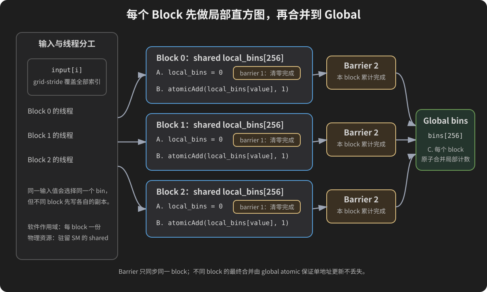

# 13 原子操作与直方图

本章从“普通加法为什么丢更新”开始，逐步建立原子加法、global/shared 直方图、分层 partial、scope/order、CAS、warp 聚合、统一 benchmark 与动态检查。目标不是背下一个 `atomicAdd`，而是能独立判断共享更新协议是否正确、何时值得优化以及怎样验证。

## 13.0 为什么这一章不能从背 atomicAdd 开始

第 5 章的向量加法让每个线程写不同的 `c[i]`；第 11 章的归约先在 block 内分层合并，再由唯一线程写部分和；第 12 章又在 warp 内明确规定参与者和结果 lane。这些程序都尽量安排了**唯一写者**。

直方图改变了任务形状。假设输入是：

```text
2 0 2 1 2 0 3 2
```

我们不再为每个输入位置输出一个结果，而是统计每个值出现多少次：

```text
bin 0: 2
bin 1: 1
bin 2: 4
bin 3: 1
```

输入位置 0、2、4、7 都要更新 `bins[2]`。如果四个 CUDA 线程各自执行普通的：

```cpp
bins[2] += 1;
```

就有多个写者更新同一地址。问题不在语法看起来太短，而在 `+=` 不是不可分割的一步。

本章学习路线：

```text
普通 read-modify-write 的丢更新
              ↓
atomicAdd 的单地址原子事务与返回旧值
              ↓
每输入一项 → 一次 global atomic → 正确的朴素直方图
              ↓
输入分布 → bin 热点 → 争用不是正确性错误却可能影响性能
              ↓
每 block 的 shared histogram → block 内更新 → global 合并
              ↓
grid-stride、16/256 bins、溢出、scope/order、CAS 与 warp 聚合
              ↓
CPU oracle + 总数不变量 + Sanitizer + 同范围 benchmark
```

原子操作是必要工具，不是看到共享写入就无脑添加的装饰。本章始终先问三件事：

1. 哪些线程可能同时访问哪个地址？
2. 需要原子的究竟是哪一个状态变化？
3. 能否先减少写者或分层合并，再使用更少的原子操作？

## 13.1 一条 += 实际包含读、算、写

先看一个普通变量 `counter=0`。线程 A 和 B 都想执行 `counter += 1`。抽象地拆开：

```text
读取 counter 的旧值
计算 old + 1
把新值写回 counter
```

一种合法交错是：

| 时刻 | 线程 A | 线程 B | 内存 counter |
|---:|---|---|---:|
| 0 | 尚未执行 | 尚未执行 | 0 |
| 1 | 读取 oldA=0 | | 0 |
| 2 | | 读取 oldB=0 | 0 |
| 3 | 计算 newA=1 | | 0 |
| 4 | | 计算 newB=1 | 0 |
| 5 | 写入 1 | | 1 |
| 6 | | 写入 1 | 1 |

两次逻辑递增，最终却只增加 1，这叫 **lost update（丢失更新）**。它不是“线程 B 没运行”，而是两个线程都基于同一个旧值计算，后一次写覆盖了前一次写。

### 13.1.1 结果不一定每次都错

另一种执行顺序可能是 A 完成读算写后 B 才读取，最终得到 2。正因为结果取决于不可假定的交错，运行十次都碰巧正确也不能证明普通 `+=` 安全。

设备代码中无同步的冲突访问还涉及 CUDA 内存模型中的数据竞争；教材用交错表只为解释“为什么会丢”，不是为数据竞争程序预测一组合法稳定输出。我们不会把故意竞争 kernel 放进默认测试。

### 13.1.2 __syncthreads 不能把同阶段争写变成唯一写者

假设在 `+=` 前后各加一次 block 屏障：

```cpp
__syncthreads();
bins[value] += 1;
__syncthreads();
```

第一次只让大家大致一起进入更新阶段，第二次只让大家等该阶段结束；两个屏障之间仍可能有许多线程同时 read-modify-write 同一地址。屏障解决阶段顺序，不自动让一个地址的更新逐个执行。

反过来，`atomicAdd` 也不等于 block 屏障。它保护的是指定地址上的一次原子更新，不保证所有线程已经完成其他 shared 写入。第 10 章的同步协议仍然存在。

### 13.1.3 CPU 交错模型

`code/13_histogram/atomic_interleaving_model.cpp` 不创建线程，也不运行数据竞争。它把危险交错和串行原子事务写成两个确定模型：

```cpp
#include <array>
#include <iostream>

int main() {
    int ordinary_counter = 0;
    const int old_a = ordinary_counter;
    const int old_b = ordinary_counter;
    const int new_a = old_a + 1;
    const int new_b = old_b + 1;
    ordinary_counter = new_a;
    ordinary_counter = new_b;

    if (ordinary_counter != 1) return 1;
    std::cout << "ordinary_reads=" << old_a << ',' << old_b
              << " ordinary_final=" << ordinary_counter
              << " logical_updates=2 lost=1\n";

    int atomic_counter_model = 0;
    std::array<int, 2> returned_old{};
    for (int operation = 0; operation < 2; ++operation) {
        returned_old[operation] = atomic_counter_model;
        atomic_counter_model += 1;
    }

    if (returned_old != std::array<int, 2>{0, 1} ||
        atomic_counter_model != 2) return 1;
    std::cout << "atomic_old_values=" << returned_old[0] << ','
              << returned_old[1] << " atomic_final="
              << atomic_counter_model << '\n';
    std::cout << "PASS deterministic interleaving model; no CPU/GPU race executed\n";
    return 0;
}
```

编译运行：

```bash
g++ -std=c++17 -O2 code/13_histogram/atomic_interleaving_model.cpp -o atomic_interleaving_model
./atomic_interleaving_model
```

预期：

```text
ordinary_reads=0,0 ordinary_final=1 logical_updates=2 lost=1
atomic_old_values=0,1 atomic_final=2
PASS deterministic interleaving model; no CPU/GPU race executed
```

后半段只是“两个原子事务按某种顺序发生”的串行参考。真实并发执行时谁先获得旧值 0 不确定，但若两个操作都完成，返回旧值集合应是 `{0,1}`，最终值是 2。

## 13.2 atomicAdd 的完整语义：地址、增量、旧值

传统 CUDA 接口的基本形状是：

```cpp
T old = atomicAdd(T* address, T value);
```

把参数逐项翻译：

- `T` 是接口支持的数值类型；不同类型和架构支持范围要查当前文档。
- `address` 指向 global 或 shared memory 中被更新的对象。
- `value` 是本次加到旧值上的增量。
- 函数在该地址上原子地完成“读旧值、计算旧值加增量、写回新值”。
- 返回值是更新**之前**的旧值，不是更新后的结果。

例如初始 `counter=10`：

```cpp
int ticket = atomicAdd(&counter, 3);
```

该调用返回的 `ticket` 是 10，完成后 `counter` 是 13。忽略返回值也完全合法：直方图只关心最终计数时常这样写。

当前 NVIDIA 编程指南把 `atomicAdd` 归入 legacy atomic functions：它是 device-only；无后缀版本为 device scope、relaxed memory order。`atomicAdd_block` 缩小到 block scope，`atomicAdd_system` 在满足设备和内存条件时扩展到 system scope。legacy 原子只保证相应原子操作，不凭空建立周围普通内存访问需要的 fence。[CUDA 原子函数](https://docs.nvidia.com/cuda/cuda-programming-guide/05-appendices/cpp-language-extensions.html#atomic-functions)

### 13.2.1 “原子”不是“整个 kernel 只有一个线程运行”

32 个线程可同时做其他计算，也可更新不同地址。只有竞争同一受保护位置的 read-modify-write 必须表现为某个完整顺序，不会出现半次更新被另一次插入。

因此下面两项要分开：

```text
正确性：对同一 bin 的每次原子加最终都计入
性能：对同一 bin 的高争用可能使这些更新成为热点
```

原子更新变慢不表示计数错误；结果正确也不表示原子没有成本。

### 13.2.2 单地址原子不等于多地址事务

```cpp
atomicAdd(&bins[a], 1u);
atomicAdd(&bins[b], 1u);
```

每次调用分别原子，但观察者仍可能看到第一项已更新、第二项尚未更新。若业务要求两个字段必须作为不可分割的状态一起改变，需要重新设计状态表示，例如在支持的位宽内打包并用 CAS，或使用更高层协议；不能把两行原子函数想象成数据库事务。

### 13.2.3 整数计数先讨论溢出

`unsigned int` 常用作直方图计数，但它只有有限范围。若单个 bin 可能接收超过 `UINT_MAX` 次更新，模 2^32 回绕会让总数检查失败。可改用受目标架构支持的 64 位原子与主机 `uint64_t` 参考，或分批/分层累积。类型选择是任务规模的一部分，不是最后才补的优化。

浮点 `atomicAdd` 还会受加法顺序与舍入影响。不同合法原子顺序可能得到略有差别的浮点结果；不要把整数直方图的精确相等结论直接搬到浮点累加。

## 13.3 返回旧值：32 个线程领取不重复票号

在直方图里常忽略 `atomicAdd` 返回值。先单独写一个例子观察它，这会帮助理解工作队列、压缩输出位置和计数器分配。

目标：一个完整 warp 的 32 个线程都对同一 `counter` 加 1，并把各自拿到的旧值保存为 ticket。

```text
初始 counter=0
32 次 atomicAdd(&counter,1)
最终 counter=32
ticket 集合必须恰好是 0..31
lane 0 不保证拿 ticket 0，lane 顺序不是原子全序承诺
```

### 13.3.1 完整程序

`code/13_histogram/atomic_tickets.cu`：

```cpp
#include <cuda_runtime.h>
#include <algorithm>
#include <array>
#include <iostream>

__global__ void claim_tickets(unsigned int* counter,
                              unsigned int* tickets) {
    const int lane = threadIdx.x;
    tickets[lane] = atomicAdd(counter, 1u);
}

bool check(cudaError_t status, const char* operation) {
    if (status == cudaSuccess) return true;
    std::cerr << operation << ": " << cudaGetErrorString(status) << '\n';
    return false;
}

int main() {
    constexpr int threads = 32;
    std::array<unsigned int, threads> tickets{};
    unsigned int counter = 0;
    unsigned int *d_counter = nullptr, *d_tickets = nullptr;
    int device = -1;
    cudaDeviceProp prop = {};
    if (!check(cudaGetDevice(&device), "current device") ||
        !check(cudaGetDeviceProperties(&prop, device), "device properties")) return 1;
    if (prop.maxThreadsPerBlock < threads || prop.maxThreadsDim[0] < threads) {
        std::cerr << "this lesson requires a 32-thread block\n";
        return 1;
    }

    bool ok = false;
    do {
        if (!check(cudaMalloc(&d_counter, sizeof(unsigned int)),
                   "allocate counter") ||
            !check(cudaMalloc(&d_tickets,
                              tickets.size() * sizeof(unsigned int)),
                   "allocate tickets") ||
            !check(cudaMemset(d_counter, 0, sizeof(unsigned int)),
                   "zero counter") ||
            !check(cudaMemset(d_tickets, 0xff,
                              tickets.size() * sizeof(unsigned int)),
                   "poison tickets")) break;

        claim_tickets<<<1, threads>>>(d_counter, d_tickets);
        if (!check(cudaGetLastError(), "launch") ||
            !check(cudaDeviceSynchronize(), "wait") ||
            !check(cudaMemcpy(&counter, d_counter, sizeof(unsigned int),
                              cudaMemcpyDeviceToHost), "D2H counter") ||
            !check(cudaMemcpy(tickets.data(), d_tickets,
                              tickets.size() * sizeof(unsigned int),
                              cudaMemcpyDeviceToHost), "D2H tickets")) break;

        const auto lane_order = tickets;
        std::sort(tickets.begin(), tickets.end());
        ok = counter == threads;
        for (int i = 0; i < threads && ok; ++i) {
            if (tickets[i] != static_cast<unsigned int>(i)) ok = false;
        }
        if (!ok) {
            std::cerr << "ticket set or final counter mismatch\n";
            break;
        }
        std::cout << "counter=" << counter << " lane0_ticket="
                  << lane_order[0] << " lane31_ticket=" << lane_order[31]
                  << '\n';
    } while (false);

    if (d_tickets && !check(cudaFree(d_tickets), "free tickets")) ok = false;
    if (d_counter && !check(cudaFree(d_counter), "free counter")) ok = false;
    if (!ok) return 1;
    std::cout << "PASS 32 unique old-value tickets; lane-to-ticket order not assumed\n";
    return 0;
}
```

### 13.3.2 为什么先复制 lane_order 再排序

`tickets[lane]` 最初记录“这个 lane 得到什么”。为了验证 0..31 每个旧值恰好出现一次，主机排序后逐项比较。排序会破坏 lane 到 ticket 的原始映射，所以先复制一份 `lane_order` 供说明性打印。

程序只断言集合，不断言：

```cpp
tickets[lane] == lane;  // 不应作为正确性条件
```

atomic 保证存在一个原子修改顺序，不保证该顺序等于 lane 编号、打印顺序或你在源码中想象的先后。

### 13.3.3 编译与预期输出边界

```bash
nvcc -std=c++17 -lineinfo code/13_histogram/atomic_tickets.cu -o atomic_tickets
./atomic_tickets
```

输出形状：

```text
counter=32 lane0_ticket=<0..31中的一个值> lane31_ticket=<0..31中的一个值>
PASS 32 unique old-value tickets; lane-to-ticket order not assumed
```

尖括号字段是运行时观测，不应在教材中伪造为固定数。真正必须固定的是最终 counter=32、32 个 ticket 唯一且排序后为 0..31。

## 13.4 第一份正确直方图：每个输入对应一次 Global Atomic

现在把原子加法用于真正的问题。输入类型是 `unsigned char`，每项取值 0..255，因此输出恰有 256 个 bin：

```text
输入 data[i]=v  →  bins[v] 增加 1
```

### 13.4.1 先写串行参考

CPU 参考最直接：

```cpp
std::array<unsigned int, 256> expected{};
for (unsigned char value : input) {
    ++expected[value];
}
```

花括号 `{}` 对 `std::array` 做值初始化，本例所有计数从 0 开始。`value` 会转换成 0..255 的数组下标。若输入是有符号 `char`，大于 127 的位模式在某些平台可能转成负数；因此这里明确使用 `unsigned char`，不把数据类型细节留给平台默认。

CPU 代码也有多个逻辑阶段：读取一个输入值、选择 bin、递增那个 bin。但这里只有一个 CPU 控制流顺序执行，不存在并发写同一计数器。它作为独立 oracle，而不是 GPU 算法的性能版本。

### 13.4.2 最小 global atomic kernel

```cpp
__global__ void histogram_global(const unsigned char* input,
                                 unsigned int* bins, int n) {
    const int start = blockIdx.x * blockDim.x + threadIdx.x;
    const int step = blockDim.x * gridDim.x;
    for (int i = start; i < n; i += step) {
        atomicAdd(&bins[input[i]], 1u);
    }
}
```

逐行解释：

- `input` 指向设备输入，`const` 表示 kernel 不经此指针改输入。
- `bins` 指向 256 个设备端 `unsigned int` 计数器。
- `start` 是这个线程首次负责的全局输入索引。
- `step` 是整个 grid 的线程数。
- 循环使固定数量线程能覆盖大于线程总数的输入。
- `input[i]` 决定地址 `&bins[input[i]]`。
- 增量 `1u` 与无符号计数类型一致。
- 返回旧值被忽略，因为直方图只需要最终计数。

如果改成普通 `bins[input[i]] += 1u`，不同线程处理相同值时就可能丢更新。即使 cycle 模式较分散，也不能因为一次输出碰巧正确就保留数据竞争。

### 13.4.3 Grid-stride 不是自动负载均衡器

假设 `blocks=2`、`threads=4`，总线程数和 `step` 都是 8：

| 线程 start | 处理索引 |
|---:|---|
| 0 | 0, 8, 16, ... |
| 1 | 1, 9, 17, ... |
| 2 | 2, 10, 18, ... |
| 7 | 7, 15, 23, ... |

`i<n` 负责尾部。它保证这些算术序列不重不漏，但不保证每个 bin 的原子争用均匀；争用由 `input[i]` 的值分布决定。

不能把 `step` 写成 `blockDim.x`，否则每个 block 的同号线程会处理重叠序列；也不能只执行一个 `if(start<n)` 却仍声称固定小 grid 覆盖全部输入。

### 13.4.4 三种可复现输入分布

程序提供三个字符串参数：

| pattern | 生成规则 | 用途 |
|---|---|---|
| `cycle` | `i%256` | 近似均匀覆盖所有 bin，便于手算 |
| `hot` | 全部为 0 | 所有更新竞争 `bins[0]` 的极端热点 |
| `skew` | 每 10 项中 8 项为 0，其余为 `i%256` | 介于两者之间的偏斜输入 |

它们不是现实数据分布的完整代表，只是控制变量。固定生成公式比未记录种子的随机数更容易复现。后面的性能实验应同时报告分布，不能只写 `n=1048576`。

对于默认 `n=1031` 的 cycle 模式，有 4 个完整的 256 项周期和额外的值 0..6，所以：

```text
bin 0..6 各 5
bin 7..255 各 4
总和 = 7×5 + 249×4 = 1031
```

hot 模式则是 `bin[0]=1031`、其余全 0。两者完成同样 1031 次逻辑更新，地址冲突形状完全不同。

### 13.4.5 完整程序

`code/13_histogram/global_histogram.cu`：

```cpp
#include <cuda_runtime.h>
#include <array>
#include <cstdint>
#include <iostream>
#include <string>
#include <vector>

constexpr int kBins = 256;

enum class Pattern { Cycle, Hot, Skew };

__global__ void histogram_global(const unsigned char* input,
                                 unsigned int* bins, int n) {
    const int start = blockIdx.x * blockDim.x + threadIdx.x;
    const int step = blockDim.x * gridDim.x;
    for (int i = start; i < n; i += step) {
        atomicAdd(&bins[input[i]], 1u);
    }
}

bool check(cudaError_t status, const char* operation) {
    if (status == cudaSuccess) return true;
    std::cerr << operation << ": " << cudaGetErrorString(status) << '\n';
    return false;
}

bool parse_decimal(const char* text, int minimum, int maximum, int& result) {
    if (!text || !*text) return false;
    int value = 0;
    for (const char* p = text; *p; ++p) {
        if (*p < '0' || *p > '9') return false;
        const int digit = *p - '0';
        if (value > (maximum - digit) / 10) return false;
        value = value * 10 + digit;
        if (value > maximum) return false;
    }
    if (value < minimum) return false;
    result = value;
    return true;
}

bool parse_pattern(const char* text, Pattern& result) {
    const std::string value = text ? text : "";
    if (value == "cycle") result = Pattern::Cycle;
    else if (value == "hot") result = Pattern::Hot;
    else if (value == "skew") result = Pattern::Skew;
    else return false;
    return true;
}

const char* pattern_name(Pattern pattern) {
    if (pattern == Pattern::Cycle) return "cycle";
    if (pattern == Pattern::Hot) return "hot";
    return "skew";
}

unsigned char make_value(int i, Pattern pattern) {
    if (pattern == Pattern::Hot) return 0;
    if (pattern == Pattern::Skew && i % 10 < 8) return 0;
    return static_cast<unsigned char>(i % kBins);
}

int main(int argc, char** argv) {
    try {
        int n = 1031, threads = 128, blocks = 4;
        Pattern pattern = Pattern::Cycle;
        if (argc != 1 && (argc != 5 ||
            !parse_decimal(argv[1], 0, 1048576, n) ||
            !parse_decimal(argv[2], 1, 1024, threads) ||
            !parse_decimal(argv[3], 1, 65535, blocks) ||
            !parse_pattern(argv[4], pattern))) {
            std::cerr << "Usage: global_histogram [n threads blocks pattern]; "
                         "pattern=cycle|hot|skew\n";
            return 2;
        }
        if (n == 0) {
            std::cout << "EMPTY histogram total=0; no CUDA calls\n";
            return 0;
        }

        int device = -1;
        cudaDeviceProp prop = {};
        if (!check(cudaGetDevice(&device), "current device") ||
            !check(cudaGetDeviceProperties(&prop, device), "device properties")) return 1;
        if (threads > prop.maxThreadsPerBlock || threads > prop.maxThreadsDim[0] ||
            blocks > prop.maxGridSize[0]) {
            std::cerr << "configuration exceeds device limits\n";
            return 1;
        }

        std::vector<unsigned char> input(n);
        std::array<unsigned int, kBins> expected{}, actual{};
        for (int i = 0; i < n; ++i) {
            input[i] = make_value(i, pattern);
            ++expected[input[i]];
        }

        unsigned char* d_input = nullptr;
        unsigned int* d_bins = nullptr;
        bool ok = false;
        do {
            if (!check(cudaMalloc(&d_input, input.size() * sizeof(unsigned char)),
                       "allocate input") ||
                !check(cudaMalloc(&d_bins, actual.size() * sizeof(unsigned int)),
                       "allocate bins") ||
                !check(cudaMemcpy(d_input, input.data(),
                                  input.size() * sizeof(unsigned char),
                                  cudaMemcpyHostToDevice), "H2D input") ||
                !check(cudaMemset(d_bins, 0,
                                  actual.size() * sizeof(unsigned int)),
                       "zero bins")) break;

            histogram_global<<<blocks, threads>>>(d_input, d_bins, n);
            if (!check(cudaGetLastError(), "launch") ||
                !check(cudaDeviceSynchronize(), "wait") ||
                !check(cudaMemcpy(actual.data(), d_bins,
                                  actual.size() * sizeof(unsigned int),
                                  cudaMemcpyDeviceToHost), "D2H bins")) break;

            ok = true;
            std::uint64_t total = 0;
            for (int bin = 0; bin < kBins; ++bin) {
                total += actual[bin];
                if (actual[bin] != expected[bin]) {
                    std::cerr << "bin mismatch bin=" << bin
                              << " actual=" << actual[bin]
                              << " expected=" << expected[bin] << '\n';
                    ok = false;
                    break;
                }
            }
            if (ok && total != static_cast<std::uint64_t>(n)) {
                std::cerr << "histogram total mismatch\n";
                ok = false;
            }
            if (ok) {
                std::cout << "n=" << n << " threads=" << threads
                          << " blocks=" << blocks
                          << " pattern=" << pattern_name(pattern)
                          << " total=" << total << '\n';
                for (int bin = 0; bin < 8; ++bin) {
                    std::cout << "bin[" << bin << "]=" << actual[bin]
                              << (bin == 7 ? '\n' : ' ');
                }
                std::cout << "bin[255]=" << actual[255] << '\n';
            }
        } while (false);

        if (d_bins && !check(cudaFree(d_bins), "free bins")) ok = false;
        if (d_input && !check(cudaFree(d_input), "free input")) ok = false;
        if (!ok) return 1;
        std::cout << "PASS global atomic histogram; all 256 bins and total checked\n";
        return 0;
    } catch (const std::exception& error) {
        std::cerr << "ERROR: " << error.what() << '\n';
        return 1;
    }
}
```

### 13.4.6 命令四个参数怎样自己改

```bash
nvcc -std=c++17 -lineinfo code/13_histogram/global_histogram.cu -o global_histogram
./global_histogram
./global_histogram 1031 128 4 cycle
./global_histogram 1031 128 4 hot
./global_histogram 1031 128 4 skew
```

编译命令仍按第 1、3 章拆解：

- `nvcc` 是 CUDA 编译驱动；
- `-std=c++17` 选择本书使用的 C++ 语言标准；
- `-lineinfo` 给设备代码保留源行映射，帮助工具定位，不会自动打印变量；
- 后面第一个路径是唯一输入源文件；
- `-o global_histogram` 指定输出可执行文件名。

运行时四个位置参数必须一起提供：`n threads blocks pattern`。例如第二条显式命令是 1031 项输入、每 block 128 线程、4 个 block、cycle 分布。只写两个参数会返回 2，不会猜另外两个。

默认代表输出：

```text
n=1031 threads=128 blocks=4 pattern=cycle total=1031
bin[0]=5 bin[1]=5 bin[2]=5 bin[3]=5 bin[4]=5 bin[5]=5 bin[6]=5 bin[7]=4
bin[255]=4
PASS global atomic histogram; all 256 bins and total checked
```

hot 代表输出的首行配置相同但 pattern 为 hot，第二行以 `bin[0]=1031` 开始，其余所示 bin 为 0。程序实际比较全部 256 个 bin，不因只打印一小部分就少验证。

### 13.4.7 参数与设备限制是两层检查

主机解析先限制：

```text
n:       0..1048576
threads: 1..1024
blocks:  1..65535
pattern: cycle | hot | skew
```

这防止负数、字母、过长数字和未知模式进入分配/启动路径。之后还查询实际设备的 `maxThreadsPerBlock`、`maxThreadsDim[0]` 和 `maxGridSize[0]`。1024 是本程序允许的上界，不表示所有设备和所有 kernel 都必然能使用它。

`n=0` 在查询设备之前返回零直方图语义，不做零字节分配，也不尝试启动零工作 grid。blocks 可以大于 n；多余线程在循环条件处没有输入，不影响正确性，但可能浪费启动和调度资源。

## 13.5 验证直方图：逐 Bin 相等与总数不变量都要有

直方图比单一总和多一个常见陷阱：只检查所有 bin 的总和为 n，不足以证明分类正确。

例如真实答案：

```text
[2, 1, 4, 1]
```

错误答案：

```text
[3, 0, 3, 2]
```

两者总和都是 8，但多个输入被分到了错误 bin。因此本程序先逐 bin 比较：

```cpp
if (actual[bin] != expected[bin]) { ... }
```

再独立累计设备输出总数：

```cpp
std::uint64_t total = 0;
for (unsigned int count : actual) total += count;
```

两种检查的作用不同：

- 逐 bin 相等定位第一个分类/计数错误；
- `total==n` 检查整体守恒，能快速发现遗漏、重复和部分初始化问题；
- 两者都通过，再加 API/设备同步成功，才是本例的完整成功路径。

### 13.5.1 为什么主机总数用 uint64_t

单个设备 bin 是 `unsigned int`，但 256 个计数相加的中间/最终范围更大。即使本例 n 最大只有 1048576，也用 `std::uint64_t` 明确“总数累计器不应在 32 位求和时溢出”。以后放宽 n 时无需悄悄改变这个不变量。

这不修复设备单个 bin 自身可能溢出的问题。如果 `hot` 输入规模超过 `UINT_MAX`，`bins[0]` 已经回绕，主机用 64 位相加只能发现不一致，不能恢复丢失的高位。

### 13.5.2 输出先清零，不是可选优化

`cudaMalloc` 返回的显存内容未定义，不能假设新分配页面为 0。kernel 做的是加法，不是覆盖最终绝对值，所以运行前必须建立初始状态：

```cpp
cudaMemset(d_bins, 0, 256 * sizeof(unsigned int));
```

这里按字节填 0 对整数零有效。不要把它泛化成 `cudaMemset(...,1,...)` 会得到每个 `unsigned int` 的数值 1；那会把四个字节都写成 `0x01`，数值为 `0x01010101`。

如果在同一 `d_bins` 上连续运行两次 kernel 而中间不清零，第二次输出是两次直方图之和。这可以是有意的流式累计协议，但不能仍拿单次 CPU 参考验证。性能 benchmark 每轮是否清零、清零是否计时，都必须明示。

### 13.5.3 提交检查、完成检查和结果检查

三步仍不能合并：

```cpp
histogram_global<<<blocks, threads>>>(...);
check(cudaGetLastError(), "launch");       // 启动/提交层
check(cudaDeviceSynchronize(), "wait");   // 等待设备工作并暴露异步错误
check(cudaMemcpy(...), "D2H bins");       // 传输层
```

随后才有数学层的逐 bin 与总数检查。只看到 `cudaGetLastError()==cudaSuccess` 不表示 kernel 已执行完成；只看到 D2H 成功也不表示分类公式正确。

### 13.5.4 小规模边界矩阵

```bash
./global_histogram 0 1 1 cycle
./global_histogram 1 1 1 cycle
./global_histogram 255 32 1 cycle
./global_histogram 256 32 2 cycle
./global_histogram 257 32 2 cycle
./global_histogram 1031 128 1 cycle
./global_histogram 1031 128 4 hot
./global_histogram 1031 128 4 skew
```

255/256/257 跨越一个完整 bin 周期；blocks=1 检验 grid-stride 循环确实反复处理；hot 检验极端冲突下仍不丢计数。非法路径：

```bash
./global_histogram -1 128 4 cycle
./global_histogram 10 0 4 cycle
./global_histogram 10 128 0 cycle
./global_histogram 10 128 4 random
./global_histogram 10 128
```

这些应在主机返回 2，不提交 kernel。字符串 `random` 没有悄悄映射到某一模式，因为没有记录种子和分布就无法复现实验。

## 13.6 争用怎样变成可以测量的问题

13.4 已经看到三种输入：

- `cycle`：0、1、2……255 循环，更新较均匀地分散到 256 个地址；
- `hot`：所有值都是 0，全部原子加法争用 `bins[0]`；
- `skew`：约八成输入落到 0，其余输入按编号分散，是介于两者之间的偏斜分布。

三者结果都应正确，但同一时刻竞争同一地址的程度不同。对一个地址的原子读改写必须表现为某种串行次序，因此 `hot` 给这个地址制造了最强的逻辑争用。由此可以提出假设：

> 在其他条件相同时，热点更集中的输入可能让朴素 global atomic 直方图耗时增加。

注意这里写的是**待实验检验的假设**，不是跨所有 GPU 的性能定律。原子单元、cache、调度、时钟、输入规模和同时驻留的线程数量都会影响实测。NVIDIA 的 [Fast Histograms Using Shared Atomics](https://developer.nvidia.com/blog/gpu-pro-tip-fast-histograms-using-shared-atomics-maxwell/) 也展示了不同架构上 global/shared atomic 的相对结果可能不同；那篇文章的具体倍数属于当时测试设备，不能直接复制成今天 GPU 的结论。

### 13.6.1 控制变量：只改变数据分布

如果 cycle 用一百万项而 hot 用一亿项，时间不同不能归因于争用。本实验固定：

- 同一个 `histogram_global` kernel；
- 相同元素数 `n`；
- 相同的 256 个 bins 和计数类型；
- 相同 `blocks`、`threads`；
- 相同计时边界和重复次数；
- 每次启动前都把输出清零，但不把清零计入 kernel 区间。

唯一有意改变的是 `input[i]` 落入哪个 bin。三份输入提前复制到显存，H2D 不在测量区间。这样测到的差异才主要与访问分布有关。

这仍不是一项完全隔离的硬件实验。GPU 动态频率、温度和同机其他任务也会造成波动，所以程序不只运行一次。

### 13.6.2 Event 区间为什么这样放

[第 9 章 9.4](09-正确计时与带宽基线.md#94-cuda-event给设备执行序列放两个标记)已经完整解释过 Event；这里仅回顾本实验的新用法。默认 stream 中依次提交：

```text
cudaMemsetAsync(bins)
        ↓
record(start)
        ↓
histogram kernel
        ↓
record(stop)
        ↓
synchronize(stop)
```

同一 stream 保持提交顺序，因此 start 标记要等前面的清零完成才会生效。Event 的 elapsed 区间从 start 到 stop，不包含位于 start 之前的清零，也不包含更早的 H2D。它包含 kernel 在该 stream 上从开始标记到结束标记之间的设备时间。

这回答的是：

> 已经准备好输入和输出状态后，这次 histogram kernel 花了多长设备时间？

它不回答端到端应用耗时。如果真实应用每轮都必须分配、传输和清零，就还要另测包含这些步骤的端到端区间。

### 13.6.3 为什么预热、轮换顺序和取中位数

程序先让三种分布各运行一次预热。预热不进入样本，避免第一次 context 初始化、代码装载等一次性成本混进主要比较。

正式测量不用永远固定 `cycle → hot → skew`，而是每轮旋转：

```text
第 0 轮：cycle → hot  → skew
第 1 轮：hot   → skew → cycle
第 2 轮：skew  → cycle→ hot
第 3 轮：重新循环
```

如果设备随时间逐渐升温或频率变化，固定顺序会让某一种模式总处在同一位置。轮换不能消除所有干扰，但比永远固定顺序更公平。

每种模式保存 `repeats` 个样本，报告 median、min 和 max：

- median 是排序后的中间值，对偶发长尾不如平均值敏感；
- min 显示本次环境中最顺利的一次；
- max 帮助发现抖动；
- 三者差距很大时，先调查环境，不急着比较两种 kernel。

### 13.6.4 Blocks 为什么由 SM 数量推导，但不是“最佳答案”

程序使用：

```cpp
blocks_target = SM 数量 * 8;
blocks = min(处理全部输入至少需要的 blocks,
             blocks_target,
             设备 x 维 grid 上限);
```

这里的 8 只表示“每个 SM 准备若干候选 blocks”，帮助 grid-stride kernel 提供足够工作；它不是由 CUDA 规范给出的最优常数。一个 SM 实际能同时驻留几个 block，还受 threads、register、shared memory 和架构上限约束，第 19 章会系统计算。

即使 `blocks * threads < n` 也不会漏数据，因为每个 thread 通过 grid-stride loop 反复处理后续位置。基本全局索引来自第 5 章；固定较少 blocks 后反复跨步的完整推导见[第 11 章 11.9](11-并行归约-从错误到高效.md#119-固定较少的block用grid-stride累加线程局部和)，这里不重新展开。

### 13.6.5 完整实验：atomic_contention_benchmark.cu

文件：`code/13_histogram/atomic_contention_benchmark.cu`。

本章开始复用第 7 章已经完整解释过的 `code/common/cuda_check.h`。它不是 CUDA 关键字，而是本书自己的错误检查封装；这里不再把同一份宏实现复制进每个程序。

```cpp
#include <cuda_runtime.h>

#include "../common/cuda_check.h"

#include <algorithm>
#include <array>
#include <charconv>
#include <cstddef>
#include <cstdint>
#include <iomanip>
#include <iostream>
#include <system_error>
#include <string_view>
#include <vector>

constexpr int kBins = 256;

enum class Pattern : int {
    Cycle = 0,
    Hot = 1,
    Skew = 2
};

__global__ void histogram_global(const unsigned char* input,
                                 unsigned int* bins,
                                 std::size_t n) {
    const std::size_t start =
        static_cast<std::size_t>(blockIdx.x) * blockDim.x + threadIdx.x;
    const std::size_t step =
        static_cast<std::size_t>(blockDim.x) * gridDim.x;

    for (std::size_t i = start; i < n; i += step) {
        atomicAdd(&bins[input[i]], 1u);
    }
}

bool parse_positive(const char* text, int minimum, int maximum, int& value) {
    if (text == nullptr) return false;
    const std::string_view view(text);
    int parsed = 0;
    const auto result = std::from_chars(view.data(), view.data() + view.size(), parsed);
    if (result.ec != std::errc{} || result.ptr != view.data() + view.size() ||
        parsed < minimum || parsed > maximum) return false;
    value = parsed;
    return true;
}

const char* pattern_name(Pattern pattern) {
    if (pattern == Pattern::Cycle) return "cycle";
    if (pattern == Pattern::Hot) return "hot";
    return "skew";
}

unsigned char make_value(std::size_t i, Pattern pattern) {
    if (pattern == Pattern::Hot) return 0;
    if (pattern == Pattern::Skew && i % 10 < 8) return 0;
    return static_cast<unsigned char>(i % kBins);
}

float median(std::vector<float> samples) {
    std::sort(samples.begin(), samples.end());
    const std::size_t middle = samples.size() / 2;
    if (samples.size() % 2 == 1) return samples[middle];
    return (samples[middle - 1] + samples[middle]) * 0.5f;
}

bool verify(Pattern pattern,
            const std::vector<unsigned char>& host_input,
            const std::array<unsigned int, kBins>& actual) {
    std::array<unsigned int, kBins> expected{};
    for (unsigned char value : host_input) ++expected[value];

    std::uint64_t total = 0;
    for (int bin = 0; bin < kBins; ++bin) {
        total += actual[bin];
        if (actual[bin] != expected[bin]) {
            std::cerr << pattern_name(pattern) << " mismatch at bin " << bin
                      << ": actual=" << actual[bin]
                      << " expected=" << expected[bin] << '\n';
            return false;
        }
    }
    if (total != host_input.size()) {
        std::cerr << pattern_name(pattern) << " total mismatch: actual=" << total
                  << " expected=" << host_input.size() << '\n';
        return false;
    }
    return true;
}

int main(int argc, char** argv) {
    int n = 1 << 24;
    int repeats = 12;
    int threads = 256;
    if (argc != 1 &&
        (argc != 4 ||
         !parse_positive(argv[1], 1, 1 << 28, n) ||
         !parse_positive(argv[2], 3, 100, repeats) ||
         !parse_positive(argv[3], 1, 1024, threads))) {
        std::cerr << "Usage: atomic_contention_benchmark [n repeats threads]\n";
        return 2;
    }

    int device = 0;
    cudaDeviceProp prop{};
    CUDA_CHECK(cudaGetDevice(&device));
    CUDA_CHECK(cudaGetDeviceProperties(&prop, device));
    if (threads > prop.maxThreadsPerBlock || threads > prop.maxThreadsDim[0]) {
        std::cerr << "threads exceeds this device's one-dimensional block limit\n";
        return 2;
    }

    const std::size_t count = static_cast<std::size_t>(n);
    const std::size_t input_bytes = count * sizeof(unsigned char);
    const std::size_t bins_bytes = kBins * sizeof(unsigned int);
    const std::size_t blocks_needed =
        (count + static_cast<std::size_t>(threads) - 1) / threads;
    const std::size_t blocks_target =
        static_cast<std::size_t>(prop.multiProcessorCount) * 8;
    const int blocks = static_cast<int>(
        std::min(blocks_needed, std::min(blocks_target,
                 static_cast<std::size_t>(prop.maxGridSize[0]))));

    constexpr std::array<Pattern, 3> patterns = {
        Pattern::Cycle, Pattern::Hot, Pattern::Skew
    };
    std::array<std::vector<unsigned char>, 3> host_inputs;
    std::array<unsigned char*, 3> device_inputs{};
    unsigned int* device_bins = nullptr;

    for (int p = 0; p < 3; ++p) {
        host_inputs[p].resize(count);
        for (std::size_t i = 0; i < count; ++i) {
            host_inputs[p][i] = make_value(i, patterns[p]);
        }
        CUDA_CHECK(cudaMalloc(&device_inputs[p], input_bytes));
        CUDA_CHECK(cudaMemcpy(device_inputs[p], host_inputs[p].data(), input_bytes,
                              cudaMemcpyHostToDevice));
    }
    CUDA_CHECK(cudaMalloc(&device_bins, bins_bytes));

    cudaEvent_t start = nullptr;
    cudaEvent_t stop = nullptr;
    CUDA_CHECK(cudaEventCreate(&start));
    CUDA_CHECK(cudaEventCreate(&stop));

    for (int p = 0; p < 3; ++p) {
        CUDA_CHECK(cudaMemset(device_bins, 0, bins_bytes));
        histogram_global<<<blocks, threads>>>(device_inputs[p], device_bins, count);
        CUDA_CHECK_KERNEL();
    }

    std::array<std::vector<float>, 3> samples;
    for (auto& pattern_samples : samples) pattern_samples.reserve(repeats);

    for (int round = 0; round < repeats; ++round) {
        for (int position = 0; position < 3; ++position) {
            const int p = (round + position) % 3;
            CUDA_CHECK(cudaMemsetAsync(device_bins, 0, bins_bytes));
            CUDA_CHECK(cudaEventRecord(start));
            histogram_global<<<blocks, threads>>>(device_inputs[p], device_bins, count);
            CUDA_CHECK(cudaGetLastError());
            CUDA_CHECK(cudaEventRecord(stop));
            CUDA_CHECK(cudaEventSynchronize(stop));

            float elapsed_ms = 0.0f;
            CUDA_CHECK(cudaEventElapsedTime(&elapsed_ms, start, stop));
            samples[p].push_back(elapsed_ms);
        }
    }

    std::array<unsigned int, kBins> actual{};
    for (int p = 0; p < 3; ++p) {
        CUDA_CHECK(cudaMemset(device_bins, 0, bins_bytes));
        histogram_global<<<blocks, threads>>>(device_inputs[p], device_bins, count);
        CUDA_CHECK(cudaGetLastError());
        CUDA_CHECK(cudaDeviceSynchronize());
        CUDA_CHECK(cudaMemcpy(actual.data(), device_bins, bins_bytes,
                              cudaMemcpyDeviceToHost));
        if (!verify(patterns[p], host_inputs[p], actual)) return 1;
    }

    std::cout << "device=" << prop.name << " n=" << n
              << " blocks=" << blocks << " threads=" << threads
              << " repeats=" << repeats << '\n';
    std::cout << std::fixed << std::setprecision(4);
    for (int p = 0; p < 3; ++p) {
        const auto [minimum, maximum] =
            std::minmax_element(samples[p].begin(), samples[p].end());
        std::cout << pattern_name(patterns[p])
                  << " median_ms=" << median(samples[p])
                  << " min_ms=" << *minimum
                  << " max_ms=" << *maximum << '\n';
    }
    std::cout << "PASS all bins checked; compare distributions only on this recorded setup\n";

    CUDA_CHECK(cudaEventDestroy(stop));
    CUDA_CHECK(cudaEventDestroy(start));
    CUDA_CHECK(cudaFree(device_bins));
    for (unsigned char* pointer : device_inputs) CUDA_CHECK(cudaFree(pointer));
    return 0;
}
```

### 13.6.6 新 C++ 写法只解释本节新增部分

`enum class Pattern : int` 为三种分布建立了互不混淆的名字。`static_cast<int>` 或底层 `int` 不参与 kernel 算法，只让主机端能够用 0、1、2 组织三份数组。

```cpp
std::array<std::vector<unsigned char>, 3> host_inputs;
std::array<unsigned char*, 3> device_inputs{};
```

第一行表示“固定三个、每个长度运行时决定”的 host 数组；第二行表示固定三个 device pointer。索引 `p` 在 0—2 间选择哪一种分布，不是 CUDA thread 编号。

```cpp
const auto [minimum, maximum] = std::minmax_element(...);
```

这是 C++17 结构化绑定：函数返回一对迭代器，左边分别命名为 `minimum` 和 `maximum`。打印时使用 `*minimum` 读取迭代器指向的样本值。它不创建 GPU 最小值 kernel。

`std::from_chars` 负责把命令行文本完整转换为整数。程序同时检查范围和是否消费了整个字符串，因此 `256abc` 不会被悄悄当成 256。

### 13.6.7 编译、运行和参数

在教材根目录执行：

```bash
nvcc -std=c++17 -O3 -lineinfo \
  code/13_histogram/atomic_contention_benchmark.cu \
  -o atomic_contention_benchmark

./atomic_contention_benchmark
./atomic_contention_benchmark 16777216 12 256
```

这里不再重复 `nvcc`、`-std=c++17` 和 `-o` 的完整基础课，忘记时回看第 3 章。当前新增的两个选项是：

- `-O3`：为 host/device 代码请求优化构建，性能实验不能拿 Debug 版本下结论；
- `-lineinfo`：保留设备源码行映射，便于后续工具定位；它不会自动打印变量或性能报告。

三个运行参数分别是：

```text
n             每种输入的元素数，1..268435456
repeats       每种分布的正式样本数，3..100
threads       每个 block 的线程数，1..1024 且不能超过实机限制
```

默认 `n=16777216`，因为 `1 << 24` 表示整数 1 的二进制向左移动 24 位，即 2^24。它不是字节数；每项是一个 `unsigned char`，所以每份输入在本例恰好占 n 字节。三份 host 输入和三份 device 输入都会占空间，盲目把 n 改到最大值可能造成内存压力。

### 13.6.8 输出中不能提前填入虚构时间

代表格式如下：

```text
device=<你的 GPU 名称> n=16777216 blocks=<实机推导值> threads=256 repeats=12
cycle median_ms=<实测值> min_ms=<实测值> max_ms=<实测值>
hot median_ms=<实测值> min_ms=<实测值> max_ms=<实测值>
skew median_ms=<实测值> min_ms=<实测值> max_ms=<实测值>
PASS all bins checked; compare distributions only on this recorded setup
```

当前编辑机器没有 CUDA 编译器和 NVIDIA GPU，因此这里不填写貌似真实的小数。只有你在服务器实际运行后，输出才是该设备、该负载和当时环境的证据。

记录结果时至少保留第一行元数据。不要只抄三行时间，因为换 GPU、threads 或 n 后它们已经不是同一个实验。

### 13.6.9 结果可以怎样解释

如果看到：

```text
hot median > skew median > cycle median
```

它与“同址争用增多带来额外串行化”的假设一致，但仍只能表述为：

> 在这次记录的设备、配置和输入规模上，热点越集中，朴素 global atomic kernel 的中位时间越高。

不能进一步声称所有 GPU 都有同样顺序，更不能从三行 Event 时间推断具体有多少硬件周期花在 atomic 上。后者要在第 18 章结合 Nsight Compute 指标分析。

如果三者接近，也不能直接宣布“争用没有代价”。可能原因包括工作太小、计时噪声较大、硬件 atomic 路径足够强、其他瓶颈占主导或 blocks/threads 没有形成足够并发。先放大 n、增加样本、检查 min/max，再用 profiler 验证。

如果结果顺序在不同运行间反复改变，而且 min/max 范围互相覆盖，最稳妥的结论是“当前证据不足以区分”，不是挑一次最符合预期的输出。

### 13.6.10 这份程序验证了什么，尚未验证什么

已经在代码中建立的验证：

- 三种输入由确定公式生成，可以复现；
- 每次正式 kernel 前清零输出；
- 三种模式轮换测量次序；
- 每种模式保留多个样本；
- 计时后重新执行，并逐项比较全部 256 个 bins；
- 再独立检查所有 bin 总数等于 n；
- 输出包含设备名、n、blocks、threads 和 repeats。

尚未在当前编辑环境完成：

- 用 nvcc 实际编译；
- 在 NVIDIA GPU 上运行；
- 用 Compute Sanitizer 检查；
- 用 profiler 观察 atomic 相关指标；
- 比较 block-private shared 实现。

最后一项正是下一节要做的算法改造：不让整个 grid 的线程直接争用同一份 256-bin 数组，而是先把争用范围缩小到每个 block 的私有直方图，再合并到 global 输出。

## 13.7 每个 Block 先做一份私有直方图

13.4 的朴素版本让整个 grid 的线程直接更新同一份 global `bins[256]`：

```text
Block 0 ─┐
Block 1 ─┼── atomicAdd(global bins[value], 1)
Block 2 ─┤
Block 3 ─┘
```

热点输入下，所有 block 都在同一个 global 地址上竞争。现在把合并分成两层：

```text
Block 0 的输入 → Block 0 的 shared local_bins ─┐
Block 1 的输入 → Block 1 的 shared local_bins ─┼→ global bins
Block 2 的输入 → Block 2 的 shared local_bins ─┤
Block 3 的输入 → Block 3 的 shared local_bins ─┘
```

每个 block 仍可能有多个线程同时更新同一个本地 bin，所以本地更新仍需 atomic。变化在于争用被拆成了多个较小范围：Block 0 不再和 Block 1 争同一个 shared 地址。最后，每个 block 只把自己的 256 项局部结果合并到 global。



图中每一条蓝框都是不同 block 的 shared 实例；黄色框是各 block 自己的第二个屏障，不是三个 block 在同一位置互相等待。右侧只有一份 global bins，所以最后合并仍需 device-scope 的 global atomic。

[第 10 章 10.4.1](10-Shared-Memory与线程同步.md#1041-shared-memory-是每个-block-的工作区)已经完整解释过 shared 的作用域。这里仅强调直方图的新作用：

```cpp
__shared__ unsigned int local_bins[256];
```

源码只有一条声明，但运行时**每个驻留 block 都有自己的逻辑实例**。它使用 SM 上的 shared memory 资源，不表示同一 SM 上的不同 block 能互访这份数组。

### 13.7.1 用 8 项输入看两级合并

输入仍是：

```text
索引：0 1 2 3 4 5 6 7
数值：2 0 2 1 2 0 3 2
```

为便于手算，假设 `blocks=2`、`threads=2`，所以 grid 一共 4 个线程，grid-stride 的 step 是 4：

| Block | tid | 处理的输入索引 | 读到的值 |
|---:|---:|---|---|
| 0 | 0 | 0, 4 | 2, 2 |
| 0 | 1 | 1, 5 | 0, 0 |
| 1 | 0 | 2, 6 | 2, 3 |
| 1 | 1 | 3, 7 | 1, 2 |

只画 bin 0—3，两个 block 得到：

```text
Block 0 local_bins = [2, 0, 2, 0]
Block 1 local_bins = [0, 1, 2, 1]
                         ↓ 逐 bin 合并
global bins        = [2, 1, 4, 1]
```

注意 `tid=0` 在两个 block 中各出现一次。它们不是同一个线程，也不共享 local_bins；`blockIdx.x` 才区分所属 block。

### 13.7.2 三个阶段不能揉成一段

kernel 的 block 内协议是：

```text
阶段 A：协作把本 block 的 256 个 local bins 清零
                      ↓ barrier 1
阶段 B：处理输入，并用 shared atomic 累计 local bins
                      ↓ barrier 2
阶段 C：协作把 local bins 合并进 global bins
```

两个 `__syncthreads()` 看起来相同，但保护的状态不同。

#### 第一个屏障：零初始化全部完成，才能开始累加

清零采用：

```cpp
for (int bin = threadIdx.x; bin < 256; bin += blockDim.x) {
    local_bins[bin] = 0;
}
```

不同线程负责不同 bins。假如没有第一个屏障，某个快线程可能已经执行：

```cpp
atomicAdd(&local_bins[7], 1u);
```

而负责清零 bin 7 的线程稍后才执行：

```cpp
local_bins[7] = 0;
```

这次合法计数就被初始化覆盖。第一个屏障建立的不变量是：

> 进入输入累计阶段时，本 block 的 256 个 local bins 已经全部为 0。

#### 第二个屏障：全部累计完成，才能读取局部结果

阶段 C 中某个线程会读 `local_bins[7]` 并合并到 global。如果没有第二个屏障，它可能在另一个线程尚未完成对 bin 7 的最后一次 atomicAdd 时提前读取，得到过小的局部计数。

第二个屏障建立的不变量是：

> 进入 global 合并阶段时，本 block 分配到的所有输入都已经计入 local bins。

这正是[第 10 章 10.7](10-Shared-Memory与线程同步.md#107-屏障不是让-gpu-慢一点它建立了什么关系)的阶段会合原则在直方图里的新用途。这里不再重讲 barrier/fence 的全部区别。

### 13.7.3 没有输入的线程为什么也不能提前 return

grid 最后一部分可能有线程第一次索引就已经 `start >= n`。它们的输入循环执行零次，但仍要参与：

- local bins 的协作初始化；
- 两次 block 屏障；
- local bins 的协作 global 合并。

因此不能写：

```cpp
if (start >= n) return;  // 错：同 block 其他线程还会执行 __syncthreads()
```

正确写法让边界条件只控制输入循环：

```cpp
for (std::size_t i = start; i < n; i += step) {
    atomicAdd(&local_bins[input[i]], 1u);
}
```

没有输入的线程自然执行零轮，然后与同 block 其他线程一起到达第二个屏障。

### 13.7.4 threads 小于 256 时如何清完所有 bins

`threads=64` 时，不能只写：

```cpp
local_bins[threadIdx.x] = 0;
```

这只清零 bin 0—63。协作循环让每个线程隔 64 再做下一项：

| tid | 负责清零/合并的 bin |
|---:|---|
| 0 | 0, 64, 128, 192 |
| 1 | 1, 65, 129, 193 |
| ... | ... |
| 63 | 63, 127, 191, 255 |

`threads=128` 时每线程最多两项；`threads=256` 时每线程一项；`threads>256` 时编号大于等于 256 的线程不负责 bin 初始化/合并，但仍可处理输入。线程数和 bin 数是两个不同维度。

### 13.7.5 Global Atomic 数量怎样减少

朴素版本每个输入做一次 global atomic，所以是 n 次。

shared 版本分成：

- n 次 shared atomic：每个输入仍必须计入某个本地 bin；
- 每 block 每个非零 local bin 至多一次 global atomic。

若有 G 个 blocks、256 个 bins，global atomic 次数上界是 `G×256`，代码还用 `count != 0` 跳过空 bin。对于很大的 n，这可能远小于 n；但它不是“总 atomic 次数变成零”，而是把大量 global 原子更新换成 shared 原子更新和较少的 global 合并。

是否更快仍需实测。n 很小、bins 很多但多数为空、blocks 太多、shared atomic 性能或资源占用不同，都可能改变收益。这里先证明算法正确，统一性能对照放在后面。

### 13.7.6 完整程序：shared_histogram.cu

文件：`code/13_histogram/shared_histogram.cu`。

```cpp
#include <cuda_runtime.h>

#include "../common/cuda_check.h"

#include <array>
#include <charconv>
#include <cstddef>
#include <cstdint>
#include <iostream>
#include <string_view>
#include <system_error>
#include <vector>

constexpr int kBins = 256;

enum class Pattern {
    Cycle,
    Hot,
    Skew
};

__global__ void histogram_shared(const unsigned char* input,
                                 unsigned int* bins,
                                 std::size_t n) {
    __shared__ unsigned int local_bins[kBins];

    for (int bin = threadIdx.x; bin < kBins; bin += blockDim.x) {
        local_bins[bin] = 0;
    }
    __syncthreads();

    const std::size_t start =
        static_cast<std::size_t>(blockIdx.x) * blockDim.x + threadIdx.x;
    const std::size_t step =
        static_cast<std::size_t>(blockDim.x) * gridDim.x;
    for (std::size_t i = start; i < n; i += step) {
        atomicAdd(&local_bins[input[i]], 1u);
    }
    __syncthreads();

    for (int bin = threadIdx.x; bin < kBins; bin += blockDim.x) {
        const unsigned int count = local_bins[bin];
        if (count != 0) atomicAdd(&bins[bin], count);
    }
}

bool parse_integer(const char* text, int minimum, int maximum, int& value) {
    if (text == nullptr) return false;
    const std::string_view view(text);
    int parsed = 0;
    const auto result = std::from_chars(view.data(), view.data() + view.size(), parsed);
    if (result.ec != std::errc{} || result.ptr != view.data() + view.size() ||
        parsed < minimum || parsed > maximum) return false;
    value = parsed;
    return true;
}

bool parse_pattern(const char* text, Pattern& pattern) {
    const std::string_view view(text ? text : "");
    if (view == "cycle") pattern = Pattern::Cycle;
    else if (view == "hot") pattern = Pattern::Hot;
    else if (view == "skew") pattern = Pattern::Skew;
    else return false;
    return true;
}

const char* pattern_name(Pattern pattern) {
    if (pattern == Pattern::Cycle) return "cycle";
    if (pattern == Pattern::Hot) return "hot";
    return "skew";
}

unsigned char make_value(std::size_t i, Pattern pattern) {
    if (pattern == Pattern::Hot) return 0;
    if (pattern == Pattern::Skew && i % 10 < 8) return 0;
    return static_cast<unsigned char>(i % kBins);
}

int main(int argc, char** argv) {
    int n = 1031;
    int threads = 128;
    int blocks = 4;
    Pattern pattern = Pattern::Cycle;
    if (argc != 1 &&
        (argc != 5 ||
         !parse_integer(argv[1], 0, 1 << 26, n) ||
         !parse_integer(argv[2], 1, 1024, threads) ||
         !parse_integer(argv[3], 1, 65535, blocks) ||
         !parse_pattern(argv[4], pattern))) {
        std::cerr << "Usage: shared_histogram [n threads blocks pattern]\n"
                     "  pattern: cycle | hot | skew\n";
        return 2;
    }
    if (n == 0) {
        std::cout << "EMPTY shared histogram total=0; no CUDA calls\n";
        return 0;
    }

    int device = 0;
    cudaDeviceProp prop{};
    CUDA_CHECK(cudaGetDevice(&device));
    CUDA_CHECK(cudaGetDeviceProperties(&prop, device));
    constexpr std::size_t shared_bytes = kBins * sizeof(unsigned int);
    if (threads > prop.maxThreadsPerBlock || threads > prop.maxThreadsDim[0] ||
        blocks > prop.maxGridSize[0] || shared_bytes > prop.sharedMemPerBlock) {
        std::cerr << "configuration exceeds this device's limits\n";
        return 2;
    }

    const std::size_t count = static_cast<std::size_t>(n);
    std::vector<unsigned char> input(count);
    std::array<unsigned int, kBins> expected{};
    std::array<unsigned int, kBins> actual{};
    for (std::size_t i = 0; i < count; ++i) {
        input[i] = make_value(i, pattern);
        ++expected[input[i]];
    }

    unsigned char* device_input = nullptr;
    unsigned int* device_bins = nullptr;
    CUDA_CHECK(cudaMalloc(&device_input, count * sizeof(unsigned char)));
    CUDA_CHECK(cudaMalloc(&device_bins, actual.size() * sizeof(unsigned int)));
    CUDA_CHECK(cudaMemcpy(device_input, input.data(),
                          count * sizeof(unsigned char), cudaMemcpyHostToDevice));
    CUDA_CHECK(cudaMemset(device_bins, 0,
                          actual.size() * sizeof(unsigned int)));

    histogram_shared<<<blocks, threads>>>(device_input, device_bins, count);
    CUDA_CHECK_KERNEL();
    CUDA_CHECK(cudaMemcpy(actual.data(), device_bins,
                          actual.size() * sizeof(unsigned int),
                          cudaMemcpyDeviceToHost));
    CUDA_CHECK(cudaFree(device_bins));
    CUDA_CHECK(cudaFree(device_input));

    std::uint64_t total = 0;
    for (int bin = 0; bin < kBins; ++bin) {
        total += actual[bin];
        if (actual[bin] != expected[bin]) {
            std::cerr << "bin " << bin << " mismatch: actual=" << actual[bin]
                      << " expected=" << expected[bin] << '\n';
            return 1;
        }
    }
    if (total != count) {
        std::cerr << "total mismatch: actual=" << total
                  << " expected=" << count << '\n';
        return 1;
    }

    std::cout << "device=" << prop.name << " n=" << n
              << " blocks=" << blocks << " threads=" << threads
              << " pattern=" << pattern_name(pattern)
              << " shared_bytes_per_block=" << shared_bytes
              << " total=" << total << '\n';
    for (int bin = 0; bin < 8; ++bin) {
        std::cout << "bin[" << bin << "]=" << actual[bin]
                  << (bin == 7 ? '\n' : ' ');
    }
    std::cout << "PASS block-private shared histogram; all 256 bins checked\n";

    return 0;
}
```

### 13.7.7 shared_bytes_per_block 为什么是 1024

静态 shared 数组的字节数在编译期确定：

```text
256 bins × sizeof(unsigned int)
```

在本书支持的平台假设下 `sizeof(unsigned int)==4`，所以是 1024 字节。程序仍把计算写成：

```cpp
constexpr std::size_t shared_bytes = kBins * sizeof(unsigned int);
```

这样单位清楚，也不会把“256 个元素”误传成“256 字节”。它还与设备属性 `sharedMemPerBlock` 比较，拒绝超出单 block 默认 shared 上限的配置。

因为这里是静态 `__shared__` 声明，launch 的第三个参数仍为 0，不需要写：

```cpp
histogram_shared<<<blocks, threads, 1024>>>(...); // 本程序不需要
```

第三个 launch 参数只为 `extern __shared__` 动态区域指定每 block 字节数，不能给静态数组“再申请一次”。静态/动态完整对照见第 10 章 10.6。

### 13.7.8 为什么 Global 输出仍要先清零

kernel 内只清零每个 block 的 `local_bins`。最后阶段执行的是：

```cpp
atomicAdd(&bins[bin], count);
```

所以 host 上分配的 `device_bins` 仍需在 launch 前 `cudaMemset(...,0,...)`。不要把 local 初始化与 global 初始化混成一件事：

| 对象 | 有几份 | 谁清零 | 清零发生在哪里 |
|---|---:|---|---|
| `local_bins` | 每 block 一份 | block 内 threads 协作 | kernel 阶段 A |
| `device_bins` | 整个 kernel 共一份 | host 提交 cudaMemset | kernel launch 之前 |

### 13.7.9 编译、运行与边界矩阵

```bash
nvcc -std=c++17 -O2 -lineinfo \
  code/13_histogram/shared_histogram.cu \
  -o shared_histogram

./shared_histogram
./shared_histogram 8 2 2 cycle
./shared_histogram 1031 64 4 cycle
./shared_histogram 1031 128 4 hot
./shared_histogram 1031 256 4 skew
```

第二条运行命令使用 8 项、2 threads、2 blocks，适合对应 13.7.1 的责任表。但 `cycle` 生成的 8 项是 0—7，不是手算示例中的 `[2,0,2,1,2,0,3,2]`；前者用于检查通用程序，后者用于突出同 bin 合并。不要把两个输入的预期 bins 混在一起。

默认 cycle 的代表输出：

```text
device=<你的 GPU> n=1031 blocks=4 threads=128 pattern=cycle shared_bytes_per_block=1024 total=1031
bin[0]=5 bin[1]=5 bin[2]=5 bin[3]=5 bin[4]=5 bin[5]=5 bin[6]=5 bin[7]=4
PASS block-private shared histogram; all 256 bins checked
```

程序打印 8 个 bin，但比较全部 256 个。边界测试至少包括：

```bash
./shared_histogram 0 1 1 cycle
./shared_histogram 1 1 1 hot
./shared_histogram 255 32 1 cycle
./shared_histogram 256 64 2 cycle
./shared_histogram 257 128 3 skew
./shared_histogram 1031 17 7 hot
```

`threads=17` 故意不是 warp 的整数倍，用于证明正确性不依赖 32、64、128 或 256 这些熟悉数值。性能是否适合另说。

### 13.7.10 这一版为何不使用 Distributed Shared Memory

当前 256 个 32 位 bins 只需 1024 字节，单 block shared memory 足够。当前 [CUDA Programming Guide 的 SIMT kernel 章节](https://docs.nvidia.com/cuda/cuda-programming-guide/02-basics/writing-cuda-kernels.html)说明了单 block shared histogram 的常规路线，也用更大的直方图引出 thread block cluster 和 distributed shared memory。后者可以让 cluster 内 block 访问分布式 shared 区域，但会引入 cluster launch、cluster scope 同步、架构支持和容量划分，不是理解本节所必需。

教材把它留到普通 block-private 版本、动态 bin 数和资源限制都学会之后。这里“暂不使用”不是遗漏原文，而是把依赖更复杂的扩展放在读者具备前置知识的位置。

## 13.8 把每个 Block 的结果保存成 Partial 矩阵

13.7 在同一个 kernel 里把 local bins 直接 atomicAdd 到 global bins。它已经正确，但 local bins 只在 kernel 执行期间存在，host 看不到每个 block 到底贡献了什么。

为了学习和调试，现在故意把算法拆成两个 kernels：

```text
Kernel 1：输入 → 每 block 的 shared histogram → global partial 矩阵
Kernel 2：沿 partial 矩阵的每一列求和 → final bins
```

这个版本多占一块 global memory，也多一次 kernel launch，但中间状态完全可观察。它使我们能分别回答：

1. 每个 block 是否把自己负责的输入分类正确？
2. 第二阶段是否把所有 block 的同一 bin 合并正确？

调试并行算法时，“先保存可验证的中间结果”往往比把所有步骤塞进一个 kernel 更容易定位错误。

### 13.8.1 Partial 矩阵的行和列分别是什么

若第一阶段启动 G 个 blocks、每个直方图有 B 个 bins，则：

```text
partial shape = G × B
```

本章 B 固定为 256。矩阵中：

- 第 `block` 行：这个 block 处理到的全部输入计数；
- 第 `bin` 列：所有 block 对这个 bin 的局部贡献；
- 单元格 `[block][bin]`：该 block 看到多少个值落入该 bin。

global memory 中仍用一维连续数组保存 row-major 矩阵：

```cpp
partials[block * kBins + bin]
```

`block` 变化一行，地址前进 256 项；`bin` 变化一列内的位置，地址前进 1 项。这与第 6 章的 row-major 索引相同，这里只换了行/列的业务含义。

### 13.8.2 用 2×4 Partial 矩阵完整走一遍

继续使用 13.7.1 的八项输入和分工：

```text
input = [2, 0, 2, 1, 2, 0, 3, 2]
blocks = 2
threads = 2
只画 bins 0..3
```

第一阶段输出：

| partial 行 | bin 0 | bin 1 | bin 2 | bin 3 | 行和 |
|---:|---:|---:|---:|---:|---:|
| Block 0 | 2 | 0 | 2 | 0 | 4 |
| Block 1 | 0 | 1 | 2 | 1 | 4 |

第二阶段按列求和：

```text
final[0] = 2 + 0 = 2
final[1] = 0 + 1 = 1
final[2] = 2 + 2 = 4
final[3] = 0 + 1 = 1
```

于是 final 是 `[2,1,4,1]`，总数仍为 8。

这里出现两个有用不变量：

```text
每一行的和 = 对应 block 处理的输入项数
所有 partial 单元格的和 = 所有 final bins 的和 = n
```

只有总数相等仍不足以证明分类正确，所以程序还会逐个比较 G×256 个 partial 单元格和 256 个 final bins。

### 13.8.3 第一阶段为什么不需要 Global Atomic

第一阶段末尾写：

```cpp
partials[blockIdx.x * kBins + bin] = local_bins[bin];
```

每个 block 只写自己的那一行；同一行中，不同 thread 通过 `bin = threadIdx.x; bin += blockDim.x` 负责不同列。因此每个 partial 单元格恰有一个写者。

这与 13.7 直接合并到一份 global bins 不同：那里多个 block 会更新同一个 `bins[bin]`，必须 atomicAdd；这里给每个 block 分配独立行后，可以普通赋值。

第一阶段也不需要预先 `cudaMemset(device_partials,0,...)`，因为每个 block 在写出前已经清零并完成自己的 local bins，而且最后会覆盖自己行中的全部 256 个单元格。这个结论依赖“全部单元格都有唯一写者”，不能机械套到只写非零项的实现。

### 13.8.4 第二阶段为什么也可以不用 Atomic

第二个 kernel 按 bin 分工：

```cpp
for (int bin = threadIdx.x; bin < 256; bin += blockDim.x) {
    unsigned int sum = 0;
    for (int row = 0; row < partial_count; ++row) {
        sum += partials[row * 256 + bin];
    }
    bins[bin] = sum;
}
```

一个 bin 只由一个 thread 负责。该 thread 顺序读取这一列的 G 项并写一个 final bin，所以不存在多个线程同时写同一 `bins[bin]`，不需要 atomic。`device_bins` 同样由第二阶段覆盖全部 256 项，无需先清零。

这种写法优先追求透明和正确，不声称是任意 G 下的最高性能实现。G 很大时，一条线程串行累加整列可能成为瓶颈；可以进一步对列做并行 reduction，但那会回到第 11、12 章的分层归约，本节暂不叠加第三套优化。

### 13.8.5 两个 Kernels 之间怎样同步

host 按默认 stream 顺序提交：

```cpp
build_partial_histograms<<<...>>>(...);
merge_partial_histograms<<<...>>>(...);
```

同一 stream 的后一个 kernel 不会越过前一个 kernel；第一阶段完成并把 partials 写入 global memory 后，第二阶段才读取。因此中间不需要 host 调用一次 `cudaDeviceSynchronize()` 再启动第二阶段。

这里不能用 `__syncthreads()` 连接两个 kernels。它只同步某一个 block 内的线程，既不能让不同 blocks 会合，也不能跨 kernel 生命周期存在。kernel completion 边界和同 stream 顺序才是本例的跨 block 阶段边界。

代码仍在两个 launch 后分别检查：

```cpp
build_partial_histograms<<<...>>>(...);
CUDA_CHECK(cudaGetLastError());

merge_partial_histograms<<<...>>>(...);
CUDA_CHECK_KERNEL();
```

第一次 `cudaGetLastError` 只检查第一阶段 launch 配置；第二次宏包含 launch 检查和最终设备同步。最终同步会等待同 stream 中前面两个 kernels，也可能暴露第一阶段的异步执行错误。若要精确定位是哪一阶段运行失败，Debug 流程可以在两阶段之间临时同步；性能版本不要无理由保留额外 host 屏障。

### 13.8.6 Host 如何独立算出每个 Partial 的答案

只验证 final 会漏掉一种错误：第一阶段把工作分错行，而第二阶段碰巧仍合并出正确总数。因此 host 要独立模拟 block 所有权。

grid-stride 中一个输入索引 i 首先属于全局 thread：

```text
global_thread = i % (blocks × threads)
```

这个全局 thread 所属 block 是：

```text
owner_block = global_thread / threads
```

合起来：

```cpp
const std::size_t owner_block = (i % grid_threads) / threads;
++expected_partials[owner_block * kBins + value];
```

这是根据 host 上已知的 launch 几何独立生成 oracle，没有复制 device 的 `start` 循环。对 i=0..7、blocks=2、threads=2：

```text
i:             0 1 2 3 4 5 6 7
i % 4:         0 1 2 3 0 1 2 3
owner_block:   0 0 1 1 0 0 1 1
```

恰好对应 13.8.2 的两行。

### 13.8.7 完整程序：two_phase_histogram.cu

文件：`code/13_histogram/two_phase_histogram.cu`。

输入生成、参数解析和 CUDA 错误宏已经讲过；完整文件为了可直接编译仍保留所需代码，正文只重点解释新增的两个 kernels、partial 布局和双层验证。

```cpp
#include <cuda_runtime.h>

#include "../common/cuda_check.h"

#include <algorithm>
#include <array>
#include <charconv>
#include <cstddef>
#include <cstdint>
#include <iostream>
#include <string_view>
#include <system_error>
#include <vector>

constexpr int kBins = 256;

enum class Pattern {
    Cycle,
    Hot,
    Skew
};

__global__ void build_partial_histograms(const unsigned char* input,
                                         unsigned int* partials,
                                         std::size_t n) {
    __shared__ unsigned int local_bins[kBins];

    for (int bin = threadIdx.x; bin < kBins; bin += blockDim.x) {
        local_bins[bin] = 0;
    }
    __syncthreads();

    const std::size_t start =
        static_cast<std::size_t>(blockIdx.x) * blockDim.x + threadIdx.x;
    const std::size_t step =
        static_cast<std::size_t>(blockDim.x) * gridDim.x;
    for (std::size_t i = start; i < n; i += step) {
        atomicAdd(&local_bins[input[i]], 1u);
    }
    __syncthreads();

    for (int bin = threadIdx.x; bin < kBins; bin += blockDim.x) {
        partials[static_cast<std::size_t>(blockIdx.x) * kBins + bin] =
            local_bins[bin];
    }
}

__global__ void merge_partial_histograms(const unsigned int* partials,
                                         unsigned int* bins,
                                         int partial_count) {
    for (int bin = threadIdx.x; bin < kBins; bin += blockDim.x) {
        unsigned int sum = 0;
        for (int row = 0; row < partial_count; ++row) {
            sum += partials[static_cast<std::size_t>(row) * kBins + bin];
        }
        bins[bin] = sum;
    }
}

bool parse_integer(const char* text, int minimum, int maximum, int& value) {
    if (text == nullptr) return false;
    const std::string_view view(text);
    int parsed = 0;
    const auto result = std::from_chars(view.data(), view.data() + view.size(), parsed);
    if (result.ec != std::errc{} || result.ptr != view.data() + view.size() ||
        parsed < minimum || parsed > maximum) return false;
    value = parsed;
    return true;
}

bool parse_pattern(const char* text, Pattern& pattern) {
    const std::string_view view(text ? text : "");
    if (view == "cycle") pattern = Pattern::Cycle;
    else if (view == "hot") pattern = Pattern::Hot;
    else if (view == "skew") pattern = Pattern::Skew;
    else return false;
    return true;
}

const char* pattern_name(Pattern pattern) {
    if (pattern == Pattern::Cycle) return "cycle";
    if (pattern == Pattern::Hot) return "hot";
    return "skew";
}

unsigned char make_value(std::size_t i, Pattern pattern) {
    if (pattern == Pattern::Hot) return 0;
    if (pattern == Pattern::Skew && i % 10 < 8) return 0;
    return static_cast<unsigned char>(i % kBins);
}

int main(int argc, char** argv) {
    int n = 1031;
    int threads = 128;
    int blocks = 4;
    Pattern pattern = Pattern::Cycle;
    if (argc != 1 &&
        (argc != 5 ||
         !parse_integer(argv[1], 0, 1 << 26, n) ||
         !parse_integer(argv[2], 1, 1024, threads) ||
         !parse_integer(argv[3], 1, 4096, blocks) ||
         !parse_pattern(argv[4], pattern))) {
        std::cerr << "Usage: two_phase_histogram [n threads blocks pattern]\n"
                     "  pattern: cycle | hot | skew\n";
        return 2;
    }
    if (n == 0) {
        std::cout << "EMPTY two-phase histogram total=0; no CUDA calls\n";
        return 0;
    }

    int device = 0;
    cudaDeviceProp prop{};
    CUDA_CHECK(cudaGetDevice(&device));
    CUDA_CHECK(cudaGetDeviceProperties(&prop, device));
    constexpr std::size_t shared_bytes = kBins * sizeof(unsigned int);
    if (threads > prop.maxThreadsPerBlock || threads > prop.maxThreadsDim[0] ||
        blocks > prop.maxGridSize[0] || shared_bytes > prop.sharedMemPerBlock) {
        std::cerr << "configuration exceeds this device's limits\n";
        return 2;
    }
    const int merge_threads =
        std::min(kBins, std::min(prop.maxThreadsPerBlock, prop.maxThreadsDim[0]));

    const std::size_t count = static_cast<std::size_t>(n);
    const std::size_t partial_elements =
        static_cast<std::size_t>(blocks) * kBins;
    const std::size_t partial_bytes =
        partial_elements * sizeof(unsigned int);

    std::vector<unsigned char> input(count);
    std::vector<unsigned int> expected_partials(partial_elements, 0);
    std::vector<unsigned int> actual_partials(partial_elements, 0);
    std::array<unsigned int, kBins> expected{};
    std::array<unsigned int, kBins> actual{};

    const std::size_t grid_threads =
        static_cast<std::size_t>(blocks) * threads;
    for (std::size_t i = 0; i < count; ++i) {
        const unsigned char value = make_value(i, pattern);
        input[i] = value;
        ++expected[value];
        const std::size_t owner_block = (i % grid_threads) / threads;
        ++expected_partials[owner_block * kBins + value];
    }

    unsigned char* device_input = nullptr;
    unsigned int* device_partials = nullptr;
    unsigned int* device_bins = nullptr;
    CUDA_CHECK(cudaMalloc(&device_input, count * sizeof(unsigned char)));
    CUDA_CHECK(cudaMalloc(&device_partials, partial_bytes));
    CUDA_CHECK(cudaMalloc(&device_bins, actual.size() * sizeof(unsigned int)));
    CUDA_CHECK(cudaMemcpy(device_input, input.data(),
                          count * sizeof(unsigned char), cudaMemcpyHostToDevice));

    build_partial_histograms<<<blocks, threads>>>(
        device_input, device_partials, count);
    CUDA_CHECK(cudaGetLastError());
    merge_partial_histograms<<<1, merge_threads>>>(
        device_partials, device_bins, blocks);
    CUDA_CHECK_KERNEL();

    CUDA_CHECK(cudaMemcpy(actual_partials.data(), device_partials, partial_bytes,
                          cudaMemcpyDeviceToHost));
    CUDA_CHECK(cudaMemcpy(actual.data(), device_bins,
                          actual.size() * sizeof(unsigned int),
                          cudaMemcpyDeviceToHost));
    CUDA_CHECK(cudaFree(device_bins));
    CUDA_CHECK(cudaFree(device_partials));
    CUDA_CHECK(cudaFree(device_input));

    std::uint64_t partial_total = 0;
    for (std::size_t index = 0; index < partial_elements; ++index) {
        partial_total += actual_partials[index];
        if (actual_partials[index] != expected_partials[index]) {
            const std::size_t row = index / kBins;
            const std::size_t bin = index % kBins;
            std::cerr << "partial mismatch row=" << row << " bin=" << bin
                      << " actual=" << actual_partials[index]
                      << " expected=" << expected_partials[index] << '\n';
            return 1;
        }
    }

    std::uint64_t final_total = 0;
    for (int bin = 0; bin < kBins; ++bin) {
        final_total += actual[bin];
        if (actual[bin] != expected[bin]) {
            std::cerr << "final mismatch bin=" << bin
                      << " actual=" << actual[bin]
                      << " expected=" << expected[bin] << '\n';
            return 1;
        }
    }
    if (partial_total != count || final_total != count) {
        std::cerr << "total mismatch: partial=" << partial_total
                  << " final=" << final_total
                  << " expected=" << count << '\n';
        return 1;
    }

    std::cout << "device=" << prop.name << " n=" << n
              << " blocks=" << blocks << " threads=" << threads
              << " pattern=" << pattern_name(pattern)
              << " partial_shape=" << blocks << 'x' << kBins
              << " partial_bytes=" << partial_bytes << '\n';
    const int rows_to_print = std::min(blocks, 4);
    for (int row = 0; row < rows_to_print; ++row) {
        std::cout << "partial[" << row << "][0..7]=";
        for (int bin = 0; bin < 8; ++bin) {
            std::cout << actual_partials[static_cast<std::size_t>(row) * kBins + bin]
                      << (bin == 7 ? '\n' : ',');
        }
    }
    std::cout << "partial_total=" << partial_total
              << " final_total=" << final_total << '\n';
    std::cout << "PASS every partial cell, final bin, and total checked\n";
    return 0;
}
```

### 13.8.8 内存大小从 Shape 推导

partial 的元素数和字节数分别是：

```cpp
partial_elements = blocks * kBins;
partial_bytes = partial_elements * sizeof(unsigned int);
```

默认 blocks=4：

```text
shape = 4 × 256
elements = 1024 个 unsigned int
bytes = 1024 × 4 = 4096 字节
```

blocks=4096 时则约为 4 MiB。这里限制 blocks 不超过 4096，既避免初学实验意外申请过大的中间表，也提醒：两阶段版本用 global memory 容量换取了中间状态和无冲突写出。

注意每个 block 的静态 shared 仍只有 1024 字节；`partial_bytes` 是整个 grid 的 global 缓冲区大小。两者都叫“直方图存储”，但地址空间、生命周期和实例数量完全不同。

### 13.8.9 编译和小规模观察

```bash
nvcc -std=c++17 -O2 -lineinfo \
  code/13_histogram/two_phase_histogram.cu \
  -o two_phase_histogram

./two_phase_histogram
./two_phase_histogram 8 2 2 cycle
./two_phase_histogram 1031 128 4 hot
./two_phase_histogram 1031 17 7 skew
```

默认 cycle 的 partial 前八列可以手算。grid 有 512 个 threads，1031 项使每个全局 thread 最多处理三项；每行具体数值由 `(i % 512) / 128` 决定。程序打印前四行的 bins 0—7，但内部比较全部 `4×256=1024` 个 partial 单元格。

输出格式：

```text
device=<你的 GPU> n=1031 blocks=4 threads=128 pattern=cycle partial_shape=4x256 partial_bytes=4096
partial[0][0..7]=<八个实测整数>
partial[1][0..7]=<八个实测整数>
partial[2][0..7]=<八个实测整数>
partial[3][0..7]=<八个实测整数>
partial_total=1031 final_total=1031
PASS every partial cell, final bin, and total checked
```

这里不提前编造四行整数；你可以先根据 owner_block 公式手算，再运行核对。程序的 PASS 不依赖打印省略部分，而是比较完整矩阵。

### 13.8.10 本节获得的是可解释性，不是自动更快

和 13.7 单 kernel 版本相比，两阶段版本：

| 方面 | 单 kernel shared 合并 | 两阶段 partial 矩阵 |
|---|---|---|
| 中间状态 | kernel 后消失 | 保存在 global，可复制检查 |
| 第一阶段末尾 | global atomic 合并 | 普通写入独立 partial 行 |
| 第二阶段 | 没有独立 kernel | 按列求和 |
| 临时 global 空间 | 不需要 partial | G×256 个计数 |
| launch 数 | 1 | 2 |
| 适合用途 | 简洁执行 | 教学、调试、进一步分层优化 |

因此不能只看到“第一阶段没有 global atomic”就宣布两阶段更快。它增加了 partial 写入、读取、存储容量和第二次 launch。后续统一 benchmark 必须把两个 kernels 都包含在两阶段算法的计时范围内，不能只测其中较快的一段。

## 13.9 Bin 数量运行时决定：从 256 类压缩成 16 个区间

前面一直使用 256 bins，因为输入是一个字节，所有可能值恰好是 0—255。但实际任务不一定需要分辨每个整数。例如亮度统计可能只关心 16 个连续区间：

| Bin | 包含的输入值 |
|---:|---|
| 0 | 0—15 |
| 1 | 16—31 |
| 2 | 32—47 |
| ... | ... |
| 15 | 240—255 |

这不是从 256-bin 答案里随便删除 240 项，而是重新定义分类规则。程序必须让 CPU reference 和 GPU kernel 使用完全相同的映射。

本节支持 `bin_count=16` 或 `256`，并让 shared 数组大小在 launch 时决定。这正是动态 shared memory 的用途。

### 13.9.1 从输入值到 Bin 的通用公式

对一个字节值 v 和 B 个等宽 bins，使用：

```text
bin = floor(v × B / 256)
```

其中：

- v 的范围是 0—255；
- B 在本节是 16 或 256；
- 整数除法自然完成向下取整；
- 输出范围一定是 0—B-1。

代入 B=16：

```text
v=0:   0×16/256   = 0
v=15:  15×16/256  = 0
v=16:  16×16/256  = 1
v=31:  31×16/256  = 1
v=255: 255×16/256 = 15
```

代入 B=256：

```text
bin = v×256/256 = v
```

所以 256-bin 模式退化为原来的恒等映射。

不要用：

```cpp
bin = value % bin_count;
```

当 bin_count=16 时，取模会把 0、16、32……放进同一个 bin，得到的是交错类别，不是连续亮度区间。公式必须来自任务定义，不能因为某条表达式不越界就算正确。

### 13.9.2 为什么映射函数同时标记 Host 和 Device

程序写：

```cpp
__host__ __device__ int bin_for_value(unsigned char value, int bin_count) {
    return (static_cast<unsigned int>(value) * bin_count) / 256u;
}
```

- `__host__` 允许 CPU reference 调用；
- `__device__` 允许 kernel 调用；
- 同一份纯函数减少 CPU/GPU 分类规则意外漂移；
- 它不访问 global/shared memory，也不依赖线程编号。

这并不表示 CPU 与 GPU 共用同一份运行时变量。编译器会为相应执行端生成可调用版本，调用时参数仍各自按值传入。

先把 value 转成 `unsigned int`，再乘 B，使类型和范围清楚。本例最大乘积 255×256=65280，远小于 32 位无符号上限。

### 13.9.3 Static Shared 为什么不能直接接收 bin_count

下面写法不适合运行时 B：

```cpp
__shared__ unsigned int local_bins[bin_count]; // bin_count 是 kernel 参数
```

静态 shared 数组长度必须在编译期确定，而 kernel 参数要到 launch 时才有值。动态写法是：

```cpp
extern __shared__ unsigned int local_bins[];
```

空方括号不表示数组自动知道多大。真正的每 block 字节数来自 launch 第三个配置参数：

```cpp
std::size_t shared_bytes = bin_count * sizeof(unsigned int);

histogram_dynamic_bins<<<blocks, threads, shared_bytes>>>(
    device_input, device_bins, count, bin_count);
```

[CUDA Programming Guide 的动态 shared memory 说明](https://docs.nvidia.com/cuda/cuda-programming-guide/02-basics/writing-cuda-kernels.html#dynamic-allocation-of-shared-memory)明确规定：C++ 在 launch 第三个参数给每 block 的动态 shared 字节数，kernel 内用 `extern __shared__` 的未定长数组访问。第三个参数省略时默认为 0。

这里同时把 `bin_count` 作为普通 kernel 参数传进去，因为 kernel 还需要知道循环上界和分类公式。shared_bytes 告诉运行时“申请多少字节”，bin_count 告诉代码“有多少个 unsigned int 元素”；两者单位不同，不能互相替代。

### 13.9.4 16 和 256 分别占多少 Shared Memory

```text
B=16:  16 × 4 = 64 bytes per block
B=256: 256 × 4 = 1024 bytes per block
```

它们都很小，程序只需比较：

```cpp
shared_bytes <= prop.sharedMemPerBlock
```

无需使用 `cudaFuncSetAttribute` 申请超过默认上限的 opt-in dynamic shared。官方指南指出，某些架构上每 block 超过 48 KiB 的配置是架构相关的，需要动态 shared 和显式 opt-in；本例的 64/1024 bytes 离该情形很远，不为了展示高级 API 把简单例子复杂化。

动态 shared 仍是**每 block**申请。若 launch 有 100 blocks，不是启动前一次性占用 `100×shared_bytes` 的同一片片上空间；只有当前驻留在各 SM 的 blocks 消耗片上资源，block 完成后资源可供后续 block 使用。

### 13.9.5 Bin 变少会同时改变语义和争用

从 256 降到 16 会发生三件不同的事：

1. **输出语义变粗**：16 个相邻字节值合并为一个区间计数；
2. **shared 容量变小**：每 block 从 1024 bytes 降到 64 bytes；
3. **同址碰撞可能增加**：原先分散在 16 个 bins 的值，现在更新同一个 local bin。

所以“bins 越少一定越快”不是可靠结论。更少的初始化/合并工作和更低 shared 占用可能有利，但更强的 atomic 争用可能不利。输入分布、block 数和硬件实现仍决定实测。

更重要的是，不能为了速度擅自把业务需要的 256 类改成 16 类。性能优化不能改变需求允许的输出含义。

### 13.9.6 完整程序：dynamic_bins_histogram.cu

文件：`code/13_histogram/dynamic_bins_histogram.cu`。

```cpp
#include <cuda_runtime.h>

#include "../common/cuda_check.h"

#include <cstddef>
#include <cstdint>
#include <iostream>
#include <string_view>
#include <system_error>
#include <charconv>
#include <vector>

enum class Pattern {
    Cycle,
    Hot,
    Skew
};

__host__ __device__ int bin_for_value(unsigned char value, int bin_count) {
    return (static_cast<unsigned int>(value) * bin_count) / 256u;
}

__global__ void histogram_dynamic_bins(const unsigned char* input,
                                       unsigned int* bins,
                                       std::size_t n,
                                       int bin_count) {
    extern __shared__ unsigned int local_bins[];

    for (int bin = threadIdx.x; bin < bin_count; bin += blockDim.x) {
        local_bins[bin] = 0;
    }
    __syncthreads();

    const std::size_t start =
        static_cast<std::size_t>(blockIdx.x) * blockDim.x + threadIdx.x;
    const std::size_t step =
        static_cast<std::size_t>(blockDim.x) * gridDim.x;
    for (std::size_t i = start; i < n; i += step) {
        const int bin = bin_for_value(input[i], bin_count);
        atomicAdd(&local_bins[bin], 1u);
    }
    __syncthreads();

    for (int bin = threadIdx.x; bin < bin_count; bin += blockDim.x) {
        const unsigned int count = local_bins[bin];
        if (count != 0) atomicAdd(&bins[bin], count);
    }
}

bool parse_integer(const char* text, int minimum, int maximum, int& value) {
    if (text == nullptr) return false;
    const std::string_view view(text);
    int parsed = 0;
    const auto result = std::from_chars(view.data(), view.data() + view.size(), parsed);
    if (result.ec != std::errc{} || result.ptr != view.data() + view.size() ||
        parsed < minimum || parsed > maximum) return false;
    value = parsed;
    return true;
}

bool parse_pattern(const char* text, Pattern& pattern) {
    const std::string_view view(text ? text : "");
    if (view == "cycle") pattern = Pattern::Cycle;
    else if (view == "hot") pattern = Pattern::Hot;
    else if (view == "skew") pattern = Pattern::Skew;
    else return false;
    return true;
}

const char* pattern_name(Pattern pattern) {
    if (pattern == Pattern::Cycle) return "cycle";
    if (pattern == Pattern::Hot) return "hot";
    return "skew";
}

unsigned char make_value(std::size_t i, Pattern pattern) {
    if (pattern == Pattern::Hot) return 0;
    if (pattern == Pattern::Skew && i % 10 < 8) return 0;
    return static_cast<unsigned char>(i % 256);
}

int main(int argc, char** argv) {
    int n = 1031;
    int bin_count = 16;
    int threads = 128;
    int blocks = 4;
    Pattern pattern = Pattern::Cycle;
    if (argc != 1 &&
        (argc != 6 ||
         !parse_integer(argv[1], 0, 1 << 26, n) ||
         !parse_integer(argv[2], 16, 256, bin_count) ||
         (bin_count != 16 && bin_count != 256) ||
         !parse_integer(argv[3], 1, 1024, threads) ||
         !parse_integer(argv[4], 1, 65535, blocks) ||
         !parse_pattern(argv[5], pattern))) {
        std::cerr << "Usage: dynamic_bins_histogram "
                     "[n bins threads blocks pattern]\n"
                     "  bins: 16 | 256\n"
                     "  pattern: cycle | hot | skew\n";
        return 2;
    }
    if (n == 0) {
        std::cout << "EMPTY dynamic-bin histogram bins=" << bin_count
                  << " total=0; no CUDA calls\n";
        return 0;
    }

    int device = 0;
    cudaDeviceProp prop{};
    CUDA_CHECK(cudaGetDevice(&device));
    CUDA_CHECK(cudaGetDeviceProperties(&prop, device));
    const std::size_t shared_bytes =
        static_cast<std::size_t>(bin_count) * sizeof(unsigned int);
    if (threads > prop.maxThreadsPerBlock || threads > prop.maxThreadsDim[0] ||
        blocks > prop.maxGridSize[0] || shared_bytes > prop.sharedMemPerBlock) {
        std::cerr << "configuration exceeds this device's limits\n";
        return 2;
    }

    const std::size_t count = static_cast<std::size_t>(n);
    const std::size_t bins_bytes =
        static_cast<std::size_t>(bin_count) * sizeof(unsigned int);
    std::vector<unsigned char> input(count);
    std::vector<unsigned int> expected(bin_count, 0);
    std::vector<unsigned int> actual(bin_count, 0);
    for (std::size_t i = 0; i < count; ++i) {
        input[i] = make_value(i, pattern);
        ++expected[bin_for_value(input[i], bin_count)];
    }

    unsigned char* device_input = nullptr;
    unsigned int* device_bins = nullptr;
    CUDA_CHECK(cudaMalloc(&device_input, count * sizeof(unsigned char)));
    CUDA_CHECK(cudaMalloc(&device_bins, bins_bytes));
    CUDA_CHECK(cudaMemcpy(device_input, input.data(),
                          count * sizeof(unsigned char), cudaMemcpyHostToDevice));
    CUDA_CHECK(cudaMemset(device_bins, 0, bins_bytes));

    histogram_dynamic_bins<<<blocks, threads, shared_bytes>>>(
        device_input, device_bins, count, bin_count);
    CUDA_CHECK_KERNEL();
    CUDA_CHECK(cudaMemcpy(actual.data(), device_bins, bins_bytes,
                          cudaMemcpyDeviceToHost));
    CUDA_CHECK(cudaFree(device_bins));
    CUDA_CHECK(cudaFree(device_input));

    std::uint64_t total = 0;
    for (int bin = 0; bin < bin_count; ++bin) {
        total += actual[bin];
        if (actual[bin] != expected[bin]) {
            std::cerr << "bin " << bin << " mismatch: actual=" << actual[bin]
                      << " expected=" << expected[bin] << '\n';
            return 1;
        }
    }
    if (total != count) {
        std::cerr << "total mismatch: actual=" << total
                  << " expected=" << count << '\n';
        return 1;
    }

    std::cout << "device=" << prop.name << " n=" << n
              << " bins=" << bin_count
              << " threads=" << threads << " blocks=" << blocks
              << " pattern=" << pattern_name(pattern)
              << " dynamic_shared_bytes_per_block=" << shared_bytes
              << " total=" << total << '\n';
    const int shown = bin_count == 16 ? 16 : 8;
    for (int bin = 0; bin < shown; ++bin) {
        std::cout << "bin[" << bin << "]=" << actual[bin]
                  << (bin + 1 == shown ? '\n' : ' ');
    }
    if (bin_count > shown) {
        std::cout << "... bin[255]=" << actual[255] << '\n';
    }
    std::cout << "PASS dynamic-bin shared histogram; every bin checked\n";
    return 0;
}
```

### 13.9.7 为什么参数解析先允许范围，再限制集合

```cpp
!parse_integer(argv[2], 16, 256, bin_count) ||
(bin_count != 16 && bin_count != 256)
```

第一行验证它是 16—256 的完整十进制整数；第二行再把合法集合缩成 `{16,256}`。因此 32 虽然在数值范围内，仍被本教材程序拒绝。

算法公式其实能处理更多 B，但教程暂时只保留两个能清楚手算和对比的配置。以后扩展到任意 B 时，需要重新定义允许范围、输出显示、测试矩阵和可能的 shared 容量策略，而不是只删除第二个条件。

### 13.9.8 编译、运行与确定答案

```bash
nvcc -std=c++17 -O2 -lineinfo \
  code/13_histogram/dynamic_bins_histogram.cu \
  -o dynamic_bins_histogram

./dynamic_bins_histogram
./dynamic_bins_histogram 256 16 64 2 cycle
./dynamic_bins_histogram 256 256 64 2 cycle
./dynamic_bins_histogram 1031 16 17 7 hot
./dynamic_bins_histogram 1031 256 128 4 skew
```

`n=256, pattern=cycle` 会产生 0—255 各一次，因此：

```text
B=16:  每个 bin 都是 16
B=256: 每个 bin 都是 1
```

这是区分力很强的确定测试。它同时检查 0/15、16/31 等区间边界和 255 的最后一个 bin。

默认 n=1031、B=16、cycle 有四个完整字节周期和额外值 0—6：

```text
bin 0 = 4×16 + 7 = 71
bin 1..15 = 4×16 = 64
总和 = 71 + 15×64 = 1031
```

代表输出：

```text
device=<你的 GPU> n=1031 bins=16 threads=128 blocks=4 pattern=cycle dynamic_shared_bytes_per_block=64 total=1031
bin[0]=71 bin[1]=64 ... bin[15]=64
PASS dynamic-bin shared histogram; every bin checked
```

程序实际逐 bin 与 CPU reference 比较，不依赖省略号。教材中的省略号只缩短展示，不是源码的一部分。

### 13.9.9 必做边界矩阵

```bash
./dynamic_bins_histogram 0 16 1 1 cycle
./dynamic_bins_histogram 1 16 1 1 cycle
./dynamic_bins_histogram 15 16 7 2 cycle
./dynamic_bins_histogram 16 16 7 2 cycle
./dynamic_bins_histogram 17 16 7 2 cycle
./dynamic_bins_histogram 255 256 32 3 cycle
./dynamic_bins_histogram 256 256 32 3 cycle
./dynamic_bins_histogram 257 256 32 3 cycle
```

非法参数：

```bash
./dynamic_bins_histogram 100 32 64 2 cycle
./dynamic_bins_histogram 100 16 0 2 cycle
./dynamic_bins_histogram 100 16 64 0 cycle
./dynamic_bins_histogram 100 16 64 2 random
```

都应在 host 返回 2，不提交 kernel。B=32 被拒绝是当前程序规格，不是 CUDA 不支持 32-bin histogram。

### 13.9.10 本节没有重复讲什么

- shared 是每 block 一份、为何需要两个屏障：回看 13.7 和第 10 章；
- grid-stride 的覆盖证明：回看 13.4.3 和第 11 章 11.9；
- `CUDA_CHECK_KERNEL` 的实现：回看第 7 章；
- 元素数与字节数：回看第 1、5 章。

本节新增的是：分类区间规格、B 可变时的映射、动态 shared 的声明/launch 配对，以及 bin 数量同时影响输出语义、资源和争用。这样保留必要复习，又不把旧内容重新抄一遍。

## 13.10 Atomic 保证不丢更新，不保证数值永远适合类型

到目前为止，直方图计数类型都是 `unsigned int`。这使每次 `atomicAdd(...,1u)` 成为精确整数加法，但正确性仍依赖一个前提：任何 bin 的最终计数都不能超过类型上限。

原子操作解决的是并发更新不可分割，不会自动扩大类型范围。把“不会丢更新”误解成“永远不会溢出”，是两个层面混在了一起。

### 13.10.1 单个 Bin 的最坏情况决定计数范围

对 n 项输入，最坏分布就是 `hot`：全部输入都落入同一个 bin。因此一次从零开始的 histogram 满足：

```text
任何单 bin 的最大可能计数 = n
```

若使用 32 位无符号计数：

```text
最大值 = 2^32 - 1 = 4294967295
```

只有当 n 不超过该值，而且初始 bin 是 0、没有跨批次继续累计时，单次计数才不会回绕。本章示例把 n 限制在 `1<<26`，所以距离上限很远。

但流式应用可能在同一 bins 上不断累加多批输入。即使每批只有一百万项，累计足够多批后仍会越界。范围分析要看对象整个生命周期，不只看一次 kernel 的参数。

### 13.10.2 Unsigned 回绕是确定规则，但通常仍是业务错误

32 位无符号最大值再加 1 会按模 2^32 回到 0：

```text
4294967295 + 1 → 0
```

这是无符号整数算术的定义，不等于直方图结果合理。若热点 bin 回绕，主机 64 位 total 检查会发现总和不等于 n，但已经无法从回绕后的值恢复丢掉的高位。

不要为了“让程序报错”把计数器随手换成 `int`。C++ 有符号整数溢出不是简单、可依赖的环绕协议；正确做法是选择足够宽的类型、限制累计规模，或分批合并到更宽的 host/device 累加器。

### 13.10.3 64 位计数不是免费替换

当前官方原子函数参考列出 `unsigned long long` 版本的 `atomicAdd`。若任务确实可能超过 32 位，可把 global/shared bins 改成：

```cpp
unsigned long long* bins;
atomicAdd(&bins[bin], 1ULL);
```

同时必须联动修改：

- host expected/actual 类型；
- `sizeof` 参与的 global/shared/partial 字节数；
- `cudaMemset` 和 `cudaMemcpy` 长度；
- 输出格式和验证；
- 设备与目标架构对相应原子类型的支持核对；
- 性能重新测量。

256 个 bins 从 32 位改成 64 位后，每 block shared 由 1024 bytes 变成 2048 bytes；partial 矩阵也扩大一倍。更宽类型解决范围，不保证同样快，也不自动消除争用。

这里使用 CUDA 接口明确声明支持的 `unsigned long long`，而不是假设任意平台的 `std::uint64_t` typedef 一定与某个 overload 完全匹配。类型宽度、接口签名和格式化都要一起检查。[CUDA `atomicAdd` 参考](https://docs.nvidia.com/cuda/cuda-programming-guide/05-appendices/cpp-language-extensions.html#atomicadd)列出了当前支持类型；版本或目标架构变化时以实际 Toolkit 文档和编译结果为准。

### 13.10.4 浮点 Atomic 的“正确”含义不同

有些任务做的不是整数出现次数，而是 weighted histogram：

```cpp
atomicAdd(&bins[bin], weight);
```

若 bins 和 weight 是 float，atomic 保证每次 read-modify-write 不会被另一次更新从中间切开；但多个线程的原子操作采用哪一个全序，通常不由 lane 或输入索引固定。

浮点加法不满足结合律：

```text
(a + b) + c 可能不等于 a + (b + c)
```

因此两个都没有数据竞争、都执行了全部原子更新的合法运行，末位仍可能不同。这不是“atomic 失效”，而是不同合法加法顺序遇到有限精度舍入。

### 13.10.5 三个数就能看到顺序差异

取：

```text
large = 1.0e20f
negative = -1.0e20f
small = 3.25f
```

顺序 A：

```text
(large + negative) + small
= 0 + 3.25
= 3.25
```

顺序 B：

```text
(large + small) + negative
```

在常见 IEEE 754 float 中，large 的量级太大，`large + small` 会舍入回 large，于是再加 negative 得 0。相同三个数学实数，只因浮点执行顺序不同得到 3.25 或 0。

真实 weighted histogram 通常不会故意选这么极端的值，但大量正负权重、不同量级和很长的累加链仍会产生较小的顺序差异。

### 13.10.6 CPU 模型：把范围与顺序问题分开观察

文件：`code/13_histogram/numeric_limits_model.cpp`。它不创建并发竞争，也不模拟 GPU 调度，只构造两个确定的合法顺序。

```cpp
#include <cstdint>
#include <iomanip>
#include <iostream>
#include <limits>

float rounded_add(float left, float right) {
    volatile float result = left + right;
    return result;
}

int main() {
    const std::uint32_t maximum = std::numeric_limits<std::uint32_t>::max();
    std::uint32_t wrapped = maximum;
    wrapped += 1u;

    if (wrapped != 0u) {
        std::cerr << "unexpected uint32_t arithmetic model\n";
        return 1;
    }
    std::cout << "uint32_max=" << maximum
              << " after_plus_one=" << wrapped << '\n';

    if (!std::numeric_limits<float>::is_iec559) {
        std::cout << "SKIP floating-order model: IEC 60559 float unavailable\n";
        return 77;
    }

    volatile float positive_large = 1.0e20f;
    volatile float negative_large = -1.0e20f;
    volatile float small = 3.25f;

    const float order_a = rounded_add(
        rounded_add(positive_large, negative_large), small);
    const float order_b = rounded_add(
        rounded_add(positive_large, small), negative_large);

    std::cout << std::setprecision(9)
              << "order_A=(large+negative)+small=" << order_a << '\n'
              << "order_B=(large+small)+negative=" << order_b << '\n';
    if (order_a != 3.25f || order_b != 0.0f || order_a == order_b) {
        std::cerr << "floating-order model did not show the expected distinction\n";
        return 1;
    }

    std::cout << "PASS unsigned wrap and order-dependent float addition modeled\n";
    return 0;
}
```

`volatile` 在这个 CPU 教学模型中用于迫使每一步产生一次 float 存取/舍入观察点，避免把整条表达式折成更高精度的单个常量结果。它不是 CUDA 线程同步工具，也不能替代 atomic、barrier 或 fence。

程序先检查 `std::numeric_limits<float>::is_iec559`。若当前 C++ 实现不声明相应浮点语义，就返回 77 表示此实验不适用，而不是伪造预期输出。

### 13.10.7 编译与预期输出

```bash
g++ -std=c++17 -O2 \
  code/13_histogram/numeric_limits_model.cpp \
  -o numeric_limits_model

./numeric_limits_model
```

在符合实验前提的平台上：

```text
uint32_max=4294967295 after_plus_one=0
order_A=(large+negative)+small=3.25
order_B=(large+small)+negative=0
PASS unsigned wrap and order-dependent float addition modeled
```

不要为这个基线实验加 `-ffast-math`。快速数学选项可能允许更多代数变换和不同特殊值处理；应先在普通优化构建中确认任务允许的误差，再单独评估更激进选项。

### 13.10.8 怎样验证 Weighted Histogram

整数计数直方图可以逐 bin 精确相等：

```cpp
actual[bin] == expected[bin]
```

float 权重累计通常改为结合绝对与相对误差：

```text
abs(actual - expected) <= absolute_tolerance
或
abs(actual - expected) <= relative_tolerance × max(1, abs(expected))
```

tolerance 不能凭感觉填一个很大的数。应根据权重范围、每 bin 累加项数、数据类型和业务允许误差设计，并记录 CPU reference 使用的类型与顺序。用 double CPU 累加可以提供更高精度参考，但 GPU float 结果仍不要求逐 bit 相同。

若任务要求跨运行 bitwise reproducible，任意顺序的 float atomic accumulation 通常不是合适协议。可能需要固定分块、固定归约树、更高精度或专门的可复现求和算法，并接受额外成本。

### 13.10.9 Atomicity、Range 与 Reproducibility 是三张检查表

| 问题 | `atomicAdd` 是否自动解决 |
|---|---|
| 多线程同址更新会不会因普通 read-modify-write 丢失 | 是，针对该原子操作与相应 scope |
| 32 位计数会不会超过最大值 | 否 |
| float 加法顺序是否固定 | 否 |
| 两个不同地址是否一起构成事务 | 否 |
| 结果是否满足业务误差 | 否，必须独立验证 |

以后看到“用了 atomic，所以结果一定正确”时，应立刻追问：原子的地址和 scope 对吗？类型范围够吗？数值顺序允许吗？业务不变量验证了吗？

## 13.11 `atomicCAS`：当“加一”已经不足以描述状态转移

`atomicAdd` 适合“无条件把数值加上某个增量”。但很多并发协议带有条件：

- 计数器小于上限时才领取一个编号；
- 状态仍是 `empty` 时才改成 `ready`；
- 指针仍指向刚才观察到的节点时才替换；
- 当前值满足业务约束时才写入计算出的新值。

它们的共同形式不是单纯 `x += delta`，而是：

```text
只有当 x 仍等于我刚才观察到的 old 时，才把 x 改成 desired。
```

这就是 compare-and-swap，也叫 compare-and-exchange。CUDA 传统原子接口把它命名为 `atomicCAS`。

### 13.11.1 先读懂一个 `atomicCAS`

对 32 位无符号整数，核心调用可读成：

```cpp
unsigned int actual = atomicCAS(address, compare, desired);
```

设备会对 `*address` 完成一次不可分割的 read-modify-write：

```text
old = *address
if (old == compare):
    *address = desired
return old
```

最需要记住的是：**返回值永远是这次操作观察到的旧值**。因此成功条件不是“返回了 desired”，而是：

```cpp
if (actual == compare) {
    // 我比较时，地址中的值确实仍是 compare；本次替换成功
}
```

如果 `actual != compare`，本次调用没有写入 desired；`actual` 同时告诉调用者，失败那一刻地址里实际观察到了什么。这个返回旧值正好能成为下一轮重试的基础。

### 13.11.2 为什么“先普通读取，再 CAS 一次”不够

假设上限是 2，三个线程都想领取一个编号。初始 `counter=0`：

```text
线程 A、B、C 都可能先观察到 0
A: CAS(counter, 0, 1) 成功，返回 0，领取编号 0
B: CAS(counter, 0, 1) 失败，返回 1
C: CAS(counter, 0, 1) 失败，返回 1
```

如果 B 和 C 失败后立即放弃，编号 1 就可能无人领取，虽然容量还有剩余。正确做法是让失败者根据返回的 1 重新计算：

```text
B: CAS(counter, 1, 2) 成功，返回 1，领取编号 1
C: CAS(counter, 1, 2) 失败，返回 2
C 发现 2 已达到 limit，于是拒绝
```

最终必须满足：

```text
counter == 2
成功领取值的集合 == {0, 1}
恰有一个线程被拒绝
```

但不能断言 A、B、C 中具体谁拿到哪个编号。CUDA 不承诺 lane 0 先于 lane 1 完成这组原子操作；正确验证仍然是集合与不变量，而不是 lane 顺序。

### 13.11.3 CAS 循环的四个动作

本节使用一个“上限以内领取编号”的函数：

```cpp
__device__ unsigned int claim_below_limit(unsigned int* counter,
                                          unsigned int limit) {
    unsigned int observed = atomicCAS(counter, 0u, 0u);
    while (observed < limit) {
        const unsigned int desired = observed + 1u;
        const unsigned int actual = atomicCAS(counter, observed, desired);
        if (actual == observed) return observed;
        observed = actual;
    }
    return kRejected;
}
```

逐行看，它反复执行四件事：

1. `observed` 保存当前已知的旧状态；
2. 根据这个旧状态计算 `desired`；
3. 用 CAS 检查共享状态有没有在此期间改变；
4. 成功则返回领取值，失败则用 `actual` 更新观察值并重试。

第一句 `atomicCAS(counter, 0u, 0u)` 的 compare 和 desired 相同，因此无论计数器是不是 0，都不会改变其数值；这里借它获得一次与后续 CAS 同类的原子观察。它是为讲清传统 CAS 循环而使用的技巧，不代表现代 CUDA 中“原子读取一律应该写成 CAS 自换”。13.12 会用 `cuda::atomic_ref::load` 表达真正的原子 load。

这个循环不需要 `__syncthreads()`。线程通过同一个原子对象竞争，成功与失败由 CAS 线性化；block barrier 既不能代替 CAS，也不该被塞进只有部分线程可能继续执行的循环。

### 13.11.4 完整程序：有上限的并发领取

文件：`code/13_histogram/cas_bounded_counter.cu`。

```cpp
#include <cuda_runtime.h>

#include "../common/cuda_check.h"

#include <algorithm>
#include <charconv>
#include <iostream>
#include <limits>
#include <string_view>
#include <system_error>
#include <vector>

constexpr unsigned int kRejected =
    std::numeric_limits<unsigned int>::max();

__device__ unsigned int claim_below_limit(unsigned int* counter,
                                          unsigned int limit) {
    unsigned int observed = atomicCAS(counter, 0u, 0u);
    while (observed < limit) {
        const unsigned int desired = observed + 1u;
        const unsigned int actual = atomicCAS(counter, observed, desired);
        if (actual == observed) return observed;
        observed = actual;
    }
    return kRejected;
}

__global__ void claim_once(unsigned int* counter,
                           unsigned int limit,
                           unsigned int* claims) {
    const int tid = threadIdx.x;
    claims[tid] = claim_below_limit(counter, limit);
}

bool parse_integer(const char* text, int minimum, int maximum, int& value) {
    if (text == nullptr) return false;
    const std::string_view view(text);
    int parsed = 0;
    const auto result = std::from_chars(view.data(), view.data() + view.size(), parsed);
    if (result.ec != std::errc{} || result.ptr != view.data() + view.size() ||
        parsed < minimum || parsed > maximum) return false;
    value = parsed;
    return true;
}

int main(int argc, char** argv) {
    int threads = 32;
    int limit = 10;
    if (argc != 1 &&
        (argc != 3 ||
         !parse_integer(argv[1], 1, 1024, threads) ||
         !parse_integer(argv[2], 0, threads, limit))) {
        std::cerr << "Usage: cas_bounded_counter [threads limit]\n";
        return 2;
    }

    int device = 0;
    cudaDeviceProp prop{};
    CUDA_CHECK(cudaGetDevice(&device));
    CUDA_CHECK(cudaGetDeviceProperties(&prop, device));
    if (threads > prop.maxThreadsPerBlock || threads > prop.maxThreadsDim[0]) {
        std::cerr << "threads exceeds this device's one-dimensional block limit\n";
        return 2;
    }

    unsigned int* device_counter = nullptr;
    unsigned int* device_claims = nullptr;
    CUDA_CHECK(cudaMalloc(&device_counter, sizeof(unsigned int)));
    CUDA_CHECK(cudaMalloc(&device_claims,
                          static_cast<std::size_t>(threads) * sizeof(unsigned int)));
    CUDA_CHECK(cudaMemset(device_counter, 0, sizeof(unsigned int)));
    CUDA_CHECK(cudaMemset(device_claims, 0xff,
                          static_cast<std::size_t>(threads) * sizeof(unsigned int)));

    claim_once<<<1, threads>>>(device_counter,
                               static_cast<unsigned int>(limit),
                               device_claims);
    CUDA_CHECK_KERNEL();

    unsigned int counter = 0;
    std::vector<unsigned int> lane_claims(threads, kRejected);
    CUDA_CHECK(cudaMemcpy(&counter, device_counter, sizeof(unsigned int),
                          cudaMemcpyDeviceToHost));
    CUDA_CHECK(cudaMemcpy(lane_claims.data(), device_claims,
                          lane_claims.size() * sizeof(unsigned int),
                          cudaMemcpyDeviceToHost));
    CUDA_CHECK(cudaFree(device_claims));
    CUDA_CHECK(cudaFree(device_counter));

    std::vector<unsigned int> accepted;
    for (unsigned int claim : lane_claims) {
        if (claim != kRejected) accepted.push_back(claim);
    }
    std::sort(accepted.begin(), accepted.end());

    bool ok = counter == static_cast<unsigned int>(limit) &&
              accepted.size() == static_cast<std::size_t>(limit);
    for (int i = 0; i < limit && ok; ++i) {
        ok = accepted[i] == static_cast<unsigned int>(i);
    }
    if (!ok) {
        std::cerr << "counter or accepted claim set mismatch\n";
        return 1;
    }

    std::cout << "device=" << prop.name << " threads=" << threads
              << " limit=" << limit << " final_counter=" << counter
              << " accepted=" << accepted.size()
              << " rejected=" << threads - static_cast<int>(accepted.size())
              << '\n';
    std::cout << "lane_claims=";
    for (int lane = 0; lane < threads; ++lane) {
        if (lane_claims[lane] == kRejected) std::cout << 'X';
        else std::cout << lane_claims[lane];
        std::cout << (lane + 1 == threads ? '\n' : ',');
    }
    std::cout << "PASS accepted claims are exactly 0..limit-1; lane order not assumed\n";
    return 0;
}
```

`kRejected` 使用 `UINT_MAX` 对应的值作为哨兵。本程序把 `limit` 限制为不超过 1024，所以任何成功领取值都小于 1024，不会和哨兵混淆。哨兵能否安全使用取决于业务值域；不能因为它“看起来很大”就到处照搬。

### 13.11.5 编译、运行与正确读输出

```bash
nvcc -std=c++17 -O2 \
  code/13_histogram/cas_bounded_counter.cu \
  -o cas_bounded_counter

./cas_bounded_counter 32 10
```

其中：

- `nvcc` 是 CUDA 编译驱动；
- `-std=c++17` 要求 host/device C++ 前端按 C++17 语言模式处理本示例；
- `-O2` 开启常用优化，它不改变 CAS 协议应满足的不变量；
- `.cu` 让 nvcc 识别 CUDA 扩展和 kernel launch 语法；
- `-o cas_bounded_counter` 指定输出可执行文件名；
- 运行参数 `32 10` 分别是一个 block 中的线程数和领取上限。

某次运行的 `lane_claims` 可能类似：

```text
lane_claims=0,1,2,3,4,5,6,7,8,9,X,X,...
```

也可能由完全不同的 lane 获得 0—9。程序只检查：最终 counter 是 10、成功数是 10、排序后的成功集合恰好为 0—9。这才是协议承诺。

再检查两个边界：

```bash
./cas_bounded_counter 32 0
./cas_bounded_counter 32 32
```

第一条应全部拒绝且 counter 为 0；第二条应全部成功且成功集合为 0—31。若只测默认参数，就容易漏掉循环零次执行和无人拒绝这两个分支。

### 13.11.6 这个例子为什么没有 ABA 问题

一般 CAS 协议还要警惕 ABA：线程先看见状态 A，被暂停；别的线程把 A 改成 B 又改回 A；原线程恢复后只比较当前值，误以为状态从未变化。

本例的 counter 只单调增加，并在达到 limit 后停止，不会从较大值回到较小值。因此在其已声明的值域内，不会出现 A→B→A。这个结论来自具体状态机，不是 `atomicCAS` 自动消除了 ABA。将 CAS 用到可复用链表节点、指针或会回绕的版本号时，往往需要 tagged pointer、足够宽且不回绕的版本计数，或其他内存回收协议。

### 13.11.7 自定义浮点 CAS 循环中的 NaN 陷阱

在没有合适原生原子操作、且确实需要自定义 read-modify-write 时，可以用 CAS 循环包装计算。官方 `atomicAdd(double*)` 的兼容示例有一个很容易忽略的细节：循环退出比较使用整数位模式，而不是直接比较 double。

原因是 IEEE 浮点中的 NaN 与自身比较也不相等：

```text
NaN != NaN
```

如果 CAS 返回的旧值含 NaN，而循环条件写成浮点 `old != assumed`，即使位模式没有变化，也可能永远判定“不相等”，造成死循环。比较 `unsigned long long` 位表示则是在问 CAS 实际比较的 bit pattern 是否相同。

这不是让你重新实现已有的 `atomicAdd`。能使用 Toolkit 为目标架构提供并支持的原子操作时，应优先使用它；只有状态转移无法由现成操作表达时，才承担自定义 CAS 循环的类型语义、对齐、scope、memory order、进展性和测试责任。官方参考同时给出了 `atomicCAS` 语义和上述 double 示例：[CUDA 原子函数参考](https://docs.nvidia.com/cuda/cuda-programming-guide/05-appendices/cpp-language-extensions.html#atomic-functions)。

### 13.11.8 本节仍然是 Legacy Atomic 语义

与本章前面的无后缀 `atomicAdd` 一样，这里的无后缀 `atomicCAS` 默认是 device scope，并采用 relaxed memory order。它解决的是 counter 这个原子对象的条件状态转移，不会自动把另一个普通数据缓冲区变成安全发布的数据，也不会形成多地址事务。

如果协议只是领取互不重复的槽号，relaxed CAS 足以保证编号集合；如果线程还要“先写 payload，再发布 ready 标志”，就必须明确 payload 与标志之间的可见性顺序。下一节将用 `cuda::atomic_ref` 把 scope 与 memory order 写在代码里。

## 13.12 `cuda::atomic_ref`：把作用域和内存顺序写清楚

前面的 `atomicAdd`、`atomicCAS` 属于 legacy atomic API。它们适合快速入门，但无后缀函数把两个重要选择隐含了：device scope 和 relaxed memory order。现代 CUDA C++ 还提供 `<cuda/atomic>` 中的 `cuda::atomic` 与 `cuda::atomic_ref`，让代码明确表达：

```text
对哪个已有对象做原子访问？
哪些线程必须互相同步？
这次操作只需要原子性，还是还要给其他内存访问排序？
```

当前 NVIDIA 文档建议优先考虑这类扩展 CUDA C++ 原子接口，以获得更明确的 C++ 原子语义、scope 选择以及更好的安全性和可移植性。[CUDA 原子函数总览](https://docs.nvidia.com/cuda/cuda-programming-guide/05-appendices/cpp-language-extensions.html#atomic-functions)给出了各原子 API 家族的定位；[`cuda::atomic_ref` 参考](https://nvidia.github.io/cccl/unstable/libcudacxx/extended_api/synchronization_primitives/atomic_ref.html)给出了类型、对齐、架构与并发限制。

### 13.12.1 `atomic` 与 `atomic_ref` 不是一回事

概念上：

```cpp
cuda::atomic<unsigned int, cuda::thread_scope_block> counter;
```

声明的对象本身就是原子对象。而：

```cpp
unsigned int counter;
cuda::atomic_ref<unsigned int, cuda::thread_scope_block> counter_ref(counter);
```

先有一个普通 `unsigned int` 对象，`counter_ref` 只是在它上面建立一个原子访问视图。`atomic_ref`：

- 不分配另一块计数器内存；
- 不复制 counter 的值；
- 对 `counter_ref.fetch_add(...)` 的修改就是修改原来的 counter；
- 其构造参数是对象引用，所以指针场景要写 `counter_ref(*pointer)`；
- 要求被引用对象满足文档规定的类型和对齐约束；
- 原子并发阶段不能再用不受同步保护的普通访问与它混用。

“ref” 的意义是引用已有存储，不是引用一个自动生成的原子副本。

### 13.12.2 Scope 回答“原子到哪些参与者之间”

常用 scope 可先这样理解：

| Scope | 能互相同步的参与者 | 本章典型对象 |
|---|---|---|
| `cuda::thread_scope_block` | 同一个 thread block 内的线程 | 每 block 的 shared bins/counter |
| `cuda::thread_scope_device` | 同一 GPU device 上相应同步域内的线程 | 整个 grid 竞争的 global bins |
| `cuda::thread_scope_system` | 满足内存与设备能力条件时的 CPU、GPU 或多 GPU 参与者 | 真正的系统级共享协议 |
| `cuda::thread_scope_thread` | 线程自身 | 特殊泛型代码，不能协调不同线程 |

scope 不是“写得越大越正确”。它必须至少覆盖所有并发参与者，同时应避免无必要地扩大同步范围。例如 block-private shared counter 只会被同一个 block 访问，block scope 正好；如果两个 block 访问同一个 global counter，却把它包装成 block-scope atomic，scope 没覆盖另一个 block，程序就不是一个正确的跨 block 原子协议。

官方内存模型还明确指出：同一个对象或其子对象不能同时被不同 scope 的 `atomic_ref` 并发引用。不要让一处代码用 block scope，另一处代码又对同一地址用 device scope，然后希望“较大的那个兜底”。[CUDA C++ thread scope 与 data race 规则](https://docs.nvidia.com/cuda/cuda-programming-guide/05-appendices/cuda-cpp-memory-model.html)给出了跨 block scope 不匹配的具体反例。

### 13.12.3 Memory Order 回答“其他地址要不要跟着排序”

scope 与 order 是两条不同轴：

- scope 决定哪些线程之间能由该原子操作建立关系；
- memory order 决定原子操作与同一线程前后其他内存访问之间的排序约束。

本章先掌握三种：

| Memory order | 初学阶段的用途 |
|---|---|
| `cuda::memory_order_relaxed` | 只需要该原子对象本身不可分割，不借它发布其他数据 |
| `cuda::memory_order_release` | 发布者先写普通数据，再用原子 flag 宣告“数据准备好了” |
| `cuda::memory_order_acquire` | 接收者观察到 flag 后，随后读取发布者先前写的数据 |

直方图计数只关心每个 bin 的增量不丢失，并不靠 bin 的某个值宣告另一片 payload 已就绪，所以 `fetch_add(..., relaxed)` 足够表达其原子性需求。换成 acquire-release 不会修复错误索引、溢出或不正确的 scope，只会添加本来不需要的排序约束。

### 13.12.4 完整程序：每个 Block 独立生成票号

文件：`code/13_histogram/atomic_ref_block_tickets.cu`。

```cpp
#include <cuda/atomic>
#include <cuda_runtime.h>

#include "../common/cuda_check.h"

#include <algorithm>
#include <charconv>
#include <iostream>
#include <string_view>
#include <system_error>
#include <vector>

__global__ void make_block_local_tickets(unsigned int* tickets,
                                         unsigned int* final_counters) {
    __shared__ unsigned int counter;

    if (threadIdx.x == 0) counter = 0;
    __syncthreads();

    cuda::atomic_ref<unsigned int, cuda::thread_scope_block> counter_ref(counter);
    const unsigned int ticket =
        counter_ref.fetch_add(1u, cuda::memory_order_relaxed);
    const int output = static_cast<int>(blockIdx.x * blockDim.x + threadIdx.x);
    tickets[output] = ticket;

    __syncthreads();
    if (threadIdx.x == 0) {
        final_counters[blockIdx.x] =
            counter_ref.load(cuda::memory_order_relaxed);
    }
}

bool parse_integer(const char* text, int minimum, int maximum, int& value) {
    if (text == nullptr) return false;
    const std::string_view view(text);
    int parsed = 0;
    const auto result = std::from_chars(view.data(), view.data() + view.size(), parsed);
    if (result.ec != std::errc{} || result.ptr != view.data() + view.size() ||
        parsed < minimum || parsed > maximum) return false;
    value = parsed;
    return true;
}

int main(int argc, char** argv) {
    int blocks = 4;
    int threads = 64;
    if (argc != 1 &&
        (argc != 3 ||
         !parse_integer(argv[1], 1, 65535, blocks) ||
         !parse_integer(argv[2], 1, 1024, threads))) {
        std::cerr << "Usage: atomic_ref_block_tickets [blocks threads]\n";
        return 2;
    }

    int device = 0;
    cudaDeviceProp prop{};
    CUDA_CHECK(cudaGetDevice(&device));
    CUDA_CHECK(cudaGetDeviceProperties(&prop, device));
    if (prop.major < 6) {
        std::cerr << "cuda::atomic_ref requires compute capability 6.0 or newer\n";
        return 77;
    }
    if (threads > prop.maxThreadsPerBlock || threads > prop.maxThreadsDim[0] ||
        blocks > prop.maxGridSize[0]) {
        std::cerr << "launch dimensions exceed this device's limits\n";
        return 2;
    }

    const std::size_t ticket_count =
        static_cast<std::size_t>(blocks) * static_cast<std::size_t>(threads);
    unsigned int* device_tickets = nullptr;
    unsigned int* device_finals = nullptr;
    CUDA_CHECK(cudaMalloc(&device_tickets,
                          ticket_count * sizeof(unsigned int)));
    CUDA_CHECK(cudaMalloc(&device_finals,
                          static_cast<std::size_t>(blocks) * sizeof(unsigned int)));

    make_block_local_tickets<<<blocks, threads>>>(device_tickets, device_finals);
    CUDA_CHECK_KERNEL();

    std::vector<unsigned int> tickets(ticket_count);
    std::vector<unsigned int> finals(blocks);
    CUDA_CHECK(cudaMemcpy(tickets.data(), device_tickets,
                          tickets.size() * sizeof(unsigned int),
                          cudaMemcpyDeviceToHost));
    CUDA_CHECK(cudaMemcpy(finals.data(), device_finals,
                          finals.size() * sizeof(unsigned int),
                          cudaMemcpyDeviceToHost));
    CUDA_CHECK(cudaFree(device_finals));
    CUDA_CHECK(cudaFree(device_tickets));

    bool ok = true;
    std::vector<unsigned int> sorted_block(threads);
    for (int block = 0; block < blocks; ++block) {
        const auto first = tickets.begin() +
                           static_cast<std::size_t>(block) * threads;
        std::copy(first, first + threads, sorted_block.begin());
        std::sort(sorted_block.begin(), sorted_block.end());
        if (finals[block] != static_cast<unsigned int>(threads)) ok = false;
        for (int i = 0; i < threads; ++i) {
            if (sorted_block[i] != static_cast<unsigned int>(i)) ok = false;
        }
    }
    if (!ok) {
        std::cerr << "block-local ticket invariant failed\n";
        return 1;
    }

    std::cout << "device=" << prop.name << " blocks=" << blocks
              << " threads=" << threads << '\n';
    for (int block = 0; block < std::min(blocks, 4); ++block) {
        std::cout << "block " << block << " final=" << finals[block]
                  << " lane_order=";
        for (int lane = 0; lane < std::min(threads, 16); ++lane) {
            const std::size_t index =
                static_cast<std::size_t>(block) * threads + lane;
            std::cout << tickets[index]
                      << (lane + 1 == std::min(threads, 16) ? '\n' : ',');
        }
    }
    std::cout << "PASS every block independently produced tickets 0..threads-1\n";
    return 0;
}
```

### 13.12.5 Kernel 内部的两个同步点各做什么

第一段：

```cpp
if (threadIdx.x == 0) counter = 0;
__syncthreads();
```

允许 thread 0 在尚无并发访问时普通初始化 counter。barrier 保证所有线程越过它之后再建立 `atomic_ref` 并递增，不会出现某个线程已经加一，thread 0 才把结果清零。

中间：

```cpp
cuda::atomic_ref<unsigned int, cuda::thread_scope_block> counter_ref(counter);
unsigned int ticket = counter_ref.fetch_add(1u, cuda::memory_order_relaxed);
```

每个 block 都有自己的一份 shared counter。`fetch_add` 返回加一前的旧值，所以一个有 T 个线程的 block 最终得到 0 到 T−1 的票号集合。block scope 足够，因为不同 block 操作的是不同 shared 对象，而不是同一地址。

最后：

```cpp
__syncthreads();
if (threadIdx.x == 0) {
    final_counters[blockIdx.x] = counter_ref.load(cuda::memory_order_relaxed);
}
```

第二个 barrier 等待本 block 全部 `fetch_add` 完成，再让 thread 0 读取最终值。atomic load 只保证这一次读取本身是原子的；它不会替 thread 0 等待尚未执行到 `fetch_add` 的其他线程。这里再次体现 atomic 与 barrier 的职责不同。

### 13.12.6 编译与运行

`cuda::atomic_ref` 从 CUDA Toolkit 11.6 提供，并被回移到 C++11 语言模式；本书仍统一使用 C++17。当前 CCCL 文档说明 compute capability 6.0 之前不支持该类型，因此本例明确选择最低 `sm_60` 目标：

```bash
nvcc -std=c++17 -O2 -arch=sm_60 \
  code/13_histogram/atomic_ref_block_tickets.cu \
  -o atomic_ref_block_tickets

./atomic_ref_block_tickets 4 64
```

如果你为自己的服务器生成机器码，应把 `sm_60` 换成该 GPU 对应的实际架构；不要只因示例写了最低值就永久照抄。程序运行时还会检查当前设备 major compute capability 至少为 6。

输出中的每个 `lane_order` 可以不同；验证条件是每个 block 的最终 counter 都等于 threads，并且该 block 排序后的票号恰好是 `0..threads-1`。不同 block 可以各自拥有票号 0，因为它们原本就是不同的 shared counter。

### 13.12.7 为什么发布数据不能照抄 Relaxed

考虑两个线程之间传递消息，初始 `ready=0`：

```cpp
// producer
payload = 42;  // 普通写
cuda::atomic_ref<int, cuda::thread_scope_device> flag(ready);
flag.store(1, cuda::memory_order_release);

// consumer
cuda::atomic_ref<int, cuda::thread_scope_device> flag(ready);
if (flag.load(cuda::memory_order_acquire) == 1) {
    use(payload);  // acquire 后读取 producer 在 release 前写的 payload
}
```

当 acquire load 确实读到 release store 发布的值，并且 scope 覆盖双方时，release/acquire 为 payload 建立所需的先行关系。若 flag 用 relaxed，flag 自己仍可被安全原子读写，但它没有承担“看见 ready 就必须看见此前 payload 写入”的发布语义。

这段是内存顺序的最小模型，不应直接改成“让任意两个 block 在同一 kernel 中一个自旋等待另一个”的完整程序。GPU 不保证你设想的 block 同时驻留或按指定先后获得执行资源；等待一个尚未调度 producer 的常驻 consumer 可能导致进展问题。内存可见性正确与调度进展有保证，是两项都必须满足的条件。

### 13.12.8 初学者的选择流程

遇到共享状态时按以下顺序问：

1. 能否让每个线程或 block 先处理私有状态，减少共享？
2. 真有同址并发更新时，现成 `fetch_add`、`exchange` 或 CAS 能否表达？
3. 所有并发参与者只在一个 block、一个 device，还是整个 system？据此选择最窄且足够的 scope。
4. 只关心这个原子值本身吗？是则优先考虑 relaxed。
5. 是否借 flag 发布另一个地址的数据？若是，设计 release/acquire，并验证双方 scope 与实际读取关系。
6. 协议是否还依赖“对方一定会被调度”？单独检查 forward progress，不能拿 memory order 代替。

把这六问写进设计说明，比看到 `memory_order_seq_cst` 就全部套用更可靠。更强的顺序不能补救错误 scope，也不能让未调度的线程开始运行。

## 13.13 Warp 聚合原子：先在 Warp 内合并相同目标

block-private histogram 通过 shared bins 把许多 global atomics 转成 block 内 atomics，再由每个 block 合并一次。还有一种更细粒度的办法：如果同一个 warp 中多条 lane 恰好更新同一个 bin，可以先把它们组成一组，只让组长执行一次：

```text
普通版本：组内每条 lane 对 bins[bin] 做 atomicAdd(..., 1)
聚合版本：组长对 bins[bin] 做 atomicAdd(..., 组内 lane 数)
```

它不是“一个 warp 永远只做一次 atomic”。一个 warp 内有多少个不同 bin，就仍需多少次 bin atomic。

### 13.13.1 8-Lane 手算：8 次变 3 次

为了纸上可读，先假想一个只有 8 条 lane 的小组，bin 值是：

```text
lane:  0 1 2 3 4 5 6 7
bin:   2 2 7 2 7 9 9 9
```

按相同 bin 分组：

```text
bin 2: lanes {0,1,3}，leader=0，增量=3
bin 7: lanes {2,4}，  leader=2，增量=2
bin 9: lanes {5,6,7}，leader=5，增量=3
```

原本 8 次 `atomicAdd(...,1)` 变成：

```cpp
atomicAdd(&bins[2], 3);
atomicAdd(&bins[7], 2);
atomicAdd(&bins[9], 3);
```

只有 3 次。数学结果不变，因为 3+2+3 仍代表 8 个输入；减少的是对 bin 地址执行的原子指令数，而不是输入元素数。

### 13.13.2 `__match_any_sync` 返回的不是数量，而是 Lane Mask

真实 NVIDIA warp 当前有 32 lanes。调用：

```cpp
unsigned int same_bin = __match_any_sync(valid_mask, bin);
```

会让 `valid_mask` 中参与且 `bin` 位表示相同的 lane，得到表示本组成员的 32-bit mask。之后：

```cpp
int leader = __ffs(static_cast<int>(same_bin)) - 1;
int count  = __popc(same_bin);
```

- `__ffs(mask)` 返回最低非零 bit 的 1-based 位置，减 1 得 lane id；
- `__popc(mask)` 统计置位数，也就是本组有效 lane 数；
- 只有 `lane == leader` 的线程更新 global bin。

若 warp 的 32 个 bin 全不相同，每个 mask 只有一位，仍是 32 次 atomic，没有减少；若全都相同，只需 1 次，理论上相对每 lane 一次最多减少 32 倍。

### 13.13.3 为什么先 Ballot，再让越界线程 Return

最后一个 warp 可能只有一部分线程对应真实输入。本例要求 blockDim 是 32 的倍数，让每个物理 warp 的 32 条 lane 都先执行：

```cpp
bool valid = index < n;
unsigned int valid_mask = __ballot_sync(0xffffffffu, valid);
if (!valid) return;
```

`__ballot_sync` 把 `valid=true` 的 lane 收集进 mask。越界线程是在 ballot 之后退出，因此它们不会被后面的 `__match_any_sync(valid_mask, bin)` 指定为参与者；所有被 valid_mask 点名的线程则都会以同一个 mask 调用 match。

不能先写：

```cpp
if (index >= n) return;
unsigned int mask = __activemask();
```

再随意假设这个快照必然等于你在源代码层面想象的“分支参与集合”。当前官方文档明确警告 `__activemask()` 只是调用瞬间的活动 lane 快照，不能一般化地用来推断哪些 lanes 执行某个分支。所有 `*_sync` intrinsic 还要求：每个调用者自己的 bit 在 mask 中、mask 点名的未退出线程都调用同一 intrinsic，并使用相同 mask。违反这些参与约束会使程序不正确。[CUDA Warp Functions](https://docs.nvidia.com/cuda/cuda-programming-guide/05-appendices/cpp-language-extensions.html#warp-functions)给出了 mask 规则；`__match_any_sync` 需要 compute capability 7.x 或更新设备。

### 13.13.4 完整程序：同时验证结果与 Bin Atomic 次数

文件：`code/13_histogram/warp_aggregated_histogram.cu`。

这个实验故意不计时，而是额外记录“真正更新 bins 的 atomic 次数”，并在 CPU 上计算每个 warp 的不同 bin 数作为期望。记录次数本身也要用 atomic，会扰动性能，因此它适合验证机制，不是性能结论。13.14 的统一 benchmark 会移除这类观测探针。

```cpp
#include <cuda_runtime.h>

#include "../common/cuda_check.h"

#include <algorithm>
#include <array>
#include <charconv>
#include <cstdint>
#include <iomanip>
#include <iostream>
#include <string_view>
#include <system_error>
#include <vector>

constexpr int kBins = 256;

__global__ void histogram_one_atomic_per_thread(const std::uint8_t* input,
                                                int n,
                                                unsigned int* bins,
                                                unsigned int* bin_atomic_calls) {
    const int index = static_cast<int>(blockIdx.x * blockDim.x + threadIdx.x);
    if (index >= n) return;
    atomicAdd(&bins[input[index]], 1u);
    atomicAdd(bin_atomic_calls, 1u);
}

__global__ void histogram_warp_aggregated(const std::uint8_t* input,
                                          int n,
                                          unsigned int* bins,
                                          unsigned int* bin_atomic_calls) {
    const int index = static_cast<int>(blockIdx.x * blockDim.x + threadIdx.x);
    const bool valid = index < n;
    const unsigned int valid_mask = __ballot_sync(0xffffffffu, valid);
    if (!valid) return;

    const unsigned int bin = input[index];
    const unsigned int same_bin = __match_any_sync(valid_mask, bin);
    const int lane = static_cast<int>(threadIdx.x % warpSize);
    const int leader = __ffs(static_cast<int>(same_bin)) - 1;
    if (lane == leader) {
        atomicAdd(&bins[bin], static_cast<unsigned int>(__popc(same_bin)));
        atomicAdd(bin_atomic_calls, 1u);
    }
}

enum class Pattern { Cycle, Hot, Skew };

const char* pattern_name(Pattern pattern) {
    switch (pattern) {
        case Pattern::Cycle: return "cycle";
        case Pattern::Hot: return "hot";
        case Pattern::Skew: return "skew";
    }
    return "unknown";
}

std::vector<std::uint8_t> make_input(int n, Pattern pattern) {
    std::vector<std::uint8_t> input(n);
    for (int i = 0; i < n; ++i) {
        if (pattern == Pattern::Hot) input[i] = 0;
        else if (pattern == Pattern::Skew && i % 10 < 8) input[i] = 0;
        else input[i] = static_cast<std::uint8_t>(i % kBins);
    }
    return input;
}

std::array<unsigned int, kBins> reference_histogram(
    const std::vector<std::uint8_t>& input) {
    std::array<unsigned int, kBins> expected{};
    for (std::uint8_t value : input) ++expected[value];
    return expected;
}

unsigned int expected_warp_groups(const std::vector<std::uint8_t>& input) {
    unsigned int groups = 0;
    for (std::size_t first = 0; first < input.size(); first += 32) {
        bool seen[kBins]{};
        const std::size_t last = std::min(first + 32, input.size());
        for (std::size_t i = first; i < last; ++i) seen[input[i]] = true;
        for (bool present : seen) groups += present ? 1u : 0u;
    }
    return groups;
}

bool parse_integer(const char* text, int minimum, int maximum, int& value) {
    if (text == nullptr) return false;
    const std::string_view view(text);
    int parsed = 0;
    const auto result = std::from_chars(view.data(), view.data() + view.size(), parsed);
    if (result.ec != std::errc{} || result.ptr != view.data() + view.size() ||
        parsed < minimum || parsed > maximum) return false;
    value = parsed;
    return true;
}

int main(int argc, char** argv) {
    int n = 1031;
    int threads = 128;
    if (argc != 1 &&
        (argc != 3 ||
         !parse_integer(argv[1], 1, 1 << 26, n) ||
         !parse_integer(argv[2], 32, 1024, threads) || threads % 32 != 0)) {
        std::cerr << "Usage: warp_aggregated_histogram [n threads_multiple_of_32]\n";
        return 2;
    }

    int device = 0;
    cudaDeviceProp prop{};
    CUDA_CHECK(cudaGetDevice(&device));
    CUDA_CHECK(cudaGetDeviceProperties(&prop, device));
    if (prop.major < 7) {
        std::cerr << "__match_any_sync requires compute capability 7.0 or newer\n";
        return 77;
    }
    const int blocks = (n + threads - 1) / threads;
    if (threads > prop.maxThreadsPerBlock || threads > prop.maxThreadsDim[0] ||
        blocks > prop.maxGridSize[0]) {
        std::cerr << "launch dimensions exceed this device's limits\n";
        return 2;
    }

    std::uint8_t* device_input = nullptr;
    unsigned int* device_bins = nullptr;
    unsigned int* device_calls = nullptr;
    CUDA_CHECK(cudaMalloc(&device_input,
                          static_cast<std::size_t>(n) * sizeof(std::uint8_t)));
    CUDA_CHECK(cudaMalloc(&device_bins, kBins * sizeof(unsigned int)));
    CUDA_CHECK(cudaMalloc(&device_calls, sizeof(unsigned int)));

    bool all_ok = true;
    for (Pattern pattern : {Pattern::Cycle, Pattern::Hot, Pattern::Skew}) {
        const auto input = make_input(n, pattern);
        const auto expected = reference_histogram(input);
        const unsigned int expected_group_calls = expected_warp_groups(input);
        CUDA_CHECK(cudaMemcpy(device_input, input.data(), input.size(),
                              cudaMemcpyHostToDevice));

        std::array<unsigned int, kBins> baseline{};
        unsigned int baseline_calls = 0;
        CUDA_CHECK(cudaMemset(device_bins, 0, kBins * sizeof(unsigned int)));
        CUDA_CHECK(cudaMemset(device_calls, 0, sizeof(unsigned int)));
        histogram_one_atomic_per_thread<<<blocks, threads>>>(
            device_input, n, device_bins, device_calls);
        CUDA_CHECK_KERNEL();
        CUDA_CHECK(cudaMemcpy(baseline.data(), device_bins,
                              kBins * sizeof(unsigned int),
                              cudaMemcpyDeviceToHost));
        CUDA_CHECK(cudaMemcpy(&baseline_calls, device_calls,
                              sizeof(unsigned int), cudaMemcpyDeviceToHost));

        std::array<unsigned int, kBins> aggregated{};
        unsigned int aggregated_calls = 0;
        CUDA_CHECK(cudaMemset(device_bins, 0, kBins * sizeof(unsigned int)));
        CUDA_CHECK(cudaMemset(device_calls, 0, sizeof(unsigned int)));
        histogram_warp_aggregated<<<blocks, threads>>>(
            device_input, n, device_bins, device_calls);
        CUDA_CHECK_KERNEL();
        CUDA_CHECK(cudaMemcpy(aggregated.data(), device_bins,
                              kBins * sizeof(unsigned int),
                              cudaMemcpyDeviceToHost));
        CUDA_CHECK(cudaMemcpy(&aggregated_calls, device_calls,
                              sizeof(unsigned int), cudaMemcpyDeviceToHost));

        const bool ok = baseline == expected && aggregated == expected &&
                        baseline_calls == static_cast<unsigned int>(n) &&
                        aggregated_calls == expected_group_calls;
        all_ok = all_ok && ok;
        const double reduction =
            static_cast<double>(baseline_calls) / aggregated_calls;
        std::cout << std::left << std::setw(6) << pattern_name(pattern)
                  << " baseline_bin_atomics=" << baseline_calls
                  << " aggregated_bin_atomics=" << aggregated_calls
                  << " reduction=" << std::fixed << std::setprecision(2)
                  << reduction << "x " << (ok ? "PASS" : "FAIL") << '\n';
    }

    CUDA_CHECK(cudaFree(device_calls));
    CUDA_CHECK(cudaFree(device_bins));
    CUDA_CHECK(cudaFree(device_input));
    if (!all_ok) return 1;
    std::cout << "PASS both kernels match the CPU histogram and call-count model\n";
    return 0;
}
```

### 13.13.5 CPU 为什么能预测聚合 Atomic 数

`expected_warp_groups` 每 32 个连续输入清空一次 `seen[256]`，统计这一组中出现过多少个不同 bin。因为本例：

- 一线程处理一个连续 input index；
- blockDim 强制为 32 的倍数；
- 所以 warp 边界与每 32 个连续输入的 CPU 分组一致。

如果把 kernel 改成 grid-stride loop，某一轮参与的 index 集合和最后一轮有效 mask 都会变化，CPU call-count 模型也必须随映射一起修改。不能只复制 kernel 优化而保留不再适用的验证公式。

### 13.13.6 编译、运行与预期趋势

`__match_any_sync` 需要 compute capability 7.0 或更新设备，因此：

```bash
nvcc -std=c++17 -O2 -arch=sm_70 \
  code/13_histogram/warp_aggregated_histogram.cu \
  -o warp_aggregated_histogram

./warp_aggregated_histogram 1031 128
```

输出数值由 n 的尾部和具体 pattern 决定，但应满足：

- `cycle`：一个完整 warp 的 32 个值通常都不同，减少倍数接近 1x；
- `hot`：每个完整 warp 只有一个 bin，减少倍数接近 32x；
- `skew`：介于两者之间；
- 三种分布的 baseline 与 aggregated 都必须逐 bin 等于 CPU reference；
- aggregated call 数必须等于 CPU 统计的每 warp 不同 bin 总数。

这里的 `reduction=32x` 是“bin atomic 调用次数减少”，不是“kernel 必然快 32 倍”。match、ballot、popcount、leader 分支都要付出指令成本；内存系统还会合并、排队或缓存请求。只有在移除探针、相同输入、相同 launch、充分 warm-up 和多轮统计的 benchmark 中，才能谈实际时间。

### 13.13.7 什么时候值得用，什么时候可能白忙

Warp 聚合更可能有利于：

- 同一 warp 中键值高度重复；
- global atomic 争用已被测量为瓶颈；
- 聚合逻辑比被消除的 atomic 成本便宜；
- 目标设备支持所用 warp primitive。

它可能收益很小甚至变慢于：

- 256-bin 均匀分布使同 warp 重复很少；
- 原子吞吐已经不是主瓶颈；
- 分组 key 或增量的计算很复杂；
- block-private shared histogram 已经有效消除了 global contention；
- 为了聚合引入的控制流、寄存器和占用代价更大。

因此合理的问题不是“warp aggregation 是不是高级所以一定快”，而是：“我的每 warp 重复度是多少？减少了多少目标 atomic？端到端时间是否真的下降？”

### 13.13.8 Warp Primitive 不是内存屏障

`__ballot_sync` 和 `__match_any_sync` 的 `sync` 表示参与 lane 为这次 warp collective 会合，并不提供一般的内存顺序。它们在这里交换 predicate/key 并形成 mask；对 global bins 的不可分割更新仍来自 `atomicAdd`。

不要把函数名里的 `_sync` 解释成 `__syncthreads()`，也不要拿 match 操作替代 acquire/release。Warp convergence、block barrier、atomicity 和 memory ordering 是四个相关但不同的问题。

## 13.14 统一 Benchmark：把四种实现放到同一把尺子上

到这里已经有四条能得到相同 256-bin 结果的 GPU 路径：

1. 每个输入直接更新 global bins；
2. 每个 block 先更新 shared bins，再 atomic 合并到 global；
3. 每个 block 写一行 global partial，第二个 kernel 按列求和；
4. 同 warp 的相同 bin 先聚合，再更新 global bins。

单独运行四个教学程序的时间不能直接横比。它们的默认 n、blocks、threads、预热、输入分布、计时边界和检查频率都可能不同。统一 benchmark 的价值不是“测一个数字”，而是让唯一有意变化的因素尽量只剩实现方法。

完整程序位于 `code/13_histogram/histogram_benchmark.cu`。它较长，因为实验控制、错误处理和逐轮验证也是 benchmark 的组成部分；本节先拆开核心设计，读懂后再顺序阅读完整文件，不能只复制四个 kernel 而丢掉 host 端实验协议。

### 13.14.1 先定义测量问题

本程序测量：

```text
输入已经驻留 device、输出已在计时前清零时，
完成一次 histogram 所需 kernel 时间。
```

Event 区间包含：

- global：一个 global-atomic kernel；
- shared：一个 block-private shared kernel，包括最后的 global merge；
- two-phase：build partials 与 merge partials 两个 kernel；
- warp：一个 warp-aggregated global kernel。

Event 区间不包含：

- host 生成输入；
- H2D 输入复制；
- `cudaMemsetAsync(device_bins,0,...)`；
- D2H 结果复制；
- CPU 逐 bin 验证与打印；
- `cudaMalloc`、`cudaFree` 与 Event 创建销毁。

这不是“整个应用端到端耗时”。它回答的是输入已在 GPU 时四种计算路径的成本。若你的真实应用每次都要传输输入，应另建端到端实验；不要把 H2D 偷偷加到某一个方法里再声称算法更慢。

### 13.14.2 四个方法必须共享同一份实验条件

程序对四种方法统一使用：

- 同一 device input 指针和相同字节内容；
- 相同 n、blocks、threads；
- 256 个 bins 和同一输出类型；
- `cycle`、`hot`、`skew` 三种确定分布；
- 3 轮预热；
- 默认 15 个计时样本；
- 同一 non-blocking stream 与同一对 CUDA Events；
- 每个样本后全部 256 bins 对照 CPU reference；
- 最后把 device input 复制回来，确认 kernel 没有改输入；
- 报告 median/min/max，而不是挑一个最好看的样本。

每轮还轮换 pattern 和 method 的执行顺序：

```cpp
const int p = (round + pattern_position) % kPatternCount;
const int m = (round + p + method_position) % kMethodCount;
```

轮换不能消除温度、频率和系统负载变化，但能避免某方法永远固定排第一或最后。性能报告仍应记录 GPU、compute capability、n、launch 和样本数。

### 13.14.3 统一的 Grid-Stride 输入映射

global、shared 与 two-phase 都使用熟悉的：

```cpp
std::size_t start = blockIdx.x * blockDim.x + threadIdx.x;
std::size_t step  = gridDim.x * blockDim.x;
for (std::size_t i = start; i < n; i += step) {
    // 处理 input[i]
}
```

因此 blocks 不必等于 `ceil(n/threads)`；默认值取不超过实际所需 block 数的 `SM 数 × 8`，让每个线程可处理多项输入。这个倍数只是可复现起点，不是所有 GPU 的最佳配置。

warp 聚合不能让各 lane 在越界后各自退出，否则下一轮参与 mask 难以维持。它改成由每个 warp 共同迭代连续 32 项：

```cpp
const unsigned int lane = threadIdx.x % warpSize;
const std::size_t global_thread = blockIdx.x * blockDim.x + threadIdx.x;
const std::size_t warp_first = global_thread - lane;
const std::size_t step = gridDim.x * blockDim.x;

for (std::size_t first = warp_first; first < n; first += step) {
    const std::size_t index = first + lane;
    const bool valid = index < n;
    const unsigned int valid_mask = __ballot_sync(0xffffffffu, valid);
    if (valid) {
        const unsigned int bin = input[index];
        const unsigned int same_bin = __match_any_sync(valid_mask, bin);
        const int leader = __ffs(static_cast<int>(same_bin)) - 1;
        if (static_cast<int>(lane) == leader) {
            atomicAdd(&bins[bin],
                      static_cast<unsigned int>(__popc(same_bin)));
        }
    }
}
```

同一 warp 的 `warp_first` 与 `step` 相同，所以 loop 条件对整 warp 一致；最后一次迭代中越界 lanes 仍参加 ballot，但不会进入 match。程序强制 threads 为 32 的倍数，保证每个 block 中不存在物理上的不完整 warp。

### 13.14.4 Two-Phase 的时间为什么包含两个 Kernel

调度函数中的 two-phase 分支是：

```cpp
build_partials<<<blocks, threads, shared_bytes, stream>>>(
    input, count, device_partials);
CUDA_CHECK(cudaGetLastError());
merge_partials<<<1, kBins, 0, stream>>>(
    device_partials, blocks, device_bins);
CUDA_CHECK(cudaGetLastError());
```

两个 kernel 位于同一 stream。merge 必须等 build 完成后才能开始，Event stop 又排在 merge 后，所以 elapsed time 包含两次 kernel launch 和两阶段计算。若只测 build 而拿它与其他方法的完整结果比较，就是把必要工作漏出计时区间。

partial 工作区为：

```text
blocks × 256 × sizeof(unsigned int)
```

程序打印 `partial_MiB`。性能之外还要比较内存成本；某方法快一点但需要不可接受的临时空间，仍可能不适合真实任务。

### 13.14.5 清零在 Event 之前，但仍保持 Stream 顺序

每个样本按以下顺序提交到同一 stream：

```cpp
cudaMemsetAsync(device_bins, 0, bins_bytes, stream);
cudaEventRecord(start, stream);
launch(method, device_inputs[p]);
cudaEventRecord(stop, stream);
cudaEventSynchronize(stop);
cudaEventElapsedTime(&elapsed_ms, start, stop);
```

虽然 memset 是异步提交，但同一 stream 保证 start event 排在 memset 完成之后；因此清零不计入 elapsed。two-phase 本可覆盖最终 bins 而无需预清零，这里仍执行相同 memset，只是把它统一放在计时外。

不要把 `cudaEventRecord(start)` 放到 memset 前面，却在文字里说“只测 kernel”。也不要用 host wall clock 只包围异步 launch 而不等待完成，那测到的主要是提交时间。

### 13.14.6 为什么每一个计时样本都要验证

程序在 stop event 完成后把 bins 复制回 host，并调用：

```cpp
verify(actual, expected[p], patterns[p], method, round)
```

它报告 pattern、method、round、bin、actual 与 expected。验证在 Event 区间外，不污染被记录的 kernel 时间；但它保证没有把偶发错误或未完成的实现纳入漂亮的统计结果。

只在最后验证一次可能漏掉“某几轮错误、最后一轮碰巧正确”。benchmark 的第一优先级始终是所有被比较方法在每次样本中都产生正确结果。

### 13.14.7 编译与运行

warp 路径使用 `__match_any_sync`，最低目标是 compute capability 7.0：

```bash
nvcc -std=c++17 -O3 -arch=sm_70 \
  code/13_histogram/histogram_benchmark.cu \
  -o histogram_benchmark

./histogram_benchmark
```

默认参数：

```text
n       = 2^24
repeats = 15
threads = 256
blocks  = 0  → 程序自动选择 min(ceil(n/threads), SM数×8)
```

也可以显式设置：

```bash
./histogram_benchmark 16777216 21 256 0
./histogram_benchmark 16777216 21 256 320
```

四个位置依次是 n、计时轮数、每 block 线程数、blocks；最后一个 0 表示自动值。threads 必须是 32 的倍数。为自己的 GPU 构建时，应把 `sm_70` 换成真实目标架构；保留运行时 `prop.major >= 7` 检查。

当前编辑机器没有 nvcc 和 NVIDIA GPU，因此本书此处不填写虚构的毫秒数。真实输出格式为：

```text
device=<GPU> cc=<major.minor> n=<...> blocks=<...> threads=<...> repeats=<...> warmups=3 partial_MiB=<...>
metric=input-resident kernel(s); output memset excluded; D2H and validation excluded
cycle global    median_ms=<...> min_ms=<...> max_ms=<...> Gitems/s=<...>
cycle shared    median_ms=<...> min_ms=<...> max_ms=<...> Gitems/s=<...>
...
PASS every measured sample matched all 256 CPU bins; device inputs remained unchanged
```

`Gitems/s` 的推导是：

```text
items/s  = n / (median_ms × 10^-3)
Gitems/s = n / (median_ms × 10^6)
```

它是输入元素处理率，不是 DRAM GB/s，也不是 atomic/s。每种实现的真实内存事务和原子请求不同，不能把一个 input byte 简化成全部设备流量。

### 13.14.8 怎样解读四种分布结果

在实际跑出数据前，只能提出待检验假设：

- `hot` 让 global 版本所有线程竞争一个地址，通常最能暴露聚合或分层的价值；
- `cycle` 在同 warp 内重复少，warp 聚合可能几乎不减少 atomic，却仍支付 match 成本；
- `shared` 把 global 争用降到每 block 每个非零 bin 至多一次，但 shared 内部仍有争用；
- `two_phase` 去掉第一阶段的 global merge atomic，却增加 partial 写入、第二次 launch 和按列读取；
- `skew` 处于均匀与热点之间，常能显示优化收益随重复度变化，而不是只有两个极端。

这些不是排名保证。架构的 global/shared atomic 吞吐、缓存、blocks、寄存器、占用率和输入规模都会改变结果。报告时应写：“在某 GPU、某 Toolkit、某参数与某 metric 下观察到……”，而不是写“shared 永远比 global 快”。

### 13.14.9 阅读完整程序时的路线

`histogram_benchmark.cu` 共分为七块：

1. 四个 kernel；
2. method/pattern 名称和输入生成；
3. 参数解析、median 与逐 bin verify；
4. 设备限制、blocks 与三类字节数推导；
5. 三份输入、bins 与 partials 的分配；
6. 统一 launch lambda、预热、轮换计时和每样本验证；
7. 输入不变性检查、环境/metric/统计输出和资源释放。

建议先在编辑器中折叠四个 kernel，读 host 实验协议；再逐个展开 kernel。若一上来从第一个字符读到最后一个字符，很容易把“算法差异”和“benchmark 控制代码”混成一团。

## 13.15 Compute Sanitizer：正确结果之外的动态检查

CPU reference 能发现“最终 histogram 数字不对”，却不一定解释为什么错。越界写有时暂未覆盖可见数据，shared race 有时碰巧得到期望值，未初始化内存也可能恰好含 0；只跑一次看见 PASS，不能证明这些错误不存在。

NVIDIA Compute Sanitizer 是随 CUDA Toolkit 提供的动态正确性检查套件。四个常用工具回答不同问题：

| Tool | 主要检查 | 本节故障模式 |
|---|---|---|
| `memcheck` | global/local/shared 越界、未对齐访问、部分 CUDA API/硬件错误、可选 leak | `oob` |
| `racecheck` | 当前主要检查 on-chip shared memory 的 RAW/WAR/WAW hazard | `race` |
| `initcheck` | device global memory 未初始化读取；可选 shared/all 地址空间 | `uninit` |
| `synccheck` | `__syncthreads()`、`__syncwarp()` 和相应 Cooperative Groups 同步原语的无效使用 | `divergent` |

工具之间不能互相替代。官方特别建议先运行 memcheck，确认没有内存访问错误，再分析 racecheck/initcheck/synccheck；后三者并不顺便完成完整内存越界检查。[Compute Sanitizer 官方手册](https://docs.nvidia.com/compute-sanitizer/ComputeSanitizer/index.html)列出了当前工具能力、限制与选项。

### 13.15.1 为什么准备一个显式故障程序

不要为了学习工具而直接破坏正式 histogram 实现。`sanitizer_faults.cu` 把五种路径放在独立程序中：

```text
safe       默认；正确 shared 交换
oob        故意越界写
race       故意 shared WAW race
uninit     故意读取未初始化 global allocation
divergent  故意让部分线程进入 __syncthreads
```

无参数默认执行 `safe`，任何错误路径都必须显式写出名字。这样正常运行、CMake 测试和初学者第一次尝试不会偶然触发未定义行为。

### 13.15.2 完整故障注入程序

文件：`code/13_histogram/sanitizer_faults.cu`。

```cpp
#include <cuda_runtime.h>

#include "../common/cuda_check.h"

#include <array>
#include <iostream>
#include <string_view>

constexpr int kThreads = 32;

__global__ void safe_shared_exchange(const int* input, int* output) {
    __shared__ int values[kThreads];
    const int tid = static_cast<int>(threadIdx.x);
    values[tid] = input[tid];
    __syncthreads();
    output[tid] = values[(tid + 1) % kThreads];
}

__global__ void out_of_bounds_write(const int* input, int* output) {
    const int tid = static_cast<int>(threadIdx.x);
    output[tid + 1] = input[tid];
}

__global__ void shared_write_race(int* output) {
    __shared__ int value;
    const int tid = static_cast<int>(threadIdx.x);
    value = tid;
    __syncthreads();
    output[tid] = value;
}

__global__ void read_uninitialized_global(const int* input, int* output) {
    const int tid = static_cast<int>(threadIdx.x);
    output[tid] = input[tid];
}

__global__ void divergent_barrier(const int* input, int* output) {
    const int tid = static_cast<int>(threadIdx.x);
    if ((tid & 1) == 0) __syncthreads();
    output[tid] = input[tid];
}

bool is_mode(std::string_view mode) {
    return mode == "safe" || mode == "oob" || mode == "race" ||
           mode == "uninit" || mode == "divergent";
}

int main(int argc, char** argv) {
    const std::string_view mode = argc == 2 ? argv[1] : "safe";
    if (argc > 2 || !is_mode(mode)) {
        std::cerr << "Usage: sanitizer_faults [safe|oob|race|uninit|divergent]\n";
        return 2;
    }

    std::array<int, kThreads> host_input{};
    for (int i = 0; i < kThreads; ++i) host_input[i] = 100 + i;
    int* device_input = nullptr;
    int* device_output = nullptr;
    CUDA_CHECK(cudaMalloc(&device_input, kThreads * sizeof(int)));
    CUDA_CHECK(cudaMalloc(&device_output, kThreads * sizeof(int)));
    CUDA_CHECK(cudaMemset(device_output, 0, kThreads * sizeof(int)));
    if (mode != "uninit") {
        CUDA_CHECK(cudaMemcpy(device_input, host_input.data(),
                              kThreads * sizeof(int), cudaMemcpyHostToDevice));
    }

    if (mode == "safe") {
        safe_shared_exchange<<<1, kThreads>>>(device_input, device_output);
    } else {
        std::cerr << "INTENTIONAL FAULT MODE: " << mode << '\n';
        if (mode == "oob") {
            out_of_bounds_write<<<1, kThreads>>>(device_input, device_output);
        } else if (mode == "race") {
            shared_write_race<<<1, kThreads>>>(device_output);
        } else if (mode == "uninit") {
            read_uninitialized_global<<<1, kThreads>>>(device_input, device_output);
        } else {
            divergent_barrier<<<1, kThreads>>>(device_input, device_output);
        }
    }
    CUDA_CHECK(cudaGetLastError());
    CUDA_CHECK(cudaDeviceSynchronize());

    std::array<int, kThreads> host_output{};
    CUDA_CHECK(cudaMemcpy(host_output.data(), device_output,
                          kThreads * sizeof(int), cudaMemcpyDeviceToHost));
    CUDA_CHECK(cudaFree(device_output));
    CUDA_CHECK(cudaFree(device_input));

    if (mode == "safe") {
        for (int i = 0; i < kThreads; ++i) {
            const int expected = host_input[(i + 1) % kThreads];
            if (host_output[i] != expected) {
                std::cerr << "safe mode mismatch at " << i << '\n';
                return 1;
            }
        }
        std::cout << "PASS safe mode: synchronized shared exchange\n";
    } else {
        std::cout << "Fault mode completed; inspect Compute Sanitizer output\n";
    }
    return 0;
}
```

### 13.15.3 先构建带行号、但仍有优化的版本

```bash
nvcc -std=c++17 -O2 -lineinfo \
  code/13_histogram/sanitizer_faults.cu \
  -o sanitizer_faults
```

`-lineinfo` 添加 device 源文件行号信息，方便报告指向 `.cu:line`，但不像 `-G` 那样强制完整 device debug 构建并显著改变优化。需要单步调试时可以另建 `-G -O0` 版本；不要拿 debug 版本做性能 benchmark。

当前 memcheck 还支持可选的编译期 instrumentation：

```bash
nvcc -std=c++17 -O2 -lineinfo -fdevice-sanitize=memcheck \
  code/13_histogram/sanitizer_faults.cu \
  -o sanitizer_faults_memcheck
```

它只针对 memcheck，并要求 PTX compiler 与 Compute Sanitizer 来自同一 Toolkit。`-fdevice-sanitize=memcheck` 不自动包含行号，所以仍保留 `-lineinfo`。初学时先用普通构建即可，遇到大型程序速度或邻接 allocation 检测需求时再评估编译期 instrumentation。

### 13.15.4 先确认安全路径

先正常运行：

```bash
./sanitizer_faults
```

应得到：

```text
PASS safe mode: synchronized shared exchange
```

再把同一路径交给四个工具：

```bash
compute-sanitizer --tool memcheck  --error-exitcode 99 ./sanitizer_faults safe
compute-sanitizer --tool racecheck --error-exitcode 99 ./sanitizer_faults safe
compute-sanitizer --tool initcheck --initcheck-address-space all \
  --error-exitcode 99 ./sanitizer_faults safe
compute-sanitizer --tool synccheck --error-exitcode 99 ./sanitizer_faults safe
```

`--error-exitcode 99` 表示：若原程序本来成功退出，但工具检测到错误，Compute Sanitizer 自身以 99 退出，方便脚本或 CI 将它视为失败。它不是“最多报告 99 个错误”，也不改变程序源码。

### 13.15.5 一次只运行与工具对应的故障

越界：

```bash
compute-sanitizer --tool memcheck --error-exitcode 99 \
  ./sanitizer_faults oob
```

32 个 int 的合法下标是 0—31，`output[tid+1]` 让 tid 31 写下标 32。报告应归类为非法 global write，并在 `-lineinfo` 生效时指向相应源码行。不要依赖完整措辞或地址，它们会随版本和构建变化。

Shared race：

```bash
compute-sanitizer --tool racecheck --racecheck-report analysis \
  --error-exitcode 99 ./sanitizer_faults race
```

32 条 lane 在 barrier 前都普通写同一个 shared `value`，存在 WAW hazard。后面的 barrier 只能让随后读取发生在这些写之后，不能让先前彼此竞争的写突然变成有定义的唯一值。修复不是“再加一个写后 barrier”，而是让每个线程写不同位置、指定唯一写者，或按算法需要使用原子操作。

未初始化 global read：

```bash
compute-sanitizer --tool initcheck --initcheck-address-space all \
  --error-exitcode 99 ./sanitizer_faults uninit
```

程序仍 `cudaMalloc(device_input)`，但在该模式下故意跳过 H2D 初始化，kernel 随即读取它。`cudaMalloc` 只分配，不承诺内容为 0；读到某个看似稳定数字也不代表合法。

发散 barrier：

```bash
compute-sanitizer --tool synccheck --error-exitcode 99 \
  ./sanitizer_faults divergent
```

只有偶数 lane 进入 `__syncthreads()`，违反 block barrier 的一致参与要求。此模式可能导致 barrier error、kernel 失败或无法按普通路径完成，所以只在明确的工具实验中运行，不要把它加入默认测试。

### 13.15.6 工具报告不等于自动修复

看到报告后按三层定位：

1. **哪一种错误**：越界、uninitialized、RAW/WAR/WAW，还是 divergent barrier；
2. **哪个访问和参与者**：读/写大小、地址空间、thread/block 坐标、源文件行；
3. **哪个算法不变量被破坏**：索引范围、唯一写者、初始化先于读取、还是所有参与线程到达同步点。

不要看见 race 就机械加 `__syncthreads()`。若线程位于不同 blocks，block barrier 根本覆盖不到；若问题是多线程都要给一个 bin 累加，正确工具可能是 atomic 或分层归约；若是 WAW 且只应有一个写者，应修正所有权。

### 13.15.7 Sanitizer 没报错也不是数学正确证明

动态工具只能检查此次运行实际经过的路径，并各有检测范围。例如 racecheck 当前主要面向 shared memory hazard，不能替代对 global 协议、scope、浮点误差或业务不变量的推理。一次小输入无报告，不代表所有 n、blocks、分布和架构都安全。

因此本章验收采用组合证据：

```text
CPU逐bin reference + total不变量
+ 参数/资源边界测试
+ Compute Sanitizer 动态检查
+ 多轮正确性与性能样本
+ 对scope、barrier、所有权的代码审查
```

任何单独一项都不能覆盖全部错误类别。

## 13.16 练习：从手算到独立设计

本章 13 个完整程序、单文件命令、参数矩阵、CMake 与 Sanitizer 入口见[第 13 章程序说明](code/13_histogram/README.md)。

答案见[附录 C：第 13 章答案](附录-C-练习答案.md#第-13-章)。先在纸上写出共享对象、参与线程、更新次数和不变量，再动代码。涉及“哪个更快”的题目必须以自己的统一 benchmark 数据作答，不能拿本章的机制分析冒充实测排名。

### 第一组：原子语义与基本直方图

1. counter 初始为 5，两个线程都执行普通 `counter=counter+1`。写出一种最终得到 6 而不是 7 的 read-modify-write 交错。为什么在前后各放一个 block barrier 仍不能让中间三步不可分割？
2. 四个线程对初始为 10 的同一 counter 执行 `old=atomicAdd(&counter,1)`。最终 counter、四个 old 的集合分别是什么？能否断言 lane 0 得到 10？
3. 分别解释 atomicity、thread scope、memory order 和 barrier。哪一项回答“单地址更新会不会被切开”，哪一项回答“哪些线程之间成立”，哪一项约束其他地址的先后，哪一项要求参与线程到达共同阶段？
4. 输入 `[2,0,2,1,2,0,3,2]` 的 4-bin CPU reference 是什么？除了逐 bin 相等，还能检查哪个 total 不变量？total 正确为什么不能替代逐 bin 检查？
5. 对 n=1031 的 `cycle` 输入 `input[i]=i%256`，bin 0—6、bin 7、bin 255 各是多少？推导而不是运行后抄输出。
6. n=20、blocks=2、threads=4 时，grid-stride 的 step 是多少？列出 global thread 0、3、7 分别处理的索引，并说明为什么每个输入恰好一个 owner。

### 第二组：Shared、Partial 与数值边界

7. block-private shared histogram 为什么在初始化后和 global 合并前各需要一次 `__syncthreads()`？分别删除会破坏哪个不变量？
8. 256 bins、threads=64 时，如何让 64 个线程清零全部 bins？写出每个线程的循环，并说明 thread 0 清哪些位置。
9. 对本章 8 项输入、blocks=2、threads=2 的 two-phase 映射，写出两行 4-bin partial 和最终结果。为什么 build kernel 写 partial 行时不需要 global atomic？
10. blocks=480、256 bins、32 位计数时，partial 矩阵有多少元素、多少 bytes、多少 KiB？若改为 64 位计数会怎样变化？
11. 对 B=16，按 `floor(v×B/256)` 计算 v=0、15、16、31、255 的 bin。为什么 `v%16` 表达的是另一种分类规格？
12. 一次 n 小于 `2^32` 是否足以保证长期复用的 32 位 bins 永不溢出？给出跨批次判断方法，以及换 64 位时至少四项必须联动修改的内容。
13. 用 `1e20f`、`-1e20f`、`3.25f` 写出两种合法累加顺序及结果。atomic float 加法为何仍可能跨运行有末位差异？

### 第三组：CAS、Scoped Atomic 与 Warp 聚合

14. limit=2、counter=0，线程 A/B/C 都先观察到 0。写出一种 CAS 成功/失败/重试序列，并给出最终成功领取值集合。CAS 成功应比较返回值与哪个量？
15. 什么是 ABA？为什么本章只增不减、达到 limit 即停止的 counter 不出现 A→B→A？这个结论为什么不能直接推广到可复用链表节点？
16. `cuda::atomic<unsigned int,...>` 与 `cuda::atomic_ref<unsigned int,...>` 有何区别？已有 `unsigned int* p` 时构造 device-scope ref 应传 `p` 还是 `*p`？
17. 单纯计数为什么可用 relaxed？“先写 payload，再把 ready 改为 1”的发布协议为什么需要 release/acquire？扩大到 system scope 能否自动弥补错误 memory order？
18. 8 lanes 的 bins 是 `[2,2,7,2,7,9,9,9]`。列出每组 mask 对应的 lane 集合、leader、popcount 和最终 atomic 数。若 32 lanes 的 bin 全不同，聚合还能减少多少 bin atomic？
19. 最后一个 warp 只有 lanes 0—6 对应有效输入。`valid_mask` 是多少？为什么所有 32 lanes 应先执行 ballot，再让无效 lanes 离开，而不是先 return 后仍给 match 传 full mask？

### 第四组：实验、诊断与独立扩展

20. 统一 benchmark 的 Event 区间包含哪些工作、排除哪些工作？为什么 two-phase 必须把两个 kernel 都放进同一区间？`Gitems/s` 为什么不是 DRAM GB/s？
21. 针对 hot、cycle、skew，各提出 global、shared、two-phase、warp 中可能受益的方法及理由；然后说明为什么这些仍只是待实验假设。
22. 将四个故障分别交给哪个工具：global 越界写、shared WAW、未初始化 global read、部分线程进入 `__syncthreads()`？为什么应该先跑 memcheck？
23. 把动态 shared 程序扩展为接受 B=64。列出要修改的参数检查、映射、shared bytes、host reference、输出与测试；说明哪些核心 kernel 循环无需改变。
24. 设计 weighted histogram：value 决定 bin，float weight 决定增量。写出规格、CPU reference、误差判据、整数计数版不再适用的验证、至少三个数值风险，以及若要求 bitwise reproducible 时的替代方向。

## 13.17 本章收尾：先证明更新协议，再优化争用路径

从零写 histogram 时，可以按这条路线推进：

```text
定义输入值域与 bin 映射
        ↓
CPU reference + 逐 bin/总数不变量
        ↓
最简单 global atomic 正确版
        ↓
固定输入与 launch，测量争用是否真是瓶颈
        ↓
shared / two-phase / warp aggregation 中选择候选
        ↓
统一 benchmark + 每样本验证 + Sanitizer
        ↓
只对已测设备和参数给出结论
```

选择实现时先看约束，而不是看技巧名字：

| 条件 | 首先考虑 | 仍需检查 |
|---|---|---|
| 数据小、争用不明显、重视简单可靠 | global atomic | 类型范围、初始化、逐 bin 验证 |
| bins 能放进 shared，许多 blocks 会重复更新同一 global bins | block-private shared | block 内争用、两个屏障、shared 容量 |
| 想移除第一阶段 global merge atomic，能承担中间矩阵 | two-phase partials | `G×B` 空间、第二 kernel 和额外流量 |
| 同 warp key 重复度高、设备支持 match primitive | warp aggregation | mask 契约、分组成本、重复度实测 |
| 跨地址发布 payload/flag | scoped atomic + release/acquire | scope 覆盖、读取关系、调度进展 |
| 计数可能超过 32 位或权重为浮点 | 更宽类型/数值方案 | 原子支持、空间、误差与可复现性 |

请保留下面八条代码评审问题：

1. bin 映射对整个输入值域是否有证明，不只是几个样例？
2. 输出在每次调用前是清零、覆盖还是继续累计？
3. 哪些线程会并发访问同一地址，scope 是否覆盖它们？
4. atomic 只保护一个对象，是否被误当成 barrier 或多地址事务？
5. shared 初始化、消费、复用之间的 barrier 是否由所有参与线程一致到达？
6. 计数范围、浮点顺序和业务误差是否独立分析？
7. 优化是否在相同输入、launch、计时边界和验证下比较？
8. 没有实机证据的地方是否明确写成假设，而不是排名？

本章参考入口：

- [CUDA Programming Guide：Atomic Functions](https://docs.nvidia.com/cuda/cuda-programming-guide/05-appendices/cpp-language-extensions.html#atomic-functions)：legacy、scoped 与 built-in atomic 的当前接口和约束。
- [CUDA C++ Memory Model](https://docs.nvidia.com/cuda/cuda-programming-guide/05-appendices/cuda-cpp-memory-model.html)：thread scope、data race 与 message passing。
- [libcu++ `cuda::atomic_ref`](https://nvidia.github.io/cccl/unstable/libcudacxx/extended_api/synchronization_primitives/atomic_ref.html)：引用、对齐、架构与并发限制。
- [CUDA Warp Functions](https://docs.nvidia.com/cuda/cuda-programming-guide/05-appendices/cpp-language-extensions.html#warp-functions)：ballot、match、mask 参与约束和 memory-order 边界。
- [NVIDIA Histogram Pro Tip](https://developer.nvidia.com/blog/gpu-pro-tip-fast-histograms-using-shared-atomics-maxwell/)：两阶段 histogram 的历史案例；架构结论不能替代当前设备实测。
- [Compute Sanitizer](https://docs.nvidia.com/compute-sanitizer/ComputeSanitizer/index.html)：memcheck、racecheck、initcheck 与 synccheck。

下一章将学习 scan。它不只求一个总数，而是为每个位置保留前缀结果；本章的所有权、分层 partial、warp collective、验证和数值顺序仍会继续使用，但不会整段重复讲解。
