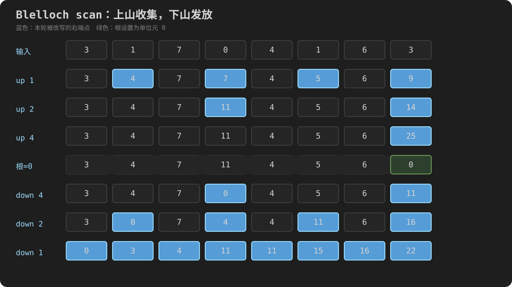

# 14 Scan（前缀和）与流压缩

Scan 的代码很短，却是 CUDA 初学阶段最容易“每行似乎都认识，合起来却不知道在干什么”的算法之一。根本原因通常不是不会写 `for`，而是以下四件事被同时抛给了读者：

- inclusive 和 exclusive 两种输出定义；
- 把看似串行的前缀依赖改写成树；
- `offset=1,2,4,...` 所代表的通信距离；
- shared memory 中每轮读写之间的同步协议。

本章不从两段神秘循环开始。我们先用 CPU 代码钉死语义，再画出 8 个元素每一轮的状态，最后才把手算过程逐行翻译成 CUDA。完成本章后，你应当能够：

1. 不靠背例子，按定义算出 inclusive/exclusive scan；
2. 解释 scan 与 reduction 的相同点和根本区别；
3. 说清 Blelloch up-sweep 和 down-sweep 中每个位置保存什么；
4. 写出并验证一个支持尾块的单 block scan；
5. 把 scan 扩展为大数组的分层算法；
6. 用 scan 构造流压缩，并解释为什么写入不会冲突；
7. 在实际工程中正确调用 CUB，而不是重复维护脆弱的手写版本。

## 14.0 Scan 到底解决什么问题

给定输入：

```text
x = [3, 1, 7, 0, 4, 1, 6, 3]
```

第 11 章的 sum reduction 只问一个问题：

```text
所有元素的总和是多少？                    25
```

Scan 问的是一整组问题：

```text
位置 0 之前的和是多少？                    0
位置 1 之前的和是多少？                    3
位置 2 之前的和是多少？                    4
……
位置 7 之前的和是多少？                   22
```

所以 exclusive scan 的结果是：

```text
[0, 3, 4, 11, 11, 15, 16, 22]
```

它最后还能推导出总和 `22 + 3 = 25`，但这不是它最重要的地方。重要的是它为**每个位置**保留了“我之前一共有多少”的答案。这个答案可以直接当作偏移量、索引或地址。

这也是 scan 比 reduction 更难并行的原因：

| 算法 | 输出数量 | 可以丢掉中间信息吗 | 常见用途 |
|---|---:|---|---|
| reduction | 通常 1 个 | 可以，只要保住最终聚合值 | 总和、最大值、计数 |
| scan | 与输入一样多 | 不可以，每个前缀都是答案 | 偏移、压缩、排序、稀疏结构 |

两者都会构造归约树，前半程看起来相似；scan 还必须把树上的前缀信息再传回所有叶子。后面会把这一步称为 down-sweep。

### 14.0.1 一个先建立起来的直觉：scan 是“批量编号器”

假设每个输入元素先产生一个工作量：

```text
count = [2, 0, 3, 1]
```

含义是元素 0 要写 2 项，元素 1 不写，元素 2 写 3 项，元素 3 写 1 项。exclusive scan 得到：

```text
offset = [0, 2, 2, 5]
```

于是每个元素的写入区间立即确定：

```text
元素 0 → output[0..2)
元素 1 → output[2..2)   空区间
元素 2 → output[2..5)
元素 3 → output[5..6)
```

最后的总输出长度是：

```text
offset.back() + count.back() = 5 + 1 = 6
```

这就是 scan 在 GPU 算法中反复出现的原因：先并行计算每个线程将产生多少数据，再 scan 一次，所有线程便获得不重叠的写入位置。

## 14.1 Inclusive 与 exclusive：差的不是一个名字，而是边界含义

设输入为 `x[0], x[1], ..., x[n-1]`，加法的单位元是 0。

Inclusive scan 的第 `i` 项**包含**当前位置：

```text
inclusive[i] = x[0] + x[1] + ... + x[i]
```

Exclusive scan 的第 `i` 项**不包含**当前位置：

```text
exclusive[i] = x[0] + x[1] + ... + x[i-1]
```

当 `i=0` 时，“位置 0 之前”没有任何元素，所以 exclusive 的第一项是单位元 0。

对输入 `[3,1,7,0,4,1,6,3]`，逐项写开：

| `i` | `x[i]` | exclusive：`i` 之前 | inclusive：到 `i` 为止 |
|---:|---:|---:|---:|
| 0 | 3 | 0 | 3 |
| 1 | 1 | 3 | 4 |
| 2 | 7 | 4 | 11 |
| 3 | 0 | 11 | 11 |
| 4 | 4 | 11 | 15 |
| 5 | 1 | 15 | 16 |
| 6 | 6 | 16 | 22 |
| 7 | 3 | 22 | 25 |

因此：

```text
exclusive = [0, 3, 4, 11, 11, 15, 16, 22]
inclusive = [3, 4, 11, 11, 15, 16, 22, 25]
```

### 14.1.1 三条极有用的交叉关系

只要是加法 scan，下面的式子就能用来检查每个输出位置，而不是只检查最终总和：

```text
exclusive[0] = 0                                      （n > 0）
inclusive[i] = exclusive[i] + x[i]
exclusive[i] = inclusive[i-1]                        （i > 0）
```

最后，总和满足：

```text
total = inclusive[n-1]
      = exclusive[n-1] + x[n-1]                      （n > 0）
```

如果 GPU 输出恰好总和正确，却有两个中间前缀写反，仅比较 `total` 会漏掉错误。测试 scan 必须逐项比较 CPU oracle。

### 14.1.2 空数组与单元素数组

边界条件不是附加题，而是定义的一部分：

| 输入 | exclusive | inclusive | total |
|---|---|---|---:|
| `[]` | `[]` | `[]` | 0 |
| `[5]` | `[0]` | `[5]` | 5 |

空输入没有第 0 个输出，不能访问 `.back()`；单元素 exclusive 输出不是 5，而是“5 之前的总和”0。后面的 GPU 程序会专门测试 `n=0,1`。

### 14.1.3 不只有加法

Scan 可以建立在一个满足结合律的二元运算 `⊕` 和单位元 `I` 上：

```text
exclusive = [I,
             x0,
             x0 ⊕ x1,
             x0 ⊕ x1 ⊕ x2,
             ...]
```

例如乘法单位元是 1，`max` 可选一个不大于任何合法输入的哨兵值。运算必须具有结合律，是因为并行树会改变括号分组。交换律并非所有 scan 接口的必要条件：即使 `a ⊕ b` 与 `b ⊕ a` 不同，只要实现始终保持输入顺序，也可扫描非交换但结合的运算。

浮点加法在实数数学中结合，在有限精度机器运算中却可能因舍入出现：

```text
(a + b) + c != a + (b + c)
```

所以并行浮点 scan 与串行左折叠可能有末位差异。后面验证浮点版本时应使用误差标准，并记录算法与运行环境，不能盲目逐位相等。

## 14.2 先写 CPU oracle：把“正确答案”与“GPU 算法”分开

如果一开始就用 GPU kernel 给另一个 GPU kernel 当答案，两个实现可能带着相同错误一起通过。可靠做法是先写最直白的串行参考。

Exclusive scan 的递推顺序是“先写旧 running，再加入当前输入”：

```cpp
running = 0;
for (i = 0; i < n; ++i) {
    exclusive[i] = running;
    running += input[i];
}
```

Inclusive scan 恰好相反：“先加入当前输入，再写 running”：

```cpp
running = 0;
for (i = 0; i < n; ++i) {
    running += input[i];
    inclusive[i] = running;
}
```

这两段代码只差两行的先后顺序，却准确表达了“含不含自己”。不要靠“结果整体左移还是右移”的模糊记忆来写；先说清输出位置的含义，再决定写入顺序。

### 14.2.1 完整程序：scan_reference.cpp

下面的程序默认处理本章的 8 元素例子，也允许从命令行输入最多 64 个整数。累加器和输出使用 `int64_t`，是为了让本节先聚焦 scan 语义，而不是让 32 位溢出混进第一个例子。

```cpp
#include <charconv>
#include <cstdint>
#include <iostream>
#include <string_view>
#include <vector>

namespace {

bool parse_int(std::string_view text, int& value) {
    const char* first = text.data();
    const char* last = text.data() + text.size();
    const auto result = std::from_chars(first, last, value);
    return result.ec == std::errc{} && result.ptr == last;
}

std::vector<std::int64_t> exclusive_scan_reference(
    const std::vector<int>& input) {
    std::vector<std::int64_t> output(input.size());
    std::int64_t running = 0;
    for (std::size_t i = 0; i < input.size(); ++i) {
        output[i] = running;
        running += input[i];
    }
    return output;
}

std::vector<std::int64_t> inclusive_scan_reference(
    const std::vector<int>& input) {
    std::vector<std::int64_t> output(input.size());
    std::int64_t running = 0;
    for (std::size_t i = 0; i < input.size(); ++i) {
        running += input[i];
        output[i] = running;
    }
    return output;
}

template <typename T>
void print_vector(std::string_view name, const std::vector<T>& values) {
    std::cout << name << "=[";
    for (std::size_t i = 0; i < values.size(); ++i) {
        if (i != 0) std::cout << ", ";
        std::cout << values[i];
    }
    std::cout << "]\n";
}

bool validate(const std::vector<int>& input,
              const std::vector<std::int64_t>& exclusive,
              const std::vector<std::int64_t>& inclusive) {
    if (exclusive.size() != input.size() ||
        inclusive.size() != input.size()) return false;

    for (std::size_t i = 0; i < input.size(); ++i) {
        if (inclusive[i] != exclusive[i] + input[i]) return false;
        if (i == 0) {
            if (exclusive[i] != 0) return false;
        } else if (exclusive[i] != inclusive[i - 1]) {
            return false;
        }
    }
    return true;
}

}  // namespace

int main(int argc, char** argv) {
    std::vector<int> input;
    if (argc == 1) {
        input = {3, 1, 7, 0, 4, 1, 6, 3};
    } else {
        constexpr int kMagnitudeLimit = 1'000'000;
        constexpr int kItemLimit = 64;
        if (argc - 1 > kItemLimit) {
            std::cerr << "error: at most " << kItemLimit << " integers\n";
            return 2;
        }
        input.reserve(static_cast<std::size_t>(argc - 1));
        for (int i = 1; i < argc; ++i) {
            int value = 0;
            if (!parse_int(argv[i], value) || value < -kMagnitudeLimit ||
                value > kMagnitudeLimit) {
                std::cerr << "error: argument " << i
                          << " must be an integer in [-1000000, 1000000]\n";
                return 2;
            }
            input.push_back(value);
        }
    }

    const auto exclusive = exclusive_scan_reference(input);
    const auto inclusive = inclusive_scan_reference(input);
    if (!validate(input, exclusive, inclusive)) {
        std::cerr << "FAIL: scan invariants do not hold\n";
        return 1;
    }

    print_vector("input", input);
    print_vector("exclusive", exclusive);
    print_vector("inclusive", inclusive);
    const std::int64_t total = inclusive.empty() ? 0 : inclusive.back();
    std::cout << "total=" << total << '\n';
    std::cout << "PASS: every prefix and cross-relation validated\n";
    return 0;
}
```

在 Linux 服务器上编译：

```bash
g++ -std=c++17 -O2 -Wall -Wextra \
    code/14_scan/scan_reference.cpp -o scan_reference
./scan_reference
```

命令逐项解释：

- `g++`：调用 GNU C++ 编译器；这份文件不含 CUDA 设备代码，所以不必用 `nvcc`。
- `-std=c++17`：要求编译器按 C++17 语言标准解析源码，程序使用的 `std::from_chars` 属于这一标准。
- `-O2`：开启常用优化；它不改变程序应有的可观察语义。
- `-Wall -Wextra`：打开两组常用警告，帮助发现可疑代码；警告不等于运行错误，也不保证抓住所有错误。
- `code/14_scan/scan_reference.cpp`：输入源文件路径。
- `-o scan_reference`：把生成的可执行文件命名为 `scan_reference`；不指定时，Linux 上常见默认名为 `a.out`。
- `./scan_reference`：执行当前目录下的文件。`./` 表示当前目录，避免 shell 只在 `PATH` 中查找。

默认预期输出：

```text
input=[3, 1, 7, 0, 4, 1, 6, 3]
exclusive=[0, 3, 4, 11, 11, 15, 16, 22]
inclusive=[3, 4, 11, 11, 15, 16, 22, 25]
total=25
PASS: every prefix and cross-relation validated
```

再测试负数、零和单元素：

```bash
./scan_reference 5 -2 0 7
./scan_reference 9
```

第一条的结果应为：

```text
input=[5, -2, 0, 7]
exclusive=[0, 5, 3, 3]
inclusive=[5, 3, 3, 10]
total=10
PASS: every prefix and cross-relation validated
```

负数不会破坏加法 scan。它只会让前缀不再单调递增，因此“可以用二分搜索前缀”的额外性质也不再自动成立。

### 14.2.2 为什么参考实现不用 int 累加

若输入类型是 32 位 `int`，`n` 个输入的和未必仍适合 32 位。即使每个元素合法，累积结果也可能溢出。C++ 有符号整数溢出不是可依赖的回绕语义。

本例把输入限制在 64 个、绝对值不超过一百万，并使用 `int64_t` 累加，因此参考值远离 64 位边界。以后 GPU 版本若选择 `int` 输出，就必须把“允许的数据范围”写进接口；若选择 64 位输出，还要确认设备实现、共享内存占用和库模板参数全部一致。

## 14.3 流压缩：为什么 exclusive scan 天然产生写入下标

任务：从下面的数组中保留所有正数，并维持原有顺序。

```text
input = [-2, 5, 0, 7, -1, 3]
```

### 第一步：并行生成 flags

每个线程只判断自己的元素：

```text
flags[i] = input[i] > 0 ? 1 : 0
flags    = [0, 1, 0, 1, 0, 1]
```

### 第二步：对 flags 做 exclusive scan

```text
offsets = [0, 0, 1, 1, 2, 2]
```

`offsets[i]` 表示位置 `i` **之前**一共有几个满足条件的元素。这正是当前元素被保留时应写到的紧凑下标。

### 第三步：只让 flag 为 1 的线程散射

| `i` | `input[i]` | `flags[i]` | `offsets[i]` | 动作 |
|---:|---:|---:|---:|---|
| 0 | -2 | 0 | 0 | 不写 |
| 1 | 5 | 1 | 0 | `output[0]=5` |
| 2 | 0 | 0 | 1 | 不写 |
| 3 | 7 | 1 | 1 | `output[1]=7` |
| 4 | -1 | 0 | 2 | 不写 |
| 5 | 3 | 1 | 2 | `output[2]=3` |

最终：

```text
output = [5, 7, 3]
count  = offsets[5] + flags[5] = 2 + 1 = 3
```

这里没有 `atomicAdd` 分配位置。原因是 scan 已经为每个被保留元素算出不同下标：第 `k` 个 1 前面恰好有 `k` 个 1，所以它写 `output[k]`。输入顺序也自然保持。

若改用 inclusive scan，位置 1 得到 1，必须再减 1 才能成为零基下标：

```text
if (flags[i]) output[inclusive_flags[i] - 1] = input[i];
```

不是不能用 inclusive，而是 exclusive 的语义直接等于“我之前有多少项”，更适合作为起始偏移。

## 14.4 怎样把串行依赖变成并行层

CPU 递推 `output[i]=output[i-1]+input[i-1]` 看起来要求位置 `i` 等位置 `i-1`，像一条完全串行的链。并行 scan 的关键是改变计算图，而不是让许多线程同时执行这条有依赖的递推。

### 14.4.1 容易理解但工作量较多的 doubling scan

先看 inclusive 版本。第 0 轮每个位置只代表自己；距离依次取 `1,2,4,...`。在距离 `d` 的一轮中，位置 `i>=d` 把“从自己向左相距 `d` 的旧值”加进来。

对 `[3,1,7,0,4,1,6,3]`：

```text
初始 d=0: [3, 1,  7,  0,  4,  1,  6,  3]
d=1 后 : [3, 4,  8,  7,  4,  5,  7,  9]
d=2 后 : [3, 4, 11, 11, 12, 12, 11, 14]
d=4 后 : [3, 4, 11, 11, 15, 16, 22, 25]
```

为什么 `d=2` 时位置 6 得到 `11`？它用的是**该轮开始前**位置 6 的 7 和位置 4 的 4：

```text
old[6] + old[4] = 7 + 4 = 11
```

不能让位置 6 偶然读到同一轮中位置 4 刚写出的 12，否则一个算法轮次混入两代数据。实现这种方法通常要使用两份缓冲交替读写，或先把源值读入寄存器并通过严格同步保证轮次边界；仅在原地循环末尾放一个屏障不足以防止同轮读写风险。

`offset=1,2,4` 的含义不是“处理元素 1、2、4”，而是：

```text
第 1 轮，每个已知片段长度从 1 扩成最多 2
第 2 轮，每个已知片段长度从 2 扩成最多 4
第 3 轮，每个已知片段长度从 4 扩成最多 8
```

对于 8 个元素需要 `log2(8)=3` 轮。每轮最多约 `n` 次加法，总工作量是 `O(n log n)`；串行 scan 只有 `O(n)` 次加法。因此它并行深度较小，却不是 work-efficient（工作高效）的 scan。

### 14.4.2 并行深度与总工作量是两把尺子

不要把“轮数少”直接等同于“总工作少”：

| 算法 | 串行/并行层数 | 加法总量级 | 是否保留所有前缀 |
|---|---:|---:|---|
| 串行 scan | `O(n)` | `O(n)` | 是 |
| doubling scan | `O(log n)` | `O(n log n)` | 是 |
| Blelloch scan | `O(log n)` | `O(n)` | 是 |
| reduction | `O(log n)` | `O(n)` | 否，只保留聚合值 |

GPU Gems 3 第 39 章用 balanced tree 解释 work-efficient scan：树只是决定每一步由谁合并谁的计算结构，不需要在内存中创建指针节点。接下来使用的 Blelloch 算法正是先从叶子走到根，再从根走回叶子。[NVIDIA GPU Gems 3：Parallel Prefix Sum (Scan) with CUDA](https://developer.nvidia.com/gpugems/gpugems3/part-vi-gpu-computing/chapter-39-parallel-prefix-sum-scan-cuda)

## 14.5 Blelloch 上山：up-sweep 收集区间总和

仍使用 8 个输入：

```text
[3, 1, 7, 0, 4, 1, 6, 3]
```

把数组想象成二叉树的叶子，但实际数据仍原地放在数组里。每层让右端点保存其整个区间的总和。

### 14.5.1 offset=1：长度 2 的相邻区间

活动的左右位置是：

```text
(0,1) (2,3) (4,5) (6,7)
```

右位置加左位置：

```text
data[1] += data[0]   → 1+3 = 4
data[3] += data[2]   → 0+7 = 7
data[5] += data[4]   → 1+4 = 5
data[7] += data[6]   → 3+6 = 9
```

本轮以后：

```text
[3, 4, 7, 7, 4, 5, 6, 9]
```

没有被写的位置并非“丢了”或“没参加”。位置 0、2、4、6 仍保存单元素值，后面的 down-sweep 会用到它们；右端点 1、3、5、7 则保存各长度 2 区间的总和。

### 14.5.2 offset=2：长度 4 的相邻区间

活动位置变成：

```text
(1,3) (5,7)
```

```text
data[3] += data[1]   → 7+4  = 11
data[7] += data[5]   → 9+5  = 14
```

本轮以后：

```text
[3, 4, 7, 11, 4, 5, 6, 14]
```

现在位置 3 保存输入 `[0..3]` 的总和 11，位置 7 保存 `[4..7]` 的总和 14。

### 14.5.3 offset=4：长度 8 的根区间

唯一活动对是 `(3,7)`：

```text
data[7] += data[3]   → 14+11 = 25
```

up-sweep 完成：

```text
[3, 4, 7, 11, 4, 5, 6, 25]
```

末尾位置 7 是根，保存全数组总和 25。注意其他位置不是普通输入，也不是最终 scan，而是不同树节点留下的局部和。

### 14.5.4 index 公式从哪里来

CUDA 教学代码常见：

```cpp
int index = (threadIdx.x + 1) * offset * 2 - 1;
if (index < n) {
    data[index] += data[index - offset];
}
```

这里 `index` 是每个活动区间的**右端点**，`index-offset` 是左半区间的右端点。

代入 `n=8`：

| `offset` | `tid=0` | `tid=1` | `tid=2` | `tid=3` |
|---:|---:|---:|---:|---:|
| 1 | 1，左端 0 | 3，左端 2 | 5，左端 4 | 7，左端 6 |
| 2 | 3，左端 1 | 7，左端 5 | 11，越界 | 15，越界 |
| 4 | 7，左端 3 | 15，越界 | 23，越界 | 31，越界 |

公式不是需要死背的魔法。每个长度 `2*offset` 的区间右端点依次为：

```text
2*offset-1, 2*(2*offset)-1, 3*(2*offset)-1, ...
```

把区间编号写成 `tid+1`，就得到代码中的表达式。

### 14.5.5 为什么每层之后需要 block 屏障

`offset=2` 的线程会读取 `offset=1` 刚写好的 `data[1]`、`data[5]`；`offset=4` 又依赖上一层写好的 `data[3]`。因此每层必须满足：

```text
本层所有 shared memory 写入完成
                ↓ __syncthreads()
下一层任何线程才可以读取
```

CUDA 编程指南规定 `__syncthreads()` 协调同一 block 内的线程，并为参与线程提供屏障前后共享访问所需的顺序；它不能同步不同 block。[CUDA Programming Guide：thread block synchronization](https://docs.nvidia.com/cuda/cuda-programming-guide/02-basics/intro-to-cuda-cpp.html)

屏障必须由 block 中所有未退出线程以一致控制流到达。不能写成：

```cpp
if (index < n) {
    data[index] += data[index - offset];
    __syncthreads();  // 错：只有部分线程进入
}
```

正确形状是让条件只包围数据操作，屏障放在条件外：

```cpp
if (index < n) {
    data[index] += data[index - offset];
}
__syncthreads();
```

## 14.6 山顶清零：为什么这一步把 reduction 变成 exclusive scan

up-sweep 结束时，根节点保存全数组总和 25。如果从这个值直接向下传播，叶子会带着“整个数组之前还有 25”的错误前缀。

Exclusive scan 的第一个前缀必须是单位元 0。因此在 down-sweep 前做：

```cpp
if (threadIdx.x == 0) data[n - 1] = 0;
__syncthreads();
```

状态变成：

```text
[3, 4, 7, 11, 4, 5, 6, 0]
```

这里的根 0 可以读作：“整个根区间 `[0..7]` 左边没有任何输入，所以进入这个区间的前缀为 0。”down-sweep 的任务就是把“进入父区间时已经累积多少”分发给左右子区间。

这一步若忘记，代码通常仍会输出一串有规律的数字，反而容易蒙混过关。逐项 CPU 对照会立即发现问题。

## 14.7 Blelloch 下山：down-sweep 发放每个区间的起始前缀

对于一个父区间，设：

```text
left  = 左子区间原来保存的总和
right = 父区间当前携带的“进入本区间之前的前缀”
```

则传播规则是：

```text
左子区间的新前缀 = right
右子区间的新前缀 = right + left
```

代码常写成：

```cpp
int left = data[index - offset];
data[index - offset] = data[index];
data[index] += left;
```

第一行一定要先保存旧 `left`；若先覆盖再读取，左子树总和就丢了。

### 14.7.1 offset=4：根拆成左右两个长度 4 区间

当前：

```text
[3, 4, 7, 11, 4, 5, 6, 0]
```

活动对 `(3,7)`：旧左值 11，父前缀 0。

```text
data[3] = 0
data[7] = 0 + 11 = 11
```

得到：

```text
[3, 4, 7, 0, 4, 5, 6, 11]
```

这表示左半 `[0..3]` 的起始前缀为 0，右半 `[4..7]` 之前已有左半总和 11。

### 14.7.2 offset=2：每个长度 4 区间再拆成两个长度 2 区间

活动对 `(1,3)` 与 `(5,7)`：

```text
(1,3): old_left=4, parent_prefix=0
       data[1]=0, data[3]=4

(5,7): old_left=5, parent_prefix=11
       data[5]=11, data[7]=16
```

得到：

```text
[3, 0, 7, 4, 4, 11, 6, 16]
```

### 14.7.3 offset=1：发到每个叶子

四个活动对依次传播：

```text
(0,1): old_left=3, parent_prefix=0  → (0,3)
(2,3): old_left=7, parent_prefix=4  → (4,11)
(4,5): old_left=4, parent_prefix=11 → (11,15)
(6,7): old_left=6, parent_prefix=16 → (16,22)
```

最终数组：

```text
[0, 3, 4, 11, 11, 15, 16, 22]
```

这正是 exclusive scan。

把完整过程放在一张表里：

| 阶段 | `offset` | shared memory 状态 |
|---|---:|---|
| 输入 | — | `[3,1,7,0,4,1,6,3]` |
| up-sweep | 1 | `[3,4,7,7,4,5,6,9]` |
| up-sweep | 2 | `[3,4,7,11,4,5,6,14]` |
| up-sweep | 4 | `[3,4,7,11,4,5,6,25]` |
| 根清零 | — | `[3,4,7,11,4,5,6,0]` |
| down-sweep | 4 | `[3,4,7,0,4,5,6,11]` |
| down-sweep | 2 | `[3,0,7,4,4,11,6,16]` |
| down-sweep | 1 | `[0,3,4,11,11,15,16,22]` |

同一过程的暗色逐轮图如下。图中蓝色格是该轮被改写的树节点；它们不是“只有这些输入参与”，而是由这些右端点替所在区间保存聚合状态。



### 14.7.4 它和堆排序的树是不是一回事

二者都可能画成完全二叉树，也都常把逻辑树映射到连续数组，因此外形相似。但维护的不变量不同：

- 堆排序中的堆要维持父节点与子节点的大小顺序，例如最大堆的父值不小于子值。
- Blelloch up-sweep 的内部节点保存区间聚合结果，不要求父值大于或小于子值。
- Blelloch down-sweep 又把内部节点改写为进入各区间前的前缀，目的是为所有叶子产生输出。

所以可以借“数组里的完全二叉树”帮助理解索引，但不能把堆的比较和交换规则搬来。

## 14.8 第一份 CUDA 实现：单 block、任意尾部、逐项验证

旧教学程序把长度固定为 256，这会遮住三个必须理解的问题：如果 `n=13` 怎么办，补出来的三个位置是什么，以及 `n=0` 是否还应发射 kernel。新程序 `code/14_scan/single_block_scan.cu` 明确区分：

```text
n          真实输入的逻辑长度
capacity   不小于 n 的最小 2 次幂，也是本例 blockDim.x
padding    [n, capacity) 中为算法补上的单位元 0
```

例如 `n=13`：

```text
capacity = 16
shared   = [x0,x1,...,x12,0,0,0]
```

加法单位元 0 满足 `a+0=0+a=a`，所以补零不会改变任何真实位置的前缀，也不会改变总和。算法在长度 16 的树上运行，最后只把前 13 项写回。

### 14.8.1 动态 shared memory 与发射参数

kernel 声明：

```cpp
extern __shared__ std::int64_t data[];
```

数组长度不写在设备源码里，而由第三个发射配置参数给出字节数：

```cpp
const std::size_t shared_bytes = capacity * sizeof(std::int64_t);
exclusive_scan_single_block<<<1, capacity, shared_bytes>>>(
    d_input, d_output, d_total, n);
```

逐项翻译：

- 第一个 `1`：只发射一个 block；本节算法只能在这个 block 内同步。
- `capacity`：block 中线程数。本教学版一线程对应 shared 中一个位置，包括补零位置。
- `shared_bytes`：每个 block 动态分配多少 shared memory，单位是**字节**，不是元素个数。
- 圆括号中的四项才是 kernel 普通参数。

主机端先查询设备属性，并同时检查线程上限、x 维上限和 shared memory 上限。不能只因为源码把最大值写成 512，就假定所有设备与所有资源配置一定允许发射。

### 14.8.2 所有线程先装载，再开始树计算

```cpp
data[tid] = tid < n ? input[tid] : 0;
__syncthreads();
```

真实线程装载输入，尾部线程装载单位元。屏障保证 up-sweep 第一轮不会在别的线程还没写完时读取 shared memory。

注意没有这样写：

```cpp
if (tid >= n) return;  // 在含后续 __syncthreads() 的 kernel 中危险
```

尾部线程虽然没有真实输入，仍是树的参与者，并且必须和整个 block 一起经过每个屏障。让一部分线程提前返回、另一部分继续到达 block 屏障，会破坏屏障的参与协议。

### 14.8.3 总和必须在根清零之前保存

```cpp
if (tid == 0) {
    *total = data[capacity - 1];
    data[capacity - 1] = 0;
}
__syncthreads();
```

up-sweep 后根是总和；exclusive down-sweep 要把它改成 0。因此若调用者还需要总输出长度，必须先把旧根保存到 `d_total`。这里只有线程 0 写 `*total`，不存在多写者冲突。

### 14.8.4 为什么这个版本允许 input 与 output 指向同一设备数组

程序支持：

```bash
./single_block_scan 13 inplace
```

kernel 在最终写 output 之前，已经让所有输入进入 shared memory，并完成整棵树的计算：

```cpp
data[tid] = tid < n ? input[tid] : 0;
__syncthreads();
// 所有计算都只访问 data
...
if (tid < n) output[tid] = data[tid];
```

因此最后覆盖 global input 不会影响尚未发生的输入读取。如果某个实现边读 global input 边写 global output，就不能自动得出相同结论。原地安全是具体读写协议的性质，不是 scan 这个名字附带的保证。

### 14.8.5 编译、运行与应该观察什么

```bash
nvcc -std=c++17 -O2 -lineinfo \
    code/14_scan/single_block_scan.cu -o single_block_scan
./single_block_scan 13 out
./single_block_scan 13 inplace
./single_block_scan 257 out
./single_block_scan 0 out
```

命令中新出现的部分：

- `nvcc` 同时组织主机 C++ 与 CUDA 设备代码的编译和链接；`.cu` 文件及 `<<<...>>>` 发射语法需要它处理。
- `-lineinfo` 给设备代码保留行号信息，便于 Compute Sanitizer 与 profiler 把问题定位回源文件，通常不像完整 `-G` 那样关闭大量设备优化。
- `13` 是逻辑元素数，不是字节数，也不是线程数；程序会自行算出 `capacity=16`。
- `out` 使用不同输入输出缓冲，`inplace` 让两者指向同一设备分配。

程序使用确定输入公式 `(i*7)%11-5`，CPU 逐项生成 exclusive 参考。它会比较所有 `n` 项，再独立比较根保存的 `total`。成功输出末尾应是：

```text
PASS single-block exclusive scan; every prefix and total checked
```

不要把教材中的一段预期时间当成你的性能结论；本例当前只验证正确性。后面会用事件、预热、多轮样本和统一输入比较实现。

### 14.8.6 本节算法的边界

这个 kernel 是理解树与屏障的教学实现，不是 device-wide 通用库：

- 只有一个 block，最多处理程序限制的 512 项；
- 一线程只处理一个位置，未做每线程多项、向量化或 bank-conflict 优化；
- 每层都有全 block 屏障；
- 只实现 64 位整数加法 exclusive scan；
- 大数组不能靠把 grid 从 1 改大解决，因为 `__syncthreads()` 不同步 block。

最后一条尤其重要。若直接发射多个 block，每个 block 只能得到自己的局部前缀；第二个 block 不知道第一个 block 的总和。大数组需要显式分层，这正是下一节的主题。

## 14.9 从 1 个 block 到整个数组：三阶段分层 scan

假设 tile 大小固定为 256，而输入有 600 项。grid 会有三个 block：

```text
block 0 扫描 input[  0..256)  → 256 项
block 1 扫描 input[256..512)  → 256 项
block 2 扫描 input[512..600)  →  88 项 + 168 个补零
```

第一阶段以后，每个 tile 内部都正确，但 block 1 的第一个输出仍为 0。对于全数组 exclusive scan，它应该等于 block 0 的总和。block 2 的所有输出则要加上 block 0 和 block 1 的总和。

因此 device-wide scan 分三步：

```text
阶段 A：各 block 独立扫描 tile，并额外写出 block_sums
         block_sums = [sum(tile0), sum(tile1), sum(tile2)]

阶段 B：扫描 block_sums，得到每个 block 之前的总和
         block_offsets = [0, sum(tile0), sum(tile0)+sum(tile1)]

阶段 C：把 block_offsets[b] 加到 block b 的每一个局部输出
```

阶段 C 以后，每个局部前缀都被平移成全局前缀。

### 14.9.1 为什么必须拆成 kernel 阶段

普通 CUDA kernel 的 `__syncthreads()` 只同步一个 block。不能在 `scan_tiles` 末尾写：

```cpp
__syncthreads();
// 然后假设所有 block_sums 都已经写完
```

block 0 到达屏障时，block 2 甚至可能尚未被调度。跨 block 的依赖需要一个真正适用的协议。本章基础实现使用最清楚的方式：

```text
scan_tiles kernel
        ↓ 同一 stream 中先提交的 kernel 完成后，后提交的才能执行
递归扫描 block_sums 的 kernel
        ↓
uniform_add kernel
```

kernel 边界和同一 stream 的顺序保证了阶段依赖。更高级的 cooperative launch、单 pass look-back 等方案有额外条件，不应在尚未建立正确分层模型时混进第一份大数组实现。

### 14.9.2 scan_tiles 同时产生局部输出和 block 总和

每个 block 仍做上一节的 256 项 Blelloch scan。区别是根清零之前，将总和写到独立数组：

```cpp
if (tid == 0) {
    block_sums[blockIdx.x] = data[kTileSize - 1];
    data[kTileSize - 1] = 0;
}
__syncthreads();
```

`block_sums` 每个位置只有对应 block 的线程 0 写，因此不需要原子操作。最后一个尾块把越界输入装成 0，其根仍是所有真实尾部元素的准确总和。

### 14.9.3 “扫描 block_sums”本身也可能太大

若输入有一百万项，tile 为 256，则第一层大约产生 3907 个 block sums。3907 仍大于单个 256 项 tile，所以阶段 B 不是永远只有一个 block。

解决方法是递归应用同一结构：

```text
level 0: 1,000,003 items → 3,907 block sums
level 1:     3,907 items →    16 block sums
level 2:        16 items →     1 block sum
```

最顶层的 16 项可由一个 block 完成。递归返回时，先给 level 1 加回其 block offsets，再给 level 0 加回其 block offsets。

这里的“递归”发生在**主机提交工作**的函数中，不是每个 GPU 线程递归调用自身：

```cpp
scan_tiles<<<blocks, 256>>>(input, output, block_sums, n);
if (blocks > 1) {
    scan_recursive(block_sums, block_offsets, blocks, ...);
    uniform_add<<<blocks, 256>>>(output, block_offsets, n);
}
```

这三行省略了分配、错误检查和释放，只展示依赖关系。完整可运行版本在 `code/14_scan/hierarchical_scan.cu`。

### 14.9.4 uniform_add 为什么不需要 shared memory

```cpp
__global__ void uniform_add(std::int64_t* output,
                            const std::int64_t* block_offsets,
                            int n) {
    const int index = blockIdx.x * kTileSize + threadIdx.x;
    if (index < n) output[index] += block_offsets[blockIdx.x];
}
```

同一 block 的线程读取同一个 `block_offsets[blockIdx.x]`，但每个线程写不同的 `output[index]`。这不是第 13 章那种多个线程对同一地址做 read-modify-write，所以不需要 `atomicAdd`。尾部条件只包围一次独立写入，kernel 中没有后续 block 屏障，越界线程不写即可。

### 14.9.5 以 n=257 手算层级边界

`n=256` 时正好一个 tile；`n=257` 时突然需要两个：

```text
tile 0: input[0..256)
tile 1: input[256] + 255 个 0
block_sums = [sum(input[0..256)), input[256]]
block_offsets = [0, sum(input[0..256))]
```

第二个 tile 的局部 exclusive 输出第 0 项为 0。加回 `block_offsets[1]` 后，`output[256]` 正好等于前 256 个输入的总和。这是最值得保留的边界测试之一，因为它能同时检验：

- grid 向上取整；
- 尾块补零；
- block sums 的 scan；
- uniform add；
- `index<n` 的尾部保护。

所以 CMake 测试矩阵特意覆盖 `255,256,257` 和 `65535,65536,65537`，不是随便挑几个大数。

### 14.9.6 原地大数组为什么仍然安全

顶层 `input==output` 时，每个 block 只读取并覆盖自己的 tile；在覆盖 global memory 之前，该 tile 的全部输入已经进 shared memory。一个 block 不读取别的 block 的原始输入。后续层只读取单独的 `block_sums`，最后的 `uniform_add` 只修改已经生成的输出。因此这个具体实现允许原地运行。

再次强调：这是从实际读写集合推出来的结论。CUB 或别的接口是否允许 in-place，要看它自己的契约；两个范围部分重叠也不等于完全相同，不能自行推广。

### 14.9.7 编译与观察递归层

```bash
nvcc -std=c++17 -O2 -lineinfo \
    code/14_scan/hierarchical_scan.cu -o hierarchical_scan
./hierarchical_scan 257 out
./hierarchical_scan 65537 inplace
./hierarchical_scan 1000003 out
```

一百万零三项的输出会列出类似的结构信息：

```text
n=1000003 tile=256 mode=out levels=3
level=0 items=1000003 blocks=3907
level=1 items=3907 blocks=16
level=2 items=16 blocks=1
...
PASS hierarchical exclusive scan; every prefix checked
```

`levels=3` 是算法分层数，不是发射了三个 kernel。每个非顶层至少有 tile scan 和 uniform add；内存分配、复制和同步也不计入这个简单的层数。程序逐项比较一百万零三项 CPU 参考，这比只看首尾打印值更有证明力。

### 14.9.8 这仍是教学实现，不是性能终点

`hierarchical_scan.cu` 为了看清结构，在递归层临时 `cudaMalloc/cudaFree`，每线程只处理一项，tile 固定为 256，也没有消除 shared-memory bank conflict。实际高性能 scan 会考虑更大的每 block 工作量、寄存器内局部扫描、向量化加载、可复用临时存储以及跨 tile 前缀传播协议。

所以本例回答的是：

```text
怎样正确地把单 block exclusive scan 组合成任意长度 device-wide scan？
```

它还没有回答：

```text
在你的 GPU、数据类型和输入规模上，怎样做到最快？
```

后者优先交给经过广泛调优的 CUB，并用本机 benchmark 验证。

## 14.10 实战：用 flags、CUB scan 和 scatter 做稳定流压缩

14.3 已经手算了流压缩。现在把它变为完整 CUDA 程序 `code/14_scan/stream_compaction.cu`。本例不再复制一遍手写分层 scan，而是调用 CUB：学习者应当既能解释算法结构，也会使用 CUDA Toolkit 自带的工程级并行原语。

任务仍是保留所有正数并维持输入相对顺序。整个设备流水线是：

```text
input
  │ make_positive_flags
  ▼
flags ── CUB ExclusiveSum ──► offsets
  │                              │
  └──────── scatter_selected ────┘
                 │
                 ▼
            compacted output
```

### 14.10.1 flags kernel：先把业务条件变成 0/1

```cpp
__global__ void make_positive_flags(const int* input, int* flags, int n) {
    const int index = blockIdx.x * blockDim.x + threadIdx.x;
    if (index < n) flags[index] = input[index] > 0 ? 1 : 0;
}
```

这里的 `>0` 是可替换的业务谓词。要保留偶数，可改为 `input[index] % 2 == 0`；要保留结构体中的有效记录，可检查其状态字段。后面的 scan 和 scatter 不关心“为什么是 1”。

把谓词结果显式放进 `flags` 还有一个验证好处：程序可以分别检查“选择条件算对了吗”和“前缀偏移算对了吗”，而不是只在最终 output 错时猜是哪一阶段出问题。

### 14.10.2 CUB 的经典两阶段临时存储接口

包含头文件：

```cpp
#include <cub/device/device_scan.cuh>
```

第一次调用传空的临时存储指针，只查询需要多少字节：

```cpp
void* d_temp_storage = nullptr;
std::size_t temp_storage_bytes = 0;

cub::DeviceScan::ExclusiveSum(
    nullptr, temp_storage_bytes, d_flags, d_offsets, n);
```

然后分配这些字节，再用相同输入输出真正执行：

```cpp
cudaMalloc(&d_temp_storage, temp_storage_bytes);

cub::DeviceScan::ExclusiveSum(
    d_temp_storage, temp_storage_bytes, d_flags, d_offsets, n);
```

两次函数调用外形相同，作用却不同：

| 调用 | `d_temp_storage` | 主要结果 | 是否产生 offsets |
|---|---|---|---|
| 查询 | `nullptr` | 填写 `temp_storage_bytes` | 否 |
| 执行 | 已分配设备地址 | 扫描 `d_flags` 到 `d_offsets` | 是 |

`temp_storage_bytes` 是字节数，不能误当成 `int` 元素数再乘一次 `sizeof(int)`。临时空间归调用者所有；若在循环中反复扫描相似规模，应考虑复用足够大的分配，而不是每轮查询、分配和释放。

CUB 当前官方文档把 `DeviceScan::ExclusiveSum` 描述为 device-wide exclusive prefix sum，并明确给出两阶段临时存储调用方式；接口还说明完全相同的输入输出范围可用于 in-place，但其他部分重叠不受允许。[CUB `DeviceScan` API](https://nvidia.github.io/cccl/unstable/cub/api/structcub_1_1DeviceScan.html)

本例仍使用不同的 `d_flags` 和 `d_offsets`，因为调试时需要把两者都复制回来分别验证。

### 14.10.3 同一 stream 的提交顺序构成数据依赖

代码依次提交：

```cpp
make_positive_flags<<<blocks, 256>>>(...);
cub::DeviceScan::ExclusiveSum(...);
scatter_selected<<<blocks, 256>>>(...);
```

三项都使用默认 stream。主机提交通常是异步的，但同一 stream 中后面的工作不会越过前面的工作，所以 CUB 读取 flags 前，flag kernel 会完成；scatter 读取 offsets 前，scan 会完成。

这再次区分第 9 章的两个概念：

```text
主机已经提交调用  ≠  GPU 已经完成工作
同一 stream 有顺序 ≠  主机在每一步都必须 cudaDeviceSynchronize
```

程序在需要读取最终结果之前统一 `cudaDeviceSynchronize()`，并同时检查异步执行错误。它没有在三个设备阶段之间插入主机同步。

### 14.10.4 scatter 为何没有写冲突且保持稳定顺序

```cpp
if (index < n && flags[index] != 0) {
    output[offsets[index]] = input[index];
}
```

设 `i<j` 且两者 flag 都为 1。位置 `j` 之前至少比位置 `i` 之前多包含 `flags[i]` 这个 1，因此：

```text
offsets[j] > offsets[i]
```

两线程写入地址不同，不需要原子操作；后出现的被选元素得到更大的输出下标，所以相对顺序保持。这叫 stable compaction（稳定压缩）。

没被选中的位置可能共享相同 offset，例如手算例子中 offsets 是 `[0,0,1,1,2,2]`；但这些线程不执行写入，所以相同 offset 不构成冲突。

### 14.10.5 输出长度与容量是两件事

exclusive offsets 最后一项不一定等于被选总数，因为它不含最后一个 flag。正确公式为：

```cpp
selected_count = offsets[n - 1] + flags[n - 1];
```

若 `n=0`，上述两个索引都不存在，所以程序在任何 CUDA 调用前单独返回空结果。

本例为 output 分配最坏情况容量 `n*sizeof(int)`，因为每个输入最多产生一个输出。真实长度只有 `selected_count`。这样 scatter 可以完全留在设备流水线中，不必为了先得知长度而中途同步主机。

如果下游只接受精确大小，可以有几种设计：

- 接受一次设备到主机的小拷贝和同步，取得 count 后再分配；
- 让上层缓冲池预留容量，传递逻辑长度；
- 若生产消费都在 GPU 上，让 count 留在设备并设计后续 kernel 的协议。

哪一种最好取决于完整流水线，不能只看一次 `cudaMalloc`。

### 14.10.6 逐阶段验证比“输出看起来对”更可靠

完整程序构造三份 CPU 参考：

```text
expected_flags
expected_offsets
expected_output
```

运行结束后同时要求：

```cpp
actual_flags == expected_flags &&
actual_offsets == expected_offsets &&
actual_output == expected_output
```

这样能区分：谓词错误、scan 错位、scatter 错写或稳定性破坏。只比较输出集合而不比较顺序，会把不稳定算法误判为稳定实现；只比较 selected count，则几乎无法证明内容正确。

### 14.10.7 编译和边界矩阵

CUB 随 CUDA Toolkit 提供，不需要单独下载。用 `nvcc` 编译：

```bash
nvcc -std=c++17 -O2 -lineinfo \
    code/14_scan/stream_compaction.cu -o stream_compaction
./stream_compaction 0
./stream_compaction 1 none
./stream_compaction 1 all
./stream_compaction 257 mixed
./stream_compaction 1031 mixed
./stream_compaction 1031 none
./stream_compaction 1031 all
```

默认输入公式 `(i*7)%13-6` 会生成正数、零和负数。成功末尾为：

```text
PASS stable stream compaction; flags, offsets, and output checked
```

边界测试不只看大输入：

- `n=0`：不能访问最后一个 offset/flag；
- `n=1`：最后一个元素被选和未被选都应考虑；
- `255/256/257`：跨越线程块边界；
- 全不选：`selected_count=0`，不能对空输出做非零字节复制；
- 全选：输出应与输入逐项相同，count 等于 n。

程序提供三种输入分布：`mixed` 同时生成正数、零与负数；`none` 全不选；`all` 全选。CMake 测试矩阵也包含单元素 `none/all`，确保 count 分别为 0 和 1。

## 14.11 正确之后再谈性能：工作量、bank conflict 与数值边界

手写 scan 通过测试，只能说明“已测输入上的结果符合参考”，不能自动说明它快、适合所有类型或可替代库。本节把几条容易混在一起的边界分开。

### 14.11.1 Blelloch 为什么叫 work-efficient

长度为 8 的 up-sweep 分别做 4、2、1 次加法，共 7 次；down-sweep 每个内部节点也执行一次传播组合，共 7 次。一般长度为 `n` 的满二叉树有 `n-1` 个内部节点，所以两趟约为：

```text
(n-1) + (n-1) = 2n-2 次组合
```

它是 `O(n)`，与串行 scan 同量级；并不表示常数与串行完全相同，更不表示任意小数组都值得搬到 GPU。GPU 版本还包含装载、存储、屏障、kernel 发射及可能的主机设备传输。

Doubling scan 每层约做 `n` 次组合，共 `log2(n)` 层，工作量为 `O(n log n)`。它的每一轮规则更直观，在 warp shuffle、很小固定宽度或特定硬件原语中仍可能有用；“渐进工作更多”不等于任何规模和实现上都必然更慢。最终要用受控实验决定。

### 14.11.2 shared memory bank conflict 是地址映射问题

第 10 章已经建立了 bank 的基本模型。本章只补充 scan 中的新角色：Blelloch 的逻辑索引会随 `offset` 改变，活动线程访问的右端点从连续奇数逐渐拉开：

```text
offset=1: index 1,3,5,7,...
offset=2: index 3,7,11,15,...
offset=4: index 7,15,23,31,...
```

这些 stride 经过“地址到 bank”的映射后，可能让多个活动线程在同一事务中访问同一个 bank 的不同地址，从而产生 bank conflict 和序列化。它与 global memory coalescing 不是一回事：这里讨论的是 shared memory 内部的 bank 地址分布。

经典优化会给逻辑数组加入 padding，把逻辑索引 `i` 映射到稍微错开的物理位置，例如概念上的：

```text
physical(i) = i + padding(i)
```

GPU Gems 的旧实现给出了针对当时 bank 配置的 conflict-free offset 技巧。但不要未经核对直接复制一个历史宏：bank 数、bank 宽度、访问数据类型以及硬件广播/多播能力都会影响实际冲突。尤其本章教学代码使用 64 位元素，一个元素的访问特征不能简单套用只针对 32 位 word 的心算公式。

可靠流程是：

1. 先保留无 padding 的正确基线；
2. 用 Nsight Compute 检查目标 GPU 上相关 shared-memory 指标和源代码位置；
3. 只改变地址布局，保持输入、类型、tile、迭代与验证相同；
4. 重新验证所有输出并测量端到端或明确边界的 kernel 时间；
5. 若无稳定收益，优先保留更简单版本或直接使用 CUB。

本章不会填一张虚构的“优化后快多少”表；不同 GPU、Toolkit、类型和规模会给出不同结果。

### 14.11.3 整数 scan：每个输入合法不代表前缀合法

假设 32 位有符号输入是：

```text
[1'500'000'000, 1'500'000'000]
```

每项都能放进 `int`，前缀 3,000,000,000 却不能。不能只检查输入范围；要约束任何可能前缀的范围。

本章手写版本用 `int64_t` 保存输入和输出，并把最大元素数限制在四百多万，确定性测试值绝对值又很小，因此参考计算有明确安全裕量。流压缩的 flags 只有 0/1，且 `n` 受 `int` 范围内的更小上限约束，offset 不会溢出。

若业务规模可能让 64 位前缀也溢出，应改变表示、分段处理或显式定义饱和/模运算语义。C++ 有符号溢出不能当作可靠回绕；无符号算术按模数回绕虽有定义，但通常仍不是“元素数量”想要的结果。

### 14.11.4 浮点 scan：树改变了括号

串行左折叠：

```text
(((x0 + x1) + x2) + x3) + ...
```

并行树可能先分别合并若干子区间。以双精度 `[1e20, 1, -1e20, 1]` 为例，较小的 1 在与 `1e20` 相加时可能被舍去，不同括号可能得到不同末位乃至 0 与 1 的明显差异。

所以验证浮点 scan 时：

- 不能默认与 CPU 左折叠逐位相等；
- 同时考虑绝对误差和相对误差，并根据数据尺度选择容差；
- 特别关注大量异号数导致的抵消；
- 若必须可复现，明确固定库版本、算法策略、设备条件，并查接口是否提供相应确定性保证；
- “结果每次一样”与“等于某个串行顺序”是两件事。

CUB 文档明确提醒，浮点加法这类 pseudo-associative 运算的结果不能一概假定确定。整数无溢出时则没有舍入顺序差异。

### 14.11.5 结合律、交换律与顺序保持

并行分组要求结合律：

```text
(a ⊕ b) ⊕ c = a ⊕ (b ⊕ c)
```

但 scan 不必先打乱元素再组合。一个保持输入顺序的 scan 可以支持“结合但不交换”的操作，即 `a⊕b` 未必等于 `b⊕a`。这也是调用通用库时必须阅读接口对操作顺序的说明，而不能只看到模板参数 `op` 就假设所有二元函数都可用。

减法不是结合运算：

```text
(a-b)-c != a-(b-c)
```

不能把 `+` 简单替换为 `-`，再期待并行树复现串行逐项减法。若想计算相邻差分，那是另一个可并行定义，不是“减法 scan”。

### 14.11.6 手写还是 CUB：一张工程决策表

| 需求 | 优先选择 | 理由 |
|---|---|---|
| 学习树、shared memory 和同步 | 手写单 block | 中间状态可手算、可观察 |
| 理解大数组组合 | 手写分层版 | 看清 block sums 与 add-back |
| 产品代码的一般 device-wide scan | CUB `DeviceScan` | 已处理多架构、多规模和复杂调优 |
| block 内自定义算法的一部分 | CUB `BlockScan` 或审慎手写 | 范围与 block 生命周期一致 |
| warp 内小固定集合 | warp 原语或 CUB `WarpScan` | 避免不必要的全 block 协调 |
| 要筛选元素 | CUB scan 组合，或直接评估 `DeviceSelect` | 高层原语可能更直接 |

理解底层不是为了永远拒绝库；它让你能正确准备输入、解释临时存储、判断同步边界、验证输出，并在 profiler 里看懂库调用在解决什么问题。

## 14.12 公平 benchmark：手写分层 Scan 与 CUB 到底怎样比较

“CUB 肯定更快”或者“我的 kernel 只有几行所以更快”都不是实验结论。性能比较必须先定义同一任务，再控制除实现以外的变量。`code/14_scan/scan_benchmark.cu` 比较：

```text
方法 A：本章的 256 项 tile + 递归 block sums + uniform add
方法 B：cub::DeviceScan::ExclusiveSum
```

两者完成完全相同的任务：

```text
输入类型：int64_t
输出类型：int64_t
操作：加法 exclusive scan
元素数：相同 n
stream：同一个默认 stream
原始设备输入：同一份、只读
```

本例不是为了在书中宣布永久排名，而是给你一套可以带到自己的服务器、GPU、Toolkit 和数据规模上复现实验的方法。

### 14.12.1 为什么 benchmark 不能直接复用上一节的递归函数

`hierarchical_scan.cu` 为了让控制流清楚，在递归过程中分配和释放临时数组。若直接把整个函数放进计时区间，测到的会混合：

```text
cudaMalloc/cudaFree + kernel + 可能的同步副作用
```

而 CUB 若事先准备好临时存储，计时区间只有库 scan。这样的对比回答不了“scan 设备工作谁更快”，只反映两个不同的内存管理策略。

benchmark 先根据 n 构造所有层级并分配 workspace：

```text
level 0 sums/offsets
level 1 sums/offsets
...
CUB temporary storage
manual output
CUB output
```

这些分配全部发生在正式测量之前。计时函数 `launch_manual_scan` 只提交 tile scan、递归层和 uniform add，不执行 `cudaMalloc`。

这不表示分配成本永远不重要。它只表示本实验问题被清楚限定为“临时空间已准备好时，两种 scan 的设备执行时间”。若你的程序只扫描一次且临时空间无法复用，应另外测量端到端生命周期。

### 14.12.2 一份不可变输入，两份独立输出

```cpp
std::int64_t* d_input;
std::int64_t* d_manual_output;
std::int64_t* d_cub_output;
```

两种方法都从 `d_input` 读取，但写到自己的输出。这样不会出现“方法 B 扫描了方法 A 已经改写的数据”，也不必在每个样本前重新 H2D 输入。

每一轮两种方法都结束后，程序把 `d_input` 完整复制回主机，与原始输入逐项比较：

```cpp
if (input_snapshot != input) {
    // benchmark 立即失败
}
```

输入不变性检查非常重要。一个误写输入的实现可能在自己的第一次运行中给出正确结果，随后让另一方法读取错误数据，从而制造假差异。

### 14.12.3 先填哨兵，但不把填充算进 scan 时间

每个样本前：

```cpp
cudaMemsetAsync(output, 0xA5, bytes);
cudaEventRecord(start);
// manual 或 CUB scan
cudaEventRecord(stop);
```

三项在同一 stream 中提交。start Event 排在 memset 后，因此时间戳要等哨兵填充完成才记录；哨兵开销不落入 start—stop 区间。

哨兵的目的不是产生某个合法数字，而是让“有位置根本没写”更容易在逐项验证时暴露。`0xA5` 填充的是每个**字节**，并不是把每个 `int64_t` 设置为十进制 0xA5。

计时区间明确为：

```text
包含：实现 exclusive scan 所提交的设备工作
排除：分配、H2D、D2H、输出哨兵、CPU 验证、统计和打印
```

手写实现的区间覆盖它为完成一次 device-wide scan 所需的全部递归层和 add-back kernel，而不是只挑最内层 tile kernel。CUB 内部究竟发射多少 kernel 是库实现细节，本程序不猜测，也不打印一个虚构的 stages 数。

### 14.12.4 为什么用 CUDA Event，而不是只包一层主机时钟

kernel 发射和 CUB 调用通常先把工作提交给 GPU，再让主机继续。下面写法大多只测到提交耗时：

```cpp
auto begin = std::chrono::steady_clock::now();
kernel<<<...>>>();
auto end = std::chrono::steady_clock::now();
```

本例在相同 stream 中记录 start/stop Event，并等待 stop：

```cpp
cudaEventRecord(start);
launch_scan();
cudaEventRecord(stop);
cudaEventSynchronize(stop);
cudaEventElapsedTime(&milliseconds, start, stop);
```

这样得到的是两个设备事件之间的毫秒数。Event 分辨率、GPU 动态频率和系统噪声仍存在，所以不能只跑一次。

### 14.12.5 预热与轮换顺序

程序默认先做 4 轮预热，再收集 15 轮样本。预热会让上下文初始化、首次加载及频率状态等一次性影响不至于只污染第一个正式样本。

每轮两种方法都运行，但先后轮换：

```cpp
method = ((round + position) % 2 == 0) ? Manual : Cub;
```

因此：

```text
round 0: manual → CUB
round 1: CUB → manual
round 2: manual → CUB
...
```

如果永远让 A 先跑、B 后跑，温度、频率、缓存或同机干扰的时间趋势可能与方法名称绑定。轮换不能消除所有噪声，但比固定次序更公平。

预热也不是“随便跑、不检查”。每次预热输出同样逐项比较；错误实现不能靠“那几轮不计时”而被忽略。

### 14.12.6 每一个样本都验证，而不是 benchmark 结束才抽查

Event stop 完成后，D2H 输出发生在计时区间外。程序比较所有 n 个位置：

```cpp
for (std::size_t i = 0; i < actual.size(); ++i) {
    if (actual[i] != expected[i]) { ... }
}
```

为什么不只检查最后一个 total？因为 scan 的每个前缀都是输出，两个中间位置错了却恰好最终和正确并不罕见。为什么不只在最后检查一次？因为偶发同步、尾部或未初始化错误可能只出现在某一轮。

本例使用无溢出的整数，能够精确比较。若改成浮点，必须把 14.11 的数值顺序规则带进验证器，不能直接保留 `!=`。

### 14.12.7 报告样本和统计，不只报“最快一次”

输出保留每轮毫秒数，并给出：

```text
min_ms
median_ms
mean_ms
max_ms
logical_items_per_s
```

中位数比单次最小值更能表示一组典型样本；最小/最大和完整数组能暴露波动。`logical_items_per_s = n / median_seconds` 表示每秒处理多少逻辑输入项，不是 DRAM 实际字节带宽。算法可能多次读写层级数组，缓存也会改变物理流量；没有硬件计数器就不要把它标成 DRAM GB/s。

### 14.12.8 编译与运行

```bash
nvcc -std=c++17 -O2 -lineinfo \
    code/14_scan/scan_benchmark.cu -o scan_benchmark

./scan_benchmark 1031 15 4
./scan_benchmark 1000003 15 4
./scan_benchmark 4194304 21 5
```

三个参数依次是：

```text
n        元素数，1..4194304
rounds   正式样本轮数，3..100
warmups  预热轮数，1..20
```

成功输出的结构如下，但教材不填伪造时间：

```text
device="你的 GPU 名称" n=1000003 rounds=15 warmups=4 type=int64 exclusive=true
timed=scan-kernels-only; excludes allocation,H2D,D2H,sentinel,validation,printing
manual_levels=3 cub_temp_bytes=由当前 CUB 返回
manual samples_ms=[本机样本...] min_ms=... median_ms=... mean_ms=... max_ms=...
cub samples_ms=[本机样本...] min_ms=... median_ms=... mean_ms=... max_ms=...
PASS all warmup and measured outputs; immutable input checked 19 rounds
```

比较结果时至少记录 GPU 型号、CUDA Toolkit/驱动、编译命令、n、数据类型、轮数、机器负载和电源状态。不要把某台机器上一个 n 的结论推广成“所有 CUB/手写 scan 永远如此”。

### 14.12.9 这个 benchmark 仍然没有回答什么

它没有覆盖：

- 浮点与自定义运算；
- 多 stream 并发或与其他工作重叠；
- pinned H2D/D2H 的端到端流水线；
- CUB 临时空间首次分配成本；
- 多种 tile、每线程多项和 padding 的手写调优空间；
- 能耗、功率限制、长期热稳定性；
- Nsight Compute 的实际内存事务、bank conflict 和 occupancy 指标。

一个可信 benchmark 不必一次回答所有问题，但必须明确自己回答了哪一个问题。

## 14.13 用 Compute Sanitizer 检查 Scan 的内存与同步协议

CPU oracle 能证明已观察输出与数学参考一致，却无法独自证明没有越界、shared memory 数据竞争或错误屏障。Scan 恰好大量使用 shared memory 和循环屏障，应把动态检查作为练习流程的一部分。

第 13 章 13.15 已经系统讲过四种工具和显式故障注入，本节不重复复制一套危险 kernel，而是说明它们在 Scan 中各自检查什么，并让本章所有默认入口保持安全。

### 14.13.1 先用小而跨边界的输入

Compute Sanitizer 会显著降低程序速度。先用能触发结构边界的最小案例：

```bash
compute-sanitizer --tool memcheck \
  ./single_block_scan 257 out

compute-sanitizer --tool racecheck \
  ./single_block_scan 257 inplace

compute-sanitizer --tool synccheck \
  ./single_block_scan 257 out

compute-sanitizer --tool initcheck \
  ./hierarchical_scan 65537 out
```

为什么选 257：单 block 教学程序会把容量补到 512，既有真实位置也有 padding，能检查尾部读写保护。为什么给分层版选 65537：它跨过 `256*256`，会多出递归层边界，但仍比百万级输入更适合动态检查。

注意 `single_block_scan` 的最大逻辑长度就是 512；257 仍由一个 512 线程 block 处理，不表示发射了两个 block。

### 14.13.2 memcheck：重点看尾部与 workspace

对本章代码，memcheck 重点覆盖：

- `index<n` 是否保护尾 block 的 global load/store；
- 动态 shared memory 字节数是否足够容纳 `capacity` 个 `int64_t`；
- block sums/offsets 的递归层分配是否与 blocks 数一致；
- scatter 的 `offsets[index]` 是否落在 output 容量内；
- in-place 指针是否导致越界或非法重叠访问。

程序自己的 `PASS` 与工具的零错误都要满足。只看到：

```text
ERROR SUMMARY: 0 errors
```

却忽略程序返回了 mismatch，不算通过；反过来，数值正确但 memcheck 报越界也绝不能接受。

### 14.13.3 racecheck：重点看 shared memory 的层间协议

Blelloch 每层都是：

```text
若干线程读写 data
        ↓
整个 block 屏障
        ↓
下一层读取上一层结果
```

删掉任意层末尾的 `__syncthreads()`，普通运行可能偶尔仍输出正确，racecheck 才更有机会指出 shared memory hazard。它不替代数学验证，也不能证明 global memory 上所有高层协议；不同工具负责不同问题。

原地模式值得单独跑 racecheck，是为了检查“先全体装入 shared，再覆盖 global input”的实现是否引入了未预料的 shared hazard。global input/output 完全相同本身不是 race：每个线程最终写不同全局位置，且原始 tile 已经装载完成。

### 14.13.4 synccheck：屏障必须由一致的参与集合到达

本章 kernel 把屏障放在条件外：

```cpp
if (index < capacity) {
    data[index] += data[index - offset];
}
__syncthreads();
```

尾部线程和本层没有算术工作的线程仍会到达屏障。synccheck 用来发现不匹配的同步参与、错误的 warp/block 同步使用等问题。

不要为了“亲眼看错误”直接在正在使用的程序中随手把屏障移进 `if`；这可能让 kernel 挂住。若要练习故障模式，使用第 13 章已经隔离、默认不触发的 `sanitizer_faults.cu`，并严格按显式参数运行。正式默认测试不能故意执行未定义行为。

### 14.13.5 initcheck：输出哨兵不等于输入初始化

initcheck 关注未初始化 device global memory 的读取。本章程序在 kernel 前明确 H2D 输入，并让 padding 线程写单位元 0；CUB 临时空间由库自行管理，调用者不应猜测内部需要怎样初始化。

benchmark 给 output 填 `0xA5` 是为了验证完整写入，但这不能修复未初始化的 input，也不能证明 kernel 所有位置都已覆盖。最终逐项 oracle 才判断哨兵是否残留或结果是否错误。

### 14.13.6 不要在 Sanitizer 下解释性能数字

下面命令可以检查 benchmark 的正确路径：

```bash
compute-sanitizer --tool memcheck ./scan_benchmark 1031 3 1
```

但工具会插桩并显著改变执行时间。此时打印的 Event 样本只说明“在检查环境中经过了这些调用”，不能拿来比较手写与 CUB 性能，不用于性能排名。性能实验应在不带 Sanitizer 的正常运行中单独完成。

### 14.13.7 保存完整日志和返回码

服务器上建议把 stdout/stderr 一起保存：

```bash
compute-sanitizer --tool memcheck ./hierarchical_scan 65537 out \
  2>&1 | tee scan-memcheck.log
```

若要保留管道中 `compute-sanitizer` 的失败状态，在 Bash 中先启用：

```bash
set -o pipefail
```

然后查看：

```bash
echo $?
```

返回 0、程序 `PASS`、工具零错误三者共同构成这次检查的成功证据。日志还应记录二进制的构建命令、GPU 和 Toolkit 版本，便于之后复现。

动态工具只能覆盖实际执行到的路径。跑过 257 不会自动证明 0、1、256、512 或多层分层输入；因此 CTest 边界矩阵与 Sanitizer 代表性案例要配合使用。

## 14.14 练习：先手算，再改代码，最后做实验

不要只在脑中回答。第 1—12 题建议写出每一轮数组，第 13—20 题实际修改副本、编译并跑边界测试，第 21—24 题保存实验命令和原始输出。详细答案在附录 C；先独立完成，再对照。

### A. 定义与顺序

1. 手算输入 `[2,1,3,2]` 的 inclusive scan、exclusive scan 和 total，并逐项验证两种输出的交叉关系。
2. 分别写出空数组 `[]`、单元素 `[9]` 的 inclusive/exclusive 输出。为什么不能对空输出直接调用 `.back()`？
3. 已知 `exclusive=[0,5,3,3]`、`input=[5,-2,0,7]`，不用重新扫描，求 inclusive。再说明若只给 exclusive 而不给最后一个输入，能否恢复 total。
4. 工作量 `count=[2,0,3,1]`。求每项的起始 offset、半开写入区间和总输出长度；指出哪个区间为空。
5. 对输入 `[3,1,7,0,4]`，说明 reduction 与 scan 的输出数量和信息差异。为什么“reduction 总和正确”不能证明 scan 中间前缀正确？
6. 给 `max` scan 选择一个适用于输入范围 `[-100,100]` 的单位元，计算 `[3,-2,5,1]` 的 inclusive max scan。减法为什么不能直接替换加法成为并行 scan 运算？

### B. 并行树与同步

7. 对 `[1,2,3,4,5,6,7,8]` 手算 doubling inclusive scan 在 `d=1,2,4` 后的三个数组。每轮必须读取上一轮快照，不能读取同轮新值。
8. 对 `[2,5,1,3,0,4,2,1]` 写出 Blelloch 三轮 up-sweep、根清零、三轮 down-sweep 的全部七个数组，并核对最终 exclusive scan。
9. `n=16` 时，对 `offset=1,2,4,8`，列出所有未越界的 `(index-offset,index)` 活动对；解释 `index=(tid+1)*2*offset-1` 的含义。
10. 若 up-sweep 后不把根设置为 0，down-sweep 得到的值为什么不是 exclusive scan？用 4 个元素的小例子说明根中的 total 会怎样污染结果。
11. 在 up-sweep 循环中删除每层末尾的 `__syncthreads()`，列出至少一个跨层 read-after-write 依赖。为什么“我跑了十次都对”不能证明安全？
12. 逻辑长度 `n=6` 时，把输入 `[3,1,4,1,5,9]` 补到最小 2 次幂。写出 padding、最终前 6 项 exclusive 输出与 total，并解释补零为何不改变真实结果。

### C. CUDA 代码、尾部与流压缩

13. 逐项解释命令 `nvcc -std=c++17 -O2 -lineinfo code/14_scan/single_block_scan.cu -o single_block_scan`，并写出运行 257 项原地模式的命令。
14. 找出下面代码的同步错误，并给出正确结构：

    ```cpp
    if (index < capacity) {
        data[index] += data[index - offset];
        __syncthreads();
    }
    ```

15. tile=256、`n=257` 时，写出 level 0 的 blocks 数、两个 block 覆盖范围、`block_sums` 含义和 `block_offsets`。第 257 项的全局 exclusive 输出由哪两部分组成？
16. 根据实际读写阶段证明 `single_block_scan.cu` 的 `input==output` 为什么安全。再构造一种“边读 global input 边写 global output”的做法，说明它为什么不能沿用这一结论。
17. 对输入 `[-2,5,0,7,-1,3]`，写出 flags、exclusive offsets、每个被选线程的写入语句、最终稳定输出和 selected count。
18. 分别构造“最后一个 flag 为 0”和“最后一个 flag 为 1”的例子，证明 `selected_count=offsets[n-1]+flags[n-1]`。为什么只用最后一个 offset 会在其中一种情况下少算？
19. 把流压缩谓词从“保留正数”改成“保留偶数”。列出 kernel、CPU reference、测试分布和成功提示中真正需要改的内容；哪些 scan/scatter 代码不应修改？
20. CUB 两阶段 API 中，第一次调用和第二次调用各自做什么？若循环处理 100 批相似规模数据，怎样管理 temporary storage，避免把重复分配混进每批核心算法？

### D. 数值、验证与工程实验

21. 输入元素都能放进 32 位 `int`，为什么前缀仍可能溢出？给一个两元素反例，并列出把实现改为 `int64_t` 时至少需要同步修改的四类位置。
22. 用 `[1e20,1,-1e20,1]` 说明浮点加法括号分组的影响。设计一个验证规则，明确为什么不能照搬整数的逐位相等。
23. 为手写分层 scan 与 CUB 设计公平实验记录表。至少列出 10 个必须固定或记录的项目，并说明 Event 区间中包含/排除什么、为何要轮换方法顺序、为何每个样本仍要验证。
24. 将下列风险分别交给最相关的检查手段：尾块 global 越界、shared 层间竞争、发散 block barrier、未初始化 global input、数学前缀错误、性能波动。写出一组针对 `n=257` 与 `n=65537` 的实际命令，并说明哪些命令下的时间不能用于性能排名。

## 14.15 源码导航：从哪一个文件开始读

本章正文完整列出了 CPU oracle，并逐段解释 GPU 核心协议。较长的 CUDA 主机资源管理、参数解析和验证保留在独立源码中，避免同一套错误处理在正文重复数百行。仓库中的文件是可编译的完整版本，不是省略号伪代码。

| 顺序 | 文件 | 先回答的问题 | 读完检查点 |
|---:|---|---|---|
| 1 | `code/14_scan/scan_reference.cpp` | inclusive/exclusive 的正确答案是什么 | 能解释两行先后为何决定语义 |
| 2 | `code/14_scan/single_block_scan.cu` | 8 元素手算怎样翻译成 shared memory kernel | 能指出每个 barrier 保护哪一层依赖 |
| 3 | `code/14_scan/hierarchical_scan.cu` | 多 block 局部前缀怎样变成全局前缀 | 能画出 sums→offsets→add-back |
| 4 | `code/14_scan/stream_compaction.cu` | 前缀怎样成为无冲突写入地址 | 能证明稳定性和 count 公式 |
| 5 | `code/14_scan/scan_benchmark.cu` | 怎样公平比较完整算法 | 能说出 Event 内外各有什么 |
| — | `code/14_scan/README.md` | 在服务器上怎样构建、测试和检查 | 能按顺序跑完边界矩阵 |

不要从 benchmark 倒着学。benchmark 同时包含递归 workspace、CUB、事件、统计和验证；若还不能手算 8 元素 down-sweep，直接读它只会把多层概念重新缠在一起。

### 14.15.1 直接编译还是 CMake

学习单个文件时，直接命令最透明：

```bash
g++ -std=c++17 -O2 -Wall -Wextra \
  code/14_scan/scan_reference.cpp -o scan_reference

nvcc -std=c++17 -O2 -lineinfo \
  code/14_scan/single_block_scan.cu -o single_block_scan
```

要一次构建并运行边界矩阵时使用 CMake：

```bash
cmake -S . -B build -DCMAKE_BUILD_TYPE=Release
cmake --build build -j
ctest --test-dir build --output-on-failure \
  -R "scan_(reference|single_block|hierarchical|compaction|benchmark)"
```

如果服务器装有多个 Toolkit，用实际路径显式指定：

```bash
cmake -S . -B build \
  -DCMAKE_CUDA_COMPILER=/usr/local/cuda/bin/nvcc \
  -DCMAKE_BUILD_TYPE=Release
```

`/usr/local/cuda/bin/nvcc` 只是常见示例，必须以 `which nvcc`、模块系统或管理员文档确认你的路径。不要照抄一个不存在的目录，再把配置失败误判成源码失败。

### 14.15.2 CMake 中的 BUILD_CUB_EXAMPLES

根工程的 CUB 示例由选项控制。正常 CUDA Toolkit 应能构建：

```bash
cmake -S . -B build -DBUILD_CUB_EXAMPLES=ON
```

若为了先练手写版本而临时关闭：

```bash
cmake -S . -B build -DBUILD_CUB_EXAMPLES=OFF
```

关闭后 `stream_compaction` 和 `scan_benchmark` 不会生成，因为它们依赖 CUB；这不是这些测试“通过”或被运行，而是目标未构建。实验记录必须写清选项。

### 14.15.3 推荐的最小验收顺序

```bash
# 1. 无 GPU 也能先固定数学语义
./scan_reference
./scan_reference 5 -2 0 7

# 2. 单 block：空、单项、2 次幂两侧、原地
./single_block_scan 0 out
./single_block_scan 1 out
./single_block_scan 255 out
./single_block_scan 256 out
./single_block_scan 257 out
./single_block_scan 257 inplace
./single_block_scan 512 out

# 3. 分层：跨一个 tile 与跨一层 block sums
./hierarchical_scan 255 out
./hierarchical_scan 256 out
./hierarchical_scan 257 out
./hierarchical_scan 65535 out
./hierarchical_scan 65536 out
./hierarchical_scan 65537 inplace

# 4. 应用：混合、全不选、全选
./stream_compaction 1031 mixed
./stream_compaction 1031 none
./stream_compaction 1031 all

# 5. 先正确，再测量
./scan_benchmark 1000003 15 4
```

每个程序都要同时满足：进程返回 0、输出末尾有对应 `PASS`、没有更早的 CUDA/mismatch 诊断。benchmark 还必须保留样本与环境记录。

### 14.15.4 改代码时一次只改变一个维度

建议实验顺序：

1. 先保持 `int64_t`、加法和 tile=256，只改变 n；
2. 再保持输入和 n，只改变 out/inplace；
3. 若研究 tile，联动 shared 数组、线程数、层级 blocks、设备限制和测试边界；
4. 若研究类型，联动 host/device/shared/CUB/bytes/reference；
5. 若研究运算，先证明结合律和单位元，再写 CPU oracle；
6. 性能改动一次只改地址布局、每线程工作量或某一个策略，并保留原基线。

同时改变类型、tile、输入模式和算法后即使变快，也很难知道原因；出错时也难以定位。

## 14.16 常见故障：从症状回到协议

| 症状 | 首先检查 | 不要立刻得出的结论 |
|---|---|---|
| exclusive 第一项不是 0 | 根是否在 down-sweep 前设为单位元 | “CUB 定义和我不一样” |
| 只有 n 非 2 次幂时错 | capacity、padding、`tid<n` 写回 | “GPU 不支持 13 项” |
| 0—255 对，256 起整体偏小 | 是否扫描 block sums 并 uniform add | “第二个 block 算慢了” |
| 偶发中间前缀错 | 层间 barrier 与同轮读写 | “多跑几次就稳定” |
| kernel 挂住 | 是否有线程提前返回或条件 barrier | “输入太大” |
| total 少最后一项 | exclusive 最后项是否再加最后输入/flag | “scan 漏算了” |
| CUB 第二次调用仍不产出 | temp 指针、bytes、返回码和 stream | “查询调用已经执行过” |
| 原地模式错、out 模式对 | 全部输入是否先快照再覆盖 | “所有 scan 都不能原地” |
| Sanitizer 下极慢 | 插桩开销与所选 n | “正常程序也一定这么慢” |
| benchmark 波动大 | 样本、预热、轮换、同机负载与频率 | 只挑最小值宣布胜者 |

### 14.16.1 一份提交前检查表

在你把一个新 scan 用进实际项目之前，逐项回答：

- [ ] inclusive 还是 exclusive，输出第 i 项的精确定义是什么？
- [ ] 空输入、单元素和 total 怎样定义？
- [ ] 运算是否结合，单位元是什么，是否要求保持顺序？
- [ ] 类型能容纳所有可能前缀吗？
- [ ] CPU oracle 是否与 GPU 实现独立？
- [ ] 是否逐项验证，而不是只看 total？
- [ ] 非 2 次幂和每个 tile 边界两侧是否覆盖？
- [ ] 所有 shared 跨线程依赖之间是否有正确屏障？
- [ ] block barrier 是否由一致参与集合到达？
- [ ] 多 block 时是否存在 sums、offsets 和 add-back？
- [ ] in-place/alias 是否被接口明确允许或由读写协议证明？
- [ ] 输出容量与逻辑输出长度是否区分？
- [ ] 每个 scatter 写地址是否唯一且在容量内？
- [ ] 所有 CUDA/CUB 调用、发射和完成是否检查状态？
- [ ] temporary storage 生命周期是否覆盖异步使用？
- [ ] memcheck/racecheck/synccheck/initcheck 的代表路径是否运行？
- [ ] benchmark 是否测完整相同任务、排除相同开销？
- [ ] 是否保存原始样本、环境和验证证据？
- [ ] 是否避免把 Sanitizer 时间当性能？
- [ ] 产品代码是否优先评估 CUB，而非无理由维护自写 device-wide scan？

若其中某项回答是“我猜”，先回到对应小例子，不要直接用更大 n 掩盖问题。

## 14.17 本章小结与下一步

Scan 把“每项之前已经有多少”同时交给所有位置。它与 reduction 共享树形聚合思想，却不能丢弃中间信息；Blelloch 因此需要 up-sweep 收集区间和、根写入单位元、down-sweep 发放区间前缀。

真正写成 CUDA 时，难点不在两条 `for`，而在完整协议：

```text
逻辑定义
  → CPU oracle
  → 单 block shared 树与层间 barrier
  → 非 2 次幂补单位元
  → block sums 的递归 scan
  → uniform add 得到全局前缀
  → flags/offsets/scatter 组成稳定流压缩
  → CUB 工程接口、验证、Sanitizer 与公平 benchmark
```

手写版本让你看见算法；CUB 让你在产品代码中复用多架构调优。二者不是互相否定：理解底层之后，才能正确使用库的语义、临时存储、stream 与验证契约。

下一章进入矩阵转置与合并访存。Scan 主要研究线程怎样合作传播数据依赖；转置则会把注意力移到二维索引、global memory 合并访问、shared tile 和 bank padding。请先确保自己能独立解释 `n=257` 的两层前缀，否则二维 tile 的“逻辑坐标与物理布局分离”会再次变得抽象。

下一章：[第 15 章：矩阵转置与合并访存](15-矩阵转置与合并访存.md)。

主要参考：[NVIDIA GPU Gems 3：Parallel Prefix Sum (Scan) with CUDA](https://developer.nvidia.com/gpugems/gpugems3/part-vi-gpu-computing/chapter-39-parallel-prefix-sum-scan-cuda)、[CUDA Programming Guide](https://docs.nvidia.com/cuda/cuda-programming-guide/)、[CUB `DeviceScan` API](https://nvidia.github.io/cccl/unstable/cub/api/structcub_1_1DeviceScan.html)。
