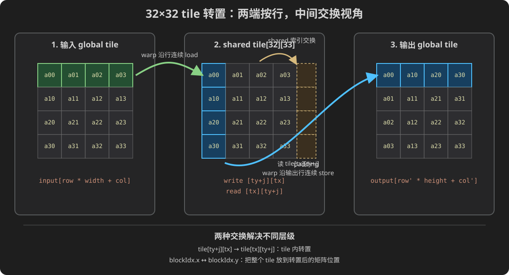

# 第 15 章：矩阵转置与合并访存

这一章把一个数学定义很短的操作，发展成一套完整的 CUDA 访存优化方法：先证明坐标和边界正确，再观察 warp 地址集合，通过 shared memory 改变数据排列，最后用受控实验与 profiler 验证机制。

矩阵转置的数学只有一行：`output[col][row]=input[row][col]`。但它是学习 CUDA 访存优化的经典案例，因为同一批线程很难在“不重新排列数据”的前提下既连续读取输入行，又连续写出输出行。

本章不会一上来给出 `tile[32][33]`。学习顺序是：

```text
先确定非方阵的输入/输出形状
        ↓
手算 row-major 线性下标和唯一写者
        ↓
把一个 thread 映射到一个 (row,col)
        ↓
从一个 warp 的同一条 load/store 看地址集合
        ↓
naive：连续读、跨步写
        ↓
shared tile：连续读、在片上交换坐标、连续写
        ↓
无 padding 与 +1 padding 的 bank 映射
        ↓
非方阵尾块、验证、Event、Nsight Compute
```

完成后，你应能独立回答：

1. `height×width` 输入为什么产生 `width×height` 输出；
2. row-major 的 `row*stride+col` 中每个量是什么；
3. 合并访问为什么以一个 warp 的一条内存指令为观察单位；
4. naive 转置为什么通常读得连续、写得跨步；
5. shared memory 怎样改变数据排列而不改变数学结果；
6. `[32][33]` 中多出的 1 为什么只属于物理布局；
7. 怎样用非方阵、奇数尺寸、完整 CPU oracle 和 profiler 验证。

## 15.0 先把“矩阵形状”和“内存数组”分开

设输入有 `height=2` 行、`width=3` 列：

```text
input（2 行 × 3 列）

1 2 3
4 5 6
```

转置交换行列角色，输出有 3 行、2 列：

```text
output（3 行 × 2 列）

1 4
2 5
3 6
```

数学坐标关系是：

```text
input(row, col) → output(col, row)
```

但 `cudaMalloc` 得到的是一段线性字节，C++ `std::vector` 也是一维连续容器。程序必须把二维坐标变成一维下标。

本章使用 row-major（行主序）：一行的列元素连续存放，下一行紧接其后。

```text
input 内存  = [1,2,3,4,5,6]
output 内存 = [1,4,2,5,3,6]
```

输入线性下标：

```text
input_index = row * width + col
```

输出的每行有 `height` 列，所以：

```text
output_index = out_row * output_width + out_col
             = col * height + row
```

这里最常见的错误是转置坐标后仍乘输入 width：

```cpp
output[col * width + row] = ...;  // 非方阵时通常错误
```

`col` 在输出中是行号，一行实际只有 `height` 项，所以 stride 必须是输出 width，也就是原来的 height。

### 15.0.1 width、height、row、col 不要凭图形方向猜

本书统一约定：

| 名称 | 含义 | 合法范围 |
|---|---|---|
| `width` | 输入每行元素数，也就是列数 | `col=0..width-1` |
| `height` | 输入行数 | `row=0..height-1` |
| `input_index` | 输入 row-major 下标 | `row*width+col` |
| `output_width` | 转置后每行元素数 | `height` |
| `output_height` | 转置后行数 | `width` |
| `output_index` | 输出 row-major 下标 | `col*height+row` |

不要用“x 好像是横向，所以一定等于 row”之类直觉。后面约定 `x=col`、`y=row`，但这是代码映射选择，不是 CUDA 强制规定。

### 15.0.2 为什么必须先测非方阵

若输入是 4×4，错误的 `col*width+row` 与正确的 `col*height+row` 碰巧相同。正方形会掩盖 width/height、输入/输出 stride 写反。

因此第一个 oracle 使用 2×3，GPU 完整验证使用类似 `1003×777` 的非方阵与非 tile 整除尺寸。规则是：

```text
非对称测试先暴露坐标错误
整齐大尺寸再用于特定性能实验
```

## 15.1 逐元素地址表：2×3 输入怎样变成 3×2 输出

把六个元素全部列出：

| input 坐标 `(row,col)` | `row*3+col` | 值 | output 坐标 `(col,row)` | `col*2+row` |
|---|---:|---:|---|---:|
| (0,0) | 0 | 1 | (0,0) | 0 |
| (0,1) | 1 | 2 | (1,0) | 2 |
| (0,2) | 2 | 3 | (2,0) | 4 |
| (1,0) | 3 | 4 | (0,1) | 1 |
| (1,1) | 4 | 5 | (1,1) | 3 |
| (1,2) | 5 | 6 | (2,1) | 5 |

按 input 的遍历顺序，输出下标是 `0,2,4,1,3,5`，看起来跨步；但每个输出位置 0—5 恰好被写一次。

这张表同时给出三个验证不变量：

1. 元素总数不变：`width*height`；
2. 每个 `(row,col)` 的值出现在 `(col,row)`；
3. 每个输出位置只有一个输入所有者。

再转置一次应恢复原矩阵：

```text
transpose(transpose(input)) == input
```

这是有用的不变量，但不能代替第一次转置的 CPU reference：两个互相抵消的错误映射也可能两次后恢复，所以仍要逐项验证期望坐标。

## 15.2 CPU 地址模型：没有 GPU 也先把坐标写对

`code/15_transpose/transpose_mapping.cpp` 默认生成 2×3 输入，也接受 1—16 范围内的 width/height。它打印每个元素的输入/输出坐标和线性下标，并检查唯一写者与二次转置。

```cpp
#include <charconv>
#include <iostream>
#include <string_view>
#include <vector>

namespace {

bool parse_dimension(std::string_view text, int& value) {
    const char* first = text.data();
    const char* last = text.data() + text.size();
    const auto result = std::from_chars(first, last, value);
    return result.ec == std::errc{} && result.ptr == last &&
           value >= 1 && value <= 16;
}

void print_matrix(std::string_view name, const std::vector<int>& values,
                  int rows, int cols) {
    std::cout << name << " rows=" << rows << " cols=" << cols << '\n';
    for (int row = 0; row < rows; ++row) {
        std::cout << "  [";
        for (int col = 0; col < cols; ++col) {
            if (col) std::cout << ", ";
            std::cout << values[row * cols + col];
        }
        std::cout << "]\n";
    }
}

}  // namespace

int main(int argc, char** argv) {
    int width = 3;
    int height = 2;
    if (argc != 1 &&
        (argc != 3 || !parse_dimension(argv[1], width) ||
         !parse_dimension(argv[2], height))) {
        std::cerr << "Usage: transpose_mapping [width height], each in [1,16]\n";
        return 2;
    }

    const int count = width * height;
    std::vector<int> input(static_cast<std::size_t>(count));
    std::vector<int> output(static_cast<std::size_t>(count), -1);
    std::vector<int> owners(static_cast<std::size_t>(count), 0);
    for (int index = 0; index < count; ++index) input[index] = index + 1;

    std::cout << "mapping: input(row,col) -> output(col,row)\n";
    for (int row = 0; row < height; ++row) {
        for (int col = 0; col < width; ++col) {
            const int input_index = row * width + col;
            const int output_index = col * height + row;
            output[output_index] = input[input_index];
            ++owners[output_index];
            std::cout << "  (" << row << ',' << col << ") in["
                      << input_index << "]=" << input[input_index]
                      << " -> (" << col << ',' << row << ") out["
                      << output_index << "]\n";
        }
    }

    for (int row = 0; row < height; ++row) {
        for (int col = 0; col < width; ++col) {
            const int input_index = row * width + col;
            const int output_index = col * height + row;
            if (owners[output_index] != 1 ||
                output[output_index] != input[input_index]) {
                std::cerr << "FAIL mapping row=" << row
                          << " col=" << col << '\n';
                return 1;
            }
        }
    }

    std::vector<int> restored(static_cast<std::size_t>(count), -1);
    for (int out_row = 0; out_row < width; ++out_row) {
        for (int out_col = 0; out_col < height; ++out_col) {
            restored[out_col * width + out_row] =
                output[out_row * height + out_col];
        }
    }
    if (restored != input) {
        std::cerr << "FAIL transpose twice did not restore input\n";
        return 1;
    }

    print_matrix("input", input, height, width);
    print_matrix("output", output, width, height);
    std::cout << "PASS every output has one owner; transpose twice restored input\n";
    return 0;
}
```

编译运行：

```bash
g++ -std=c++17 -O2 -Wall -Wextra \
  code/15_transpose/transpose_mapping.cpp -o transpose_mapping
./transpose_mapping
./transpose_mapping 5 3
./transpose_mapping 3 5
```

默认输出矩阵部分应是：

```text
input rows=2 cols=3
  [1, 2, 3]
  [4, 5, 6]
output rows=3 cols=2
  [1, 4]
  [2, 5]
  [3, 6]
PASS every output has one owner; transpose twice restored input
```

`./transpose_mapping 5 3` 中第一个参数是 width、第二个是 height，所以输入形状是 3 行×5 列，输出是 5 行×3 列。程序打印时明确 rows/cols，避免把命令参数顺序凭感觉倒过来。

## 15.3 从 CPU 循环到 naive CUDA kernel

CPU 双循环中，每个 `(row,col)` 的输出互不重叠，所以最直接的并行化是一个 CUDA thread 负责一个输入坐标：

```cpp
__global__ void transpose_naive(const float* input, float* output,
                                int width, int height) {
    const int col = blockIdx.x * blockDim.x + threadIdx.x;
    const int row = blockIdx.y * blockDim.y + threadIdx.y;
    if (col < width && row < height) {
        output[col * height + row] = input[row * width + col];
    }
}
```

变量名直接使用 `col/row`，比只写 `x/y` 更不容易忘记各自的矩阵含义。发射可用：

```cpp
dim3 block(32, 8);
dim3 grid((width + block.x - 1) / block.x,
          (height + block.y - 1) / block.y);
transpose_naive<<<grid, block>>>(d_input, d_output, width, height);
```

`block(32,8)` 一共有 256 个线程。thread 的线性编号以 x 维变化最快：

```text
linear_tid = threadIdx.y * blockDim.x + threadIdx.x
```

因此一个完整 warp 通常具有同一个 `threadIdx.y`，而 `threadIdx.x` 从 0 到 31。映射为矩阵坐标后，就是同一输入 row 上连续 32 个 col。

### 15.3.1 尾部线程为什么只包围读写，不提前 return 后再协作

naive kernel 没有 block barrier，越界线程可以不执行内存访问。这里使用一个条件把读写一起保护：

```cpp
if (col < width && row < height) { ... }
```

下一阶段 tiled kernel 含 `__syncthreads()`，不能把 naive 的“越界就 return”习惯机械搬过去。尾部线程可能没有 global 元素，却仍必须经过 shared tile 的 block 屏障；这与第 10、14 章的协作协议一致，本章只在 tile 的新作用下重新使用。

### 15.3.2 输出是 width×height，不需要更多元素

转置改变形状但不改变元素数：

```text
input_count  = width * height
output_count = output_width * output_height
             = height * width
```

两份分配字节数相同，但这不表示它们的 row stride 相同。输入 stride 是 width，输出 stride 是 height。容量相同、布局含义不同，正是矩阵代码中常见的混淆。

## 15.4 合并访问要看“一个 warp 的一条内存指令”

“整个 block 访问了连续矩阵”不足以证明合并良好。硬件处理 global memory load/store 时，要观察同一 warp 在同一条指令上，各活动 lane 请求的地址集合。

先看 naive kernel 中同一行的四个线程，假设 `row=1`、`col=0..3`，元素类型 float：

| lane 示例 | `col` | input 元素下标 `row*width+col` | input 字节地址增量 | output 元素下标 `col*height+row` | output 相邻 lane 步长 |
|---:|---:|---:|---:|---:|---:|
| 0 | 0 | `width` | 基址+0 B | 1 | — |
| 1 | 1 | `width+1` | 基址+4 B | `height+1` | `height` 个 float |
| 2 | 2 | `width+2` | 基址+8 B | `2*height+1` | `height` 个 float |
| 3 | 3 | `width+3` | 基址+12 B | `3*height+1` | `height` 个 float |

读取地址随 lane 每次增加一个 float，形成连续行片段；写地址随 lane 每次增加 `height*sizeof(float)` 字节，是跨步列写。

### 15.4.1 “连续”为什么通常更利于合并

当一个 warp 的活动 lane 请求相邻且对齐良好的元素时，这些请求可由较少的内存事务/sector 覆盖。若 lane 之间相隔很大，许多事务中只有少量字节真正属于本次请求，传输利用率降低。

不要死背“永远一次 128 字节事务”。具体 sector、cache line、对齐与合并规则随架构和缓存路径变化。本章使用稳定的判断层次：

```text
先列出 warp 地址集合
→ 判断连续、跨步、重复和对齐
→ 用当前架构文档与 Nsight Compute 指标验证实际事务
```

### 15.4.2 为什么 width/height 大小时差别明显

若 `height=777`、float 为 4 字节，naive 相邻 lane 的输出地址相隔：

```text
777 * 4 = 3108 bytes
```

32 个 lane 写的是 32 个相距 3108 字节的位置，很难由少量紧凑事务覆盖。矩阵很小或 height=1 时情况会不同，所以性能结论必须带上尺寸。

naive kernel 的问题不是“写错地址”，而是数学正确、访问模式可能低效。这正是本章要建立的习惯：

```text
正确性由坐标/CPU oracle 证明
性能原因由 warp 地址与 profiler 证据解释
```

## 15.5 Shared tile 的作用：不是只缓存，而是重新排列

naive kernel 每个线程从输入行读一个元素，却直接把它写到输出列。要让 global 写也沿行连续，需要先把整个小矩阵放进 block 内 shared memory，再从另一个方向读出来。

先用一个 4×4 tile 手算。输入 tile：

```text
 1  2  3  4
 5  6  7  8
 9 10 11 12
13 14 15 16
```

### 阶段 A：沿 global 输入行连续读取

线程 `(tx,ty)` 执行：

```cpp
tile[ty][tx] = input[input_row * width + input_col];
```

`ty=0, tx=0..3` 的线程读取 1、2、3、4；`ty=1` 读取 5、6、7、8。shared tile 逻辑内容与输入小矩阵相同：

```text
tile after load

 1  2  3  4
 5  6  7  8
 9 10 11 12
13 14 15 16
```

随后必须：

```cpp
__syncthreads();
```

因为下一阶段的线程会读取其他线程写入的 shared 位置。例如写出线程 `(tx=1,ty=0)` 要读取 `tile[1][0]=5`，它由装载线程 `(tx=0,ty=1)` 写入。

### 阶段 B：沿 shared 列读取，沿 global 输出行连续写入

同一组 `ty=0, tx=0..3` 的线程现在读取：

```text
tile[0][0] = 1
tile[1][0] = 5
tile[2][0] = 9
tile[3][0] = 13
```

即代码中的：

```cpp
value = tile[tx][ty];
```

它们把 `[1,5,9,13]` 写到转置输出的同一行连续列：

```text
output row 0 = [1,5,9,13]
```

`ty=1` 的线程同理得到 `[2,6,10,14]`。完整输出：

```text
 1  5  9 13
 2  6 10 14
 3  7 11 15
 4  8 12 16
```

这里发生了两种不同“方向”：

```text
global load：warp 沿 input 的一行
shared read：warp 沿 tile 的一列
global store：warp 沿 output 的一行
```

shared memory 把不利于 global 合并的列方向访问留在片上，从而让两边 global memory 都能使用行方向的连续地址。它不只是“同一数据读很多次的缓存”，还可作为显式数据重排空间。

### 15.5.1 为什么还要交换 block 坐标

输入 tile 的左上角是：

```text
input_col_base = blockIdx.x * TILE
input_row_base = blockIdx.y * TILE
```

转置后，原来的 tile 列位置成为输出 tile 行位置，所以输出基址交换 block x/y：

```text
output_col_base = blockIdx.y * TILE
output_row_base = blockIdx.x * TILE
```

标准形状：

```cpp
int input_col = blockIdx.x * TILE + threadIdx.x;
int input_row = blockIdx.y * TILE + threadIdx.y;

int output_col = blockIdx.y * TILE + threadIdx.x;
int output_row = blockIdx.x * TILE + threadIdx.y;
```

shared 索引交换 `tile[tx][ty]` 解决 tile **内部**转置；block 坐标交换解决 tile 在整个矩阵中的**位置**转置。只做其中一项，多个 tile 时仍会错。

对于非方阵，输入 grid 是：

```text
grid.x = ceil(width / TILE)
grid.y = ceil(height / TILE)
```

输出坐标的合法范围相应变为：

```text
output_col < height
output_row < width
```

这就是 tiled kernel 装载与写回需要两套边界判断的原因。

## 15.6 为什么 32×32 tile 常只用 32×8 个线程

一个 32×32 tile 有 1024 个元素，但不一定需要 1024 个线程。常见配置：

```cpp
constexpr int TILE_DIM = 32;
constexpr int BLOCK_ROWS = 8;
dim3 block(TILE_DIM, BLOCK_ROWS);  // 32×8 = 256 threads
```

每个线程沿 y 方向循环四次：

```cpp
for (int j = 0; j < TILE_DIM; j += BLOCK_ROWS) {
    tile[threadIdx.y + j][threadIdx.x] =
        input[(input_row + j) * width + input_col];
}
```

`threadIdx.y=0` 负责 tile 行 0、8、16、24；`threadIdx.y=7` 负责 7、15、23、31。对每个固定 j，`threadIdx.x=0..31` 仍沿一行连续访问，所以“每线程多项”没有破坏这一轮的 global 合并方向。

装载责任满足：

```text
256 threads × 每线程 4 项 = 1024 tile 元素
```

写回也使用相同 j 循环：

```cpp
for (int j = 0; j < TILE_DIM; j += BLOCK_ROWS) {
    output[(output_row + j) * height + output_col] =
        tile[threadIdx.x][threadIdx.y + j];
}
```

### 15.6.1 屏障放在两个完整循环之间

正确阶段是：

```text
所有线程完成自己负责的 4 次 global→shared 装载
                         ↓
                  __syncthreads()
                         ↓
所有线程开始 shared→global 写回
```

不能在每个线程只装完第一项后就开始写，也不能让越界线程在屏障前 return。尾 tile 中某线程可能没有第一个 j 的合法输入，却在后续 j 或同步参与上仍有责任。

转置只有一次装载阶段和一次消费阶段，所以一个中间屏障足够；若在循环中复用同一 shared tile 处理下一批数据，还需要消费结束到下一次覆盖之间的额外屏障。不要因为第 10 章讲过“两次屏障”就机械规定每个 shared kernel 永远两次，要从生产—消费—复用生命周期判断。

### 15.6.2 少线程不自动更快

32×8 的优点包括减少线程数，让每线程承担多项并保持地址方向；但每线程工作量、寄存器、指令数、block 驻留和延迟隐藏也会变化。32×16、32×8 或其他 tile 需要在相同正确性、尺寸和计时边界下实验，不能只数线程宣布胜者。

## 15.7 `[32][33]`：用 4-bank 小模型理解 padding

shared tile 解决了 global 跨步写，却产生新的片上访问形状：写回阶段，一个 warp 按列读取 `tile[tx][fixed_ty]`。

先使用教学用 4 个 bank、每个 float 占一个 bank word 的小模型。逻辑 4×4 shared 数组 row-major 线性下标为：

```text
linear = row * physical_stride + col
bank   = linear % 4
```

### 15.7.1 无 padding：`float tile[4][4]`

读取第 0 列：

| lane/tx | shared 元素 | 线性下标 | bank |
|---:|---|---:|---:|
| 0 | `tile[0][0]` | 0 | 0 |
| 1 | `tile[1][0]` | 4 | 0 |
| 2 | `tile[2][0]` | 8 | 0 |
| 3 | `tile[3][0]` | 12 | 0 |

四个线程访问同一 bank 的四个**不同地址**，形成冲突，需要分多次服务。它不是广播：广播要求多个线程读取同一 shared 地址，这里值分别是 1、5、9、13。

### 15.7.2 加一列：`float tile[4][5]`

数学 tile 仍只有 4×4；第 5 列只是每行末尾的物理 padding，不装有效矩阵元素。读取逻辑第 0 列：

| lane/tx | shared 元素 | 线性下标 | bank |
|---:|---|---:|---:|
| 0 | `tile[0][0]` | 0 | 0 |
| 1 | `tile[1][0]` | 5 | 1 |
| 2 | `tile[2][0]` | 10 | 2 |
| 3 | `tile[3][0]` | 15 | 3 |

行跨度从 4 变成 5，每向下一行 bank 编号也前进 1，于是四个访问分散到四个 bank。

把小模型放大到经典 32-bank、32×32 float tile：

```text
stride=32 → 同一列的行首 bank 周期不变
stride=33 → 每下一行 bank 前进 1
```

因此常见声明：

```cpp
__shared__ float tile[32][32 + 1];
```

### 15.7.3 `+1` 不是普遍魔法常数

上述推导明确假设了元素宽度、bank word 与 bank 数的经典关系。改成 double、向量类型、不同 tile 或不同架构特性后，访问可能拆成多个事务，实际冲突指标也可能变化。

正确方法是：

1. 写下 shared 物理 stride；
2. 列出一个 warp 同一指令的地址；
3. 按目标架构的 bank 规则推导；
4. 保持数学结果不变，比较无 padding/padded；
5. 用 Nsight Compute 的 shared memory 相关 section 验证。

padding 增加每 block shared memory：32×32 float 是 4096 字节，32×33 float 是 4224 字节，多 128 字节。通常很小，但仍应纳入资源与 occupancy 检查，不能说“padding 完全免费”。

## 15.8 把推导变成四方法对照实验

现在不要急着问“优化了几倍”。先建立一个能回答三类问题的实验：

1. **数学结果对不对**：三个转置 kernel 的每个输出元素都要等于 CPU oracle；
2. **优化究竟改了什么**：copy、naive、tiled-no-padding、tiled-padded 每次只引入一层变化；
3. **时间能不能比较**：四种方法采用相同输入、相同元素数量、相同计时边界，并轮换执行顺序。

完整程序位于 [`code/15_transpose/transpose.cu`](code/15_transpose/transpose.cu)。四种方法的职责如下。

| 方法 | 数学操作 | global load | global store | shared memory | 用途 |
|---|---|---|---|---|---|
| copy-baseline | 原样复制 | 连续 | 连续 | 无 | 给出理想化读一遍、写一遍的参照 |
| transpose-naive | 转置 | 连续 | 跨步 | 无 | 暴露不合并写的代价 |
| tiled-no-padding | 转置 | 连续 | 连续 | `float[32][32]` | 隔离 tiling 的收益和 bank conflict |
| tiled-padded | 转置 | 连续 | 连续 | `float[32][33]` | 在上一方法基础上只改变 shared stride |

copy 不是转置算法，不能与转置共用同一个期望结果。它的 CPU oracle 是原输入；另外三种方法的 oracle 才是 CPU 转置。copy 的意义是回答：“若同样读取并写回全部字节，但两端都能连续访问，这块 GPU 大约能做到什么水平？”因此它更像性能上界参照，而不是第五种数学解法。

### 15.8.1 为什么保留无 padding 版本

若只写 naive 和最终 padded 版本，即使后者更快，也无法区分收益来自：

- 把 global store 改成连续访问；
- 消除了 shared bank conflict；
- 偶然的运行时波动。

无 padding 版本构成受控实验的中间台阶。两个 tiled kernel 共用同一个函数模板，只让 `Padding` 取 0 或 1：

```cpp
template <int Padding>
__global__ void transpose_tiled_kernel(const float* input, float* output,
                                       int width, int height) {
    __shared__ float tile[32][32 + Padding];
    // 其余计算完全相同
}
```

启动时分别实例化：

```cpp
transpose_tiled_kernel<0><<<tiled_grid, block>>>(input, output,
                                                 width, height);
transpose_tiled_kernel<1><<<tiled_grid, block>>>(input, output,
                                                 width, height);
```

`<0>` 和 `<1>` 是 C++ 模板实参，不是 kernel 启动参数。编译器会生成两个不同的 kernel 实例；其中 shared 数组的第二维分别在编译期成为 32 和 33。

### 15.8.2 为什么默认仍用 `1003 × 777`

默认输入有 777 行、1003 列，两者都不是 32 的整数倍，且宽高不相等。它一次覆盖三种容易被整齐方阵掩盖的错误：

- 最右 tile 只有 `1003 % 32 = 11` 个有效列；
- 最下 tile 只有 `777 % 32 = 9` 个有效行；
- 输出是 1003 行、777 列，若写回边界仍把 width 和 height 当成输入含义，就会漏写或越界。

开发时可以先运行 `37 × 29`，因为它同样覆盖横、纵尾块，数据量更小；最终再运行默认尺寸和较大尺寸。只在 `1024 × 1024` 上得到 PASS，不能证明非方阵正确。

## 15.9 逐段写出 unified CUDA 程序

这一节不把三百多行程序当成黑盒。先写 kernel，再写调用和验证。主机端的通用参数解析、RAII buffer 与统计函数可在完整源码中对照。

### 15.9.1 copy 基线：连续读、连续写

```cpp
__global__ void copy_kernel(const float* input, float* output,
                            int width, int height) {
    const int col = blockIdx.x * blockDim.x + threadIdx.x;
    const int row = blockIdx.y * blockDim.y + threadIdx.y;

    if (row < height && col < width) {
        const std::size_t index =
            static_cast<std::size_t>(row) * width + col;
        output[index] = input[index];
    }
}
```

同一个线程只处理一个元素。warp 内相邻 lane 通常有相邻 `col`，所以 load 和 store 都沿行前进。这里使用 `std::size_t` 形成线性下标，是为了避免先在 32 位 `int` 中完成乘法再发生溢出；即使本程序把总元素数限制在 16 Mi，也保留了可扩展的写法。

### 15.9.2 naive 转置：公式正确，但 store 方向不理想

```cpp
__global__ void transpose_naive_kernel(const float* input, float* output,
                                       int width, int height) {
    const int col = blockIdx.x * blockDim.x + threadIdx.x;
    const int row = blockIdx.y * blockDim.y + threadIdx.y;

    if (row < height && col < width) {
        const std::size_t input_index =
            static_cast<std::size_t>(row) * width + col;
        const std::size_t output_index =
            static_cast<std::size_t>(col) * height + row;
        output[output_index] = input[input_index];
    }
}
```

它与 copy 只差输出下标。正是这一个变化，把 warp 的输出地址间隔从 1 个 float 变成 `height` 个 float。优化首先要能指出这种“最小差异”，而不是看到 tiled 代码更长就笼统说 shared memory 更快。

### 15.9.3 tiled 转置：完整的数据路径

下面是核心 kernel。为便于学习，这里保留完整索引而不缩写变量名：

```cpp
template <int Padding>
__global__ void transpose_tiled_kernel(const float* input,
                                       float* output,
                                       int width,
                                       int height) {
    __shared__ float tile[32][32 + Padding];

    const int input_col = blockIdx.x * 32 + threadIdx.x;
    const int input_row_base = blockIdx.y * 32 + threadIdx.y;

    for (int j = 0; j < 32; j += 8) {
        const int input_row = input_row_base + j;
        if (input_col < width && input_row < height) {
            const std::size_t input_index =
                static_cast<std::size_t>(input_row) * width + input_col;
            tile[threadIdx.y + j][threadIdx.x] = input[input_index];
        }
    }

    __syncthreads();

    const int output_col = blockIdx.y * 32 + threadIdx.x;
    const int output_row_base = blockIdx.x * 32 + threadIdx.y;

    for (int j = 0; j < 32; j += 8) {
        const int output_row = output_row_base + j;
        if (output_col < height && output_row < width) {
            const std::size_t output_index =
                static_cast<std::size_t>(output_row) * height + output_col;
            output[output_index] = tile[threadIdx.x][threadIdx.y + j];
        }
    }
}
```

请按以下四步读，而不是从第一行一路背到最后一行。

第一步，定位输入 tile。`blockIdx.x` 选输入 tile 列，`blockIdx.y` 选输入 tile 行，因此：

```text
input_col      = blockIdx.x * 32 + tx
input_row_base = blockIdx.y * 32 + ty
```

第二步，沿输入行合并加载。`ty` 只有 0～7，`j` 依次为 0、8、16、24，合起来覆盖 tile 的 32 行。shared 写入 `[ty+j][tx]`，仍是按行写入。

第三步，所有线程经过屏障。屏障之后，完整 tile 已经从 global 搬进 shared，接下来允许按交换后的 shared 下标读取。

第四步，交换 block 坐标并沿输出行写回：

```text
output_col      = blockIdx.y * 32 + tx
output_row_base = blockIdx.x * 32 + ty
```

这里的 `output_col < height` 和 `output_row < width` 乍看反直觉，其实是在使用**输出矩阵**的形状：输出列数等于输入高度，输出行数等于输入宽度。线性下标因此是：

```text
output_index = output_row * 输出列数 + output_col
             = output_row * height   + output_col
```

shared 读取 `tile[tx][ty+j]` 完成 tile 内转置。请把两种交换分开看：

- `blockIdx.x ↔ blockIdx.y`：把整个 tile 放到转置后的矩阵位置；
- `tile[ty+j][tx] → tile[tx][ty+j]`：转置 tile 内的元素。

少任意一个交换，方阵的某些小例子也许看不出问题，但一般矩阵会错误。

### 15.9.4 两种 grid 为什么不同

线程块统一为：

```cpp
dim3 block(32, 8);
```

copy 和 naive 中一个线程只处理一个元素，所以 y 方向要按 8 个线程覆盖：

```cpp
dim3 direct_grid(ceil_div(width, 32),
                 ceil_div(height, 8));
```

tiled 中一个 block 的 8 行线程通过 j 循环覆盖 32 个矩阵行，所以 grid 应按 32×32 tile 的逻辑覆盖：

```cpp
dim3 tiled_grid(ceil_div(width, 32),
                ceil_div(height, 32));
```

若 tiled 也把 y grid 除以 8，不一定越界，却会让很多 block 重复处理重叠 tile，既写竞争又浪费工作。这是“物理线程块高度”和“逻辑 tile 高度”混淆导致的典型错误。

## 15.10 编译和运行：每个命令片段都是什么意思

在仓库根目录执行单文件编译：

```bash
nvcc -std=c++17 -lineinfo code/15_transpose/transpose.cu -o transpose
```

Windows PowerShell 下可以把输出名明确写成：

```powershell
nvcc -std=c++17 -lineinfo code/15_transpose/transpose.cu -o transpose.exe
```

逐项解释：

| 片段 | 含义 | 去掉或写错会怎样 |
|---|---|---|
| `nvcc` | 调用 NVIDIA CUDA 编译驱动 | 系统找不到时应先检查 CUDA Toolkit 与 PATH，不是改源码 |
| `-std=c++17` | 主机 C++ 与 nvcc 前端按 C++17 编译 | 本程序用了 `std::from_chars` 等 C++17 能力；旧工具链也可能缺少库支持 |
| `-lineinfo` | 给 device 代码加入源码行映射 | 不改变算法；有助于 profiler 和 sanitizer 报告对应源代码行 |
| `code/15_transpose/transpose.cu` | 输入源文件，相对当前目录解释 | 若站在别的目录，需改变路径或先 `cd` 到仓库根目录 |
| `-o` | 指定随后一个参数为输出文件名 | 它不是 optimization 的缩写；优化等级通常写 `-O2`、`-O3` |
| `transpose.exe` | 生成的可执行文件 | Linux 通常无需 `.exe`；文件名可改但运行命令也要跟着改 |

这里尤其不要把小写字母 `o` 的 `-o` 与大写字母 `O` 的 `-O3` 混淆：前者是 output，后者才是 optimization level。

运行默认实验：

```powershell
./transpose.exe
```

显式指定宽、高、计时轮数、预热轮数：

```powershell
./transpose.exe 1003 777 20 5
```

参数顺序固定为：

```text
程序名  width  height  rounds  warmups
```

为什么 width 在 height 前面？这是本程序的命令行接口选择，不是 CUDA 的强制规定。进入矩阵后仍必须记住：`height` 是行数，`width` 是列数。

也可以使用 CMake：

```bash
cmake -S . -B build -DCMAKE_BUILD_TYPE=Release
cmake --build build --config Release --target transpose
ctest --test-dir build -C Release -R "transpose" --output-on-failure
```

- `-S .`：源码目录是当前目录；
- `-B build`：生成文件放进 build 目录；
- `--target transpose`：只构建本章程序；
- `-R "transpose"`：只运行名称匹配 transpose 的 CTest；
- `--output-on-failure`：成功时保持简洁，失败时显示程序输出。

## 15.11 正确性协议：不要让性能数字掩盖错误

### 15.11.1 CPU oracle 不是从 GPU 结果加工出来的

CPU 直接按数学定义生成期望输出：

```cpp
for (int row = 0; row < height; ++row) {
    for (int col = 0; col < width; ++col) {
        expected[col * height + row] = input[row * width + col];
    }
}
```

如果用 naive GPU 结果作为 tiled 的“真值”，两个 kernel 共享的索引错误会一起通过。独立 CPU oracle 的价值就在于实现路径不同。

输入值使用小整数转换成 float：

```cpp
input[index] = static_cast<float>((row * 131 + col * 17) % 4096);
```

0～4095 都能被 float 精确表示，转置又只有搬运没有算术，因此可以逐项使用 `actual == expected`。这不与第 7 章的浮点容差矛盾：加法、乘法会引入舍入误差，而本章只改变位置。若把案例改成包含计算的算子，就应恢复绝对误差/相对误差或 ULP 策略。

### 15.11.2 sentinel 检查漏写

每次 kernel 之前，输出 buffer 都在计时区间外填入字节模式 `0xA5`：

```cpp
cudaMemset(d_output, 0xA5, bytes);
```

它不是把每个 float 设置成数值 165；`cudaMemset` 按**字节**填充。这里不关心这个位模式代表什么 float，只希望未被 kernel 覆盖的位置保留一个很难碰巧等于期望值的模式。随后检查全部 `width * height` 个输出，尾 tile 漏写就不会因显存里恰好残留上次正确结果而蒙混过关。

sentinel 不是边界检测器。越界写要依靠边界推导、`compute-sanitizer` 和保护机制发现；它主要抓“应该写却没写”的位置。

### 15.11.3 输入必须保持不变

输入 buffer 与四个输出 buffer 分开分配，kernel 参数中输入还声明为 `const float*`。程序每完成一轮四方法测试，就把 device input 拷回并与原输入逐项比较。

`const` 能阻止正常 C++ 代码通过这个指针写入，却不能证明错误地址计算绝不覆盖输入；独立分配与回读验证给出了第二道检查。工程代码还应配合 Compute Sanitizer。

## 15.12 公平计时：Event 中究竟包含什么

单次样本采用以下顺序：

```text
cudaMemset(output, sentinel)    ← 不计时
cudaEventRecord(start)          ← 计时开始
launch exactly one kernel
cudaEventRecord(stop)           ← 计时结束标记排入同一默认流
cudaEventSynchronize(stop)
cudaEventElapsedTime(...)
cudaMemcpy(output D2H)           ← 不计时
逐项验证                         ← 不计时
```

Event 测到的是一次 kernel 在 GPU 时间线上的耗时，不包括 allocation、H2D、D2H、打印和 CPU oracle。它也不是端到端应用延迟。若你的实际应用每次都必须传入、传出，那么应另设一个端到端实验，而不是偷偷扩大当前区间后仍叫 kernel 时间。

### 15.12.1 为什么每轮改变顺序

若每轮总是 copy → naive → tiled-no-padding → tiled-padded，固定位置可能与升频、温度、缓存或系统负载相关。程序使用：

```cpp
method_index = (round + position) % 4;
```

前四轮顺序为：

```text
round 0: copy, naive, no-padding, padded
round 1: naive, no-padding, padded, copy
round 2: no-padding, padded, copy, naive
round 3: padded, copy, naive, no-padding
```

这不是消除所有噪声，但能避免一种方法永远占据同一顺序位置。四个方法先各自预热，再开始收集样本。

### 15.12.2 为什么同时打印 min、median、mean、max

- min：接近当前条件下最少受干扰的一次，但可能过于乐观；
- median：对少数慢样本不敏感，本章主要用它比较；
- mean：反映所有样本平均，但会被长尾拉高；
- max：帮助发现明显抖动，不能单独代表稳定性能。

程序不会在教材里伪造某张 GPU 的时间。实际输出格式类似下面这样，其中数字应由你自己的服务器产生：

```text
GPU: <你的 GPU 名称>
input shape: 777 rows x 1003 cols
output shape: 1003 rows x 777 cols
block: (32, 8), rounds=20, warmups=5

Kernel-only CUDA Event statistics
copy-baseline                  min=<...> median=<...> mean=<...> max=<...> ms  logical_GB/s=<...>
transpose-naive                min=<...> median=<...> mean=<...> max=<...> ms  logical_GB/s=<...>
transpose-tiled-no-padding     min=<...> median=<...> mean=<...> max=<...> ms  logical_GB/s=<...>
transpose-tiled-padded         min=<...> median=<...> mean=<...> max=<...> ms  logical_GB/s=<...>
PASS all outputs match their CPU oracle and the input remained unchanged.
```

### 15.12.3 `logical_GB/s` 是什么，不是什么

每种方法逻辑上读取整个输入一次、写整个输出一次，所以按 median 计算：

```text
logical_GB/s = 2 × width × height × sizeof(float)
               ─────────────────────────────────────
                       median_seconds × 10^9
```

它适合在相同问题规模下比较四种算法，但不是 DRAM 实际事务字节数。naive 的跨步 store 可能造成更多内存事务，shared 版本还有片上流量；这些都没有出现在分子中。要回答“物理 DRAM 到底传了多少字节”，需要读取 profiler 的硬件计数器，而不是从源代码逻辑字节数反推。

## 15.13 第一次实验应该怎样做

不要一上来只跑一次默认命令并截图。按下面的阶梯记录。

### 实验 A：先证明边界正确

```powershell
./transpose.exe 37 29 3 1
./transpose.exe 29 37 3 1
./transpose.exe 1 97 3 1
./transpose.exe 97 1 3 1
./transpose.exe 32 32 3 1
./transpose.exe 33 31 3 1
```

它们分别覆盖宽矩阵、高矩阵、单列、单行、整 tile 和双向尾块。每条都必须出现 PASS。性能数字在这些小尺寸上主要反映启动固定成本，不用于下结论。

### 实验 B：再比较访存方案

```powershell
./transpose.exe 1003 777 20 5
./transpose.exe 4096 4096 20 5
./transpose.exe 8192 2048 20 5
```

把每次的 GPU 型号、驱动、尺寸、rounds、warmups、四个 median 一并保存。比较时先问：

1. naive 与 copy 差多少？这主要提示跨步 global store 的代价；
2. no-padding 与 naive 差多少？这主要提示 global 访问重排的收益；
3. padded 与 no-padding 差多少？这才主要隔离 shared stride 的影响；
4. padded 离 copy 还有多远？剩余差异可能来自同步、shared 指令、额外整数计算等。

“主要提示”不等于单一因果证明。最终仍需 profiler 指标和重复实验支持。

### 实验 C：用 Compute Sanitizer 查内存与同步

先使用很小的非方阵，减少工具开销：

```bash
compute-sanitizer --tool memcheck ./transpose 37 29 3 1
compute-sanitizer --tool synccheck ./transpose 37 29 3 1
```

Windows 对应可执行文件通常写 `./transpose.exe`。`memcheck` 重点发现越界和非法地址，`synccheck` 重点检查同步原语的非法用法。工具无报错是重要证据，却仍不替代 CPU oracle：写到合法但错误的位置，可能不会触发 memcheck。

下一节将把四种访问画成一张本地图，并用 Nsight Compute 把“地址推导”与“硬件计数器”连接起来。

## 15.14 一张图串起 tiled transpose



图中用 4×4 元素展示地址关系，实际程序使用 32×32 的逻辑 tile 和 32×33 的物理 shared 数组。绿色横行表示输入 global memory 中一个 warp 的连续加载；蓝色 shared 列表示写回阶段交换下标后的读取；右侧蓝色横行表示输出 global memory 中的连续写入。

请用下面一句话复述整张图：

> global 两端都按各自矩阵的行访问，shared memory 在中间提供一次可以同步的重新排列。

padding 列不属于数学矩阵，不会出现在输出中。它只改变 shared 每行的物理跨度，使列访问不再让相邻 lane 周期性落入同一 bank。图底部再次区分两种交换：shared 下标交换解决 tile 内元素位置，block 坐标交换解决 tile 在整张输出矩阵中的位置。

## 15.15 用 Nsight Compute 验证，而不是只凭直觉

源代码推导告诉我们应该发生什么，Event 告诉我们总体时间，profiler 则尝试回答硬件实际执行了什么。三者是互补证据，不能互相替代。

NVIDIA 当前文档把 `MemoryWorkloadAnalysis` 定义为内存资源分析 section；更详细的表格由 `MemoryWorkloadAnalysis_Tables` 提供。官方表格把 shared 的 Instructions、Requests、Wavefronts、Bank Conflicts 分开，也把 L1/TEX 的请求与 sectors/request 分开。参见 [Nsight Compute Profiling Guide：Memory Tables](https://docs.nvidia.com/nsight-compute/ProfilingGuide/#memory-tables) 和 [Nsight Compute CLI](https://docs.nvidia.com/nsight-compute/NsightComputeCli/index.html)。

### 15.15.1 先查询本机能力

不要从网页复制一个多年不变的 metric 名并假定所有架构都有。先执行：

```bash
ncu --version
ncu --list-sets
ncu --list-sections
ncu --query-metrics-mode all
```

- `--list-sets` 列出本机 section set 以及大致收集量；
- `--list-sections` 确认 `MemoryWorkloadAnalysis_Tables` 是否存在；
- `--query-metrics-mode all` 查询目标设备可用的完整 metric 名；
- 某指标显示 `n/a` 时，先检查拼写、suffix、GPU 架构和本机版本，不要把 `n/a` 当成 0。

section 名比某个底层 metric 名更适合教材入口，因为 Nsight Compute 会按当前版本把相关指标组织成表。收集 `--set full` 往往需要多次 replay、开销很大；本实验先只选内存表。

### 15.15.2 分别抓无 padding 与 padded

Linux shell 示例：

```bash
ncu --section MemoryWorkloadAnalysis_Tables \
    --kernel-name-base demangled \
    --kernel-name 'regex:.*transpose_tiled_kernel<0>.*' \
    --launch-count 1 \
    -o transpose-no-padding \
    ./transpose 4096 4096 3 1

ncu --section MemoryWorkloadAnalysis_Tables \
    --kernel-name-base demangled \
    --kernel-name 'regex:.*transpose_tiled_kernel<1>.*' \
    --launch-count 1 \
    -o transpose-padded \
    ./transpose 4096 4096 3 1
```

PowerShell 中把正则改用双引号即可：

```powershell
ncu --section MemoryWorkloadAnalysis_Tables `
    --kernel-name-base demangled `
    --kernel-name "regex:.*transpose_tiled_kernel<1>.*" `
    --launch-count 1 `
    -o transpose-padded `
    ./transpose.exe 4096 4096 3 1
```

逐项解释新增选项：

| 选项 | 作用 |
|---|---|
| `ncu` | Nsight Compute 的命令行前端 |
| `--section MemoryWorkloadAnalysis_Tables` | 只收集详细内存表相关指标，避免一开始抓 full set |
| `--kernel-name-base demangled` | 用含模板实参的可读函数签名匹配 kernel |
| `--kernel-name 'regex:...'` | 只分析 `<0>` 或 `<1>` 对应实例，避免把四种方法混在一起 |
| `--launch-count 1` | 只收集第一个匹配 launch；计数只针对通过 kernel filter 的 launch |
| `-o name` | 保存 `.ncu-rep` 报告，方便之后用 UI 打开和比较 |
| 最后的程序及参数 | 被 profiler 启动的目标程序，不是 ncu 自己的参数 |

如果正则没有匹配，不要盲改尖括号。先用较宽的 `--kernel-name regex:transpose` 观察报告里实际显示的名称，或暂时去掉 filter；确认后再缩窄。模板名、匿名 namespace、自动简化和 shell 引号都可能影响表面字符串。

### 15.15.3 按问题读指标，不按表格从上抄到下

第一问：naive 的 global store 是否比 tiled 更分散？

- 比较 L1/TEX 表中 global store 对应的 Requests、Sectors、Sectors/Req；
- 相同活跃线程和 32-bit store 下，更多 sectors/request 通常表示访问更分散；
- 不能只看 DRAM bytes，因为 cache、写合并和其他路径会影响最终下游流量。

第二问：无 padding 的 shared 列读取是否产生更多序列化？

- 比较 Shared Memory 表的 load 行；
- 关注 Requests 与 Wavefronts 的差距及 Bank Conflicts；
- 一条 shared 指令形成一个 request，冲突会需要更多可串行处理的 wavefront；
- padded 版本应显著减少由列 stride=32 引起的冲突，但具体数值取决于架构、编译器和实际指令。

第三问：padding 是否引入资源副作用？

- Launch Statistics 中核对每 block static shared memory；
- 无 padding 理论值为 4096 字节，padding 理论值为 4224 字节；
- 再看 occupancy 限制项，而不是仅凭多 128 字节就断言 occupancy 一定改变。

第四问：改进的内存形状是否真的缩短 kernel？

- 回到正常运行下的 CUDA Event median；
- profiler replay 下的单次 duration 可能受收集开销与 replay 机制影响；
- 性能结论应同时保存 Event 样本、报告、GPU/驱动/工具版本。

### 15.15.4 一个合格的对照记录表

不要写“padded 更好”四个字就结束。至少填写：

| 项目 | naive | tiled no padding | tiled padded |
|---|---:|---:|---:|
| Event median ms | 实测 | 实测 | 实测 |
| logical GB/s | 实测 | 实测 | 实测 |
| global store Sectors/Req | 实测 | 实测 | 实测 |
| shared load Requests | 不适用/实测 | 实测 | 实测 |
| shared load Wavefronts | 不适用/实测 | 实测 | 实测 |
| shared load Bank Conflicts | 不适用/实测 | 实测 | 实测 |
| static shared bytes/block | 0 | 4096 | 4224 |

“不适用”与 0 不同：naive 没有算法级 shared tile，就不应把缺失的 shared 行解释成“做了 shared 访问但冲突为零”。

## 15.16 故障诊断：从症状回到坐标和阶段

| 症状 | 最可能的第一检查点 | 原因 |
|---|---|---|
| 方阵正确，非方阵失败 | 输出 shape、`output_row < width`、`output_col < height` | 把输入的 width/height 原样套到输出边界 |
| 只有 32 倍数正确 | 输入和输出两个尾 tile 条件 | 整 tile 隐藏了越界与漏写 |
| 输出像分块后位置错乱 | `blockIdx.x/y` 是否交换 | tile 内转置正确，但 tile 放错全局位置 |
| 每个 tile 内没有转置 | shared 写 `[ty+j][tx]`、读 `[tx][ty+j]` | 只交换 block 坐标，未交换 tile 内坐标 |
| 偶尔错误或工具报告 race | `__syncthreads()` 是否位于 load 与 read 之间 | 消费者可能读取其他线程尚未写完的 shared 元素 |
| synccheck 报发散屏障 | 是否在屏障前按越界线程 return | 尾 tile 中只有部分线程到达 block barrier |
| 尾部保留旧正确值 | 是否每次先填 sentinel 并全量验证 | 未写位置沿用了上一轮输出 |
| no-padding 与 padded 数学结果不同 | 两实例除 Padding 外是否真的相同 | padding 不应改变逻辑索引或值 |
| naive 很慢，memcheck 却无错误 | 查看 global store 的地址跨度 | 这是合法但低效的访问，不是内存安全错误 |
| ncu 没抓到 kernel | kernel filter、demangled 名、模板实例、shell 引号 | 正则没有匹配实际名称 |
| ncu 报性能计数器无权限 | 管理员/驱动 profiling 权限 | 程序可运行不代表用户有读取硬件计数器权限 |
| 小矩阵四方法都差不多 | 增大尺寸并重复采样 | kernel 启动固定成本淹没访存差异 |
| 第一次样本特别慢 | 检查预热、频率和上下文初始化 | 冷启动不是稳态 kernel 成本 |
| logical GB/s 大于或小于预期 | 先确认公式和单位，再查实际 DRAM 指标 | logical 流量不是物理事务流量 |

调试次序推荐固定为：手算 2×3 → CPU mapping 模型 → 小非方阵全量 oracle → memcheck/synccheck → 正常 Event 多轮 → Nsight Compute。不要在第一步就打开 profiler；profiler 不会替你定义正确的转置结果。

## 15.17 工程扩展：本章实现故意没有解决什么

### 15.17.1 带 leading dimension 的矩阵

实际矩阵的一行物理跨度可能大于逻辑列数。例如 `cudaMallocPitch` 返回 pitch bytes，或库视图从更大的张量中切出子矩阵。此时：

```text
input_index  = row * input_ld  + col
output_index = col * output_ld + row
```

`input_ld`、`output_ld` 是以**元素**计还是以**字节**计，必须由接口明确规定；不能把 pitch bytes 直接当 float 元素数。若接口接收 byte pitch，地址常写成先把基址转成 `char*`，按字节移动到行首，再转回元素指针。

### 15.17.2 原地转置不是把两个指针传成同一个

本章算法假设输入、输出不重叠。若令 `input == output`，一个 tile 写回可能覆盖另一个尚未读取的输入 tile，`const` 也无法从运行时阻止别名。

方阵原地转置需要：

- 对角 tile 在 tile 内原地转置；
- 非对角 tile `(i,j)` 与 `(j,i)` 成对读取后交换写回；
- 两个 tile 的数据都安全暂存后才能覆盖 global；
- 设计唯一所有者，避免两个 blocks 同时交换同一对 tile。

非方阵原地转置还会改变线性排列的置换周期，问题更复杂。初学阶段优先使用 out-of-place，并把额外 output 容量计入算法成本。

### 15.17.3 类型变成 double 或向量类型

正确性公式不变，但以下内容都要重新审计：

- device/host buffer 类型与 `sizeof(T)`；
- shared 容量；
- bank 映射可能由一次元素访问拆成多个 bank word；
- logical GB/s 的字节数；
- 对齐和向量 load/store 前提；
- profiler 中一条源代码访问对应的机器指令与事务。

因此 `[32][33]` 对 float 的经典解释不能无条件复制到所有类型。

### 15.17.4 现代异步拷贝和 TMA

更新架构提供 global→shared 异步拷贝、pipeline 和 TMA/swizzle 等机制，可减少寄存器中转或改变 shared 布局。但它们没有取消本章基础：仍要定义 tile、证明边界、理解生产—消费同步、检查布局与 bank、建立独立 oracle，并在目标架构上测量。

先把本章同步 tiled 版本完全掌握，再把现代机制看作替换“搬运和布局实现”的下一层；不要在还分不清 `row*width+col` 时直接堆叠异步 API。

## 15.18 本章小结与提交检查表

矩阵转置没有改变元素数量，却改变了二维坐标与一维地址的对应关系。naive kernel 数学正确，但同一 warp 的输出 store 跨过 `height` 个元素。shared tile 的核心作用是让 global 两端都按行访问：先连续加载到 shared，经过 block 屏障，再交换 shared 下标和 block 坐标，连续写到输出行。`[32][33]` 的额外一列进一步改变 shared 物理 stride，减少经典 float 列访问的 bank conflict。

提交自己的实现前逐项确认：

- [ ] 能用 2×3 表格手算 `input[row*width+col] → output[col*height+row]`；
- [ ] CPU oracle 与 GPU 实现独立；
- [ ] 至少测试宽、高、单行、单列、整 tile、双尾 tile；
- [ ] 所有线程在 tiled kernel 中一致到达 `__syncthreads()`；
- [ ] 输入和输出边界分别按各自 shape 推导；
- [ ] 每次运行前用 sentinel 暴露漏写，并验证全部元素；
- [ ] benchmark 的四方法只改变目标因素，输入保持不变；
- [ ] Event 区间只包含相同定义的设备工作；
- [ ] 报告多个样本与环境，不只摘最快数字；
- [ ] 先用地址集合提出假设，再用 Memory Workload Analysis 验证；
- [ ] 不把 logical GB/s 当成 profiler 的 DRAM bytes；
- [ ] 没有真实运行时明确写“未实测”，不填写虚构数字。

## 15.19 练习

1. 输入是 2 行 3 列、row-major 数组 `[1,2,3,4,5,6]`。写出输出 shape、输出线性数组，并列出输入 `(1,2)` 的输入/输出下标。
2. 对输入 `height=3,width=5`，固定 `row=1`，让一个 warp 的前 5 个 lane 对应 `col=0..4`。列出 naive 的 input indices 与 output indices，并写出相邻 output index 的步长。
3. 解释为什么 `n=width*height` 不能帮助你决定输出的一行有多少元素。
4. 写出 CPU 双循环转置。要求线性下标乘法先转换为 `std::size_t`，并说明为什么。
5. 对 37×29 输入，分别计算 `direct_grid` 与 `tiled_grid`，线程块为 `(32,8)`、tile 为 32×32。
6. 证明 32×8 threads 配合 `j=0,8,16,24` 恰好覆盖 32×32 tile 一次。
7. 若把 tiled kernel 的 grid.y 错写成 `ceil(height/8)`，会发生什么？这与正确性、重复写和性能分别有什么关系？
8. 在 4-bank 模型中，计算 `[4][4]` 和 `[4][5]` 读取逻辑第 2 列时四个 lane 的 bank 编号。
9. 为什么 `[32][33]` 只多 128 字节？写出完整计算。
10. 去掉 load 与 store 之间的 `__syncthreads()`，说明具体的跨线程 read-after-write 依赖。
11. 为什么不能让 `input_col>=width` 的线程在屏障前 return？用尾 tile 解释。
12. 分别说明 shared 下标交换和 block 坐标交换解决什么问题。漏掉其中一个时输出呈现什么类型的错误？
13. 给出 copy、naive、tiled-no-padding、tiled-padded 各自的 CPU 期望结果。为什么 copy 不能与后三者共用 oracle？
14. `cudaMemset(d_output,0xA5,bytes)` 是否把每个 float 设成 165.0？它在本实验中捕捉什么错误，不能捕捉什么错误？
15. 本章为什么可以用 float 精确相等，而向量加法通常不应照搬？
16. 写出一次公平样本的 Event 边界，并列出必须排除的工作。
17. 四种方法固定顺序可能带来什么偏差？写出公式 `(round+position)%4` 的前四轮顺序。
18. 对 `width=1000,height=500,float`，写出 logical bytes；若 median 为 0.050 ms，计算 logical GB/s。说明它为何不一定等于 DRAM throughput。
19. 给出两个 ncu 命令，分别只抓 `transpose_tiled_kernel<0>` 与 `<1>` 的 Memory Workload Analysis 表。解释 `--kernel-name-base demangled` 的作用。
20. 要验证 naive 的跨步 store 与 shared padding，分别应优先比较哪些表格字段？为什么只看 kernel duration 不足以证明机制？
21. 程序在 1024×1024 通过、1003×777 失败。列出至少四个优先检查点和一组更小的复现尺寸。
22. 把接口扩展为 `input_ld` 与 `output_ld` 后，写出两个线性下标。若 pitch 以字节给出，还要做什么转换？
23. 解释为什么把输入输出指针设成同一个不能自动得到原地转置，并概述方阵非对角 tile 的安全交换协议。
24. 设计一份提交前证据包：至少包含正确性、内存安全、同步、性能和 profiler 五类证据，并标明哪些结果必须来自真实 GPU。

详细答案见[附录 C](附录-C-练习答案.md#第-15-章)。
