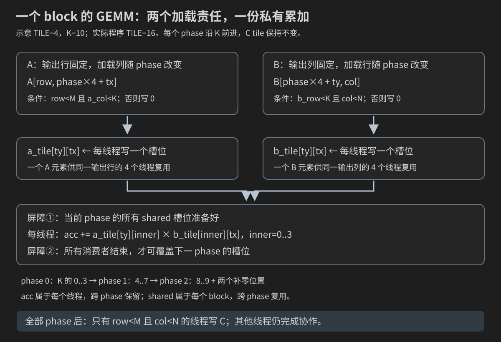
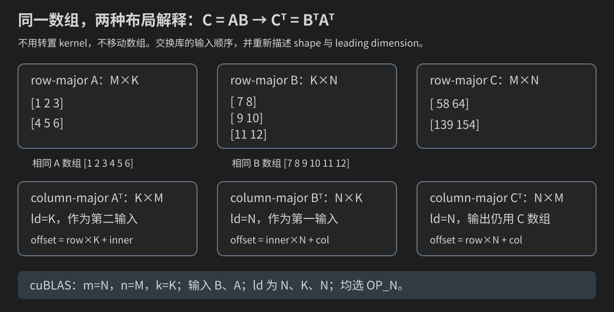

# 第 16 章：矩阵乘法——从一个点积到 Tiled GEMM

上一章的转置只搬动元素，不做浮点计算；矩阵乘法既要决定每个线程负责哪个输出，又要让许多输出重复利用同一批输入。它把索引、warp 访存、shared memory、同步、数值误差和性能测量第一次集中到一个核心算子里。

本章仍不从“背一个 tiled kernel”开始。学习路线是：

```text
先检查 A(M×K) 与 B(K×N) 的 shape 是否能相乘
        ↓
手算 2×3 乘 3×2 的四个输出点积
        ↓
把 A、B、C 的二维坐标写成 row-major 线性下标
        ↓
用 CPU reference 固定数学语义、输出所有者和验证规则
        ↓
一个 CUDA thread 计算一个 C[row,col]
        ↓
观察一个 warp 重复读取了哪些 A/B 元素
        ↓
沿 K 维分 tile，把 A/B 子块协作搬进 shared
        ↓
证明两次 block barrier、K 尾块补零和 M/N 边界
        ↓
统一 benchmark、算术强度、Nsight Compute 与 cuBLAS 对照
```

完成本章后，你应能从零写出并解释：

1. 为什么 `A(M×K) * B(K×N)` 的输出是 `C(M×N)`；
2. 为什么每个 `C[row,col]` 是 A 的一行与 B 的一列的 K 项点积；
3. M、N、K、row、col、inner、stride/leading dimension 分别是什么；
4. 一个 thread 为什么可用私有 accumulator 独立负责一个 C 元素；
5. naive GEMM 正确却为何会重复读取 global memory；
6. shared tiling 怎样在一个 block 内复用 A/B；
7. 为什么每个 K tile 常需要“加载后”和“消费后”两次同步；
8. 如何验证非整齐矩阵、浮点误差、GFLOP/s 与库调用。

## 16.0 矩阵乘法不是“同位置元素相乘”

先把最常见误解排除。若 A、B 都是 2×2，下式是**逐元素乘法**（Hadamard product）：

```text
C[row,col] = A[row,col] * B[row,col]
```

普通矩阵乘法不是这样。它把 A 的一整行与 B 的一整列做点积：

```text
C[row,col] = Σ A[row,inner] * B[inner,col]
                                      inner=0..K-1
```

`inner` 是求和维。每走一步 inner，就从 A 的固定 row 取下一个列元素，同时从 B 的固定 col 取下一个行元素。二者的 inner 坐标必须指向同一个逻辑维度，所以 A 的列数必须等于 B 的行数。

设：

```text
A shape = M × K
B shape = K × N
```

则：

```text
C shape = M × N
```

可把 shape 检查看成接口契约：

```text
A 的外维 M  ─────────────────────→ C 的行数 M
A 的内维 K  ← 必须相等 →  B 的内维 K
B 的外维 N  ─────────────────────→ C 的列数 N
```

例如 2×3 可以乘 3×4，得到 2×4；2×3 不能直接乘 2×4，因为中间的 3 与 2 不相等。CUDA 不会替裸指针携带和检查这些 shape；若调用方传错 M/N/K，kernel 可能访问仍“合法”的地址却计算了另一个问题，因此 CPU oracle 和非对称尺寸尤其重要。

## 16.1 完整手算：2×3 乘 3×2

使用：

```text
    A (2×3)             B (3×2)
┌           ┐       ┌       ┐
│ 1   2   3 │       │ 7   8 │
│ 4   5   6 │       │ 9  10 │
└           ┘       │11  12 │
                    └       ┘
```

输出有 2 行、2 列。四个位置分别计算：

```text
C[0,0] = 1×7  + 2×9  + 3×11 =  7 + 18 + 33 =  58
C[0,1] = 1×8  + 2×10 + 3×12 =  8 + 20 + 36 =  64
C[1,0] = 4×7  + 5×9  + 6×11 = 28 + 45 + 66 = 139
C[1,1] = 4×8  + 5×10 + 6×12 = 32 + 50 + 72 = 154
```

所以：

```text
    C (2×2)
┌         ┐
│ 58   64 │
│139  154 │
└         ┘
```

观察 `C[1,0]` 的坐标生命周期：

| inner | A 坐标 | A 值 | B 坐标 | B 值 | product | accumulator |
|---:|---|---:|---|---:|---:|---:|
| 初始 | — | — | — | — | — | 0 |
| 0 | `(1,0)` | 4 | `(0,0)` | 7 | 28 | 28 |
| 1 | `(1,1)` | 5 | `(1,0)` | 9 | 45 | 73 |
| 2 | `(1,2)` | 6 | `(2,0)` | 11 | 66 | 139 |

row=1 和 col=0 在整个点积期间不变，只有 inner 从 0 走到 K−1。以后 CUDA thread `(row=1,col=0)` 就按这条路径工作；它不是计算 A[1,0] 或 B[1,0]，而是计算 C[1,0] 的完整点积。

### 16.1.1 “一行乘一列”不等于先真的转置 B

数学语言说读取 B 的一列，但代码可以直接使用 `B[inner,col]`；不必为了正确性先生成 `Bᵀ`。在 row-major 数组里，这一列的线性地址确实有 stride N。是否预转置、用 shared tile 重排或交给库选择，是后续性能设计；数学定义不依赖具体存储优化。

## 16.2 M、N、K：名字短，但角色必须固定

本章统一采用 GEMM 常见约定：

| 符号 | 含义 | 决定什么 | 合法坐标范围 |
|---|---|---|---|
| M | A 与 C 的行数 | 输出有多少行 | `row ∈ [0,M)` |
| N | B 与 C 的列数 | 输出有多少列 | `col ∈ [0,N)` |
| K | A 的列数、B 的行数 | 每个输出累加多少项 | `inner ∈ [0,K)` |

记忆方法不是背字母顺序，而是写 shape：

```text
A[M,K] × B[K,N] → C[M,N]
```

K 在乘号两边出现并被“消去”，M、N 留在输出。代码中 `k_size` 表示 K 的数值，循环变量 `inner` 表示当前第几项；不要让两者都叫 k 后再分不清“维度长度”和“当前位置”。

### 16.2.1 为什么默认案例不应使用 M=N=K

若三者都等于 128，下面的错误可能仍输出正确或至少不越界：

- 把 A stride K 错写为 N；
- 把 B stride N 错写为 K；
- 把 grid.x/grid.y 或 M/N 对调；
- CPU oracle 与 GPU kernel 复制了同一个错误公式。

因此开发默认尺寸应让三者都不同，例如 `M=129,N=117,K=83`。用于快速调试的小尺寸可用 `M=3,K=5,N=2`。方阵是补充测试，不是唯一测试。

## 16.3 从二维坐标到三份 row-major 数组

紧凑 row-major 矩阵的最后一个坐标连续变化。三份数组的公式分别是：

```text
A(row,inner) → a_index = row   * K + inner
B(inner,col) → b_index = inner * N + col
C(row,col)   → c_index = row   * N + col
```

请注意两个不同的 N：B 与 C 都有 N 列，所以两者紧凑 row-major stride 都是 N；A 有 K 列，所以 stride 是 K。

以 2×3 乘 3×2 为例，`C[1,0]` 的地址表为：

| inner | `a_index=1*3+inner` | A 值 | `b_index=inner*2+0` | B 值 |
|---:|---:|---:|---:|---:|
| 0 | 3 | 4 | 0 | 7 |
| 1 | 4 | 5 | 2 | 9 |
| 2 | 5 | 6 | 4 | 11 |

输出位置为 `c_index=1*2+0=2`。于是完整的一维数组表达是：

```text
C[2] = A[3]*B[0] + A[4]*B[2] + A[5]*B[4]
```

### 16.3.1 stride、leading dimension 与逻辑列数

紧凑 row-major 时，行跨度恰好等于逻辑列数，所以初学代码可直接使用 K 或 N。工程接口常把物理行跨度单独命名为 leading dimension：

```text
A(row,inner) → row * lda + inner
B(inner,col) → inner * ldb + col
C(row,col)   → row * ldc + col
```

对紧凑 row-major：

```text
lda = K, ldb = N, ldc = N
```

若每行末尾有 padding，可能是 `lda>K`、`ldb>N`、`ldc>N`。shape 决定哪些元素有数学意义，leading dimension 决定相邻物理行首相隔多少元素。两者不能互换。

传统 cuBLAS 接口主要按 column-major 解释 leading dimension；那里 leading dimension 通常是物理列中相邻列首的跨度，即分配矩阵的行数。不要看到同一个 `lda` 名字就默认索引公式相同。库调用将在本章后半段单独推导。

### 16.3.2 为什么线性下标使用 `std::size_t`

即使 M、N、K 都存为 int，线性下标和元素数量也应在乘法前转换：

```cpp
std::size_t a_index =
    static_cast<std::size_t>(row) * k_size + inner;
```

若先在 32 位 int 中计算 `row*k_size`，大矩阵可能在转换前已经溢出。`size_t` 不能自动证明分配成功或乘积永不溢出；主机参数解析仍要检查 `M*K`、`K*N`、`M*N` 和字节数上限。

## 16.4 CPU reference：先让每个输出的旅程可见

配套程序 [`code/16_matmul/matmul_reference.cpp`](code/16_matmul/matmul_reference.cpp) 默认复现上一节的 2×3 乘 3×2，并把每个乘积的二维含义、线性下标、累加结果和输出所有者打印出来。它只依赖 C++17，不需要 CUDA 或 GPU。

完整源码如下：

```cpp
#include <charconv>
#include <cstdint>
#include <cstdlib>
#include <iomanip>
#include <iostream>
#include <string>
#include <system_error>
#include <vector>

namespace {

bool parse_dimension(const char* text, int& value) {
    if (text == nullptr || *text == '\0') return false;
    const char* end = text;
    while (*end != '\0') ++end;

    int parsed_value = 0;
    const auto parsed = std::from_chars(text, end, parsed_value);
    if (parsed.ec != std::errc{} || parsed.ptr != end) return false;
    if (parsed_value < 1 || parsed_value > 8) return false;
    value = parsed_value;
    return true;
}

void print_matrix(const std::string& name,
                  const std::vector<std::int64_t>& values,
                  int rows,
                  int cols) {
    std::cout << name << " shape=" << rows << 'x' << cols << '\n';
    for (int row = 0; row < rows; ++row) {
        std::cout << "  ";
        for (int col = 0; col < cols; ++col) {
            const std::size_t index =
                static_cast<std::size_t>(row) * cols + col;
            std::cout << std::setw(7) << values[index];
        }
        std::cout << '\n';
    }
}

}  // namespace

int main(int argc, char** argv) {
    int m = 2;
    int k_size = 3;
    int n = 2;
    if (argc > 4 ||
        (argc >= 2 && !parse_dimension(argv[1], m)) ||
        (argc >= 3 && !parse_dimension(argv[2], k_size)) ||
        (argc >= 4 && !parse_dimension(argv[3], n))) {
        std::cerr << "Usage: " << argv[0]
                  << " [M:1..8] [K:1..8] [N:1..8]\n";
        return EXIT_FAILURE;
    }

    const std::size_t a_count = static_cast<std::size_t>(m) * k_size;
    const std::size_t b_count = static_cast<std::size_t>(k_size) * n;
    const std::size_t c_count = static_cast<std::size_t>(m) * n;
    std::vector<std::int64_t> a(a_count);
    std::vector<std::int64_t> b(b_count);
    std::vector<std::int64_t> c(c_count, 0);
    std::vector<int> owners(c_count, 0);

    for (std::size_t index = 0; index < a_count; ++index) {
        a[index] = static_cast<std::int64_t>(index + 1);
    }
    for (std::size_t index = 0; index < b_count; ++index) {
        b[index] = static_cast<std::int64_t>(a_count + index + 1);
    }

    std::cout << "Contract: A(" << m << 'x' << k_size << ") * B("
              << k_size << 'x' << n << ") -> C("
              << m << 'x' << n << ")\n\n";
    print_matrix("A", a, m, k_size);
    print_matrix("B", b, k_size, n);
    std::cout << '\n';

    for (int row = 0; row < m; ++row) {
        for (int col = 0; col < n; ++col) {
            const std::size_t c_index =
                static_cast<std::size_t>(row) * n + col;
            std::int64_t accumulator = 0;
            std::cout << "C[" << row << ',' << col << "] = ";
            for (int inner = 0; inner < k_size; ++inner) {
                const std::size_t a_index =
                    static_cast<std::size_t>(row) * k_size + inner;
                const std::size_t b_index =
                    static_cast<std::size_t>(inner) * n + col;
                const std::int64_t product = a[a_index] * b[b_index];
                accumulator += product;
                if (inner != 0) std::cout << " + ";
                std::cout << "A[" << a_index << "](" << a[a_index]
                          << ")*B[" << b_index << "](" << b[b_index]
                          << ')';
            }
            c[c_index] = accumulator;
            ++owners[c_index];
            std::cout << " = " << accumulator
                      << " -> C linear index " << c_index << '\n';
        }
    }

    for (std::size_t index = 0; index < owners.size(); ++index) {
        if (owners[index] != 1) {
            std::cerr << "FAIL C index " << index
                      << " owner count=" << owners[index] << '\n';
            return EXIT_FAILURE;
        }
    }

    std::cout << '\n';
    print_matrix("C", c, m, n);
    std::cout << "PASS every C element has one owner and a K-term dot product.\n";
    return EXIT_SUCCESS;
}
```

### 16.4.1 编译命令

在教材根目录执行：

```bash
g++ -std=c++17 -O2 -Wall -Wextra \
    code/16_matmul/matmul_reference.cpp -o matmul_reference
./matmul_reference
```

这些编译选项已在第 1 章逐项解释。本章只补充它们在当前实验的作用：

- `-O2`：让普通运行接近优化构建，但 CPU 小模型用于语义而非 GPU 性能比较；
- `-Wall -Wextra`：开启常见警告，警告不等于错误却不应无视；
- `-o matmul_reference`：指定可执行文件名，不是优化开关；
- `./matmul_reference`：运行当前目录中的文件，`.` 不是源码扩展名。

Windows 若使用 MSVC，应在已配置编译环境的终端使用等价 C++17 选项；不要把 g++ 命令原样交给 `cl.exe`。

### 16.4.2 默认输出怎样核对

关键部分应为：

```text
Contract: A(2x3) * B(3x2) -> C(2x2)

C[0,0] = A[0](1)*B[0](7) + A[1](2)*B[2](9) + A[2](3)*B[4](11) = 58 -> C linear index 0
C[0,1] = A[0](1)*B[1](8) + A[1](2)*B[3](10) + A[2](3)*B[5](12) = 64 -> C linear index 1
C[1,0] = A[3](4)*B[0](7) + A[4](5)*B[2](9) + A[5](6)*B[4](11) = 139 -> C linear index 2
C[1,1] = A[3](4)*B[1](8) + A[4](5)*B[3](10) + A[5](6)*B[5](12) = 154 -> C linear index 3

PASS every C element has one owner and a K-term dot product.
```

这段是根据确定性输入推导的预期格式，不是当前编辑电脑的实测记录。服务器实际运行时还要检查返回码为 0，不能只搜索 PASS 字样。

换成长方形：

```bash
./matmul_reference 3 5 2
```

参数顺序固定为 `M K N`，直接对应 `A[M,K] * B[K,N]`，而不是常见口误中的 `M N K`。程序限制每维 1～8，是为了让完整点积仍适合人眼阅读；GPU 程序会有独立且更大的安全范围。

### 16.4.3 所有者与归约的区别

每个 C 元素只有一个外层 `(row,col)` 所有者，但这个所有者内部做 K 项累加：

```text
输出写入：每个 C 位置 1 个所有者
点积计算：同一所有者串行累加 K 个 products
```

因此最朴素 CUDA 映射不需要多个线程原子累加同一个 C；每 thread 持有私有 accumulator，循环结束只写一次。如果以后让多个 warps 或 blocks 协作同一输出，才需要额外的跨线程归约/分阶段合并协议。

## 16.5 从 CPU 双循环到“一线程一输出”

CPU reference 有三层循环：

```cpp
for (int row = 0; row < M; ++row) {
    for (int col = 0; col < N; ++col) {
        float accumulator = 0.0F;
        for (int inner = 0; inner < K; ++inner) {
            accumulator += A[row*K + inner] * B[inner*N + col];
        }
        C[row*N + col] = accumulator;
    }
}
```

最自然的 CUDA 改写是把前两层循环交给二维 grid：

```text
thread 的 y 身份 → row
thread 的 x 身份 → col
thread 内部循环   → inner=0..K-1
```

也就是：

```cpp
int col = blockIdx.x * blockDim.x + threadIdx.x;
int row = blockIdx.y * blockDim.y + threadIdx.y;
```

输出 grid 只由 C shape 决定：

```cpp
dim3 block(16, 16);
dim3 grid(ceil_div(N, block.x),
          ceil_div(M, block.y));
```

`grid.x` 除以 N，因为 x 对应输出列；`grid.y` 除以 M，因为 y 对应输出行。K 不决定输出线程数量，它决定每个有效线程内部循环多少次。

### 16.5.1 accumulator 为什么不会在线程之间互相覆盖

kernel 中普通局部变量：

```cpp
float accumulator = 0.0F;
```

是每个 CUDA thread 自己的逻辑状态。线程 `(row=0,col=0)` 的 accumulator 与 `(0,1)` 的 accumulator 不是同一个变量；它们可能最终被编译到各线程寄存器，也可能因压力 spill 到 local memory，但语义仍是 thread-private。

只有 `C[row*N+col]` 是 global 输出。由于每个有效 `(row,col)` 只由一个 thread 映射，写入地址唯一，不需要 `atomicAdd`。判断是否需要原子操作，要看多个执行者是否可能写同一位置，不是看代码里有没有加法。

### 16.5.2 先看同一 warp 的 naive 访问

假设 block.x=16。二维线程的线性顺序让一个 warp 通常先覆盖同一 `ty` 的 16 个 tx，再覆盖下一个 ty 的 16 个 tx。为简化推导，先关注同一输出 row 中、连续 col 的一组 lanes。

固定 inner 时：

```text
A address = row*K + inner       → 同一 row 的 lanes 读取同一个 A 元素
B address = inner*N + col       → 相邻 col 的 lanes 读取相邻 B 元素
C address = row*N + col         → 相邻 col 的 lanes 最终写相邻 C 元素
```

B load 与 C store 具有连续方向。A load 是多个 lanes 读取同一地址，硬件可利用广播/cache；但每个输出列 thread 都在 K 次循环中提出 A 读取，且不同 warps/blocks 计算其他列 tile 时还会再次需要相同 A 行片段。B tile 也会被不同输出行反复使用。

所以 naive GEMM 的核心问题不只是“某条访问是否合并”，还包括**同一输入元素跨多个输出被重复请求多少次**。NVIDIA 的 Best Practices Guide 也把 shared memory 在矩阵乘法中的重要用途描述为减少冗余 global transfers，而不只是修复跨步访问：[Shared Memory in Matrix Multiplication](https://docs.nvidia.com/cuda/cuda-c-best-practices-guide/#shared-memory-in-matrix-multiplication-c-ab)。

下一步将写出可单独验证的 naive CUDA 程序，先处理 M/N/K 参数、非方阵、浮点 oracle 与边界，再引入 shared tile；不会把正确性、优化和 benchmark 一次混在同一个黑盒里。

## 16.6 第一版 CUDA：naive GEMM

配套程序为 [`code/16_matmul/naive_matmul.cu`](code/16_matmul/naive_matmul.cu)。核心 kernel 没有 shared memory 和 block 内协作，正适合先验证“一线程一输出”映射：

```cpp
__global__ void matmul_naive_kernel(const float* a,
                                    const float* b,
                                    float* c,
                                    int m,
                                    int k_size,
                                    int n) {
    const int col =
        static_cast<int>(blockIdx.x * blockDim.x + threadIdx.x);
    const int row =
        static_cast<int>(blockIdx.y * blockDim.y + threadIdx.y);
    if (row >= m || col >= n) return;

    float accumulator = 0.0F;
    for (int inner = 0; inner < k_size; ++inner) {
        const std::size_t a_index =
            static_cast<std::size_t>(row) * k_size + inner;
        const std::size_t b_index =
            static_cast<std::size_t>(inner) * n + col;
        accumulator += a[a_index] * b[b_index];
    }
    const std::size_t c_index =
        static_cast<std::size_t>(row) * n + col;
    c[c_index] = accumulator;
}
```

逐段读：

1. `(blockIdx,threadIdx)` 只生成 C 的 row、col；
2. 越过 C shape 的线程没有输出责任，可以直接 return；
3. 每个有效线程创建自己的 accumulator；
4. inner 循环读取 A 的固定行与 B 的固定列；
5. 循环结束只写一个唯一 C 地址。

### 16.6.1 为什么这里可以提前 return

naive kernel 没有 `__syncthreads()`，线程之间也不通过 shared memory 交换数据。越界线程没有后续协作责任，因此可在点积前 return。

这不能机械搬到下一版 tiled kernel。tiled 尾 block 中，即使某线程对应的 C(row,col) 越界，它仍可能负责把合法 A 或 B 元素装进 shared，且必须与 block 其余线程一起到达 barrier。是否可以 return 取决于后续协作协议，不取决于“这个线程最终是否写输出”。

### 16.6.2 用 37×29×23 手算启动尺寸

命令参数顺序 `M K N` 为 `37 29 23`，所以：

```text
A shape = 37×29
B shape = 29×23
C shape = 37×23
```

block=(16,16)：

```text
grid.x = ceil(N/16) = ceil(23/16) = 2
grid.y = ceil(M/16) = ceil(37/16) = 3
```

一共发射 `2×3×256=1536` threads，真正写 C 的只有 `37×23=851` 个。多出的线程由 row/col 边界排除。K=29 不进入 grid 计算，它只让每个有效线程循环 29 次。

若把命令误读为 M N K，就会以为 B 是 23×29；程序不会猜测你的意图，参数接口必须在 README、usage 和教材中保持一致。

## 16.7 让“PASS”具有明确证据边界

`naive_matmul.cu` 不只比较两个 GPU kernel。它先在 host 上独立生成 expected C，然后执行一个 GPU kernel，回传并逐项核对。同时回传 A、B，确认 kernel 没有污染只读输入。

### 16.7.1 为什么输入选二进制可精确分数

A、B 元素由小整数除以 16 生成，例如 `-3/16`、`2/16`。两个输入相乘后分母是 256；在本程序允许的 K 与取值范围内，乘积和累加结果都可被 float 精确表示。因此 CPU 与 GPU 可以逐项使用 `==`，任何不等都应视为索引、边界或写入错误。

这是一种**测试数据设计**，不是“GEMM 永远可精确比较”的结论。改成 0.1、任意随机 float、不同 FMA 策略或并行累加顺序后，应使用绝对/相对误差，并把非有限数单独判错。后续统一 benchmark 会专门给出数值误差协议。

### 16.7.2 sentinel 仍然用于发现漏写

kernel 启动前：

```cpp
cudaMemset(d_c, 0xFF, c_bytes);
```

这是按字节填充，不是把 float 设置为 255.0。若某个合法 C 位置因 grid 或边界错误未写，它大概率保留 NaN 位模式，逐项比较就会失败。完整验证比只打印 `C[0]` 更能覆盖右边和下边尾块。

### 16.7.3 输入不变性是接口契约的一部分

kernel 参数把 A、B 声明为 `const float*`，host 还会把 d_a、d_b 拷回，与原向量逐项比较。`const` 是编译期访问约束；错误的地址计算仍可能越过 C 分配边界影响邻近分配。输入快照与 Compute Sanitizer 提供不同证据，二者都应保留。

### 16.7.4 编译、运行与预期输出

这是该阶段的完整文件；先跟随前面的小节理解各段职责，再一次编译验证：

```cpp
#include "../common/cuda_check.h"

#include <charconv>
#include <cstddef>
#include <cstdlib>
#include <iostream>
#include <system_error>
#include <vector>

namespace {

constexpr std::size_t kMaximumMatrixElements = 16ULL * 1024ULL * 1024ULL;

bool parse_dimension(const char* text, int& value) {
    if (text == nullptr || *text == '\0') return false;
    const char* end = text;
    while (*end != '\0') ++end;

    int parsed_value = 0;
    const auto parsed = std::from_chars(text, end, parsed_value);
    if (parsed.ec != std::errc{} || parsed.ptr != end) return false;
    if (parsed_value < 1 || parsed_value > 4096) return false;
    value = parsed_value;
    return true;
}

bool dimensions_are_safe(int m, int k_size, int n) {
    const std::size_t a_count = static_cast<std::size_t>(m) * k_size;
    const std::size_t b_count = static_cast<std::size_t>(k_size) * n;
    const std::size_t c_count = static_cast<std::size_t>(m) * n;
    return a_count <= kMaximumMatrixElements &&
           b_count <= kMaximumMatrixElements &&
           c_count <= kMaximumMatrixElements;
}

__global__ void matmul_naive_kernel(const float* a,
                                    const float* b,
                                    float* c,
                                    int m,
                                    int k_size,
                                    int n) {
    const int col = static_cast<int>(blockIdx.x * blockDim.x + threadIdx.x);
    const int row = static_cast<int>(blockIdx.y * blockDim.y + threadIdx.y);
    if (row >= m || col >= n) return;

    float accumulator = 0.0F;
    for (int inner = 0; inner < k_size; ++inner) {
        const std::size_t a_index =
            static_cast<std::size_t>(row) * k_size + inner;
        const std::size_t b_index =
            static_cast<std::size_t>(inner) * n + col;
        accumulator += a[a_index] * b[b_index];
    }
    const std::size_t c_index = static_cast<std::size_t>(row) * n + col;
    c[c_index] = accumulator;
}

void make_inputs(std::vector<float>& a,
                 std::vector<float>& b,
                 int m,
                 int k_size,
                 int n) {
    for (int row = 0; row < m; ++row) {
        for (int inner = 0; inner < k_size; ++inner) {
            const std::size_t index =
                static_cast<std::size_t>(row) * k_size + inner;
            const int numerator = (row * 7 + inner * 3) % 9 - 4;
            a[index] = static_cast<float>(numerator) / 16.0F;
        }
    }
    for (int inner = 0; inner < k_size; ++inner) {
        for (int col = 0; col < n; ++col) {
            const std::size_t index =
                static_cast<std::size_t>(inner) * n + col;
            const int numerator = (inner * 5 + col * 2) % 7 - 3;
            b[index] = static_cast<float>(numerator) / 16.0F;
        }
    }
}

void make_cpu_reference(const std::vector<float>& a,
                        const std::vector<float>& b,
                        std::vector<float>& expected,
                        int m,
                        int k_size,
                        int n) {
    for (int row = 0; row < m; ++row) {
        for (int col = 0; col < n; ++col) {
            float accumulator = 0.0F;
            for (int inner = 0; inner < k_size; ++inner) {
                const std::size_t a_index =
                    static_cast<std::size_t>(row) * k_size + inner;
                const std::size_t b_index =
                    static_cast<std::size_t>(inner) * n + col;
                accumulator += a[a_index] * b[b_index];
            }
            expected[static_cast<std::size_t>(row) * n + col] = accumulator;
        }
    }
}

bool validate_exact(const std::vector<float>& actual,
                    const std::vector<float>& expected,
                    const char* label) {
    for (std::size_t index = 0; index < expected.size(); ++index) {
        if (actual[index] != expected[index]) {
            std::cerr << "FAIL " << label << " index=" << index
                      << " expected=" << expected[index]
                      << " actual=" << actual[index] << '\n';
            return false;
        }
    }
    return true;
}

}  // namespace

int main(int argc, char** argv) {
    int m = 129;
    int k_size = 83;
    int n = 117;
    if (argc > 4 ||
        (argc >= 2 && !parse_dimension(argv[1], m)) ||
        (argc >= 3 && !parse_dimension(argv[2], k_size)) ||
        (argc >= 4 && !parse_dimension(argv[3], n)) ||
        !dimensions_are_safe(m, k_size, n)) {
        std::cerr << "Usage: " << argv[0]
                  << " [M:1..4096] [K:1..4096] [N:1..4096]\n"
                  << "Each matrix must contain at most "
                  << kMaximumMatrixElements << " elements.\n";
        return EXIT_FAILURE;
    }

    const std::size_t a_count = static_cast<std::size_t>(m) * k_size;
    const std::size_t b_count = static_cast<std::size_t>(k_size) * n;
    const std::size_t c_count = static_cast<std::size_t>(m) * n;
    const std::size_t a_bytes = a_count * sizeof(float);
    const std::size_t b_bytes = b_count * sizeof(float);
    const std::size_t c_bytes = c_count * sizeof(float);

    std::vector<float> a(a_count);
    std::vector<float> b(b_count);
    std::vector<float> expected(c_count);
    std::vector<float> actual(c_count);
    std::vector<float> a_after(a_count);
    std::vector<float> b_after(b_count);
    make_inputs(a, b, m, k_size, n);
    make_cpu_reference(a, b, expected, m, k_size, n);

    float* d_a = nullptr;
    float* d_b = nullptr;
    float* d_c = nullptr;
    CUDA_CHECK(cudaMalloc(&d_a, a_bytes));
    CUDA_CHECK(cudaMalloc(&d_b, b_bytes));
    CUDA_CHECK(cudaMalloc(&d_c, c_bytes));
    CUDA_CHECK(cudaMemcpy(d_a, a.data(), a_bytes, cudaMemcpyHostToDevice));
    CUDA_CHECK(cudaMemcpy(d_b, b.data(), b_bytes, cudaMemcpyHostToDevice));
    CUDA_CHECK(cudaMemset(d_c, 0xFF, c_bytes));

    const dim3 block(16, 16);
    const dim3 grid((n + block.x - 1) / block.x,
                    (m + block.y - 1) / block.y);
    matmul_naive_kernel<<<grid, block>>>(d_a, d_b, d_c, m, k_size, n);
    CUDA_CHECK_KERNEL();

    CUDA_CHECK(cudaMemcpy(actual.data(), d_c, c_bytes,
                          cudaMemcpyDeviceToHost));
    CUDA_CHECK(cudaMemcpy(a_after.data(), d_a, a_bytes,
                          cudaMemcpyDeviceToHost));
    CUDA_CHECK(cudaMemcpy(b_after.data(), d_b, b_bytes,
                          cudaMemcpyDeviceToHost));

    const bool output_ok = validate_exact(actual, expected, "C");
    const bool a_ok = validate_exact(a_after, a, "A changed");
    const bool b_ok = validate_exact(b_after, b, "B changed");

    CUDA_CHECK(cudaFree(d_c));
    CUDA_CHECK(cudaFree(d_b));
    CUDA_CHECK(cudaFree(d_a));

    if (!output_ok || !a_ok || !b_ok) return EXIT_FAILURE;
    std::cout << "A(" << m << 'x' << k_size << ") * B("
              << k_size << 'x' << n << ") -> C("
              << m << 'x' << n << ")\n"
              << "block=(16,16) grid=(" << grid.x << ',' << grid.y << ")\n"
              << "PASS naive GEMM matches every CPU output; A and B unchanged.\n";
    return EXIT_SUCCESS;
}
```

```bash
nvcc -std=c++17 -O2 -lineinfo \
    code/16_matmul/naive_matmul.cu -o matmul_naive

./matmul_naive 37 29 23
./matmul_naive 1 1 1
./matmul_naive
```

`nvcc`、`-std=c++17`、`-O2`、`-lineinfo` 和 `-o` 已分别在第 3、7、9、15 章使用；这里不重复整章定义。新的注意点是三个运行参数：它们都是**元素维度**，不是字节数、线程数或 grid 大小。

37×29×23 的关键输出应为：

```text
A(37x29) * B(29x23) -> C(37x23)
block=(16,16) grid=(2,3)
PASS naive GEMM matches every CPU output; A and B unchanged.
```

默认值为 M=129、K=83、N=117，三者故意不同。上述只是由程序逻辑推导的预期格式；当前编辑环境没有 nvcc/GPU，不能写成已实测。

### 16.7.5 建议边界矩阵

按以下顺序运行，每条都应返回 0：

```bash
./matmul_naive 1 1 1
./matmul_naive 1 17 31
./matmul_naive 19 1 23
./matmul_naive 16 16 16
./matmul_naive 17 15 31
./matmul_naive 31 17 15
./matmul_naive 37 29 23
```

它们分别覆盖最小问题、单输出行、K=1 外积形状、整 block、M/K/N 不同方向的尾部。随后运行：

```bash
compute-sanitizer --tool memcheck ./matmul_naive 37 29 23
```

memcheck 无错误不能证明矩阵公式正确；CPU oracle 正确也不能证明没有所有非法访问。两类检查回答不同问题。

下一节将用 4×4 输出 tile、K tile=4 的小模型，数清 naive 重复读取与 shared 复用，再写 tiled kernel 的两次同步协议。

## 16.8 Tiling 的第一理由：把一次 global load 服务给多个输出

先假设一个 block 计算 4×4 的 C tile，并只看 K 方向的一段 4 项。共有 16 个输出，每个输出需要 4 对 A/B 值：

```text
multiply-add terms = 4×4×4 = 64
naive logical A+B reads = 64×2 = 128
```

这里的“logical reads”指源代码层面各输出线程提出的 A/B 元素读取次数，不等于 128 次 DRAM transaction；cache、广播和合并访问可能减少下游事务。我们先数算法请求，再用 profiler 观察硬件流量。

在同一个 4×4 输出 tile 中：

- A tile 的 `A[row,inner]` 会被同一输出 row 的 4 个不同 col 重用；
- B tile 的 `B[inner,col]` 会被同一输出 col 的 4 个不同 row 重用。

若 16 个 threads 协作，各自把一个 A 元素和一个 B 元素加载到 shared：

```text
tiled global loads = 16 A + 16 B = 32
```

随后 64 个乘加项从 shared 取数。相对 naive 的源代码逻辑读取，global load 数从 128 降到 32，即理想化减少 4 倍；这个 4 正是 tile 宽度。

### 16.8.1 4×4 的复用方向

固定 A 元素 `A[2,1]`，它参与：

```text
C[2,0], C[2,1], C[2,2], C[2,3]
```

固定 B 元素 `B[1,3]`，它参与：

```text
C[0,3], C[1,3], C[2,3], C[3,3]
```

A 沿输出列方向复用，B 沿输出行方向复用。不要笼统说“shared 更快”；准确说法是：block 把这个 K phase 所需的 A/B 子块从 global 各加载一次，再让多个输出线程从 shared 重复消费。

### 16.8.2 CPU 复用计数模型

[`code/16_matmul/tile_reuse_model.cpp`](code/16_matmul/tile_reuse_model.cpp) 不模拟 GPU cache 或时序，只验证一个 K phase 中的逻辑所有者与复用次数：

```cpp
#include <charconv>
#include <cstdlib>
#include <iostream>
#include <system_error>
#include <vector>

namespace {

bool parse_tile(const char* text, int& tile) {
    if (text == nullptr || *text == '\0') return false;
    const char* end = text;
    while (*end != '\0') ++end;
    int value = 0;
    const auto parsed = std::from_chars(text, end, value);
    if (parsed.ec != std::errc{} || parsed.ptr != end) return false;
    if (value < 1 || value > 16) return false;
    tile = value;
    return true;
}

}  // namespace

int main(int argc, char** argv) {
    int tile = 4;
    if (argc > 2 || (argc == 2 && !parse_tile(argv[1], tile))) {
        std::cerr << "Usage: " << argv[0] << " [tile:1..16]\n";
        return EXIT_FAILURE;
    }

    const int elements = tile * tile;
    std::vector<int> a_uses(static_cast<std::size_t>(elements), 0);
    std::vector<int> b_uses(static_cast<std::size_t>(elements), 0);

    for (int output_row = 0; output_row < tile; ++output_row) {
        for (int output_col = 0; output_col < tile; ++output_col) {
            for (int inner = 0; inner < tile; ++inner) {
                ++a_uses[output_row * tile + inner];
                ++b_uses[inner * tile + output_col];
            }
        }
    }

    for (int index = 0; index < elements; ++index) {
        if (a_uses[index] != tile || b_uses[index] != tile) {
            std::cerr << "FAIL reuse count at tile index " << index << '\n';
            return EXIT_FAILURE;
        }
    }

    const long long output_elements = 1LL * tile * tile;
    const long long multiply_add_terms = output_elements * tile;
    const long long naive_logical_loads = 2 * multiply_add_terms;
    const long long tiled_global_loads = 2 * output_elements;

    std::cout << "one C tile: " << tile << 'x' << tile << '\n'
              << "one K phase: " << tile << " terms per output\n"
              << "output elements: " << output_elements << '\n'
              << "multiply-add terms: " << multiply_add_terms << '\n'
              << "naive logical A+B reads: " << naive_logical_loads << '\n'
              << "tiled cooperative global A+B loads: "
              << tiled_global_loads << '\n'
              << "reuse per loaded A or B element: " << tile << '\n'
              << "logical request reduction factor: " << tile << "x\n"
              << "PASS each A tile element feeds one output row and each B "
                 "tile element feeds one output column.\n";
    return EXIT_SUCCESS;
}
```

编译运行：

```bash
g++ -std=c++17 -O2 -Wall -Wextra \
    code/16_matmul/tile_reuse_model.cpp -o matmul_tile_reuse
./matmul_tile_reuse
./matmul_tile_reuse 8
```

默认 4×4 应输出：

```text
one C tile: 4x4
one K phase: 4 terms per output
output elements: 16
multiply-add terms: 64
naive logical A+B reads: 128
tiled cooperative global A+B loads: 32
reuse per loaded A or B element: 4
logical request reduction factor: 4x
PASS each A tile element feeds one output row and each B tile element feeds one output column.
```

tile=8 时，输出数 64、乘加项 512、naive 逻辑读取 1024、协作 global loads 128，理想化请求缩减因子为 8。更大的 tile 提高单次加载的潜在复用，但也增加 threads/block、shared、寄存器活跃值与同步成本；不能只看缩减因子选 tile。

## 16.9 沿 K 维分 phase：一个输出如何合并部分点积



图中 A 沿 K 的列方向前进，B 沿 K 的行方向前进；线程的输出坐标保持不变，私有 accumulator 把各 phase 的部分点积合并起来。两道屏障围住 shared 的消费阶段。

实际 K 可能大于 tile。例如 TILE=4、K=10：

```text
phase 0: inner [0,4)
phase 1: inner [4,8)
phase 2: inner [8,10) + 两个补零位置
```

同一个输出线程的 accumulator 跨 phase 保留：

```text
accumulator = 0

加载 A[:,0:4] 与 B[0:4,:] 到 shared
accumulator += 4 项部分点积

加载 A[:,4:8] 与 B[4:8,:] 到 shared
accumulator += 4 项部分点积

加载 A[:,8:10]、B[8:10,:]，shared 其余位置写 0
accumulator += 4 项，其中后 2 项为 0

最后写 C[row,col]
```

phase 数量是：

```text
phase_count = ceil(K/TILE) = (K + TILE - 1) / TILE
```

M、N 决定 block 在输出平面的位置；K 决定同一个 block 要经历多少次 load→compute phase。这就是为什么 tiled GEMM 同时存在三类边界：

- row<M：A 与 C 的输出行边界；
- col<N：B 与 C 的输出列边界；
- phase*TILE+局部 inner<K：最后一个 K phase 的输入边界。

### 16.9.1 补零是单位元设计

越界 A 或 B shared 槽位必须显式写 0：

```cpp
a_tile[ty][tx] = valid_a ? A[...] : 0.0F;
b_tile[ty][tx] = valid_b ? B[...] : 0.0F;
```

乘法中 0 会让无效乘积为 0，加到 accumulator 不改变结果。不能“越界就不写 shared”，因为同一槽位可能残留上一 phase 的合法数据；下一轮计算会把旧值再次乘入。

补零让 compute 循环始终执行 TILE 项，避免在每次乘加里再次判断 K 边界。它没有让越界 global load 变合法：条件表达式或 if 必须保证无效分支不执行地址读取。

### 16.9.2 两次 barrier 分别保护什么

每个 phase 的生命周期：

```text
所有线程写本 phase 的 a_tile / b_tile
            ↓
__syncthreads() ①：生产完成后才能消费
            ↓
所有线程读取 shared，累加本 phase
            ↓
__syncthreads() ②：所有消费者结束后才能覆盖 shared
            ↓
进入下一 phase，复用同一 shared 数组
```

第一道屏障防止读到尚未由其他线程写好的本 phase 数据；第二道屏障防止跑得快的线程提前写下一 phase，覆盖跑得慢的线程仍在读取的当前 phase 数据。这正是第 10 章“生产—消费—复用”协议在 GEMM 中的新作用，详见[第 10 章](10-Shared-Memory与线程同步.md)。

最后一个 phase 计算结束后，从纯数据生命周期看不再有下一轮覆盖；简单教学 kernel 仍把第二道屏障写在循环内部，让所有迭代结构一致。高级实现可在证明正确、考虑编译展开与流水线后重构，不能靠“最后好像用不到”随手删同步。

下一步将实现 16×16 tiled kernel，并专门解释为什么越界输出线程仍必须参与加载、补零和两次 barrier。


## 16.10 第一版 shared tiled GEMM：所有线程先协作，合法输出线程最后写回

现在把 16.8 的复用计数和 16.9 的 phase 协议落成完整程序。教学版固定：

```text
TILE = 16
block = (16,16) = 256 threads
每个 block 负责 C 的一个 16×16 输出 tile
每个 phase 协作加载 16×16 个 A 元素和 16×16 个 B 元素
```

固定 tile 不是说 16 永远最优，而是先让线程身份、加载责任、同步、计算责任和边界一一对应。到本章后半再讨论 tile 形状、寄存器与占用率之间的取舍。

### 16.10.1 一个 thread 同时有四种身份

令局部坐标为：

```cpp
tx = threadIdx.x;
ty = threadIdx.y;
```

它的输出身份是：

```cpp
row = blockIdx.y * TILE + ty;
col = blockIdx.x * TILE + tx;
```

但在每个 K phase，它还承担两项协作加载：

```cpp
a_col = phase * TILE + tx;
b_row = phase * TILE + ty;
```

因此同一 thread 在一个 phase 中负责：

1. 尝试把 `A[row,a_col]` 写入 `a_tile[ty][tx]`；
2. 尝试把 `B[b_row,col]` 写入 `b_tile[ty][tx]`；
3. 屏障之后，用 shared 的第 `ty` 行与第 `tx` 列累加自己的部分点积；
4. 所有 phase 结束后，若 `(row,col)` 是合法输出，写一个 `C[row,col]`。

“负责输出”与“负责协作加载”是重叠但不等价的职责。边界 block 中，一个 thread 可能没有合法 C，却仍需写 shared 槽位并参加屏障。

### 16.10.2 为什么不能在 kernel 开头越界 return

naive kernel 没有 block 屏障，越界 thread 可以直接返回。tiled kernel 若这样写则是错误的：

```cpp
if (row >= m || col >= n) return;  // tiled kernel 中危险
// ...
__syncthreads();
```

这里最直接的问题是**协作加载责任被丢掉**。例如 M=1、K=16、N=1，仅 `(ty,tx)=(0,0)` 有合法 C；若其余 255 个线程提前返回，A 一整行和 B 一整列中的其他元素无人加载，留下的线程会读未初始化 shared。屏障不能补回从未写入的数据。

同步语义也要说准确：当前 CUDA 规范把已经退出的线程排除在等待集合外；不能把“有线程 return”笼统等同于“屏障一定死锁”。仍在执行的参与线程必须一致经过对应的屏障，非一致条件下跳过屏障有独立的错误风险。本程序选择所有线程执行相同 phase 和两道屏障，同时完成各自的加载或补零，既满足数据责任，也使同步证明直接。见 [CUDA block 同步规范](https://docs.nvidia.com/cuda/cuda-programming-guide/05-appendices/cpp-language-extensions.html#thread-block-synchronization-functions)。

正确设计是把边界判断放到内存操作上：

```cpp
a_tile[ty][tx] = valid_a ? a[...] : 0.0F;
b_tile[ty][tx] = valid_b ? b[...] : 0.0F;

__syncthreads();
// 所有 256 个 threads 都计算 TILE 项；无效输入已经变成 0
__syncthreads();

if (valid_c) c[...] = accumulator;
```

也就是说，越界输出 thread 不写 C，但仍执行所有 phase、写两个 shared 槽位并经过两次屏障。

### 16.10.3 A、B、C 的合法条件必须分开

三个条件不是同一个：

```text
valid A load: row < M && a_col < K
valid B load: b_row < K && col < N
valid C store: row < M && col < N
```

例如 M=17、K=19、N=18 的右下角 block `blockIdx=(1,1)`：

- `ty=0,tx=0` 对应 `C[16,16]`，输出合法；
- `ty=0,tx=5` 对应 `C[16,21]`，C 与 B 列越界，但它在某些 phase 仍可能加载合法 A；
- `ty=5,tx=0` 对应 `C[21,16]`，C 与 A 行越界，但它在某些 phase 仍可能加载合法 B；
- `ty=5,tx=5` 的输出行列都越界，仍必须给自己的两个 shared 槽位写 0 并参加屏障。

这也解释了为什么不能先算一个 `valid = row<M && col<N`，再用它同时控制 A 与 B：A 的加载不依赖 `col<N`，B 的加载不依赖 `row<M`。把三类边界揉成一个条件会丢掉边界 tile 中本可由协作线程加载的合法输入。

### 16.10.4 完整的 tiled 程序

[tiled_matmul.cu](code/16_matmul/tiled_matmul.cu) 使用与 naive 版相同的输入、CPU oracle、sentinel 和 A/B 不变性检查，因而两版的区别集中在 kernel，而不是验证标准：

```cpp
#include "../common/cuda_check.h"

#include <charconv>
#include <cstddef>
#include <cstdlib>
#include <iostream>
#include <system_error>
#include <vector>

namespace {

constexpr int kTile = 16;
constexpr std::size_t kMaximumMatrixElements = 16ULL * 1024ULL * 1024ULL;

bool parse_dimension(const char* text, int& value) {
    if (text == nullptr || *text == '\0') return false;
    const char* end = text;
    while (*end != '\0') ++end;

    int parsed_value = 0;
    const auto parsed = std::from_chars(text, end, parsed_value);
    if (parsed.ec != std::errc{} || parsed.ptr != end) return false;
    if (parsed_value < 1 || parsed_value > 4096) return false;
    value = parsed_value;
    return true;
}

bool dimensions_are_safe(int m, int k_size, int n) {
    const std::size_t a_count = static_cast<std::size_t>(m) * k_size;
    const std::size_t b_count = static_cast<std::size_t>(k_size) * n;
    const std::size_t c_count = static_cast<std::size_t>(m) * n;
    return a_count <= kMaximumMatrixElements &&
           b_count <= kMaximumMatrixElements &&
           c_count <= kMaximumMatrixElements;
}

__global__ void matmul_tiled_kernel(const float* a,
                                    const float* b,
                                    float* c,
                                    int m,
                                    int k_size,
                                    int n) {
    __shared__ float a_tile[kTile][kTile];
    __shared__ float b_tile[kTile][kTile];

    const int tx = static_cast<int>(threadIdx.x);
    const int ty = static_cast<int>(threadIdx.y);
    const int col = static_cast<int>(blockIdx.x) * kTile + tx;
    const int row = static_cast<int>(blockIdx.y) * kTile + ty;
    const int phase_count = (k_size + kTile - 1) / kTile;

    float accumulator = 0.0F;
    for (int phase = 0; phase < phase_count; ++phase) {
        const int a_col = phase * kTile + tx;
        const int b_row = phase * kTile + ty;

        if (row < m && a_col < k_size) {
            const std::size_t a_index =
                static_cast<std::size_t>(row) * k_size + a_col;
            a_tile[ty][tx] = a[a_index];
        } else {
            a_tile[ty][tx] = 0.0F;
        }

        if (b_row < k_size && col < n) {
            const std::size_t b_index =
                static_cast<std::size_t>(b_row) * n + col;
            b_tile[ty][tx] = b[b_index];
        } else {
            b_tile[ty][tx] = 0.0F;
        }

        __syncthreads();

#pragma unroll
        for (int inner_tile = 0; inner_tile < kTile; ++inner_tile) {
            accumulator +=
                a_tile[ty][inner_tile] * b_tile[inner_tile][tx];
        }

        __syncthreads();
    }

    if (row < m && col < n) {
        const std::size_t c_index =
            static_cast<std::size_t>(row) * n + col;
        c[c_index] = accumulator;
    }
}

void make_inputs(std::vector<float>& a,
                 std::vector<float>& b,
                 int m,
                 int k_size,
                 int n) {
    for (int row = 0; row < m; ++row) {
        for (int inner = 0; inner < k_size; ++inner) {
            const std::size_t index =
                static_cast<std::size_t>(row) * k_size + inner;
            const int numerator = (row * 7 + inner * 3) % 9 - 4;
            a[index] = static_cast<float>(numerator) / 16.0F;
        }
    }
    for (int inner = 0; inner < k_size; ++inner) {
        for (int col = 0; col < n; ++col) {
            const std::size_t index =
                static_cast<std::size_t>(inner) * n + col;
            const int numerator = (inner * 5 + col * 2) % 7 - 3;
            b[index] = static_cast<float>(numerator) / 16.0F;
        }
    }
}

void make_cpu_reference(const std::vector<float>& a,
                        const std::vector<float>& b,
                        std::vector<float>& expected,
                        int m,
                        int k_size,
                        int n) {
    for (int row = 0; row < m; ++row) {
        for (int col = 0; col < n; ++col) {
            float accumulator = 0.0F;
            for (int inner = 0; inner < k_size; ++inner) {
                const std::size_t a_index =
                    static_cast<std::size_t>(row) * k_size + inner;
                const std::size_t b_index =
                    static_cast<std::size_t>(inner) * n + col;
                accumulator += a[a_index] * b[b_index];
            }
            expected[static_cast<std::size_t>(row) * n + col] = accumulator;
        }
    }
}

bool validate_exact(const std::vector<float>& actual,
                    const std::vector<float>& expected,
                    const char* label) {
    for (std::size_t index = 0; index < expected.size(); ++index) {
        if (actual[index] != expected[index]) {
            std::cerr << "FAIL " << label << " index=" << index
                      << " expected=" << expected[index]
                      << " actual=" << actual[index] << '\n';
            return false;
        }
    }
    return true;
}

}  // namespace

int main(int argc, char** argv) {
    int m = 129;
    int k_size = 83;
    int n = 117;
    if (argc > 4 ||
        (argc >= 2 && !parse_dimension(argv[1], m)) ||
        (argc >= 3 && !parse_dimension(argv[2], k_size)) ||
        (argc >= 4 && !parse_dimension(argv[3], n)) ||
        !dimensions_are_safe(m, k_size, n)) {
        std::cerr << "Usage: " << argv[0]
                  << " [M:1..4096] [K:1..4096] [N:1..4096]\n"
                  << "Each matrix must contain at most "
                  << kMaximumMatrixElements << " elements.\n";
        return EXIT_FAILURE;
    }

    cudaDeviceProp properties{};
    CUDA_CHECK(cudaGetDeviceProperties(&properties, 0));
    constexpr int threads_per_block = kTile * kTile;
    constexpr std::size_t shared_bytes =
        2ULL * kTile * kTile * sizeof(float);
    if (properties.maxThreadsPerBlock < threads_per_block ||
        properties.maxThreadsDim[0] < kTile ||
        properties.maxThreadsDim[1] < kTile ||
        properties.sharedMemPerBlock < shared_bytes) {
        std::cerr << "Device cannot launch the teaching tile: need "
                  << threads_per_block << " threads/block and "
                  << shared_bytes << " shared bytes/block, but device reports "
                  << properties.maxThreadsPerBlock << " and "
                  << properties.sharedMemPerBlock << ".\n";
        return 77;
    }

    const std::size_t a_count = static_cast<std::size_t>(m) * k_size;
    const std::size_t b_count = static_cast<std::size_t>(k_size) * n;
    const std::size_t c_count = static_cast<std::size_t>(m) * n;
    const std::size_t a_bytes = a_count * sizeof(float);
    const std::size_t b_bytes = b_count * sizeof(float);
    const std::size_t c_bytes = c_count * sizeof(float);

    std::vector<float> a(a_count);
    std::vector<float> b(b_count);
    std::vector<float> expected(c_count);
    std::vector<float> actual(c_count);
    std::vector<float> a_after(a_count);
    std::vector<float> b_after(b_count);
    make_inputs(a, b, m, k_size, n);
    make_cpu_reference(a, b, expected, m, k_size, n);

    float* d_a = nullptr;
    float* d_b = nullptr;
    float* d_c = nullptr;
    CUDA_CHECK(cudaMalloc(&d_a, a_bytes));
    CUDA_CHECK(cudaMalloc(&d_b, b_bytes));
    CUDA_CHECK(cudaMalloc(&d_c, c_bytes));
    CUDA_CHECK(cudaMemcpy(d_a, a.data(), a_bytes, cudaMemcpyHostToDevice));
    CUDA_CHECK(cudaMemcpy(d_b, b.data(), b_bytes, cudaMemcpyHostToDevice));
    CUDA_CHECK(cudaMemset(d_c, 0xFF, c_bytes));

    const dim3 block(kTile, kTile);
    const dim3 grid((n + kTile - 1) / kTile,
                    (m + kTile - 1) / kTile);
    matmul_tiled_kernel<<<grid, block>>>(d_a, d_b, d_c, m, k_size, n);
    CUDA_CHECK_KERNEL();

    CUDA_CHECK(cudaMemcpy(actual.data(), d_c, c_bytes,
                          cudaMemcpyDeviceToHost));
    CUDA_CHECK(cudaMemcpy(a_after.data(), d_a, a_bytes,
                          cudaMemcpyDeviceToHost));
    CUDA_CHECK(cudaMemcpy(b_after.data(), d_b, b_bytes,
                          cudaMemcpyDeviceToHost));

    const bool output_ok = validate_exact(actual, expected, "C");
    const bool a_ok = validate_exact(a_after, a, "A changed");
    const bool b_ok = validate_exact(b_after, b, "B changed");

    CUDA_CHECK(cudaFree(d_c));
    CUDA_CHECK(cudaFree(d_b));
    CUDA_CHECK(cudaFree(d_a));

    if (!output_ok || !a_ok || !b_ok) return EXIT_FAILURE;
    std::cout << "A(" << m << 'x' << k_size << ") * B("
              << k_size << 'x' << n << ") -> C("
              << m << 'x' << n << ")\n"
              << "tile=" << kTile << " block=(" << block.x << ','
              << block.y << ") grid=(" << grid.x << ',' << grid.y
              << ") phases=" << (k_size + kTile - 1) / kTile << '\n'
              << "shared_bytes_per_block=" << shared_bytes << '\n'
              << "PASS tiled GEMM matches every CPU output; A and B unchanged.\n";
    return EXIT_SUCCESS;
}
```

### 16.10.5 逐段读 kernel，而不是只背模板

两块 shared 数组共占：

```text
2 × 16 × 16 × sizeof(float)
= 2 × 256 × 4
= 2048 bytes/block
```

`phase_count=(K+15)/16` 只由 K 决定。以 K=29 为例，phase 0 处理 0—15，phase 1 处理 16—28，并给局部 inner=13、14、15 对应的越界位置补零。

加载 A 时，同一 warp 的线程主要沿 `tx` 改变，因此请求同一 A 行的相邻 K 元素。加载 B 时，`ty` 和 `tx` 共同决定坐标；对固定 `ty` 的相邻 `tx`，请求同一 B 行的相邻 N 元素。两次协作加载都让相邻 x 线程访问 row-major 的相邻元素，这比让每个输出 thread 各自反复从 global 取完整点积更容易形成合并访问和 block 内复用。

`#pragma unroll` 是给编译器的展开提示，不改变 TILE 次乘加的数学含义，也不是正确性条件。删掉它，结果仍应一致；实际指令数、寄存器数和性能是否改善要看编译结果与 profiler。

最后的 C 写回才使用 `row<M && col<N`。到达这里时，所有 block 线程已经走完最后一道屏障，因此合法线程和越界线程可以安全分开。

### 16.10.6 编译、运行与预期格式

```bash
nvcc -std=c++17 -O2 -lineinfo \
    code/16_matmul/tiled_matmul.cu -o matmul_tiled

./matmul_tiled 37 29 23
./matmul_tiled 1 1 1
./matmul_tiled
```

37×29×23 时可手算：

```text
grid.x = ceil(23/16) = 2
grid.y = ceil(37/16) = 3
phases = ceil(29/16) = 2
shared = 2048 bytes/block
```

因此关键输出格式应为：

```text
A(37x29) * B(29x23) -> C(37x23)
tile=16 block=(16,16) grid=(2,3) phases=2
shared_bytes_per_block=2048
PASS tiled GEMM matches every CPU output; A and B unchanged.
```

这是由源码推导的预期格式；当前编辑电脑没有 nvcc 和 GPU，尚未实测。程序在启动前查询当前 device 的 threads/block 与 shared/block 上限；若连这个教学配置都不支持，会打印所需值与设备值并返回 77，而不是把“未能运行”冒充计算失败。

### 16.10.7 用三条单独用例隔离 M、K、N 尾部

只跑 37×29×23 能覆盖很多边界，却不容易定位是哪一类边界写错。先用恰好只让一个维度越过 tile 的用例：

```bash
./matmul_tiled 17 16 16  # 只出现 M 尾部
./matmul_tiled 16 17 16  # 只出现 K 尾部
./matmul_tiled 16 16 17  # 只出现 N 尾部
```

再组合：

```bash
./matmul_tiled 17 17 17
./matmul_tiled 37 29 23
./matmul_tiled 1 31 1
```

若只在 M 尾部失败，优先检查 A load 与 C store 的 `row<M`；只在 N 尾部失败，检查 B load 与 C store 的 `col<N`；只在 K 尾部失败，检查 `a_col<K`、`b_row<K` 和补零。若整齐尺寸正确、任意输出尾部就挂住，则重点查是否有 thread 在屏障前 return。

最后做内存检查：

```bash
compute-sanitizer --tool memcheck ./matmul_tiled 37 29 23
compute-sanitizer --tool synccheck ./matmul_tiled 37 29 23
```

memcheck 观察越界与非法地址，synccheck 观察屏障使用；二者都不能替代 CPU oracle 的数值检查。下一节将把 naive、tiled 与 cuBLAS 放进同一个 benchmark 协议，在谈性能之前先统一数学语义、输出布局、预热、计时边界和误差标准。

## 16.11 从 AB 到 GEMM：先说明库到底计算什么

GEMM 是 General Matrix Multiply 的缩写，常用数学形式为：

```text
C_new = alpha × op(A) × op(B) + beta × C_old
```

`alpha`、`beta` 是标量；`op` 可以选择原矩阵或转置。对于复数，还可选择共轭转置。本章只计算实数、不转置的逻辑输入，并固定 alpha=1、beta=0，因此就是已学过的 `C=A×B`。

但 `C_old` 的角色值得先弄清楚。仍用 16.1 的结果：

```text
A×B = [ 58  64 ]     C_old = [ 1  2 ]
      [139 154 ]             [ 3  4 ]
```

若 alpha=2、beta=3：

```text
C_new = [2×58+3×1   2×64+3×2] = [119 134]
        [2×139+3×3  2×154+3×4]   [287 320]
```

beta=0 时，合法实现不需要 C_old 的数值；输出内存仍须分配足够空间。beta≠0 时，C_old 必须是定义好的输入，不能保留 NaN sentinel 后直接参与运算。

这一点直接影响重复 benchmark：beta=0 每次调用覆盖同一个数学结果；beta=1 则每次把新 AB 加到旧 C 上，第二次结果已不同。要比较一般 GEMM，必须每次恢复相同 C_old，并明确恢复成本是否包含在计时内。本章先固定覆盖语义，让所有方法接受完全相同任务。

cuBLAS 是 host 调用的算法库。你不需要自己写库内 kernel 的 `<<<grid,block>>>`；你仍要负责设备内存、数据布局、运行队列、错误检查和结果验证。库调用返回成功表示提交过程成功，真正执行完仍须经过完成点。

## 16.12 不搬数据的布局转换：row-major AB 怎样接到 column-major 接口

本书的 A、B、C 采用 row-major。传统 cuBLAS GEMM 参数以 column-major 描述矩阵。先从字节布局推导，再填调用参数。



### 16.12.1 相同的一维数组可以描述另一张二维矩阵

A 是：

```text
row-major A(2×3):       flat bytes:
[1 2 3]                [1 2 3 4 5 6]
[4 5 6]
```

若仍用这 6 个值，但按 column-major、shape=3×2 解读：

```text
column-major X(3×2):
[1 4]
[2 5]   X 正好等于 A^T
[3 6]
```

没有执行转置 kernel，没有重排数组，也没有复制第二份 A。改变的是对已有地址的 shape 和 stride 解释。两套下标都指向同一个元素：

```text
row-major A[row,inner] index = row*K + inner
column-major A^T[inner,row] index = row*ld + inner，ld=K
```

同理，row-major B(K×N) 的数组可被看成 column-major B^T(N×K)，leading dimension 为 N。

### 16.12.2 操作数也必须交换

目标为 `C=A×B`。对整个等式转置：

```text
C^T = (A×B)^T = B^T×A^T
```

因此用 cuBLAS 看待现有三份数组时：

| 角色 | cuBLAS 看到的矩阵 | shape | leading dimension |
|---|---|---|---|
| 第一输入，传 d_b | B^T | N×K | N |
| 第二输入，传 d_a | A^T | K×M | K |
| 输出，传 d_c | C^T | N×M | N |

cuBLAS 调用的 `m,n,k` 于是是 `N,M,K`。接口中的 m 是本次列主序输出的行数，不能因为教材把逻辑输出行数命名为 M，就不经推导地传 M。

这里 `CUBLAS_OP_N` 的含义是“按已给出的列主序解释，不再额外转置”。由于 d_b 已被解释为 B^T，若再设 `CUBLAS_OP_T`，会再次改变逻辑输入。

写回地址也一致：

```text
column-major C^T[col,row] index = row*N + col
row-major C[row,col] index      = row*N + col
```

所以回读 d_c 后直接按 row-major C 检查即可。这个结论并不要求 M=N；使用 37×29×23 这样的非对称 shape 更能暴露误传维度。

### 16.12.3 纯 CPU 布局实验

[cublas_layout_model.cpp](code/16_matmul/cublas_layout_model.cpp) 分别按两套下标计算，再检查一维输出是否逐项相同。它不调用 cuBLAS，可在没有 GPU 的电脑上帮助验证地址解释：

```cpp
#include <cstdlib>
#include <iostream>
#include <vector>

int main() {
    constexpr int m = 2, k = 3, n = 2;
    const std::vector<int> a = {1, 2, 3, 4, 5, 6};
    const std::vector<int> b = {7, 8, 9, 10, 11, 12};
    const std::vector<int> expected = {58, 64, 139, 154};
    std::vector<int> row_c(m * n, 0), column_ct(n * m, 0);

    // Row-major C(row,col) = dot(A row, B column).
    for (int row = 0; row < m; ++row) {
        for (int col = 0; col < n; ++col) {
            for (int inner = 0; inner < k; ++inner) {
                row_c[row * n + col] += a[row * k + inner] * b[inner * n + col];
            }
        }
    }

    // The same B bytes represent column-major B^T of shape n x k.
    // The same A bytes represent column-major A^T of shape k x m.
    for (int column = 0; column < m; ++column) {
        for (int row = 0; row < n; ++row) {
            for (int inner = 0; inner < k; ++inner) {
                const int bt_index = inner * n + row;     // ld(B^T) = n
                const int at_index = column * k + inner; // ld(A^T) = k
                const int ct_index = column * n + row;   // ld(C^T) = n
                column_ct[ct_index] += b[bt_index] * a[at_index];
            }
        }
    }

    if (row_c != expected || column_ct != expected) {
        std::cerr << "FAIL layout reinterpretation changed the product.\n";
        return EXIT_FAILURE;
    }
    std::cout << "row-major C shape=(2,2), bytes=[";
    for (int value : row_c) std::cout << value << ' ';
    std::cout << "]\ncolumn-major C^T shape=(2,2), bytes=[";
    for (int value : column_ct) std::cout << value << ' ';
    std::cout << "]\ncuBLAS call: m=N=2, n=M=2, k=K=3; "
                 "first=B ld=N=2; second=A ld=K=3; output=C ld=N=2\n";
    std::cout << "PASS swapped operands and dimensions preserve every row-major output.\n";
    return EXIT_SUCCESS;
}
```

```bash
g++ -std=c++17 -O2 -Wall -Wextra \
    code/16_matmul/cublas_layout_model.cpp -o matmul_cublas_layout
./matmul_cublas_layout
```

两套数组都应为 `[58 64 139 154]`，最后打印 PASS。它证明布局重解释的数学映射；库的具体执行仍须在 NVIDIA GPU 上验证。

### 16.12.4 如果行尾有 padding，ld 就不能再写死

若 row-major A 的每行实际分配 `lda_row` 个元素，其中只有 K 个有数学意义，那么 A^T 的 column-major leading dimension 是 `lda_row`。B、C 分别对应 `ldb_row`、`ldc_row`。

例如 A shape=2×3，但每行存 5 个值：

```text
[1 2 3 pad pad | 4 5 6 pad pad]
第二行开始于 offset=5，而不是 offset=3
```

正确读取 `A[1,0]` 的地址是 5。shape 仍是 2×3，求和仍只有 K=3 项；padding 不进入数学运算。本章代码使用紧凑矩阵，所以传 N、K、N；以后支持子矩阵或 pitch 时，必须把逻辑 shape 与物理 stride 分别传入。

布局契约和 GEMM 接口可核对 [cuBLAS 官方参考](https://docs.nvidia.com/cuda/cublas/index.html#cublasgemmex)。上述地址模型和参数表是对本章数组的具体推导。

## 16.13 第一条 cuBLAS 调用：句柄、类型、标量与完成点

先看本章统一程序中库调用的核心：

```cpp
const float alpha = 1.0F, beta = 0.0F;
CUBLAS_CHECK(cublasGemmEx(handle, CUBLAS_OP_N, CUBLAS_OP_N,
    p.n, p.m, p.k, &alpha,
    db, CUDA_R_32F, p.n, da, CUDA_R_32F, p.k,
    &beta, outputs[method], CUDA_R_32F, p.n,
    CUBLAS_COMPUTE_32F_PEDANTIC, CUBLAS_GEMM_DEFAULT));
```

`p` 是 host 上的配置对象。它的 m/k/n 是元素维度，db/da/output 指向设备数组。调用按列主序解释，刚好实现 16.12 的等价计算。

### 16.13.1 handle 为什么先创建、后销毁

`cublasHandle_t` 是库的上下文句柄，保存调用所需的配置和资源。程序通过 `cublasCreate(&handle)` 创建一次，把 handle 传给每次 GEMM，所有实验结束后 `cublasDestroy(handle)`。不要每次 timed GEMM 都重新创建；那样比较的任务就混入库初始化成本。

`cublasStatus_t` 与 `cudaError_t` 是两种不同的状态类型。`CUBLAS_CHECK` 检查库返回值，`CUDA_CHECK` 检查 Runtime API。即使底层都涉及 GPU，也不能把它们随意混用成同一个枚举。

### 16.13.2 统一 stream 是为了让 Event 计时覆盖库任务

这里先使用 stream 的最小概念：它是一条 GPU 操作的有序提交队列。所有手写 kernel、cuBLAS GEMM 和计时 Event 都必须放到同一条队列，才能用队列顺序定义测量区间。多队列并发留到第 20 章。

```cpp
cudaStreamCreateWithFlags(&stream, cudaStreamNonBlocking);
cublasSetStream(handle, stream);
benchmark_tiled_kernel<<<grid, block, 0, stream>>>(...);
cudaEventRecord(start, stream);
```

启动配置第四项指定 stream；第三项 0 表示没有动态 shared memory，本程序的两个 shared 数组是静态声明。non-blocking 标志改变与传统默认 stream 的隐式同步关系，不保证 kernel 会和另一个任务重叠。本章只用一条 stream，不研究并发。

### 16.13.3 alpha、beta 为什么要取地址

本程序明确设置 `CUBLAS_POINTER_MODE_HOST`，因此 alpha/beta 指向 host 标量：`&alpha`、`&beta`。库读取这些标量的数值；A/B/C 数组本身仍位于 device。

不能从“参数里出现一个 host 地址”推断“这个函数全部在 CPU 上算”。每个参数的地址空间由接口契约决定。若以后选择 device pointer mode，标量要存到 device，并保证依赖与生命周期；本章无需提前增加那条路线。

### 16.13.4 存储 float 不足以定义计算精度

`CUDA_R_32F` 描述 A/B/C 的存储类型。`CUBLAS_COMPUTE_32F_PEDANTIC` 明确选择严格的 32 位浮点计算模式，避免把允许降低输入乘法精度的快速模式混进初次对照。该接口需要支持此枚举的 Toolkit，本书的 CUDA 12.x/13.x 路线具备它。

严格 FP32 仍不保证和手写 kernel 按位相同：加法顺序、FMA 和分块方式可能不同。下一节用两种输入分别训练索引正确性和浮点检查。程序没有打开 `--use_fast_math`，也没有把 TF32/FP16/BF16 的速度当作同一精度的结果。

`CUBLAS_GEMM_DEFAULT` 让库在该契约下选择实现；它不表示“库内部只有一个 kernel”，也不固定寄存器/shared 布局。调用提交后，用本 stream 的同步或结束 Event 确认完成，再回读和检查结果。

## 16.14 两种数值协议：精确输入找索引错误，一般输入观察浮点误差

### 16.14.1 exact 模式为什么允许 ==

前面的输入是小整数除以 16，产品是整数除以 256。最大绝对分子和为 `K×4×3`；即使独立程序 K=4096，仍只有 49152，远低于 float 可精确表示连续整数的范围。所有中间和都能精确表示，所以不同合法加法顺序仍得到相同结果。

这种刻意挑选的输入用于验证三个下标、K 累加、边界补零和布局转换。它不推出任意 float GEMM 都能使用 ==。

### 16.14.2 decimal 模式的参考结果对应谁

统一程序另有 `decimal` 模式：A 用小整数乘 `0.1F`，B 用小整数乘 `0.2F`。这两个十进制小数通常不能由二进制 float 精确表示。

CPU reference 先生成与 device 相同的 float 数组，再将**实际 float 元素**提升为 double，做乘积和累加。参考目标是“已存入数组的 float 值的高精度点积”，而不是把理想十进制 0.1 当作无限精度数再比较。否则输入舍入与计算舍入会混在一起。

```cpp
double product = static_cast<double>(a[index_a]) *
                 static_cast<double>(b[index_b]);
```

先提升再相乘很关键；写成 `double product = a[index_a]*b[index_b]` 时，乘法已先按 float 执行，事后转 double 无法恢复丢失精度。

### 16.14.3 为什么只看相对误差会遇到除零和抵消

定义一个输出的误差：

```text
absolute_error = |actual-reference|
relative_error = absolute_error/|reference|
```

若 reference=0，相对误差不能按这个公式计算。若各乘积很大、正负抵消后 reference 很小，相对误差会被放大。例如产品为 `1000,-999.999`，点积很小，但加法面对的是两个接近 1000 的量。

本程序同时记录每个输出的 `sum_abs = Σ|A×B|`，它描述点积中参与运算的量级。不是对所有矩阵随意写一个固定 `1e-3` 后宣称正确。

### 16.14.4 本章可解释的容差

设 float 的单位舍入误差 `u=epsilon/2`，TILE=16 的计算长度为 `Kp=ceil(K/16)×16`。定义：

```text
q = 2×Kp+1
gamma_q = (q×u)/(1-q×u)
bound = 1e-6 + 8×gamma_q×sum_abs
```

`q` 给乘法、加法及输出舍入留出保守预算；Kp 也覆盖 tiled 的补零迭代。代码维度上限使 q×u 远小于 1；输入量级不会造成溢出或下溢。系数 8 和绝对底限给这套教学输入留余量，构成**本实验的验收约定**，不是对任意库算法、混合精度和任意数据分布的普适误差证明。

每个输出必须有限，并满足 `absolute_error<=bound`。程序打印最大绝对误差和最大 `error/bound`：后者≤1 表示满足协议。exact 模式则 bound=0，逐项完全一致。绝对误差为 0 时，decimal 模式可以通过；不要求所有输入一定产生可见误差。

容差检查有盲区：过宽容差可能容忍轻微算法错误。先通过 exact 非对称尺寸与边界检查，再运行 decimal，接着用不同模式的随机/抵消输入扩充测试，证据才更充分。任何 NaN/Inf 都直接失败，不能只靠 `error>bound` 处理 NaN。

浮点顺序和验证的基础回顾见[第 7 章](07-错误检查与Compute-Sanitizer.md)与[第 11 章](11-并行归约-从错误到高效.md)；本节新增的是 GEMM 每个输出的点积量级和库精度契约。

## 16.15 统一实验程序：从输入到每一批的验证

### 16.15.1 先画清测量范围

```text
准备一次：解析参数 → CPU参考 → 分配 → H2D → 创建stream/Event/库handle
每方法先验证一次完整覆盖；每方法预热三次

每一批：
  填输出sentinel（Event区间外）
  start Event
      同一个方法提交 repeats 次 C=AB
  stop Event，等待 stop 完成
  得到 batch_ms / repeats
  D2H → 验证最后一次输出（Event区间外）

每轮所有方法结束：回读A/B，检查输入未改变
最后：统计各方法 → 释放资源
```

所有方法读取同一份原始 A/B，使用独立 C，避免一个方法给另一个方法改变数据。beta=0 意味着每次输出都覆盖，repeats 不改变数学任务。先独立检查一次完整覆盖，是为了降低批内多次调用掩盖漏写的风险。

每一轮轮换方法顺序：第 0 轮 naive→tiled→cuBLAS，第 1 轮 tiled→cuBLAS→naive，第 2 轮 cuBLAS→naive→tiled。这个安排减少“总把某个方法放在刚预热或刚校验后”的系统偏差；它不能消除温度、频率和缓存影响。轮数最好选 3 的倍数，或同时报告轮数与顺序。

### 16.15.2 完整源码和阅读顺序

[matmul_benchmark.cu](code/16_matmul/matmul_benchmark.cu) 可构建为手写两方法版本，也可启用 cuBLAS 三方法版本。它复用[第 9 章统计头文件](code/09_timing/benchmark_stats.h)，不再重写中位数算法。

先读 `Configuration`、两个 kernel、`make_inputs/cpu_reference/validate`，最后读 main 的资源准备、launch、校验和计时循环。lambda `launch` 捕获已创建的 host 变量，按 method 选择调用；它本身不是 device kernel。`#if MATMUL_WITH_CUBLAS` 在编译期决定是否加入库分支，不是 GPU 上的运行时判断。

```cpp
#include "../common/cuda_check.h"
#include "../09_timing/benchmark_stats.h"

#ifndef MATMUL_WITH_CUBLAS
#define MATMUL_WITH_CUBLAS 0
#endif
#if MATMUL_WITH_CUBLAS
#include <cublas_v2.h>
#endif

#include <array>
#include <charconv>
#include <cmath>
#include <cstdlib>
#include <iomanip>
#include <iostream>
#include <limits>
#include <string>
#include <system_error>
#include <vector>

namespace {
constexpr int kTile = 16;
constexpr int kMethods = MATMUL_WITH_CUBLAS ? 3 : 2;
constexpr std::array<const char*, 3> kNames = {"naive", "tiled", "cublas"};
constexpr long long kMaxReferenceTerms = 256LL * 1024LL * 1024LL;

struct Configuration {
    int m = 129, k = 83, n = 117, rounds = 7, repeats = 3;
    bool exact = true;
};

bool parse_int(const char* text, int high, int& value) {
    if (!text || !*text) return false;
    const char* end = text;
    while (*end) ++end;
    int candidate = 0;
    const auto result = std::from_chars(text, end, candidate);
    if (result.ec != std::errc{} || result.ptr != end ||
        candidate < 1 || candidate > high) return false;
    value = candidate;
    return true;
}

bool configure(int argc, char** argv, Configuration& p) {
    if (argc > 7 ||
        (argc > 1 && !parse_int(argv[1], 2048, p.m)) ||
        (argc > 2 && !parse_int(argv[2], 2048, p.k)) ||
        (argc > 3 && !parse_int(argv[3], 2048, p.n)) ||
        (argc > 4 && !parse_int(argv[4], 31, p.rounds)) ||
        (argc > 5 && !parse_int(argv[5], 1000, p.repeats))) return false;
    if (argc > 6) {
        const std::string mode = argv[6];
        if (mode != "exact" && mode != "decimal") return false;
        p.exact = mode == "exact";
    }
    // All dimensions <= 2048 already bound each matrix to 4 Mi elements.
    return 1LL * p.m * p.k * p.n <= kMaxReferenceTerms;
}

__global__ void benchmark_naive_kernel(const float* a, const float* b,
                                       float* c, int m, int k, int n) {
    const int row = static_cast<int>(blockIdx.y * blockDim.y + threadIdx.y);
    const int col = static_cast<int>(blockIdx.x * blockDim.x + threadIdx.x);
    if (row >= m || col >= n) return;
    float acc = 0.0F;
    for (int inner = 0; inner < k; ++inner) {
        acc += a[static_cast<std::size_t>(row) * k + inner] *
               b[static_cast<std::size_t>(inner) * n + col];
    }
    c[static_cast<std::size_t>(row) * n + col] = acc;
}

__global__ void benchmark_tiled_kernel(const float* a, const float* b,
                                       float* c, int m, int k, int n) {
    __shared__ float at[kTile][kTile], bt[kTile][kTile];
    const int tx = static_cast<int>(threadIdx.x), ty = static_cast<int>(threadIdx.y);
    const int row = static_cast<int>(blockIdx.y) * kTile + ty;
    const int col = static_cast<int>(blockIdx.x) * kTile + tx;
    float acc = 0.0F;
    for (int base = 0; base < k; base += kTile) {
        at[ty][tx] = row < m && base + tx < k
            ? a[static_cast<std::size_t>(row) * k + base + tx] : 0.0F;
        bt[ty][tx] = base + ty < k && col < n
            ? b[static_cast<std::size_t>(base + ty) * n + col] : 0.0F;
        __syncthreads();
#pragma unroll
        for (int inner = 0; inner < kTile; ++inner) acc += at[ty][inner] * bt[inner][tx];
        __syncthreads();
    }
    if (row < m && col < n) c[static_cast<std::size_t>(row) * n + col] = acc;
}

#if MATMUL_WITH_CUBLAS
void check_cublas(cublasStatus_t status, const char* expression, int line) {
    if (status == CUBLAS_STATUS_SUCCESS) return;
    std::cerr << "cuBLAS status=" << static_cast<int>(status)
              << " expression=" << expression << " line=" << line << '\n';
    std::exit(EXIT_FAILURE);
}
#define CUBLAS_CHECK(expr) check_cublas((expr), #expr, __LINE__)
#endif

void make_inputs(std::vector<float>& a, std::vector<float>& b, const Configuration& p) {
    for (int row = 0; row < p.m; ++row) {
        for (int inner = 0; inner < p.k; ++inner) {
            const int numerator = (row * 7 + inner * 3) % 9 - 4;
            a[static_cast<std::size_t>(row) * p.k + inner] =
                p.exact ? numerator / 16.0F : numerator * 0.1F;
        }
    }
    for (int inner = 0; inner < p.k; ++inner) {
        for (int col = 0; col < p.n; ++col) {
            const int numerator = (inner * 5 + col * 2) % 7 - 3;
            b[static_cast<std::size_t>(inner) * p.n + col] =
                p.exact ? numerator / 16.0F : numerator * 0.2F;
        }
    }
}

void cpu_reference(const std::vector<float>& a, const std::vector<float>& b,
                   std::vector<double>& expected, std::vector<double>& sum_abs,
                   const Configuration& p) {
    for (int row = 0; row < p.m; ++row) {
        for (int col = 0; col < p.n; ++col) {
            double acc = 0.0, magnitude = 0.0;
            for (int inner = 0; inner < p.k; ++inner) {
                const double product =
                    static_cast<double>(a[static_cast<std::size_t>(row) * p.k + inner]) *
                    static_cast<double>(b[static_cast<std::size_t>(inner) * p.n + col]);
                acc += product;
                magnitude += std::abs(product);
            }
            const std::size_t index = static_cast<std::size_t>(row) * p.n + col;
            expected[index] = acc;
            sum_abs[index] = magnitude;
        }
    }
}

bool validate(const std::vector<float>& actual, const std::vector<double>& expected,
              const std::vector<double>& sum_abs, const Configuration& p,
              const char* name) {
    const double u = std::numeric_limits<float>::epsilon() / 2.0;
    const int padded_k = ((p.k + kTile - 1) / kTile) * kTile;
    const double qu = (2.0 * padded_k + 1.0) * u;
    const double gamma = qu / (1.0 - qu);
    double max_error = 0.0, max_ratio = 0.0;
    for (std::size_t i = 0; i < actual.size(); ++i) {
        const double error = std::abs(static_cast<double>(actual[i]) - expected[i]);
        const double bound = p.exact ? 0.0 : 1.0e-6 + 8.0 * gamma * sum_abs[i];
        if (!std::isfinite(actual[i]) || error > bound) {
            std::cerr << std::setprecision(17) << "FAIL " << name
                      << " C[" << i / p.n << ',' << i % p.n << "] expected="
                      << expected[i] << " actual=" << actual[i]
                      << " abs_error=" << error << " bound=" << bound << '\n';
            return false;
        }
        max_error = std::max(max_error, error);
        if (bound > 0.0) max_ratio = std::max(max_ratio, error / bound);
    }
    std::cout << "check " << name << " max_abs_error=" << max_error
              << " max_bound_ratio=" << max_ratio << '\n';
    return true;
}
}  // namespace

int main(int argc, char** argv) {
    Configuration p;
    if (!configure(argc, argv, p)) {
        std::cerr << "Usage: " << argv[0] << " [M:1..2048] [K:1..2048] [N:1..2048]"
                  << " [rounds:1..31] [repeats:1..1000] [exact|decimal]\n"
                  << "CPU reference M*K*N must be <= " << kMaxReferenceTerms << ".\n";
        return EXIT_FAILURE;
    }
    cudaDeviceProp prop{};
    CUDA_CHECK(cudaGetDeviceProperties(&prop, 0));
    if (prop.maxThreadsPerBlock < 256 || prop.maxThreadsDim[0] < kTile ||
        prop.maxThreadsDim[1] < kTile || prop.sharedMemPerBlock < 2048) {
        std::cerr << "NOT RUN: device does not support this 16x16 block.\n";
        return 77;
    }
    int runtime = 0, driver = 0;
    CUDA_CHECK(cudaRuntimeGetVersion(&runtime));
    CUDA_CHECK(cudaDriverGetVersion(&driver));
    cudaFuncAttributes naive_attr{}, tiled_attr{};
    CUDA_CHECK(cudaFuncGetAttributes(&naive_attr, benchmark_naive_kernel));
    CUDA_CHECK(cudaFuncGetAttributes(&tiled_attr, benchmark_tiled_kernel));

    const std::size_t ac = static_cast<std::size_t>(p.m) * p.k;
    const std::size_t bc = static_cast<std::size_t>(p.k) * p.n;
    const std::size_t cc = static_cast<std::size_t>(p.m) * p.n;
    const std::size_t ab = ac * sizeof(float), bb = bc * sizeof(float), cb = cc * sizeof(float);
    std::vector<float> a(ac), b(bc), actual(cc), a_after(ac), b_after(bc);
    std::vector<double> expected(cc), sum_abs(cc);
    make_inputs(a, b, p);
    cpu_reference(a, b, expected, sum_abs, p);
    float *da = nullptr, *db = nullptr;
    std::array<float*, kMethods> outputs{};
    CUDA_CHECK(cudaMalloc(&da, ab));
    CUDA_CHECK(cudaMalloc(&db, bb));
    for (float*& output : outputs) CUDA_CHECK(cudaMalloc(&output, cb));
    CUDA_CHECK(cudaMemcpy(da, a.data(), ab, cudaMemcpyHostToDevice));
    CUDA_CHECK(cudaMemcpy(db, b.data(), bb, cudaMemcpyHostToDevice));

    cudaStream_t stream{};
    cudaEvent_t start{}, stop{};
    CUDA_CHECK(cudaStreamCreateWithFlags(&stream, cudaStreamNonBlocking));
    CUDA_CHECK(cudaEventCreate(&start));
    CUDA_CHECK(cudaEventCreate(&stop));
#if MATMUL_WITH_CUBLAS
    cublasHandle_t handle{};
    CUBLAS_CHECK(cublasCreate(&handle));
    CUBLAS_CHECK(cublasSetStream(handle, stream));
    CUBLAS_CHECK(cublasSetPointerMode(handle, CUBLAS_POINTER_MODE_HOST));
    CUBLAS_CHECK(cublasSetAtomicsMode(handle, CUBLAS_ATOMICS_NOT_ALLOWED));
    int version = 0;
    CUBLAS_CHECK(cublasGetVersion(handle, &version));
    std::cout << "cublas_version=" << version << " compute=CUBLAS_COMPUTE_32F_PEDANTIC\n";
#endif
    const dim3 block(kTile, kTile);
    const dim3 grid((p.n + kTile - 1) / kTile, (p.m + kTile - 1) / kTile);
    auto launch = [&](int method) {
        if (method == 0) {
            benchmark_naive_kernel<<<grid, block, 0, stream>>>(da, db, outputs[method], p.m, p.k, p.n);
            CUDA_CHECK(cudaGetLastError());
        } else if (method == 1) {
            benchmark_tiled_kernel<<<grid, block, 0, stream>>>(da, db, outputs[method], p.m, p.k, p.n);
            CUDA_CHECK(cudaGetLastError());
        }
#if MATMUL_WITH_CUBLAS
        else {
            const float alpha = 1.0F, beta = 0.0F;
            // Row-major C = A*B is column-major C^T = B^T*A^T.
            CUBLAS_CHECK(cublasGemmEx(handle, CUBLAS_OP_N, CUBLAS_OP_N,
                p.n, p.m, p.k, &alpha,
                db, CUDA_R_32F, p.n, da, CUDA_R_32F, p.k,
                &beta, outputs[method], CUDA_R_32F, p.n,
                CUBLAS_COMPUTE_32F_PEDANTIC, CUBLAS_GEMM_DEFAULT));
        }
#endif
    };
    auto check_result = [&](int method) {
        CUDA_CHECK(cudaMemcpy(actual.data(), outputs[method], cb, cudaMemcpyDeviceToHost));
        if (!validate(actual, expected, sum_abs, p, kNames[method])) std::exit(EXIT_FAILURE);
    };
    auto check_inputs = [&]() {
        CUDA_CHECK(cudaMemcpy(a_after.data(), da, ab, cudaMemcpyDeviceToHost));
        CUDA_CHECK(cudaMemcpy(b_after.data(), db, bb, cudaMemcpyDeviceToHost));
        if (a_after != a || b_after != b) {
            std::cerr << "FAIL A or B changed.\n";
            std::exit(EXIT_FAILURE);
        }
    };
    std::cout << "GPU=" << prop.name << " cc=" << prop.major << '.' << prop.minor
              << " runtime=" << runtime << " driver=" << driver << '\n'
              << "M=" << p.m << " K=" << p.k << " N=" << p.n
              << " rounds=" << p.rounds << " repeats=" << p.repeats
              << " mode=" << (p.exact ? "exact" : "decimal") << '\n'
              << "naive registers/thread=" << naive_attr.numRegs
              << " tiled registers/thread=" << tiled_attr.numRegs
              << " tiled static_shared_bytes/block=" << tiled_attr.sharedSizeBytes << '\n';

    // Validate one complete overwrite before repeated calls can hide stale output.
    for (int method = 0; method < kMethods; ++method) {
        CUDA_CHECK(cudaMemsetAsync(outputs[method], 0xFF, cb, stream));
        launch(method);
        CUDA_CHECK(cudaStreamSynchronize(stream));
        check_result(method);
    }
    check_inputs();
    for (int warm = 0; warm < 3; ++warm) {
        for (int slot = 0; slot < kMethods; ++slot) launch((warm + slot) % kMethods);
    }
    CUDA_CHECK(cudaStreamSynchronize(stream));
    for (int method = 0; method < kMethods; ++method) check_result(method);
    check_inputs();

    std::array<std::vector<double>, kMethods> samples;
    for (int round = 0; round < p.rounds; ++round) {
        for (int slot = 0; slot < kMethods; ++slot) {
            const int method = (round + slot) % kMethods;
            CUDA_CHECK(cudaMemsetAsync(outputs[method], 0xFF, cb, stream));
            CUDA_CHECK(cudaEventRecord(start, stream));
            for (int repeat = 0; repeat < p.repeats; ++repeat) launch(method);
            CUDA_CHECK(cudaEventRecord(stop, stream));
            CUDA_CHECK(cudaEventSynchronize(stop));
            float batch_ms = 0.0F;
            CUDA_CHECK(cudaEventElapsedTime(&batch_ms, start, stop));
            if (!std::isfinite(batch_ms) || batch_ms <= 0.0F) {
                std::cerr << "FAIL unresolvable Event interval; increase repeats.\n";
                return EXIT_FAILURE;
            }
            samples[method].push_back(batch_ms / p.repeats);
            check_result(method);
            std::cout << "sample round=" << round << " method=" << kNames[method]
                      << " batch_ms=" << batch_ms << " ms_per_gemm=" << samples[method].back() << '\n';
        }
        check_inputs();
    }
    const double useful_flops = 2.0 * p.m * p.n * p.k;
    std::cout << std::setprecision(8)
              << "scope=Event interval for repeated GEMM submissions on one stream; "
                 "allocation/copies/checks excluded\n"
              << "useful_FLOPs_per_GEMM=" << useful_flops << '\n';
    for (int method = 0; method < kMethods; ++method) {
        const TimingStats s = summarize(samples[method]);
        std::cout << "summary method=" << kNames[method] << " samples=" << s.count
                  << " min_ms=" << s.minimum << " median_ms=" << s.median
                  << " mean_ms=" << s.mean << " max_ms=" << s.maximum
                  << " useful_GFLOP_s=" << useful_flops / (s.median * 1.0e6) << '\n';
    }
#if MATMUL_WITH_CUBLAS
    CUBLAS_CHECK(cublasDestroy(handle));
#endif
    CUDA_CHECK(cudaEventDestroy(stop));
    CUDA_CHECK(cudaEventDestroy(start));
    CUDA_CHECK(cudaStreamDestroy(stream));
    for (float* output : outputs) CUDA_CHECK(cudaFree(output));
    CUDA_CHECK(cudaFree(db));
    CUDA_CHECK(cudaFree(da));
    std::cout << "PASS every checked GEMM output matches the CPU reference; A and B unchanged.\n";
    return EXIT_SUCCESS;
}
```

### 16.15.3 两种构建方式

从教材仓库根目录运行：

```bash
# 只构建 naive/tiled，不需要链接 cuBLAS
nvcc -std=c++17 -O2 -lineinfo \
    code/16_matmul/matmul_benchmark.cu -o matmul

# 使用相同源码加入 cuBLAS 对照
nvcc -std=c++17 -O2 -lineinfo -DMATMUL_WITH_CUBLAS=1 \
    code/16_matmul/matmul_benchmark.cu -lcublas -o matmul_cublas
```

新的 `-D名称=值` 为预处理宏赋值；这里使编译器保留库代码。`-lcublas` 告诉链接阶段连接 cuBLAS；`#include <cublas_v2.h>` 提供声明，但包含头文件本身不能替代链接库。报 `undefined reference to cublas...` 通常要查链接命令；报 `cublas_v2.h: No such file` 则先查 Toolkit 头文件搜索路径。这是两个阶段的问题。

其余编译选项已在[第 3 章](03-第一段CUDA程序与NVCC.md)讲过。部署时也要像前章一样加与目标 GPU 匹配的 `-arch=sm_XX`；XX 从设备查询得来，不能照抄另一台电脑的值。

```bash
./matmul 37 29 23 6 2 exact
./matmul_cublas 37 29 23 6 2 exact
./matmul_cublas 37 29 23 6 2 decimal
```

六个运行参数依次是 M、K、N、rounds、repeats、输入模式。rounds 是独立计时样本数，repeats 是每个样本内的 GEMM 次数，二者都不是 GPU 线程数。每个整数有范围检查；未知模式、0、负数、尾随文字均被拒绝。

CPU reference 的 M×K×N 上限为 268435456 项。这个预算限制的是校验耗时，不是 GPU 只能处理这么大的 GEMM；每张矩阵也由维度上限约束到 4 Mi 个元素。先用小测试保证正确，再有意识地扩展预算和校验策略。

### 16.15.4 读输出，不预设排名

程序首先报告 GPU 名称、compute capability、Runtime/driver 数值版本、shape、输入模式、寄存器/thread 与 static shared/block；三方法版本另有 cuBLAS 版本和 compute mode。

随后每次检查输出误差、每批时间，最后输出这种结构：

```text
summary method=naive samples=6 min_ms=<实测> median_ms=<实测> mean_ms=<实测> max_ms=<实测> useful_GFLOP_s=<计算>
summary method=tiled samples=6 ...
summary method=cublas samples=6 ...
PASS every checked GEMM output matches the CPU reference; A and B unchanged.
```

占位符不是任何设备的测量值。当前编辑环境尚未执行 GPU benchmark，教材不填写虚构排名。

Event 区间覆盖这条 stream 上反复提交的 GEMM，包括库内部实际排入的工作。它排除了分配、传输与检查，但**不必然等于多个 kernel duration 的简单相加**：短任务可能等待 host 继续提交，队列中出现空隙。增加 repeats 能降低计时粒度影响，却不会自动消除提交开销；第 18 章的 timeline 可帮助区分。这里也没有声称 cuBLAS 内部 kernel 数为 1。

每批只回读最后一次结果；前置单次 sentinel 验证补充覆盖检查，但这仍不是对批内每一次独立执行的完整观察。若排查间歇性错误，可先 repeats=1、多轮运行，再结合 Sanitizer。

## 16.16 FLOP 与 GFLOP/s：把算子的有用工作量算清楚

FLOP 表示一次浮点运算；FLOP/s 表示每秒浮点运算数。它们与 bytes、bytes/s 是不同单位。

一个 C 输出需要 K 次乘法。数学表达可写 K−1 次加法，但程序从 0 累加 K 次。GEMM 的常用统计约定把每个乘加项算 2 FLOP：

```text
useful_FLOPs = 2×M×N×K
```

FMA 在一次指令中做乘法加法，按这个约定仍计 2 FLOP；“指令数”和“运算数”不能混写。

设每次 GEMM 中位时间为 t_ms：

```text
t_seconds = t_ms / 1000
GFLOP/s = useful_FLOPs / t_seconds / 1e9
         = useful_FLOPs / (t_ms × 1e6)
```

例如 37×29×23 的 useful FLOPs 为 `2×37×23×29=49358`。若只是练习单位换算、假设时间 0.010 ms，结果是 4.9358 GFLOP/s；这个假设不代表任何 GPU 的实测。

### 16.16.1 Padding 不应增加报告的有用工作量

TILE=16 的手写 tiled kernel 在尾部也执行固定内层循环。令：

```text
Mp=ceil(M/16)×16
Np=ceil(N/16)×16
Kp=ceil(K/16)×16
```

源代码层面有 `Mp×Np×Kp` 次乘加迭代（编译器实际指令可再优化）。37×29×23 得到 Mp=48、Np=32、Kp=32：有用迭代 24679，发出的教学迭代 49152，比例约 50.2%。其余迭代服务于尾部统一结构。

若把所有补零迭代都当成有用工作，会让浪费越多的实现显示越高的 GFLOP/s。统一程序因此对所有方法使用相同 `2MNK`；不要把这个指标当成实际发出指令的计数。

### 16.16.2 小矩阵、大矩阵与重复的三种作用

小矩阵很适合发现布局和边界错误；大矩阵增加可以并行调度的 block 和运算总量；repeats 让一个计时样本更长。小矩阵重复一千次依然是一千次小 GEMM，它不等同于一次大 GEMM，也不增加单次 GEMM 的并行度。

同一 GPU 上先比较 `37 29 23`、`129 83 117`、`512 512 512`，再比较例如 `513 509 503`。每次记录 shape 与输入模式，才能讨论尾部、K 长度和调度数量的影响。

## 16.17 算术强度：一次搬运能支持多少计算

算术强度 AI 是“运算数/所选内存层级的流量”，单位 FLOP/byte。定义时必须说明分母是在数源码请求、global 搬运模型，还是 profiler 观测的 DRAM bytes。

### 16.17.1 Naive 的源码请求模型

每个 C 读 K 个 A、K 个 B，写 1 个 float：

```text
source_request_bytes = 4×(2MNK+MN)
AI_source = 2MNK / [4×(2MNK+MN)]
K 很大时约为 0.25 FLOP/byte
```

这是源码元素请求模型。相同地址的广播、L1/L2 命中与合并事务会改变实际硬件流量，所以不能据此宣称 DRAM 必然读了 8MNK 字节。

### 16.17.2 一个完整 T×T tile 的 global 搬运模型

假设 M/N/K 都是 T 的倍数，忽略 cache 和跨 block 复用。一个 phase 读取 T² 个 A 和 T² 个 B：8T² bytes；产生 2T³ FLOP。

```text
AI_phase = 2T³/(8T²) = T/4 FLOP/byte
```

T=16 时是 4 FLOP/byte，比 naive 请求模型高 16 倍。这里尚未计最后一次 C 写回；完整 GEMM 的模型为：

```text
bytes_tiled_model = 8MNK/T + 4MN
AI_tiled_model = 2MNK / (8MNK/T + 4MN)
```

例如 M=N=K=256、T=16：有用 FLOPs=33554432，模型 bytes=8650752，AI≈3.8788。内存请求复用的收益能由这个式子解释，但性能不会自动提升 16 倍：shared load、两次屏障、指令依赖、尾部浪费与资源限制也消耗时间。

### 16.17.3 一个理想下限与 Roofline 的用途

如果每个 A/B 元素只从选定内存层级读一次，C 只写一次，beta=0 的理想流量是 `4(MK+KN+MN)` bytes。256³ 时是 786432 bytes，对应 AI≈42.67。当前简单 tiled kernel 在不同输出 block 中重复读相同输入，所以通常还没有实现这个理想模型。

Roofline 把浮点运算上限 P_peak 与带宽 BW_peak 组合：

```text
predicted upper bound = min(P_peak, AI × BW_peak)
```

代入前，AI 和 BW 必须属于同一内存层级，P_peak 必须属于同一计算精度。把 TF32 Tensor Core 峰值与本章严格 FP32 的指令流直接相除，没有比较意义。模型用于提出瓶颈假设；实际指标和时间用 profiler 验证。基础见[第 9 章](09-正确计时与带宽基线.md)。

## 16.18 为什么“更大 tile”不是一个完整优化方案

### 16.18.1 先算三个候选的预算

本章每 thread 一个输出，因此方形 tile 同时决定 thread 数和 shared：

| T | threads/block=T² | 两块 float shared=8T² bytes | 理想 phase AI=T/4 |
|---|---:|---:|---:|
| 8 | 64 | 512 | 2 |
| 16 | 256 | 2048 | 4 |
| 32 | 1024 | 8192 | 8 |

32×32 可能触及 threads/block 上限；即使合法，寄存器数和架构分配粒度也可能降低 blocks/SM。T=8 较轻，但每 phase 复用较少，K phases 更多。只有把 block、grid、shared 声明和索引一起改，并验证全部边界，才完成一次合法 tile 实验。

```bash
nvcc -std=c++17 -O2 -lineinfo -Xptxas=-v \
    code/16_matmul/tiled_matmul.cu -o matmul_tiled
```

新的 `-Xptxas=-v` 把 verbose 参数传给设备汇编编译阶段，输出资源使用报告。它不会在运行时打印变量。统一 benchmark 的 `cudaFuncGetAttributes` 也打印编译后寄存器/thread 与 static shared/block；二者用于记录资源，不能直接推出快慢。

### 16.18.2 本章的 shared 访问不照搬转置的 +1

计算指令读取：

```cpp
at[ty][inner]   // 同一局部输出行的线程请求同一个元素
bt[inner][tx]   // 相邻局部输出列请求相邻元素
```

T=16 时，一个 warp 跨两个局部行。固定 inner，A 读通常涉及两个广播地址；B 读涉及重复的相邻列地址。它不是第 15 章全 warp 对 `[32][32]` 跨行读取那种固定 bank 冲突模式。是否 padding，要先画真实 lane→地址→bank，再看测量；随手把所有 shared 数组改成 `[T][T+1]` 并不保证改善。

详细 bank 推导回看[第 10 章 10.11](10-Shared-Memory与线程同步.md#1011-bank共享内存大家一起读也有布局问题)。本章的新增判断是两条具体 GEMM shared load 指令的地址集合。

### 16.18.3 从 shared tile 到寄存器 tile

当前一个 thread 只维护一个 accumulator，每次更新都从 shared 取 A/B。若让一个 thread 维护 2×2 输出，它可用 4 个 accumulator；一次取得两项 A 和两项 B，就能更新四个输出：

```text
acc00 += a0*b0    acc01 += a0*b1
acc10 += a1*b0    acc11 += a1*b1
```

这在寄存器中再次复用数据，并提供多个独立累加链，但寄存器需求增加，输出映射、协作加载和尾部验证也变复杂。block tile、每 thread tile 与 K tile 从此可以分开设置。它是下一层 GEMM 学习的起点，不能仅把当前 block 放大就得到同样效果。

高性能库还会把数据搬运与计算流水化、使用合适的向量访问和矩阵乘加指令，并针对 shape、类型与 GPU 选择实现。Tensor Core 的精度和数据格式要单独立契约；本章的严格 FP32 基线足以支持正确对照，之后可再学 cuBLASLt/CUTLASS 与融合 epilogue。

## 16.19 用 Nsight 提出和检验三个具体假设

先在普通运行中通过数值检查，再采集报告。工具重放和采集会改变运行成本，采集中的 Event 输出不用于替代普通 benchmark 时间。

### 16.19.1 可复制的服务器命令

```bash
ncu --list-sections
ncu --kernel-name-base function \
    --kernel-name regex:matmul_tiled_kernel \
    --launch-count 1 --set full -o gemm_tiled \
    ./matmul_tiled 513 509 503
```

这条命令过滤独立程序的 tiled kernel，采集一次匹配启动，并保存 `gemm_tiled.ncu-rep`。`-o` 在这里是 profiler 报告名，与 nvcc 输出可执行文件的 `-o` 属于不同命令的选项。若不需 full 的全部指标，可先查本机 section 列表，再选择 MemoryWorkloadAnalysis、LaunchStats、Occupancy 等实际存在的 section。

同样采集 naive：

```bash
ncu --kernel-name-base function \
    --kernel-name regex:matmul_naive_kernel \
    --launch-count 1 --set full -o gemm_naive \
    ./matmul_naive 513 509 503
```

过滤器针对实际 kernel 名：统一程序名称带 `benchmark_`，独立程序则是 `matmul_`。不要把两套名字混写后误以为 profiler 没工作。CLI 参数可核对 [Nsight Compute CLI](https://docs.nvidia.com/nsight-compute/NsightComputeCli/index.html)。

### 16.19.2 假设一：shared 减少了重复 global 请求

比较相同 shape 的 global load 请求、L1/L2 命中和 DRAM 流量。如果源码请求减少明显，而 DRAM bytes 变化不大，可能 naive 已有良好的 cache/广播复用。还应看 shared 流量、barrier 与总时间，判断搬运改造是否整体获益。

不能只拿 DRAM 带宽百分比降低当作失败；少搬数据也可能让利用率降低而时间更短。应同时记录有用运算完成时间。

### 16.19.3 假设二：资源限制或依赖链拖慢了计算

查看 LaunchStats、Occupancy、寄存器/thread、shared/block，以及 eligible warps、issue 活动和 stall 原因。一个 accumulator 形成连续依赖链；更高 occupancy 可能隐藏一些延迟，但不保证解决所有瓶颈。

若改成多 accumulator，比较资源与时间：寄存器更多但速度更快是可能的；寄存器更多且驻留下降也可能抵消收益。stall 名称及计数单位随版本与硬件而异，按本机报告定义解释，不把单个百分比当成无需验证的结论。[Nsight Compute Profiling Guide](https://docs.nvidia.com/nsight-compute/ProfilingGuide/index.html) 给出指标与重放背景。

### 16.19.4 假设三：小问题主要受提交和调度影响

若 1×1×1 或 37×29×23 上三种方法都很短，先用 timeline 看提交间隙和 GPU 启动，不急着靠 tile 改造解决。cuBLAS 有调用和选择实现的开销，小问题未必形成稳定排名。

普通 benchmark 与 profiler 分开保存；记录 GPU/driver/Toolkit、cuBLAS 版本、编译命令、shape、精度、rounds/repeats 和功耗/并发背景。没有这个记录，跨服务器的数字很难解释。

## 16.20 从现象回到地址、协议和工具链

| 现象 | 第一项检查 | 下一项证据 |
|---|---|---|
| 所有 C 形状不对或像转置 | M/K/N 顺序、C 下标 | 2×3×2 的点积和布局模型 |
| 只在 M 尾部错 | A 的 row 条件、C 的 row 条件 | 17×16×16 |
| 只在 N 尾部错 | B 的 col 条件、C 的 col 条件 | 16×16×17 |
| 只在 K 尾部错 | 每 phase 补零、a_col/b_row | 16×17×16，查看上一 phase 残留 |
| 整齐尺寸正常、尾部偶发错 | 有无遗漏协作加载、非一致屏障路径 | memcheck/racecheck/synccheck 与 CPU oracle |
| cuBLAS 参数无效 | 交换后 shape、ld、compute type | 手画 N×K 乘 K×M |
| 库版数值不同 | exact/decimal、精度模式与误差 | 双精度 oracle、绝对误差和 sum_abs |
| output 留 NaN | 漏 store 或 beta 使用旧 C | 单次 sentinel 检查 |
| 编译找不到头文件 | Toolkit/include 路径 | nvcc 来源、安装目录 |
| 链接报 cublas 未定义 | 是否加 -lcublas | 逐项查看完整编译命令 |
| 计时很小或零 | Event 完成、repeats | 增大 batch，检查提交间隙 |
| tiled 不如 naive | cache、同步、shape、资源 | 相同精度下的时间和 profiler |
| CPU reference 花很久 | MKN 校验预算 | 先小尺寸；扩展预算需连同验证策略改 |

建议验收顺序：CPU 手算模型 → 独立 naive → 独立 tiled 的三维边界 → 两方法统一 exact → 三方法 exact → decimal → Sanitizer → 常规 benchmark → profiler。

```bash
compute-sanitizer --tool memcheck --error-exitcode 99 ./matmul_tiled 37 29 23
compute-sanitizer --tool racecheck --error-exitcode 99 ./matmul_tiled 37 29 23
compute-sanitizer --tool synccheck --error-exitcode 99 ./matmul_tiled 37 29 23
compute-sanitizer --tool memcheck --error-exitcode 99 ./matmul_cublas 37 29 23 3 1 exact
```

`--error-exitcode 99` 让检查器发现错误时返回非零状态，便于脚本/CI 判断。racecheck 聚焦 shared 等支持的竞争诊断，不是对整个程序任意 global 数据竞争的完整证明。没有错误报告也不能代替数学验证。

本章明确拒绝维度 0；不是因为 CUDA 永远不能处理空 GEMM，而是教学接口选择正维度。以后扩展空输入，先定义 M/N=0 的不启动行为与 K=0 时 C=beta*C_old 的语义，再改 API 与测试。不要分配 0 字节后凭报错猜该怎样处理。

## 16.21 练习：从点积、加载责任到独立实验

答案在[附录 C：第 16 章](附录-C-练习答案.md#第-16-章)。先完成 1—12 的手算，再编译和修改代码；13—24 逐步要求你解释错误、设计协议和独立实现。

1. A shape=3×5、B shape=5×2：输出 shape、元素数、每个输出项数分别是多少？若 B 改为 2×5 能直接相乘吗？
2. 对 16.1 的 A/B，逐项计算 C[0,1]，写出所有 A/B flat 下标。
3. 为什么 K 不决定输出线程数？M=37、K=29、N=23、block=16×16 时有多少 block、多少合法输出？
4. 在 M=3、K=5、N=2 中，写 A[2,4]、B[4,1]、C[2,1] 的 flat 下标与 byte offset。
5. 同一 kernel 源码中只写一次 accumulator，为什么不同线程不会相互覆盖它？
6. T=4、一个 K phase：乘加项、naive 输入请求、tiled global loads 和复用因子分别是多少？
7. T=16、K=29：phase 数、各 phase 的有效 inner 范围和补零个数分别是多少？
8. M=17、K=19、N=18，右下 block 的 ty=0/tx=5 在两个 phase 中能加载哪些 A/B？会写 C 吗？
9. 同一 block 的 ty=5/tx=0 呢？解释 A/B 的边界条件为什么必须独立。
10. M=1、K=16、N=1 时，如果只有合法 C 线程留在 kernel，哪一组必需输入会无人加载？这和“有 return 必然死锁”有何区别？
11. 删去第二道 barrier：画出一个快 warp 覆盖下一 phase 与慢 warp 读取当前 phase 的交错。
12. 将所有越界 shared 写 0 改成“什么也不做”，为什么 K 尾部可能读到前一轮数据？
13. 对非方阵 M=3、K=5、N=2，填写 cuBLAS 的 m/n/k、两个输入次序与三个 ld。
14. row-major A 的 shape=3×5、行 stride=8；对应 A^T 的 shape/ld 是什么？A[2,4] 的下标是多少？
15. alpha=2、beta=3、C_old 为 16.11 的矩阵：推导输出，并说明 beta=0 时 sentinel 为什么不进入数学运算。
16. beta=1、C 初始为零，连续调用两次会得到什么？怎样设计固定输入的重复计时？
17. exact 输入为什么能逐项数值精确比较？把它改为乘 0.1F 后为何不能沿用证明？`==` 是否也检查了正负零的位模式？
18. CPU 参考中先转 double 再相乘与先 float 相乘再赋 double 有何区别？
19. reference 接近 0 时，单独相对误差有何问题？解释 sum_abs 和有限值检查的用途。
20. M=N=K=256，按常用约定有多少 useful FLOPs？假设 t=0.5 ms，GFLOP/s 是多少？
21. T=16、M=37/K=29/N=23，源代码 padded 迭代数量、有用迭代数量与比例是多少？为什么报告分子仍用 2MNK？
22. 推导 T=8/16/32 的线程、shared、phase AI；为什么最有复用潜力的候选不一定最快？
23. 运行或设计两方法/三方法 exact 与 decimal 实验，提交完整命令、设备信息、误差和计时范围；没有 GPU 时提交待运行计划，勿填写假时间。
24. 独立给手写 kernel 增加 alpha/beta，支持有 padding 的 row-major A/B/C。说明参数、字节容量、C_old 初始化、重复恢复和 CPU oracle；至少验证一个非对称尾部矩阵。

## 16.22 走出本章：从空文件重新写一遍

现在关掉现成 kernel，先在纸上写 A(M×K)、B(K×N)、C(M×N) 三个契约，再写 C 的点积。选择一个 thread 一个输出，推导 row/col/grid。把 CPU reference 和 host 数据流写好，先完成 naive。

第二次实现时画一块 C tile，给每个 thread 分配 A/B shared 加载责任。沿 K 走 phase，写明每个 shared 槽位是否有效、两道屏障分别保护什么，以及哪些线程最后写 C。若这一步还需要背源码，先回到 16.9—16.10 的职责表手算边界。

第三次再加入 Event 和库对照。先从 C^T=B^T A^T 推导参数，选定精度与验证协议，然后才采集时间。你交付的应是能解释维度、通过边界与数值验证、可复现实验的程序。

下一章把这种“定义任务→CPU oracle→线程分工→shared 复用→边界与验证”的方法用于[图像卷积](17-卷积与Stencil.md)，重点是 filter、halo 与不同边界策略。

本章主要核对资料：[CUDA Programming Guide](https://docs.nvidia.com/cuda/cuda-programming-guide/)、[CUDA Best Practices：矩阵复用](https://docs.nvidia.com/cuda/cuda-c-best-practices-guide/index.html#shared-memory-in-matrix-multiplication-c-ab)、[cuBLAS GEMM](https://docs.nvidia.com/cuda/cublas/index.html#cublasgemmex)、[Nsight Compute CLI](https://docs.nvidia.com/nsight-compute/NsightComputeCli/index.html)。所有手算、配套程序和示意图按本章教学任务重新编写。
