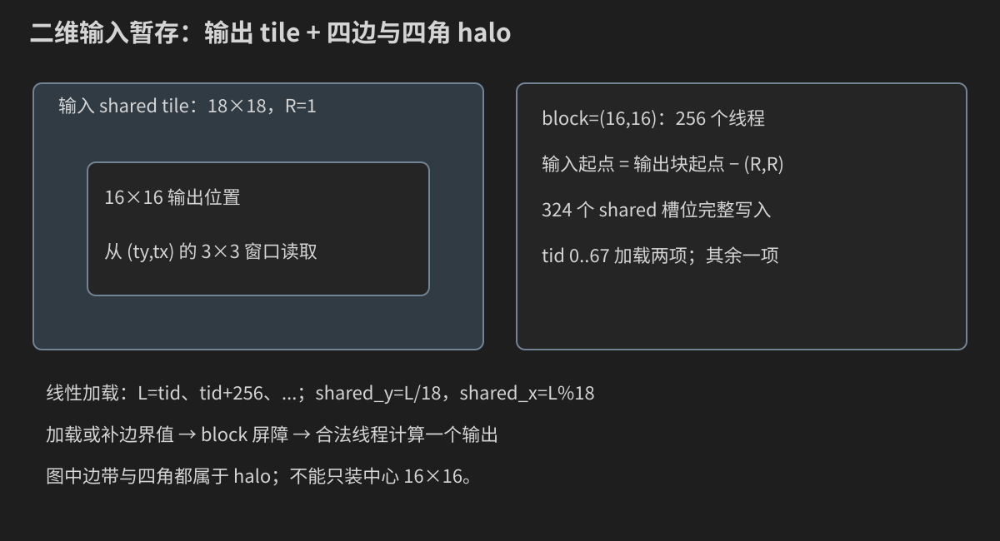

# 第 17 章：二维卷积与 Stencil——从九项手算到 Shared Halo

矩阵乘法让许多输出重用 A/B 子块。图像滤波也有复用，但来源变成相邻输出的重叠邻域。本章先用 5×5 数字图像定义算法，再写 CPU、naive CUDA、constant filter、shared tile 和两阶段可分离版本。每个阶段都回答：输出是什么、哪个线程负责、需要哪些输入、边界怎样定义、结果怎样证明。

本章读完应能独立完成一个带半径参数、边界策略和数值验证的二维滤波程序。深度学习中的 batch/channel/stride/dilation 是后续接口扩展；先把单张单通道图像的语义与地址讲清。

## 17.0 图像先是数值矩阵，再是颜色

设 width=W 是列数、height=H 是行数，输入和输出均为 H×W 个 float，按 row-major 存储。像素 `(x,y)` 的下标为 `y*W+x`。这里 x 对应列、y 对应行，不能把 width 当总元素数。

先研究这张图：

```text
 1  2  3  4  5
 6  7  8  9 10
11 12 13 14 15
16 17 18 19 20
21 22 23 24 25
```

它不需要实际图片文件，因而可以手算。输出值可能有小数或负数，使用 float；不要先压进 0..255 的 unsigned byte，再拿被截断的结果验证算法。

本章使用输入、输出两份数组。每个输出可能读取邻近输入；原地写回会让另一个线程读到已经更新的值，普通 block 同步也无法协调整个图像。已有经验回看[第 10 章](10-Shared-Memory与线程同步.md)，本次新增的是二维邻域。

## 17.1 Filter、半径和 Stencil 分别是什么

Stencil 是一种依赖模式：一个输出依赖附近若干输入。二维滤波是其中的加权求和实例；热传导或有限差分可以有类似邻域，但不一定使用同一组权重。

filter 是系数矩阵。半径 R=1 时边长 S=2R+1=3，共 9 个权重；R=2 时是 5×5，共 25 个权重。

本章的 3×3 高斯形状权重为：

```text
F = (1/16) × [1 2 1]
             [2 4 2]
             [1 2 1]
```

权重和为 1，所以常值输入在内部区域保持同一常值。它是一个特定离散平滑 filter，不是任意高斯分布的通用构造。

filter 的数组下标为 `fy*S+fx`。fy/fx 是系数的局部坐标，范围 0..S−1；它们不是图像输出坐标，也不是 threadIdx。遍历 filter 时，线程的 x/y 不变。

## 17.2 卷积与互相关：先决定系数是否翻转

常见直接滤波循环为：

```text
out[y,x] = Σ F[fy,fx] × extended_input[y+fy-R,x+fx-R]
```

这里没有翻转 F，严格数学名称是互相关（cross-correlation）。若定义数学卷积，使用 `F[S-1-fy,S-1-fx]`。很多应用把这两类操作都简称“卷积”；写程序必须明确选哪一种。

本章运行参数 `corr` 表示不翻转，`conv` 表示先在 host 把权重旋转 180°，device 仍执行同一套位置公式。对对称高斯 filter，两者数值相同，不能靠它检测翻转错误。

用 Sobel X 检测方向：

```text
[-1 0 1]
[-2 0 2]
[-1 0 1]
```

5×5 示例中心向右逐列增大，corr 的中心值为 8，conv 为 −8。方向符号改变，因此边缘检测尤其不能含糊。

再用非对称 filter `[1 2 0;0 -1 3;2 0 1]`：中心 corr=105、conv=103。案例提供它，帮助区分“结果刚好一样”和“接口真的实现了所选语义”。

## 17.3 九个乘积的完整旅程：中心像素

输出 `(x,y)=(2,2)` 的邻域为 `[7 8 9;12 13 14;17 18 19]`。高斯权重先按整数分子计算：

| fy,fx | 输入坐标 | 输入值 | 权重分子 | 分子乘积 |
|---|---|---:|---:|---:|
| 0,0 | 1,1 | 7 | 1 | 7 |
| 0,1 | 2,1 | 8 | 2 | 16 |
| 0,2 | 3,1 | 9 | 1 | 9 |
| 1,0 | 1,2 | 12 | 2 | 24 |
| 1,1 | 2,2 | 13 | 4 | 52 |
| 1,2 | 3,2 | 14 | 2 | 28 |
| 2,0 | 1,3 | 17 | 1 | 17 |
| 2,1 | 2,3 | 18 | 2 | 36 |
| 2,2 | 3,3 | 19 | 1 | 19 |

总分子 208，除以 16 得 13。固定 x/y，fy/fx 每步改变，输入坐标与权重下标一起前进。这个循环与 GEMM 的点积相似，但读取的是二维邻域，不是 A 行/B 列。

## 17.4 边缘不是“特殊像素”，而是算法契约

zero padding 定义图像外的值为 0。左上角 `(0,0)` 对应扩展邻域：

```text
0 0 0
0 1 2
0 6 7
```

分子为 `4×1+2×2+2×6+1×7=27`，输出 27/16=1.6875。仍使用原 filter，仍除以 16；没有把分母改成有效权重和。若想“仅对有效邻居重新归一化”，那是另一个算法。

clamp 把每个越界坐标映射到最近边缘：`ix=clamp(ix,0,W−1)`，iy 同理。左上角邻域为：

```text
1 1 2
1 1 2
6 6 7
```

分子 40，输出 2.5。clamp 会重复使用边缘像素；它没有让边界线程消失。

reflect 要另定义是否重复端点，例如 reflect 与 reflect-101 并非同一映射；valid 输出通常只保留完全落在图像内的窗口。当前程序只实现 zero/clamp，列出其他策略不等于代码已支持。

## 17.5 先写 CPU 参考与可观察手算模型

案例文件共用 `filter_reference.h`：它集中定义输入解析、权重构造、边界取样、double reference 和验证规则。头文件中的函数用 inline，避免多个编译单元包含后产生重复定义。这里复用的是**数学契约**，GPU 索引仍独立编写并核对。

```cpp
#ifndef CUDA_BOOK_FILTER_REFERENCE_H
#define CUDA_BOOK_FILTER_REFERENCE_H

#include <algorithm>
#include <charconv>
#include <cmath>
#include <cstddef>
#include <iostream>
#include <string>
#include <system_error>
#include <vector>

namespace filter_example {
struct Filter {
    int radius;
    bool separable;
    std::vector<float> weights, horizontal, vertical;
};

inline bool integer(const char* text, int low, int high, int& value) {
    if (!text || !*text) return false;
    const char* end = text;
    while (*end) ++end;
    int candidate = 0;
    const auto result = std::from_chars(text, end, candidate);
    if (result.ec != std::errc{} || result.ptr != end ||
        candidate < low || candidate > high) return false;
    value = candidate;
    return true;
}

inline Filter make_filter(const std::string& name, int radius, bool convolution) {
    Filter f{radius, true, {}, {}, {}};
    const int side = 2 * radius + 1;
    if (name == "gaussian") {
        f.horizontal = f.vertical = {0.25F, 0.5F, 0.25F};
    } else if (name == "sobel") {
        f.horizontal = {-1.0F, 0.0F, 1.0F};
        f.vertical = {1.0F, 2.0F, 1.0F};
    } else if (name == "box") {
        f.horizontal.assign(side, 1.0F / side);
        f.vertical.assign(side, 1.0F / side);
    } else {
        f.separable = false;
        f.weights = {1.0F, 2.0F, 0.0F, 0.0F, -1.0F, 3.0F, 2.0F, 0.0F, 1.0F};
    }
    if (f.separable) {
        f.weights.resize(static_cast<std::size_t>(side) * side);
        for (int y = 0; y < side; ++y) {
            for (int x = 0; x < side; ++x) {
                f.weights[y * side + x] = f.vertical[y] * f.horizontal[x];
            }
        }
    }
    if (convolution) {
        std::reverse(f.weights.begin(), f.weights.end());
        std::reverse(f.horizontal.begin(), f.horizontal.end());
        std::reverse(f.vertical.begin(), f.vertical.end());
    }
    return f;
}

inline float sample(const std::vector<float>& input, int width, int height,
                    int x, int y, bool clamp) {
    if (clamp) {
        x = std::clamp(x, 0, width - 1);
        y = std::clamp(y, 0, height - 1);
    } else if (x < 0 || y < 0 || x >= width || y >= height) {
        return 0.0F;
    }
    return input[static_cast<std::size_t>(y) * width + x];
}

inline std::vector<double> reference(const std::vector<float>& input,
                                     int width, int height, const Filter& f,
                                     bool clamp, std::vector<double>& magnitude) {
    const int side = 2 * f.radius + 1;
    std::vector<double> out(input.size(), 0.0);
    magnitude.assign(input.size(), 0.0);
    for (int y = 0; y < height; ++y) {
        for (int x = 0; x < width; ++x) {
            const std::size_t index = static_cast<std::size_t>(y) * width + x;
            for (int fy = 0; fy < side; ++fy) {
                for (int fx = 0; fx < side; ++fx) {
                    const double term = static_cast<double>(sample(
                        input, width, height, x + fx - f.radius,
                        y + fy - f.radius, clamp)) * f.weights[fy * side + fx];
                    out[index] += term;
                    magnitude[index] += std::abs(term);
                }
            }
        }
    }
    return out;
}

inline bool validate(const std::vector<float>& out, const std::vector<double>& expected,
                     const std::vector<double>& magnitude, const char* label) {
    double maximum = 0.0;
    for (std::size_t i = 0; i < out.size(); ++i) {
        const double error = std::abs(static_cast<double>(out[i]) - expected[i]);
        const double bound = 1.0e-5 + 2.0e-5 * magnitude[i];
        if (!std::isfinite(out[i]) || error > bound) {
            std::cerr << "FAIL " << label << " index=" << i << " expected=" << expected[i]
                      << " actual=" << out[i] << " bound=" << bound << '\n';
            return false;
        }
        maximum = std::max(maximum, error);
    }
    std::cout << "check " << label << " max_abs_error=" << maximum << '\n';
    return true;
}
}  // namespace filter_example
#endif
```

`reference` 在每个输出中先把实际 float 输入转 double 再乘权重，累计 expected 与各项绝对值之和 magnitude。验证要求 actual 有限，且绝对误差不超过 `1e-5+2e-5*magnitude`。这是对本章小半径、小量级输入的保守验收预算，不是任意深度学习卷积的通用精度证明。

模型 `filter_model.cpp` 固定 5×5 图像，逐项打印中心和角落的输入坐标、值、权重和 accumulator，同时检查确定答案：

```cpp
#include "filter_reference.h"
#include <cstdlib>
#include <utility>

int main(int argc, char** argv) {
    const std::string name = argc > 1 ? argv[1] : "gaussian";
    const std::string boundary = argc > 2 ? argv[2] : "zero";
    const std::string operation = argc > 3 ? argv[3] : "corr";
    if (argc > 4 || (name != "gaussian" && name != "sobel" && name != "asymmetric") ||
        (boundary != "zero" && boundary != "clamp") ||
        (operation != "corr" && operation != "conv")) {
        std::cerr << "Usage: filter_model [gaussian|sobel|asymmetric] [zero|clamp] [corr|conv]\n";
        return EXIT_FAILURE;
    }
    constexpr int width = 5, height = 5;
    std::vector<float> input(width * height);
    for (int i = 0; i < width * height; ++i) input[i] = static_cast<float>(i + 1);
    const auto f = filter_example::make_filter(name, 1, operation == "conv");
    std::vector<double> magnitude;
    const auto expected = filter_example::reference(input, width, height, f,
                                                    boundary == "clamp", magnitude);
    for (const auto point : {std::pair<int, int>{2, 2}, {0, 0}}) {
        const int x = point.first, y = point.second;
        std::cout << "output(x=" << x << ",y=" << y << ") terms:\n";
        double acc = 0.0;
        for (int fy = 0; fy < 3; ++fy) {
            for (int fx = 0; fx < 3; ++fx) {
                const int ix = x + fx - 1, iy = y + fy - 1;
                const float value = filter_example::sample(input, width, height, ix, iy,
                                                           boundary == "clamp");
                const float weight = f.weights[fy * 3 + fx];
                acc += static_cast<double>(value) * weight;
                std::cout << "  input(" << ix << ',' << iy << ")=" << value
                          << " filter[" << fy * 3 + fx << "]=" << weight
                          << " acc=" << acc << '\n';
            }
        }
        if (acc != expected[y * width + x]) return EXIT_FAILURE;
    }
    if (name == "gaussian" && expected[12] != 13.0) return EXIT_FAILURE;
    if (name == "gaussian" && boundary == "zero" && expected[0] != 1.6875) return EXIT_FAILURE;
    if (name == "gaussian" && boundary == "clamp" && expected[0] != 2.5) return EXIT_FAILURE;
    std::cout << "PASS center/corner trace agrees with the full CPU image.\n";
    return EXIT_SUCCESS;
}
```

```bash
g++ -std=c++17 -O2 -Wall -Wextra code/17_convolution/filter_model.cpp -o filter_model
./filter_model gaussian zero corr
./filter_model gaussian clamp corr
./filter_model sobel zero corr
./filter_model sobel zero conv
./filter_model asymmetric zero corr
```

默认输出中心 13、角落 1.6875；clamp 角落 2.5；Sobel 中心符号随 corr/conv 改变。它只验证 CPU 模型，不是 GPU 的实测证据。

## 17.6 每个 CUDA thread 先独立负责一个输出

从输出 shape 推导映射：

```cpp
x = blockIdx.x * blockDim.x + threadIdx.x;
y = blockIdx.y * blockDim.y + threadIdx.y;
grid.x = ceil(W/block.x);
grid.y = ceil(H/block.y);
```

131×97、block=16×16 时 grid=(9,7)，共 63 个 block。每个合法线程读取 S² 项并写一个 output。naive kernel 没有 block 屏障，因此越界输出线程可直接 return。

负 ix/iy 必须先判断，不能先转 size_t 再判断：−1 转无符号会变成极大整数。`pixel` 先应用边界契约，再把合法 y 转 size_t 形成线性下标。

相邻输出的邻域重叠：输出 `(x,y)` 与 `(x+1,y)` 的 3×3 邻域共享 6 个像素。naive 重复提出这些读取请求，cache 可以帮助，但程序尚未显式协作复用。

## 17.7 Constant memory：适合广播的系数访问

filter 小、只读、许多线程在同一循环步读相同系数，是 constant memory 的典型应用。声明 `__constant__ float c_filter[81]` 创建 device 上的符号；host 用 `cudaMemcpyToSymbol` 上传当前 filter。

81 来自本程序最大 R=4、S=9；它不是整个 constant memory 的容量。实际权重数 S²，复制的字节数是 `S²*sizeof(float)`。

一次 warp 指令若请求同一常量地址，可以利用广播；若许多 lane 请求不同常量地址，访问行为会改变。把任意只读数组换成 constant，不保证更快。案例同一 naive kernel 用模板参数选择 global filter 或 constant filter，只改变系数存储，图像读取、边界和输出任务保持相同。

constant 符号不是每个 stream 一份。若两个任务需要不同 filter，不能在它们仍运行时随意覆盖同一个符号；应建立顺序依赖，或为独立任务使用各自的 global 参数数组。到第 20 章学习并发时，要再次检查这一所有权。

## 17.8 Shared tile 与 halo 的准确尺寸

一个 block 输出 Bx×By，半径 R。为了覆盖边缘输出的邻域，输入暂存必须扩展到：

```text
shared_w = Bx + 2R
shared_h = By + 2R
shared_count = shared_w × shared_h
```

Bx=By=16、R=1：18×18=324 个 float，1296 bytes。R=4：24×24=576 项、2304 bytes。halo 是超出输出 tile 的输入边带，包含上下左右和四个角，不能只加载四条边而漏角。



这里 tile 左上角的全局坐标为 `blockIdx*blockDim−R`，不是当前线程的输出坐标。shared(0,0) 因而是输出块左上角向左、向上各偏移 R 的输入。

## 17.9 256 个线程怎样完整加载 324 项

先把二维 block 线程线性化：`tid=ty*blockDim.x+tx`，范围 0..255。分配：

```text
thread t 负责 linear=t, t+256, t+512, ...，直到 shared_count
```

R=1 时，tid=0..67 各加载两项，68..255 各加载一项，共 68×2+188=324。tid=0 的第二项 linear=256：shared_y=256/18=14、shared_x=256%18=4。

任何 shared 线性下标 L 都唯一分解为 `t=L%256` 与迭代号 `L/256`，因此没有漏写或重复所有者。循环步长来自 block 总线程数；写死 256 后改变 block 就可能破坏证明。

每个槽位通过 pixel 函数获得合法输入或边界值。越界输出线程仍可能承担合法 halo 加载；因此在这段协作前不能只按自己的输出有效性 return。这个具体原因与第 16 章一致，回看该章的加载责任说明，无需重复整个同步基础。

## 17.10 一个屏障为什么在这里就够

先完成所有槽位写入，再 `__syncthreads()`，然后合法输出线程从 shared 读取邻域。计算完成后 kernel 结束，本次 shared 数组没有下一 phase 的覆盖，所以不像循环 GEMM 那样需要消费后的第二道屏障。

shared 读取下标为 `(ty+fy)*shared_w+(tx+fx)`。ty/tx 对应输出在 block 中的位置，fy/fx 对应窗口位置；由于输入暂存起点已减 R，这里不再减 R。重复减一次会把窗口错误地移向左上。

这道屏障之后才允许越界输出 thread 返回。它已经完成加载责任，又没有后续屏障或共享覆盖需要参与，返回不会丢失仍被依赖的工作。

## 17.11 从二维权重到两个一维 filter

若 `F[fy,fx]=vertical[fy]*horizontal[fx]`，称 filter 可分离。高斯形状为 h=v=[1/4,2/4,1/4]，外积得到二维 /16 权重。

先水平：`temp[y,x]=Σ h[fx]*input[y,x+fx−R]`；再垂直：`out[y,x]=Σ v[fy]*temp[y+fy−R,x]`。两式展开恰好得到二维加权和。

5×5 示例中，中心附近 temp 的三项为 8、13、18；垂直计算 `(8+2×13+18)/4=13`。zero 边界左上 temp[0,0]=1，temp[1,0]=4.75，图像外行 temp=0；垂直得到 `0.5×1+0.25×4.75=1.6875`。

Sobel 也可分离：horizontal=[−1,0,1]，vertical=[1,2,1]；它不是“所有可分离 filter 都是平滑”的例子。非对称测试 filter 不是本程序可分离候选，第三个数学方法不会被错误地强行运行。

## 17.12 两个 kernel、中间缓冲与边界一致性

水平 kernel 写完整 temp；同一 stream 的垂直 kernel 排在其后，读取已完成的 temp。temp 与 input/output 是三份独立数组，不做原地覆盖。

对当前按 x/y 分别 zero 或 clamp 的矩形边界，两阶段可维持相同扩展定义。若每像素改为“仅有效系数重新归一化”，或其他非线性边界处理，就必须重新证明可分离等价，不能只套用外积分解。

浮点执行仍有区别：两阶段 temp 按 float 存储，增加一次中间舍入；box 的一维系数和二维乘积构造也有舍入。比较采用同一 double oracle 与解释过的预算，不要求任意输入按位一致。

## 17.13 完整 CUDA 程序：把四条路径放进相同验证协议

`convolution.cu` 复用前面的数学头文件，包含 global/constant naive、shared、separable 两 kernel，严格解析输入，在运行后比较全部输出并检查原始输入未改变：

```cpp
#include "../common/cuda_check.h"
#include "../09_timing/benchmark_stats.h"
#include "filter_reference.h"

#include <array>
#include <cstdlib>
#include <limits>

namespace {
constexpr int kBlock = 16, kMaxSide = 9;
__constant__ float c_filter[kMaxSide * kMaxSide];
__constant__ float c_horizontal[kMaxSide], c_vertical[kMaxSide];

__device__ float pixel(const float* input, int w, int h, int x, int y, bool clamp) {
    if (clamp) { x = min(max(x, 0), w - 1); y = min(max(y, 0), h - 1); }
    else if (x < 0 || y < 0 || x >= w || y >= h) return 0.0F;
    return input[static_cast<std::size_t>(y) * w + x];
}

template<bool Constant>
__global__ void filter_naive(const float* input, float* output, const float* weights,
                             int w, int h, int radius, bool clamp) {
    const int x = blockIdx.x * blockDim.x + threadIdx.x;
    const int y = blockIdx.y * blockDim.y + threadIdx.y;
    if (x >= w || y >= h) return;
    const int side = 2 * radius + 1;
    float acc = 0.0F;
    for (int fy = 0; fy < side; ++fy) for (int fx = 0; fx < side; ++fx) {
        const int index = fy * side + fx;
        const float weight = Constant ? c_filter[index] : weights[index];
        acc += pixel(input, w, h, x + fx - radius, y + fy - radius, clamp) * weight;
    }
    output[static_cast<std::size_t>(y) * w + x] = acc;
}

__global__ void filter_shared(const float* input, float* output,
                              int w, int h, int radius, bool clamp) {
    extern __shared__ float tile[];
    const int tx = threadIdx.x, ty = threadIdx.y;
    const int tid = ty * blockDim.x + tx;
    const int shared_w = blockDim.x + 2 * radius;
    const int shared_h = blockDim.y + 2 * radius;
    const int origin_x = blockIdx.x * blockDim.x - radius;
    const int origin_y = blockIdx.y * blockDim.y - radius;
    const int threads = blockDim.x * blockDim.y;
    for (int linear = tid; linear < shared_w * shared_h; linear += threads) {
        tile[linear] = pixel(input, w, h, origin_x + linear % shared_w,
                            origin_y + linear / shared_w, clamp);
    }
    __syncthreads();
    const int x = blockIdx.x * blockDim.x + tx;
    const int y = blockIdx.y * blockDim.y + ty;
    if (x >= w || y >= h) return; // All cooperative loads and the sole barrier finished.
    const int side = 2 * radius + 1;
    float acc = 0.0F;
    for (int fy = 0; fy < side; ++fy) for (int fx = 0; fx < side; ++fx) {
        acc += tile[(ty + fy) * shared_w + tx + fx] * c_filter[fy * side + fx];
    }
    output[static_cast<std::size_t>(y) * w + x] = acc;
}

template<bool Horizontal>
__global__ void filter_separable(const float* input, float* output,
                                 int w, int h, int radius, bool clamp) {
    const int x = blockIdx.x * blockDim.x + threadIdx.x;
    const int y = blockIdx.y * blockDim.y + threadIdx.y;
    if (x >= w || y >= h) return;
    float acc = 0.0F;
    for (int f = 0; f < 2 * radius + 1; ++f) {
        const int ix = Horizontal ? x + f - radius : x;
        const int iy = Horizontal ? y : y + f - radius;
        acc += pixel(input, w, h, ix, iy, clamp) *
               (Horizontal ? c_horizontal[f] : c_vertical[f]);
    }
    output[static_cast<std::size_t>(y) * w + x] = acc;
}
} // namespace

int main(int argc, char** argv) {
    int w = 131, h = 97, radius = 1, rounds = 5;
    const std::string name = argc > 3 ? argv[3] : "gaussian";
    const std::string boundary = argc > 4 ? argv[4] : "zero";
    const std::string operation = argc > 6 ? argv[6] : "corr";
    if (argc > 8 ||
        (argc > 1 && !filter_example::integer(argv[1], 1, 2048, w)) ||
        (argc > 2 && !filter_example::integer(argv[2], 1, 2048, h)) ||
        (argc > 5 && !filter_example::integer(argv[5], 1, 4, radius)) ||
        (argc > 7 && !filter_example::integer(argv[7], 1, 31, rounds)) ||
        (name != "gaussian" && name != "sobel" && name != "asymmetric" && name != "box") ||
        (boundary != "zero" && boundary != "clamp") ||
        (operation != "corr" && operation != "conv") ||
        (name != "box" && radius != 1) ||
        1LL * w * h * (2 * radius + 1) * (2 * radius + 1) > 268435456LL) {
        std::cerr << "Usage: convolution [width:1..2048] [height:1..2048]"
                     " [gaussian|sobel|asymmetric|box] [zero|clamp] [radius:1..4]"
                     " [corr|conv] [rounds:1..31]\n"
                     "Only box accepts radius>1; CPU terms <=268435456.\n";
        return EXIT_FAILURE;
    }
    const auto f = filter_example::make_filter(name, radius, operation == "conv");
    const bool clamp = boundary == "clamp";
    const int methods = f.separable ? 4 : 3;
    const std::array<const char*, 4> names = {"global-filter", "constant-filter", "shared", "separable"};
    const std::size_t count = static_cast<std::size_t>(w) * h;
    const std::size_t bytes = count * sizeof(float);
    const std::size_t shared_bytes = (kBlock + 2 * radius) * (kBlock + 2 * radius) * sizeof(float);
    cudaDeviceProp prop{};
    CUDA_CHECK(cudaGetDeviceProperties(&prop, 0));
    if (prop.maxThreadsPerBlock < 256 || prop.sharedMemPerBlock < shared_bytes) {
        std::cerr << "NOT RUN: insufficient block/shared resources.\n";
        return 77;
    }
    std::vector<float> input(count), output(count), after(count);
    for (std::size_t i = 0; i < count; ++i) input[i] = static_cast<float>((i * 17) % 23) / 8.0F - 1.375F;
    std::vector<double> magnitude;
    const auto expected = filter_example::reference(input, w, h, f, clamp, magnitude);
    float *d_input = nullptr, *d_weights = nullptr, *d_temp = nullptr;
    std::array<float*, 4> d_output{};
    CUDA_CHECK(cudaMalloc(&d_input, bytes));
    CUDA_CHECK(cudaMalloc(&d_temp, bytes));
    CUDA_CHECK(cudaMalloc(&d_weights, f.weights.size() * sizeof(float)));
    CUDA_CHECK(cudaMemcpy(d_input, input.data(), bytes, cudaMemcpyHostToDevice));
    CUDA_CHECK(cudaMemcpy(d_weights, f.weights.data(), f.weights.size() * sizeof(float), cudaMemcpyHostToDevice));
    CUDA_CHECK(cudaMemcpyToSymbol(c_filter, f.weights.data(), f.weights.size() * sizeof(float)));
    if (f.separable) {
        CUDA_CHECK(cudaMemcpyToSymbol(c_horizontal, f.horizontal.data(), f.horizontal.size() * sizeof(float)));
        CUDA_CHECK(cudaMemcpyToSymbol(c_vertical, f.vertical.data(), f.vertical.size() * sizeof(float)));
    }
    for (int method = 0; method < methods; ++method) CUDA_CHECK(cudaMalloc(&d_output[method], bytes));
    cudaEvent_t start{}, stop{};
    CUDA_CHECK(cudaEventCreate(&start));
    CUDA_CHECK(cudaEventCreate(&stop));
    const dim3 block(kBlock, kBlock), grid((w + kBlock - 1) / kBlock, (h + kBlock - 1) / kBlock);
    auto launch = [&](int method) {
        if (method == 0) filter_naive<false><<<grid, block>>>(d_input, d_output[method], d_weights, w, h, radius, clamp);
        if (method == 1) filter_naive<true><<<grid, block>>>(d_input, d_output[method], d_weights, w, h, radius, clamp);
        if (method == 2) filter_shared<<<grid, block, shared_bytes>>>(d_input, d_output[method], w, h, radius, clamp);
        if (method == 3) {
            filter_separable<true><<<grid, block>>>(d_input, d_temp, w, h, radius, clamp);
            CUDA_CHECK(cudaGetLastError());
            filter_separable<false><<<grid, block>>>(d_temp, d_output[method], w, h, radius, clamp);
        }
        CUDA_CHECK(cudaGetLastError());
    };
    auto check = [&](int method) {
        CUDA_CHECK(cudaMemcpy(output.data(), d_output[method], bytes, cudaMemcpyDeviceToHost));
        if (!filter_example::validate(output, expected, magnitude, names[method])) std::exit(EXIT_FAILURE);
    };
    std::cout << "GPU=" << prop.name << " width=" << w << " height=" << h
              << " filter=" << name << " radius=" << radius << " boundary=" << boundary
              << " operation=" << operation << " shared_bytes=" << shared_bytes << '\n';
    for (int method = 0; method < methods; ++method) {
        CUDA_CHECK(cudaMemset(d_output[method], 0xFF, bytes));
        if (method == 3) CUDA_CHECK(cudaMemset(d_temp, 0xFF, bytes));
        launch(method);
        CUDA_CHECK(cudaDeviceSynchronize());
        check(method);
        for (int warm = 0; warm < 3; ++warm) launch(method);
        CUDA_CHECK(cudaDeviceSynchronize());
        check(method);
    }
    std::array<std::vector<double>, 4> times;
    for (int round = 0; round < rounds; ++round) {
        for (int slot = 0; slot < methods; ++slot) {
            const int method = (round + slot) % methods;
            CUDA_CHECK(cudaMemset(d_output[method], 0xFF, bytes));
            if (method == 3) CUDA_CHECK(cudaMemset(d_temp, 0xFF, bytes));
            CUDA_CHECK(cudaEventRecord(start));
            launch(method);
            CUDA_CHECK(cudaEventRecord(stop));
            CUDA_CHECK(cudaEventSynchronize(stop));
            float ms = 0.0F;
            CUDA_CHECK(cudaEventElapsedTime(&ms, start, stop));
            if (!std::isfinite(ms) || ms <= 0.0F) { std::cerr << "FAIL unresolved Event time.\n"; return EXIT_FAILURE; }
            times[method].push_back(ms);
            check(method);
            std::cout << "sample round=" << round << " method=" << names[method] << " ms=" << ms << '\n';
        }
        CUDA_CHECK(cudaMemcpy(after.data(), d_input, bytes, cudaMemcpyDeviceToHost));
        if (after != input) { std::cerr << "FAIL input changed.\n"; return EXIT_FAILURE; }
    }
    for (int method = 0; method < methods; ++method) {
        const auto s = summarize(times[method]);
        std::cout << "summary " << names[method] << " min_ms=" << s.minimum << " median_ms=" << s.median
                  << " mean_ms=" << s.mean << " max_ms=" << s.maximum
                  << " pixels_per_second=" << count / (s.median * 1.0e-3) << '\n';
    }
    for (int method = 0; method < methods; ++method) CUDA_CHECK(cudaFree(d_output[method]));
    CUDA_CHECK(cudaFree(d_temp)); CUDA_CHECK(cudaFree(d_weights)); CUDA_CHECK(cudaFree(d_input));
    CUDA_CHECK(cudaEventDestroy(stop)); CUDA_CHECK(cudaEventDestroy(start));
    std::cout << "PASS all eligible methods match the CPU image; input unchanged.\n";
    return EXIT_SUCCESS;
}
```

依次阅读参数→权重→CPU参考→分配上传→launch→单次检查→预热→计时轮换→结果检查→释放。模板 bool 是编译期选择；它不把不同存储模式混成一条含糊的性能结果。

先对照下面的host变量表，再走一遍37×29/R1的程序：

| 变量 | 所在位置与单位 | 此输入的作用 |
|---|---|---|
| w/h/radius | host int，元素维度/半径 | 37、29、1，决定图像与窗口 |
| count/bytes | host size_t，元素/字节 | 1073项、4292bytes，决定图像分配与复制 |
| shared_bytes | host size_t，bytes/block | 18×18×4=1296，传入第三启动参数 |
| f.weights | host vector<float> | 按所选方向排好的9个系数 |
| expected/magnitude | host vector<double> | 每输出的参考和项绝对值之和 |
| d_input/d_weights | device global指针 | 不变图像、普通global系数对照 |
| d_temp | device global指针 | separable水平结果，不能别名input |
| d_output[method] | 每方法独立device输出 | 避免跨方法覆盖影响对照 |
| times[method] | host vector<double>，ms | 每轮单方法完整区间样本 |

该输入grid=(3,2)。先上传一次图像和filter，第一种方法覆盖1073个输出；shared方法由6个block各装自己的halo；separable先写1073项temp，再写1073项最终输出。四者都在计时完成点之后回传，逐项对照同一expected。若asymmetric被选中，methods=3，temp虽保留已分配空间，但不会执行虚假的分解。

## 17.14 编译、运行和参数修改

```bash
nvcc -std=c++17 -O2 -lineinfo code/17_convolution/convolution.cu -o convolution
./convolution 37 29 gaussian zero 1 corr 5
./convolution 37 29 gaussian clamp 1 corr 5
./convolution 37 29 sobel zero 1 corr 5
./convolution 37 29 sobel zero 1 conv 5
./convolution 37 29 asymmetric zero 1 corr 5
./convolution 37 29 box clamp 4 corr 5
```

参数依次为 width、height、filter、边界、半径、corr/conv、rounds。width/height 是元素数，radius 是邻域跨度，不是 bytes；rounds 是计时样本数。只有 box 允许 R>1；名字与范围错误、0、负尺寸均在 GPU 操作前拒绝。

默认 131×97、gaussian、zero、R=1、corr、5 轮。输出包含 GPU、shape、数学契约、shared bytes、各方法最大绝对误差、原始样本、四项统计和 pixels/s。最后应出现 PASS；任何具体时间都须来自实际运行。

`filter_model.cpp` 和 CUDA 程序放在同一目录，双引号 include 相对源文件搜索数学头文件。旧 conv2d 短例已经由该完整程序替代。编译选项基础回看[第 3 章](03-第一段CUDA程序与NVCC.md)，批量入口见[本章 README](code/17_convolution/README.md)。

## 17.15 性能比较先保持任务相同

global 与 constant 比较 filter 读取；constant naive 与 shared 比较图像复用；shared 与 separable 比较算法分解。每个输出必须接受同一 filter、边界和方向定义，不能把 clamp 的结果拿来对 zero 的速度排名。

预热三次、每轮轮换方法。Event 内只包含本方法的完整设备计算；separable 必须包围水平与垂直两次启动，不能只测最后一个 kernel。分配、filter 更新、H2D、D2H 与校验在区间外。测量仍可能包含 host 提交第二个 kernel 之间的空隙。

pixels/s 以 W×H 个有用输出除以时间。直接 filter 的名义乘加是 S²，separable 是约 2S；如果都用 direct FLOP 数当分子，必须标为“等效工作率”，不能声称 separable 实际执行了那些 FLOP。本程序选择 pixels/s，便于比较同一输出任务。

## 17.16 复用收益也有成本

完整 16×16 输出、R=1 时 naive 发出 256×9=2304 次图像元素读取；shared 协作最多加载 324 个输入位置，源码请求比约 7.11。R=4 时为 256×81/576=36。边界补零、clamp 重复地址和 cache 会改变真实流量，不能把这些数直接当 DRAM transaction。

shared 增加协作循环、屏障、片上读取与资源占用。R 很小、naive cache 命中好时，shared 未必明显获益。R 越大，halo 面积和计算量也增加；选择 tile 时不能只看理想复用。

separable 减少乘加，但多一次 temp 写回和读取、多一次启动。3×3 不保证比 direct 快；大 filter 更可能有算术优势，但仍要测量。把 Gaussian、box、Sobel 分别记录，不预设统一排名。

## 17.17 验证阶梯与故障定位

先运行 1×1、1×17、19×1、16×16、17×15、37×29，再改 R 和边界。1×1 高斯 zero 输出为中心权重×输入，clamp 则所有邻域都指向唯一像素，权重和为 1，输出等于输入。

```bash
compute-sanitizer --tool memcheck --error-exitcode 99 ./convolution 17 15 gaussian zero 1 corr 1
compute-sanitizer --tool racecheck --error-exitcode 99 ./convolution 17 15 box zero 4 corr 1
compute-sanitizer --tool synccheck --error-exitcode 99 ./convolution 17 15 gaussian clamp 1 corr 1
```

工具检测地址与协作错误，CPU oracle 检查数学语义。无报告不等于已证明 filter 翻转正确。当前编辑环境未执行 GPU/工具，上述是验收命令。

| 现象 | 先检查 |
|---|---|
| 中心对、角落错 | zero/clamp、是否偷偷重新归一化 |
| 高斯对、Sobel方向错 | corr/conv 是否翻转 |
| 16×16对、17×15错 | 尾线程加载责任、shared尺寸、grid |
| shared整个窗口偏移 | origin减R后，compute是否又减R |
| separable只最后一行错 | 垂直边界和temp完整写入 |
| constant版本偶发切换权重 | filter符号更新与正在执行的任务 |
| 输出NaN | 漏加载/漏store、temp未覆盖 |
| signed边缘结果巨大 | 负数被转换为unsigned |

## 17.18 扩展到 stride、dilation 与多通道时先改契约

目前 stride=1、dilation=1、输出与输入同尺寸。若 stride=s，输出坐标映射为输入中心 `x*s,y*s`；dilation=d 则 filter 相邻采样点在输入中相距 d。有效窗口边长变为 `(S−1)*d+1`，halo 不能仍按 R 计算。

常用输出尺寸为 `floor((input+2padding−dilation*(S−1)−1)/stride)+1`，必须分别对两个方向应用，并定义 padding 是否对称。先用一维小数字验证尺寸，再写 kernel。

多通道输出会在邻域之外还沿输入 channel 求和。NCHW/NHWC、batch、输出 channel、精度、workspace 与算法选择进入接口。可用 cuDNN 等成熟库；本章的单通道实验训练地址和协议，不把九项循环当作完整深度学习卷积实现。

texture object 可提供采样和地址模式，但它的坐标、插值、类型转换有自己的契约。现代 global load 也有 cache；是否采用 texture 要用访问模式与实测判断。不要把换成 texture 当成不用分析边界的办法。

## 17.19 练习

1. 5×5 row-major 图像的 `(x,y)=(3,2)` 下标是多少？R=2 时filter有多少项？
2. 完整列出中心高斯九项分子，为什么结果为13？
3. 手算zero左上角，解释为什么没有改分母。
4. 手算clamp左上角，哪些像素被重复？
5. Sobel中心corr/conv各是多少？为何Gaussian不足以测试翻转？
6. 非对称filter中心corr/conv各是多少？
7. 131×97、block16×16的grid是多少？
8. 解释负ix不能先转size_t的原因。
9. R=1/4的shared尺寸与bytes是多少？
10. tid=67和68分别负责哪些shared下标？
11. 证明加载循环完整覆盖且每槽只有一个写者。
12. 为什么越界输出线程仍可能加载合法halo？
13. 推导shared compute下标，为什么这里不再减R？
14. 本程序为何只需一屏障？什么改造会重新需要第二屏障？
15. 为什么constant适合相同系数读取，但不适合所有只读数据？
16. 两stream同时使用不同filter，应怎样处理constant符号？
17. 写出高斯和Sobel的一维分解。
18. 从两阶段公式展开证明direct等价，列出边界前提。
19. temp引入哪些内存操作与舍入？
20. 为什么Event必须同时包围两次separable启动？
21. 推导R=1/4的naive与shared图像请求数。
22. 设计1×1、尾tile与方向的测试矩阵。
23. stride=2、dilation=2、S=3、输入7、padding2时输出长度是多少？
24. 独立实现reflect-101边界，先定义索引映射，再给CPU/GPU对照与长度1处理。

答案见[附录 C](附录-C-练习答案.md#第-17-章)。

## 17.20 从这个算子进入性能分析

你现在有四条正确性契约相同的设备路径。下一章用它们练习：先看整个应用时间线，再挑真正值得优化的kernel，最后用指标检验具体假设。先保存普通运行的输入、命令和结果，再采集报告。

下一章：[Nsight性能分析与优化方法](18-Nsight性能分析与优化方法.md)。参考：[CUDA Best Practices](https://docs.nvidia.com/cuda/cuda-c-best-practices-guide/index.html)、[CUDA语言扩展中的内存声明](https://docs.nvidia.com/cuda/cuda-programming-guide/05-appendices/cpp-language-extensions.html)。
