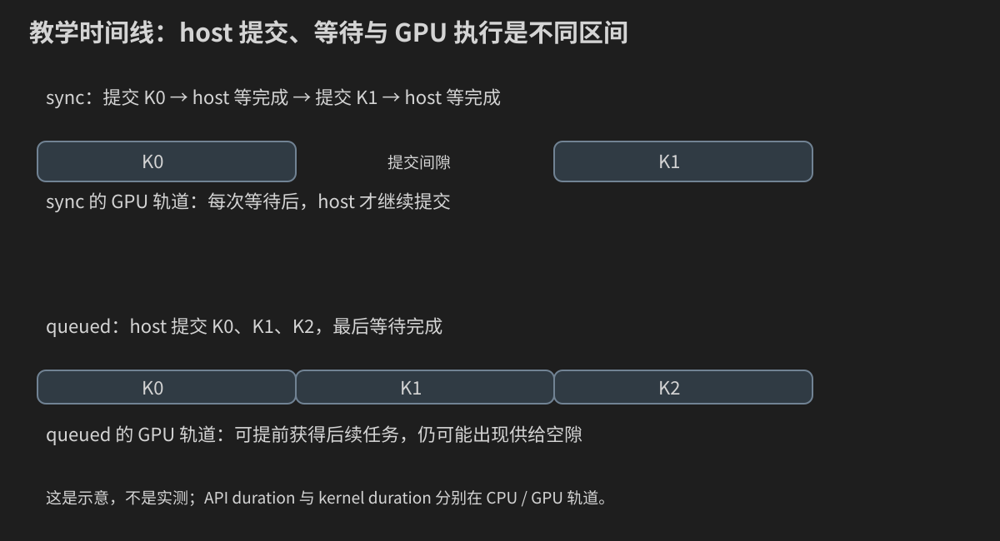

# 第 18 章：Nsight 性能分析——从一条时间线到一次可信优化

前面已经有正确的转置、GEMM 和卷积程序。现在不要急着改 tile：先明确应用是否被这些 kernel 限制。本章从普通计时建立基线，再用 Nsight Systems 找应用中的时间关系，用 Nsight Compute 深入一个 kernel，最后把修改的收益放回端到端任务验证。

你将实际得到两类报告文件、一个带阶段标记的完整案例、一份可重复的优化记录。当前教材没有在 GPU 上采集这些报告，所有 timeline 示意和假设数字明确属于教学模型。

## 18.0 “慢”必须带一个完整任务

同一卷积可能有不同目标：一次服务器请求的延迟、每秒处理多少图像、固定 batch 的总时间、设备计算时间，或包括文件读写的数据流程。目标不同，优化排序也不同。

先写：输入 shape/类型/边界、输出验证、测量起止、重复次数、硬件和构建方式。例如“131×97 gaussian/zero/corr，输入已经在显存，只测四种实现的设备计算”与“从文件读入到输出图像落盘”是不同任务。

复习[第 9 章](09-正确计时与带宽基线.md)的 Event 与 host 时钟。本章新增的是多层证据：普通计时给排名，Systems 给提交/执行时间关系，Compute 给具体 kernel 的机制。

## 18.1 APOD：把一次优化组织成可审查实验

Assess 是确定热点与目标；Parallelize 是建立正确并行版本；Optimize 是用证据改进；Deploy 是将改进带回真实任务。这个循环并不要求每次都从串行重写；已有 GPU 程序可以先重新 Assess。

具体记录可以是：卷积端到端时间主要用于哪一步？shared 相对 naive 的输入请求减少是否体现在硬件？修改一个因素后结果是否仍满足 oracle？最终请求延迟是否改善？

如果不知道要回答哪一个问题，先不采集 full 报告。大量指标并不会自动替你选择目标。

## 18.2 两种 Nsight 的职责

| 工具 | 分析对象 | 适合的问题 | 主要结果 |
|---|---|---|---|
| Nsight Systems / nsys | 应用、CPU线程、CUDA API与GPU任务 | GPU空隙、传输/计算、同步、并发和关键路径 | .nsys-rep |
| Nsight Compute / ncu | 选中的CUDA kernel | 访存、指令、资源、调度与吞吐限制 | .ncu-rep |

Systems 中 API 的 CPU 时间不是 kernel 的 GPU 执行时间。Compute 中一个 kernel 的高效率也不说明应用无 CPU/传输瓶颈。先选择工具层级，再解释字段。

## 18.3 工具版本、环境和权限先做只读检查

```bash
nvidia-smi
nvcc --version
nsys --version
ncu --version
nsys profile --help
ncu --help
```

`command not found` 是工具未找到；`No kernels were profiled` 多半要看筛选或捕获范围；硬件计数器权限拒绝是另一种环境限制。不要混成“程序算错”。

CLI 选项、report 名称、section 和 metrics 会随工具版本变化。本章命令以 NVIDIA 当前文档为参考，但读者应先对照服务器 help。Linux 无图形界面照样能采集，GUI 可以放在另一台电脑上。

共享服务器通常不由学习者随意改驱动设置或系统性能计数器权限。先保留错误和环境，使用可用的普通计时/时间线继续分析；需要管理员配置时说明具体权限需求。

## 18.4 建立一个可解释的被测程序

`profiling_workload.cu` 对固定输入重复执行 `out=2*input+1`。每次覆盖 output，输入不改变。两种模式唯一主要变化是完成点：sync 每次启动后等待 stream，queued 连续提交后等结束 Event。

它有三个阶段标签：allocate-and-upload、submit-and-complete、download-and-validate。计时的工作区间在完成初始化和预热之后，复制/验证位于外面。不要把运行了32次缩放误解成把同一个数反复乘2：所有 kernel 都读原始 input。

```cpp
#include "../common/cuda_check.h"
#include "../17_convolution/filter_reference.h"
#include <cuda_profiler_api.h>

#include <chrono>
#include <cstdlib>
#include <vector>

#ifndef PROFILE_NVTX
#define PROFILE_NVTX 0
#endif
#if PROFILE_NVTX
#include <nvtx3/nvToolsExt.h>
#endif

namespace {
void push(const char* name) {
#if PROFILE_NVTX
    nvtxRangePushA(name);
#else
    (void)name;
#endif
}
void pop() {
#if PROFILE_NVTX
    nvtxRangePop();
#endif
}
__global__ void affine_kernel(const float* input, float* output, int n) {
    const std::size_t i = static_cast<std::size_t>(blockIdx.x) * blockDim.x + threadIdx.x;
    if (i < static_cast<std::size_t>(n)) output[i] = 2.0F * input[i] + 1.0F;
}
}

int main(int argc, char** argv) {
    int n = 1048576, repeats = 32;
    const std::string mode = argc > 3 ? argv[3] : "queued";
    if (argc > 4 ||
        (argc > 1 && !filter_example::integer(argv[1], 0, 16777216, n)) ||
        (argc > 2 && !filter_example::integer(argv[2], 1, 10000, repeats)) ||
        (mode != "sync" && mode != "queued")) {
        std::cerr << "Usage: profiling_workload [n:0..16777216] [repeats:1..10000] [sync|queued]\n";
        return EXIT_FAILURE;
    }
    if (n == 0) { std::cout << "PASS empty input; no GPU launch.\n"; return EXIT_SUCCESS; }
    const std::size_t bytes = static_cast<std::size_t>(n) * sizeof(float);
    std::vector<float> input(n), output(n), after(n);
    for (int i = 0; i < n; ++i) input[i] = static_cast<float>(i % 127 - 63) / 8.0F;
    push("allocate-and-upload");
    float *di = nullptr, *dout = nullptr;
    CUDA_CHECK(cudaMalloc(&di, bytes)); CUDA_CHECK(cudaMalloc(&dout, bytes));
    CUDA_CHECK(cudaMemcpy(di, input.data(), bytes, cudaMemcpyHostToDevice));
    cudaStream_t stream{};
    CUDA_CHECK(cudaStreamCreateWithFlags(&stream, cudaStreamNonBlocking));
    cudaEvent_t start{}, stop{};
    CUDA_CHECK(cudaEventCreate(&start)); CUDA_CHECK(cudaEventCreate(&stop));
    const int threads = 256, blocks = (n + threads - 1) / threads;
    for (int warm = 0; warm < 3; ++warm) {
        affine_kernel<<<blocks, threads, 0, stream>>>(di, dout, n);
        CUDA_CHECK(cudaGetLastError());
    }
    CUDA_CHECK(cudaStreamSynchronize(stream));
    pop();
    CUDA_CHECK(cudaMemsetAsync(dout, 0xFF, bytes, stream));
    CUDA_CHECK(cudaStreamSynchronize(stream));

    CUDA_CHECK(cudaProfilerStart());
    push("submit-and-complete");
    const auto host_start = std::chrono::steady_clock::now();
    CUDA_CHECK(cudaEventRecord(start, stream));
    for (int repeat = 0; repeat < repeats; ++repeat) {
        affine_kernel<<<blocks, threads, 0, stream>>>(di, dout, n);
        CUDA_CHECK(cudaGetLastError());
        if (mode == "sync") CUDA_CHECK(cudaStreamSynchronize(stream));
    }
    CUDA_CHECK(cudaEventRecord(stop, stream));
    CUDA_CHECK(cudaEventSynchronize(stop));
    const auto host_stop = std::chrono::steady_clock::now();
    pop();
    CUDA_CHECK(cudaProfilerStop());
    float event_ms = 0.0F;
    CUDA_CHECK(cudaEventElapsedTime(&event_ms, start, stop));
    const double host_ms = std::chrono::duration<double, std::milli>(host_stop - host_start).count();
    push("download-and-validate");
    CUDA_CHECK(cudaMemcpy(output.data(), dout, bytes, cudaMemcpyDeviceToHost));
    CUDA_CHECK(cudaMemcpy(after.data(), di, bytes, cudaMemcpyDeviceToHost));
    for (int i = 0; i < n; ++i) {
        const float expected = 2.0F * input[i] + 1.0F;
        if (!std::isfinite(output[i]) || output[i] != expected || after[i] != input[i]) {
            std::cerr << "FAIL index=" << i << '\n';
            return EXIT_FAILURE;
        }
    }
    pop();
    CUDA_CHECK(cudaEventDestroy(stop)); CUDA_CHECK(cudaEventDestroy(start));
    CUDA_CHECK(cudaStreamDestroy(stream));
    CUDA_CHECK(cudaFree(dout)); CUDA_CHECK(cudaFree(di));
    std::cout << "mode=" << mode << " n=" << n << " repeats=" << repeats
              << " Event_interval_ms=" << event_ms << " host_submit_and_wait_ms=" << host_ms << '\n'
              << "PASS output and immutable input; allocation/copies/validation excluded from these timers.\n";
    return EXIT_SUCCESS;
}
```

```bash
nvcc -std=c++17 -O2 -lineinfo code/18_profiling/profiling_workload.cu -o profiling_workload
./profiling_workload 1031 32 sync
./profiling_workload 1031 32 queued
./profiling_workload 1048576 32 queued
```

n 是元素数、repeats 是启动次数，mode 决定等待方式。n=0 明确不启动GPU；非法参数在分配前拒绝。输出逐项精确检查，并回读 input 确认不变。

Event_interval_ms 是同一队列的设备区间，host_submit_and_wait_ms 是 CPU 端从提交到完成的区间。两者可有不同起止和排队间隙，不要求相等。测量精度过小时换更大repeats，不把单次噪声当优化收益。

第一次读main时，把input/output/after当成三份host数组，di/dout是两份device数组；after只用于回读input证明没有被kernel改写。stream/start/stop都是host持有的句柄，记录与等待调用作用于GPU队列。host_start/host_stop是CPU时钟时刻，event_ms是Runtime写出的float毫秒，host_ms是chrono转换后的double毫秒。

例如n=1031时grid=ceil(1031/256)=5，1280个已启动线程中1031个写output。sync模式3次启动对应3个host stream等待，queued模式3次启动只有主体末尾等待。两者CPU参考都是每个元素的2x+1，未改变数据量，因此能用它们练习提交差异；具体快慢与空隙仍要实测。

## 18.5 NVTX：标签描述 host 代码，不自动等待 GPU

NVTX 是给分析工具的事件/范围注释。push 开始当前 host 线程的范围，pop 结束；嵌套范围必须配对。它不会替你执行同步，也不会改变数组结果。

代码默认不依赖NVTX，打开宏后包含 NVTX3 头文件：

```bash
nvcc -std=c++17 -O2 -lineinfo -DPROFILE_NVTX=1 \
    code/18_profiling/profiling_workload.cu -ldl -o profiling_workload_nvtx
```

NVTX3 的 header-only 路线不使用旧的 `-lnvToolsExt`；Linux 通常需链接动态加载接口 `-ldl`。若头文件未随环境提供，安装或使用 [NVIDIA NVTX 仓库](https://github.com/NVIDIA/NVTX) 的include目录，并按它的安装说明构建。Windows不套用Linux的-ldl。案例的无NVTX版仍可采集CUDA时间线。

如果范围只包住launch，host很快pop，而GPU稍后仍在执行，范围短不表示kernel短。本案例submit-and-complete范围包含最终等待，让它对应一段完成的工作，但仍应在GPU轨道上读具体kernel。

## 18.6 第一次 Systems 采集：命令逐项解释

从仓库根目录编译好程序后：

```bash
nsys profile --trace=cuda,nvtx --sample=none \
    -o queued_trace ./profiling_workload_nvtx 1031 32 queued
nsys profile --trace=cuda,nvtx --sample=none \
    -o sync_trace ./profiling_workload_nvtx 1031 32 sync
nsys stats queued_trace.nsys-rep
```

profile启动应用并采集；trace选择CUDA/NVTX事件；sample=none关闭CPU采样，适合先关注CUDA时间关系；-o给报告前缀；其后的可执行文件和参数属于你的应用。输出通常为同前缀.nsys-rep，实际产物以工具日志为准。

第一次先采全程序，这样能区分初始化、预热和主体。报告变大后再聚焦。本例cudaProfilerStart/Stop围住主体，可用：

需要观察操作系统运行时调用时，可在本机支持的trace项中加入osrt，例如`--trace=cuda,nvtx,osrt`。它补充host等待/运行时活动背景；CPU采样与OS运行时trace是不同采集选择，先以CUDA/NVTX的小范围报告回答主问题，再逐步扩展。

```bash
nsys profile --trace=cuda,nvtx --sample=none \
    --capture-range=cudaProfilerApi --capture-range-end=stop \
    -o focused ./profiling_workload_nvtx 1031 32 queued
```

捕获范围只决定工具采集时段；不替代程序验证。确认结束行为保留程序继续运行到校验，读取完整应用输出和返回码。[Systems官方User Guide](https://docs.nvidia.com/nsight-systems/UserGuide/index.html)说明CLI与捕获设置。

## 18.7 如何在时间线中找到同一个 kernel

先定位host线程的NVTX主体范围，再展开CUDA API、GPU kernels、memcpy、stream轨道。选一条launch API，查其相关GPU kernel，观察从提交到开始、开始到完成、完成到host返回的不同间隔。



图是教学示意，不代表实测：queued可以在GPU执行前一个任务时提交后续任务，sync则让每次提交等待前一次完成。即使queued仍有空隙，也可能是CPU提交不足、操作依赖或其他任务，而不一定是显存访问慢。

CUDA API调用本身很短而对应GPU工作很长是正常的异步行为；API等待很长也可能是在等之前提交的工作。将等待成本全部归到该API名字下，容易把根因判断错。

## 18.8 统计表：总duration不能随意当wall time

nsys stats能给kernel、API、memcpy汇总。先用默认统计，再通过 `nsys stats --help-reports` 查询本机报告名，选择需要的表。不要写死不在本机版本中的名字。

若两个kernel区间为[0,4]和[2,6]，duration和是8，但覆盖的墙钟跨度/并集为6。跨stream重叠时，kernel总duration除以应用wall time甚至可能超过100%。这不说明GPU利用率超过物理上限，而是统计分母不同。

API汇总里的同步时间也可能与GPU执行重叠；不能把API duration、memcpy duration、kernel duration直接相加得到端到端时间。先看轨道关系与关键路径。

## 18.9 Amdahl手算：选对优化对象

假设应用串行分解为100 ms，其中60 ms是可优化kernel，其余40 ms保持不变。kernel加速3倍后，应用为40+60/3=60 ms，总加速1.6667倍。

令f为原时间中目标部分比例，s为该部分加速比：

```text
application_speedup = 1 / [(1-f) + f/s]
```

只有5%时间的部分，即使无限加速，应用上限为1/0.95≈1.0526。若时间段重叠，f必须代表可改变关键路径的贡献，不能直接用所有kernel duration和占比代入。

完整CPU模型同时演示Amdahl和区间并集，数据明确为合成：

```cpp
#include <algorithm>
#include <charconv>
#include <cmath>
#include <cstdlib>
#include <iostream>
#include <system_error>
#include <utility>
#include <vector>

bool parse(const char* text, int low, int high, int& out) {
    if (!text || !*text) return false;
    const char* end = text;
    while (*end) ++end;
    int value = 0;
    const auto result = std::from_chars(text, end, value);
    if (result.ec != std::errc{} || result.ptr != end || value < low || value > high) return false;
    out = value;
    return true;
}

int main(int argc, char** argv) {
    int fraction_percent = 60, kernel_speedup = 3;
    if (argc > 3 || (argc > 1 && !parse(argv[1], 0, 100, fraction_percent)) ||
        (argc > 2 && !parse(argv[2], 1, 1000, kernel_speedup))) {
        std::cerr << "Usage: performance_model [fraction_percent:0..100] [speedup:1..1000]\n";
        return EXIT_FAILURE;
    }
    const double fraction = fraction_percent / 100.0;
    const double relative_new_time = 1.0 - fraction + fraction / kernel_speedup;
    std::cout << "SYNTHETIC MODEL, not measured GPU data\n"
              << "baseline_ms=100 new_ms=" << 100.0 * relative_new_time
              << " application_speedup=" << 1.0 / relative_new_time << '\n';
    std::vector<std::pair<int, int>> spans = {{0, 4}, {2, 6}};
    std::sort(spans.begin(), spans.end());
    int union_length = 0, start = spans.front().first, stop = spans.front().second;
    for (std::size_t i = 1; i < spans.size(); ++i) {
        if (spans[i].first > stop) {
            union_length += stop - start;
            start = spans[i].first;
            stop = spans[i].second;
        } else stop = std::max(stop, spans[i].second);
    }
    union_length += stop - start;
    if (union_length != 6 || !std::isfinite(relative_new_time) || relative_new_time <= 0.0) return EXIT_FAILURE;
    std::cout << "overlapping intervals [0,4],[2,6]: summed_duration=8 union_duration="
              << union_length << '\n'
              << "PASS Amdahl arithmetic and interval union; not a GPU execution test.\n";
    return EXIT_SUCCESS;
}
```

```bash
g++ -std=c++17 -O2 -Wall -Wextra code/18_profiling/performance_model.cpp -o performance_model
./performance_model 60 3
./performance_model 5 1000
```

它不解析nsys报告，也不证明应用瓶颈，只训练正确的时间算术。

## 18.10 从时间线选择一个 Compute 目标

目标可能是占据关键路径的最长kernel、调用很多次的短kernel，或一次版本变更突然变慢的kernel。先记录名字、shape、启动配置和调用次数，再筛选。

```bash
ncu --set basic --kernel-name-base function \
    --kernel-name regex:affine_kernel --launch-count 1 \
    -o affine_basic ./profiling_workload 1048576 1 queued
```

该程序先有三次预热；直接launch-count=1可能采到第一次预热。若目标是主体，用本机支持的launch-skip/launch-skip-before-match选项，并确认日志筛选次数。例如匹配同一kernel的三次预热后再采一次：

```bash
ncu --kernel-name-base function --kernel-name regex:affine_kernel \
    --launch-skip 3 --launch-count 1 --set basic \
    -o affine_main ./profiling_workload 1048576 1 queued
```

筛选语义应对照本机help；若应用还有其他同名启动或多设备，要用更明确的kernel-id/范围。错误地采到初始化或不同shape，会让后续比较失去意义。

## 18.11 从basic到指定section

```bash
ncu --list-sections
ncu --query-metrics
```

list-sections列出可收集分析章节；query-metrics列出当前环境支持的指标。选择MemoryWorkloadAnalysis、LaunchStats、Occupancy等时先确认存在，再传 `--section 名称`；full可以方便地收齐背景，但重放次数和成本更大。

Compute为了采多组硬件计数器，可能重放kernel或应用。缓存控制、保存恢复和采集插桩影响环境。用于瓶颈解释的采集与用于排名的普通benchmark要分开；不要把工具里的运行耗时直接宣称为生产延迟。[CLI参考](https://docs.nvidia.com/nsight-compute/NsightComputeCli/index.html)和[Profiling Guide](https://docs.nvidia.com/nsight-compute/ProfilingGuide/index.html)说明这些选项与机制。

## 18.12 读内存指标：请求、sector、cache和DRAM

源码一次读取float不一定对应一次DRAM transaction。warp指令可以合并地址，cache可以命中，同地址可以广播，sector是硬件统计单位之一。先画lane→地址，再看报告中请求数、sector数和各层bytes。

例如第15章naive转置连续读、跨步写；shared tiled把输出写重排为连续。假设应体现在store请求的事务效率，而不只是总时间。卷积shared版本可能减少global输入请求，但若naive本已cache命中，DRAM流量未必按源码请求比变化。

读取报告字段时写明层级、单位、是否每request、平均值还是总数、是否只针对一条kernel。把L1 sectors、L2 bytes和DRAM bytes混为同一个“带宽”会误导。

## 18.13 读计算与调度：一个stall不能独立定罪

eligible warps表示调度器有可发射工作的候选；active/resident warps描述驻留；issue活动描述实际发射。三者不相等。某warp等待内存时，另一个warp可能让SM继续忙。

stall采样的百分比表示所选采样/统计规则下观察到的等待，不能简单乘kernel总时间说“这些毫秒一定浪费”。warp有stall而执行流水线仍饱和是可能的。

先结合吞吐、eligible/issue、资源、依赖链和时间判断，再修改。例如GEMM一个accumulator有长依赖链，多accumulator可能提高ILP；是否获益还要看寄存器与驻留的权衡，下一章展开。

## 18.14 Roofline不是把点往右上推的游戏

用有用运算/所选内存层级bytes得到AI，与同精度计算峰值和同层级带宽比较。手写FP32、TF32 Tensor Core、FP16的峰值不同。若算子还受提交、同步、短任务或资源限制，简单Roofline不能解释全部延迟。

模型提出“可能受内存/算力限制”的假设；硬件计数器和具体指令流补充验证。减少重复计算可能让报告FLOP/s降低但应用变快，所以最终仍看同一输出任务的完成时间。

## 18.15 Source关联：lineinfo、SASS与-G

`-lineinfo`把设备指令关联到源码位置，通常适合优化构建分析；`-G`为设备调试产生不同代码，资源和速度可能变化，不能与Release直接排名。

Source页面的一行可能对应多条指令，编译器还会展开、移动和消除运算。看到某行高计数，先查它对应的内存/算术指令及循环次数，不能按源码行长度判断成本。

没有编译器资源报告时，无法从变量数量准确推断寄存器；没有目标硬件支持时，也不能凭源码断定用了某种矩阵指令。

## 18.16 服务器采集，本地阅读

在服务器保存.nsys-rep/.ncu-rep与环境、命令、源码commit。用你已有的安全文件传输方式下载；GUI打开报告时使用兼容版本，必要时核对工具版本与报告格式要求。

无需把服务器密码写进教材。图形界面不是采集前提：nsys stats、ncu CLI输出可以先完成许多检查。GUI用于放大时间线、看关联与Source；CLI用于可重复采集。

采集report放在单独实验目录，文件名包含算子、shape、方案；避免覆盖旧基线。报告常比文本大，保存必要范围而不是无限扩大捕获。

## 18.17 一次只改一个因素，再回到完整任务

记录基线多轮样本→提出假设→改一个因素→编译→边界/数值/Sanitizer→普通计时→采集目标证据→端到端复核。若同时改block、数据类型、filter边界和传输路径，结果即使快也难解释。

优化需要可撤销的实验版本。保留commit和命令，比较中位数与分布，不只最小值。共享服务器有其他任务时记录背景；不擅自用锁频/占卡替代实验说明。

## 18.18 实验记录模板与故障表

```text
任务契约/输出验证:
GPU、CC、driver、Toolkit、nsys/ncu版本:
源码commit与完整构建命令:
输入shape、精度、预热、计时区间:
基线原始样本与统计:
假设、唯一修改因素:
新结果与正确性检查:
Systems关键路径证据:
Compute相关指标/层级/单位:
端到端收益、未验证项:
```

| 现象 | 下一项检查 |
|---|---|
| No kernels profiled | 名称基础、正则、次数、捕获范围 |
| metric不可用 | 架构/工具版本，查询本机metrics |
| counter权限拒绝 | 保存错误，查环境权限，先做普通计时 |
| trace比平常慢很多 | 插桩/采集/重放，分离排名数据 |
| kernel快、应用不变 | Amdahl、传输、CPU与关键路径 |
| NVTX很短、GPU很长 | host范围是否只含提交 |
| API统计总时间巨大 | 是否在等前序工作，避免重复计时 |
| 两次数据差距大 | 输入、构建、功耗/温度、并发与统计 |

## 18.19 练习

1. 为卷积定义设备时间与端到端时间两个任务。
2. 哪种工具回答CPU提交间隙？哪种工具回答shared bank冲突？
3. 解释launch API duration与kernel duration的差别。
4. 为什么sync和queued案例不会把结果反复乘2？
5. NVTX push/pop包住launch时，range结束是否意味着GPU结束？
6. 拆解一条nsys profile命令，哪些参数属于应用？
7. 全程序和cudaProfilerApi捕获分别适合什么情况？
8. 设计一个不需要GUI的报告阅读流程。
9. [0,4]与[2,6]的总duration和并集各是多少？
10. 原100ms，40ms目标加速2倍，应用总时间与加速比是多少？
11. 仅5%目标无限加速，上限是多少？
12. 重叠工作为什么不能简单用duration占比代入Amdahl？
13. 程序预热3次，怎样确认ncu采的是主体？
14. 为什么先查section/metrics再写脚本？
15. ncu采集时间能否替代普通Event时间？
16. 从lane地址推导一个转置store假设，选择验证字段。
17. DRAM利用率降低且程序更快，是否矛盾？
18. stall比例高是否必然代表SM闲着？
19. lineinfo与-G分别为谁服务？
20. 一个kernel快20%，应用却慢，列至少3个可能原因。
21. 设计一次只改一个因素的shared tile实验。
22. 报告应和哪些环境/源码信息一起保存？
23. 没有GPU时哪些练习可以完成，哪些必须标NOT RUN？
24. 用本章完整案例产出sync/queued两份报告，给出关联到CPU与GPU轨道的判断；未能采集时交付待执行计划。

答案见[附录 C](附录-C-练习答案.md#第-18-章)。

## 18.20 接下来研究驻留与资源

先判断应用需要优化哪条路径，再研究kernel为何不能保持足够工作。本章不要求每次必须拿到所有metrics；证据能够回答当前假设即可。下一章将把寄存器、shared、线程数和blocks/SM放入同一个资源预算。

下一章：[Occupancy、寄存器与资源权衡](19-Occupancy-寄存器与资源权衡.md)。
