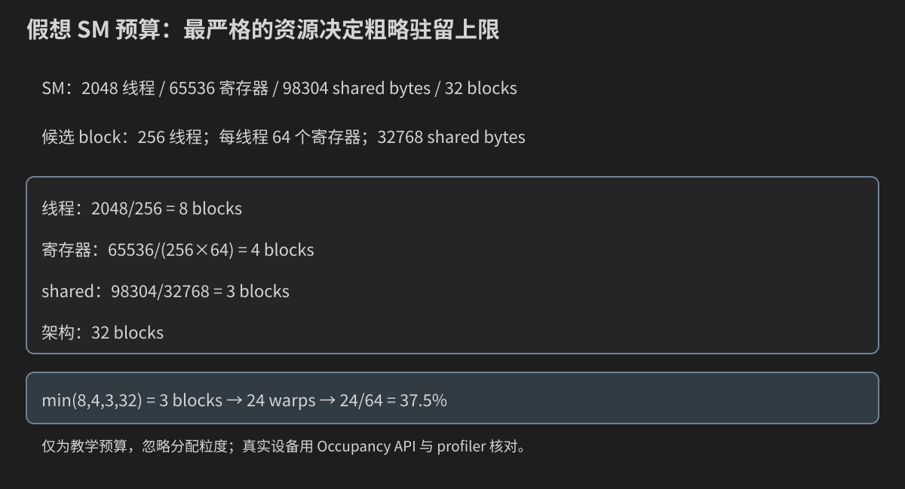

# 第 19 章：Occupancy、寄存器与资源权衡——从预算到配置实验

上一章会在报告里看到理论occupancy、achieved occupancy、寄存器和shared。本章先给这些字段一个可以手算的含义，再用Runtime API询问真实编译结果与设备，最后把资源候选和正确性、时间一起比较。

本章不重新讲一遍warp/SIMT；只需记住warp是block中的线程执行分组，block被调度到SM后使用该SM的片上资源。复习入口是[第4章](04-线程-Block-Grid-Warp与SIMT.md)。现在新增的问题是：同时能放下多少组工作，为什么放得下仍不一定快？

## 19.0 先分开四种状态

grid中有很多尚未被调度的block；resident block已占用SM资源；其中resident warp可能正在等数据或依赖；eligible warp当前有可发射指令。调度器从可用候选中发射，不能把“驻留”画成“同时全部执行”。

```text
尚未驻留的block → 获得资源 → 驻留warp
                              ├─ 等依赖/内存/同步
                              └─ eligible → 发射 → 后续又可能等待
```

资源允许两个block驻留，不代表每个warp固定占住一个CUDA core。寄存器和shared在驻留期间占用预算，执行流水线则按指令调度工作。

## 19.1 Occupancy的分子与分母

常用定义为“SM上的active/resident warps与架构允许最大warps之比”。这里active在occupancy语境中指驻留，不是每个周期都发射。

若上限64warps，当前可驻留24warps，理论occupancy为24/64=37.5%。分母来自具体GPU，不是所有NVIDIA设备永远64。

achieved occupancy是运行中按工具定义采样/平均的实际驻留水平。理论值是资源上限；grid不足、尾波、负载不均、运行阶段变化等会让实际平均不同。

## 19.2 一个block带哪些资源需求

设block有B个线程、每thread使用r个32位寄存器、每block使用S bytes shared。粗略需求为B*r个寄存器、S bytes shared、B个线程和ceil(B/warpSize)个warp。每个block还占一个架构block槽位。

static shared由编译器声明决定，dynamic shared来自启动第三参数；总需求要合并考虑。普通局部数组可能进入寄存器、stack或local，不能仅按源码变量数量估算r。

寄存器分配和shared资源都有硬件粒度、分区和编译器约束。下面手算先忽略这些，随后用API补充，不能把纸面除法当作精确硬件调度器。

## 19.3 手算一个明确标注为假想的SM

假想SM：2048线程、65536个32位寄存器、98304shared bytes、32blocks、warpSize=32。候选block：B=256、r=64、S=32768。

| 约束 | 粗略blocks/SM上限 |
|---|---:|
| 线程 | floor(2048/256)=8 |
| 寄存器 | floor(65536/(256×64))=4 |
| shared | floor(98304/32768)=3 |
| 架构block槽位 | 32 |

最严格为3blocks，3×8=24warps，occupancy=37.5%。这是教学设备预算，不代表你服务器的属性。



如果只把S降为16384，共享预算允许6blocks，但寄存器仍只允许4，因此上限变为4，不会自动翻倍到6。若再把r降为32，各项变为8、8、6、32，上限才成为6。

## 19.4 完整CPU预算模型

`resource_model.cpp`可改B/r/S，打印各约束和最终上限。B限制为32的倍数，使第一阶段模型不混入不满warp。

```cpp
#include "../17_convolution/filter_reference.h"
#include <algorithm>
#include <cstdlib>

int main(int argc, char** argv) {
    int threads = 256, registers = 64, shared = 32768;
    if (argc > 4 || (argc > 1 && !filter_example::integer(argv[1], 32, 1024, threads)) ||
        (argc > 2 && !filter_example::integer(argv[2], 1, 255, registers)) ||
        (argc > 3 && !filter_example::integer(argv[3], 0, 98304, shared)) || threads % 32 != 0) {
        std::cerr << "Usage: resource_model [threads:32..1024,multiple-of-32] [registers:1..255] [shared:0..98304]\n";
        return EXIT_FAILURE;
    }
    // A deliberately synthetic SM. Ignores hardware allocation granularity.
    constexpr int sm_threads = 2048, sm_registers = 65536, sm_shared = 98304, sm_blocks = 32;
    const int thread_bound = sm_threads / threads;
    const int register_bound = sm_registers / (threads * registers);
    const int shared_bound = shared == 0 ? sm_blocks : sm_shared / shared;
    const int blocks = std::min({thread_bound, register_bound, shared_bound, sm_blocks});
    const int active_warps = blocks * (threads / 32);
    const double occupancy = active_warps / 64.0;
    std::cout << "SYNTHETIC SM: 2048 threads,65536 registers,98304 shared bytes,32 blocks\n"
              << "bounds threads=" << thread_bound << " registers=" << register_bound
              << " shared=" << shared_bound << " architecture=" << sm_blocks << '\n'
              << "blocks_per_SM=" << blocks << " active_warps=" << active_warps
              << " occupancy=" << occupancy << '\n';
    if (threads == 256 && registers == 64 && shared == 32768 && blocks != 3) return EXIT_FAILURE;
    std::cout << "PASS integer resource model; hardware granularity and GPU timing are not modeled.\n";
    return EXIT_SUCCESS;
}
```

```bash
g++ -std=c++17 -O2 -Wall -Wextra code/19_occupancy/resource_model.cpp -o resource_model
./resource_model 256 64 32768
./resource_model 256 64 16384
./resource_model 256 32 16384
```

预期blocks为3、4、6，对应37.5%、50%、75%。S=0表示无shared需求，shared约束不成为额外限制。实际粒度与GPU性能未被模型模拟。

## 19.5 部分warp与少量grid的独立限制

B=33通常形成2个warp，最后31个lane没有线程。资源预算不能把33/32=1.03125当成warp数。若算法需要完整warp参与collective，还要检查mask与block大小契约，回看[第12章](12-Warp原语与分支发散.md)。

假设GPU有80个SM，理论每SM可驻留4blocks，grid却只有10blocks，整个GPU就没有320blocks可用。occupancy API给的是单SM资源容量，不会给应用凭空增加任务。

最后一波不足、不同block耗时差异也会降低运行平均。比较理论与实测时，要同时记录grid和每block工作量。

## 19.6 读取真实GPU与函数属性

设备属性中的maxThreadsPerMultiProcessor、regsPerMultiprocessor、sharedMemPerMultiprocessor、multiProcessorCount、warpSize来自真实设备查询。函数属性由`cudaFuncGetAttributes`查询，含numRegs、sharedSizeBytes、localSizeBytes、maxThreadsPerBlock等。

numRegs是编译后每线程寄存器需求；sharedSizeBytes是静态shared；启动时的dynamic bytes另算。localSizeBytes提示local使用，但不能直接等同于“所有字节都由寄存器spill造成”，可能还有显式局部数组或其他栈需求。

同一源码用不同GPU目标、编译器版本或选项构建，函数属性可以变化。因此必须把报告与完整构建命令放在一起。

## 19.7 Occupancy API的两个不同问题

`cudaOccupancyMaxActiveBlocksPerMultiprocessor`输入具体kernel、block线程数、dynamic shared bytes，输出该配置预计能驻留的blocks/SM。

`cudaOccupancyMaxPotentialBlockSize`搜索资源意义上的建议block大小，并给出minGridSize等信息。它不是测量所有候选后的最快配置，也不知道你的端到端目标。

输出blocks转warp时用ceil(B/warpSize)，再除设备maxThreadsPerMultiProcessor/warpSize。API状态必须检查；动态shared传错成元素数会错误地估计需求，启动时也必须使用相同bytes。

例如函数在B=128、dynamic=16384bytes时API输出active=4，warpSize=32、SM最大2048线程，则预测active warps=4×ceil(128/32)=16，最大warps=64，occupancy=25%。这些数字只是解释API结果的假设，不是本机查询值。若active=0，该候选不能作为可执行配置进入计时。

参考[CUDA Occupancy Runtime API](https://docs.nvidia.com/cuda/cuda-runtime-api/group__CUDART__OCCUPANCY.html)。下面程序把查询值、配置和时间一起打印，让建议与实测能够对照。

## 19.8 完整资源扫描程序

`resource_sweep.cu`在相同输出任务`out=2*input+1`上扫描每thread处理1或4项、64/128/256/512线程、0/16/32KiB dynamic shared。所有输出逐项验证，输入回读不变，参数严格解析，n=0不启动。

```cpp
#include "../common/cuda_check.h"
#include "../09_timing/benchmark_stats.h"
#include "../17_convolution/filter_reference.h"
#include <array>
#include <cstdlib>

namespace {
template<int Items>
__global__ void sweep_kernel(const float* input, float* output, int n, int shared_bytes) {
    extern __shared__ float reserved[];
    if (shared_bytes != 0) {
        if (threadIdx.x == 0) reserved[0] = 0.0F;
        __syncthreads();
    }
    const float bias = shared_bytes == 0 ? 0.0F : reserved[0];
    const std::size_t first =
        (static_cast<std::size_t>(blockIdx.x) * blockDim.x + threadIdx.x) * Items;
    const std::size_t stride = static_cast<std::size_t>(gridDim.x) * blockDim.x * Items;
    for (std::size_t base = first; base < static_cast<std::size_t>(n); base += stride) {
        float values[Items]{};
#pragma unroll
        for (int j = 0; j < Items; ++j) {
            if (base + j < static_cast<std::size_t>(n)) values[j] = input[base + j];
        }
#pragma unroll
        for (int j = 0; j < Items; ++j) {
            if (base + j < static_cast<std::size_t>(n)) output[base + j] = 2.0F * values[j] + 1.0F + bias;
        }
    }
}
}

int main(int argc, char** argv) {
    int n = 1048576, rounds = 5, repeats = 8;
    if (argc > 4 || (argc > 1 && !filter_example::integer(argv[1], 0, 16777216, n)) ||
        (argc > 2 && !filter_example::integer(argv[2], 1, 31, rounds)) ||
        (argc > 3 && !filter_example::integer(argv[3], 1, 1000, repeats))) {
        std::cerr << "Usage: resource_sweep [n:0..16777216] [rounds:1..31] [repeats:1..1000]\n";
        return EXIT_FAILURE;
    }
    if (n == 0) { std::cout << "PASS empty input; no GPU launch.\n"; return EXIT_SUCCESS; }
    cudaDeviceProp prop{};
    CUDA_CHECK(cudaGetDeviceProperties(&prop, 0));
    cudaFuncAttributes attr1{}, attr4{};
    CUDA_CHECK(cudaFuncGetAttributes(&attr1, sweep_kernel<1>));
    CUDA_CHECK(cudaFuncGetAttributes(&attr4, sweep_kernel<4>));
    int minimum_grid = 0, suggested_block = 0;
    CUDA_CHECK(cudaOccupancyMaxPotentialBlockSize(&minimum_grid, &suggested_block, sweep_kernel<1>, 0, 0));
    std::cout << "GPU=" << prop.name << " SMs=" << prop.multiProcessorCount
              << " max_threads_SM=" << prop.maxThreadsPerMultiProcessor
              << " registers_SM=" << prop.regsPerMultiprocessor
              << " shared_SM=" << prop.sharedMemPerMultiprocessor
              << " warp_size=" << prop.warpSize << '\n'
              << "potentialBlockSize items1 shared0: minGrid=" << minimum_grid
              << " suggestedBlock=" << suggested_block << '\n';
    const std::size_t bytes = static_cast<std::size_t>(n) * sizeof(float);
    std::vector<float> input(n), output(n), after(n);
    for (int i = 0; i < n; ++i) input[i] = static_cast<float>(i % 127 - 63) / 8.0F;
    float *di = nullptr, *dout = nullptr;
    CUDA_CHECK(cudaMalloc(&di, bytes)); CUDA_CHECK(cudaMalloc(&dout, bytes));
    CUDA_CHECK(cudaMemcpy(di, input.data(), bytes, cudaMemcpyHostToDevice));
    cudaEvent_t start{}, stop{};
    CUDA_CHECK(cudaEventCreate(&start)); CUDA_CHECK(cudaEventCreate(&stop));

    struct Candidate { int items, threads, shared, blocks_sm, grid; std::vector<double> times; };
    std::vector<Candidate> candidates;
    for (int items : {1, 4}) for (int threads : {64, 128, 256, 512}) for (int shared : {0, 16384, 32768}) {
        const auto& attr = items == 1 ? attr1 : attr4;
        if (threads > prop.maxThreadsPerBlock || threads > attr.maxThreadsPerBlock ||
            static_cast<std::size_t>(shared) + attr.sharedSizeBytes > prop.sharedMemPerBlock ||
            shared > attr.maxDynamicSharedSizeBytes) {
            std::cout << "SKIP unsupported candidate items=" << items << " threads=" << threads << " shared=" << shared << '\n';
            continue;
        }
        int active = 0;
        if (items == 1) CUDA_CHECK(cudaOccupancyMaxActiveBlocksPerMultiprocessor(&active, sweep_kernel<1>, threads, shared));
        else CUDA_CHECK(cudaOccupancyMaxActiveBlocksPerMultiprocessor(&active, sweep_kernel<4>, threads, shared));
        if (active == 0) continue;
        const int covering_grid = (n + threads * items - 1) / (threads * items);
        // Two estimated residency waves; grid-stride covers the remaining work.
        const int grid = std::min(covering_grid, 2 * prop.multiProcessorCount * active);
        candidates.push_back({items, threads, shared, active, grid, {}});
    }
    if (candidates.empty()) { std::cerr << "NOT RUN: no supported candidate.\n"; return 77; }
    auto launch = [&](const Candidate& c) {
        if (c.items == 1) sweep_kernel<1><<<c.grid, c.threads, c.shared>>>(di, dout, n, c.shared);
        else sweep_kernel<4><<<c.grid, c.threads, c.shared>>>(di, dout, n, c.shared);
        CUDA_CHECK(cudaGetLastError());
    };
    auto validate = [&]() {
        CUDA_CHECK(cudaMemcpy(output.data(), dout, bytes, cudaMemcpyDeviceToHost));
        CUDA_CHECK(cudaMemcpy(after.data(), di, bytes, cudaMemcpyDeviceToHost));
        for (int i = 0; i < n; ++i) {
            if (!std::isfinite(output[i]) || output[i] != 2.0F * input[i] + 1.0F || after[i] != input[i]) {
                std::cerr << "FAIL index=" << i << '\n'; std::exit(EXIT_FAILURE);
            }
        }
    };
    for (const auto& c : candidates) {
        CUDA_CHECK(cudaMemset(dout, 0xFF, bytes));
        launch(c); CUDA_CHECK(cudaDeviceSynchronize()); validate();
        for (int warm = 0; warm < 3; ++warm) launch(c);
        CUDA_CHECK(cudaDeviceSynchronize());
    }
    for (int round = 0; round < rounds; ++round) {
        for (std::size_t slot = 0; slot < candidates.size(); ++slot) {
            auto& c = candidates[(static_cast<std::size_t>(round) + slot) % candidates.size()];
            CUDA_CHECK(cudaMemset(dout, 0xFF, bytes));
            CUDA_CHECK(cudaEventRecord(start));
            for (int repeat = 0; repeat < repeats; ++repeat) launch(c);
            CUDA_CHECK(cudaEventRecord(stop)); CUDA_CHECK(cudaEventSynchronize(stop));
            float ms = 0.0F; CUDA_CHECK(cudaEventElapsedTime(&ms, start, stop));
            if (!std::isfinite(ms) || ms <= 0.0F) { std::cerr << "FAIL unresolved Event time.\n"; return EXIT_FAILURE; }
            c.times.push_back(ms / repeats);
            validate();
        }
    }
    const int maximum_warps = prop.maxThreadsPerMultiProcessor / prop.warpSize;
    for (const auto& c : candidates) {
        const auto& attr = c.items == 1 ? attr1 : attr4;
        const int warps = c.blocks_sm * ((c.threads + prop.warpSize - 1) / prop.warpSize);
        const auto stats = summarize(c.times);
        std::cout << "items=" << c.items << " threads=" << c.threads << " dynamic_shared=" << c.shared
                  << " registers_thread=" << attr.numRegs << " local_bytes_thread=" << attr.localSizeBytes
                  << " blocks_SM=" << c.blocks_sm << " predicted_occupancy=" << warps / static_cast<double>(maximum_warps)
                  << " grid=" << c.grid << " min_ms=" << stats.minimum << " median_ms=" << stats.median
                  << " mean_ms=" << stats.mean << " max_ms=" << stats.maximum << '\n';
    }
    CUDA_CHECK(cudaEventDestroy(stop)); CUDA_CHECK(cudaEventDestroy(start));
    CUDA_CHECK(cudaFree(dout)); CUDA_CHECK(cudaFree(di));
    std::cout << "PASS every supported candidate writes each expected value; input unchanged.\n";
    return EXIT_SUCCESS;
}
```

程序在不支持配置时打印SKIP；所有配置都不支持返回77。记录真实设备属性、每函数资源、预测blocks/SM、occupancy、grid与多轮统计。所有时间都由GPU运行产生，本教材没有填写预设排名。

Candidate是一条host实验记录：items/threads/shared定义实现与启动需求，blocks_sm保存API预测，grid保存本次启动block数，times保存每轮每次kernel的毫秒。attr1/attr4分别属于两个模板实例，不能查询items1的numRegs却拿去解释items4。minimum_grid/suggested_block只是API建议，与候选实测记录分开打印。

以n=1031、Items4、B128为例，覆盖需要ceil(1031/(4×128))=3blocks；即使设备允许很多驻留，程序仍只需这3blocks。这个小输入用于正确性，不足以代表大问题的资源稳态；大n才能观察grid-stride、多个SM与驻留波的关系。

## 19.9 这个实验改变了什么，能够说明什么

dynamic shared候选实际预留空间，但只使用reserved[0]作为零bias。非零候选有一次初始化屏障。这是观察资源预留影响的教学探针，不是一个有用算法需要如此多shared的证明。

16KiB与32KiB分支的指令结构基本相同，但驻留预算不同；0与非零还改变了屏障/读取路径，所以不能把它们时间差全部归因于occupancy。

items=4增加独立值，但也改变每条指令中lane地址布局、每thread工作量和grid。代码按thread分配连续4项，每次标量j访问中相邻lane相距4个float；这可能影响事务效率。它是候选实现对比，不能仅凭更快就证明“ILP增加是唯一原因”。

grid取覆盖需要与两波预计驻留容量的较小值，grid-stride循环覆盖剩余输入。API预测改变时grid也可能变；若要隔离单个因素，另固定相同grid并记录。实验设计的限制应写出来，不能藏在代码里。

## 19.10 Grid-stride覆盖的证明

每线程最初base=global_tid×Items，步长=grid×block×Items；每组内部j=0..Items−1。任意元素i可先分解为group=i/Items、j=i%Items，再由group对全局线程数取余找到唯一线程与循环轮次。

因此合法输出不会漏项或有两个写者；尾组每个j独立判断base+j<n。读取和写回都是独立input/output。n=1031特别适合检查不能整除4或block的尾部。

shared阶段在任何数据尾部判断之前执行，所有线程参与唯一屏障。即使某线程没有合法输出，它仍遵守预留空间初始化协议。

## 19.11 编译与扫描步骤

```bash
nvcc -std=c++17 -O2 -lineinfo -Xptxas=-v \
    code/19_occupancy/resource_sweep.cu -o resource_sweep
./resource_sweep 1031 3 1
./resource_sweep 1048576 5 8
```

n是元素数、rounds是独立样本数、repeats是每样本启动次数。`-Xptxas=-v`请求设备汇编器资源报告；它不执行程序，也不打印运行时局部变量。

先通过小尾部，再跑较大输入。保存每个候选items/B/shared/regs/local/blocks/grid与四项时间统计；预测occupancy列用API结果计算，不冒充achieved occupancy。后者需要真实profiler。

## 19.12 寄存器增加的收益与代价

更多寄存器可以保存重复使用的值、多个accumulator或地址，减少重载与串行依赖；同时每个block占更多SM寄存器，可能跨越一个分配阈值，减少可驻留blocks。

少一个寄存器可能完全不改变驻留，跨过阈值时才有阶梯变化；实际阈值受架构粒度影响。只看源码少了一行变量并不能证明编译器少用了一个寄存器。

local memory名称容易误导：它是每线程逻辑私有的地址空间，但通常使用设备内存与cache，并非和寄存器一样的片上存储。基础回看[第8章](08-显存-拷贝-统一内存与RAII.md)。

## 19.13 --maxrregcount是实验约束，不是性能开关

```bash
nvcc -std=c++17 -O2 -lineinfo -Xptxas=-v \
    --maxrregcount=64 code/19_occupancy/resource_sweep.cu -o resource_sweep_r64
```

该选项限制编译器使用寄存器的预算，具体效果受ABI、kernel属性与编译器约束影响。可能增加spill load/store，也可能重计算值。保存编译器报告，再测同一输入；不能看到occupancy提高就宣布优化成功。

对已有numRegs<64的kernel，加r64约束未必产生变化。若为教学强行设计巨大局部数组，编译器可能消除它或将其放到local；要通过资源/机器码观察，不从C++数组长度猜寄存器。

比较基线、r64、r32时，确保其余编译选项和GPU目标相同，检查边界与结果，再看time/local流量。选项含义可核对[NVCC参考](https://docs.nvidia.com/cuda/cuda-compiler-driver-nvcc/index.html#maxrregcount-amount)。

## 19.14 __launch_bounds__的承诺

```cpp
__global__ __launch_bounds__(256, 2)
void bounded_kernel(const float* input, float* output, int n) {
    // 与普通kernel一样定义其数据映射；此处仅展示属性位置
}
```

第一个数是该kernel承诺的最大threads/block；超过它启动会失败。第二个数给编译器一个最小blocks/SM目标，用于权衡寄存器，不是Runtime保证所有资源组合都能达到两blocks。

这个声明可能令编译器压低或调整寄存器使用。static/dynamic shared、架构上限和其他限制仍存在；它也不会把grid自动变大。

片段只解释属性位置，不是独立可运行程序。若加入本章kernel，要同步检查host候选上限、cudaFuncAttributes和编译结果。不要把原来的512线程候选继续送给max256的版本。

## 19.15 Latency hiding：没有降低单次load延迟

某warp发出global load后等待，调度器可以发射其他ready warp。多驻留warp有助于隐藏等待，但那个load本身没有因此更早返回。

若所有warp都在等相同长依赖链、带宽已饱和或指令供给不足，提高驻留可能收益很小。改善合并访问、数据复用、减少无用load或增加独立操作，才会改变工作/等待结构。

读报告时将resident、eligible、issue、memory吞吐与实际时间联系起来，回看第18章的三层指标，不只盯occupancy一个数字。

## 19.16 TLP与ILP：两种来源的独立工作

TLP是更多线程/warp提供并行工作；ILP是同一线程内有多个独立操作。例如GEMM一个accumulator连续依赖，四个accumulator可以让编译器安排更多独立乘加。

ILP常需要更多寄存器；TLP需要足够驻留。每thread多项还影响地址和边界，不能只把Items改成4就声称获得了四倍ILP。

一种受控实验先保持线程映射与global读取地址集合，增加彼此独立的累加链，再记录寄存器、指令、spill、issue与时间。最后回到真实算法，确认增加工作不是仅让硬件更忙而输出任务更慢。

## 19.17 Shared、寄存器和cache的联合预算

减少shared可能增加global重读，减少寄存器可能增加local spill。某些架构的shared/L1容量还存在分配配置关系，具体能力与默认配置应查设备和文档。

不要拿本章假想98KiB shared预算套到所有GPU，也不随意开启opt-in大shared。若算法需要超过默认per-block上限，应明确查询最大能力、配置kernel属性，并保持合法回退路径。

当前扫描使用默认可用上限范围；超过时SKIP，不通过修改全局GPU状态让实验偷偷可用。

## 19.18 结合profiler与故障排查

```bash
compute-sanitizer --tool memcheck --error-exitcode 99 ./resource_sweep 1031 1 1
compute-sanitizer --tool synccheck --error-exitcode 99 ./resource_sweep 1031 1 1
ncu --kernel-name-base demangled --kernel-name regex:sweep_kernel \
    --launch-count 1 --set full -o resources ./resource_sweep 1048576 1 1
```

扫描有多候选、预热和重复；最后一条只是首次探索报告，不保证采到你希望比较的B/shared组合。正式分析要缩小程序候选或用kernel-id/启动参数筛选，并核对LaunchStats。工具基本命令见第18章，不再复制整个使用流程。

| 现象 | 检查 |
|---|---|
| invalid configuration | B、launch bounds、shared bytes、函数上限 |
| API预测高但实际低 | grid、尾波、负载与工具平均定义 |
| r32 occupancy高但更慢 | spill、重计算、指令数和local流量 |
| shared下降但更慢 | global重载和cache复用损失 |
| items4变慢 | 每指令lane地址、额外边界与寄存器 |
| 小n排名反转 | 有用工作、grid数量、启动开销 |
| numRegs没变 | 约束未生效或已有预算更低 |

## 19.19 练习

1. 区分pending block、resident warp、eligible warp与issued指令。
2. 最大64warp、驻留24warp，occupancy是多少？
3. 手算B256/r64/S32768的四种预算。
4. 只把S减半，为何blocks不翻到6？
5. 再把r减半，上限变成多少？
6. B33为何需要2warp？模型为何限制B为32倍数？
7. GPU80SM但grid10，API能否创造更多block？
8. static/dynamic shared应怎样合并，单位是什么？
9. numRegs与localSizeBytes各能说明什么、不能说明什么？
10. 两个occupancy API分别回答什么问题？
11. 给API的dynamic参数错用元素数会怎样？
12. 证明Items4与grid-stride覆盖全部元素且唯一写者。
13. n1031的最后一组哪些j有效？
14. shared0与shared16KiB时间差能否全部归为驻留变化？
15. Items4为什么可能改变合并访问？
16. 理论occupancy与achieved为何不同？
17. r64编译约束为何不一定改变numRegs？
18. occupancy提高而程序变慢，给出两条具体因果链。
19. __launch_bounds__(256,2)的两个数分别承诺什么？
20. block512启动max256版本会怎样？
21. latency hiding与降低load latency有何区别？
22. 设计同地址布局下的ILP实验，列出必须测的字段。
23. 比较B128/256/512时如何保存一份完整证据表？
24. 在具备GPU的环境执行扫描，按中位时间排名，再解释至少一组occupancy与快慢不一致的候选；没有设备则提交待执行计划。

答案见[附录 C](附录-C-练习答案.md#第-19-章)。

## 19.20 从单kernel资源走向多队列依赖

并发kernel也要共享SM资源；单kernel高occupancy可能占满预算，让另一个kernel难以同时驻留。下一章先建立正确的数据依赖，再研究传输和计算是否能重叠。队列越多不保证设备资源越多。

下一章：[Stream、Event与流水线](20-Stream-Event-Pinned-Memory与流水线.md)。
