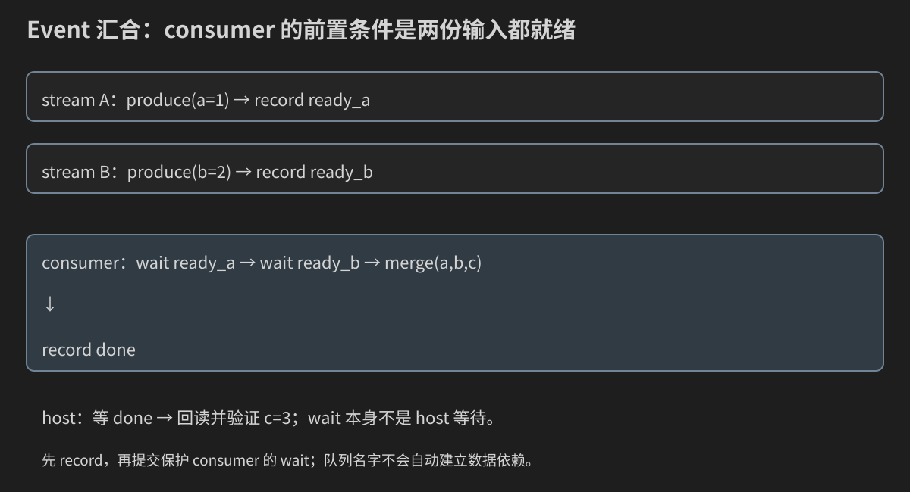
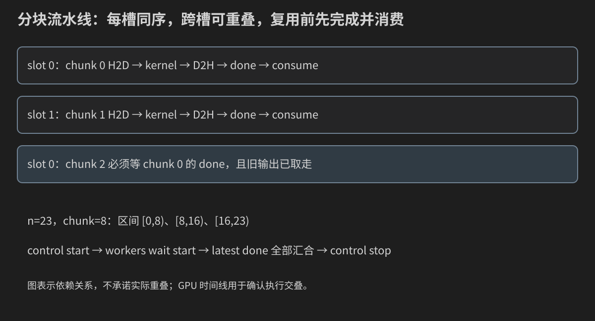

# 第 20 章：Stream、Event、Pinned Memory与流水线——先建立依赖，再寻找重叠

此前在一个队列里提交kernel，用Event确认完成。现在让多个分块在不同队列中前进。你需要掌握的不只是创建几个stream，而是说明每份数据何时有效、谁可以改写、下一步等待什么、整项任务何时完成。

本章从单stream H2D→kernel→D2H开始，写两生产者汇合，再实现有限槽位流水线，并与单槽串行基线比较。异步表示host通常不等完成，是否真正并发必须看GPU时间线。

## 20.0 Stream在软件层级中的位置

stream是host提交GPU操作的有序队列，不是grid/block/warp/thread中的新一级。一个stream可以提交许多grid，同一grid的block仍由GPU调度到SM。

`cudaStream_t`是host句柄；变量叫input_stream、compute_stream或s0不会赋予硬件专用角色。提交到它的操作和依赖决定实际用途。

多个stream不是多个GPU，也不是每个stream固定对应一个SM/copy engine。它们提供潜在并行工作，资源和调度决定执行方式。

## 20.1 同一队列的顺序与不同队列的无默认依赖

```text
stream A: H2D(a) → kernel(a) → D2H(a)
stream B: H2D(b) → kernel(b) → D2H(b)
```

A中的kernel等待A的H2D，A的D2H等待A的kernel。A与B之间若共享数据，要显式说明依赖；不能因为host先调用A API再调用B API，就推断不同stream上的GPU工作一定按完整操作顺序完成。

先区分提交顺序、队列顺序和实际时间线。独立任务可以串行执行也可以重叠，只要不违反依赖；程序正确性不应依赖它们一定重叠。

## 20.2 资源生命周期：异步增加了“借用时间”

H2D借用host输入和device目标，kernel借用device输入/输出，D2H借用device源与host目标。在操作完成前，不能释放或改写仍被借用的区域，也不能读取尚未完成写入的输出。

指针值本身没变，不代表数组已经可读。CPU在stack上离开作用域、vector重新分配、另一线程写input，都会影响正在执行的异步操作。

同一stream后续kernel可安全读取前一个H2D的结果，因为队列依赖已建立；host要读D2H输出，则需要完成点。这里新增的是host/device的借用生命周期，内存所有权基础回看[第8章](08-显存-拷贝-统一内存与RAII.md)。

## 20.3 创建显式non-blocking stream

```cpp
cudaStream_t stream{};
CUDA_CHECK(cudaStreamCreateWithFlags(&stream, cudaStreamNonBlocking));
kernel<<<grid, block, 0, stream>>>(...);
```

第四启动参数选择队列，第三参数是dynamic shared bytes。non-blocking主要控制与legacy default stream的隐式同步关系，不保证API完全不阻塞，也不保证GPU并发。

使用显式stream能把本章依赖写得清楚。资源销毁前先完成任务；`cudaStreamDestroy`本身不作为host读取数据的完成点。即使销毁API允许仍有任务延后释放内部资源，数据缓冲生命周期仍须由程序保证。

## 20.4 Pinned memory解决哪一步

普通vector/数组一般是pageable，操作系统可迁移其物理页。DMA式异步传输通常需要稳定的host页；`cudaMallocHost`分配pinned host memory，`cudaFreeHost`配对释放。

```cpp
cudaMallocHost(&input, bytes);
cudaMemcpyAsync(device, input, bytes, cudaMemcpyHostToDevice, stream);
```

Pinned仍是host地址空间，不是把input变成device pointer。显式拷贝版本仍需要device数组。它也不是“无限分配更快”的资源：锁页占用会影响系统内存，流水线应控制容量并检查失败。

pageable内存调用Async接口可能出现暂存和同步行为，不应依赖其host返回时机实现并发。Pinned只是必要条件之一；copy engine、依赖、任务长度、总线和设备资源也影响重叠。

## 20.5 第一段完整异步往返

`async_roundtrip.cu`创建一条队列，提交H2D、原地加1、D2H、done Event；query只观察状态，等待done后才读输出。这里kernel的原地更新是逐元素独立的，和卷积原地邻域覆盖不是同一问题。

```cpp
#include "../common/cuda_check.h"
#include "../17_convolution/filter_reference.h"
#include <cstdlib>
#include <limits>

__global__ void add_one(float* values, int n) {
    const int i = blockIdx.x * blockDim.x + threadIdx.x;
    if (i < n) values[i] += 1.0F;
}

int main(int argc, char** argv) {
    int n = 1031;
    if (argc > 2 || (argc > 1 && !filter_example::integer(argv[1], 0, 16777216, n))) {
        std::cerr << "Usage: async_roundtrip [n:0..16777216]\n"; return EXIT_FAILURE;
    }
    if (n == 0) { std::cout << "PASS empty input; no GPU launch.\n"; return EXIT_SUCCESS; }
    const std::size_t bytes = static_cast<std::size_t>(n) * sizeof(float);
    float *input = nullptr, *output = nullptr, *device = nullptr;
    CUDA_CHECK(cudaMallocHost(&input, bytes)); CUDA_CHECK(cudaMallocHost(&output, bytes));
    CUDA_CHECK(cudaMalloc(&device, bytes));
    for (int i = 0; i < n; ++i) {
        input[i] = static_cast<float>(i % 127 - 63);
        output[i] = std::numeric_limits<float>::quiet_NaN();
    }
    cudaStream_t stream{}; cudaEvent_t done{};
    CUDA_CHECK(cudaStreamCreateWithFlags(&stream, cudaStreamNonBlocking));
    CUDA_CHECK(cudaEventCreateWithFlags(&done, cudaEventDisableTiming));
    CUDA_CHECK(cudaMemcpyAsync(device, input, bytes, cudaMemcpyHostToDevice, stream));
    add_one<<<(n + 255) / 256, 256, 0, stream>>>(device, n);
    CUDA_CHECK(cudaGetLastError());
    CUDA_CHECK(cudaMemcpyAsync(output, device, bytes, cudaMemcpyDeviceToHost, stream));
    CUDA_CHECK(cudaEventRecord(done, stream));
    const cudaError_t state = cudaEventQuery(done);
    if (state != cudaSuccess && state != cudaErrorNotReady) CUDA_CHECK(state);
    std::cout << "query=" << (state == cudaSuccess ? "complete" : "not-ready")
              << "; neither outcome is assumed in advance.\n";
    // Do not read output or modify/free input until this completion point.
    CUDA_CHECK(cudaEventSynchronize(done));
    for (int i = 0; i < n; ++i) {
        if (!std::isfinite(output[i]) || output[i] != input[i] + 1.0F ||
            input[i] != static_cast<float>(i % 127 - 63)) {
            std::cerr << "FAIL index=" << i << '\n'; return EXIT_FAILURE;
        }
    }
    CUDA_CHECK(cudaEventDestroy(done)); CUDA_CHECK(cudaStreamDestroy(stream));
    CUDA_CHECK(cudaFree(device)); CUDA_CHECK(cudaFreeHost(output)); CUDA_CHECK(cudaFreeHost(input));
    std::cout << "PASS completed async H2D/kernel/D2H and immutable input.\n";
    return EXIT_SUCCESS;
}
```

```bash
nvcc -std=c++17 -O2 -lineinfo code/20_streams/async_roundtrip.cu -o async_roundtrip
./async_roundtrip 1031
./async_roundtrip 1
./async_roundtrip 0
```

query可能打印complete，也可能not-ready，二者都合法；不预设“立即查询一定没完成”。输出验证发生在event同步之后，NaN sentinel可捕捉未写回位置。n=0不分配或启动。

## 20.6 选择最小足够的host完成点

| API | host行为与范围 | 常用目的 |
|---|---|---|
| cudaDeviceSynchronize | 等当前device的前序工作 | 全设备完成/初期诊断 |
| cudaStreamSynchronize | 等指定stream的前序工作 | 一条队列完成 |
| cudaEventSynchronize | 等已记录event所代表的点 | 数据就绪/槽位复用 |
| cudaStreamQuery | 查询当前已提交队列工作是否完成 | 非阻塞状态观察 |
| cudaEventQuery | 查询某event是否完成 | 非阻塞状态观察 |

Query返回cudaErrorNotReady通常是正常状态；其他错误仍要检查。它不显示完成百分比，也不代表不存在异步执行错误。反复tight-loop轮询会浪费CPU；简单教材用明确等待，真正应用可在未就绪时执行独立CPU工作。

Device同步范围最大，若每块数据都调用它，会阻塞所有队列。精准完成点表达需要的依赖，也方便时间线解释。

## 20.7 Event是队列中的一个标记

record把event放在stream当前已提交的工作之后，完成时说明那些前序工作已完成。它不等待以后才提交的工作。

同一个event句柄可以再次record，但每一次是一个新的记录状态。依赖设计要知道wait/query/synchronize针对哪个记录；本章槽位在旧任务完成并消费之后，才重录下一块done。

未记录event不能当未来生产者的承诺：对未记录状态的wait可能不产生你想要的阻塞。先提交producer工作并record，再提交consumer wait。

Timing event用于elapsedTime；`cudaEventDisableTiming`创建只用作依赖/完成点的event，不用于elapsedTime。主程序的start/stop保留计时，slot.done禁用计时。

## 20.8 跨stream依赖让GPU等待，host继续提交

```cpp
produce<<<..., ..., 0, producer>>>(data);
cudaEventRecord(ready, producer);
cudaStreamWaitEvent(consumer, ready, 0);
consume<<<..., ..., 0, consumer>>>(data);
```

WaitEvent为consumer后续操作添加依赖，通常不让host等到producer完成。它不暂停producer，也不影响consumer已经在wait之前提交的操作。因此wait必须写在受保护的consumer任务之前。

一个ready可以被多个consumer等待。一个consumer也可等待两个不同生产者；图中边表示数据依赖，不是host线程阻塞。



## 20.9 完整两生产者汇合程序

`event_dependency.cu`在两条stream分别写a=1、b=2；第三条先等两个ready，再计算c=a+b。最后等待consumer的done，逐项验证c=3以及a/b未被merge改变。

```cpp
#include "../common/cuda_check.h"
#include "../17_convolution/filter_reference.h"
#include <cstdlib>

__global__ void produce(float* values, float value, int n) {
    const int i = blockIdx.x * blockDim.x + threadIdx.x;
    if (i < n) values[i] = value;
}
__global__ void merge(const float* a, const float* b, float* output, int n) {
    const int i = blockIdx.x * blockDim.x + threadIdx.x;
    if (i < n) output[i] = a[i] + b[i];
}
int main(int argc, char** argv) {
    int n = 1031;
    if (argc > 2 || (argc > 1 && !filter_example::integer(argv[1], 0, 16777216, n))) {
        std::cerr << "Usage: event_dependency [n:0..16777216]\n"; return EXIT_FAILURE;
    }
    if (n == 0) { std::cout << "PASS empty input; no GPU launch.\n"; return EXIT_SUCCESS; }
    const std::size_t bytes = static_cast<std::size_t>(n) * sizeof(float);
    float *a = nullptr, *b = nullptr, *c = nullptr;
    CUDA_CHECK(cudaMalloc(&a, bytes)); CUDA_CHECK(cudaMalloc(&b, bytes)); CUDA_CHECK(cudaMalloc(&c, bytes));
    CUDA_CHECK(cudaMemset(a, 0xFF, bytes)); CUDA_CHECK(cudaMemset(b, 0xFF, bytes)); CUDA_CHECK(cudaMemset(c, 0xFF, bytes));
    // Complete default-stream initialization before using non-blocking workers.
    CUDA_CHECK(cudaDeviceSynchronize());
    cudaStream_t first{}, second{}, consumer{};
    CUDA_CHECK(cudaStreamCreateWithFlags(&first, cudaStreamNonBlocking));
    CUDA_CHECK(cudaStreamCreateWithFlags(&second, cudaStreamNonBlocking));
    CUDA_CHECK(cudaStreamCreateWithFlags(&consumer, cudaStreamNonBlocking));
    cudaEvent_t ready_a{}, ready_b{}, done{};
    CUDA_CHECK(cudaEventCreateWithFlags(&ready_a, cudaEventDisableTiming));
    CUDA_CHECK(cudaEventCreateWithFlags(&ready_b, cudaEventDisableTiming));
    CUDA_CHECK(cudaEventCreateWithFlags(&done, cudaEventDisableTiming));
    const int blocks = (n + 255) / 256;
    produce<<<blocks, 256, 0, first>>>(a, 1.0F, n); CUDA_CHECK(cudaGetLastError());
    CUDA_CHECK(cudaEventRecord(ready_a, first));
    produce<<<blocks, 256, 0, second>>>(b, 2.0F, n); CUDA_CHECK(cudaGetLastError());
    CUDA_CHECK(cudaEventRecord(ready_b, second));
    CUDA_CHECK(cudaStreamWaitEvent(consumer, ready_a, 0));
    CUDA_CHECK(cudaStreamWaitEvent(consumer, ready_b, 0));
    merge<<<blocks, 256, 0, consumer>>>(a, b, c, n); CUDA_CHECK(cudaGetLastError());
    CUDA_CHECK(cudaEventRecord(done, consumer));
    CUDA_CHECK(cudaEventSynchronize(done));
    std::vector<float> output(n), after_a(n), after_b(n);
    CUDA_CHECK(cudaMemcpy(output.data(), c, bytes, cudaMemcpyDeviceToHost));
    CUDA_CHECK(cudaMemcpy(after_a.data(), a, bytes, cudaMemcpyDeviceToHost));
    CUDA_CHECK(cudaMemcpy(after_b.data(), b, bytes, cudaMemcpyDeviceToHost));
    for (int i = 0; i < n; ++i) {
        if (output[i] != 3.0F || after_a[i] != 1.0F || after_b[i] != 2.0F) {
            std::cerr << "FAIL index=" << i << '\n'; return EXIT_FAILURE;
        }
    }
    CUDA_CHECK(cudaEventDestroy(done)); CUDA_CHECK(cudaEventDestroy(ready_b)); CUDA_CHECK(cudaEventDestroy(ready_a));
    CUDA_CHECK(cudaStreamDestroy(consumer)); CUDA_CHECK(cudaStreamDestroy(second)); CUDA_CHECK(cudaStreamDestroy(first));
    CUDA_CHECK(cudaFree(c)); CUDA_CHECK(cudaFree(b)); CUDA_CHECK(cudaFree(a));
    std::cout << "PASS consumer waits for both producers; a+b=3 everywhere.\n";
    return EXIT_SUCCESS;
}
```

```bash
nvcc -std=c++17 -O2 -lineinfo code/20_streams/event_dependency.cu -o event_dependency
./event_dependency 1031
./event_dependency 1
```

默认stream初始化在进入non-blocking workers前显式完成，避免把旧默认stream行为误当新依赖。删掉一条wait可能产生竞争，但一次碰巧正确不证明删掉安全；应从consumer所需的两份输入推导必需边。

## 20.10 分块的第一件事：区间必须覆盖一次

总n元素，chunk容量C：块id的offset=id*C，count=min(C,n−offset)，只在offset<n时提交。区间是半开 `[offset,offset+count)`。

n=23/C=8：块0是[0,8)，块1[8,16)，块2[16,23)，最后count=7。字节数是count*sizeof(float)，不能给最后一块仍传完整C字节。

槽位s=id%S。chunk id标识数据区间，slot id标识复用资源，二者不是同一个编号。S=2时slot0依次承接chunk0、chunk2；输出依然写回各块原来的global offset。

## 20.11 CPU槽位模型：先看复用顺序

`chunk_model.cpp`打印submit与wait/consume，检查每个全局元素恰好被一个已退役块覆盖。它假定retire时任务完成，不模拟GPU时序：

```cpp
#include "../17_convolution/filter_reference.h"
#include <algorithm>
#include <cstdlib>

int main(int argc, char** argv) {
    int n = 23, chunk = 8, streams = 2;
    if (argc > 4 || (argc > 1 && !filter_example::integer(argv[1], 0, 128, n)) ||
        (argc > 2 && !filter_example::integer(argv[2], 1, 64, chunk)) ||
        (argc > 3 && !filter_example::integer(argv[3], 1, 8, streams))) {
        std::cerr << "Usage: chunk_model [n:0..128] [chunk:1..64] [slots:1..8]\n";
        return EXIT_FAILURE;
    }
    struct Slot { int id = -1, offset = 0, count = 0; bool busy = false; };
    std::vector<Slot> slots(streams);
    std::vector<int> owners(n, 0);
    auto retire = [&](int s) {
        auto& slot = slots[s];
        if (!slot.busy) return;
        std::cout << "wait/consume slot=" << s << " chunk=" << slot.id
                  << " range=[" << slot.offset << ',' << slot.offset + slot.count << ")\n";
        for (int i = 0; i < slot.count; ++i) ++owners[slot.offset + i];
        slot.busy = false;
    };
    for (int offset = 0, id = 0; offset < n; offset += chunk, ++id) {
        const int s = id % streams;
        retire(s);
        slots[s] = {id, offset, std::min(chunk, n - offset), true};
        std::cout << "submit slot=" << s << " chunk=" << id << " count=" << slots[s].count << '\n';
    }
    for (int s = 0; s < streams; ++s) retire(s);
    if (std::any_of(owners.begin(), owners.end(), [](int value) { return value != 1; })) return EXIT_FAILURE;
    std::cout << "PASS disjoint chunks cover each element once; this model assumes completion at retire.\n";
    return EXIT_SUCCESS;
}
```

```bash
g++ -std=c++17 -O2 -Wall -Wextra code/20_streams/chunk_model.cpp -o chunk_model
./chunk_model 23 8 2
./chunk_model 1 8 3
./chunk_model 0 8 2
```

默认轨迹先提交slot0/chunk0，再slot1/chunk1；复用slot0前退役chunk0；最后排空仍busy的slot。不要在处理完提交循环后立即验证，因为最后S块可能仍在GPU执行。

## 20.12 每个槽位具体拥有哪些资源

本章slot拥有host_input、host_output、device buffer、一条worker stream、done Event，以及当前offset/count/busy/used记录。每槽host/device容量都是chunk。

生命周期：

```text
free → CPU填host_input → H2D → kernel → D2H → done完成
                                                    ↓
                  CPU取走host_output ← 等done ← busy
                  ↓
                 free，才能重用同一批地址
```

仅在device上排好前后顺序还不够：CPU若立即改写仍被H2D借用的host_input，或未消费旧host_output就让下次D2H覆盖，仍会丢数据。完成并消费是两个条件。

## 20.13 完整串行/流水线对照程序

`stream_pipeline.cu`使用有限slot池，分别跑单slot串行与S-slot流水线。每块在GPU上乘2.5，完整输出逐项检查，原始host input按生成公式检查不变。Pinned/Pageable两模式使用相同数学与槽位协议。

```cpp
#include "../common/cuda_check.h"
#include "../09_timing/benchmark_stats.h"
#include "../17_convolution/filter_reference.h"
#include <chrono>
#include <cstdlib>
#include <limits>

namespace {
__global__ void scale_chunk(float* values, int count) {
    const int i = blockIdx.x * blockDim.x + threadIdx.x;
    if (i < count) values[i] *= 2.5F;
}
struct Slot {
    cudaStream_t stream{};
    cudaEvent_t done{};
    float *host_input = nullptr, *host_output = nullptr, *device = nullptr;
    std::vector<float> pageable_input, pageable_output;
    int offset = 0, count = 0;
    bool busy = false, used = false;
};
struct Pool {
    std::vector<Slot> slots;
    cudaStream_t control{};
    cudaEvent_t start{}, stop{};
    bool pinned;
    Pool(int streams, int chunk, bool use_pinned) : slots(streams), pinned(use_pinned) {
        const std::size_t bytes = static_cast<std::size_t>(chunk) * sizeof(float);
        CUDA_CHECK(cudaStreamCreateWithFlags(&control, cudaStreamNonBlocking));
        CUDA_CHECK(cudaEventCreate(&start)); CUDA_CHECK(cudaEventCreate(&stop));
        for (auto& s : slots) {
            CUDA_CHECK(cudaStreamCreateWithFlags(&s.stream, cudaStreamNonBlocking));
            CUDA_CHECK(cudaEventCreateWithFlags(&s.done, cudaEventDisableTiming));
            CUDA_CHECK(cudaMalloc(&s.device, bytes));
            if (pinned) {
                CUDA_CHECK(cudaMallocHost(&s.host_input, bytes));
                CUDA_CHECK(cudaMallocHost(&s.host_output, bytes));
            } else {
                s.pageable_input.resize(chunk); s.pageable_output.resize(chunk);
                s.host_input = s.pageable_input.data(); s.host_output = s.pageable_output.data();
            }
        }
    }
    Pool(const Pool&) = delete;
    Pool& operator=(const Pool&) = delete;
    ~Pool() {
        // Every run drains all slots before destruction; checked destruction is shown explicitly.
        for (auto& s : slots) {
            CUDA_CHECK(cudaEventDestroy(s.done)); CUDA_CHECK(cudaStreamDestroy(s.stream));
            CUDA_CHECK(cudaFree(s.device));
            if (pinned) { CUDA_CHECK(cudaFreeHost(s.host_output)); CUDA_CHECK(cudaFreeHost(s.host_input)); }
        }
        CUDA_CHECK(cudaEventDestroy(stop)); CUDA_CHECK(cudaEventDestroy(start));
        CUDA_CHECK(cudaStreamDestroy(control));
    }
};
struct Sample { double host_ms, gpu_span_ms; };

Sample execute(Pool& pool, const std::vector<float>& input, std::vector<float>& output, int chunk) {
    std::fill(output.begin(), output.end(), std::numeric_limits<float>::quiet_NaN());
    for (auto& s : pool.slots) { s.busy = false; s.used = false; }
    const auto before = std::chrono::steady_clock::now();
    CUDA_CHECK(cudaEventRecord(pool.start, pool.control));
    for (auto& s : pool.slots) CUDA_CHECK(cudaStreamWaitEvent(s.stream, pool.start, 0));
    auto consume = [&](Slot& s) {
        if (!s.busy) return;
        CUDA_CHECK(cudaEventSynchronize(s.done));
        std::copy_n(s.host_output, s.count, output.data() + s.offset);
        s.busy = false;
    };
    const int n = static_cast<int>(input.size());
    for (int offset = 0, id = 0; offset < n; offset += chunk, ++id) {
        auto& s = pool.slots[id % pool.slots.size()];
        consume(s); // D2H complete and previous output consumed before host/device slot reuse.
        s.offset = offset; s.count = std::min(chunk, n - offset);
        std::copy_n(input.data() + offset, s.count, s.host_input);
        std::fill_n(s.host_output, s.count, std::numeric_limits<float>::quiet_NaN());
        const std::size_t bytes = static_cast<std::size_t>(s.count) * sizeof(float);
        CUDA_CHECK(cudaMemcpyAsync(s.device, s.host_input, bytes, cudaMemcpyHostToDevice, s.stream));
        scale_chunk<<<(s.count + 255) / 256, 256, 0, s.stream>>>(s.device, s.count);
        CUDA_CHECK(cudaGetLastError());
        CUDA_CHECK(cudaMemcpyAsync(s.host_output, s.device, bytes, cudaMemcpyDeviceToHost, s.stream));
        CUDA_CHECK(cudaEventRecord(s.done, s.stream));
        s.busy = true; s.used = true;
    }
    // Join latest D2H completion from every used slot before recording the stop timestamp.
    for (auto& s : pool.slots) if (s.used) CUDA_CHECK(cudaStreamWaitEvent(pool.control, s.done, 0));
    CUDA_CHECK(cudaEventRecord(pool.stop, pool.control));
    for (auto& s : pool.slots) consume(s);
    CUDA_CHECK(cudaEventSynchronize(pool.stop));
    const auto after = std::chrono::steady_clock::now();
    float gpu_ms = 0.0F; CUDA_CHECK(cudaEventElapsedTime(&gpu_ms, pool.start, pool.stop));
    const double host_ms = std::chrono::duration<double, std::milli>(after - before).count();
    if (!std::isfinite(gpu_ms) || gpu_ms <= 0.0F || !std::isfinite(host_ms) || host_ms <= 0.0) {
        std::cerr << "FAIL unresolved timing interval.\n"; std::exit(EXIT_FAILURE);
    }
    for (std::size_t i = 0; i < input.size(); ++i) {
        const float original = static_cast<float>(static_cast<int>(i % 127) - 63) / 8.0F;
        if (input[i] != original || !std::isfinite(output[i]) || output[i] != original * 2.5F) {
            std::cerr << "FAIL global index=" << i << '\n'; std::exit(EXIT_FAILURE);
        }
    }
    return {host_ms, gpu_ms};
}
}

int main(int argc, char** argv) {
    int n = 4194304, chunk = 262144, streams = 3, rounds = 5;
    const std::string memory = argc > 5 ? argv[5] : "pinned";
    if (argc > 6 || (argc > 1 && !filter_example::integer(argv[1], 0, 16777216, n)) ||
        (argc > 2 && !filter_example::integer(argv[2], 1, 4194304, chunk)) ||
        (argc > 3 && !filter_example::integer(argv[3], 1, 8, streams)) ||
        (argc > 4 && !filter_example::integer(argv[4], 1, 31, rounds)) ||
        (memory != "pinned" && memory != "pageable") ||
        12ULL * chunk * (streams + 1) > 256ULL * 1024ULL * 1024ULL) {
        std::cerr << "Usage: stream_pipeline [n:0..16777216] [chunk:1..4194304]"
                     " [streams:1..8] [rounds:1..31] [pinned|pageable]\n"
                     "Combined slot host/device capacity must be <=256 MiB.\n";
        return EXIT_FAILURE;
    }
    if (n == 0) { std::cout << "PASS empty input; no GPU allocation or launch.\n"; return EXIT_SUCCESS; }
    cudaDeviceProp prop{}; CUDA_CHECK(cudaGetDeviceProperties(&prop, 0));
    std::cout << "GPU=" << prop.name << " asyncEngineCount=" << prop.asyncEngineCount
              << " concurrentKernels=" << prop.concurrentKernels << " n=" << n
              << " chunk=" << chunk << " streams=" << streams << " memory=" << memory << '\n';
    std::vector<float> input(n), output(n);
    for (std::size_t i = 0; i < input.size(); ++i) input[i] = static_cast<float>(static_cast<int>(i % 127) - 63) / 8.0F;
    Pool serial(1, chunk, memory == "pinned"), pipeline(streams, chunk, memory == "pinned");
    execute(serial, input, output, chunk); execute(pipeline, input, output, chunk);
    std::vector<double> serial_host, pipeline_host, serial_gpu, pipeline_gpu;
    for (int round = 0; round < rounds; ++round) {
        for (int slot = 0; slot < 2; ++slot) {
            const bool parallel = (round + slot) % 2 == 1;
            const Sample s = execute(parallel ? pipeline : serial, input, output, chunk);
            (parallel ? pipeline_host : serial_host).push_back(s.host_ms);
            (parallel ? pipeline_gpu : serial_gpu).push_back(s.gpu_span_ms);
            std::cout << "sample round=" << round << " method=" << (parallel ? "pipeline" : "serial")
                      << " host_staging_submit_gather_ms=" << s.host_ms << " GPU_fork_join_span_ms=" << s.gpu_span_ms << '\n';
        }
    }
    const auto a = summarize(serial_host), b = summarize(pipeline_host);
    const auto ga = summarize(serial_gpu), gb = summarize(pipeline_gpu);
    std::cout << "serial host min/median/mean/max=" << a.minimum << '/' << a.median << '/' << a.mean << '/' << a.maximum << '\n'
              << "pipeline host min/median/mean/max=" << b.minimum << '/' << b.median << '/' << b.mean << '/' << b.maximum << '\n'
              << "GPU span median serial=" << ga.median << " pipeline=" << gb.median << '\n'
              << "host_speedup=" << a.median / b.median
              << " pipeline_logical_transfer_GB_s=" << (2.0 * n * sizeof(float)) / (b.median * 1.0e6) << '\n'
              << "PASS serial/pipeline cover every output; input unchanged.\n";
    return EXIT_SUCCESS;
}
```

Pool集中拥有资源并禁用复制，避免句柄和指针被浅复制后重复释放。这沿用第8章所有权知识；execute负责队列和slot流程，main负责参数、两池对照和统计。读取时先跟随一个chunk，再观察第二个slot加入。

| 字段/变量 | 类型、位置和单位 | 谁在什么时候使用 |
|---|---|---|
| slots | host vector<Slot> | 创建后地址/数量稳定，处理时按id%S选择 |
| host_input/host_output | pinned或pageable host指针 | CPU填入/取出，Async复制借用 |
| device | device global指针 | 容量chunk，每块只用count项 |
| stream/done | host句柄 | stream排序，done在D2H后记录 |
| offset/count | host int，元素下标/项数 | busy期间保持当前块信息，consume完成才改 |
| busy/used | host bool | 待消费状态与本轮join状态 |
| control/start/stop | host句柄 | 建立所有worker共同计时边界 |
| Sample | host double毫秒 | 一个完整run的CPU/GPU跨度 |

`execute`没有在返回后留下忙槽。输入vector在每个run中只读，output按全局offset拼接；不同chunk可以以不同完成顺序被CPU取走，但最终下标保持不变。如此既支持异步完成，也不改变数组顺序。

## 20.14 为什么reuse等待在提交循环里面

遇到busy slot，consume先等done，再把其count项host_output复制到完整output的offset处。之后才能填下一块host_input、设置新的offset/count并提交。done记录在D2H之后，因此保护整个借用区间。

所有同slot操作按stream排队；不同slot不共享host/device缓冲，因而可独立前进。最后为所有used slot的最新done建立control队列join，再record stop；提交停止之后不再重录这些done，join依赖稳定。

函数返回前排空busy slot并等待stop。Pool析构只发生在这些任务已结束后；输出与所有资源生命周期闭合。busy表示当前有待消费块，used表示本轮该slot曾提交过任务，二者不能合并，否则drain后会漏掉计时join边。

## 20.15 两套计时回答不同问题

host计时从fork/start提交前到最后结果取走与stop完成后，包含CPU填槽、submit、复用等待、末尾gather。它不含池分配、原始input生成、清空完整output或逐项结果校验，因而是该数据处理核心的端到端时间，不是文件I/O全应用时间。

GPU start在control stream记录，各worker先wait start；stop在control等所有最新done后记录。这个fork/join区间涵盖多队列设备工作及其中由host供给造成的空隙，末尾CPU gather不在GPU区间内。不能简单拿某个worker的start/stop计时代表所有stream。

所有传输逻辑bytes=2*n*sizeof(float)，除以host时间得到logical_transfer_GB_s。它是该程序的数据完成率，包含CPU staging/gather影响，不是PCIe硬件计数器的带宽。分配与校验范围另立说明，避免只报一个快数字。

## 20.16 编译与边界阶梯

```bash
nvcc -std=c++17 -O2 -lineinfo code/20_streams/stream_pipeline.cu -o stream_pipeline
./stream_pipeline 23 8 2 3 pinned
./stream_pipeline 1 8 3 3 pinned
./stream_pipeline 1031 257 3 3 pinned
./stream_pipeline 0 8 2 3 pinned
./stream_pipeline 4194304 262144 3 5 pinned
./stream_pipeline 4194304 262144 3 5 pageable
```

参数是n、chunk、streams、rounds、memory；streams就是slot数量，不是线程数量。每块threads=256，grid来自当块count；最后块因此不同。内存预算检查两池合计 `(S+1)×chunk×(两个host+一个device)×4` 不超过256MiB，原始完整CPU数组另占空间。

输出GPU能力提示、两方法每轮host/GPU span、四项统计和host_speedup。S=1时两池都只有一个slot，不应预设speedup一定为1，仍有测量噪声；正确性必须相同。返回PASS只是输出与输入检查通过，不能证明发生重叠。

## 20.17 三阶段时长与稳态瓶颈

假设H2D=2ms、kernel=3ms、D2H=2ms，串行4块为28ms。若有独立双向copy资源、足够slot与无其他开销，理想流水线首块7ms，后面每3ms完成一块，共约16ms。示意数字不是实测。

若H2D/D2H共享同一copy资源，稳态每块至少占用4ms copy资源；cycle下限要考虑max(H+D,K)，并重新分析有限块的填充/排空，不能仍套独立三引擎公式。真实设备还有总线、内存控制器、调度与资源争用。



stream数量足够表达在途任务就可能达到平台限制，再增加会增加锁页、设备buffer和调度开销。一个短kernel配长传输可能主要受copy限制；这时给kernel再加速并不改变稳态瓶颈。

## 20.18 Chunk大小与CPU供给

chunk太小，API/launch/CPU拷贝成本占比大；chunk太大，在途块少、单块传输长、流水线填充和排空开销明显。n固定时，改变chunk也改变chunk数量与尾部。

实验网格：S=1/2/3/4，chunk=64Ki/256Ki/1Mi元素，先固定pinned，再单独比较pageable。记录slot容量、块数量、host和GPU区间、正确性、时间线。不能把chunk值当bytes填进count。

本程序包含CPU staging/gather；若CPU因此成为供给瓶颈，可考虑生产数据直接进入pinned槽、独立CPU线程或减少额外复制，但每种改造要重新界定生命周期和计时。

## 20.19 确认重叠，而不是仅推测

```bash
nsys profile --trace=cuda --sample=none -o pipeline_trace \
    ./stream_pipeline 4194304 262144 3 3 pinned
```

按第18章方法展开GPU memcpy、kernel与各stream轨道，观察同一时间是否有不同chunk的H2D/kernel/D2H。先标出同一slot的顺序，再找跨slot重叠。

asyncEngineCount/concurrentKernels是能力提示，任务资源与依赖仍决定实际重叠。多个stream轨道都有任务不等于任务时间相交；host API同时存在也不等于GPU同时执行。

如无重叠，检查pinned、是否每块device同步、slot是否同址、chunk是否太小/太大、copy资源和kernel资源是否已饱和，再看CPU是否及时提交。

## 20.20 默认stream、库状态与隐式同步

Legacy默认stream与其他blocking stream可能有隐式同步；non-blocking worker避免部分这种关系。Per-thread默认stream为每host线程提供不同默认语义，可通过统一构建选项选择；不要在多个编译单元依赖含糊设置。

```bash
nvcc --default-stream per-thread -std=c++17 -O2 source.cu -o app
```

本章所有依赖仍写在显式队列上，不靠这个选项补救缺失event。分配、释放、某些默认stream操作和库内部行为也可能影响并发；尽量在处理核心之外建立资源。

cuBLAS handle可绑定stream，CUB workspace要遵守并发生命周期；constant filter也不是每stream一份。第17章filter若在另一个任务运行时更新，须建立依赖或用独立参数内存。stream独立不等于所有隐含库状态也独立。

## 20.21 调试与故障诊断

```bash
compute-sanitizer --tool memcheck --error-exitcode 99 ./stream_pipeline 1031 257 3 1 pinned
compute-sanitizer --tool memcheck --error-exitcode 99 ./event_dependency 1031
```

先用小尾部验证再用timeline分析。Sanitizer不能完全证明host缓冲竞争；slot状态与借用关系还需要程序协议证明。

| 现象 | 检查 |
|---|---|
| 最后块越界 | count=min(chunk,n-offset)，bytes用count |
| 结果像上一块 | reuse前是否消费旧输出、offset/count是否更新过早 |
| pinned输入偶发被污染 | CPU在H2D完成前是否改写 |
| consumer偶发NaN | wait是否在merge之前，是否等两个producer |
| event query一直等 | 是否record、是否观察正确记录、前序工作错误 |
| output读取过早 | 是否等D2H后的done |
| streams更多仍串行 | 隐式同步、pageable、资源与供给 |
| Event只反映一条stream | 是否有完整fork/join依赖 |

## 20.22 练习

1. stream属于host队列还是block/warp层级？
2. 同streamH2D/kernel/D2H为何不用三个host同步？
3. 不同streamhost调用先后是否足够建立数据依赖？
4. 列出异步H2D和D2H借用的地址与生命周期。
5. pinned是否等同device memory？为何限制总容量？
6. query立即返回success或not-ready，分别意味着什么？
7. 为什么其他query错误不能当not-ready忽略？
8. 比较device/stream/event同步范围。
9. record后的event涵盖以后提交的任务吗？
10. wait未record的event为何不能保护未来任务？
11. 两producer汇合为什么需要两条wait？
12. wait写在consumer kernel之后能否保护该kernel？
13. n23/chunk8写出三个区间和count。
14. S2时chunk0/1/2对应哪个slot？
15. 为什么同slot顺序不能替代host reuse等待？
16. done应record在H2D后还是D2H后，理由是什么？
17. busy与used分别保护什么？
18. fork/join计时为什么不能只取某worker结束？
19. host时间包含什么，哪些步骤被排除？
20. S3/chunk262144的两池host/device槽容量是多少bytes？
21. 假想2/3/2ms、独立三阶段、4块，串行和理想流水线各多久？
22. 设计streams×chunk网格，列出除了时间之外必须记录的字段。
23. 看不到重叠时按哪条检查路线排查？
24. 独立把逐块缩放改成两输入向量加法，画出每slot资源、H2D借用、kernel、D2H、消费/复用和验证；保留同任务串行基线。

答案见[附录 C](附录-C-练习答案.md#第-20-章)。

## 20.23 下一步：固定工作流的提交成本

本章已能用stream与event表达一个数据依赖图。若重复执行固定短任务，host提交仍可能占比显著；第21章将研究CUDA Graphs。但先完成本章生命周期与完成点：Graph不会自动修复错误的数据依赖或缓冲复用。

第21章仍待教材化完善。资料核对：[CUDA Asynchronous Execution](https://docs.nvidia.com/cuda/cuda-programming-guide/02-basics/asynchronous-execution.html)、[Runtime API同步行为](https://docs.nvidia.com/cuda/cuda-runtime-api/api-sync-behavior.html)、[Nsight Systems](https://docs.nvidia.com/nsight-systems/UserGuide/index.html)。
