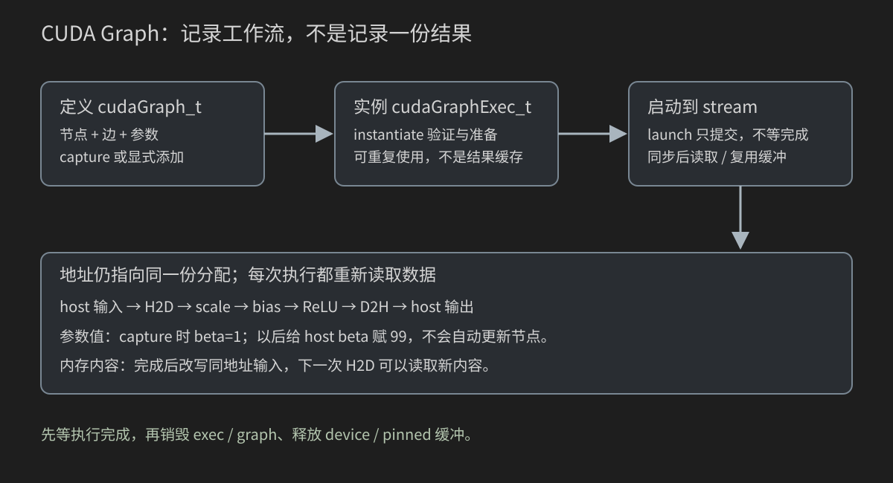
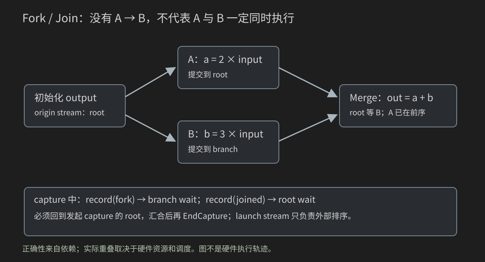

# 21 CUDA Graphs 与重复工作流：把一次正确执行变成可复用计划

学完第 20 章，你已经能让 CPU 提交多个异步操作，并用 stream/event 建立依赖。本章不再从头解释它们，而是回答一个新问题：同一组很短的操作要执行很多轮时，CPU 是否必须每轮重新逐项提交？

我们用“缩放 → 加偏置 → ReLU”贯穿本章。先保证普通 stream 版本正确，再建立 Graph；接着区分记录值和数据内容、修改模板和修改可执行实例、单节点更新和整图更新，最后与普通排队和 kernel 融合一起测量。Graph 不是必然更快的按钮，也不是结果缓存。

本章代码以 CUDA Toolkit 12.0 或更新版本为最低教学接口基线，特别是三参数 `cudaGraphExecUpdate` 与结果结构体；核对过 CUDA 12.6.3 归档和当前 Runtime 文档。不要混抄旧博客的四参数更新接口。本机尚未编译或在 GPU 上运行本章程序：所有确定值是数学推导，时间字段只是预期格式。

## 21.0 什么问题值得交给 Graph

假设每轮要做三件事，每件事只处理几千个元素：

```text
CPU：launch scale；launch bias；launch relu；下一轮再提交三个
GPU：执行 scale → bias → relu
```

如果 kernel 本身很短，host 端准备和提交、驱动调度以及操作之间的空隙可能占显著比例。Graph 把工作和依赖提前定义、实例化，再用一次 graph launch 提交整个工作流。本章会测量“可能”，不先写“必然”。

先问四个问题：

1. 每轮的工作结构是否重复？输入内容可以变化，但操作和依赖是否相似？
2. 正确的普通版本是否已经完成？Graph 不会替你补缺失的边。
3. [第 18 章](18-Nsight性能分析与优化方法.md)的时间线是否显示提交瓶颈，而不是一个长 kernel 占满了时间？
4. 要重复多少轮？建立和维护 Graph 的成本能否摊薄？

如果主要时间在一个很长的矩阵乘法里，先研究该 kernel 或库调用；如果每轮只有一次执行且结构经常变，Graph 的准备工作可能得不偿失。这里是选择依据，不是硬件独立的阈值。

## 21.1 先定义数学，不让重放改变任务

输入是 n 个 float。每个输出：

```text
scaled[i] = alpha * input[i]
biased[i] = scaled[i] + beta
output[i] = max(biased[i], 0)
```

alpha、beta 是标量；ReLU 是 Rectified Linear Unit 的缩写，在本例只表示“负数变 0，非负数保留”。没有神经网络知识也能学这条工作流。

取 alpha=2、beta=1：

| input | scale 后 | bias 后 | ReLU 后 |
|---:|---:|---:|---:|
| -2 | -4 | -3 | 0 |
| -1 | -2 | -1 | 0 |
| -0.5 | -1 | 0 | 0 |
| 0 | 0 | 1 | 1 |
| 0.5 | 1 | 2 | 2 |
| 1 | 2 | 3 | 3 |
| 1.5 | 3 | 4 | 4 |
| 2 | 4 | 5 | 5 |

工作区 output 先被 scale 完整覆盖，随后两个 kernel 在 output 上逐元素操作；input 始终只读。因此重复 R 次执行，每次都得到同一个 `max(2*input+1,0)`，不是把上一轮的 output 当输入。

若改成 `data *= 2; data += 1; relu(data)`，就变成递推：从 1 开始会得到 3、7、15……那是另一个数学任务。Graph 不会自动把 data 恢复成初值。普通版本和 Graph 版本必须先统一这一点。

本例输入来自小范围二进制精确分数，alpha/beta 也是小整数，所用乘加不会产生难以比较的舍入差异；因此可以数值 `==` 验证。真实十进制输入或复杂融合需要重新定义误差协议，回看[第 16 章](16-矩阵乘法-朴素到Tiled-GEMM.md)，不能把本例精确标准机械套到所有算子。

## 21.2 DAG：箭头表示必须完成的前序，不是画出的时间

Graph 是一个工作与依赖的图。node 是一项操作，edge 是依赖边，topology 是节点怎样连接。DAG 即 Directed Acyclic Graph：有向无环图。

本例的依赖是 `scale → bias → relu`。bias 需要 scale 写出的内容，relu 又需要 bias 的内容；把箭头删掉不会让算法合法地并行。

另一种工作流是：

```text
upload → branch-A ┐
                 ├→ merge → download
upload → branch-B ┘
```

A/B 都只读相同输入、写不同输出；merge 必须等两份输出。图没有 A→B 边，只表示二者无这条先后约束，不保证它们真的重叠。

先在纸上给各节点假想时长 2、3、5、1、2 个时间单位。无限资源模型下：

| 节点 | 最早开始 | 最早结束 |
|---|---:|---:|
| upload | 0 | 2 |
| A | 2 | 5 |
| B | 2 | 7 |
| merge | max(5,7)=7 | 8 |
| download | 8 | 10 |

串行相加是 13，最长依赖路径是 10。10 是这个理想模型的下界；资源不足可能让实际运行比它长。它不是某张 GPU 的测量时间，也不能据此断言 CUDA 会使用两个固定“执行槽”。

一条 A→merge 边虽然画对了，但如果 B→merge 缺失，merge 就可能读到 B 的旧数据。节点编号或在 C++ 中“先调用 B”不能替代依赖。这是第 20 章的依赖原则在 Graph 中的新表现。

## 21.3 用 CPU 模型验证依赖、调用数量和摊销

`code/21_graphs/dag_model.cpp` 不使用 CUDA。parents 存每个节点的前序编号；finish 保存最早结束时刻。本模型按拓扑顺序编号，要求 parent<node；真实任意编号 DAG 需要先拓扑排序，不能只靠数组顺序。

```cpp
#include "graph_reference.h"
#include <array>
#include <iomanip>

int main(int argc, char** argv) {
    int repeats = 10;
    if (argc > 2 || (argc > 1 && !graph_example::integer(argv[1], 1, 100000, repeats))) {
        std::cerr << "Usage: dag_model [repeats:1..100000]\n"; return EXIT_FAILURE;
    }
    // Synthetic durations, in arbitrary time units; NOT measured hardware times.
    const std::array<const char*, 5> name = {"upload", "branch-A", "branch-B", "merge", "download"};
    const std::array<int, 5> duration = {2, 3, 5, 1, 2};
    const std::array<std::vector<int>, 5> parents = {
        std::vector<int>{}, std::vector<int>{0}, std::vector<int>{0},
        std::vector<int>{1, 2}, std::vector<int>{3}
    };
    std::array<int, 5> finish{};
    int sum = 0;
    for (int node = 0; node < 5; ++node) {
        int start = 0;
        for (int parent : parents[node]) {
            if (parent >= node) return EXIT_FAILURE;
            start = std::max(start, finish[parent]);
        }
        finish[node] = start + duration[node]; sum += duration[node];
        std::cout << name[node] << " earliest_start=" << start
                  << " earliest_finish=" << finish[node] << '\n';
    }
    if (sum != 13 || finish[4] != 10) return EXIT_FAILURE;
    std::cout << "synthetic_serial_sum=" << sum << " critical_path_lower_bound=" << finish[4]
              << "\nthree_kernel_host_calls=" << 3LL * repeats
              << " graph_host_launch_calls=" << repeats << '\n';
    // Another synthetic model: extra setup S=120; steady-state t_stream=9, t_graph=6.
    constexpr int setup = 120, stream_time = 9, graph_time = 6;
    const int first_win = setup / (stream_time - graph_time) + 1;
    std::cout << "synthetic_setup=" << setup << " first_strict_win_repeats=" << first_win << '\n';
    if (first_win != 41) return EXIT_FAILURE;
    for (int i = 0; i < 17; ++i)
        std::cout << "x=" << graph_example::input_value(i) << " y="
                  << graph_example::expected(graph_example::input_value(i), 2.0F, 1.0F) << '\n';
    std::cout << "PASS synthetic DAG, call counts and break-even arithmetic.\n";
    return EXIT_SUCCESS;
}
```

从教材根目录在终端执行：

```bash
g++ -std=c++17 -O2 -Wall -Wextra code/21_graphs/dag_model.cpp -o dag_model
./dag_model 10
```

编译选项的基础含义见[第 3 章](03-第一段CUDA程序与NVCC.md)；这里没有 device 编译，所以使用 g++。10 表示重复次数，不是 n。程序确定会算出串行和 13、关键路径 10；三 kernel 的显式提交为 30 次，Graph launch 为 10 次。不要把调用减少 3 倍误读成整段程序必然加速 3 倍。

最后的假想成本：额外准备 S=120，普通每轮 9，Graph 每轮 6。总时间分别 9R 与 120+6R；R=40 时相等，R=41 才严格获益。21.18 会把模型换成你的真实测量。

## 21.4 三种对象与三个阶段



图上从左到右是准备过程；下方的数据流才是被重复执行的操作。

| 对象 | 含义 | 不是什么 |
|---|---|---|
| `cudaGraph_t` | 节点、边和参数构成的定义 | 已算好的结果数组 |
| `cudaGraphNode_t` | 定义中某个节点的标识 | kernel 中的线程编号 |
| `cudaGraphExec_t` | 已实例化、可启动的执行对象 | 一条 stream 或一块显存 |
| `cudaStream_t` | 排序 Graph launch 与其他异步工作 | Graph 内部唯一执行通道 |

顺序是定义 → instantiate → launch。定义可以显式添加节点，也可以 capture 现有 stream 提交。实例化做结构验证和执行准备；launch 才请求执行。launch 返回不表示输出完成，仍要有 stream/event 完成点。其接口约定见[Runtime Graph Management](https://docs.nvidia.com/cuda/cuda-runtime-api/group__CUDART__GRAPH.html)。

“exec 是可执行的快照”是帮助区分对象的教学说法，不代表它永久不可变；后面有专门的更新接口。修改 graph 定义不会自动改写已有 exec。

## 21.5 Capture 是记录提交，不是偷偷执行一次

普通提交时，`submit_three(...)` 向 stream 放入工作；在 BeginCapture/EndCapture 之间，同样的提交描述变成图的节点。CPU 的 C++ 代码仍然在运行，但被捕获的 GPU 工作不在这时实际执行。

因此：

- 捕获前就要准备 device/pinned 内存和 stream。
- 捕获期间不能同步等待这些工作“算完”，因为它们还只是定义。
- EndCapture 返回 graph 后，仍须 instantiate、launch、等待完成，才读取结果。
- CPU 的 `for`/`if` 在捕获时已经决定记录多少节点、走哪个分支；普通 host 控制流不会作为动态控制逻辑自动重放。

如果你在捕获区写一个 R 次循环，得到的是含 R 组操作的大图；如果只捕获一组、结束后 launch R 次，得到的是小图重放 R 次。两者都可能合法，但图规模、准备成本、输出生命周期和提交次数不同。本章采用后者。

捕获接口与模式语义见[CUDA 12.6.3 Stream Management](https://docs.nvidia.com/cuda/archive/12.6.3/cuda-runtime-api/group__CUDART__STREAM.html)。本章使用 `cudaStreamCaptureModeGlobal`：在多 host 线程的程序里，其他线程的潜在不安全 CUDA 操作也可能受其约束。它不是线程互斥锁；ThreadLocal/Relaxed 更不是允许同步捕获 stream 的开关。

## 21.6 两个辅助文件：先认识数据和真正的 kernel

新目录包含以下文件。先阅读小案例，不必一开始通读 benchmark：

| 文件 | 作用 |
|---|---|
| `graph_reference.h` | 参数解析、确定输入、CPU 数值契约 |
| `graph_workload.cuh` | 三阶段与融合 kernel、普通提交函数 |
| `dag_model.cpp` | 无 GPU 的依赖和成本模型 |
| `graph_capture.cu` | pinned 往返和最小重放 |
| `capture_failure.cu` | 捕获协议错误与清理 |
| `graph_update.cu` | 显式节点、参数更新和重建 |
| `graph_fork_join.cu` | 跨 stream 捕获的 fork/join |
| `graph_benchmark.cu` | 普通三阶段、Graph 三阶段、融合对照 |

`.cuh` 在这里是“包含 CUDA 代码的头文件”的命名惯例，不是自动启动 kernel 的文件类型。每个可执行程序只从一个 .cu 编译，避免此阶段的多翻译单元 device 链接复杂性；第 23 章再处理工程组织。

完整 `graph_reference.h`：

```cpp
#ifndef CUDA_BOOK_GRAPH_REFERENCE_H
#define CUDA_BOOK_GRAPH_REFERENCE_H
#include <algorithm>
#include <cerrno>
#include <cmath>
#include <cstdlib>
#include <iostream>
#include <limits>
#include <string>
#include <vector>

namespace graph_example {
inline bool integer(const char* text, int low, int high, int& output) {
    if (text == nullptr || *text == '\0') return false;
    for (const char* p = text; *p; ++p) if (*p < '0' || *p > '9') return false;
    errno = 0;
    char* end = nullptr;
    const long value = std::strtol(text, &end, 10);
    if (errno || *end || value < low || value > high) return false;
    output = static_cast<int>(value); return true;
}
inline float input_value(std::size_t i) {
    return static_cast<float>(static_cast<int>(i % 17) - 8) / 4.0F;
}
inline float expected(float x, float alpha, float beta) {
    return std::max(alpha * x + beta, 0.0F);
}
inline bool validate(const float* output, int n, float alpha, float beta, const char* label) {
    for (int i = 0; i < n; ++i) {
        const float want = expected(input_value(i), alpha, beta);
        if (!std::isfinite(output[i]) || output[i] != want) {
            std::cerr << "FAIL " << label << " index=" << i
                      << " actual=" << output[i] << " expected=" << want << '\n';
            return false;
        }
    }
    return true;
}
}
#endif
```

integer 拒绝空字符串、负号、非数字、溢出和范围外值。n=0 留给调用方处理。input_value 在 -2..2 之间每 0.25 一步循环，既包含被 ReLU 截断的数，也包含保留的数。validate 检查全数组和有限值，而不是只看第一个元素。

完整 `graph_workload.cuh`：

```cpp
#ifndef CUDA_BOOK_GRAPH_WORKLOAD_CUH
#define CUDA_BOOK_GRAPH_WORKLOAD_CUH
#include "../common/cuda_check.h"
#include "graph_reference.h"

namespace graph_example {
__global__ void scale_input(const float* input, float* output, float alpha, int n) {
    const int i = blockIdx.x * blockDim.x + threadIdx.x;
    if (i < n) output[i] = alpha * input[i];
}
__global__ void add_bias(float* output, float beta, int n) {
    const int i = blockIdx.x * blockDim.x + threadIdx.x;
    if (i < n) output[i] += beta;
}
__global__ void relu(float* output, int n) {
    const int i = blockIdx.x * blockDim.x + threadIdx.x;
    if (i < n) output[i] = fmaxf(output[i], 0.0F);
}
__global__ void fused(const float* input, float* output, float alpha, float beta, int n) {
    const int i = blockIdx.x * blockDim.x + threadIdx.x;
    if (i < n) output[i] = fmaxf(alpha * input[i] + beta, 0.0F);
}
inline void submit_three(const float* input, float* output, int n,
                         float alpha, float beta, cudaStream_t stream) {
    const int threads = 256, blocks = (n + threads - 1) / threads;
    scale_input<<<blocks, threads, 0, stream>>>(input, output, alpha, n);
    CUDA_CHECK(cudaGetLastError());
    add_bias<<<blocks, threads, 0, stream>>>(output, beta, n);
    CUDA_CHECK(cudaGetLastError());
    relu<<<blocks, threads, 0, stream>>>(output, n);
    CUDA_CHECK(cudaGetLastError());
}
}
#endif
```

四个 kernel 都是一线程一元素；索引基础只短回顾[第 5 章](05-一维索引与向量运算.md)。n=1031、threads=256 时 blocks=5，最后 block 只有 7 个有效线程。256 是便于 warp 对齐的教学候选，不是 Graph 的固定要求。

scale_input 写 output，add_bias/relu 各自原地更新一个独立元素。这样的原地更新没有邻域竞争，与卷积的原地输入覆盖不同。三次 cudaGetLastError 只检查提交/启动错误；submit_three **没有执行同步**，才能用于 capture。不能把它换成包含 cudaDeviceSynchronize 的 CUDA_CHECK_KERNEL 宏。

fused 把三个标量步骤合进一次 kernel；它服务于性能对照。Graph 保留三个节点，并不意味着自动生成这个 fused kernel。

## 21.7 最小完整程序：捕获 H2D → 三 kernel → D2H

先看资源关系：

```text
hi：pinned 输入，CPU 填写；H2D 只读
di：device 输入，三 kernel 中只读
dout：device 输出，scale 覆盖后 bias/relu 更新
ho：pinned 输出，D2H 写入；CPU 在完成后验证
stream：排序一次工作流
graph / exec：定义与可执行实例
```

捕获的两份拷贝让每次重放都重新从原始输入开始，不会产生递推。完整 `graph_capture.cu`：

```cpp
#include "graph_workload.cuh"
#include <limits>

int main(int argc, char** argv) {
    int n = 1031, repeats = 3;
    if (argc > 3 || (argc > 1 && !graph_example::integer(argv[1], 0, 16777216, n)) ||
        (argc > 2 && !graph_example::integer(argv[2], 1, 1000, repeats))) {
        std::cerr << "Usage: graph_capture [n:0..16777216] [repeats:1..1000]\n";
        return EXIT_FAILURE;
    }
    if (n == 0) { std::cout << "PASS empty input; no allocation or capture.\n"; return EXIT_SUCCESS; }
    const std::size_t bytes = static_cast<std::size_t>(n) * sizeof(float);
    float *hi = nullptr, *ho = nullptr, *di = nullptr, *dout = nullptr;
    CUDA_CHECK(cudaMallocHost(&hi, bytes)); CUDA_CHECK(cudaMallocHost(&ho, bytes));
    CUDA_CHECK(cudaMalloc(&di, bytes)); CUDA_CHECK(cudaMalloc(&dout, bytes));
    for (int i = 0; i < n; ++i) hi[i] = graph_example::input_value(i);
    cudaStream_t stream{};
    CUDA_CHECK(cudaStreamCreateWithFlags(&stream, cudaStreamNonBlocking));
    cudaGraph_t graph{}; cudaGraphExec_t exec{};
    float alpha = 2.0F, beta = 1.0F;
    CUDA_CHECK(cudaStreamBeginCapture(stream, cudaStreamCaptureModeGlobal));
    CUDA_CHECK(cudaMemcpyAsync(di, hi, bytes, cudaMemcpyHostToDevice, stream));
    graph_example::submit_three(di, dout, n, alpha, beta, stream);
    CUDA_CHECK(cudaMemcpyAsync(ho, dout, bytes, cudaMemcpyDeviceToHost, stream));
    CUDA_CHECK(cudaStreamEndCapture(stream, &graph));
    std::size_t nodes = 0;
    CUDA_CHECK(cudaGraphGetNodes(graph, nullptr, &nodes));
    std::cout << "captured_nodes=" << nodes << " n=" << n << '\n';
    CUDA_CHECK(cudaGraphInstantiateWithFlags(&exec, graph, 0));
    beta = 99.0F; // Does NOT update the already recorded kernel scalar argument.
    for (int round = 0; round < repeats; ++round) {
        for (int i = 0; i < n; ++i) {
            hi[i] = graph_example::input_value(i);
            ho[i] = std::numeric_limits<float>::quiet_NaN();
        }
        CUDA_CHECK(cudaGraphLaunch(exec, stream));
        CUDA_CHECK(cudaStreamSynchronize(stream)); // Protect host read AND next host-buffer rewrite.
        if (!graph_example::validate(ho, n, 2.0F, 1.0F, "captured")) return EXIT_FAILURE;
        for (int i = 0; i < n; ++i) if (hi[i] != graph_example::input_value(i)) return EXIT_FAILURE;
    }
    std::vector<float> after(n);
    CUDA_CHECK(cudaMemcpy(after.data(), di, bytes, cudaMemcpyDeviceToHost));
    for (int i = 0; i < n; ++i) if (after[i] != hi[i]) return EXIT_FAILURE;
    CUDA_CHECK(cudaGraphExecDestroy(exec)); CUDA_CHECK(cudaGraphDestroy(graph));
    CUDA_CHECK(cudaStreamDestroy(stream)); CUDA_CHECK(cudaFree(dout)); CUDA_CHECK(cudaFree(di));
    CUDA_CHECK(cudaFreeHost(ho)); CUDA_CHECK(cudaFreeHost(hi));
    std::cout << "PASS repeated fresh-input workflows; captured beta=1, host beta=" << beta << ".\n";
    return EXIT_SUCCESS;
}
```

按执行顺序读 host 端：

1. 解析 n/repeats，n=0 直接结束，不分配零字节、不启动零 grid。
2. pinned 与 device 各两份数组；所有分配在 capture 外。
3. 创建 nonblocking stream；BeginCapture 之后记录 H2D、三次 kernel、D2H。
4. EndCapture 得到 graph；GetNodes 的 nullptr 表示只查询数量，而不是返回节点数组。
5. InstantiateWithFlags 的 flags=0 表示不启用额外实例化标志。
6. 每轮填回确定输入、将 ho 设 NaN，launch 后等 stream 完成。
7. 验证所有输出，检查 host/device 原始输入未改；最后才销毁、释放。

这条简单线性图预期有 5 个工作节点：两份 memcpy 和三个 kernel。不要用这个数推断所有捕获都有固定节点数；事件、库内部多 kernel、空节点和后续新接口可能改变图形。

这里“每轮同步”是保护 CPU 改写 hi 与读取 ho 的正确性选择，不是最高吞吐范式。要重叠多轮，必须准备独立缓冲和可执行实例/正确依赖；不能只删掉等待。

## 21.8 参数值、指针值、指针指向的内容：三件不同的事

程序在实例化后执行 `beta=99`，但 GPU 仍使用捕获时的 beta=1。为什么？

普通 kernel 参数是按值传入的。图记录了这次提交使用的标量和地址，不会在以后 launch 时重新执行 C++ 调用表达式，也不会自动追踪某个 host 变量。API 添加节点时会复制参数数组及其指向的参数值，详见[CUDA 12.6.3 Graph API](https://docs.nvidia.com/cuda/archive/12.6.3/cuda-runtime-api/group__CUDART__GRAPH.html)。

| 修改 | 没有更新节点时的影响 |
|---|---|
| host beta 从 1 改 99 | 已记录标量仍是 1 |
| host di 变量改成另一地址 | 节点仍保存旧的 device 地址 |
| 已分配 hi 的内容改变，地址不变 | 下一次 H2D 可读取新内容；先等上一轮借用结束 |
| 同地址 device input 内容改变 | 后续 kernel 读新内容；必须先建立数据依赖 |
| 释放旧 di 再分配一个同名变量 | 旧节点不会自动获得新分配的所有权 |

变量名不是身份，地址也不是所有权。一个栈上的 `float beta` 可在参数复制后离开作用域；但参数中保存的 device 指针所指内存，仍必须在执行时有效。memcpy 节点保存的 host 指针同样借用那片 pinned 内存，不会复制它的全部内容成为永久快照。

修改 n 时还要同步考虑 grid、实际分配容量、拷贝字节数与 CPU oracle。更新某一个标量并不保证整个新 shape 都合法。

## 21.9 捕获限制与可恢复的协议错误

本章的规则很简单：分配、创建对象、准备输入放在捕获外；捕获中只放已经确认可捕获的异步操作；捕获后再执行和等待。

同步/查询正在捕获的 stream，或者同步包含活跃捕获的整个 device，属于非法协议。捕获失效后也必须调用 EndCapture 收尾，不能因为出错就跳过它。EndCapture 会退出捕获并返回错误/空图。核对依据为[CUDA Graphs：Invalidation](https://docs.nvidia.com/cuda/cuda-programming-guide/04-special-topics/cuda-graphs.html#invalidation)。

完整 `capture_failure.cu`：

```cpp
#include "../common/cuda_check.h"
#include <string>

__global__ void write_one(int* output) { *output = 1; }
int main(int argc, char** argv) {
    const std::string mode = argc > 1 ? argv[1] : "safe";
    if (argc > 2 || (mode != "safe" && mode != "invalid-sync")) {
        std::cerr << "Usage: capture_failure [safe|invalid-sync]\n"; return EXIT_FAILURE;
    }
    int* device = nullptr; CUDA_CHECK(cudaMalloc(&device, sizeof(int)));
    cudaStream_t stream{}; cudaGraph_t graph{}; cudaGraphExec_t exec{};
    CUDA_CHECK(cudaStreamCreateWithFlags(&stream, cudaStreamNonBlocking));
    if (mode == "invalid-sync") {
        CUDA_CHECK(cudaStreamBeginCapture(stream, cudaStreamCaptureModeGlobal));
        write_one<<<1, 1, 0, stream>>>(device); CUDA_CHECK(cudaGetLastError());
        // Intentional API-protocol error only: no OOB access, no data race.
        const cudaError_t bad = cudaStreamSynchronize(stream);
        cudaStreamCaptureStatus status{};
        CUDA_CHECK(cudaStreamIsCapturing(stream, &status));
        const cudaError_t ended = cudaStreamEndCapture(stream, &graph);
        std::cout << "forbidden_sync=" << cudaGetErrorString(bad)
                  << " invalidated=" << (status == cudaStreamCaptureStatusInvalidated)
                  << " end_capture=" << cudaGetErrorString(ended)
                  << " null_graph=" << (graph == nullptr) << '\n';
        if (bad != cudaErrorStreamCaptureUnsupported ||
            status != cudaStreamCaptureStatusInvalidated ||
            ended != cudaErrorStreamCaptureInvalidated || graph != nullptr) return EXIT_FAILURE;
        const cudaError_t last = cudaGetLastError();
        if (last != cudaSuccess && last != bad && last != ended) CUDA_CHECK(last);
        CUDA_CHECK(cudaStreamDestroy(stream));
        CUDA_CHECK(cudaStreamCreateWithFlags(&stream, cudaStreamNonBlocking));
    }
    CUDA_CHECK(cudaStreamBeginCapture(stream, cudaStreamCaptureModeGlobal));
    write_one<<<1, 1, 0, stream>>>(device); CUDA_CHECK(cudaGetLastError());
    CUDA_CHECK(cudaStreamEndCapture(stream, &graph));
    CUDA_CHECK(cudaGraphInstantiateWithFlags(&exec, graph, 0));
    CUDA_CHECK(cudaGraphLaunch(exec, stream));
    CUDA_CHECK(cudaStreamSynchronize(stream));
    int output = 0;
    CUDA_CHECK(cudaMemcpy(&output, device, sizeof(int), cudaMemcpyDeviceToHost));
    if (output != 1) return EXIT_FAILURE;
    CUDA_CHECK(cudaGraphExecDestroy(exec)); CUDA_CHECK(cudaGraphDestroy(graph));
    CUDA_CHECK(cudaStreamDestroy(stream)); CUDA_CHECK(cudaFree(device));
    std::cout << "PASS valid capture and result; mode=" << mode << '\n'; return EXIT_SUCCESS;
}
```

默认 safe 只做正常捕获。显式 invalid-sync 只故意违反 API 协议，不制造越界、竞争或失控 GPU 循环。故障流程：

```text
BeginCapture
  → 记录 write_one
  → 故意同步，收到错误
  → 查询捕获状态（不是查询执行是否完成）
  → EndCapture 收尾，得到空图
  → 核对并清理预期错误状态
  → 重建 stream
  → 正常捕获 / 实例化 / launch / 验证
```

这里没有用 CUDA_CHECK 包住“预期失败”的同步调用，因为该宏会立刻退出，后面的收尾就做不到。另一方面，只有明确认识的错误才被接纳；其他 CUDA 错误仍失败，不能写成“任何非零都说明故障实验成功”。

不要把 cudaStreamIsCapturing 与 cudaStreamQuery 混淆：前者查询捕获模式，后者查询实际执行进度。即使成功捕获，输出也未执行；capture 状态正常不等于算法正确。

## 21.10 显式加节点：把 kernel 调用拆成参数表

capture 让普通提交代码复用起来容易；显式 API 让节点身份、依赖和更新位置更清楚。更新实验先用两节点：affine → relu。affine 一步算 `alpha*input+beta`，不是改变数学结果，只简化要更新的节点。

`cudaKernelNodeParams` 字段可在[结构体文档](https://docs.nvidia.com/cuda/archive/12.6.3/cuda-runtime-api/structcudaKernelNodeParams.html)核对：

| 字段 | 本例填写 | 含义 |
|---|---|---|
| func | affine 的函数地址 | 执行哪个 kernel |
| gridDim | ceil(n/256) | block 数 |
| blockDim | 256 | 每 block 线程数 |
| sharedMemBytes | 零初始化为 0 | 动态 shared 字节 |
| kernelParams | arguments | 各参数值在 host 上的地址 |
| extra | 零初始化为 nullptr | 本例不用另一种参数打包方式 |

`void* arguments[] = {&input,&output,&alpha,&beta,&n}` 不是五个数据数组，而是“告诉 API 到哪里读取五个参数值”的 host 地址列表。&input 指向一个 device 指针变量，不是把 device 数组复制到 CPU；API 读取其中的地址值。顺序和类型必须与 kernel 签名严格一致。

`p{}` 先零初始化整个参数结构，避免 extra/sharedMemBytes 等未用字段带垃圾值。依赖参数 `&d.affine_node,1` 表示新 relu 节点只有一个前序；nullptr,0 表示没有前序。空节点没有数学工作，但在图结构中真实存在，后面用它演示拓扑改变。

## 21.11 完整更新程序：定义、实例、单节点、整图与重建

完整 `graph_update.cu`：

```cpp
#include "graph_workload.cuh"
#if CUDART_VERSION < 12000
#error "graph_update requires CUDA Toolkit 12.0 or newer."
#endif

__global__ void affine(const float* input, float* output, float alpha, float beta, int n) {
    const int i = blockIdx.x * blockDim.x + threadIdx.x;
    if (i < n) output[i] = alpha * input[i] + beta;
}
struct Definition { cudaGraph_t graph{}; cudaGraphNode_t affine_node{}, relu_node{}, extra{}; };
cudaKernelNodeParams affine_parameters(int n, void** arguments) {
    // arguments are supplied by the caller; CUDA copies argument VALUES during the API call.
    cudaKernelNodeParams p{};
    p.func = reinterpret_cast<void*>(affine);
    p.gridDim = dim3((n + 255) / 256); p.blockDim = dim3(256);
    p.kernelParams = arguments; return p;
}
Definition define(const float* input, float* output, int n, float alpha, float beta, bool extra) {
    Definition d;
    CUDA_CHECK(cudaGraphCreate(&d.graph, 0));
    void* arguments[] = {&input, &output, &alpha, &beta, &n};
    auto p = affine_parameters(n, arguments);
    CUDA_CHECK(cudaGraphAddKernelNode(&d.affine_node, d.graph, nullptr, 0, &p));
    void* relu_arguments[] = {&output, &n};
    cudaKernelNodeParams r{};
    r.func = reinterpret_cast<void*>(graph_example::relu);
    r.gridDim = p.gridDim; r.blockDim = p.blockDim; r.kernelParams = relu_arguments;
    CUDA_CHECK(cudaGraphAddKernelNode(&d.relu_node, d.graph, &d.affine_node, 1, &r));
    if (extra) CUDA_CHECK(cudaGraphAddEmptyNode(&d.extra, d.graph, &d.relu_node, 1));
    return d;
}
void update_or_rebuild(cudaGraphExec_t& exec, cudaGraph_t candidate, bool expect_topology_failure) {
    cudaGraphExecUpdateResultInfo info{};
    const cudaError_t error = cudaGraphExecUpdate(exec, candidate, &info);
    if (error == cudaSuccess && info.result == cudaGraphExecUpdateSuccess) {
        if (expect_topology_failure) { std::cerr << "FAIL topology change unexpectedly accepted.\n"; std::exit(EXIT_FAILURE); }
        std::cout << "whole_update=success\n"; return;
    }
    if (error != cudaErrorGraphExecUpdateFailure) CUDA_CHECK(error);
    if (error == cudaSuccess || (expect_topology_failure &&
        info.result != cudaGraphExecUpdateErrorTopologyChanged)) {
        std::cerr << "FAIL unexpected update result.\n"; std::exit(EXIT_FAILURE);
    }
    std::cout << "whole_update=rejected result=" << static_cast<int>(info.result) << " rebuild=yes\n";
    const cudaError_t last = cudaGetLastError();
    if (last != cudaSuccess && last != cudaErrorGraphExecUpdateFailure) CUDA_CHECK(last);
    cudaGraphExec_t replacement{};
    CUDA_CHECK(cudaGraphInstantiateWithFlags(&replacement, candidate, 0));
    CUDA_CHECK(cudaGraphExecDestroy(exec)); exec = replacement;
}
int main(int argc, char** argv) {
    int n = 1031;
    if (argc > 2 || (argc > 1 && !graph_example::integer(argv[1], 0, 16777216, n))) {
        std::cerr << "Usage: graph_update [n:0..16777216]\n"; return EXIT_FAILURE;
    }
    if (n == 0) { std::cout << "PASS empty input.\n"; return EXIT_SUCCESS; }
    const std::size_t bytes = static_cast<std::size_t>(n) * sizeof(float);
    std::vector<float> input(n), output(n), after(n);
    for (int i = 0; i < n; ++i) input[i] = graph_example::input_value(i);
    float *di = nullptr, *dout = nullptr;
    CUDA_CHECK(cudaMalloc(&di, bytes)); CUDA_CHECK(cudaMalloc(&dout, bytes));
    CUDA_CHECK(cudaMemcpy(di, input.data(), bytes, cudaMemcpyHostToDevice));
    cudaStream_t stream{}; CUDA_CHECK(cudaStreamCreateWithFlags(&stream, cudaStreamNonBlocking));
    auto original = define(di, dout, n, 2.0F, 1.0F, false);
    cudaGraphExec_t exec{}; CUDA_CHECK(cudaGraphInstantiateWithFlags(&exec, original.graph, 0));
    auto run = [&](float alpha, float beta, const char* label) {
        CUDA_CHECK(cudaMemsetAsync(dout, 0xFF, bytes, stream));
        CUDA_CHECK(cudaGraphLaunch(exec, stream));
        CUDA_CHECK(cudaMemcpyAsync(output.data(), dout, bytes, cudaMemcpyDeviceToHost, stream));
        CUDA_CHECK(cudaStreamSynchronize(stream));
        if (!graph_example::validate(output.data(), n, alpha, beta, label)) std::exit(EXIT_FAILURE);
        std::cout << "verified=" << label << " alpha=" << alpha << " beta=" << beta << '\n';
    };
    run(2.0F, 1.0F, "initial");
    const float* in = di; float* out = dout; float alpha = 4.0F, beta = -1.0F;
    void* arguments[] = {&in, &out, &alpha, &beta, &n};
    auto p = affine_parameters(n, arguments);
    CUDA_CHECK(cudaGraphKernelNodeSetParams(original.affine_node, &p));
    run(2.0F, 1.0F, "template-only-exec-unchanged");
    CUDA_CHECK(cudaGraphExecKernelNodeSetParams(exec, original.affine_node, &p));
    run(4.0F, -1.0F, "exec-node-update");
    auto compatible = define(di, dout, n, 1.0F, 2.0F, false);
    update_or_rebuild(exec, compatible.graph, false); // run() above already completed.
    run(1.0F, 2.0F, "whole-update-or-rebuild");
    auto changed = define(di, dout, n, 2.0F, -1.0F, true);
    update_or_rebuild(exec, changed.graph, true); // Added empty node changes topology.
    run(2.0F, -1.0F, "topology-rebuild");
    CUDA_CHECK(cudaMemcpy(after.data(), di, bytes, cudaMemcpyDeviceToHost));
    if (after != input) return EXIT_FAILURE;
    CUDA_CHECK(cudaGraphExecDestroy(exec));
    CUDA_CHECK(cudaGraphDestroy(changed.graph)); CUDA_CHECK(cudaGraphDestroy(compatible.graph));
    CUDA_CHECK(cudaGraphDestroy(original.graph)); CUDA_CHECK(cudaStreamDestroy(stream));
    CUDA_CHECK(cudaFree(dout)); CUDA_CHECK(cudaFree(di));
    std::cout << "PASS template/exec distinction, update/fallback, input unchanged.\n";
    return EXIT_SUCCESS;
}
```

Definition 只把几个句柄放在一个普通 struct 里，便于返回；它不自动管理资源。每个创建的 graph 在 main 末尾对应一次 GraphDestroy，exec 对应 ExecDestroy。

define 的局部 arguments 在 API 返回后可以结束生命周期，因为参数值已经复制；但其中的 device 分配没有复制，di/dout 仍由 main 拥有。affine_parameters 只构造参数结构，实际参数列表由调用者保持到添加/更新 API 返回，不能返回一个指向函数内部已消失 arguments 的结构。

run 先用同 stream memset 填 NaN，再 launch 和 D2H，最后同步并验证。每个阶段执行完才更新下一阶段，避免让资源修改与上一轮借用交叉。这个样例侧重更新语义，不计性能。

## 21.12 五个阶段分别证明什么

| 阶段 | 操作 | 应使用的 alpha/beta |
|---|---|---|
| initial | instantiate 后直接执行 | 2 / 1 |
| template-only | 只对 graph 的节点 SetParams | 仍然 2 / 1 |
| exec-node | 对 exec 的对应节点 SetParams | 4 / -1 |
| whole-update | 构造同拓扑候选并更新 | 1 / 2 |
| topology-rebuild | 候选多一个 empty 节点 | 重建后 2 / -1 |

两种 SetParams 名称很相近：不含 Exec 的修改定义，含 Exec 的修改已有实例。程序故意先改模板、再次运行旧实例，让你观察它仍算旧参数。

单节点更新必须提供实例化时原图中的对应节点，而不是另建一张图里的“同样编号”节点。这里保留 original.graph，也没有删除它的 affine_node。更新只影响之后的 launch，不回头修改已提交的执行；本例仍等待上一轮完成，保护自己持有的资源。相关边界见[GraphExecKernelNodeSetParams](https://docs.nvidia.com/cuda/cuda-runtime-api/group__CUDART__GRAPH.html)。

整图更新有两层结果：cudaError_t 返回状态，以及 info.result 的更新分类；info.errorNode/errorFromNode 可辅助定位。不要只检查结构体其中一项。结构定义见[UpdateResultInfo](https://docs.nvidia.com/cuda/archive/12.6.3/cuda-runtime-api/structcudaGraphExecUpdateResultInfo.html)。

同拓扑只是必要条件，节点函数/context/参数变化还有限制，须检查实际结果。本程序对可预期的 GraphExecUpdateFailure 建立新实例；对其他错误停止。新增 empty 节点改变节点数，预期会触发 topology changed；若没有得到所期望的分类，实验失败，不伪装通过。

重建顺序是“新实例创建成功 → 销毁已完成的旧实例 → 替换句柄”，不是先把唯一可用实例扔掉。返回的新实例仍引用 candidate 中记录的参数和外部 device 内存；本例保持所有定义到结束，便于学习和诊断。真实应用可建立清楚的缓存淘汰策略，而不是永久积累所有候选。

## 21.13 跨 stream 捕获：分叉必须重新汇合



图表示依赖，不是测到的 GPU 时间线。本例先记录一个输出初始化节点，然后 A 写 a=2*input，B 写 b=3*input，merge 写 a+b=5*input。A/B 写不同数组，原始 input 不变。

root 是发起 capture 的 stream；branch 等待 root 中捕获的 fork event 后加入同一次捕获。root 中 A 的顺序已经保证 A 在 merge 之前；root 还必须 wait branch 的 joined event，补上 B→merge，并在原来的 root 上 EndCapture。

完整 `graph_fork_join.cu`：

```cpp
#include "graph_workload.cuh"
#include <limits>

__global__ void merge_branches(const float* a, const float* b, float* output, int n) {
    const int i = blockIdx.x * blockDim.x + threadIdx.x;
    if (i < n) output[i] = a[i] + b[i];
}
int main(int argc, char** argv) {
    int n = 1031;
    if (argc > 2 || (argc > 1 && !graph_example::integer(argv[1], 0, 16777216, n))) {
        std::cerr << "Usage: graph_fork_join [n:0..16777216]\n"; return EXIT_FAILURE;
    }
    if (n == 0) { std::cout << "PASS empty input.\n"; return EXIT_SUCCESS; }
    const std::size_t bytes = static_cast<std::size_t>(n) * sizeof(float);
    std::vector<float> input(n), output(n), after(n);
    for (int i = 0; i < n; ++i) input[i] = graph_example::input_value(i);
    float *di = nullptr, *a = nullptr, *b = nullptr, *dout = nullptr;
    CUDA_CHECK(cudaMalloc(&di, bytes)); CUDA_CHECK(cudaMalloc(&a, bytes));
    CUDA_CHECK(cudaMalloc(&b, bytes)); CUDA_CHECK(cudaMalloc(&dout, bytes));
    CUDA_CHECK(cudaMemcpy(di, input.data(), bytes, cudaMemcpyHostToDevice));
    cudaStream_t root{}, branch{};
    CUDA_CHECK(cudaStreamCreateWithFlags(&root, cudaStreamNonBlocking));
    CUDA_CHECK(cudaStreamCreateWithFlags(&branch, cudaStreamNonBlocking));
    cudaEvent_t fork{}, joined{};
    CUDA_CHECK(cudaEventCreateWithFlags(&fork, cudaEventDisableTiming));
    CUDA_CHECK(cudaEventCreateWithFlags(&joined, cudaEventDisableTiming));
    cudaGraph_t graph{}; cudaGraphExec_t exec{};
    const int blocks = (n + 255) / 256;
    CUDA_CHECK(cudaStreamBeginCapture(root, cudaStreamCaptureModeGlobal));
    CUDA_CHECK(cudaMemsetAsync(dout, 0xFF, bytes, root)); // A real initial node for the fork.
    CUDA_CHECK(cudaEventRecord(fork, root));
    CUDA_CHECK(cudaStreamWaitEvent(branch, fork, 0));
    graph_example::scale_input<<<blocks, 256, 0, root>>>(di, a, 2.0F, n);
    CUDA_CHECK(cudaGetLastError());
    graph_example::scale_input<<<blocks, 256, 0, branch>>>(di, b, 3.0F, n);
    CUDA_CHECK(cudaGetLastError());
    CUDA_CHECK(cudaEventRecord(joined, branch));
    CUDA_CHECK(cudaStreamWaitEvent(root, joined, 0)); // Rejoin BEFORE merge AND EndCapture.
    merge_branches<<<blocks, 256, 0, root>>>(a, b, dout, n);
    CUDA_CHECK(cudaGetLastError());
    CUDA_CHECK(cudaStreamEndCapture(root, &graph));
    std::size_t nodes = 0, edges = 0;
    CUDA_CHECK(cudaGraphGetNodes(graph, nullptr, &nodes));
    CUDA_CHECK(cudaGraphGetEdges(graph, nullptr, nullptr, &edges));
    std::cout << "captured_nodes=" << nodes << " edges=" << edges << '\n';
    CUDA_CHECK(cudaGraphInstantiateWithFlags(&exec, graph, 0));
    for (int round = 0; round < 3; ++round) {
        CUDA_CHECK(cudaMemsetAsync(a, 0xFF, bytes, root));
        CUDA_CHECK(cudaMemsetAsync(b, 0xFF, bytes, root));
        CUDA_CHECK(cudaMemsetAsync(dout, 0xFF, bytes, root));
        CUDA_CHECK(cudaGraphLaunch(exec, root));
        CUDA_CHECK(cudaMemcpyAsync(output.data(), dout, bytes, cudaMemcpyDeviceToHost, root));
        CUDA_CHECK(cudaStreamSynchronize(root));
        for (int i = 0; i < n; ++i) {
            if (!std::isfinite(output[i]) || output[i] != 5.0F * input[i]) return EXIT_FAILURE;
        }
    }
    CUDA_CHECK(cudaMemcpy(after.data(), di, bytes, cudaMemcpyDeviceToHost));
    if (after != input) return EXIT_FAILURE;
    CUDA_CHECK(cudaGraphExecDestroy(exec)); CUDA_CHECK(cudaGraphDestroy(graph));
    CUDA_CHECK(cudaEventDestroy(joined)); CUDA_CHECK(cudaEventDestroy(fork));
    CUDA_CHECK(cudaStreamDestroy(branch)); CUDA_CHECK(cudaStreamDestroy(root));
    CUDA_CHECK(cudaFree(dout)); CUDA_CHECK(cudaFree(b)); CUDA_CHECK(cudaFree(a)); CUDA_CHECK(cudaFree(di));
    std::cout << "PASS both producer dependencies, repeated outputs, input unchanged.\n";
    return EXIT_SUCCESS;
}
```

这次捕获的不只有三次 kernel，还有一个输出 memset。普通 captured event 用于形成依赖，不必当作独立 GPU 计时节点理解；程序打印实际 nodes/edges，不靠硬编码数量判断正确。

与[第 20 章事件汇合](20-Stream-Event-Pinned-Memory与流水线.md)相比，本次新增的是“event 把另一条 stream 拉进同一次 capture”和“必须回到 origin stream 收尾”。若删掉 join，不能以“branch 工作已经提交”证明 capture 完整。

CUDA 对跨 stream 捕获的 origin/fork/join 约定见[Graph 的跨流依赖](https://docs.nvidia.com/cuda/cuda-programming-guide/04-special-topics/cuda-graphs.html#cross-stream-dependencies-and-events)。本例 launch 后只在 root 上回传并等待；这是 Graph 完整执行与后续工作的排序，不是忽略 branch。

## 21.14 一个 launch stream 不会把图内所有节点串行化

实例启动到 stream 是为了与图外操作排序。内部按图的依赖执行，不必复制捕获时的 stream 分工；没有依赖的节点有并行机会，但资源与调度决定实际重叠。

同一个 exec 不能与自己并发执行；即使 host 在不同 stream 启动它，这些 launch 也会被排序。要并发处理独立任务，需要多个 exec，还要独立/正确同步的输入输出和工作区。仅复制 exec 句柄，得到的还是同一个对象，不是新实例。

不能因此反过来说“同 exec 自排序解决全部资源问题”：另一个普通 kernel、另一个 exec 或 CPU 仍可能错误地覆盖它借用的缓冲。Graph/exec API 也不是让多个 CPU 线程随意并发改同一对象的线程安全容器。这些范围约定见[Using Graph APIs](https://docs.nvidia.com/cuda/cuda-programming-guide/04-special-topics/cuda-graphs.html#using-graph-apis)。

一个安全的先后顺序：

```text
同 stream：准备/初始化 → Graph launch → D2H → done
CPU：等待 done → 读输出 / 改输入 / 释放资源
```

不把 thread/block/warp 知识重新讲一遍，因为这里的粒度是“整项 CUDA 操作”，不是 kernel 内部同步。

## 21.15 性能对照设计：不要只与逐 kernel 同步的慢版本比较

普通基线应让三个 kernel 连续排队，整批最后才等待；不能每个 kernel 后 DeviceSynchronize，再宣布 Graph 快很多。那种差异包含你人为加入的等待。

本章三方法：

| 方法 | 每个工作流 | 显式 host launch 数/工作流 | 改变了什么 |
|---|---|---:|---|
| queued-three | 三 kernel 连续排队 | 3 | 原始普通基线 |
| graph-three | 同三 kernel 的一张图 | 1 | 定义/提交方式 |
| queued-fused | 一次融合 kernel | 1 | 算法实现与中间内存流量 |

三者同一数学任务、同一只读输入、三个独立输出。fused 是另一个实现，不能把它的收益全部称为 Graph 收益；它也不是证明 Graph 没价值，而是提醒先考虑减少小操作的数量。后续练习再比较 graph-fused。

benchmark 捕获的只有三 kernel，不含 H2D/D2H；输入上传一次，每次 scale 从 di 重新读，最终才回传验证。它测“数据已在 device 上时的重复计算”，与最小 capture 程序的完整往返任务范围不同。两者时间不能直接对比。

## 21.16 完整 benchmark：提交、完成与 Event 三种时间

完整 `graph_benchmark.cu`：

```cpp
#include "graph_workload.cuh"
#include "../09_timing/benchmark_stats.h"
#include <array>
#include <chrono>
#include <iomanip>

int main(int argc, char** argv) {
    int n = 4096, repeats = 1000, rounds = 5;
    if (argc > 4 || (argc > 1 && !graph_example::integer(argv[1], 0, 16777216, n)) ||
        (argc > 2 && !graph_example::integer(argv[2], 1, 100000, repeats)) ||
        (argc > 3 && !graph_example::integer(argv[3], 1, 31, rounds)) ||
        1LL * n * repeats > 4294967296LL) {
        std::cerr << "Usage: graph_benchmark [n:0..16777216] [repeats:1..100000]"
                     " [rounds:1..31]; n*repeats<=4294967296\n"; return EXIT_FAILURE;
    }
    if (n == 0) { std::cout << "PASS empty input; no timing.\n"; return EXIT_SUCCESS; }
    using Clock = std::chrono::steady_clock;
    auto ms = [](auto a, auto b) { return std::chrono::duration<double, std::milli>(b - a).count(); };
    cudaDeviceProp prop{}; int driver = 0, runtime = 0;
    CUDA_CHECK(cudaGetDeviceProperties(&prop, 0));
    CUDA_CHECK(cudaDriverGetVersion(&driver)); CUDA_CHECK(cudaRuntimeGetVersion(&runtime));
    std::cout << "GPU=" << prop.name << " driver=" << driver << " runtime=" << runtime
              << " n=" << n << " repeats=" << repeats << " rounds=" << rounds << '\n';
    const std::size_t bytes = static_cast<std::size_t>(n) * sizeof(float);
    std::vector<float> input(n), output(n), after(n);
    for (int i = 0; i < n; ++i) input[i] = graph_example::input_value(i);
    float* di = nullptr; std::array<float*, 3> dout{};
    CUDA_CHECK(cudaMalloc(&di, bytes));
    CUDA_CHECK(cudaMemcpy(di, input.data(), bytes, cudaMemcpyHostToDevice));
    for (auto& p : dout) CUDA_CHECK(cudaMalloc(&p, bytes));
    cudaStream_t stream{}; CUDA_CHECK(cudaStreamCreateWithFlags(&stream, cudaStreamNonBlocking));
    cudaEvent_t start{}, stop{}; CUDA_CHECK(cudaEventCreate(&start)); CUDA_CHECK(cudaEventCreate(&stop));
    // Materialize kernel code before timing graph construction (not a cold-process measurement).
    graph_example::submit_three(di, dout[0], n, 2.0F, 1.0F, stream);
    graph_example::fused<<<(n + 255) / 256, 256, 0, stream>>>(di, dout[2], 2.0F, 1.0F, n);
    CUDA_CHECK(cudaGetLastError()); CUDA_CHECK(cudaStreamSynchronize(stream));
    cudaGraph_t graph{}; cudaGraphExec_t exec{};
    const auto build_begin = Clock::now();
    CUDA_CHECK(cudaStreamBeginCapture(stream, cudaStreamCaptureModeGlobal));
    graph_example::submit_three(di, dout[1], n, 2.0F, 1.0F, stream);
    CUDA_CHECK(cudaStreamEndCapture(stream, &graph));
    CUDA_CHECK(cudaGraphInstantiateWithFlags(&exec, graph, 0));
    const auto build_end = Clock::now();
    const auto upload_begin = Clock::now();
    CUDA_CHECK(cudaGraphUpload(exec, stream)); CUDA_CHECK(cudaStreamSynchronize(stream));
    const auto upload_end = Clock::now();
    const std::array<const char*, 3> names = {"queued-three", "graph-three", "queued-fused"};
    auto launch = [&](int method) {
        if (method == 0) graph_example::submit_three(di, dout[method], n, 2.0F, 1.0F, stream);
        else if (method == 1) CUDA_CHECK(cudaGraphLaunch(exec, stream));
        else {
            graph_example::fused<<<(n + 255) / 256, 256, 0, stream>>>(di, dout[method], 2.0F, 1.0F, n);
            CUDA_CHECK(cudaGetLastError());
        }
    };
    auto validate = [&](int method) {
        CUDA_CHECK(cudaMemcpy(output.data(), dout[method], bytes, cudaMemcpyDeviceToHost));
        CUDA_CHECK(cudaMemcpy(after.data(), di, bytes, cudaMemcpyDeviceToHost));
        if (!graph_example::validate(output.data(), n, 2.0F, 1.0F, names[method]) || after != input)
            std::exit(EXIT_FAILURE);
    };
    for (int method = 0; method < 3; ++method) {
        CUDA_CHECK(cudaMemsetAsync(dout[method], 0xFF, bytes, stream));
        launch(method); CUDA_CHECK(cudaStreamSynchronize(stream)); validate(method);
        for (int warm = 0; warm < 3; ++warm) launch(method);
        CUDA_CHECK(cudaStreamSynchronize(stream)); validate(method);
    }
    std::array<std::vector<double>, 3> submit_samples, total_samples, event_samples;
    std::cout << std::fixed << std::setprecision(6)
              << "graph_definition_instantiate_ms=" << ms(build_begin, build_end)
              << " graph_upload_wait_ms=" << ms(upload_begin, upload_end) << '\n';
    for (int round = 0; round < rounds; ++round) for (int slot = 0; slot < 3; ++slot) {
        const int method = (round + slot) % 3;
        CUDA_CHECK(cudaMemsetAsync(dout[method], 0xFF, bytes, stream));
        CUDA_CHECK(cudaStreamSynchronize(stream)); // sentinel and prior work outside measured batch.
        const auto total_begin = Clock::now();
        CUDA_CHECK(cudaEventRecord(start, stream));
        const auto submit_begin = Clock::now();
        for (int repeat = 0; repeat < repeats; ++repeat) launch(method);
        const auto submit_end = Clock::now();
        CUDA_CHECK(cudaEventRecord(stop, stream)); CUDA_CHECK(cudaEventSynchronize(stop));
        const auto total_end = Clock::now();
        float elapsed = 0.0F; CUDA_CHECK(cudaEventElapsedTime(&elapsed, start, stop));
        const double submit = ms(submit_begin, submit_end), total = ms(total_begin, total_end);
        if (!std::isfinite(elapsed) || elapsed <= 0 || submit <= 0 || total <= 0) return EXIT_FAILURE;
        submit_samples[method].push_back(submit); total_samples[method].push_back(total);
        event_samples[method].push_back(elapsed); validate(method);
        std::cout << "sample round=" << round << " method=" << names[method]
                  << " host_submit_batch_ms=" << submit << " host_complete_batch_ms=" << total
                  << " event_batch_ms=" << elapsed << '\n';
    }
    for (int method = 0; method < 3; ++method) {
        const auto s = summarize(submit_samples[method]), t = summarize(total_samples[method]);
        const auto e = summarize(event_samples[method]);
        std::cout << names[method] << " submit_median_batch_ms=" << s.median
                  << " complete_min/median/mean/max_batch_ms="
                  << t.minimum << '/' << t.median << '/' << t.mean << '/' << t.maximum
                  << " event_median_per_workflow_us=" << 1000.0 * e.median / repeats << '\n';
    }
    CUDA_CHECK(cudaGraphExecDestroy(exec)); CUDA_CHECK(cudaGraphDestroy(graph));
    CUDA_CHECK(cudaEventDestroy(stop)); CUDA_CHECK(cudaEventDestroy(start));
    CUDA_CHECK(cudaStreamDestroy(stream));
    for (auto p : dout) CUDA_CHECK(cudaFree(p));
    CUDA_CHECK(cudaFree(di));
    std::cout << "PASS equal math, immutable input, independent outputs, rotated samples.\n";
    return EXIT_SUCCESS;
}
```

按三个阶段阅读：

**准备。** 分配输入和三份输出，创建 stream/events；先执行三阶段和 fused，使 kernel 代码加载准备发生在 Graph 建立计时之前。记录 definition+instantiate 的 host 时间，再单独记录 GraphUpload 加等待的时间。因此这些不是“新进程第一次使用 CUDA”的冷启动数字。

**预检和预热。** 每方法独立 NaN 初始化，执行一次并逐项验证，再预热三次。所有输出初值和上轮输出都不参与本次数学任务。n=0 不测时间；严格参数限制和 n*repeats 的预算避免照抄巨大实验。

**轮换测量。** 每轮按 round 旋转方法起点，不总让同一方法首先经历温度/频率变化。每个样本前 sentinel 和等待都在计时外；样本中重复提交 R 个工作流，只有整批尾部同步。样本后回传全数组，验证 output 和原始 input；输出 min/median/mean/max，而不是只挑一个最好数字。

这里 launch helper 对每次 kernel 都做 cudaGetLastError；Graph 方法检查 GraphLaunch 返回码。它们的 host API 路径并非完全相同，属于“这份带错误检查实现”的成本，不能把提交差异宣称成硬件固有常数。

## 21.17 编译、运行、边界与工具命令

在教材根目录输入命令，不写进 .cu 文件：

```bash
nvcc -std=c++17 -O2 -lineinfo code/21_graphs/graph_capture.cu -o graph_capture
nvcc -std=c++17 -O2 -lineinfo code/21_graphs/graph_update.cu -o graph_update
nvcc -std=c++17 -O2 -lineinfo code/21_graphs/graph_fork_join.cu -o graph_fork_join
nvcc -std=c++17 -O2 -lineinfo code/21_graphs/capture_failure.cu -o capture_failure
nvcc -std=c++17 -O2 -lineinfo code/21_graphs/graph_benchmark.cu -o graph_benchmark
```

- 输入 .cu 文件不同，输出可执行名也随之改变；辅助 .h/.cuh 由 include 展开，不单独传给 nvcc。
- `-std=c++17` 选语言标准；`-O2` 是优化等级；`-lineinfo` 保留 device 源码行关联，不会打印变量。
- 未写死 `-arch=sm_XX`；需要时按第 2 章查到的设备能力添加，不盲抄某个 GPU 的数字。
- 更新样例若因旧 Toolkit 缺三参数 API 而编译失败，先升级/使用满足本章基线的 Toolkit，而不是删掉结果检查。
- Linux 用 `./graph_capture` 运行；Windows 通常将输出改为 graph_capture.exe，再用 `.\\graph_capture.exe`。

先进行低成本正确性实验：

```bash
./graph_capture 0 1
./graph_capture 1 3
./graph_capture 255 3
./graph_capture 256 3
./graph_capture 257 3
./graph_capture 1031 3
./graph_update 1031
./graph_fork_join 1031
./capture_failure safe
./capture_failure invalid-sync
./graph_benchmark 1031 10 3
```

0 检查空输入，1 检查最小输入，255/256/257 检查 block 边界两侧，1031 检查多个 block 与尾部。capture_failure 的故障模式需要你明确输入，默认测试不运行它。

```bash
./graph_capture -1 3
./graph_benchmark 10 0 3
compute-sanitizer --tool memcheck ./graph_capture 1031 3
compute-sanitizer --tool memcheck ./graph_update 1031
compute-sanitizer --tool memcheck ./graph_fork_join 1031
compute-sanitizer --tool initcheck ./graph_benchmark 1031 10 3
```

前两条应拒绝参数、返回非零、显示 Usage；不是 CUDA 执行故障。Sanitizer 检查完成的程序路径，但 memcheck 通过不证明所有依赖正确，也不证明参数更新协议在未测试分支都正确。Graph 的支持/诊断展示依工具版本而异，必要时先用普通 stream 基线定位 kernel 本身，见[第 7 章](07-错误检查与Compute-Sanitizer.md)。

批量 CMake/CTest 入口见[案例目录](code/21_graphs/README.md)，初学先跑单文件，不必立即构建全书。

## 21.18 怎样读输出和计算是否划算

小 capture 程序的确定结果包括“捕获 beta=1、host beta=99”，输出仍匹配 beta=1；PASS 在释放检查之后打印。更新程序应依次验证五种阶段，拓扑增加 empty 后打印 rejected/rebuild。同拓扑路径可能成功更新，也可能因接口限制走重建；两条路径都必须验证最终数学结果。

benchmark 的时间只有实机才能填。字段含义：

| 字段 | 包含 | 不包含 |
|---|---|---|
| host_submit_batch_ms | R 次 helper/launch 与错误检查的 CPU 时间 | 之后显式等待、D2H、校验 |
| host_complete_batch_ms | 起始 Event record、提交、终止 record、完成等待 | 初始化、构图、上传、D2H、校验 |
| event_batch_ms | GPU start 到 stop 的时间跨度 | 区间外准备和回传 |
| definition_instantiate_ms | 定义与实例化的 host 时间 | GraphUpload 和首次执行 |
| graph_upload_wait_ms | upload 调用与这条 stream 完成等待 | kernel 的算法计算 |

host 提交时间可能受队列背压等影响，不是纯粹固定的“launch 指令延迟”。Event 中也可能有 host 供给不及时造成的空隙，不等于三个 kernel 时间的简单和。CPU 与 GPU 区间彼此重叠，不能三列相加算总时间。

每 workflow 的 Event 微秒为 `1000 * batch_ms / R`；这是重复工作流的平均跨度，不是单个 kernel 时长。

真实摊销时定义 S 为额外建立/上传/必要维护的成本，s 为普通每 workflow 完成成本，g 为 Graph 成本。如果 s>g：

```text
Graph 获益条件：S + R*g < R*s
即 R > S/(s-g)
```

若测到 S=120 微秒、s=9、g=6 微秒，40 次打平，41 次严格获益。这些仍是讲解用的假想数。若 s<=g，不存在这个模型下的正次数盈亏平衡；不要对负分母套公式。

工程上的 S 应包含实际新增工作，而不仅是本程序打印的两项。更新、重新捕获、缓存未命中和多 shape 的实例数都会改变它。比较 total wall time 时还要加入共同的传输、CPU 输入构造和结果消费，不能只用 steady-state 数字承诺端到端收益。

## 21.19 在服务器采集 Graph 报告

先确认 `nsys --version` 和 `nsys profile --help`，旧版本可能没有相同选项。先保存不带 profiler 的 benchmark 输出，再采集报告：

```bash
nsys profile --trace=cuda --cuda-graph-trace=graph --sample=none --cpuctxsw=none -o graph_overview ./graph_benchmark 4096 1000 5
nsys profile --trace=cuda --cuda-graph-trace=node --sample=none --cpuctxsw=none -o graph_nodes ./graph_benchmark 4096 100 3
nsys stats graph_overview.nsys-rep
```

`graph` 粒度看整体 Graph 活动，适合先看提交与整体执行；`node` 粒度看节点，可能引入显著采集开销，所以第二条减少重复次数。用不同报告名，避免覆盖原报告。把 .nsys-rep 拷到本地，在相容版本的 Nsight Systems 中查看，具体流程回看第 18 章。

查四个问题：

1. Graph 方法是否从多次 kernel launch API 变成 GraphLaunch？不要把初始化/预热也算进稳态比较。
2. GPU 时间线的工作间隙是否减少？是 CPU 供给变化还是单 kernel 本身变化？
3. 三节点 Graph 是否仍执行三个 kernel？fused 方法是否减少中间读写与节点数？
4. fork/join 的两个 branch 有没有实际重叠？没有重叠时算法仍应正确。

不要把图形报告里的“不可见节点”当作没有执行：先检查 graph/node 采集粒度。也不要拿带 node tracing 的时间与无 tracing 的基线直接比较。选项和开销依据：[Nsight Systems CUDA Graph Trace](https://docs.nvidia.com/nsight-systems/UserGuide/index.html#cuda-graph-trace)。

## 21.20 生命周期、库调用和实例缓存

本章所有释放都在最后一次完成点之后。先完成执行，再销毁 exec/graph，最后释放它们使用的 device/pinned 内存与事件/stream。没有开启内存节点，本书也不让 Graph 替你隐式拥有普通 cudaMalloc 分配。

如果把局部 pinned 指针传给 memcpy 节点，然后函数返回时 cudaFreeHost，之后 launch 就可能使用失效地址。定义函数返回的参数表可以结束生命周期，不代表数据分配也可以结束；必须分开审计。

库工作流还需要审计：

- 是否支持当前版本的 capture？库的某些初始化或算法路径可能不支持。
- handle 是否绑定正确的 stream？内部工作区是否提前准备、容量足够？
- 多个 exec 是否共用会被同时修改的 workspace？capture 不会自动隔离它。
- 库调用对应几个 kernel/其他节点？不要把“一次 C++ 调用”当“一节点”。

多 shape 的工程常用缓存：key 至少描述影响拓扑/参数合法性的形状、类型和算法选择；entry 持有 graph exec 与资源。新 shape 不一定必须新实例，但更新必须成功且容量、grid、拷贝都满足。缓存命中不意味着当前内容已经上传；缓存淘汰也不能释放仍在执行的资源。

先让单 shape、单 host 线程、单实例正确，再扩展。这里的设计分析不把尚未核对的库接口当作已支持，下一章会讲如何阅读库契约。

## 21.21 本章故意不提前混入的高级功能

本章的固定 DAG 与 host launch 已足以写真实小程序。下面这些是进一步阅读入口，不是本章编译的隐含要求：

- 条件节点用于图内条件/循环，不能与“capture 时 host if 的固定结果”混淆。
- 内存分配/释放节点与 stream-ordered allocator 有专门规则，本例普通 cudaMalloc 不在图内。
- device-side Graph launch 是 device 发起的另一条接口路线，不是这里 CPU GraphLaunch 自动变成 device 发起。
- 节点启用/禁用、child graph、扩展边语义和设备端参数更新受具体版本与约束限制。

如确实需要，按功能查[官方 Graphs 功能章节](https://docs.nvidia.com/cuda/cuda-programming-guide/04-special-topics/cuda-graphs.html)和对应 Toolkit 文档，不按教程发表日期猜兼容性。先证明固定版本有收益，再引入复杂功能；不要因教材提到名称就认为已经掌握其执行协议。

## 21.22 故障诊断与验收清单

| 现象 | 优先检查 |
|---|---|
| capture 里同步失败 | 是否用了同步宏、同步 memcpy、库内部等待或 device synchronize |
| EndCapture 返回空图 | 是否早已失效；是否在 origin 收尾；跨 stream 是否 join |
| 改 beta 后仍算旧值 | 改的是 host 变量、graph 定义还是 exec |
| 更新调用成功但新结果错误 | 参数顺序/类型、grid、容量、CPU oracle、对应原节点 |
| 增加节点后 update 失败 | topology 已变；是否明确处理并重建 |
| 多轮输出越来越大 | scale 是否读取原始 input，还是上一轮 output |
| host 输入偶发污染 | 上一轮 H2D 仍借用该地址时，是否提前改写/释放 |
| Graph 比普通慢 | 普通基线是否公平、准备成本、节点粒度、重复次数、实测瓶颈 |
| 极小样本的时间为 0 或无法分辨 | 增加 repeats，重新测多轮；不能把不可靠时间当作性能结果 |
| 一个 stream 中启动，分支仍重叠 | 这是合法图内部并行，不是自动违反 stream 排序 |
| 看不到节点 | profiler 是否选 graph 粒度；不要先改算法 |
| invalid-sync 后正常程序也失败 | 是否 EndCapture 收尾并清理已确认错误；不要吞其他错误 |

交付一个 Graph 案例前，能写出：数学公式、只读输入、每节点读写地址、依赖来源、定义/exec 区别、参数更新位置、完成点、释放点、空/尾部/非法测试、准确计时边界和不使用 Graph 的基线。答不出其中之一，就先补它。

## 21.23 递进练习

1. 对 input=-1、-0.5、0、0.5、1，手算 alpha=2/beta=1 的三阶段结果。
2. repeats=3 为什么结果不是对输出应用三次 f(x)？
3. 写出 input 与 output 各自在三 kernel 中的读写身份。
4. 用五节点假想 DAG 算串行和、关键路径，以及 merge 最早开始。
5. 删掉 B→merge 边会发生什么？为什么 host 先调用 B 不够？
6. 区分 graph、node、exec、stream 四种句柄。
7. 只 capture+instantiate 后能读到计算结果吗？
8. 捕获一组三 kernel 后 launch 100 次，与在 capture 中循环 100 次有何区别？
9. 修改 host beta、修改同地址输入内容、修改指针变量各影响什么？
10. arguments 中 &input 和 input 有何不同？
11. 为什么局部参数数组可结束，而 device 分配不能提前释放？
12. 模板 SetParams 与 Exec SetParams 分别影响谁？
13. 更新 n 时至少还要核对哪四类东西？
14. 整图更新为什么必须看返回值和结果分类，不能吞任意错误？
15. 为什么增加 empty 节点也可能要求重建？
16. 写出 invalid-sync 的故障、收尾与恢复顺序。
17. 为什么不能把 submit_three 的 launch 检查换成同步检查宏？
18. 画出 fork/join 的两份输出、root/branch 及必要依赖。
19. 一个 exec 在两个 stream 启动，能否与自己并发？复制句柄是否创造新实例？
20. 本章三种性能方法各自改变了什么？为什么不以每 kernel 同步为普通基线？
21. Event/host submit/host complete 的时间能否相加？分别包含什么？
22. 用 S=150、s=8、g=5 微秒，求第一个严格获益的整数 R；再分析 s=4/g=5。
23. 若 node 采集下 Graph 较慢，应如何重新验证，不能直接得出什么结论？
24. 完成下一节的独立小项目；列出编译、测试、更新、故障和性能验收证据。

答案见[附录 C](附录-C-练习答案.md#第-21-章)。不要只读答案：先手算和预测，再运行实际程序。

## 21.24 独立项目：一个可变化的向量变换计划

从空文件实现 `output=max(alpha*input+beta,0)`。第一版只支持 n=1031、alpha=2/beta=1；第二版加入 0/1/257/1031 和严格参数；第三版创建可复用图并逐项验证；第四版让 alpha/beta 在已完成的轮次间变化。

要求：

1. 普通 queued、Graph 和 fused 版本都从同一原始 input 读取，不能递推。
2. 更新 scalar 不重新分配；如果改 n，先写清容量、grid、copy 和 oracle 协议，不够容量就安全重建。
3. 每个资源只有一个明确所有者；CPU 读/写 pinned 缓冲前有完成点。
4. 同一输出先 NaN，测试负值、0、正值和尾部；检查输入未变。
5. 记录当前 GPU、驱动、Toolkit、命令、各方法稳态范围与额外建立/更新成本。
6. 能关闭 Graph 回到普通基线；若没有实测收益，保留简单正确的普通实现也算工程上合理。

先做 scalar 更新，不要求多线程缓存或条件节点。进阶可把 fused kernel 也加入一节点 Graph，构成 queued-three/graph-three/queued-fused/graph-fused 四方法；明确它在比较提交方式还是计算实现。

## 21.25 下一步：把库当作有契约的工作节点

本章的 Graph 不依赖特定算法库，但你已知道一个库调用也可能展开成多个工作节点。下一章会从 Runtime/Driver/算法库的层次开始，讲 Thrust、CUB、cuBLAS 的数据布局、临时空间、stream、错误检查与正确性对照；它不是“找到 API 名称就不用理解参数”。

下一章尚待教材化完善，不把旧短稿当作已完成章节。官方继续阅读入口：CUDA Graphs 功能章节、Runtime Graph Management 与 CUDA 12.6.3 归档均已在相应知识点引用；本章的 CPU 模型、图片和源码是按这条教学路线独立编写的，而不是复制官方长篇内容。
