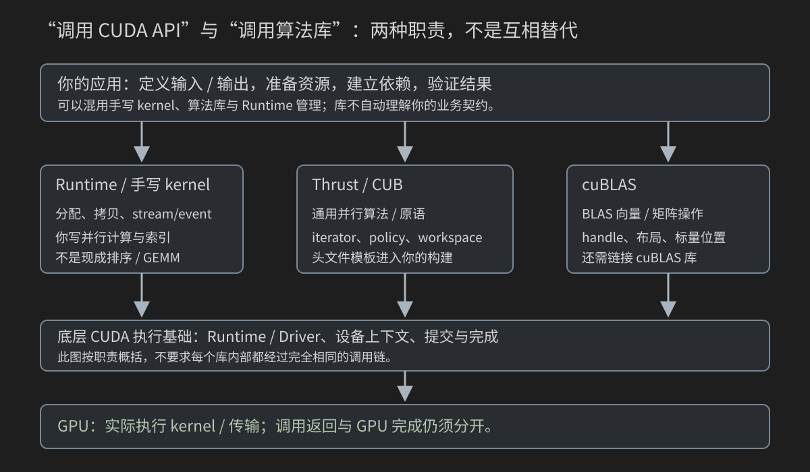
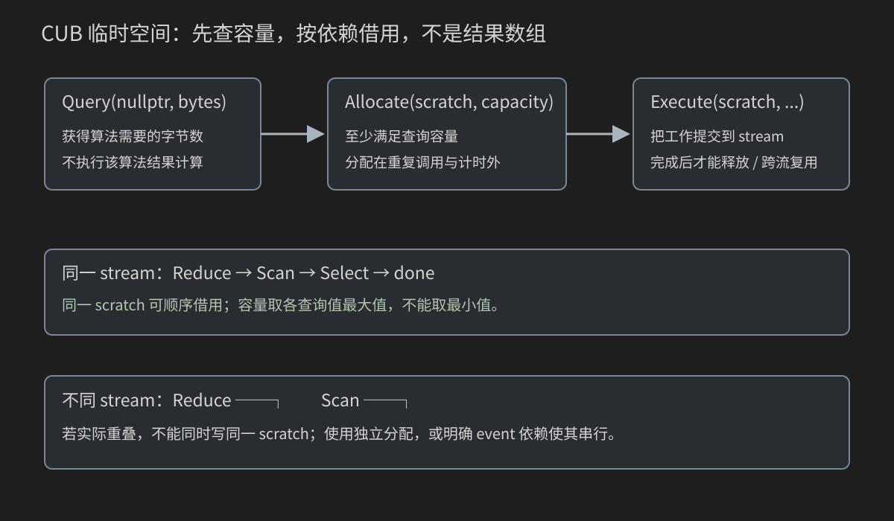
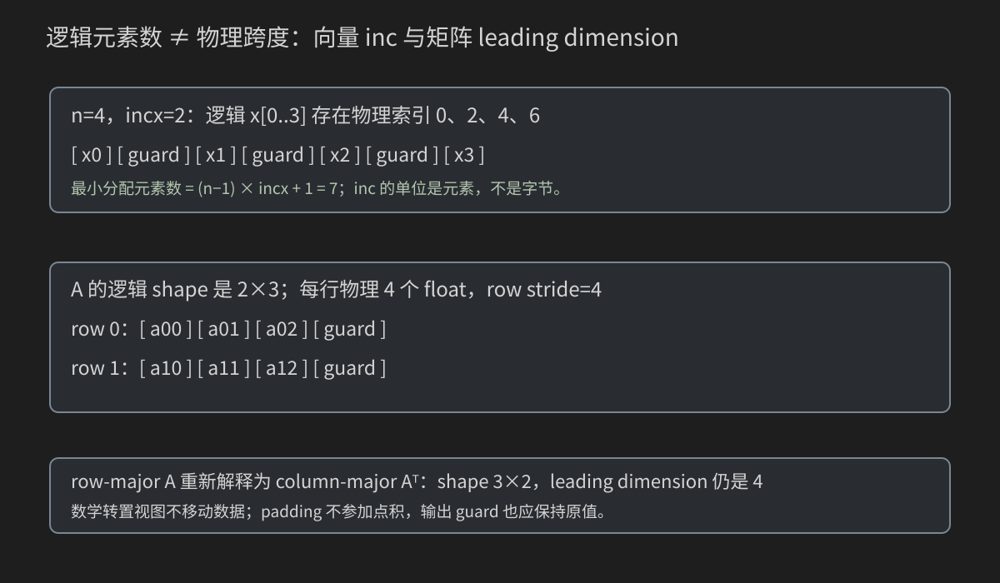

# 22 Thrust、CUB、cuBLAS：从“有这个 API”到正确调用库

前面你已经写过归约、Scan、GEMM，也理解 stream、事件和 Graph。现在转到工程中更常见的问题：怎样把现成算法库接进自己的程序，而不是每个操作都重新写 kernel？

本章不重新推导归约树或 tiled GEMM。已有算法只短回顾，重点放在新增的接口契约：数据在哪、范围多长、谁拥有内存、是否修改输入、工作在哪条 stream、临时空间够不够、返回值意味着什么、怎样验证与公平计时。

路线是 CPU 手算 → Thrust 容器 → 手写/Thrust SAXPY → 变换归约 → CUB 三操作工作流 → cuBLAS stride/标量模式 → 带 padding 的非方阵 GEMM → 四方法性能对照。8 个完整程序、2 个辅助头文件、3 张图和 28 道练习都在本章给出。

接口教学基线为 CUDA Toolkit 12.x 的常见接口；具体核对了 NVIDIA CCCL v2.5.0 源码和 CUDA 12.6.3 cuBLAS 归档，也查阅当前官方文档。没有采用最新 unstable 文档才有的新重载。本机仍无 C++/CUDA 编译器和 GPU，确定结果是数学推导，性能数值必须在你的服务器上测量。

## 22.0 “库优先”不是“库永远最快”

先写规格，再找成熟库，建立可信基线；如果需要库不支持的语义、特殊布局、算子融合，或者实测库路径不适合，再考虑自定义 kernel。

库减少的是你维护通用算法的负担，不减少下面的责任：

- 输入、输出、类型、形状、边界和数值标准必须由你确定。
- 你必须提供合法的数据、容量、资源和依赖。
- 你必须知道哪些输入会被修改，以及结果何时能读。
- 你必须验证结果，不能把“API 返回成功”当成算法正确。
- 性能比较要包括同一任务，不把传输、复位、分配或同步偷偷漏掉。

本章会直接比较手写 kernel、Thrust 与 cuBLAS，但不预先排速度榜。维护成本、可读性、依赖、可复现性同样是选择依据。

## 22.1 Runtime、Driver 和算法库分别在哪一层



图按职责分层，不声称每个库内部都有完全相同的调用链。

| 接口 | 例子 | 主要职责 |
|---|---|---|
| CUDA Runtime API | cudaMalloc、cudaMemcpy、stream/event | 管理和提交 CUDA 工作 |
| CUDA Driver API | cuCtx、cuModule、cuLaunchKernel 等接口族 | 更显式的上下文、模块和启动管理 |
| 手写 kernel | 你写的 __global__ 函数 | 自己定义并行计算与索引 |
| Thrust | transform、sort、reduce | 用范围、迭代器和函数对象表达通用算法 |
| CUB | DeviceReduce、DeviceScan、DeviceSelect | 更直接组织 CUDA 并行原语和临时空间 |
| cuBLAS | axpy、gemm | BLAS 向量/矩阵数学操作 |

Runtime 建立在更底层 Driver 接口上，但学会 Driver API 不会自动获得一个排序或矩阵乘法实现；调用算法库也不意味着必须先手写 Driver Context。官方范围说明见[CUDA Driver API 导读](https://docs.nvidia.com/cuda/cuda-programming-guide/03-advanced/driver-api.html)。

本章继续使用 Runtime 管理资源，不把独立 Driver API 专册搬进来。Thrust/CUB 与 cuBLAS 最终也需要 CUDA 执行环境；“用了库”不会使 GPU 数据变成普通 CPU 数组。

## 22.2 三套库的入口与依赖

CCCL 是包含 Thrust、CUB、libcu++ 等组件的 NVIDIA CUDA 核心计算库集合；不是第四个必须替代前三者的新算法名字。安装和版本关系以[NVIDIA CCCL 项目](https://github.com/NVIDIA/cccl)为准。

本章使用 Toolkit 已附带的匹配头文件，通常不需要另克隆 main。头文件主要靠模板进入编译；cuBLAS 则还要链接库。不要随意拼“新版 Thrust + 旧 CUB + 另一份 libcu++”，它们内部可能有版本耦合。

| 需求 | 优先看的入口 | 应先确认 |
|---|---|---|
| 每个元素同一个变换 | Thrust transform 或自定义 kernel | 范围、函数对象、输入输出是否重叠 |
| 排序/筛选/通用归约 | Thrust 算法 | 类型、比较/归约规则、返回形式 |
| device 上保留归约/Scan/筛选结果 | CUB Device 算法 | 临时空间、输出容量、stream |
| 向量线性更新/矩阵乘法 | cuBLAS | stride/layout、handle、标量位置、精度 |
| 多操作减少中间数组 | fancy iterator/transform_reduce/融合 | 数学是否等价，是否仍有内部临时空间 |

库之间可以混用：例如先用 CUB 算 device 标量，再交给 device pointer mode 的 cuBLAS。真正连接它们的是同一数据契约与完成依赖，不是库名相似。

## 22.3 用三个小问题定义本章的答案

### SAXPY：一个位置的两输入线性组合

S 表示单精度，AXPY 表示 alpha times X plus Y：

```text
y_new[i] = alpha*x[i] + y_old[i]
```

本章 alpha=2。先用五项手算：

| i | x | y_old | 2*x+y_old |
|---:|---:|---:|---:|
| 0 | -2 | 1 | -3 |
| 1 | -0.5 | 2 | 1 |
| 2 | 0 | -1 | -1 |
| 3 | 1 | 0.5 | 2.5 |
| 4 | 2 | -3 | 1 |

“输出另放”与“更新 y”都可实现同一个单次任务，但多次执行时若不恢复 y_old，就会递推。这里首先统一数学语义，而不是先抄函数名。

### 一组整数的四种结果

输入 `[-2,0,3,-1,4]`：

- Sum：4。
- Exclusive scan：`[0,-2,-2,1,0]`。
- 只筛选 >0 且保持相对顺序：`[3,4]`，count=2。
- 平方和：4+0+9+1+16=30。

归约、Scan、稳定压缩的完整算法分别回看[第 11 章](11-并行归约-从错误到高效.md)和[第 14 章](14-Scan前缀和与流压缩.md)。本章的新问题是调用接口后这些结果存在哪。

### 有旧 C 的 GEMM

取 A 为 2×3、B 为 3×2：

```text
A = [1 2 3; 4 5 6]
B = [1 2; 3 4; 5 6]
A*B = [22 28; 49 64]
C_old = [1 -1; 2 -2]
C_new = 2*(A*B) + 0.5*C_old
      = [44.5 55.5; 99 127]
```

alpha=2、beta=0.5。beta 不为零，所以 C_old 不是可忽略的垃圾内存。下一步加入 padding，但它不参与数学点积。

## 22.4 先跑不需要 GPU 的契约模型

目录 `code/22_libraries/` 中，各程序有独立 main；不要把所有 .cu 一起编译成一个可执行文件，否则会出现多个 main。

公共数学与参数头文件 `library_reference.h`：

```cpp
#ifndef CUDA_BOOK_LIBRARY_REFERENCE_H
#define CUDA_BOOK_LIBRARY_REFERENCE_H
#include <algorithm>
#include <charconv>
#include <cmath>
#include <cstddef>
#include <cstdlib>
#include <iostream>
#include <limits>
#include <string>
#include <system_error>
#include <vector>

namespace library_example {
inline bool integer(const char* text, int low, int high, int& result) {
    if (!text || !*text) return false;
    const char* end = text;
    while (*end) { if (*end < '0' || *end > '9') return false; ++end; }
    int candidate = 0;
    const auto parsed = std::from_chars(text, end, candidate);
    if (parsed.ec != std::errc{} || parsed.ptr != end || candidate < low || candidate > high) return false;
    result = candidate; return true;
}
inline float x_value(int i) { return static_cast<float>(i % 17 - 8) / 4.0F; }
inline float y_value(int i) { return static_cast<float>(i % 11 - 5) / 8.0F; }
inline long long integer_value(int i, const std::string& mode) {
    if (mode == "none") return -(i % 5 + 1LL);
    if (mode == "all") return i % 5 + 1LL;
    return i % 11 - 5LL;
}
inline bool saxpy_valid(const std::vector<float>& actual, const char* label) {
    for (std::size_t i = 0; i < actual.size(); ++i) {
        const float want = 2.0F * x_value(static_cast<int>(i)) + y_value(static_cast<int>(i));
        if (!std::isfinite(actual[i]) || actual[i] != want) {
            std::cerr << "FAIL " << label << " index=" << i << " actual=" << actual[i]
                      << " expected=" << want << '\n'; return false;
        }
    }
    return true;
}
}
#endif
```

integer 复用已经熟悉的严格解析思路，使用 `std::from_chars`，不把字符串误当 n。x/y 是小范围二进制精确分数；integer_value 提供 mixed/none/all 三种整数分布。saxpy_valid 对整个输出检查有限值和精确数值。

完整 `library_contracts.cpp`：

```cpp
#include "library_reference.h"

int main() {
    const std::vector<float> x = {-2.0F, -0.5F, 0.0F, 1.0F, 2.0F};
    const std::vector<float> y = {1.0F, 2.0F, -1.0F, 0.5F, -3.0F};
    const std::vector<float> expected = {-3.0F, 1.0F, -1.0F, 2.5F, 1.0F};
    for (std::size_t i = 0; i < x.size(); ++i) {
        const float output = 2.0F * x[i] + y[i];
        if (output != expected[i]) return EXIT_FAILURE;
        std::cout << "saxpy i=" << i << " x=" << x[i] << " y_old=" << y[i] << " output=" << output << '\n';
    }
    const std::vector<long long> input = {-2, 0, 3, -1, 4};
    const std::vector<long long> expected_scan = {0, -2, -2, 1, 0}, expected_selected = {3, 4};
    std::vector<long long> scan, selected;
    long long sum = 0, squares = 0;
    for (long long value : input) {
        scan.push_back(sum); sum += value; squares += value * value;
        if (value > 0) selected.push_back(value);
    }
    if (sum != 4 || squares != 30 || scan != expected_scan || selected != expected_selected) return EXIT_FAILURE;
    std::cout << "integer sum=" << sum << " squares=" << squares << " selected_count=" << selected.size() << '\n';
    constexpr int m = 2, k = 3, n = 2, lda = 4, ldb = 3, ldc = 3;
    const float guard = -777.0F;
    const std::vector<float> a = {1,2,3,guard, 4,5,6,guard};
    const std::vector<float> b = {1,2,guard, 3,4,guard, 5,6,guard};
    const std::vector<float> c0 = {1,-1,guard, 2,-2,guard};
    const std::vector<float> want = {44.5F,55.5F,guard, 99,127,guard};
    std::vector<float> c = c0;
    for (int row = 0; row < m; ++row) for (int col = 0; col < n; ++col) {
        float dot = 0;
        for (int q = 0; q < k; ++q) dot += a[row*lda+q] * b[q*ldb+col];
        c[row*ldc+col] = 2.0F * dot + 0.5F * c0[row*ldc+col];
    }
    if (c != want) return EXIT_FAILURE;
    std::cout << "padded row strides A/B/C=" << lda << '/' << ldb << '/' << ldc
              << " cublas m/n/k=" << n << '/' << m << '/' << k << '\n';
    std::cout << "PASS CPU contracts: SAXPY, sum/scan/select/squares, padded alpha-beta GEMM.\n";
    return EXIT_SUCCESS;
}
```

在根目录终端执行：

```bash
g++ -std=c++17 -O2 -Wall -Wextra code/22_libraries/library_contracts.cpp -o library_contracts
./library_contracts
```

本程序核对上面的确定答案。guard=-777 是 padding 的有限哨兵，不参加运算。a/b/c0 的逻辑形状不变，但每行多放一个元素，CPU 地址必须使用物理 stride；只复制 n×m 连续数字的思路不适用于这份 padded 存储。

GPU 大规模程序使用头文件的循环输入，不是全部照搬这五项；CPU 模型让你先理解契约，GPU 程序则对自己实际输入再生成全量 oracle。两者验证对象不要混淆。

## 22.5 Thrust 容器：谁负责分配与释放

`std::vector<T>` 和 `thrust::host_vector<T>` 供 host 端使用；本章默认的 `thrust::device_vector<T>` 拥有 device 分配。与手写 cudaMalloc 相比，容器负责大小、存储和析构，但不会让 CPU 直接以普通内存方式遍历 device 数据。

从 host 迭代范围构造 device_vector，会完成数据复制；构造 host_vector 接收 device_vector，得到可在 CPU 上检查的 host 数据。接口定义见[CCCL v2.5.0 device_vector](https://github.com/NVIDIA/cccl/blob/v2.5.0/thrust/thrust/device_vector.h)。

注意四个所有权问题：

1. device_vector 拥有分配，不能再手动 cudaFree 它的数据指针。
2. raw_pointer_cast/device_pointer_cast 是表示转换，不新建数组。
3. resize/重新分配可能使之前缓存的指针或迭代器失效；在执行借用结束前不能这样做。
4. 从 host 单项读取 device_vector 的 `operator[]` 是代理访问，可能引起传输，不适合循环逐项搬回大数组。

代理引用与实际 device 引用的边界可在[device_reference](https://github.com/NVIDIA/cccl/blob/v2.5.0/thrust/thrust/device_reference.h)核对。先整体复制回 host 再验证，避免把 n 次小传输当成正常算法成本。

## 22.6 完整容器案例：归约和排序

完整 `thrust_vectors.cu`：

```cpp
#include "../common/cuda_check.h"
#include "library_reference.h"
#include <thrust/device_vector.h>
#include <thrust/host_vector.h>
#include <thrust/functional.h>
#include <thrust/reduce.h>
#include <thrust/sort.h>
#include <thrust/system/cuda/execution_policy.h>
#include <exception>

int main(int argc, char** argv) {
    try {
        int n = 1031;
        if (argc > 2 || (argc > 1 && !library_example::integer(argv[1], 0, 1048576, n))) {
            std::cerr << "Usage: thrust_vectors [n:0..1048576]\n"; return EXIT_FAILURE;
        }
        if (n == 0) { std::cout << "PASS empty range, application sum=0; no GPU call.\n"; return EXIT_SUCCESS; }
        std::vector<long long> original(n);
        long long want_sum = 0;
        for (int i = 0; i < n; ++i) { original[i] = library_example::integer_value(i, "mixed"); want_sum += original[i]; }
        auto expected_sorted = original; std::sort(expected_sorted.begin(), expected_sorted.end());
        cudaStream_t stream{}; CUDA_CHECK(cudaStreamCreateWithFlags(&stream, cudaStreamNonBlocking));
        {
            thrust::device_vector<long long> data(original.begin(), original.end());
            // Container construction is outside this custom-stream workflow; establish completion explicitly.
            CUDA_CHECK(cudaDeviceSynchronize());
            const auto policy = thrust::cuda::par.on(stream);
            const long long result = thrust::reduce(policy, data.begin(), data.end(), 0LL, thrust::plus<long long>{});
            thrust::sort(policy, data.begin(), data.end());
            CUDA_CHECK(cudaGetLastError()); CUDA_CHECK(cudaStreamSynchronize(stream));
            thrust::host_vector<long long> sorted = data;
            if (result != want_sum || sorted.size() != expected_sorted.size()) return EXIT_FAILURE;
            for (std::size_t i = 0; i < sorted.size(); ++i) if (sorted[i] != expected_sorted[i]) return EXIT_FAILURE;
            if (n <= 16) { for (long long v : sorted) std::cout << v << ' '; std::cout << '\n'; }
            std::cout << "sum=" << result << " sorted_count=" << sorted.size() << '\n';
        } // device_vector owns its allocation and releases it; no cudaFree on its pointer.
        CUDA_CHECK(cudaStreamDestroy(stream));
        std::cout << "PASS host/device containers, whole-range sum and sort.\n"; return EXIT_SUCCESS;
    } catch (const std::exception& error) {
        std::cerr << "Thrust/C++ exception: " << error.what() << '\n'; return EXIT_FAILURE;
    }
}
```

执行路线：

```text
host original → device_vector data
                 ├→ reduce 返回 host sum
                 └→ sort 原地修改 data
host_vector sorted ← data
CPU 全数组排序参考 + sum 参考
```

本例整数求和避免浮点求和顺序干扰。sort 会修改 data，所以不能验证 device data “仍与原始顺序相同”；应该与 CPU 排序后的副本逐项比较，并保留 original 作为 oracle。只检查总和不能证明排序正确，因为乱序也可能保留总和。

构造容器的传输在自定义 stream 工作流之外，代码显式 cudaDeviceSynchronize 建立准备完成点。它放在计时之外，不代表每次库调用都应该同步整个 device。

内部花括号让 device_vector 在 stream 销毁前析构；同 stream 的工作已完成。try/catch 将 Thrust/C++ 异常变成失败退出，不能把异常吞掉后打印 PASS。本章教学程序在错误路径采用失败即终止；复杂服务的异常安全清理留待工程与 RAII 组织，不宣称所有原始句柄错误路径都自动释放。

## 22.7 Iterator：不是元素值，而是范围位置

迭代器可以理解为“在某种序列里定位和读取元素的对象”。指针是其中一种；Thrust 的迭代器还携带或组合执行系统与取值方式。

`[first,last)` 左闭右开：

```text
n=5：begin 指向第0项；end=begin+5 指向最后一项之后
实际访问：begin+0、+1、+2、+3、+4
不访问：begin+5
```

begin 不是 input[0] 的数值；end 不是最后一项本身。相减得到元素数量，不是字节数。传 n 之前已分配 n*sizeof(T)，这两种单位继续分开。

`cudaMalloc` 得到的裸指针在 C++ 类型上不自动带“device”标签。没有显式 policy 时，裸指针可能按 host 系统派发；Thrust 不会因为地址看起来像显存就替你正确猜测。两种正常方式是明确 CUDA execution policy，或使用 device 迭代器；本章同时写出 device_pointer_cast 与 par.on(stream)，让数据与队列都明确。

表示转换不会上传数据，也不会取得所有权。把 host 指针包装为 device_pointer_cast，不会把 host 数组变成 device 分配。Unified Memory 的地址可访问性质是另一条契约，回看第 8 章，不能用它为任意错误的 policy 开脱。

## 22.8 Functor：把“每个元素怎样算”交给算法

Saxpy 是函数对象，也叫 functor。它有一个 alpha 成员和可调用的 `operator()`：

```text
Saxpy{2} 是一个对象，其中保存 alpha=2。
op(x,y) 调用这个对象的 operator()，返回 alpha*x+y。
```

它不是 kernel。算法负责并行分发；你的 operator() 描述一个位置的计算。`__host__ __device__` 让相同函数对象可在 host/device 编译，`const` 表示不在调用中修改自身 alpha。

从手写 kernel 转到 transform，你仍要回答每个输入值怎样对应，但不用给 Thrust 手动传 block/grid。库会组织工作；它不证明输出容量足够。

binary transform 的参数依次为 policy、first1、last1、first2、output、operation。第二个输入没有单独的 end，因此调用者必须保证它至少有 `last1-first1` 项。契约与允许的原地情况见[Thrust transform 接口](https://github.com/NVIDIA/cccl/blob/v2.5.0/thrust/thrust/transform.h)。

### 后面的host组织为什么出现auto与[&]

本章稍后的benchmark把“提交一次”和“验证一次”写成小的host可调用对象，这种语法叫C++ lambda。先看一个只涉及普通变量的片段：

```cpp
int completed = 0;
auto mark = [&]() { ++completed; };
mark();
mark(); // completed now equals 2
```

auto让编译器推导mark这个lambda对象的类型，不表示“随便一种类型”。[&]是捕获列表：函数体使用外层自动变量时按引用借用；空的()是本例参数列表；花括号中是被调用时执行的函数体。定义mark不会先执行两次++，只有mark()才执行。

带一个int参数时，可在上述completed仍有效的同一作用域继续写：

```cpp
auto add = [&](int amount) { completed += amount; };
add(3); // completed now equals 5
```

后文submit对象的method参数同样是int，用于选择要提交的方法；其函数体借用当前作用域内实际使用的指针、stream等变量。借用这些变量不复制它们指向的CUDA数组，不分配device memory，也不会把lambda自动变成kernel。

本书这些lambda只用于host端减少重复组织代码，不把捕获lambda传给device算法，不要求额外device-lambda编译扩展。C++捕获也不是第21章的Graph capture：前者是一个对象怎样持有外层变量，后者是怎样记录CUDA工作流。

按引用借用的变量必须活到调用结束；不要把引用局部变量的lambda保存起来，在外层函数结束后继续调用。相同原则也用于后章launch/reset_output/validate/cleanup/ensure，届时只说明它们的新职责，不重新讲一遍全部语法。

## 22.9 完整手写/Thrust SAXPY 对照

完整 `thrust_saxpy.cu`：

```cpp
#include "../common/cuda_check.h"
#include "library_reference.h"
#include <thrust/device_ptr.h>
#include <thrust/transform.h>
#include <thrust/system/cuda/execution_policy.h>
#include <exception>

struct Saxpy {
    float alpha;
    __host__ __device__ float operator()(float x, float y) const { return alpha * x + y; }
};
__global__ void saxpy_kernel(const float* x, const float* y, float* output, int n) {
    const int i = blockIdx.x * blockDim.x + threadIdx.x;
    if (i < n) output[i] = 2.0F * x[i] + y[i];
}
int main(int argc, char** argv) {
    try {
        int n = 1031;
        if (argc > 2 || (argc > 1 && !library_example::integer(argv[1], 0, 16777216, n))) {
            std::cerr << "Usage: thrust_saxpy [n:0..16777216]\n"; return EXIT_FAILURE;
        }
        if (n == 0) { std::cout << "PASS empty input; no GPU call.\n"; return EXIT_SUCCESS; }
        const std::size_t bytes = static_cast<std::size_t>(n) * sizeof(float);
        std::vector<float> x(n), y(n), output(n), after(n);
        for (int i = 0; i < n; ++i) { x[i] = library_example::x_value(i); y[i] = library_example::y_value(i); }
        float *dx = nullptr, *dy = nullptr, *custom = nullptr, *library = nullptr;
        CUDA_CHECK(cudaMalloc(&dx, bytes)); CUDA_CHECK(cudaMalloc(&dy, bytes));
        CUDA_CHECK(cudaMalloc(&custom, bytes)); CUDA_CHECK(cudaMalloc(&library, bytes));
        CUDA_CHECK(cudaMemcpy(dx, x.data(), bytes, cudaMemcpyHostToDevice));
        CUDA_CHECK(cudaMemcpy(dy, y.data(), bytes, cudaMemcpyHostToDevice));
        cudaStream_t stream{}; CUDA_CHECK(cudaStreamCreateWithFlags(&stream, cudaStreamNonBlocking));
        CUDA_CHECK(cudaMemsetAsync(custom, 0xFF, bytes, stream));
        CUDA_CHECK(cudaMemsetAsync(library, 0xFF, bytes, stream));
        saxpy_kernel<<<(n+255)/256,256,0,stream>>>(dx, dy, custom, n); CUDA_CHECK(cudaGetLastError());
        const auto begin_x = thrust::device_pointer_cast(dx);
        const auto begin_y = thrust::device_pointer_cast(dy);
        const auto begin_out = thrust::device_pointer_cast(library);
        thrust::transform(thrust::cuda::par.on(stream), begin_x, begin_x+n, begin_y, begin_out, Saxpy{2.0F});
        CUDA_CHECK(cudaGetLastError()); CUDA_CHECK(cudaStreamSynchronize(stream));
        CUDA_CHECK(cudaMemcpy(output.data(), custom, bytes, cudaMemcpyDeviceToHost));
        if (!library_example::saxpy_valid(output, "custom")) return EXIT_FAILURE;
        CUDA_CHECK(cudaMemcpy(output.data(), library, bytes, cudaMemcpyDeviceToHost));
        if (!library_example::saxpy_valid(output, "thrust")) return EXIT_FAILURE;
        CUDA_CHECK(cudaMemcpy(after.data(), dx, bytes, cudaMemcpyDeviceToHost)); if (after != x) return EXIT_FAILURE;
        CUDA_CHECK(cudaMemcpy(after.data(), dy, bytes, cudaMemcpyDeviceToHost)); if (after != y) return EXIT_FAILURE;
        CUDA_CHECK(cudaStreamDestroy(stream)); CUDA_CHECK(cudaFree(library)); CUDA_CHECK(cudaFree(custom));
        CUDA_CHECK(cudaFree(dy)); CUDA_CHECK(cudaFree(dx));
        std::cout << "PASS custom/Thrust SAXPY, both inputs unchanged.\n"; return EXIT_SUCCESS;
    } catch (const std::exception& error) {
        std::cerr << "Thrust/C++ exception: " << error.what() << '\n'; return EXIT_FAILURE;
    }
}
```

两个版本分别输出到 custom/library，输入 dx/dy 只读。默认 n=1031，手写版 5 blocks×256 threads，最后有效 7 项；Thrust 版除执行策略外只传五个范围/操作对象参数，不暴露具体调度。

顺着以下位置读：

- 分配和 H2D：CPU x/y 与 device dx/dy 对应，不是指针赋值复制数组。
- 两份输出先 NaN，防止没覆盖的位置被旧值掩盖。
- 手写 kernel 提交到 stream，然后 Thrust transform 也明确使用同 stream。
- API/launch 检查后，在完成点等待；输出回传并验证，dx/dy 回读检查不变。
- 所有借用结束后释放资源。

这个程序是正确性对照，不计时。不能从“代码更短”推导更快，也不能用它的 CPU 逐项检查时间给 Thrust 下速度结论。

## 22.10 执行策略与 stream：同步也属于接口契约

`thrust::cuda::par.on(stream)` 选择 CUDA 后端与具体 stream。在本章核对的版本，它在算法返回前同步该 stream。不是因为 kernel 天生同步，而是策略为算法提供了这个返回语义。

`par_nosync.on(stream)` 请求避免不必要的同步；算法仍可能为了正确性同步。比如返回 host 标量的 reduce 必须得到该标量，不能承诺“用了 nosync 就永不等待”。官方可复现实例见[CCCL v2.5.0 explicit_cuda_stream](https://github.com/NVIDIA/cccl/blob/v2.5.0/thrust/examples/cuda/explicit_cuda_stream.cu)。

| 方式 | 本章应怎样理解 |
|---|---|
| CUDA kernel launch | host 提交后通常不等完成 |
| Thrust par.on | 策略包含 stream 同步语义 |
| Thrust par_nosync.on | 尽量不等；不是无条件异步保证 |
| Thrust reduce 返回 host scalar | 结果必须在返回时可用 |
| CUB device 输出 | 输出在 device，仍需要执行完成点 |
| cuBLAS 调用 | submission status 与实际完成要分开 |

因此同一 Event 区间里，Thrust 同步策略可能让 GPU 等 CPU 再次供给；不能把出现的空隙都归咎于 transform 的 device 算法。

如果生产者和 Thrust 用不同 stream，写对 policy 不等于依赖自动建立，仍要 event 或完成等待。stream/event 基础只回链[第 20 章](20-Stream-Event-Pinned-Memory与流水线.md)。

## 22.11 Fancy iterator：不分配一个你并不需要的中间数组

平方和常见的直觉实现：

```text
input → 平方 kernel → squares 数组 → reduce → scalar
```

如果 squares 不给别的步骤用，它是一个可以避免的用户中间数组。transform_reduce 在逻辑上对每项变换后归约；transform_iterator 则把“读取位置 i”变成“读取 input[i] 并调用 Square”。

`transformed+i` 仍是位置对象，解引用才获得变换后的值；它不在构造时遍历全部数据，更不保存一份平方结果。接口定义见[transform_iterator](https://github.com/NVIDIA/cccl/blob/v2.5.0/thrust/thrust/iterator/transform_iterator.h)。

进一步还有 counting iterator（按位置产生编号）和 zip iterator（同位置组合多个序列）。本章不为了列名字增加未运行的复杂代码；你先独立写出平方和，再在需要三输入变换时查 zip 的类型和 tuple 取值规则。

“没有用户 squares 数组”不等于“内部零临时空间”，也不保证一次 kernel。库归约仍可使用内部存储/多阶段执行；需要报告判断，不能把 fusion 一词当成保证。

## 22.12 完整变换归约与类型契约

完整 `thrust_fancy_reduce.cu`：

```cpp
#include "../common/cuda_check.h"
#include "library_reference.h"
#include <thrust/device_ptr.h>
#include <thrust/functional.h>
#include <thrust/iterator/transform_iterator.h>
#include <thrust/reduce.h>
#include <thrust/transform_reduce.h>
#include <thrust/system/cuda/execution_policy.h>
#include <exception>

struct Square {
    __host__ __device__ long long operator()(long long x) const { return x * x; }
};
int main(int argc, char** argv) {
    try {
        int n = 1031;
        if (argc > 2 || (argc > 1 && !library_example::integer(argv[1], 0, 16777216, n))) {
            std::cerr << "Usage: thrust_fancy_reduce [n:0..16777216]\n"; return EXIT_FAILURE;
        }
        if (n == 0) { std::cout << "PASS empty input, application sum_squares=0.\n"; return EXIT_SUCCESS; }
        const std::size_t bytes = static_cast<std::size_t>(n) * sizeof(long long);
        std::vector<long long> input(n), after(n); long long expected = 0;
        for (int i = 0; i < n; ++i) { input[i] = library_example::integer_value(i,"mixed"); expected += input[i]*input[i]; }
        long long* device = nullptr; CUDA_CHECK(cudaMalloc(&device, bytes));
        CUDA_CHECK(cudaMemcpy(device, input.data(), bytes, cudaMemcpyHostToDevice));
        cudaStream_t stream{}; CUDA_CHECK(cudaStreamCreateWithFlags(&stream,cudaStreamNonBlocking));
        auto begin = thrust::device_pointer_cast(device);
        const auto policy = thrust::cuda::par.on(stream);
        const long long a = thrust::transform_reduce(policy,begin,begin+n,Square{},0LL,thrust::plus<long long>{});
        const auto transformed = thrust::make_transform_iterator(begin,Square{});
        const long long b = thrust::reduce(policy,transformed,transformed+n,0LL,thrust::plus<long long>{});
        CUDA_CHECK(cudaGetLastError()); CUDA_CHECK(cudaStreamSynchronize(stream));
        CUDA_CHECK(cudaMemcpy(after.data(),device,bytes,cudaMemcpyDeviceToHost));
        if (a != expected || b != expected || after != input) return EXIT_FAILURE;
        CUDA_CHECK(cudaStreamDestroy(stream)); CUDA_CHECK(cudaFree(device));
        std::cout << "sum_squares=" << a << " expected=" << expected
                  << "\nPASS transformed values without a user-allocated square array.\n"; return EXIT_SUCCESS;
    } catch (const std::exception& error) {
        std::cerr << "Thrust/C++ exception: " << error.what() << '\n'; return EXIT_FAILURE;
    }
}
```

两种表达验证同一个结果：

1. transform_reduce 直接提供 Square。
2. make_transform_iterator 构造取值方式，再交给 reduce。

算法返回 long long host 标量，输入未变。Square 的乘法先发生在 long long 类型上；如果先用 int 做可能溢出的乘法再转 long long，事后转换救不了前面的溢出。

`0LL` 是 long long 初值，不是“把每项变成零”。reduce 的归约类型要与数据、初值和二元操作协调；例如两个 1,500,000,000 的宽整数之和，不能把初值写成 int 0 后期待一个宽类型输出兜底。类型要求与操作性质见[Thrust reduce](https://github.com/NVIDIA/cccl/blob/v2.5.0/thrust/thrust/reduce.h)。

本例 |x|<=5、n<=16,777,216，平方和<=419,430,400，使用 long long 有明确裕量；这份受限数据即使 32 位也能有界，不谎称它必然溢出。采用 64 位是为了让当前输入/变换/输出契约统一，并为扩展留空间。

并行 reduce 对组合顺序有要求；整数加法在无溢出时适合本例。浮点不是严格结合，处理真实小数仍要使用误差协议，不要求与串行累加位模式相同。

## 22.13 CUB 的 device、block、warp 不是同一种调用位置

`cub::DeviceReduce` 等是从 host 调用的 device 范围算法，内部可以启动多个 kernel；本章不手动给它 threadIdx 或 block size。

`cub::BlockReduce` 是在 kernel 内供一个 block 使用的组件，通常需要每 block shared 的 TempStorage；`WarpReduce` 对应更小组。它们的作用域与结果有效线程仍需遵守各自契约，回看第 11/12 章，不把“CUB”三个字当作跨 block 同步方式。

Thrust 可以在内部利用 CUB。选择 CUB 不一定意味着换成完全不同的 device 算法；它主要让你更直接掌握输出地址、临时存储和队列。没有公开接口保证两者相同任务必然用同一内部实现。

本章只使用传统明确 workspace 的 Device 接口，不混入新版本的自动 allocator/environment 重载。

## 22.14 两阶段临时存储：查询的是 bytes，不是数据结果



以 Sum 为例：

```text
Sum(nullptr, queried_bytes, input, output, n, stream)
  → 查询所需临时容量，不执行该算法结果计算
cudaMalloc(&scratch, capacity)
Sum(scratch, available_bytes, input, output, n, stream)
  → 提交实际工作
等待相关完成点 → 读取结果 / 释放 scratch
```

scratch 是中间工作区，d_sum 才是结果。queried_bytes 是 host 上的 size_t，接口用引用写回；n 是元素数。两者不能互换。查询也不是保证没有任何运行时准备成本，所以仍检查返回码，放在重复计时之外。

如果某个查询需要 0 bytes，本例仍分配至少 1 byte，保持执行调用的 scratch 非空；nullptr 的查询含义不能与“这个算法不需要多少工作区”混为一谈。具体两阶段接口核对[DeviceReduce v2.5.0](https://github.com/NVIDIA/cccl/blob/v2.5.0/cub/cub/device/device_reduce.cuh)。

工作区大小受类型、算法、规模、设备和版本影响；不要把某次打印的 8192 等字节写死给未来输入。每次变更契约需要重新查询并确认容量。

## 22.15 完整 CUB 工作流：Sum → ExclusiveScan → Select

完整 `cub_workflow.cu`：

```cpp
#include "../common/cuda_check.h"
#include "library_reference.h"
#include <cub/device/device_reduce.cuh>
#include <cub/device/device_scan.cuh>
#include <cub/device/device_select.cuh>
#include <cub/version.cuh>

struct Positive {
    __host__ __device__ bool operator()(long long value) const { return value > 0; }
};
int main(int argc, char** argv) {
    int n = 1031, rounds = 3;
    const std::string mode = argc > 2 ? argv[2] : "mixed";
    if (argc > 4 || (argc > 1 && !library_example::integer(argv[1],0,16777216,n)) ||
        (argc > 3 && !library_example::integer(argv[3],1,31,rounds)) ||
        (mode != "mixed" && mode != "none" && mode != "all")) {
        std::cerr << "Usage: cub_workflow [n:0..16777216] [mixed|none|all] [rounds:1..31]\n"; return EXIT_FAILURE;
    }
    if (n == 0) { std::cout << "PASS empty input, application sum=0 count=0; no CUB execution.\n"; return EXIT_SUCCESS; }
    const std::size_t bytes = static_cast<std::size_t>(n) * sizeof(long long);
    std::vector<long long> input(n), scan_expected(n), selected_expected, scan(n), after(n);
    long long expected = 0;
    for (int i = 0; i < n; ++i) {
        input[i] = library_example::integer_value(i,mode); scan_expected[i] = expected; expected += input[i];
        if (input[i] > 0) selected_expected.push_back(input[i]);
    }
    long long *di=nullptr, *d_sum=nullptr, *d_scan=nullptr, *d_selected=nullptr;
    int* d_count=nullptr; void* scratch=nullptr;
    CUDA_CHECK(cudaMalloc(&di,bytes)); CUDA_CHECK(cudaMalloc(&d_sum,sizeof(long long)));
    CUDA_CHECK(cudaMalloc(&d_scan,bytes)); CUDA_CHECK(cudaMalloc(&d_selected,bytes));
    CUDA_CHECK(cudaMalloc(&d_count,sizeof(int)));
    CUDA_CHECK(cudaMemcpy(di,input.data(),bytes,cudaMemcpyHostToDevice));
    cudaStream_t stream{}; CUDA_CHECK(cudaStreamCreateWithFlags(&stream,cudaStreamNonBlocking));
    std::size_t reduce_bytes=0, scan_bytes=0, select_bytes=0;
    CUDA_CHECK(cub::DeviceReduce::Sum(nullptr,reduce_bytes,di,d_sum,n,stream));
    CUDA_CHECK(cub::DeviceScan::ExclusiveSum(nullptr,scan_bytes,di,d_scan,n,stream));
    CUDA_CHECK(cub::DeviceSelect::If(nullptr,select_bytes,di,d_selected,d_count,n,Positive{},stream));
    const std::size_t capacity=std::max({reduce_bytes,scan_bytes,select_bytes,std::size_t{1}});
    CUDA_CHECK(cudaMalloc(&scratch,capacity));
    std::cout << "CUB_VERSION=" << CUB_VERSION << " query bytes reduce/scan/select=" << reduce_bytes << '/' << scan_bytes << '/' << select_bytes
              << " shared_sequential_capacity=" << capacity << '\n';
    for (int round=0; round<rounds; ++round) {
        CUDA_CHECK(cudaMemsetAsync(d_sum,0xA5,sizeof(long long),stream));
        CUDA_CHECK(cudaMemsetAsync(d_scan,0xA5,bytes,stream));
        CUDA_CHECK(cudaMemsetAsync(d_selected,0xA5,bytes,stream));
        CUDA_CHECK(cudaMemsetAsync(d_count,0xFF,sizeof(int),stream));
        std::size_t available=capacity;
        CUDA_CHECK(cub::DeviceReduce::Sum(scratch,available,di,d_sum,n,stream));
        available=capacity;
        CUDA_CHECK(cub::DeviceScan::ExclusiveSum(scratch,available,di,d_scan,n,stream));
        available=capacity;
        CUDA_CHECK(cub::DeviceSelect::If(scratch,available,di,d_selected,d_count,n,Positive{},stream));
        CUDA_CHECK(cudaGetLastError()); CUDA_CHECK(cudaStreamSynchronize(stream));
        long long sum=0; int count=-1;
        CUDA_CHECK(cudaMemcpy(&sum,d_sum,sizeof(sum),cudaMemcpyDeviceToHost));
        CUDA_CHECK(cudaMemcpy(&count,d_count,sizeof(count),cudaMemcpyDeviceToHost));
        if (sum != expected || count < 0 || count > n ||
            static_cast<std::size_t>(count) != selected_expected.size()) return EXIT_FAILURE;
        CUDA_CHECK(cudaMemcpy(scan.data(),d_scan,bytes,cudaMemcpyDeviceToHost));
        std::vector<long long> selected(count);
        if (count != 0) CUDA_CHECK(cudaMemcpy(selected.data(),d_selected,count*sizeof(long long),cudaMemcpyDeviceToHost));
        CUDA_CHECK(cudaMemcpy(after.data(),di,bytes,cudaMemcpyDeviceToHost));
        if (scan != scan_expected || selected != selected_expected || after != input) return EXIT_FAILURE;
        std::cout << "round=" << round << " sum=" << sum << " selected_count=" << count << '\n';
    }
    CUDA_CHECK(cudaStreamDestroy(stream)); CUDA_CHECK(cudaFree(scratch)); CUDA_CHECK(cudaFree(d_count));
    CUDA_CHECK(cudaFree(d_selected)); CUDA_CHECK(cudaFree(d_scan)); CUDA_CHECK(cudaFree(d_sum)); CUDA_CHECK(cudaFree(di));
    std::cout << "PASS reduce/exclusive-scan/stable-select; scratch reused only in stream order.\n";
    return EXIT_SUCCESS;
}
```

CPU 同时生成 sum、exclusive scan 和 positive selected 三份参考；GPU 三个操作都从原始 di 读取，不把 scan 输出误当 select 输入。

| device 对象 | 大小 | 角色 |
|---|---:|---|
| di | n 个 long long | 只读原始输入 |
| d_sum | 1 个 long long | 归约结果 |
| d_scan | n 个 long long | exclusive scan |
| d_selected | 最坏 n 个 long long | 筛选结果容量 |
| d_count | 1 个 int | 筛选有效结果数量 |
| scratch | 查询容量最大值 | 同 stream 顺序工作区 |

reduce/scan/select 三个 queried_bytes 分开保存；capacity=max(三者,1)。每次实际调用前恢复 available=capacity，因为它是传给 API 的可修改容量变量，不能误把某算法返回的数字当作全部分配的永久大小。

rounds 只是重复同一正确任务，输入不变，每轮结果先设哨兵。这里不计性能，所有 workspace 分配在重复循环外；这使你先验证长期复用的协议。

## 22.16 共享工作区和动态输出数量的两个边界

同 stream 的 Reduce→Scan→Select 按顺序执行，因此可顺序借用同一块 scratch。不是“CPU 第一个函数返回了，所以别的 stream 可以立即写它”。若两个 stream 真正重叠，共享 scratch 就可能竞争；要么独立分配，要么建立 event 依赖使复用串行。该规则也可核对[CCCL Device scope 临时存储](https://nvidia.github.io/cccl/unstable/cub/developer/device_scope.html)，本例仍使用上述固定版本接口。

d_selected 分配 n 项是最坏容量，d_count 才是本轮有效长度。例如输入全为非正数时 count=0；全正时 count=n。不能总复制/验证 n 项并把无效尾部当结果。

程序先完成工作、复制 count、检查 0<=count<=n 与 CPU count，再分配 host selected(count)，只复制有效前缀。计数损坏时不能直接拿它计算 D2H 字节数。每轮保留被选中项的相对顺序，因此还要逐项对照，不只检查 selected_count。

选择接口要求输出和相关输入范围按契约分离；不能猜测任意重叠都安全。核对[DeviceSelect::If](https://github.com/NVIDIA/cccl/blob/v2.5.0/cub/cub/device/device_select.cuh)与[DeviceScan](https://github.com/NVIDIA/cccl/blob/v2.5.0/cub/cub/device/device_scan.cuh)，尤其本例不用 in-place select。n=0 在应用层明确定义空结果，不调用这些库路径，不能把它称为“已测试库的空输入实现”。

## 22.17 cuBLAS：handle、stream、状态与标量位置

cuBLAS 的调用组织围绕 handle。handle 保存库状态，关联当前 CUDA 环境，不是你的矩阵，也不是 Runtime stream 的替身。创建后绑定 stream，复用同一 handle，执行完才销毁。多 GPU 要先选择对应设备并管理各自的对象，第 24 章再展开。

本章单独使用 `cublas_check.h`，因为 cuBLAS 返回的是 cublasStatus_t，不是 cudaError_t：

```cpp
#ifndef CUDA_BOOK_CUBLAS_CHECK_H
#define CUDA_BOOK_CUBLAS_CHECK_H
#include <cublas_v2.h>
#include <cstdlib>
#include <iostream>
inline const char* cublas_status_name(cublasStatus_t status) {
    switch (status) {
        case CUBLAS_STATUS_SUCCESS: return "SUCCESS";
        case CUBLAS_STATUS_NOT_INITIALIZED: return "NOT_INITIALIZED";
        case CUBLAS_STATUS_ALLOC_FAILED: return "ALLOC_FAILED";
        case CUBLAS_STATUS_INVALID_VALUE: return "INVALID_VALUE";
        case CUBLAS_STATUS_ARCH_MISMATCH: return "ARCH_MISMATCH";
        case CUBLAS_STATUS_MAPPING_ERROR: return "MAPPING_ERROR";
        case CUBLAS_STATUS_EXECUTION_FAILED: return "EXECUTION_FAILED";
        case CUBLAS_STATUS_INTERNAL_ERROR: return "INTERNAL_ERROR";
        case CUBLAS_STATUS_NOT_SUPPORTED: return "NOT_SUPPORTED";
        default: return "OTHER";
    }
}
inline void cublas_check(cublasStatus_t status, const char* expression, const char* file, int line) {
    if (status == CUBLAS_STATUS_SUCCESS) return;
    std::cerr << "cuBLAS error=" << cublas_status_name(status) << " numeric=" << static_cast<int>(status)
              << "\n expression=" << expression << "\n location=" << file << ':' << line << '\n';
    std::exit(EXIT_FAILURE);
}
#define CUBLAS_CHECK(expression) cublas_check((expression), #expression, __FILE__, __LINE__)
#endif
```

CUDA_CHECK 负责 Runtime；CUBLAS_CHECK 负责库返回状态。整数编码不够直观，辅助头文件打印有限的一组状态名、数值、表达式与文件行；未知状态仍失败，不当成功。

pointer mode 指定 alpha/beta 等 **标量参数** 所在位置。host 模式传 &alpha；device 模式传 device 上的 alpha 地址。这不改变矩阵/向量的存放位置；dx/dy/da/db/dc 在两种模式下都仍是 device 数据。

本例使用库默认工作区。若以后显式调用 cublasSetWorkspace，注意 cublasSetStream 会重置用户工作区配置；应先绑定 stream，再设置需要的 workspace，并保护执行期间的分配。不要把 CUB 的 query 接口照搬成 cuBLAS workspace API。规则见[cuBLAS stream/workspace](https://docs.nvidia.com/cuda/cublas/index.html#cublassetstream)。

多个 scalar 参数必须遵循同一个 pointer mode，不能 host alpha 配 device beta。各枚举与 handle 规则见[cuBLAS 接口](https://docs.nvidia.com/cuda/cublas/index.html)。如果共享 handle 的不同任务不断改 stream/pointer mode，须管理状态和并发，不能因各自函数名相同就默认安全。

## 22.18 向量 stride：n 是逻辑长度，inc 是元素间距



cuBLAS AXPY 的操作是 `y_i = alpha*x_i+y_i`。incx/incy 描述物理存储中的元素间距，单位是元素，不是 byte。

例如 n=4、incx=2：

```text
逻辑 i          0     1     2     3
物理下标        0     2     4     6
x 分配           x0 G x1 G x2 G x3
最少元素数       (n-1)*incx+1 = 7
最少字节数       7*sizeof(float)
```

G 是 guard。incy=3 时四项位于 0/3/6/9，需要 10 个元素。传 incx=sizeof(float) 不是“正常连续 float”，而会跨四个 float。

本章 wrapper 只接受正 stride 1..8，避免初学阶段混入负 stride 的起点约定。库有更完整的接口范围，但不要用本 wrapper 的限制去断言 cuBLAS 只支持正 stride。n=0 在应用层跳过。

## 22.19 完整 cuBLAS SAXPY：两种标量模式和 guard

完整 `cublas_saxpy.cu`：

```cpp
#include "../common/cuda_check.h"
#include "cublas_check.h"
#include "library_reference.h"

int main(int argc,char** argv) {
    int n=1031,incx=2,incy=3;
    if (argc>4 || (argc>1 && !library_example::integer(argv[1],0,1048576,n)) ||
        (argc>2 && !library_example::integer(argv[2],1,8,incx)) ||
        (argc>3 && !library_example::integer(argv[3],1,8,incy))) {
        std::cerr << "Usage: cublas_saxpy [n:0..1048576] [incx:1..8] [incy:1..8]\n"; return EXIT_FAILURE;
    }
    if (n==0) { std::cout << "PASS empty vector; no cuBLAS call.\n"; return EXIT_SUCCESS; }
    const std::size_t nx=static_cast<std::size_t>(n-1)*incx+1, ny=static_cast<std::size_t>(n-1)*incy+1;
    const float guard=-777.0F,alpha=2.0F;
    std::vector<float> x(nx,guard),y0(ny,guard),expected(ny,guard),output(ny),after(nx);
    for(int i=0;i<n;++i) {
        x[static_cast<std::size_t>(i)*incx]=library_example::x_value(i);
        y0[static_cast<std::size_t>(i)*incy]=library_example::y_value(i);
        expected[static_cast<std::size_t>(i)*incy]=2.0F*library_example::x_value(i)+library_example::y_value(i);
    }
    float *dx=nullptr,*dy=nullptr,*d_alpha=nullptr;
    CUDA_CHECK(cudaMalloc(&dx,nx*sizeof(float))); CUDA_CHECK(cudaMalloc(&dy,ny*sizeof(float)));
    CUDA_CHECK(cudaMalloc(&d_alpha,sizeof(float)));
    CUDA_CHECK(cudaMemcpy(dx,x.data(),nx*sizeof(float),cudaMemcpyHostToDevice));
    cudaStream_t stream{}; CUDA_CHECK(cudaStreamCreateWithFlags(&stream,cudaStreamNonBlocking));
    cublasHandle_t handle{}; CUBLAS_CHECK(cublasCreate(&handle)); CUBLAS_CHECK(cublasSetStream(handle,stream));
    CUDA_CHECK(cudaMemcpyAsync(d_alpha,&alpha,sizeof(float),cudaMemcpyHostToDevice,stream));
    for(int mode=0;mode<2;++mode) {
        CUBLAS_CHECK(cublasSetPointerMode(handle,mode==0?CUBLAS_POINTER_MODE_HOST:CUBLAS_POINTER_MODE_DEVICE));
        CUDA_CHECK(cudaMemcpyAsync(dy,y0.data(),ny*sizeof(float),cudaMemcpyHostToDevice,stream));
        CUBLAS_CHECK(cublasSaxpy(handle,n,mode==0?&alpha:d_alpha,dx,incx,dy,incy));
        CUDA_CHECK(cudaGetLastError());
        CUDA_CHECK(cudaMemcpyAsync(output.data(),dy,ny*sizeof(float),cudaMemcpyDeviceToHost,stream));
        CUDA_CHECK(cudaStreamSynchronize(stream));
        if(output!=expected) return EXIT_FAILURE; // includes all finite guard positions.
        std::cout << "verified_pointer_mode=" << (mode==0?"host":"device") << '\n';
    }
    CUDA_CHECK(cudaMemcpy(after.data(),dx,nx*sizeof(float),cudaMemcpyDeviceToHost));
    if(after!=x) return EXIT_FAILURE;
    CUBLAS_CHECK(cublasDestroy(handle)); CUDA_CHECK(cudaStreamDestroy(stream));
    CUDA_CHECK(cudaFree(d_alpha)); CUDA_CHECK(cudaFree(dy)); CUDA_CHECK(cudaFree(dx));
    std::cout << "PASS strided SAXPY, holes unchanged, x unchanged, both scalar modes.\n"; return EXIT_SUCCESS;
}
```

默认 incx=2/incy=3，使“逻辑长度≠分配长度”可见。x/y0 的空隙填有限 guard=-777；GPU 只更新合法 y 位置，验证整个物理输出就能同时检查计算和空隙。

每种 pointer mode 都先从 y0 恢复 dy，而不是让第二种模式接着第一次结果加一次。两个模式因此应该得到相同数学输出；dx 含 guard 的全部分配也应保持不变。

device alpha 的 H2D 与计算在同一 stream，顺序保证 alpha 先准备；主机 alpha 在整个执行期间有效。本例选择清楚保守的生命周期，不要求靠提前结束 host 栈对象优化。

cublasSaxpy 的返回值检查提交，CUDA stream 完成点检查实际执行；D2H 后才读 output。S/D/C/Z 等前缀主要描述数据类型家族，不能把它们当作不同同步方式。stride 和 alpha 参数约定见[CUDA 12.6.3 AXPY](https://docs.nvidia.com/cuda/archive/12.6.3/cublas/index.html#cublas-t-axpy)。

## 22.20 带 padding 的 GEMM：复习布局，但只展开新增部分

[第 16 章](16-矩阵乘法-朴素到Tiled-GEMM.md)已完整推导 `Cᵀ=BᵀAᵀ`。这里保留一张当前参数映射表，新增的是 padding、beta!=0 和 pointer mode 两种执行。

原始 row-major：

```text
A[M,K]，每行 lda=K+pad
B[K,N]，每行 ldb=N+pad
C[M,N]，每行 ldc=N+pad
C_new = alpha*A*B + beta*C_old
```

重新解释同一内存为 column-major 视图，不移动数组：

| cuBLAS 参数 | 传入值 | 解释 |
|---|---|---|
| m/n/k | N/M/K | 求 Cᵀ[N,M] |
| 第一个矩阵 | db | Bᵀ[N,K] |
| 第一个 lda | ldb=N+pad | B 的物理 row stride |
| 第二个矩阵 | da | Aᵀ[K,M] |
| 第二个 ldb | lda=K+pad | A 的物理 row stride |
| ldc | N+pad | Cᵀ 的 leading dimension |
| op | 两个 N | 视图已重新解释，不再传转置 op |

变量叫 lda 不意味着它永远对应函数签名中那个 lda 位置；本例“CPU A 的 stride lda”传给 cuBLAS 第二矩阵。把位置、对象和单位写在一起，就不必靠变量名猜。

CPU 计算使用 a[row*lda+q]、b[q*ldb+col]、c0[row*ldc+col]；padding 不参与点积。默认 M=3/K=5/N=2，明显非方阵；pad=3 使 stride 与逻辑维度不同，暴露误用 K/N 的地址计算。

## 22.21 完整严格 FP32 GEMM 与非零 beta

完整升级后的 `cublas_gemm.cu`：

```cpp
#include "../common/cuda_check.h"
#include "cublas_check.h"
#include "library_reference.h"

int main(int argc,char** argv) {
    int m=3,k=5,n=2,pad=3;
    if(argc>5 || (argc>1 && !library_example::integer(argv[1],1,256,m)) ||
       (argc>2 && !library_example::integer(argv[2],1,256,k)) ||
       (argc>3 && !library_example::integer(argv[3],1,256,n)) ||
       (argc>4 && !library_example::integer(argv[4],0,8,pad))) {
        std::cerr << "Usage: cublas_gemm [M:1..256] [K:1..256] [N:1..256] [padding:0..8]\n"; return EXIT_FAILURE;
    }
    const int lda=k+pad,ldb=n+pad,ldc=n+pad;
    const float guard=-777.0F,alpha=2.0F,beta=0.5F;
    std::vector<float> a(static_cast<std::size_t>(m)*lda,guard),b(static_cast<std::size_t>(k)*ldb,guard);
    std::vector<float> c0(static_cast<std::size_t>(m)*ldc,guard),out(c0.size()),after_a(a.size()),after_b(b.size());
    for(int row=0;row<m;++row) for(int q=0;q<k;++q) a[row*lda+q]=static_cast<float>((row*7+q*3)%9-4)/16.0F;
    for(int q=0;q<k;++q) for(int col=0;col<n;++col) b[q*ldb+col]=static_cast<float>((q*5+col*2)%7-3)/16.0F;
    for(int row=0;row<m;++row) for(int col=0;col<n;++col) c0[row*ldc+col]=static_cast<float>((row+col)%5-2)/8.0F;
    std::vector<double> expected(c0.begin(),c0.end());
    for(int row=0;row<m;++row) for(int col=0;col<n;++col) {
        double dot=0;
        for(int q=0;q<k;++q) dot+=static_cast<double>(a[row*lda+q])*b[q*ldb+col];
        expected[row*ldc+col]=alpha*dot+beta*c0[row*ldc+col];
    }
    const std::size_t ab=a.size()*sizeof(float),bb=b.size()*sizeof(float),cb=c0.size()*sizeof(float);
    float *da=nullptr,*db=nullptr,*dc=nullptr,*scalars=nullptr;
    CUDA_CHECK(cudaMalloc(&da,ab)); CUDA_CHECK(cudaMalloc(&db,bb)); CUDA_CHECK(cudaMalloc(&dc,cb));
    CUDA_CHECK(cudaMalloc(&scalars,2*sizeof(float)));
    CUDA_CHECK(cudaMemcpy(da,a.data(),ab,cudaMemcpyHostToDevice));
    CUDA_CHECK(cudaMemcpy(db,b.data(),bb,cudaMemcpyHostToDevice));
    const float host_scalars[]={alpha,beta};
    CUDA_CHECK(cudaMemcpy(scalars,host_scalars,sizeof(host_scalars),cudaMemcpyHostToDevice));
    cudaStream_t stream{}; CUDA_CHECK(cudaStreamCreateWithFlags(&stream,cudaStreamNonBlocking));
    cublasHandle_t handle{}; CUBLAS_CHECK(cublasCreate(&handle));
    CUBLAS_CHECK(cublasSetStream(handle,stream)); CUBLAS_CHECK(cublasSetMathMode(handle,CUBLAS_PEDANTIC_MATH));
    auto release=[&]() {
        CUBLAS_CHECK(cublasDestroy(handle)); CUDA_CHECK(cudaStreamDestroy(stream));
        CUDA_CHECK(cudaFree(scalars)); CUDA_CHECK(cudaFree(dc)); CUDA_CHECK(cudaFree(db)); CUDA_CHECK(cudaFree(da));
    };
    std::cout << "row_major M/K/N=" << m << '/' << k << '/' << n
              << " strides_A/B/C=" << lda << '/' << ldb << '/' << ldc << " alpha=2 beta=0.5\n";
    for(int mode=0;mode<2;++mode) {
        CUBLAS_CHECK(cublasSetPointerMode(handle,mode==0?CUBLAS_POINTER_MODE_HOST:CUBLAS_POINTER_MODE_DEVICE));
        CUDA_CHECK(cudaMemcpyAsync(dc,c0.data(),cb,cudaMemcpyHostToDevice,stream)); // reset C_old, including padding.
        const cublasStatus_t status=cublasGemmEx(handle,CUBLAS_OP_N,CUBLAS_OP_N,
            n,m,k,mode==0?&alpha:scalars,db,CUDA_R_32F,ldb,da,CUDA_R_32F,lda,
            mode==0?&beta:scalars+1,dc,CUDA_R_32F,ldc,CUBLAS_COMPUTE_32F_PEDANTIC,CUBLAS_GEMM_DEFAULT);
        if(status==CUBLAS_STATUS_NOT_SUPPORTED) {
            CUDA_CHECK(cudaStreamSynchronize(stream)); release();
            std::cout << "NOT RUN: strict FP32 GemmEx unsupported.\n"; return 77;
        }
        CUBLAS_CHECK(status); CUDA_CHECK(cudaGetLastError());
        CUDA_CHECK(cudaMemcpyAsync(out.data(),dc,cb,cudaMemcpyDeviceToHost,stream));
        CUDA_CHECK(cudaStreamSynchronize(stream));
        for(std::size_t i=0;i<out.size();++i)
            if(!std::isfinite(out[i]) || static_cast<double>(out[i])!=expected[i]) {
                std::cerr << "FAIL padded C index=" << i << '\n'; return EXIT_FAILURE;
            }
        std::cout << "verified_pointer_mode=" << (mode==0?"host":"device") << '\n';
    }
    CUDA_CHECK(cudaMemcpy(after_a.data(),da,ab,cudaMemcpyDeviceToHost));
    CUDA_CHECK(cudaMemcpy(after_b.data(),db,bb,cudaMemcpyDeviceToHost));
    if(after_a!=a || after_b!=b) return EXIT_FAILURE;
    release();
    std::cout << "PASS padded non-square GEMM, nonzero beta, guards and A/B unchanged.\n"; return EXIT_SUCCESS;
}
```

旧短例只用一个固定 shape、beta=0 和宽松绝对误差；本例使用受限命令行、物理 stride、完整 double oracle、finite 检查、padding guard、A/B 不变性、两种标量模式和每次 C_old 恢复。

库使用 GemmEx 明确 A/B/C 都是 CUDA_R_32F，compute type 请求 CUBLAS_COMPUTE_32F_PEDANTIC，并设置 pedantic math。不要只看输入是 float 就推断所有内部路径的精度；类型与计算选项分别记录。接口依据：[GemmEx](https://docs.nvidia.com/cuda/archive/12.6.3/cublas/index.html#cublasgemmex)。

这里对小 dyadic 数据精确比较有可证明条件：A 的分子绝对值<=4，B<=3，乘积是 1/256 的整数倍；K<=256，所有部分和的分子绝对值<=3072。alpha=2、beta=0.5，旧 C 是 1/8 倍数，组合仍是足够小的二进制精确数。它不是“一切 FP32 GEMM 必须等于 double”的要求。

C0 含合法旧值，不能整个输出设 NaN 后再用 beta=0.5 计算；那会把 NaN 当输入。程序每次复制 C0，guard 也被纳入比较。若想覆盖 beta=0 情况，再为那条独立路径设计 sentinel 与 oracle，不能把两种初始化规则混在一起。

如果严格 GemmEx 路径返回 NOT_SUPPORTED，程序等已提交工作完成、清理资源并返回 77，表示未执行/跳过，不打印数值 PASS。其他错误失败即终止，不能全部化成“设备不支持”。

## 22.22 四方法 benchmark：先恢复同一个 y_old

SAXPY 是原地 y 更新。如果重复 R 次而不恢复，就变成 `y_final=y0+R*alpha*x`。即使结果验证按这个递推写对，也不是在比较独立工作流的接口成本。

本章每次 workflow 都先 D2D 复制 y0→output，然后做 SAXPY。所有方法包含同样恢复：

| 方法 | SAXPY 部分 | 同步差异 |
|---|---|---|
| custom | 手写原地 kernel | 不在单次 helper 内同步 |
| thrust-par | binary transform 原地输出到第二输入 | 策略包含同步 |
| thrust-nosync | 同样 transform，不同策略 | 请求减少非必要同步 |
| cublas | cublasSaxpy，incx=incy=1 | 检查库状态，批尾完成 |

Thrust binary transform 允许输出与某个输入起点完全相同；本例严格同位置，不做 output=first_y+1 那样部分重叠。看接口的 alias 条件，不因一般“就地写”经验就猜合法。

D2D 恢复会增加工作，但它是所有方法共同的一部分，标题明确测 restore-plus-SAXPY。它不是裸 SAXPY kernel-only 结果；如果你真正需要递推，应重新定义任务并对所有方法一起改变，不能只给 cuBLAS 加恢复。

## 22.23 完整 benchmark 与证据边界

完整 `saxpy_benchmark.cu`：

```cpp
#include "../common/cuda_check.h"
#include "../09_timing/benchmark_stats.h"
#include "library_reference.h"
#include "cublas_check.h"
#include <thrust/device_ptr.h>
#include <thrust/transform.h>
#include <thrust/system/cuda/execution_policy.h>
#include <thrust/version.h>
#include <array>
#include <chrono>
#include <exception>

struct SaxpyOperation {
    __host__ __device__ float operator()(float x,float y) const { return 2.0F*x+y; }
};
__global__ void saxpy_inplace(const float* x,float* y,int n) {
    const int i=blockIdx.x*blockDim.x+threadIdx.x;
    if(i<n) y[i]=2.0F*x[i]+y[i];
}
int main(int argc,char** argv) {
    try {
        int n=1048576,repeats=16,rounds=5;
        if(argc>4 || (argc>1 && !library_example::integer(argv[1],0,16777216,n)) ||
            (argc>2 && !library_example::integer(argv[2],1,1000,repeats)) ||
            (argc>3 && !library_example::integer(argv[3],1,31,rounds)) ||
            1LL*n*repeats>1073741824LL) {
            std::cerr << "Usage: saxpy_benchmark [n:0..16777216] [repeats:1..1000] [rounds:1..31]; n*repeats<=1073741824\n";
            return EXIT_FAILURE;
        }
        if(n==0) { std::cout << "PASS empty input, no timing.\n"; return EXIT_SUCCESS; }
        const std::size_t bytes=static_cast<std::size_t>(n)*sizeof(float);
        std::vector<float> x(n),y0(n),result(n),after(n);
        for(int i=0;i<n;++i) { x[i]=library_example::x_value(i); y0[i]=library_example::y_value(i); }
        float *dx=nullptr,*dy0=nullptr; std::array<float*,4> output{};
        CUDA_CHECK(cudaMalloc(&dx,bytes)); CUDA_CHECK(cudaMalloc(&dy0,bytes));
        CUDA_CHECK(cudaMemcpy(dx,x.data(),bytes,cudaMemcpyHostToDevice));
        CUDA_CHECK(cudaMemcpy(dy0,y0.data(),bytes,cudaMemcpyHostToDevice));
        for(auto& p:output) CUDA_CHECK(cudaMalloc(&p,bytes));
        cudaStream_t stream{}; CUDA_CHECK(cudaStreamCreateWithFlags(&stream,cudaStreamNonBlocking));
        cudaEvent_t start{},stop{}; CUDA_CHECK(cudaEventCreate(&start)); CUDA_CHECK(cudaEventCreate(&stop));
        cublasHandle_t handle{}; CUBLAS_CHECK(cublasCreate(&handle)); CUBLAS_CHECK(cublasSetStream(handle,stream));
        CUBLAS_CHECK(cublasSetPointerMode(handle,CUBLAS_POINTER_MODE_HOST));
        const float alpha=2.0F;
        const std::array<const char*,4> name={"custom","thrust-par","thrust-nosync","cublas"};
        auto first_x=thrust::device_pointer_cast(dx);
        auto submit=[&](int method) {
            // ALL methods restore the same y_old inside EVERY measured workflow.
            CUDA_CHECK(cudaMemcpyAsync(output[method],dy0,bytes,cudaMemcpyDeviceToDevice,stream));
            auto first_y=thrust::device_pointer_cast(output[method]);
            if(method==0) {
                saxpy_inplace<<<(n+255)/256,256,0,stream>>>(dx,output[method],n); CUDA_CHECK(cudaGetLastError());
            } else if(method==1) {
                thrust::transform(thrust::cuda::par.on(stream),first_x,first_x+n,first_y,first_y,SaxpyOperation{});
                CUDA_CHECK(cudaGetLastError());
            } else if(method==2) {
                thrust::transform(thrust::cuda::par_nosync.on(stream),first_x,first_x+n,first_y,first_y,SaxpyOperation{});
                CUDA_CHECK(cudaGetLastError());
            } else CUBLAS_CHECK(cublasSaxpy(handle,n,&alpha,dx,1,output[method],1));
        };
        auto validate=[&](int method) {
            CUDA_CHECK(cudaMemcpy(result.data(),output[method],bytes,cudaMemcpyDeviceToHost));
            if(!library_example::saxpy_valid(result,name[method])) std::exit(EXIT_FAILURE);
            CUDA_CHECK(cudaMemcpy(after.data(),dx,bytes,cudaMemcpyDeviceToHost)); if(after!=x) std::exit(EXIT_FAILURE);
            CUDA_CHECK(cudaMemcpy(after.data(),dy0,bytes,cudaMemcpyDeviceToHost)); if(after!=y0) std::exit(EXIT_FAILURE);
        };
        cudaDeviceProp prop{}; int driver=0,runtime=0,library_version=0;
        CUDA_CHECK(cudaGetDeviceProperties(&prop,0)); CUDA_CHECK(cudaDriverGetVersion(&driver)); CUDA_CHECK(cudaRuntimeGetVersion(&runtime));
        CUBLAS_CHECK(cublasGetVersion(handle,&library_version));
        std::cout << "GPU=" << prop.name << " driver=" << driver << " runtime=" << runtime
                  << " THRUST_VERSION=" << THRUST_VERSION << " cublas_version=" << library_version
                  << " n=" << n << " repeats=" << repeats << " rounds=" << rounds << " scope=restore-plus-SAXPY\n";
        for(int method=0;method<4;++method) {
            CUDA_CHECK(cudaMemsetAsync(output[method],0xFF,bytes,stream));
            submit(method); CUDA_CHECK(cudaStreamSynchronize(stream)); validate(method);
            for(int warm=0;warm<3;++warm) submit(method);
            CUDA_CHECK(cudaStreamSynchronize(stream)); validate(method);
        }
        std::array<std::vector<double>,4> event_times,host_times;
        for(int round=0;round<rounds;++round) for(int slot=0;slot<4;++slot) {
            const int method=(round+slot)%4;
            CUDA_CHECK(cudaMemsetAsync(output[method],0xFF,bytes,stream));
            CUDA_CHECK(cudaStreamSynchronize(stream));
            const auto before=std::chrono::steady_clock::now();
            CUDA_CHECK(cudaEventRecord(start,stream));
            for(int repeat=0;repeat<repeats;++repeat) submit(method);
            CUDA_CHECK(cudaEventRecord(stop,stream)); CUDA_CHECK(cudaEventSynchronize(stop));
            const auto after_time=std::chrono::steady_clock::now();
            float ms=0; CUDA_CHECK(cudaEventElapsedTime(&ms,start,stop));
            const double host_ms=std::chrono::duration<double,std::milli>(after_time-before).count();
            if(!std::isfinite(ms)||ms<=0 || !std::isfinite(host_ms)||host_ms<=0) return EXIT_FAILURE;
            event_times[method].push_back(ms/repeats); host_times[method].push_back(host_ms/repeats);
            validate(method);
            std::cout << "sample round=" << round << " method=" << name[method] << " event_ms_workflow=" << ms/repeats
                      << " host_complete_ms_workflow=" << host_ms/repeats << '\n';
        }
        for(int method=0;method<4;++method) {
            const auto e=summarize(event_times[method]),h=summarize(host_times[method]);
            std::cout << name[method] << " event_min/median/mean/max=" << e.minimum << '/' << e.median << '/' << e.mean << '/' << e.maximum
                      << " host_complete_median=" << h.median << '\n';
        }
        CUBLAS_CHECK(cublasDestroy(handle)); CUDA_CHECK(cudaEventDestroy(stop)); CUDA_CHECK(cudaEventDestroy(start));
        CUDA_CHECK(cudaStreamDestroy(stream)); for(auto p:output) CUDA_CHECK(cudaFree(p));
        CUDA_CHECK(cudaFree(dy0)); CUDA_CHECK(cudaFree(dx));
        std::cout << "PASS equal task and reset, four methods, immutable x/y0.\n"; return EXIT_SUCCESS;
    } catch(const std::exception& error) {
        std::cerr << "Thrust/C++ exception: " << error.what() << '\n'; return EXIT_FAILURE;
    }
}
```

四份输出互不混用，dx/dy0 只读。每方法先单次预检、三次预热；正式每轮旋转方法起点；每样本输出初始化和同步在计时外，R 次恢复+SAXPY 在 Event 与 host 完成区间内。

输出字段含：

- GPU、driver/runtime、THRUST_VERSION 和 cuBLAS version。
- 每 workflow 的 Event ms，包含 D2D 恢复、计算与可能供给空隙。
- host complete ms，包含 Event 记录、提交和批尾等待。
- Event 的 min/median/mean/max；不是只选最好一次。
- 每样本后全输出验证，dx/dy0 不变性检查，分配/上传/回传/验证不在测量中。

Thrust par 的等待属于所选接口策略，程序故意单列 par/nosync。不能把 par 比 queued kernel 慢的全部差异归给 device 算法。nosync 也不保证完全无 host 内部等待或分配；本章并未证明其内部零成本。

因为每轮恢复完全覆盖 y，NaN 检查主要辅助发现错误路径；数学合法旧值来自 y0。重复批末只检最后结果可能掩盖中间偶发问题，所以程序另做一次单次预检，每批保留全量检查；它仍不是对每一轮中间输出的独立观测。

## 22.24 编译、链接与头文件：三个阶段不要混淆

从教材根目录终端执行：

```bash
nvcc -std=c++17 -O2 -lineinfo code/22_libraries/thrust_vectors.cu -o thrust_vectors
nvcc -std=c++17 -O2 -lineinfo code/22_libraries/thrust_saxpy.cu -o thrust_saxpy
nvcc -std=c++17 -O2 -lineinfo code/22_libraries/thrust_fancy_reduce.cu -o thrust_fancy_reduce
nvcc -std=c++17 -O2 -lineinfo code/22_libraries/cub_workflow.cu -o cub_workflow
nvcc -std=c++17 -O2 -lineinfo code/22_libraries/cublas_saxpy.cu -lcublas -o cublas_saxpy
nvcc -std=c++17 -O2 -lineinfo code/22_libraries/cublas_gemm.cu -lcublas -o cublas_gemm
nvcc -std=c++17 -O2 -lineinfo code/22_libraries/saxpy_benchmark.cu -lcublas -o saxpy_benchmark
```

已有编译选项只短回顾：C++17 是语言标准，O2 是优化，lineinfo 关联 device 源码行，-o 指输出名。当前新增 `-lcublas`：-l 请求链接名为 cublas 的库，不能写进 .cu 文件代替 #include，也不能靠 #include 自动完成链接。

Thrust/CUB 不需要本例中的独立 -lthrust/-lcub；nvcc 编译所用 CUDA 模板与 Runtime 链接由工具链组织。找不到头文件与 undefined reference 是两个不同阶段的问题。

| 第一条关键错误 | 优先检查 |
|---|---|
| thrust/xxx.h 或 cub/xxx.cuh not found | Toolkit/头文件安装和 include 版本 |
| 模板/类型不匹配 | 参数数量、iterator 类型、op 签名、实际版本 |
| undefined reference to cublas... | 链接是否加 -lcublas 或 CUDA::cublas |
| 运行时找不到 libcublas.so... | 运行环境能否找到匹配共享库 |
| invalid value/执行错误 | 数据位置、容量、stride、pointer mode、依赖 |

不要把系统上任意一个同名 .so 复制到项目里“修好”运行环境。记录实际 Toolkit、编译器和库版本，按第 2 章环境路线检查。Windows 常改输出为 .exe，并在配置好的 nvcc/MSVC 终端执行；动态库搜索环境同样需要正确配置。

## 22.25 由小到大的验证阶梯

先运行 CPU model，再执行：

```bash
./thrust_vectors 5
./thrust_saxpy 0
./thrust_saxpy 1
./thrust_saxpy 255
./thrust_saxpy 256
./thrust_saxpy 257
./thrust_saxpy 1031
./thrust_fancy_reduce 1031
./cub_workflow 0 mixed 1
./cub_workflow 1031 mixed 3
./cub_workflow 1031 none 3
./cub_workflow 1031 all 3
./cublas_saxpy 4 2 3
./cublas_saxpy 1031 1 1
./cublas_gemm 3 5 2 3
./cublas_gemm 17 19 23 0
./cublas_gemm 17 19 23 5
./saxpy_benchmark 1031 4 3
```

空输入走应用显式路径，不代表 GPU 库已运行。255/256/257 用于手写边界；库仍必须正确覆盖相同范围。CUB none/all 检查筛选计数极端，padding=0/5 检查 shape 与存储分离。GEMM wrapper 只接受正 M/K/N；0 应拒绝，而不是照抄向量空输入规则。

```bash
./thrust_saxpy -1
./cub_workflow 10 unknown 1
./cublas_saxpy 10 0 1
./cublas_gemm 0 5 2 3
compute-sanitizer --tool memcheck ./thrust_saxpy 1031
compute-sanitizer --tool memcheck ./cub_workflow 1031 mixed 2
compute-sanitizer --tool initcheck ./cub_workflow 1031 all 2
compute-sanitizer --tool memcheck ./cublas_saxpy 1031 2 3
compute-sanitizer --tool memcheck ./cublas_gemm 17 19 23 5
```

前四条应显示 Usage 并返回非零；不是故意发起 GPU 越界。Sanitizer 的库内部诊断能力受版本与预编译库可见性影响，不能把没有报告当作所有业务契约都成立。逐项 oracle、guard 和生命周期审计仍不可少。

可选 CMake/CTest 与关闭库案例的入口见[案例 README](code/22_libraries/README.md)。

## 22.26 数值、版本与其他库的下一步

本章受限 dyadic SAXPY/GEMM 和无溢出的整数流程可以做精确数值比较。扩展到十进制 float、长归约、Tensor Core 或不同计算类型时：

1. 分别记录输入、输出、计算/累加类型，不只写“用 float”。
2. CPU 高精度参考之外，还应检查有限值与合理误差；别只设一个很大的容差掩盖 shape 错误。
3. alpha/beta、C_old、transa/transb 和 stride 必须保持相同语义。
4. 默认模式不等于严格 FP32；设置改变后重新验证与记录。
5. 实测特殊精度前查当前 GPU/Toolkit/库的对应支持，不把 API 名称当硬件能力保证。

本章没有伪造 TF32 对照。第 16 章已有 exact/decimal 基线；需要时在同一任务上增加 fast 路径并记录误差，不能拿不同输入的速度数字比较。

接第 21 章 Graph 时，也不能直接把整个本章 main 放进 capture：par 的同步、返回 host 标量的归约、分配与回传验证都要重新审计。nosync 不是“任意算法都可捕获”的保证。本章没有执行库的 capture 验收。cuBLAS 的 host 模式输入系数在捕获时记录其值，device 模式则在图执行时从保存的 device 地址读取内容；返回 host 结果的接口仍有同步限制。对应依据：[cuBLAS CUDA Graphs Support](https://docs.nvidia.com/cuda/cublas/index.html#cuda-graphs-support)。

其他库可沿同一个“资源→计划/handle→提交→完成→校验→释放”模板学习：

| 库方向 | 继续学习的新增契约 |
|---|---|
| FFT | 变换方向、归一化、实数/复数布局、plan 与 workspace |
| 稀疏矩阵 | CSR/COO 索引、行偏移、索引基数、描述符与稀疏结构 |
| 线性求解/分解 | 数学前提、info 状态、workspace、误差与条件数 |
| 随机数 | seed、state、序列/偏移、统计验证，不把几项打印当分布证明 |
| 图像/深度学习算子 | 类型、通道/layout、边界、算法/工作区 |
| NCCL | 多 GPU rank、通信顺序、缓冲与完成，不是单卡算子库 |

这里只给学习方向，不宣称本章已提供这些库的完整课程。原有独立专册保留其路线；主教材下一章先整理你已经会写的代码工程。

## 22.27 性能报告与故障定位

先保留无 profiler 的多轮 benchmark 输出，再使用：

```bash
nsys profile --trace=cuda,cublas --sample=none --cpuctxsw=none -o library_saxpy ./saxpy_benchmark 1048576 16 5
nsys stats library_saxpy.nsys-rep
```

选项版本与报告查看方法回看[第 18 章](18-Nsight性能分析与优化方法.md)。查：恢复 copy 是否四方法都存在，par 是否出现同步 API，nosync 是否减少等待，库调用展开成哪些工作，空隙是提交还是执行造成。一个库 API 不保证一个 kernel；模板算法的名字也不一定作为库 API trace 单独出现。

| 现象 | 优先检查 |
|---|---|
| 裸 device 指针交给无 policy 的 Thrust 后失败 | iterator 系统与实际内存、显式 CUDA policy |
| sort 后“输入不变性”失败 | sort 本来修改输入；是否比较正确 oracle |
| 第二轮 SAXPY 更大 | 是否恢复 y_old，还是无意递推 |
| CUB 输出没变化 | scratch 是否仍 nullptr 查询路径 |
| CUB 某规模失败 | 重新查询容量；是否把 bytes 当元素数 |
| 不同 stream 偶发错 | scratch/handle/workspace 是否竞争，数据依赖是否缺失 |
| select D2H 越界 | count 是否先完成并验证范围 |
| cuBLAS 仅 host mode 通过 | device scalar 地址、准备顺序、模式与所有 scalar 是否一致 |
| 方阵对、非方阵错 | m/n/k、交换 A/B、leading dimension |
| padding 被改写 | 传的是实际物理 stride 还是逻辑宽度 |
| beta!=0 出 NaN | C_old 是否有效，不能整块毒化 |
| 极小 benchmark 时间不可分辨 | 增加 repeats，多轮重新测，不使用零时间排序 |

修正错误先恢复小输入全验证，再采集真实性能；不要为了“终于 PASS”同时去掉 guard、放宽误差、关闭输入检查。

## 22.28 递进练习

1. Runtime、Driver 与算法库分别解决什么问题？举出不能互相替代的例子。
2. 手算本章五项 SAXPY，再说明 alpha 的单位/角色。
3. y 原地重复三次、不恢复时，输出公式怎样变？如何建立公平基线？
4. 对 [-2,0,3,-1,4] 写出 sum、exclusive scan、positive select 与平方和。
5. device_vector 与原始 cudaMalloc 指针谁拥有分配？为什么不能双重释放？
6. begin/end 为什么用左闭右开？n=5 时访问哪些位置？
7. device_pointer_cast 会上传或复制数据吗？误包 host 指针会怎样？
8. binary transform 为什么第二输入也必须有 n 项，谁负责检查？
9. 解释 Saxpy functor 的 alpha、operator()、host/device 和 const。
10. sort 的 oracle 为什么不是原始顺序不变？只验 sum 有什么缺口？
11. par.on 与 par_nosync.on 怎样影响返回语义？host scalar reduce 能否承诺永不等？
12. transform_iterator 是否在构造时生成 n 项数组？何时取值？
13. 为什么 0LL、Square 返回类型和加法类型要一致？给一个过窄初值风险例。
14. CUB DeviceReduce 与 BlockReduce 在哪个位置调用、作用域怎样不同？
15. 查询调用与执行调用的第一个参数怎样不同？各自得到什么？
16. queried_bytes、capacity、available 和 n 的单位/角色分别是什么？
17. 三算法查询 8/20/12 KiB，同 stream 复用至少需要多少？跨流并发还缺什么？
18. select 为什么分配 n 项却只复制 count 项？读取 count 前后应做什么？
19. positive select 的 stable 顺序怎样验证，none/all 预期是什么？
20. CUDA_CHECK 与 CUBLAS_CHECK 为何不能混用？
21. n=4/incx=2/incy=3 时最小物理长度是多少？inc 是否为字节？
22. host/device pointer mode 改变哪些参数的位置，哪些不变？
23. padded A[M,K] 的 row stride 为什么在转置视图中仍保留？列出本章 GemmEx 映射。
24. beta!=0 时为什么必须恢复 C_old？output NaN sentinel 规则怎样改变？
25. 本章 GEMM 为什么可以精确比较，为什么不能推广到任意十进制数据？
26. 四方法 benchmark 的测量范围是什么？怎样解释 par 与 nosync 差异？
27. header not found、undefined reference、运行时缺 .so 分别处于哪个阶段？
28. 完成下一节独立项目，给出正确性、资源、库状态与性能证据。

答案见[附录 C](附录-C-练习答案.md#第-22-章)。

## 22.29 独立项目：一条库工作流，而不只是一次函数调用

从空文件实现：输入整数序列 → 保留正数（stable）→ 对选中值计算平方和。先用 CPU oracle；再用 CUB select 和 Thrust transform_reduce 组合，或在掌握 iterator 契约后用合适的 CUB 归约表达。

阶段验收：

1. 先固定 [-2,0,3,-1,4]，应选 [3,4]，平方和=25；注意不是对原始全部输入算平方和 30。
2. 加入 n=0/1/257/1031、none/all、非法参数与 int64 范围边界。
3. count 在 device，若 host 决定后续范围，就建立 count 完成点；不能把未回传计数当 host n。
4. 同 stream 组织阶段，工作区不跨并发复用；选中输出容量按最坏 n，后续范围按有效 count。
5. 检查原始输入不变、结果有限/整数有界、selected 顺序与 CPU 一致。
6. 分别记录分配/查询、选择、count 往返、归约和端到端时间；不要把带 host 标量返回的流程误标为完全异步。
7. 若 count=0，明确返回平方和=0，不读不存在的 selected[0]。
8. 与能完成相同数学任务的简单基线比较。库方案正确且易维护，即使小数据较慢也可以合理保留；若为性能改写，必须有证据。

本项目刻意要求你处理“上一步的输出数量影响下一步范围”，它比只复制两段 API 调用更接近真实工程。

## 22.30 下一步：从单文件到可复现工程

你已经会写库的 host 端组织：准备资源、选择接口、建立依赖、验证结果与释放。下一章将把这些知识拆成 .h/.cpp/.cu、CMake、测试与配置，而不让 CPU oracle 消失在工程文件里。

继续阅读[第 23 章：CMake、项目结构、测试与可复现构建](23-CMake-项目结构-测试与可复现构建.md)。保持原则：接口依赖必须明确，编译与链接可解释，测试能独立运行，性能报告有输入与构建记录；从四个独立阶段建立工程，逐个理解每个文件为何存在。
