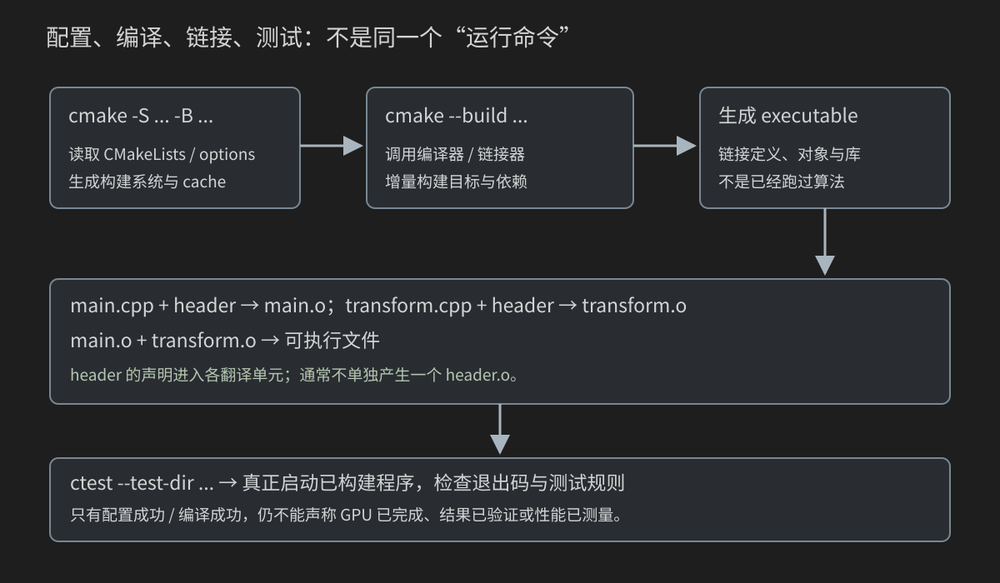
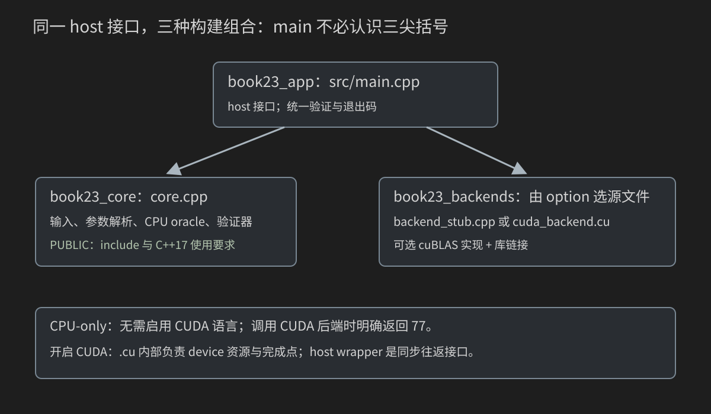
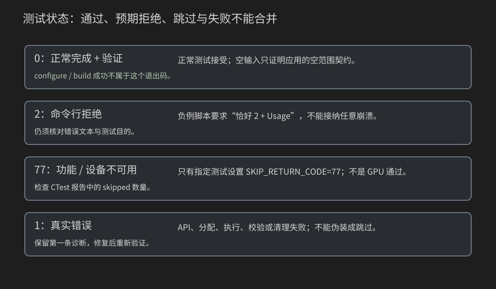

# 23 从单文件到可复现工程：C++/CUDA、CMake、测试与设备链接

能写一个 kernel 后，还需要回答：为什么拆成多个文件就链接失败？为什么 main.cpp 不认识三尖括号？为什么“构建成功”不代表 GPU 跑过？别人怎样在没有你的目录和缓存的机器上复现结果？

本章做四个完整阶段，不先扔一套大型封装：单文件 CPU → 多文件 CPU → 可关闭 CUDA/cuBLAS 的工程 → 真正跨 .cu 的 device 调用。CPU oracle、参数解析、验证器和错误路径始终保留。

用一个已熟悉的小数学任务贯穿：`output[i]=2*input[i]+1`。本章不是优化这个算子的性能，而是教你组织正确实现、依赖与证据。重复公式只为统一各阶段，不重新讲一维索引和 SAXPY 的全部算法。

CMake 示例最低 3.24，C++17；核对了对应版本的官方文档与 NVCC 文档。本机仍没有 g++/nvcc/CMake/GPU，实际配置、编译、CTest、GPU/Sanitizer 都未执行；源码与静态/数学检查不冒充工具链验收。

## 23.0 工程先有契约，再有目录

固定小输入：

```text
input： -2  -0.5   0   1   2
output：-3   0     1   3   5
```

alpha=2、beta=1，没有 ReLU，所以负结果保留。输入只读、输出另放；空范围不访问指针。最终工程使用确定公式生成更长输入，逐项与 double 参考比较。

项目的四层职责：

1. core：输入、解析、CPU 计算、数学参考与验证。
2. backend：完成同一数学任务的 CPU/CUDA/cuBLAS 路径。
3. app：选择后端、报告结果、统一退出状态。
4. tests/build：怎样构建、执行与判定证据。

这是本章的设计，不是所有项目必须照抄的目录标准。每个文件的价值在于职责和依赖清楚，而不是看起来“像大项目”。

## 23.1 阶段一：一个文件包含所有必要部分

文件 `code/23_project/01_single_cpu/main.cpp`：

```cpp
#include <cmath>
#include <cstdlib>
#include <iostream>
#include <vector>

int main() {
    const std::vector<float> input = {-2.0F,-0.5F,0.0F,1.0F,2.0F};
    const std::vector<float> expected = {-3.0F,0.0F,1.0F,3.0F,5.0F};
    std::vector<float> output(input.size());
    for (std::size_t i=0;i<input.size();++i) output[i]=2.0F*input[i]+1.0F;
    for (std::size_t i=0;i<input.size();++i) {
        if (!std::isfinite(output[i]) || output[i]!=expected[i]) return EXIT_FAILURE;
        std::cout << "i=" << i << " input=" << input[i] << " output=" << output[i] << '\n';
    }
    std::cout << "PASS single-file CPU transform and fixed oracle.\n";
    return EXIT_SUCCESS;
}
```

根目录终端：

```bash
g++ -std=c++17 -O2 -Wall -Wextra code/23_project/01_single_cpu/main.cpp -o book23_single
./book23_single
```

程序应打印五项确定结果与 PASS，成功返回 0；这是预期，不是本机实测。main、输入、计算、参考和检查都在一个翻译单元。先能解释这一版，再拆文件；否则只会把不懂的代码分散到更多地方。

为什么保留 expected 而不只打印？打印证明输出过几项，不能自动让错误程序返回失败。后面的测试运行器依赖退出码，因此校验不能在重构时被“清理掉”。

## 23.2 阶段二：声明、定义、使用各放在哪里

创建同一目录中的三个文件。

`02_split_cpu/transform.h`：

```cpp
#ifndef BOOK23_SPLIT_TRANSFORM_H
#define BOOK23_SPLIT_TRANSFORM_H
#include <cstddef>
void transform_cpu(const float* input,float* output,std::size_t n);
#endif
```

这是声明：告诉编译器函数名字、返回类型、参数类型，没有函数体。input/output 是借用的 host 地址；n 是项数，函数不分配、不释放。n=0 时不解引用地址。

`02_split_cpu/transform.cpp`：

```cpp
#include "transform.h"
void transform_cpu(const float* input,float* output,std::size_t n) {
    for (std::size_t i=0;i<n;++i) output[i]=2.0F*input[i]+1.0F;
}
```

这是定义：提供函数体。它也包含 transform.h，让编译器对照声明和实际定义；不是“实现文件已经知道自己函数叫什么，所以不用包含自己的头”。

`02_split_cpu/main.cpp`：

```cpp
#include "transform.h"
#include <cmath>
#include <cstdlib>
#include <iostream>
#include <limits>
#include <vector>

int main() {
    const std::vector<float> input={-2.0F,-0.5F,0.0F,1.0F,2.0F};
    const std::vector<float> expected={-3.0F,0.0F,1.0F,3.0F,5.0F};
    std::vector<float> output(input.size(),std::numeric_limits<float>::quiet_NaN());
    transform_cpu(input.data(),output.data(),input.size());
    for (std::size_t i=0;i<output.size();++i)
        if (!std::isfinite(output[i]) || output[i]!=expected[i]) return EXIT_FAILURE;
    transform_cpu(nullptr,nullptr,0); // Defined empty range: no pointer dereference.
    std::cout << "PASS split CPU: declaration, definition, fixed oracle and empty range.\n";
    return EXIT_SUCCESS;
}
```

main 使用声明来检查调用是否合法。std::vector 拥有两份 host 数组，data() 只借出地址；input.size() 是元素数。输出先 NaN、固定 oracle 与 empty case 都没有因为分文件而消失。

## 23.3 手动分开编译，观察 host 链接

进入阶段二目录后：

```bash
g++ -std=c++17 -O2 -Wall -Wextra -c main.cpp -o main.o
g++ -std=c++17 -O2 -Wall -Wextra -c transform.cpp -o transform.o
g++ main.o transform.o -o book23_split
./book23_split
```

`-c` 表示编译到对象文件，暂不生成最终 executable。main.o 中有 main 的实现和对 transform_cpu 的引用；transform.o 提供那个函数定义。第三条把它们连接，解析引用，形成可运行文件。Windows 常见对象后缀 .obj；这里按 Linux 主线写。

你也可以一条命令：

```bash
g++ -std=c++17 -O2 -Wall -Wextra main.cpp transform.cpp -o book23_split
```

这不是“没有编译阶段”，而是编译驱动替你协调各输入和链接。

故意只传 main.cpp：

```bash
g++ -std=c++17 main.cpp -o book23_missing_definition
```

它可通过调用类型检查，却应在链接阶段报告 transform_cpu 的未定义引用，因为你没把实现交给链接器。与“头文件找不到”不是同一种错误。使用另一个输出名，别覆盖已经成功的程序。

## 23.4 Header guard 不是多文件定义的万能保护

include 主要让一个翻译单元看到声明/类型等内容；普通头文件通常不单独生成 header.o。

guard 的 `#ifndef/#define/#endif` 防止同一翻译单元重复展开头。它不能阻止两个不同 .cpp 各自包含头并各自生成一个非 inline 函数定义。

本章的简单原则：

- 头里放声明；一个 .cpp/.cu 提供对应普通函数定义。
- 同一声明重复包含可以由 guard 处理。
- 模板与合适的 inline 函数可在头中定义，但要满足其规则。
- 不把 transform.cpp include 进 main.cpp 后又单独编译它；那会重复生成定义。
- 每个文件直接包含自己真正需要的声明，不靠碰巧经过另一头间接包含。

完整语言规则参见[C++ 工作草案 ODR](https://eel.is/c++draft/basic.def.odr)。这里的 inline 主要涉及定义/链接规则，不是命令“每次调用必须机器码展开”。

后面的 gpu_utils.h 提供 inline host 辅助函数，被两份 .cu 使用；它们不会因为 header guard 就自动变成一份定义，inline 的规则才是相关原因。

## 23.5 .h、.cuh、.cpp、.cu 与翻译单元

| 文件 | 本章角色 | 编译时如何出现 |
|---|---|---|
| .h | 公共普通 C++ 声明 | 被源文件 include |
| .cuh | CUDA 声明的命名惯例 | 被 CUDA 源文件 include |
| .cpp | host 主程序/数学核心 | 普通 C++ 编译 |
| .cu | kernel 与 CUDA host wrapper | CUDA 编译驱动协调 host/device |
| .o/.obj | 编译产物 | 输入链接阶段 |

后缀是工具链识别和项目约定的一部分，不是自动赋予代码功能。把文件改名 .cu 不会自动让普通函数成为 kernel；把 __global__ 代码放 .h 也不会让所有包含它的 g++ 文件突然认识 CUDA 语法。

一个翻译单元大体是“源文件加上它展开的头”。同一个头的内容可进入多个翻译单元；这正是为何声明与定义要分清。

nvcc 是协调编译/链接的驱动，不等于所有 host/device 阶段只有一个底层编译器。具体轨迹参见[NVCC](https://docs.nvidia.com/cuda/cuda-compiler-driver-nvcc/index.html)。

## 23.6 最小 CMake：目标等价于刚才那条编译命令

阶段二完整 CMakeLists.txt：

```cmake
cmake_minimum_required(VERSION 3.24)
project(book23_split LANGUAGES CXX)
add_executable(book23_split main.cpp transform.cpp)
target_compile_features(book23_split PRIVATE cxx_std_17)
include(CTest)
if(BUILD_TESTING)
  add_test(NAME book23_split COMMAND book23_split)
endif()
```

在教材根目录：

```bash
cmake -S code/23_project/02_split_cpu -B build-book23-split -DCMAKE_BUILD_TYPE=Release
cmake --build build-book23-split --config Release
ctest --test-dir build-book23-split -C Release --output-on-failure
```

逐项对应：

- minimum：声明需要的 CMake 版本，不安装编译器。
- project(... LANGUAGES CXX)：此项目需要 C++，不启用 CUDA。
- add_executable：名为 book23_split 的目标由两份源文件组成。
- target_compile_features：这个目标要求 C++17。
- include(CTest)/add_test：注册运行已构建程序的测试。

不要写 `add_executable(app main.cpp transform.h)` 后以为函数体已经被提供；实现是 transform.cpp。头可以为 IDE 展示而列入源文件表，但这不代替编译实现。

## 23.7 Configure、Generate、Build、Run、Test



`cmake -S ... -B ...` 读取项目描述、发现工具链并生成构建系统；`cmake --build` 调用选定的后端构建工具，协调编译与链接；程序运行才执行算法；ctest 是测试驱动。

CMake 不是 g++/nvcc，也不是“GPU 加速版 make”。generator 决定生成 Ninja、Makefiles、Visual Studio 等构建系统；实际生成器可用 cmake --help 查询。本章先让 CMake 默认选择，preset 部分才明确 Ninja。

source tree 放源码，binary tree 放 cache、构建文件、对象与 executable。建议分离，避免产物混入学习文件。不同工具链/生成器/配置组合使用独立目录；不能在同一个已配置目录随意从 Makefiles 切到 Ninja。

cache 保存配置选项和发现的路径，不是需要提交给别人照抄的源文件。详细边界见[cmake 命令行](https://cmake.org/cmake/help/v3.24/manual/cmake.1.html)。

## 23.8 最终工程的文件关系与公开接口



阶段三：

```text
03_project/
  CMakeLists.txt
  CMakePresets.json
  include/
    core.h
    backend.h
    gpu_utils.h
  src/
    core.cpp
    main.cpp
    backend_stub.cpp
    cuda_backend.cu
    cublas_backend.cu
    cublas_stub.cpp
  tests/
    test_core.cpp
    header_self_contained.cpp
    reject_cli.cmake
```

core.h：

```cpp
#ifndef BOOK23_CORE_H
#define BOOK23_CORE_H
#include <cstddef>
#include <string>
#include <vector>

namespace book23 {
bool parse_unsigned(const char* text,int maximum,int& result);
std::vector<float> make_input(std::size_t n,int seed);
std::vector<double> reference(const std::vector<float>& input,float alpha,float beta);
std::vector<float> transform_cpu(const std::vector<float>& input,float alpha,float beta);
bool verify(const std::vector<float>& actual,const std::vector<double>& expected,std::string& message);
}
#endif
```

backend.h：

```cpp
#ifndef BOOK23_BACKEND_H
#define BOOK23_BACKEND_H
#include <string>
#include <vector>

namespace book23 {
// Synchronous host interface: input/output are host vectors, not device pointers.
// 0: completed; 1: real failure; 77: backend unavailable.
// Output is valid only on success. Neither function changes input.
int transform_cuda(const std::vector<float>& input,std::vector<float>& output,
                   float alpha,float beta,std::string& detail);
int transform_cublas(const std::vector<float>& input,std::vector<float>& output,
                     float alpha,float beta,std::string& detail);
}
#endif
```

两份公共头只依赖普通 C++ 类型，main.cpp 因而不需要 CUDA 语法。backend 函数是同步 host 往返接口：内部完成上传、计算、回传、等待和资源收尾；返回 0 后 output 才可读取。不能因为内部有 Async API 就称公共接口异步。

状态 0 表示后端执行完成，不替代 main 的数学验证；1 是真实错误，77 是不可用。输入 host vector 只读，输出由调用方持有。纯 host 接口也有代价：它不适合直接组合高吞吐 device-resident 流水线，这个选择是为了先学工程分层。

## 23.9 CPU core 和 oracle 没有被重构删掉

完整 core.cpp：

```cpp
#include "core.h"
#include <charconv>
#include <cmath>
#include <system_error>

namespace book23 {
bool parse_unsigned(const char* text,int maximum,int& result) {
    if (!text || !*text) return false;
    const char* end=text;
    while (*end) { if (*end<'0' || *end>'9') return false; ++end; }
    int candidate=0;
    const auto parsed=std::from_chars(text,end,candidate);
    if (parsed.ec!=std::errc{} || parsed.ptr!=end || candidate<0 || candidate>maximum) return false;
    result=candidate; return true;
}
std::vector<float> make_input(std::size_t n,int seed) {
    std::vector<float> input(n);
    for (std::size_t i=0;i<n;++i)
        input[i]=static_cast<float>(static_cast<int>((i*17+static_cast<std::size_t>(seed))%31)-15)/8.0F;
    return input;
}
std::vector<double> reference(const std::vector<float>& input,float alpha,float beta) {
    std::vector<double> expected(input.size());
    for (std::size_t i=0;i<input.size();++i)
        expected[i]=static_cast<double>(alpha)*static_cast<double>(input[i])+static_cast<double>(beta);
    return expected;
}
std::vector<float> transform_cpu(const std::vector<float>& input,float alpha,float beta) {
    std::vector<float> output(input.size());
    for (std::size_t i=0;i<input.size();++i) output[i]=alpha*input[i]+beta;
    return output;
}
bool verify(const std::vector<float>& actual,const std::vector<double>& expected,std::string& message) {
    message.clear();
    if (actual.size()!=expected.size()) { message="output length mismatch"; return false; }
    for (std::size_t i=0;i<actual.size();++i) {
        if (!std::isfinite(actual[i]) || !std::isfinite(expected[i]) ||
            static_cast<double>(actual[i])!=expected[i]) {
            message="output mismatch at index "+std::to_string(i); return false;
        }
    }
    return true;
}
}
```

make_input 用公式产生 [-15,15]/8 的确定数值。seed 是公式的偏移参数，不是随机库状态，不声称输入是统计随机数。n<=16,777,216、seed<=65,535 是 CLI 契约。

CPU 实现计算 float；reference 用 double 对相同实际 input 算数学结果；verify 检查长度、finite 与数值等价。因为 alpha=2/beta=1、输入小且 dyadic，本例可以精确比较；不是把所有十进制 CUDA 运算都要求等于 double。

parse_unsigned 明确拒绝空串、符号、非数字、溢出和范围外值。接口声明与实现必须一起链接；不能只保留 core.h 就认为数学模块完整。

## 23.10 主程序只负责组织与统一判定

完整 main.cpp：

```cpp
#include "core.h"
#include "backend.h"
#include <exception>
#include <iostream>
#include <limits>

#ifndef BOOK23_BUILD_LABEL
#define BOOK23_BUILD_LABEL "manual"
#endif

int main(int argc,char** argv) {
    try {
        int n=1031,seed=7;
        const std::string backend=argc>2?argv[2]:"cpu";
        if (argc>4 || (argc>1 && !book23::parse_unsigned(argv[1],16777216,n)) ||
            (argc>3 && !book23::parse_unsigned(argv[3],65535,seed)) ||
            (backend!="cpu" && backend!="cuda" && backend!="cublas")) {
            std::cerr << "Usage: book23_app [n:0..16777216] [cpu|cuda|cublas] [seed:0..65535]\n";
            return 2;
        }
        const float alpha=2.0F,beta=1.0F;
        const auto input=book23::make_input(static_cast<std::size_t>(n),seed);
        const auto before=input;
        const auto expected=book23::reference(input,alpha,beta);
        std::vector<float> output(input.size(),std::numeric_limits<float>::quiet_NaN());
        std::string detail;
        std::cout << "build=" << BOOK23_BUILD_LABEL << " backend=" << backend
                  << " n=" << n << " seed=" << seed << " alpha=2 beta=1\n";
        if (n==0) { std::cout << "PASS empty contract; no backend execution.\n"; return 0; }
        int status=0;
        if (backend=="cpu") { output=book23::transform_cpu(input,alpha,beta); detail="host computation"; }
        else if (backend=="cuda") status=book23::transform_cuda(input,output,alpha,beta,detail);
        else status=book23::transform_cublas(input,output,alpha,beta,detail);
        if (status==77) { std::cout << "NOT RUN: " << detail << '\n'; return 77; }
        if (status!=0) { std::cerr << "FAIL backend: " << detail << '\n'; return 1; }
        std::string problem;
        if (!book23::verify(output,expected,problem) || input!=before) {
            std::cerr << "FAIL validation: " << problem << '\n'; return 1;
        }
        std::cout << "PASS complete output and immutable input; " << detail << '\n'; return 0;
    } catch (const std::exception& error) {
        std::cerr << "FAIL C++ exception: " << error.what() << '\n'; return 1;
    }
}
```

默认 `1031 cpu 7`。例如 `book23_app 257 cuda 7`，257 是项数、cuda 是后端名字、7 是 seed。三者不是 kernel 参数的自然语言排列，而是你自己定义的 CLI。

读以下分支：

1. 参数不合法：先打印 Usage，返回 2，不探测 GPU。
2. 生成 input、snapshot、oracle 和 NaN output。
3. n=0：检查应用空契约，不启动任何后端。
4. 后端 77：打印 NOT RUN，不拿未计算的 output 验证。
5. 后端失败：报告真实错误，返回 1。
6. 成功后仍逐项验证并检查 host input 不变，才打印 PASS。

BOOK23_BUILD_LABEL 是构建注入的字符串；手动编译未注入时用 manual。它报告你选择的配置，不证明每个底层 flags 都如你想象，仍应查看 verbose 构建。

## 23.11 Stub 让 CPU-only 真正不依赖 CUDA

CUDA 全部关闭时编译 backend_stub.cpp：

```cpp
#include "backend.h"
namespace book23 {
int transform_cuda(const std::vector<float>&,std::vector<float>&,float,float,std::string& detail) {
    detail="CUDA backend was not built"; return 77;
}
int transform_cublas(const std::vector<float>&,std::vector<float>&,float,float,std::string& detail) {
    detail="cuBLAS backend was not built"; return 77;
}
}
```

开启 CUDA、关闭 cuBLAS 时只补 cublas_stub.cpp：

```cpp
#include "backend.h"
namespace book23 {
int transform_cublas(const std::vector<float>&,std::vector<float>&,float,float,std::string& detail) {
    detail="cuBLAS backend was not built"; return 77;
}
}
```

stub 是提供相同 host 接口、明确说明功能未构建的实现，不是偷偷计算 CPU 并冒充 GPU。一个构建组合只能选择正确的一组定义；若同时编译真实 CUDA 实现和同名 stub，就会产生重复定义。

CPU-only 工程既不启用 CUDA language，也不找 CUDAToolkit/链接 cudart。执行 cpu 路径不会调用 GPU 探测。主程序仍可以接受 cuda 字符串，但会清楚返回 77。

“禁用 GPU”不应只是把 kernel launch 注释掉，却保留一堆 cudaMalloc 和 CUDA 头依赖。这是 option 必须组织完整依赖图的原因。

## 23.12 内部 GPU helper：资源收尾也属于正确性

gpu_utils.h 只由 .cu 使用：

```cpp
#ifndef BOOK23_GPU_UTILS_H
#define BOOK23_GPU_UTILS_H
#include <cuda_runtime.h>
#include <string>

namespace book23 {
inline bool runtime_ok(cudaError_t status,const char* operation,std::string& error) {
    if (status==cudaSuccess) return true;
    if (error.empty()) error=std::string(operation)+": "+cudaGetErrorString(status);
    return false;
}
inline int probe_gpu(std::string& detail) {
    int count=0;
    const cudaError_t status=cudaGetDeviceCount(&count);
    if (status==cudaErrorNoDevice || status==cudaErrorInsufficientDriver ||
        (status==cudaSuccess && count==0)) {
        detail="no usable CUDA device/driver"; return 77;
    }
    if (!runtime_ok(status,"device count",detail)) return 1;
    cudaDeviceProp prop{};
    if (!runtime_ok(cudaGetDeviceProperties(&prop,0),"device properties",detail)) return 1;
    detail=prop.name; return 0;
}
// Caller has already attempted stream completion. Every release is attempted,
// even if a preceding release fails; the FIRST diagnostic is retained.
inline bool free_resources(float* input,float* output,cudaStream_t stream,std::string& error) {
    bool ok=true;
    if (output) ok=runtime_ok(cudaFree(output),"free output",error)&&ok;
    if (input) ok=runtime_ok(cudaFree(input),"free input",error)&&ok;
    if (stream) ok=runtime_ok(cudaStreamDestroy(stream),"destroy stream",error)&&ok;
    return ok;
}
}
#endif
```

probe_gpu 只把明确的无设备/驱动不可用分支标 77；其他初始化/查询错误是 1。不能把所有 CUDA 错误都叫“没 GPU”。

runtime_ok 返回 bool 并保存第一条诊断，而不是立即 exit；wrapper 因而能走统一收尾路径。free_resources 中调用检查在 `&&ok` 左边，即使 ok 已为 false，释放动作仍被尝试。

正常与可预期 API 失败路径都尝试完成/释放资源；这些代码没有声称提供所有 C++ 异常下的强异常安全保证。进一步封装所有权时回看第 8 章 RAII，先理解这份显式路径，再抽象。

## 23.13 CUDA wrapper：调用返回时已完成的完整 .cu

cuda_backend.cu：

```cpp
#include "backend.h"
#include "gpu_utils.h"
#include <limits>
#include <vector>

namespace {
__global__ void affine_kernel(const float* input,float* output,int n,float alpha,float beta) {
    const int i=blockIdx.x*blockDim.x+threadIdx.x;
    if (i<n) output[i]=alpha*input[i]+beta;
}
}
namespace book23 {
int transform_cuda(const std::vector<float>& input,std::vector<float>& output,
                   float alpha,float beta,std::string& detail) {
    if (input.empty()) { output.clear(); detail="empty; no GPU work"; return 0; }
    if (input.size()>16777216) { detail="backend input exceeds contract"; return 1; }
    std::string gpu;
    const int probe=probe_gpu(gpu);
    if (probe!=0) { detail=gpu; return probe; }
    detail.clear();
    const int n=static_cast<int>(input.size());
    const std::size_t bytes=input.size()*sizeof(float);
    output.assign(input.size(),std::numeric_limits<float>::quiet_NaN());
    std::vector<float> after(input.size());
    float *di=nullptr,*dout=nullptr; cudaStream_t stream{};
    bool ok=false;
    do {
        if (!runtime_ok(cudaStreamCreateWithFlags(&stream,cudaStreamNonBlocking),"create stream",detail)) break;
        if (!runtime_ok(cudaMalloc(&di,bytes),"allocate input",detail)) break;
        if (!runtime_ok(cudaMalloc(&dout,bytes),"allocate output",detail)) break;
        if (!runtime_ok(cudaMemcpyAsync(di,input.data(),bytes,cudaMemcpyHostToDevice,stream),"H2D input",detail)) break;
        if (!runtime_ok(cudaMemsetAsync(dout,0xFF,bytes,stream),"output sentinel",detail)) break;
        affine_kernel<<<(n+255)/256,256,0,stream>>>(di,dout,n,alpha,beta);
        if (!runtime_ok(cudaGetLastError(),"kernel launch",detail)) break;
        if (!runtime_ok(cudaMemcpyAsync(output.data(),dout,bytes,cudaMemcpyDeviceToHost,stream),"D2H output",detail)) break;
        if (!runtime_ok(cudaMemcpyAsync(after.data(),di,bytes,cudaMemcpyDeviceToHost,stream),"D2H input snapshot",detail)) break;
        if (!runtime_ok(cudaStreamSynchronize(stream),"wait for result",detail)) break;
        if (after!=input) { detail="device input changed"; break; }
        ok=true;
    } while (false);
    if (stream) ok=runtime_ok(cudaStreamSynchronize(stream),"cleanup wait",detail)&&ok;
    ok=free_resources(di,dout,stream,detail)&&ok;
    if (ok) detail="GPU="+gpu+"; synchronous CUDA roundtrip";
    return ok?0:1;
}
}
```

kernel 与启动 wrapper 位于同一个翻译单元，没有跨 .cu 的 device 函数调用。因此普通 host 多文件链接已经足够，不因“项目有多份源文件”就开启 RDC。

步骤是探测→分配→H2D→sentinel→kernel→D2H 输出/输入快照→完成→验证输入未变→清理。最后一次 cleanup wait 在错误路径也会尝试保护尚未完成的借用，不能用“Destroy 后反正结束”替代完成点。

output 的 host 存储由 vector 管，device 存储属于 wrapper。malloc、copy、launch、执行、清理都可能报错，最终状态保持失败；这不是只有一条 kernel launch 的零开销函数。

## 23.14 可选 cuBLAS backend：同一个 host 契约

cublas_backend.cu：

```cpp
#include "backend.h"
#include "gpu_utils.h"
#include <cublas_v2.h>
#include <vector>

namespace {
bool blas_ok(cublasStatus_t status,const char* operation,std::string& error) {
    if (status==CUBLAS_STATUS_SUCCESS) return true;
    if (error.empty()) error=std::string(operation)+": cuBLAS status="+std::to_string(static_cast<int>(status));
    return false;
}
}
namespace book23 {
int transform_cublas(const std::vector<float>& input,std::vector<float>& output,
                     float alpha,float beta,std::string& detail) {
    if (input.empty()) { output.clear(); detail="empty; no cuBLAS work"; return 0; }
    if (input.size()>16777216) { detail="backend input exceeds contract"; return 1; }
    std::string gpu;
    const int probe=probe_gpu(gpu);
    if (probe!=0) { detail=gpu; return probe; }
    detail.clear();
    const int n=static_cast<int>(input.size());
    const std::size_t bytes=input.size()*sizeof(float);
    std::vector<float> old_output(input.size(),beta),after(input.size());
    output.resize(input.size());
    float *di=nullptr,*dout=nullptr; cudaStream_t stream{}; cublasHandle_t handle{};
    bool ok=false;
    do {
        if (!runtime_ok(cudaStreamCreateWithFlags(&stream,cudaStreamNonBlocking),"create stream",detail)) break;
        if (!runtime_ok(cudaMalloc(&di,bytes),"allocate input",detail)) break;
        if (!runtime_ok(cudaMalloc(&dout,bytes),"allocate output",detail)) break;
        if (!runtime_ok(cudaMemcpyAsync(di,input.data(),bytes,cudaMemcpyHostToDevice,stream),"H2D input",detail)) break;
        if (!runtime_ok(cudaMemcpyAsync(dout,old_output.data(),bytes,cudaMemcpyHostToDevice,stream),"H2D beta values",detail)) break;
        if (!blas_ok(cublasCreate(&handle),"create handle",detail)) break;
        if (!blas_ok(cublasSetStream(handle,stream),"bind stream",detail)) break;
        if (!blas_ok(cublasSetPointerMode(handle,CUBLAS_POINTER_MODE_HOST),"scalar mode",detail)) break;
        if (!blas_ok(cublasSaxpy(handle,n,&alpha,di,1,dout,1),"SAXPY",detail)) break;
        if (!runtime_ok(cudaGetLastError(),"library launch state",detail)) break;
        if (!runtime_ok(cudaMemcpyAsync(output.data(),dout,bytes,cudaMemcpyDeviceToHost,stream),"D2H output",detail)) break;
        if (!runtime_ok(cudaMemcpyAsync(after.data(),di,bytes,cudaMemcpyDeviceToHost,stream),"D2H input snapshot",detail)) break;
        if (!runtime_ok(cudaStreamSynchronize(stream),"wait for result",detail)) break;
        if (after!=input) { detail="device input changed"; break; }
        ok=true;
    } while (false);
    if (stream) ok=runtime_ok(cudaStreamSynchronize(stream),"cleanup wait",detail)&&ok;
    if (handle) ok=blas_ok(cublasDestroy(handle),"destroy handle",detail)&&ok;
    ok=free_resources(di,dout,stream,detail)&&ok;
    if (ok) detail="GPU="+gpu+"; synchronous cuBLAS roundtrip";
    return ok?0:1;
}
}
```

AXPY 算 `dout=alpha*di+dout`，所以先把 dout 初始化为 beta 的 n 项合法值，得到同一 `alpha*x+beta`。这里不能把 dout 全设 NaN 当输入；这个规则只短回顾第 22 章。

cublasStatus_t 和 cudaError_t 分开处理。handle 与 stream 配置在实现里，main 不需要认识它们。路径结束前等待 stream，再销毁 handle 与数组；不靠异常吞掉清理错误。

此 backend 也是教学正确性往返，并不宣称优于单 kernel。上传 beta 数组、handle 创建等开销都真实存在；工程分层不意味着性能对照可以忽略它们。

## 23.15 最终完整 CMakeLists：三种构建组合

阶段三完整 CMakeLists.txt：

```cmake
cmake_minimum_required(VERSION 3.24)
project(book23_project LANGUAGES CXX)
option(BOOK23_ENABLE_CUDA "Build CUDA backend" OFF)
option(BOOK23_ENABLE_CUBLAS "Build optional cuBLAS backend" OFF)
option(BOOK23_DEVICE_DEBUG "Add -G for CUDA Debug configurations" OFF)
include(CTest)

add_library(book23_core STATIC src/core.cpp)
target_include_directories(book23_core PUBLIC "${CMAKE_CURRENT_SOURCE_DIR}/include")
target_compile_features(book23_core PUBLIC cxx_std_17)

if(BOOK23_ENABLE_CUBLAS AND NOT BOOK23_ENABLE_CUDA)
  message(FATAL_ERROR "BOOK23_ENABLE_CUBLAS requires BOOK23_ENABLE_CUDA")
endif()
if(BOOK23_ENABLE_CUDA)
  if(NOT DEFINED CMAKE_CUDA_ARCHITECTURES OR "${CMAKE_CUDA_ARCHITECTURES}" STREQUAL "")
    message(FATAL_ERROR "Set CMAKE_CUDA_ARCHITECTURES from verified GPU/toolkit support")
  endif()
  enable_language(CUDA)
  find_package(CUDAToolkit REQUIRED)
  add_library(book23_backends STATIC src/cuda_backend.cu)
  target_link_libraries(book23_backends PRIVATE CUDA::cudart)
  set_target_properties(book23_backends PROPERTIES
    CUDA_STANDARD 17 CUDA_STANDARD_REQUIRED ON CUDA_RUNTIME_LIBRARY Shared)
  target_compile_options(book23_backends PRIVATE $<$<COMPILE_LANGUAGE:CUDA>:-lineinfo>)
  if(BOOK23_DEVICE_DEBUG)
    target_compile_options(book23_backends PRIVATE
      $<$<AND:$<COMPILE_LANGUAGE:CUDA>,$<CONFIG:Debug>>:-G>)
  endif()
  if(BOOK23_ENABLE_CUBLAS)
    target_sources(book23_backends PRIVATE src/cublas_backend.cu)
    target_link_libraries(book23_backends PRIVATE CUDA::cublas)
  else()
    target_sources(book23_backends PRIVATE src/cublas_stub.cpp)
  endif()
else()
  add_library(book23_backends STATIC src/backend_stub.cpp)
endif()
target_include_directories(book23_backends PUBLIC "${CMAKE_CURRENT_SOURCE_DIR}/include")
target_compile_features(book23_backends PUBLIC cxx_std_17)
add_executable(book23_app src/main.cpp)
target_link_libraries(book23_app PRIVATE book23_core book23_backends)
target_compile_definitions(book23_app PRIVATE "BOOK23_BUILD_LABEL=\"$<CONFIG>\"")
if(BOOK23_ENABLE_CUDA)
  set_target_properties(book23_app PROPERTIES CUDA_RUNTIME_LIBRARY Shared)
endif()

if(BUILD_TESTING)
  add_executable(book23_test_core tests/test_core.cpp)
  target_link_libraries(book23_test_core PRIVATE book23_core)
  add_executable(book23_header_check tests/header_self_contained.cpp)
  target_link_libraries(book23_header_check PRIVATE book23_core)
  add_test(NAME book23_core COMMAND book23_test_core)
  add_test(NAME book23_header COMMAND book23_header_check)
  set_tests_properties(book23_core book23_header PROPERTIES LABELS cpu)
  foreach(n 0 1 255 256 257 1031)
    add_test(NAME book23_cpu_${n} COMMAND book23_app ${n} cpu 7)
    set_tests_properties(book23_cpu_${n} PROPERTIES LABELS cpu)
  endforeach()
  foreach(backend cuda cublas)
    foreach(n 1 257 1031)
      add_test(NAME book23_${backend}_${n} COMMAND book23_app ${n} ${backend} 7)
      set_tests_properties(book23_${backend}_${n} PROPERTIES
        LABELS gpu SKIP_RETURN_CODE 77 RUN_SERIAL TRUE TIMEOUT 60)
    endforeach()
  endforeach()
  foreach(case negative backend seed range)
    add_test(NAME book23_reject_${case}
      COMMAND "${CMAKE_COMMAND}" "-DAPP=$<TARGET_FILE:book23_app>" "-DCASE=${case}"
      -P "${CMAKE_CURRENT_SOURCE_DIR}/tests/reject_cli.cmake")
    set_tests_properties(book23_reject_${case} PROPERTIES LABELS cpu)
  endforeach()
endif()
```

阅读顺序：

- 总是构建 book23_core。
- cuBLAS=ON/CUDA=OFF 是矛盾配置，明确拒绝。
- CUDA=ON 才启用语言、找 Toolkit、构建真实 CUDA backend。
- cuBLAS 关闭时补对应 stub；全 CUDA 关闭时使用双 stub。
- app 只链接 core 与 backends；测试 core 不链接 backends。
- GPU 测试设置 77 跳过；拒绝测试交给专用脚本，不反转任意错误。

这些目标组成一个依赖图。CMake 用它决定编译、链接及使用要求，不需要你全局给所有目标塞相同 flags。构建系统模型见[CMake buildsystem](https://cmake.org/cmake/help/v3.24/manual/cmake-buildsystem.7.html)。

## 23.16 PUBLIC、PRIVATE、INTERFACE 与库依赖

| 设置 | 对本目标 | 对使用本目标者 |
|---|---|---|
| PRIVATE | 使用 | 不传播为一般使用要求 |
| PUBLIC | 使用 | 传播 |
| INTERFACE | 本目标不使用 | 传播 |

core 的公共头必须让 app/tests 找到，所以 include 路径与 C++17 使用要求是 PUBLIC；CUDA-only lineinfo 是 backend 的 PRIVATE 编译选项。

STATIC 库的 PRIVATE 链接依赖还可能以 link-only 形式传递到最终链接；“PRIVATE”不是“最终 executable 不需要任何这份库的链接依赖”。以生成的实际链接命令为准。

CUDA::cudart、CUDA::cublas 是 imported targets，不是你自己写的文件名。find_package 提供包含路径/库位置等使用信息，target_link_libraries 连接依赖；它不安装 CUDA，也不证明驱动可运行。见[FindCUDAToolkit](https://cmake.org/cmake/help/v3.24/module/FindCUDAToolkit.html)、[link libraries](https://cmake.org/cmake/help/v3.24/command/target_link_libraries.html)。

本例统一选择 Shared CUDA Runtime，避免一边按 shared imported target、一边不加说明地混用不同 runtime 选择；其属性含义见[CUDA_RUNTIME_LIBRARY](https://cmake.org/cmake/help/v3.24/prop_tgt/CUDA_RUNTIME_LIBRARY.html)。

## 23.17 先配置 CPU-only：无 GPU 也能学项目

根目录：

```bash
cmake -S code/23_project/03_project -B build-book23-cpu -DCMAKE_BUILD_TYPE=Release -DBOOK23_ENABLE_CUDA=OFF -DBOOK23_ENABLE_CUBLAS=OFF
cmake --build build-book23-cpu --config Release
ctest --test-dir build-book23-cpu -C Release --output-on-failure
```

Linux 单配置构建后一般：

```bash
./build-book23-cpu/book23_app 1031 cpu 7
./build-book23-cpu/book23_app 257 cuda 7
```

第二条应返回 77，并说明 CUDA 未构建。它不是数值失败，也不是 GPU 成功。多配置 Windows 构建常从 `build-book23-cpu/Release/book23_app.exe` 运行，具体以 generator 产物位置为准。

CPU-only 的六个正 n GPU 测试应 skipped，CPU/拒绝检查仍能执行。CTest 汇总“没有失败”时也要看 skipped 数量；不能据此说整套 GPU 测试通过。

## 23.18 启用 CUDA/cuBLAS 时先确认架构

下面仅在第 2 章查询确认 GPU 的 compute capability 为 8.0、且当前 nvcc 支持 sm_80 时使用示例数字 80。你的 GPU 不符合这个条件时，先替换架构，不复制数字。

```bash
cmake -S code/23_project/03_project -B build-book23-cuda -DCMAKE_BUILD_TYPE=Release -DBOOK23_ENABLE_CUDA=ON -DBOOK23_ENABLE_CUBLAS=OFF -DCMAKE_CUDA_ARCHITECTURES=80
cmake --build build-book23-cuda --config Release --verbose
ctest --test-dir build-book23-cuda -C Release --output-on-failure
cmake -S code/23_project/03_project -B build-book23-cublas -DCMAKE_BUILD_TYPE=Release -DBOOK23_ENABLE_CUDA=ON -DBOOK23_ENABLE_CUBLAS=ON -DCMAKE_CUDA_ARCHITECTURES=80
cmake --build build-book23-cublas --config Release
ctest --test-dir build-book23-cublas -C Release --output-on-failure
```

CUDA-only 组合中 cuBLAS 测试仍 skip；真正有可用 GPU 的全开启组合才应跑两后端。没有驱动/设备但工具链可编译时，也可能构建成功、运行 skip。

主机编译器和 nvcc 的 host compiler 必须兼容。需要明确指定时，在新的 build tree 初次配置前设置 CMAKE_CXX_COMPILER/CMAKE_CUDA_HOST_COMPILER，不在已有 cache 随意替换。规则见[CUDA host compiler](https://cmake.org/cmake/help/v3.24/variable/CMAKE_CUDA_HOST_COMPILER.html)。

## 23.19 测试 CPU core 与验证器本身

tests/test_core.cpp：

```cpp
#include "core.h"
#include <cstdlib>
#include <iostream>
#include <limits>

int main() {
    for (std::size_t n : {0U,1U,7U,255U,256U,257U,1031U}) for (int seed : {0,7,65535}) {
        const auto input=book23::make_input(n,seed),snapshot=input;
        const auto expected=book23::reference(input,2.0F,1.0F);
        const auto output=book23::transform_cpu(input,2.0F,1.0F);
        std::string detail;
        if (!book23::verify(output,expected,detail) || input!=snapshot) return EXIT_FAILURE;
    }
    int value=0;
    for (const char* bad : {"","-1","-0","+1","1x","16777217","999999999999999999999"})
        if (book23::parse_unsigned(bad,16777216,value)) return EXIT_FAILURE;
    if (!book23::parse_unsigned("001",16777216,value) || value!=1) return EXIT_FAILURE;
    const std::vector<double> expected={1};
    std::string problem;
    if (book23::verify({},expected,problem) || problem.empty()) return EXIT_FAILURE;
    if (book23::verify({std::numeric_limits<float>::quiet_NaN()},expected,problem)) return EXIT_FAILURE;
    if (book23::verify({2.0F},expected,problem)) return EXIT_FAILURE;
    std::cout << "PASS CPU core, parser, sizes, finite check and negative checker cases.\n";
    return EXIT_SUCCESS;
}
```

它不仅测试数学正常值，还故意把错误数据送给 verify，确认验证器会拒绝长度不符、NaN、错误值。这里不制造 GPU 错误；“验证器能识别错误”也需要测试。

tests/header_self_contained.cpp：

```cpp
#include "core.h"
#include "core.h"
int main() {
    const std::vector<float> actual;
    const std::vector<double> expected;
    std::string message;
    return book23::verify(actual,expected,message)?0:1;
}
```

只 include core.h，而且重复 include 一次，核对它自包含、guard 有效、公共类型可用。它仍链接 core 定义，因为 header 声明不会替代 verify 函数体。

这是维护多文件接口的基础测试，不靠另一份“大头文件”碰巧提供 std::vector 声明。

## 23.20 拒绝、跳过、失败的自动判定



tests/reject_cli.cmake：

```cmake
if(NOT DEFINED APP OR NOT DEFINED CASE)
  message(FATAL_ERROR "APP and CASE are required")
endif()
if(CASE STREQUAL "negative")
  set(arguments -1 cpu 7)
elseif(CASE STREQUAL "backend")
  set(arguments 10 unknown 7)
elseif(CASE STREQUAL "seed")
  set(arguments 10 cpu -1)
elseif(CASE STREQUAL "range")
  set(arguments 16777217 cpu 7)
else()
  message(FATAL_ERROR "Unknown rejection case")
endif()
execute_process(COMMAND "${APP}" ${arguments}
  RESULT_VARIABLE result OUTPUT_VARIABLE output ERROR_VARIABLE error TIMEOUT 15)
if(NOT "${result}" STREQUAL "2" OR NOT error MATCHES "Usage:")
  message(FATAL_ERROR "Expected exit 2 and Usage; result=${result}; stdout=${output}; stderr=${error}")
endif()
message(STATUS "PASS exact rejection: ${CASE}")
```

这个文件是 CMake 脚本，不是 Python，也不是 GPU kernel。execute_process 直接启动 APP，不通过额外 shell 拼接命令；读取真实退出状态和 stderr。要求恰好 2 且含 Usage，超时、找不到 executable 或 GPU 崩溃都不会被接受。

WILL_FAIL 可以反转普通非零退出的测试判定，但不能精确保证“因为参数拒绝而失败”，有些系统级异常也不受这种简单反转保护。因此本章改用明确脚本，不将全书旧测试全盘否定。

77 只有指定 SKIP_RETURN_CODE 的测试才视为 skip；其他地方的 77 不自动变成通过。范围见[SKIP_RETURN_CODE](https://cmake.org/cmake/help/v3.24/prop_test/SKIP_RETURN_CODE.html)、[WILL_FAIL](https://cmake.org/cmake/help/v3.24/prop_test/WILL_FAIL.html)、[execute_process](https://cmake.org/cmake/help/v3.24/command/execute_process.html)。

## 23.21 阶段四：真正需要 device link 的六个文件

之前的多文件只是在 host 调用另一个源文件的 wrapper。本阶段不同：launch.cu 的 kernel 调用 device_math.cu 定义的 __device__ 函数。

device_math.cuh：

```cpp
#ifndef BOOK23_DEVICE_MATH_CUH
#define BOOK23_DEVICE_MATH_CUH
__device__ float device_affine(float value);
#endif
```

device_math.cu：

```cpp
#include "device_math.cuh"
__device__ float device_affine(float value) { return 2.0F*value+1.0F; }
```

launch.h：

```cpp
#ifndef BOOK23_DEVICE_LAUNCH_H
#define BOOK23_DEVICE_LAUNCH_H
#include <cuda_runtime.h>
cudaError_t launch_device_math(float* values,int n,cudaStream_t stream);
#endif
```

launch.cu：

```cpp
#include "launch.h"
#include "device_math.cuh"
namespace {
__global__ void apply(float* values,int n) {
    const int i=blockIdx.x*blockDim.x+threadIdx.x;
    if (i<n) values[i]=device_affine(values[i]);
}
}
cudaError_t launch_device_math(float* values,int n,cudaStream_t stream) {
    apply<<<(n+127)/128,128,0,stream>>>(values,n);
    return cudaGetLastError();
}
```

main.cpp：

```cpp
#include "launch.h"
#include <cmath>
#include <iostream>
#include <vector>

bool check(cudaError_t status,const char* operation) {
    if(status==cudaSuccess) return true;
    std::cerr << operation << ": " << cudaGetErrorString(status) << '\n'; return false;
}
int main() {
    int count=0;const cudaError_t probe=cudaGetDeviceCount(&count);
    if(probe==cudaErrorNoDevice || probe==cudaErrorInsufficientDriver || (probe==cudaSuccess && count==0)) {
        std::cout << "NOT RUN: no usable CUDA device/driver.\n";return 77;
    }
    if(!check(probe,"device count")) return 1;
    constexpr int n=7;std::vector<float> input(n),output(n);
    for(int i=0;i<n;++i) input[i]=static_cast<float>(i-3)/4.0F;
    float* device=nullptr;cudaStream_t stream{};bool ok=false;
    do {
        if(!check(cudaStreamCreateWithFlags(&stream,cudaStreamNonBlocking),"create stream")) break;
        if(!check(cudaMalloc(&device,n*sizeof(float)),"allocate")) break;
        if(!check(cudaMemcpyAsync(device,input.data(),n*sizeof(float),cudaMemcpyHostToDevice,stream),"upload")) break;
        if(!check(launch_device_math(device,n,stream),"launch")) break;
        if(!check(cudaMemcpyAsync(output.data(),device,n*sizeof(float),cudaMemcpyDeviceToHost,stream),"download")) break;
        if(!check(cudaStreamSynchronize(stream),"wait")) break;
        ok=true;
        for(int i=0;i<n;++i)
            if(!std::isfinite(output[i]) || output[i]!=2.0F*input[i]+1.0F) ok=false;
    } while(false);
    if(stream) ok=check(cudaStreamSynchronize(stream),"cleanup wait")&&ok;
    if(device) ok=check(cudaFree(device),"free")&&ok;
    if(stream) ok=check(cudaStreamDestroy(stream),"destroy stream")&&ok;
    if(!ok) return 1;
    std::cout << "PASS real cross-.cu device call, all seven results checked.\n";return 0;
}
```

完整 CMakeLists.txt：

```cmake
cmake_minimum_required(VERSION 3.24)
if(NOT DEFINED CMAKE_CUDA_ARCHITECTURES OR "${CMAKE_CUDA_ARCHITECTURES}" STREQUAL "")
  message(FATAL_ERROR "Set verified CMAKE_CUDA_ARCHITECTURES")
endif()
project(book23_device_link LANGUAGES CXX CUDA)
find_package(CUDAToolkit REQUIRED)
add_executable(book23_device_link main.cpp launch.cu device_math.cu)
target_compile_features(book23_device_link PRIVATE cxx_std_17)
target_link_libraries(book23_device_link PRIVATE CUDA::cudart)
set_target_properties(book23_device_link PROPERTIES
  CUDA_STANDARD 17 CUDA_STANDARD_REQUIRED ON
  CUDA_SEPARABLE_COMPILATION ON CUDA_RUNTIME_LIBRARY Shared)
target_compile_options(book23_device_link PRIVATE $<$<COMPILE_LANGUAGE:CUDA>:-lineinfo>)
include(CTest)
if(BUILD_TESTING)
  add_test(NAME book23_device_link COMMAND book23_device_link)
  set_tests_properties(book23_device_link PROPERTIES SKIP_RETURN_CODE 77 RUN_SERIAL TRUE TIMEOUT 60)
endif()
```

main.cpp 的 launch.h 故意暴露 cudaError_t/cudaStream_t，所以它需要 Runtime 头与库；与阶段三的纯 host 公共接口是两种取舍。别宣称所有 .cpp 都不可能含 CUDA Runtime API，它不能直接被普通编译器当 CUDA kernel 源码处理才是本章的关键区别。

device_affine 的定义不在调用它的 kernel 翻译单元里，必须允许可重定位 device 代码并在 device link 解析引用。header guard 不能替代这一步。

## 23.22 RDC 与 separable compilation 的实际命令

仍只在确认 sm_80 合法时：

```bash
cmake -S code/23_project/04_device_link -B build-book23-link -DCMAKE_BUILD_TYPE=Release -DCMAKE_CUDA_ARCHITECTURES=80
cmake --build build-book23-link --config Release --verbose
ctest --test-dir build-book23-link -C Release --output-on-failure
```

CMake 的 CUDA_SEPARABLE_COMPILATION=ON 为这个目标组织跨 .cu device 编译/链接。阶段三没有这种调用，不默认打开。属性见[separable compilation](https://cmake.org/cmake/help/v3.24/prop_tgt/CUDA_SEPARABLE_COMPILATION.html)。

进入阶段四目录，也可用 nvcc 协调：

```bash
nvcc -std=c++17 -O2 -lineinfo -rdc=true --cudart=shared -arch=sm_80 main.cpp launch.cu device_math.cu -o book23_device_link
./book23_device_link
```

分开观察：

```bash
nvcc -std=c++17 -O2 -lineinfo -arch=sm_80 -dc launch.cu -o launch.o
nvcc -std=c++17 -O2 -lineinfo -arch=sm_80 -dc device_math.cu -o device_math.o
nvcc -std=c++17 -O2 --cudart=shared -arch=sm_80 main.cpp launch.o device_math.o -o book23_device_link
```

-dc 相当于可重定位 device 编译加 -c；最后 nvcc 协调 device 与 host link。--cudart=shared 使手动链接也使用与本例 CMake 相同的 shared Runtime 选择。所有阶段使用一致的目标架构。只给 host 链接器一堆包含未解析 device 引用的对象，不会自动获得正确设备链接。官方轨迹见[NVCC separate compilation](https://docs.nvidia.com/cuda/cuda-compiler-driver-nvcc/index.html#using-separate-compilation-in-cuda)。

RDC 也有编译/优化权衡；不要因为“可扩展”就对所有小工程打开。设备 LTO 是后续选项，本章不将它当必需。

## 23.23 架构列表、引号与 cache 的边界

CMake 的架构数写 80，不写 sm_80；nvcc 的 -arch 示例用 sm_80。两者是不同工具的参数语法，不是 compute capability 两套物理定义。

需要同时构建 80/86 且 Toolkit 支持时：

```bash
cmake -S code/23_project/03_project -B build-book23-multiarch -DBOOK23_ENABLE_CUDA=ON -DCMAKE_BUILD_TYPE=Release "-DCMAKE_CUDA_ARCHITECTURES=80;86"
```

引号把分号列表保为一个传给 CMake 的参数，尤其不要让 shell 把它当命令分隔。多架构增加构建时间和产物大小，不是每个目标 GPU 都会同时执行两份 kernel。

real/virtual、all/native 等特殊选择有版本和部署含义；本章优先用经过设备/Toolkit 核对的显式列表，避免依赖构建机碰巧有哪张 GPU。见[CUDA_ARCHITECTURES](https://cmake.org/cmake/help/v3.24/prop_tgt/CUDA_ARCHITECTURES.html)。

缓存是当前机器的发现结果。切编译器/generator/架构组合时使用新目录，不把 CMakeCache.txt 推给别人。也不要为了修一个选项递归删除整个源码树。

## 23.24 Debug、Release、lineinfo 与 -G

| 用途 | 关注 |
|---|---|
| CPU/host 调试 | host debug 信息与配置 |
| device 调试 | 本工程显式 BOOK23_DEVICE_DEBUG=ON，且 Debug 下追加 -G |
| 性能分析 | 不使用 -G，保存实际优化与 lineinfo flags |
| Compute Sanitizer | 外部运行工具，不因设置一个 CMake 配置就自动检查 |

Debug 不会自动打印变量；CMake 的 Debug 名字也不保证自动包含 -G。本项目用 generator expression 同时限定 CUDA language 和 Debug config，不把 -G 传给 .cpp host 编译器。

```bash
cmake -S code/23_project/03_project -B build-book23-debug -DCMAKE_BUILD_TYPE=Debug -DBOOK23_ENABLE_CUDA=ON -DBOOK23_DEVICE_DEBUG=ON -DCMAKE_CUDA_ARCHITECTURES=80
cmake --build build-book23-debug --config Debug --verbose
```

lineinfo 与 -G 的具体组合由 nvcc 解释，日志可能提示某些信息/优化变化；看真实命令与警告，不靠配置名称猜。Debug 与 Release 分目录保存，性能结论回到未使用 -G 的构建。

单配置 generator 用 CMAKE_BUILD_TYPE 选择配置；多配置 generator 用 --config 构建、ctest -C 选择测试配置。不把 -DCMAKE_BUILD_TYPE=Release 当成所有 generator 都已经构建 Release 的保证。

## 23.25 Presets：共享选择，不共享个人路径

完整 CMakePresets.json：

```json
{
  "version": 5,
  "cmakeMinimumRequired": {
    "major": 3,
    "minor": 24,
    "patch": 0
  },
  "configurePresets": [
    {
      "name": "cpu-release",
      "generator": "Ninja",
      "binaryDir": "${sourceDir}/build/cpu-release",
      "cacheVariables": {
        "CMAKE_BUILD_TYPE": "Release",
        "BOOK23_ENABLE_CUDA": "OFF",
        "BOOK23_ENABLE_CUBLAS": "OFF",
        "BUILD_TESTING": "ON",
        "CMAKE_EXPORT_COMPILE_COMMANDS": "ON"
      }
    },
    {
      "name": "cpu-debug",
      "inherits": "cpu-release",
      "binaryDir": "${sourceDir}/build/cpu-debug",
      "cacheVariables": {
        "CMAKE_BUILD_TYPE": "Debug"
      }
    },
    {
      "name": "cuda-release",
      "inherits": "cpu-release",
      "binaryDir": "${sourceDir}/build/cuda-release",
      "cacheVariables": {
        "BOOK23_ENABLE_CUDA": "ON",
        "CMAKE_CUDA_ARCHITECTURES": "$env{BOOK23_CUDA_ARCHS}"
      }
    },
    {
      "name": "cublas-release",
      "inherits": "cuda-release",
      "binaryDir": "${sourceDir}/build/cublas-release",
      "cacheVariables": {
        "BOOK23_ENABLE_CUBLAS": "ON"
      }
    }
  ],
  "buildPresets": [
    {
      "name": "cpu-release",
      "configurePreset": "cpu-release",
      "configuration": "Release"
    },
    {
      "name": "cpu-debug",
      "configurePreset": "cpu-debug",
      "configuration": "Debug"
    },
    {
      "name": "cuda-release",
      "configurePreset": "cuda-release",
      "configuration": "Release"
    },
    {
      "name": "cublas-release",
      "configurePreset": "cublas-release",
      "configuration": "Release"
    }
  ],
  "testPresets": [
    {
      "name": "cpu-release",
      "configurePreset": "cpu-release",
      "configuration": "Release",
      "output": {
        "outputOnFailure": true
      },
      "execution": {
        "noTestsAction": "error"
      }
    },
    {
      "name": "cpu-debug",
      "configurePreset": "cpu-debug",
      "configuration": "Debug",
      "output": {
        "outputOnFailure": true
      },
      "execution": {
        "noTestsAction": "error"
      }
    },
    {
      "name": "cuda-release",
      "configurePreset": "cuda-release",
      "configuration": "Release",
      "output": {
        "outputOnFailure": true
      },
      "execution": {
        "noTestsAction": "error"
      }
    },
    {
      "name": "cublas-release",
      "configurePreset": "cublas-release",
      "configuration": "Release",
      "output": {
        "outputOnFailure": true
      },
      "execution": {
        "noTestsAction": "error"
      }
    }
  ]
}
```

version=5 是 JSON schema 版本，需要 CMake 3.24，不是项目版本或 CUDA 版本。configure/build/test presets 各自有用途；inherits 复用公共字段，binaryDir 让各组合分离。

进入阶段三目录、已安装 Ninja 和编译器时：

```bash
cmake --preset cpu-release
cmake --build --preset cpu-release
ctest --preset cpu-release
```

CUDA preset 从 BOOK23_CUDA_ARCHS 环境读取列表。只有确认架构合法后，Linux 可用：

```bash
export BOOK23_CUDA_ARCHS=80
cmake --preset cuda-release
cmake --build --preset cuda-release
ctest --preset cuda-release
```

PowerShell 的对应赋值是 `$env:BOOK23_CUDA_ARCHS="80"`，不是 Linux export。环境没设时 CUDA preset 不会替你猜GPU，应先配置正确值。没有 Ninja 时使用前面未指定 generator 的命令，不是删掉校验掩盖工具缺失。

个人本机设置放 CMakeUserPresets.json，不提交账号/绝对路径。共享 preset 的规则见[CMake presets](https://cmake.org/cmake/help/v3.24/manual/cmake-presets.7.html)。

## 23.26 看真实编译命令与增量依赖

`cmake --build ... --verbose` 显示 compiler/linker 命令，可以核对 .cpp/.cu 的 flags、库和 device link，而不是只看 IDE 左下角配置名。

对 Ninja/Makefile generators：

```bash
cmake -S code/23_project/03_project -B build-book23-commands -DCMAKE_BUILD_TYPE=Release -DCMAKE_EXPORT_COMPILE_COMMANDS=ON
cmake --build build-book23-commands --config Release --verbose
```

compile_commands.json 记录编译命令，可供编辑器/分析工具使用；不是运行日志，也不保证完整表达所有链接步骤。支持范围见[compile commands](https://cmake.org/cmake/help/v3.24/variable/CMAKE_EXPORT_COMPILE_COMMANDS.html)。

修改 core.cpp 通常重编对应对象和受影响的链接；修改公共 core.h 可影响多个使用者。CMakeLists 改变通常引发重新配置。不要先删所有输出再猜“为什么增量没效果”，先看源文件依赖、目标和时间戳。

## 23.27 验收、测试筛选与 Sanitizer

阶段三构建后：

```bash
ctest --test-dir build-book23-cpu -C Release -N
ctest --test-dir build-book23-cpu -C Release -L cpu --output-on-failure
ctest --test-dir build-book23-cuda -C Release -L gpu --output-on-failure
ctest --test-dir build-book23-cuda -C Release -R "^book23_cuda_" -V
compute-sanitizer --tool memcheck --error-exitcode 99 ./build-book23-cuda/book23_app 1031 cuda 7
compute-sanitizer --tool memcheck --error-exitcode 99 ./build-book23-cublas/book23_app 1031 cublas 7
```

-N 只列测试，不执行；-L 按 label、-R 按名字；--output-on-failure 给失败输出；-V 给详细执行输出。CTest 是启动可执行程序，不是先替你构建。参见[CTest](https://cmake.org/cmake/help/v3.24/manual/ctest.1.html)。

程序的 77 与 Sanitizer 本身未执行仍应分清。没有 GPU 时看到 NOT RUN，不能叫 memcheck 通过。GPU 测试 RUN_SERIAL 只约束当前 CTest 进程里的测试，不保证服务器没有别的进程占用 GPU。

GPU wrapper 的正确性依赖 API/launch/完成/全结果/输入检查；工具是补充，不取代数学 oracle。CLI 路径测试也必须在 GPU backend 未构建时能正确拒绝非法参数。

## 23.28 可复现记录：别人需要什么，不需要什么

学习模板见[run_record_template](code/23_project/run_record_template.md)。它是空白表，不是已完成的实验结果。

至少保存 commit/dirty 状态、源目录、构建目录、CMake/generator/编译器、CUDA/driver/GPU、完整配置与构建命令、实际 flags、backend/n/seed/alpha-beta、测试数量与每个 skipped 原因。若测性能，再记录计时范围、预热、样本、频率与同机负载。

不提交个人 CMakeCache、build 产物、账号/令牌、私有主机登录信息。使用共享 presets、源码和明确依赖，再由别人生成自己的 cache。可复现不等于硬件不同仍必须得到完全相同耗时。

本章默认工程为正确性往返，没有 kernel-only benchmark；整个命令运行时长含初始化、传输与验证。性能模板沿第 9/18/22 章另建，不改名就把总耗时称为 kernel 时间。

## 23.29 故障诊断：先定位阶段，再改一件事

| 现象 | 优先检查 |
|---|---|
| CMake找不到编译器/generator | 环境、开发终端、实际工具；CMake不会安装它 |
| 找不到自己的 .h | 本目标 include 目录、文件名、当前树结构 |
| std::vector 在公共头不可见 | 公共头是否自包含，别靠偶然间接 include |
| undefined reference to host wrapper | 实现源是否进目标、签名/命名空间是否一致 |
| multiple definition | stub/真实实现是否同时编译，是否 include 了 .cpp |
| device 函数 unresolved | 是否真正跨 .cu；RDC/device link与架构是否一致 |
| 编译通过、运行跳过 | 后端未构建或设备/驱动不可用，不是 GPU 已验证 |
| CUBLAS=ON/CUDA=OFF 配置失败 | 这是明确的依赖拒绝，应改组合 |
| Debug没有变量输出 | debug信息不是主动打印 |
| CTest找不到程序 | 是否先build、配置/路径是否相同 |
| CTest 0失败但GPU没跑 | 读 skipped 列与 NOT RUN 原因 |
| 改完header结果仍旧 | 检查实际build tree/executable，不先删源码 |
| Windows找不到运行库 | 对应SDK/toolchain环境与DLL搜索路径 |

错误检查不能为了通过被删除。先保留第一条关键错误与完整命令，验证修复后的小案例，再进入全部测试。

## 23.30 递进练习

1. 手算单文件五项结果，明确是否有 ReLU。
2. 声明、定义、调用各自提供什么？
3. 只编译 main.cpp 为什么可能类型检查通过却链接失败？
4. -c 与 -o 的作用分别是什么？对象文件能直接当程序跑吗？
5. header guard 为什么不能防止两个翻译单元中的重复普通定义？
6. 什么时候头里可以放模板/inline 定义？inline 是否保证展开？
7. .h/.cuh/.cpp/.cu 后缀怎样影响本例，不保证什么？
8. source tree 与 binary tree 各保存什么？
9. configure、build、run、CTest 各证明哪一阶段？
10. 阶段二 add_executable 为什么必须包含 transform.cpp？
11. 最终公共 backend.h 为什么不需要 cuda_runtime.h？
12. wrapper 内部用 Async API，为什么公共接口仍是同步的？
13. core.cpp 的 CPU oracle 和验证器分别检查什么？
14. 本例 seed 是什么，是否声称统计随机？
15. stub 为什么不能偷偷走 CPU 然后报告 CUDA PASS？
16. 0/1/2/77 四种状态在本章表示什么？
17. 为什么真实 CUDA 错误不能全部归为77？
18. cleanup 中 check(...)&&ok 与 ok&&check(...) 有何差别？
19. PRIVATE/PUBLIC/INTERFACE 怎样影响使用要求？
20. imported target CUDA::cublas 是否安装库或初始化GPU？
21. CPU-only 的源码选择怎样避免CUDA头/库依赖？
22. CUBLAS=ON/CUDA=OFF 为什么要拒绝？
23. 阶段三有两份 .cu，为什么仍不需要RDC？
24. 阶段四哪条调用真的跨了device翻译单元？
25. -dc、-rdc=true、device link分别解决什么？
26. CMake 的80与nvcc的sm_80有何关系，为什么多架构列表要引号？
27. Debug、Release、-lineinfo、-G各不能保证什么？
28. preset schema/version、inherits、binaryDir与环境架构字段各做什么？
29. -N/-R/-L/--output-on-failure怎样改变CTest操作？
30. 为什么拒绝脚本要求恰好2+Usage，而非任意非零？
31. 哪些运行记录应共享，哪些个人信息/产物不应提交？
32. 完成下一节的独立工程，并给出可重复的构建与验收证据。

答案见[附录 C](附录-C-练习答案.md#第-23-章)。

## 23.31 独立工程与下一章

把第 22 章的“筛选正数后平方和”组织为一个小项目：

- 先有独立 CPU model/validator，固定案例 [-2,0,3,-1,4] 的结果为25。
- 公开头解释输入类型、输出、有效 count、所有权与完成语义。
- 可在无 CUDA 时配置/构建 CPU 路径，不混用后台fallback和GPU成功。
- 库实现保留 workspace、stream和count边界；不为分文件漏掉任何验证。
- 正常、空、none/all、尾部、非法参数、不可用都有明确定义的测试。
- 保存完整配置/构建命令、实际版本、测试通过/拒绝/跳过数量和未执行项目。

先用静态库和清楚接口，不强制实现大型框架、插件或复杂抽象。能从空目录建立这套工程、解释每个文件和依赖，比复制成熟工程更能证明你会组织CUDA代码。

继续[第24章：多GPU入门](24-多GPU入门.md)，把设备所有权扩展到多GPU：cudaSetDevice、每卡数组与队列、分片、peer与主机中转、结果汇总，再说明通信库的学习位置。
