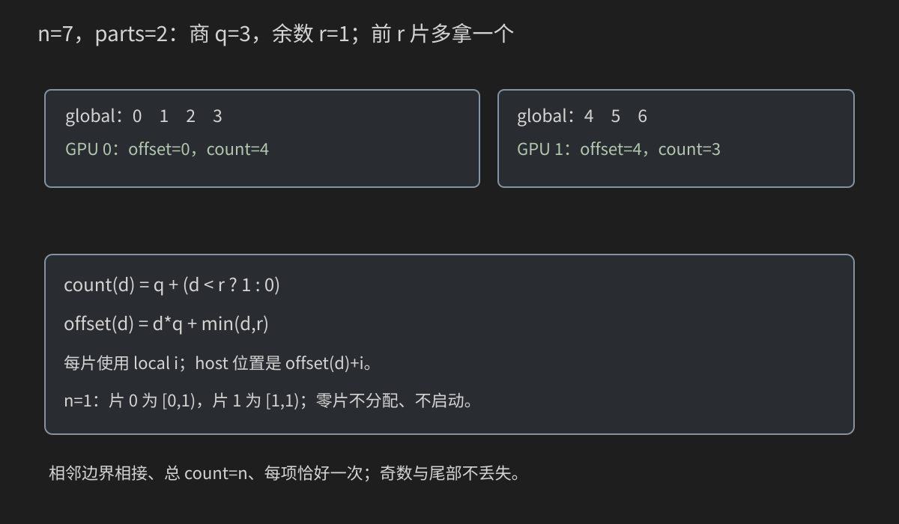
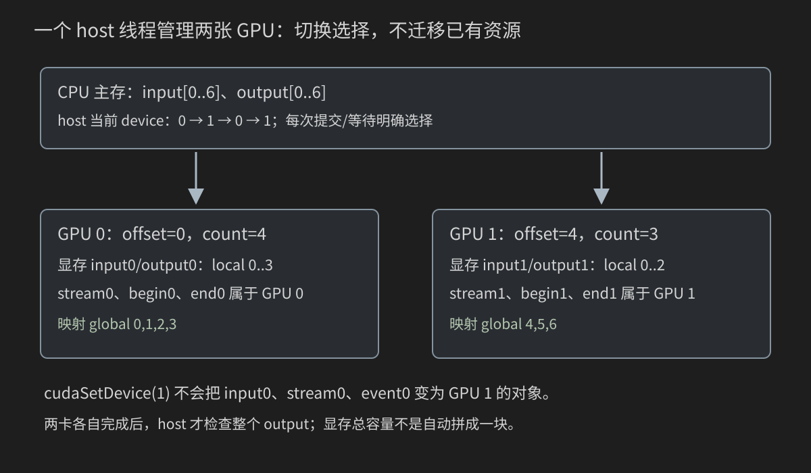
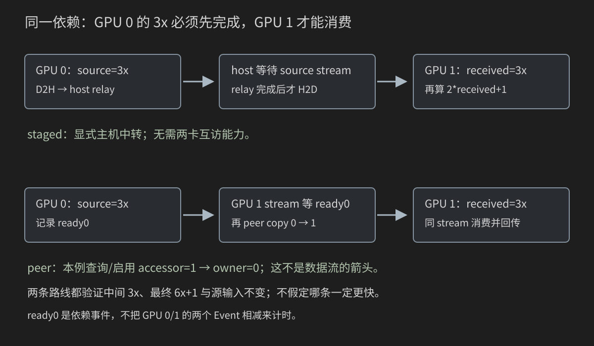

# 24 多 GPU 入门：设备归属、分片、依赖与传输

单 GPU 的 host 程序知道“数组在哪、stream 在哪、何时完成”。增加一张 GPU，不是把 block 数量乘二：你要显式决定每片工作归哪张卡，哪些数据要传递，最后谁收集结果。本章从一个进程、一个 host 线程管理两张卡开始，不要求先会 MPI 或 NCCL。

前置知识是[第20章 stream/event](20-Stream-Event-Pinned-Memory与流水线.md)和[第23章工程](23-CMake-项目结构-测试与可复现构建.md)。这里只复习它们在多设备场景的新边界，不重讲整个线程模型。案例是独立原创教学实现，不需要外部通信库。本机没有 CUDA/C++/CMake 工具链或 GPU；命令和输出均为读者验收入口，未声称已实测。

## 24.0 先分清三个问题

面对“两张 GPU”，先写三个答案：

1. **工作能否独立？** 计算 y[i]=3*x[i] 时每项独立；GPU 0 的结果不必交给 GPU 1。
2. **数据属于谁？** cudaMalloc 得到的普通 device allocation 归创建它的设备；每卡自己的 stream/event 也有归属。
3. **是否存在跨卡依赖？** 若 GPU 0 先算 a=3x、GPU 1 再算 y=2a+1，GPU 1 必须等到 a 可读。多一条 stream 不能自动推导这个依赖。

先学独立分片，再学有依赖的两阶段流水。它们使用相同 GPU 数，却是不同的算法。不能用“CUDA 是并行的”跳过依赖分析。

本章约定：普通 float 输入、有限小整数、输出另放、不允许源输入被修改。分片程序支持 n=0..16777216，workers=1 或2；传输程序支持 n=0..1048576，模式 staged/peer/auto。规模上限是教学程序的内存预算，不是 CUDA 的通用上限。

## 24.1 先认识本进程看到的设备编号

在终端检查：

```bash
nvidia-smi -L
nvidia-smi topo -m
nvcc --version
```

-L 列出 GPU，topo -m 显示拓扑矩阵，nvcc --version 检查编译工具。它们都不证明程序已经执行。

CUDA 程序使用的是**本进程可见的逻辑编号**。例如 Linux 终端：

```bash
CUDA_VISIBLE_DEVICES=1,3 ./device_inventory
```

等号前是环境变量名，等号后是可见设备选择，最后是要启动的程序。该进程内重新编号为0、1；不能仍写 cudaSetDevice(3) 以为它表示原来那张“3号卡”。实际部署可以用 UUID 等更稳定标识，需遵守对应平台规则。

不要只记编号：记录 GPU 名称、PCI bus ID 和可见性设置，才能对照拓扑与实验日志。不要把 nvidia-smi 列表序号和程序本地编号无条件视为相同。

若只有一张卡，仍可运行本章 CPU 分片模型和单卡路径；双卡路径必须明确 NOT RUN/77，不能偷偷用同一张卡两次来冒充双卡实验。

## 24.2 七个元素怎样分给两张卡

给定 n=7、parts=2：

- 商 q=n/parts=3；
- 余数 r=n%parts=1；
- 前 r 片比其他片多拿一个元素。

于是 GPU 0 拿4项，GPU 1拿3项。用半开区间表示：

| 片 d | offset 起点 | count 项数 | global 范围 | 本片 local 范围 |
|---|---:|---:|---|---|
| 0 | 0 | 4 | [0,4) | [0,4) |
| 1 | 4 | 3 | [4,7) | [0,3) |



一般公式：

```text
q = n / parts
r = n % parts
count(d) = q + (d < r ? 1 : 0)
offset(d) = d*q + min(d,r)
global = offset(d) + local
```

d 是片编号，不是 kernel 的 blockIdx；local 是某片内部的元素索引；offset/count 的单位都是“元素”，不是字节。

n=1、parts=2 时，片0的count=1，片1的count=0。空片不是异常，不应该为了它分配0字节 device buffer 或启动0个blocks。n=0则所有片都空，程序检查空契约，但没有 GPU 工作。

不能简单写 half=n/2，再令两张卡各处理 half：n=7 时只覆盖6项，第7项丢失。末片“补一项”也要同时修正起点与 host 回写位置。

## 24.3 先用 CPU 验证分片公式

文件 code/24_multi_gpu/multi_gpu_reference.h：

```cpp
#ifndef BOOK24_MULTI_GPU_REFERENCE_H
#define BOOK24_MULTI_GPU_REFERENCE_H
#include <algorithm>
#include <charconv>
#include <cmath>
#include <cstddef>
#include <string>
#include <system_error>
#include <vector>

namespace book24 {
struct Range { std::size_t offset, count; };
inline Range partition(std::size_t n,int parts,int index) {
    const std::size_t q=n/static_cast<std::size_t>(parts), r=n%static_cast<std::size_t>(parts);
    const auto d=static_cast<std::size_t>(index);
    return {d*q+std::min(d,r),q+(d<r?1U:0U)};
}
inline bool parse(const char* text,int maximum,int& value) {
    if(!text || !*text) return false;
    const char* end=text;
    while(*end) { if(*end<'0' || *end>'9') return false; ++end; }
    int candidate=0;const auto result=std::from_chars(text,end,candidate);
    if(result.ec!=std::errc{} || result.ptr!=end || candidate>maximum) return false;
    value=candidate;return true;
}
inline std::vector<float> input(std::size_t n) {
    std::vector<float> values(n);
    for(std::size_t i=0;i<n;++i) values[i]=static_cast<float>(static_cast<int>(i%17)-8);
    return values;
}
inline bool verify(const float* actual,const std::vector<float>& source,int factor,int bias) {
    for(std::size_t i=0;i<source.size();++i)
        if(!std::isfinite(actual[i]) || actual[i]!=factor*source[i]+bias) return false;
    return true;
}
}
#endif
```

Range 把起点和长度绑在一起，避免两个数组分别更新后不一致。partition 的前提是 parts>0、0<=index<parts；调用者负责验证。这里没有暗中接受非法片编号。

parse 只接受十进制数字字符，再用 from_chars 检查转换/上限；-1、+1、空文本和溢出都拒绝。它与第23章一样属于 CLI 契约，不是 GPU 功能。

input 生成 -8,-7,...,8 后重复的确定输入。乘3以及后续6x+1都能精确表示，因而本章用 exact 比较。换成任意浮点任务时，应采用第9/16/25章讨论的误差策略，不把 exact 当作通用 CUDA 验证方法。

文件 partition_model.cpp：

```cpp
#include "multi_gpu_reference.h"
#include <iostream>

int main(int argc,char** argv) {
    int n=7,parts=2;
    if(argc>3 || (argc>1 && !book24::parse(argv[1],16777216,n)) ||
       (argc>2 && (!book24::parse(argv[2],8,parts) || parts<1))) {
        std::cerr << "Usage: partition_model [n:0..16777216] [parts:1..8]\n";return 2;
    }
    const auto source=book24::input(static_cast<std::size_t>(n));
    std::vector<float> result(source.size());
    std::vector<int> visits(source.size(),0);
    for(int d=0;d<parts;++d) {
        const auto range=book24::partition(source.size(),parts,d);
        std::cout << "part=" << d << " offset=" << range.offset << " count=" << range.count << '\n';
        for(std::size_t local=0;local<range.count;++local) {
            const auto global=range.offset+local;
            ++visits[global];result[global]=3.0F*source[global];
        }
    }
    for(int count:visits) if(count!=1) return 1;
    if(!book24::verify(result.data(),source,3,0)) return 1;
    std::cout << "PASS disjoint coverage and CPU oracle; no GPU executed.\n";return 0;
}
```

运行：

```bash
g++ -std=c++17 -O2 -Wall -Wextra code/24_multi_gpu/partition_model.cpp -o partition_model
./partition_model 7 2
./partition_model 1 8
./partition_model 0 2
```

第一条编译普通 C++；7是n，2是parts。预期第一例打印 offset=0,count=4 与 offset=4,count=3，并 PASS。visits 每项必须恰好为1，验证“没有遗漏，也没有重复”；result 再验证数学结果。模型通过仍不证明跨卡 API 或 GPU kernel 正确。

## 24.4 cudaSetDevice 改变选择，不搬家



cudaSetDevice(d) 是 host API，选择**调用它的 host 线程**后续操作所使用的设备。它不是 kernel，也不设置 threadIdx；它不会复制数组、迁移 stream、把已有指针改成另一张卡的分配。

普通 Runtime 路线常用主 context；本章不手动创建 Driver context。新版本 cudaSetDevice 的初始化/错误行为仍需核对匹配 Toolkit 的文档，因此每次调用都检查返回值，不把它当作绝不会失败的赋值语句。[Runtime 设备管理](https://docs.nvidia.com/cuda/cuda-runtime-api/group__CUDART__DEVICE.html)

例如你在 GPU 0 创建了 s0，在 GPU 1 创建了 s1。切到GPU1后，把 kernel 启动到s0是不匹配的；正确设计是切到归属设备，再使用它的队列。

这里“切回归属设备再操作”是便于审计的统一代码规范，**不是声称所有 CUDA API 都要求 current device 与对象一致**：事件查询、跨设备等待、部分拷贝操作有各自规则，24.20专门列出。规则不能从一个函数机械推广到全部函数。

## 24.5 用完整 inventory 程序观察真实归属

文件 device_inventory.cu：

```cpp
#include "cuda_helpers.h"
#include <cuda_runtime.h>
#include <iostream>

int main() {
    const int status=book24::require_devices(1);if(status) return status;
    int count=0;if(!book24::check(cudaGetDeviceCount(&count),-1,"device count")) return 1;
    for(int d=0;d<count;++d) {
        cudaDeviceProp properties{};char bus[32]{};
        if(!book24::check(cudaGetDeviceProperties(&properties,d),d,"properties") ||
           !book24::check(cudaDeviceGetPCIBusId(bus,sizeof(bus),d),d,"PCI bus id") ||
           !book24::check(cudaSetDevice(d),d,"select")) return 1;
        int current=-1;if(!book24::check(cudaGetDevice(&current),d,"current device")) return 1;
        std::cout << "local_device=" << d << " current=" << current << " name=" << properties.name
                  << " cc=" << properties.major << '.' << properties.minor << " pci=" << bus
                  << " UVA=" << properties.unifiedAddressing << '\n';
        float* pointer=nullptr;if(!book24::check(cudaMalloc(&pointer,sizeof(float)),d,"allocate")) return 1;
        cudaPointerAttributes attributes{};
        bool ok=book24::check(cudaPointerGetAttributes(&attributes,pointer),d,"pointer attributes");
        if(ok) std::cout << "allocation owner=" << attributes.device << " memory_type=" << attributes.type << '\n';
        ok=book24::check(cudaFree(pointer),d,"free")&&ok;if(!ok) return 1;
    }
    for(int access=0;access<count;++access) {
        for(int owner=0;owner<count;++owner) {
            if(access==owner) continue;
            int can=0;if(!book24::check(cudaDeviceCanAccessPeer(&can,access,owner),access,"peer query")) return 1;
            std::cout << "accessor=" << access << " owner=" << owner << " can_access=" << can << '\n';
        }
    }
    std::cout << "PASS inventory queries; no peer enabled and no kernel launched.\n";return 0;
}
```

本程序依赖的 cuda_helpers.h：

```cpp
#ifndef BOOK24_CUDA_HELPERS_H
#define BOOK24_CUDA_HELPERS_H
#include <cuda_runtime.h>
#include <iostream>

namespace book24 {
inline bool check(cudaError_t status,int device,const char* operation) {
    if(status==cudaSuccess) return true;
    std::cerr << "device=" << device << " operation=" << operation << " error="
              << cudaGetErrorString(status) << '\n';return false;
}
inline int require_devices(int needed) {
    int count=0;const auto status=cudaGetDeviceCount(&count);
    if(status==cudaErrorNoDevice || status==cudaErrorInsufficientDriver ||
       (status==cudaSuccess && count<needed)) {
        std::cout << "NOT RUN: need " << needed << " visible CUDA device(s); found " << count << '\n';return 77;
    }
    return check(status,-1,"device count")?0:1;
}
}
#endif
```

先编译，再运行：

```bash
nvcc -std=c++17 -O2 -lineinfo code/24_multi_gpu/device_inventory.cu -o device_inventory
./device_inventory
```

输出包含 local_device/current/name/cc/pci/UVA，随后打印 allocation owner 与 peer 查询矩阵。数值和设备名依机器变化，本书不给虚构实机输出。

cudaPointerGetAttributes 查询指针对应的内存信息。本例只查询刚创建的普通 device allocation，因此 owner 应等于创建时选定的设备。属性不是授权：知道指针在GPU0，不表示GPU1已经可以合法解引用它。

peer矩阵使用 accessor/owner 两个字段，先把“谁要访问谁的分配”说清，避免与数据传输方向混用。inventory不启用peer，不启动kernel；查询完成不等于通信验证完成。

## 24.6 给错误日志保留设备和操作

check 的参数分别是 API 返回状态、设备编号、操作描述。-1 表示全局/host一侧的操作，不是一个可交给 cudaSetDevice 的设备号。

错误示例格式：

```text
device=1 operation=destination launch error=<具体 CUDA 错误>
```

仅记录“CUDA failed”时，你无法判断哪张卡、哪个stream、哪个阶段。复杂项目还应加入任务编号、分片范围、输入shape、stream标识。

require_devices 只把已定义的可用性情况设为77：无设备、驱动不足、成功查询但数量不够。其他初始化、查询错误仍为1，不用“任何失败都SKIP”掩盖错误。普通清理错误也会让最终退出码失败。

## 24.7 分片对象把设备、范围、资源放在一起

Shard不是一个自动拷贝数组的对象，只是本程序的资源记录：

| 字段 | 类型与单位 | 谁拥有/什么时候确定 |
|---|---|---|
| device | int，本地设备号 | main在分片前设置 |
| range.offset/count | size_t，元素数 | CPU partition决定 |
| input/output | float*，device地址 | 当前device上cudaMalloc创建 |
| stream | cudaStream_t | 当前device上创建 |
| begin/end | cudaEvent_t | 同一device上创建，用于本片kernel span |

这样每次提交、等待、释放都能找到归属，不靠当前设备“应该还没变”的隐含假设。

host_input、host_output、host_after 是三段 pinned host memory，采用 cudaHostAllocPortable，给本进程多个设备使用。input是原始输入，output是结果，after是device输入回传快照。指针变量本身仍是host C++变量；portable不把host内存变成device allocation。

三份host数组对应真实验证需求：不能只检查host_input没变化就断言GPU没有修改d_input。GPU端是否保持输入只读，要检查从device回来的after。

## 24.8 完整单卡/双卡分片程序

文件 multi_gpu_scale.cu：

```cpp
#include "multi_gpu_reference.h"
#include "cuda_helpers.h"
#include <cuda_runtime.h>
#include <algorithm>
#include <chrono>
#include <iostream>
#include <limits>
#include <vector>

__global__ void scale(const float* input,float* output,std::size_t n) {
    const std::size_t i=static_cast<std::size_t>(blockIdx.x)*blockDim.x+threadIdx.x;
    if(i<n) output[i]=3.0F*input[i];
}
struct Shard {
    int device=0;book24::Range range{};
    float* input=nullptr;float* output=nullptr;
    cudaStream_t stream{};cudaEvent_t begin{},end{};
};
bool release(Shard& shard) {
    if(!book24::check(cudaSetDevice(shard.device),shard.device,"select for cleanup")) return false;
    bool ok=true;
    if(shard.stream) ok=book24::check(cudaStreamSynchronize(shard.stream),shard.device,"cleanup wait")&&ok;
    if(shard.end) ok=book24::check(cudaEventDestroy(shard.end),shard.device,"destroy end")&&ok;
    if(shard.begin) ok=book24::check(cudaEventDestroy(shard.begin),shard.device,"destroy begin")&&ok;
    if(shard.output) ok=book24::check(cudaFree(shard.output),shard.device,"free output")&&ok;
    if(shard.input) ok=book24::check(cudaFree(shard.input),shard.device,"free input")&&ok;
    if(shard.stream) ok=book24::check(cudaStreamDestroy(shard.stream),shard.device,"destroy stream")&&ok;
    return ok;
}
int main(int argc,char** argv) {
    int n=1031,workers=2;
    if(argc>3 || (argc>1 && !book24::parse(argv[1],16777216,n)) ||
       (argc>2 && (!book24::parse(argv[2],2,workers) || workers<1))) {
        std::cerr<<"Usage: multi_gpu_scale [n:0..16777216] [workers:1|2]\n";return 2;
    }
    if(n==0) { std::cout<<"PASS empty contract; no GPU executed.\n";return 0; }
    const int probe=book24::require_devices(workers);if(probe) return probe;
    const auto source=book24::input(static_cast<std::size_t>(n));
    const std::size_t bytes=source.size()*sizeof(float);
    float *host_input=nullptr,*host_output=nullptr,*host_after=nullptr;
    std::vector<Shard> shards(static_cast<std::size_t>(workers));
    for(int d=0;d<workers;++d) { shards[d].device=d;shards[d].range=book24::partition(source.size(),workers,d); }
    bool ok=false;
    do {
        if(!book24::check(cudaHostAlloc(&host_input,bytes,cudaHostAllocPortable),-1,"portable input") ||
           !book24::check(cudaHostAlloc(&host_output,bytes,cudaHostAllocPortable),-1,"portable output") ||
           !book24::check(cudaHostAlloc(&host_after,bytes,cudaHostAllocPortable),-1,"portable input snapshot")) break;
        std::copy(source.begin(),source.end(),host_input);
        std::fill_n(host_output,source.size(),std::numeric_limits<float>::quiet_NaN());
        bool setup=true;
        for(auto& shard:shards) {
            if(!shard.range.count) continue;
            const int d=shard.device;const auto amount=shard.range.count*sizeof(float);
            if(!book24::check(cudaSetDevice(d),d,"select for setup") ||
               !book24::check(cudaStreamCreateWithFlags(&shard.stream,cudaStreamNonBlocking),d,"stream") ||
               !book24::check(cudaEventCreate(&shard.begin),d,"begin event") ||
               !book24::check(cudaEventCreate(&shard.end),d,"end event") ||
               !book24::check(cudaMalloc(&shard.input,amount),d,"input") ||
               !book24::check(cudaMalloc(&shard.output,amount),d,"output")) { setup=false;break; }
        }
        if(!setup) break;
        const auto start=std::chrono::steady_clock::now();
        bool submitted=true;
        for(auto& shard:shards) {
            if(!shard.range.count) continue;
            const int d=shard.device;const auto count=shard.range.count;
            const auto amount=count*sizeof(float),offset=shard.range.offset;
            if(!book24::check(cudaSetDevice(d),d,"select for submit") ||
               !book24::check(cudaMemcpyAsync(shard.input,host_input+offset,amount,cudaMemcpyHostToDevice,shard.stream),d,"H2D") ||
               !book24::check(cudaMemcpyAsync(shard.output,host_output+offset,amount,cudaMemcpyHostToDevice,shard.stream),d,"output sentinel") ||
               !book24::check(cudaEventRecord(shard.begin,shard.stream),d,"record begin")) { submitted=false;break; }
            scale<<<static_cast<unsigned>((count+255)/256),256,0,shard.stream>>>(shard.input,shard.output,count);
            if(!book24::check(cudaGetLastError(),d,"scale launch") ||
               !book24::check(cudaEventRecord(shard.end,shard.stream),d,"record end") ||
               !book24::check(cudaMemcpyAsync(host_output+offset,shard.output,amount,cudaMemcpyDeviceToHost,shard.stream),d,"D2H") ||
               !book24::check(cudaMemcpyAsync(host_after+offset,shard.input,amount,cudaMemcpyDeviceToHost,shard.stream),d,"input snapshot")) { submitted=false;break; }
        }
        if(!submitted) break;
        bool completed=true;
        for(auto& shard:shards) {
            if(!shard.range.count) continue;
            if(!book24::check(cudaSetDevice(shard.device),shard.device,"select for wait") ||
               !book24::check(cudaStreamSynchronize(shard.stream),shard.device,"complete shard")) { completed=false;break; }
        }
        if(!completed) break;
        const double wall_ms=std::chrono::duration<double,std::milli>(std::chrono::steady_clock::now()-start).count();
        bool reports=true;
        for(auto& shard:shards) {
            if(!shard.range.count) continue;
            float ms=0;
            if(!book24::check(cudaSetDevice(shard.device),shard.device,"select for timing") ||
               !book24::check(cudaEventElapsedTime(&ms,shard.begin,shard.end),shard.device,"same-device event span")) { reports=false;break; }
            std::cout<<"device="<<shard.device<<" offset="<<shard.range.offset<<" count="<<shard.range.count<<" kernel_span_ms="<<ms<<'\n';
        }
        if(!reports) break;
        ok=book24::verify(host_output,source,3,0) && std::equal(source.begin(),source.end(),host_after) &&
           std::equal(source.begin(),source.end(),host_input);
        if(!ok) std::cerr<<"FAIL full output or input immutability\n";
        std::cout<<"host_roundtrip_sample_ms="<<wall_ms<<" (includes sentinel/snapshot; not a benchmark ranking)\n";
    } while(false);
    for(auto& shard:shards) ok=release(shard)&&ok;
    if(host_after) ok=book24::check(cudaFreeHost(host_after),-1,"free snapshot")&&ok;
    if(host_output) ok=book24::check(cudaFreeHost(host_output),-1,"free host output")&&ok;
    if(host_input) ok=book24::check(cudaFreeHost(host_input),-1,"free host input")&&ok;
    if(!ok) return 1;
    std::cout<<"PASS all shards, full CPU oracle, immutable input.\n";return 0;
}
```

程序使用三个阶段：准备全部分片资源 → 向全部设备提交 → 等待全部分片并验证。它没有在提交GPU0后立即等待再提交GPU1，所以允许各卡工作并行推进；是否真的重叠仍取决于机器和输入。

release在清理前选择归属设备，并等待该stream。check(...)&&ok 的顺序保证旧ok=false时仍尝试当前清理。若选择设备本身失败，就不继续把对应对象交给错误上下文；程序失败退出，不声称此时仍保证全部资源可正常释放。这里只展示普通错误路径，不宣称强C++异常安全或设备失效后的恢复保证。

## 24.9 逐段读提交循环，不把 host 指针当 GPU 索引

设 n=7，GPU1 的offset=4,count=3：

1. host_input+offset 表示host数组第4项的地址。
2. amount=count*sizeof(float)=3*4=12字节。
3. shard.input 的分配长度是3项，GPU kernel只使用local i=0,1,2。
4. scale写 shard.output[i]=3*shard.input[i]，不加global offset。
5. 回传目的地址 host_output+4，把该片结果放回全局正确位置。

如果你在kernel里再写 shard.input[offset+i]，就在只有3项的device allocation里访问4、5、6，越界。**global位置用于host分发/收集，local位置用于本片kernel**。

block size 256这里只是与前面一维案例一致的合法教学候选，不保证最优。blocks=(count+255)/256 按片长计算，而不是用全局n。每个GPU上可以有许多blocks；“两张卡”不意味着“一张卡一个block”。

Event begin在输入与sentinel上传之后记录，end在kernel之后记录；D2H结果和快照放在后面。一个stream保持本片顺序，不能靠begin/end名字猜测整个流程是否被包含。

## 24.10 从三个不变量证明分片完整

分片正确性至少检查：

- 每片起点等于前一片终点，没有缝隙或交叠；
- count总和等于n；
- 每片local索引限制为[0,count)。

q/r分配满足这三项。CPU模型的visits只是可观察证据，数学证明说明为什么任意合法n都成立；GPU full oracle再检查实际代码。

测试0、1、7、255、256、257、1031分别覆盖：空任务、某片为空、奇数、启动块前后边界、较大尾部。若你改parts，应重新验证分片与预算，不能只把workers上限改成8就宣布支持任意多卡。

本例没有halo，片间不需要重叠输入。第17章stencil分片则不同：输出范围不重叠，但读取输入可能需要邻片边界，见24.22。

## 24.11 两张卡怎样计时：一张表不能抹平范围

本程序输出两类时间：

| 字段 | 时钟 | 包含 | 不包含 |
|---|---|---|---|
| kernel_span_ms | 本卡两个Event | 本片kernel的队列跨度 | H2D、D2H、其他GPU |
| host_roundtrip_sample_ms | host steady_clock | 提交/切换/等待、sentinel上传、结果与输入快照回传 | 分配、CPU验证、清理 |

host时间从第一片提交前开始，到全部片等待完成结束，不是两卡Event相减。也不是每卡kernel时间的简单相加：有并行时，相加会重复计算重叠区间。

这些是**单次诊断样本**，可能含首次kernel加载等成本，没有预热/多样本，因此不用于给单卡与双卡排名。要作benchmark，需把相同任务/证据成本统一，预热，重复，轮换方法，报告中位数与离散情况；先读第9章的测量规则。

speedup=T1/T2，efficiency=speedup/2。T1/T2必须来自相同计时范围和相同全局输入，不能拿单卡kernel-only除以双卡host roundtrip。

## 24.12 第二个任务：GPU1必须等待GPU0的结果

现在不分片，而是两阶段数学：

```text
GPU0：a[i] = 3*x[i]
GPU1：y[i] = 2*a[i] + 1
最终：y[i] = 6*x[i] + 1
```

小输入[-2,0,3]：
a=[-6,0,9]，y=[-11,1,19]。

为了学习跨卡通信，刻意把相依的两个阶段放在两卡。这个任务在一张卡融合成一个kernel很可能更合理；本章不把“动用了两张卡”当作性能优化证明。

验收分三层：源input不变；收到的a全量等于3x；最终y全量等于6x+1。只检查最终结果会让你更难定位“传输错”还是“后段计算错”。

## 24.13 无 peer 基线：主机中转必须等数据真的回来



staged路线：

1. GPU0 source_stream上传x、计算a。
2. 同一source_stream把a复制到portable pinned relay。
3. host等待source_stream，确认relay已写完。
4. 切到GPU1，把relay上传到d_received。
5. GPU1同一stream计算y、回传并完成。

关键是第3步：在GPU0的D2H还未完成时，GPU1不能读取同一relay作为H2D源。两卡分别有序，不会自动给共享host缓冲建立跨队列顺序。

本例显式host等待是初学可靠基线，不企图做分块重叠。后续可把relay划为多个slot，按照第20章规则在使用前等前一轮消费者完成，再复用。portable pinned保证适用范围，不保证某次传输一定与kernel重叠。

## 24.14 Peer 的“方向”是访问者到所有者

本例数据要从GPU0送到GPU1，程序检查：

```cpp
cudaDeviceCanAccessPeer(&can, 1, 0);
cudaSetDevice(1);
cudaDeviceEnablePeerAccess(0, 0);
```

这几行是说明片段；完整版本在24.16有错误检查。

第一函数的1是访问者，0是内存所有者。第二个0参数是flags，当前规则要求0，不是再选“GPU0”。启用是单向的；反向访问需要另外查询/启用，不由一次调用自动建立。[Peer API](https://docs.nvidia.com/cuda/cuda-runtime-api/group__CUDART__PEER.html)

**区分三件事**：拥有CUDA指针；具备/启用peer访问；某个传输/消费已完成。UVA只是统一地址表示，不是自动合并显存，也不是同步。

本例采用GPU1对GPU0的方向，并在GPU1队列执行copy/后续消费。cudaMemcpyPeerAsync API并非“能力为0就必定不可调用”；CUDA可能使用不同传输路径。本章的peer模式更严格：要求查到并启用本例指定直接访问能力，避免把运行时中转也称为已验证的直接peer路径。

## 24.15 在目的 stream 上建立生产者依赖

peer路线顺序：

```text
source_stream@GPU0：upload → produce → record ready0
destination_stream@GPU1：wait ready0 → peer copy → consume → D2H
```

ready0是GPU0 event，destination_stream是GPU1 stream。cudaStreamWaitEvent允许跨设备事件依赖；等待操作提交到目的队列，host不必在这里阻塞等GPU0。它等待这次已记录的event，不是“从此永久跟随生产者”。本例只记录一次，不涉及event重新录制的epoch管理。[Stream等待接口](https://docs.nvidia.com/cuda/cuda-runtime-api/group__CUDART__STREAM.html)

如果先复制、后wait，你已经把消费放在依赖之前。若根本不wait，GPU1可能读到尚未生成的数据。“偶尔正确”不能证明顺序合法。

本例仍在最终CPU读取output前同步目的stream，且释放源数组/ready前确保两张卡相关工作完成。提交依赖不是释放资源的许可证。

## 24.16 完整 staged/peer/auto 两阶段程序

文件 transfer_pipeline.cu：

```cpp
#include "multi_gpu_reference.h"
#include "cuda_helpers.h"
#include <cuda_runtime.h>
#include <iostream>
#include <limits>
#include <string>
#include <vector>

__global__ void affine(const float* input,float* output,std::size_t n,float factor,float bias) {
    const std::size_t i=static_cast<std::size_t>(blockIdx.x)*blockDim.x+threadIdx.x;
    if(i<n) output[i]=factor*input[i]+bias;
}
int main(int argc,char** argv) {
    int n=1031;const std::string requested=argc>2?argv[2]:"staged";
    if(argc>3 || (argc>1 && !book24::parse(argv[1],1048576,n)) ||
       (requested!="staged" && requested!="peer" && requested!="auto")) {
        std::cerr<<"Usage: transfer_pipeline [n:0..1048576] [staged|peer|auto]\n";return 2;
    }
    if(n==0) { std::cout<<"PASS empty contract; no transfer executed.\n";return 0; }
    const int probe=book24::require_devices(2);if(probe) return probe;
    int can=0;
    if(!book24::check(cudaDeviceCanAccessPeer(&can,1,0),1,"can GPU1 access GPU0")) return 1;
    if(requested=="peer" && !can) { std::cout<<"NOT RUN: required peer direction 1 -> 0 unavailable.\n";return 77; }
    const bool peer=requested!="staged" && can;
    std::cout<<"requested="<<requested<<" selected="<<(peer?"peer":"staged")<<" can_1_to_0="<<can<<'\n';
    const auto input=book24::input(static_cast<std::size_t>(n));
    const auto bytes=input.size()*sizeof(float);
    std::vector<float> output(input.size(),std::numeric_limits<float>::quiet_NaN());
    std::vector<float> received(input.size()),after(input.size());
    float *d_input=nullptr,*d_source=nullptr,*d_received=nullptr,*d_output=nullptr,*relay=nullptr;
    cudaStream_t source_stream{},destination_stream{};cudaEvent_t ready{};
    bool enabled_here=false,ok=false;
    do {
        if(!book24::check(cudaSetDevice(0),0,"source select") ||
           !book24::check(cudaStreamCreateWithFlags(&source_stream,cudaStreamNonBlocking),0,"source stream") ||
           !book24::check(cudaEventCreateWithFlags(&ready,cudaEventDisableTiming),0,"ready event") ||
           !book24::check(cudaMalloc(&d_input,bytes),0,"source input") ||
           !book24::check(cudaMalloc(&d_source,bytes),0,"source result") ||
           !book24::check(cudaMemcpyAsync(d_input,input.data(),bytes,cudaMemcpyHostToDevice,source_stream),0,"source upload")) break;
        affine<<<static_cast<unsigned>((input.size()+255)/256),256,0,source_stream>>>(d_input,d_source,input.size(),3.0F,0.0F);
        if(!book24::check(cudaGetLastError(),0,"source launch") ||
           !book24::check(cudaEventRecord(ready,source_stream),0,"record source ready")) break;
        if(!book24::check(cudaSetDevice(1),1,"destination select") ||
           !book24::check(cudaStreamCreateWithFlags(&destination_stream,cudaStreamNonBlocking),1,"destination stream") ||
           !book24::check(cudaMalloc(&d_received,bytes),1,"received array") ||
           !book24::check(cudaMalloc(&d_output,bytes),1,"final array")) break;
        if(peer) {
            // Standalone program: enable once, own this enable, disable only if it succeeded.
            if(!book24::check(cudaDeviceEnablePeerAccess(0,0),1,"enable 1 -> 0")) break;
            enabled_here=true;
            if(!book24::check(cudaStreamWaitEvent(destination_stream,ready,0),1,"cross-device producer dependency") ||
               !book24::check(cudaMemcpyPeerAsync(d_received,1,d_source,0,bytes,destination_stream),1,"peer copy 0 to 1")) break;
        } else {
            if(!book24::check(cudaHostAlloc(&relay,bytes,cudaHostAllocPortable),-1,"portable relay") ||
               !book24::check(cudaSetDevice(0),0,"select for relay download") ||
               !book24::check(cudaMemcpyAsync(relay,d_source,bytes,cudaMemcpyDeviceToHost,source_stream),0,"relay D2H") ||
               !book24::check(cudaStreamSynchronize(source_stream),0,"relay ready for host handoff") ||
               !book24::check(cudaSetDevice(1),1,"select for relay upload") ||
               !book24::check(cudaMemcpyAsync(d_received,relay,bytes,cudaMemcpyHostToDevice,destination_stream),1,"relay H2D")) break;
        }
        if(!book24::check(cudaMemcpyAsync(d_output,output.data(),bytes,cudaMemcpyHostToDevice,destination_stream),1,"output sentinel")) break;
        affine<<<static_cast<unsigned>((input.size()+255)/256),256,0,destination_stream>>>(d_received,d_output,input.size(),2.0F,1.0F);
        if(!book24::check(cudaGetLastError(),1,"destination launch") ||
           !book24::check(cudaMemcpyAsync(output.data(),d_output,bytes,cudaMemcpyDeviceToHost,destination_stream),1,"final D2H") ||
           !book24::check(cudaMemcpyAsync(received.data(),d_received,bytes,cudaMemcpyDeviceToHost,destination_stream),1,"received snapshot") ||
           !book24::check(cudaStreamSynchronize(destination_stream),1,"destination complete") ||
           !book24::check(cudaSetDevice(0),0,"select for input snapshot") ||
           !book24::check(cudaMemcpyAsync(after.data(),d_input,bytes,cudaMemcpyDeviceToHost,source_stream),0,"source input snapshot") ||
           !book24::check(cudaStreamSynchronize(source_stream),0,"source complete")) break;
        ok=book24::verify(output.data(),input,6,1) && book24::verify(received.data(),input,3,0) && after==input;
        if(!ok) std::cerr<<"FAIL intermediate/final/input oracle\n";
    } while(false);
    // Complete BOTH devices before freeing shared lifetimes, including partial failure paths.
    const bool selected0=book24::check(cudaSetDevice(0),0,"cleanup source select");
    ok=selected0&&ok;
    if(selected0 && source_stream) ok=book24::check(cudaStreamSynchronize(source_stream),0,"cleanup source wait")&&ok;
    const bool selected1=book24::check(cudaSetDevice(1),1,"cleanup destination select");
    ok=selected1&&ok;
    if(selected1 && destination_stream) ok=book24::check(cudaStreamSynchronize(destination_stream),1,"cleanup destination wait")&&ok;
    if(selected1) {
        if(d_output) ok=book24::check(cudaFree(d_output),1,"free destination output")&&ok;
        if(d_received) ok=book24::check(cudaFree(d_received),1,"free received")&&ok;
        if(destination_stream) ok=book24::check(cudaStreamDestroy(destination_stream),1,"destroy destination stream")&&ok;
        if(enabled_here) ok=book24::check(cudaDeviceDisablePeerAccess(0),1,"disable owned peer enable")&&ok;
    }
    if(book24::check(cudaSetDevice(0),0,"cleanup source reselect")) {
        if(source_stream) ok=book24::check(cudaStreamSynchronize(source_stream),0,"cleanup source rewait")&&ok;
        if(ready) ok=book24::check(cudaEventDestroy(ready),0,"destroy ready")&&ok;
        if(d_source) ok=book24::check(cudaFree(d_source),0,"free source result")&&ok;
        if(d_input) ok=book24::check(cudaFree(d_input),0,"free source input")&&ok;
        if(source_stream) ok=book24::check(cudaStreamDestroy(source_stream),0,"destroy source stream")&&ok;
    } else ok=false;
    if(relay && selected0 && selected1) ok=book24::check(cudaFreeHost(relay),-1,"free relay")&&ok;
    if(!ok) return 1;
    std::cout<<"PASS 3*x on GPU0 -> transfer -> 2*y+1 on GPU1; all elements checked.\n";return 0;
}
```

staged总是显式host中转；peer要求方向能力，缺失返回77；auto仅在成功查询capability=0时选择staged。有能力但enable、分配、copy、launch失败，仍报1，不悄悄fallback把真实错误隐藏掉。

这是独立进程、只启用一次peer的教学程序。enabled_here只有本次enable成功才置true，清理只撤销自己成功建立的状态。如果把代码移到已管理peer的库框架，必须设计共享状态/引用计数协议，不随意关闭别人的peer enable；“AlreadyEnabled”也不应被当作本次拥有状态。

host输入/输出vector用于正确性例子，Async传输不声称充分重叠；中转relay明确portable pinned。没有把两条路线写成公平传输带宽benchmark。

## 24.17 把 cudaMemcpyPeerAsync 六个参数对应到资源

调用：

```cpp
cudaMemcpyPeerAsync(d_received, 1, d_source, 0, bytes, destination_stream);
```

| 参数 | 这里的值 | 意义 |
|---|---|---|
| dst | d_received | GPU1上的接收地址 |
| dstDevice | 1 | 接收分配所属设备 |
| src | d_source | GPU0上的生产结果地址 |
| srcDevice | 0 | 源分配所属设备 |
| count | bytes | n*sizeof(float)字节 |
| stream | destination_stream | 本例在GPU1上的队列 |

这不是普通C++数组复制语法；写d_received=d_source只会复制指针值，不搬数据、不建立完成依赖。[Peer copy参数](https://docs.nvidia.com/cuda/cuda-runtime-api/group__CUDART__MEMORY.html)

同一destination_stream内，copy在consumer之前，所以consumer读d_received无需额外同卡host同步。跨卡producer依赖由前一条wait保证。各API作用不同：enable负责可访问性，wait负责顺序，copy负责内容转移，stream完成负责host可读及生命周期。

此时消费者只访问GPU1本地d_received。本章没有让GPU1 kernel直接远程逐项加载d_source；那是另一种设计，延迟/访问模式与bulk copy不同，不能把两者带宽等同。

## 24.18 错误收尾为什么也要等另一张卡

假设GPU1已经提交peer copy，接着目的kernel启动失败。如果你马上释放GPU0 d_source，peer copy可能还在读取它，形成跨设备use-after-free。

因此程序在释放跨卡生命周期前尝试完成两卡相关stream。即使最终数学验证失败，也要做资源收尾；错误返回不等于CUDA自动取消所有队列。

relay同样必须活到GPU1的H2D消费完成之后。ready事件也不能在目的等待尚使用它时随便重用/销毁。更复杂程序要明确每份资源有哪些消费者，再选择最迟完成点。

如果设备/context已经不可用，正常收尾不一定成功。日志与失败退出不可省略；不要承诺损坏GPU状态可以被一次cudaDeviceReset安全修复。reset可能影响同进程其他用户与库，不是本书默认错误处理。

## 24.19 拓扑图能告诉什么，不能告诉什么

nvidia-smi topo -m 的缩写反映PCIe/NVLink及CPU亲和相关连接。读机器输出时对照该工具对应版本帮助；不要从NV字样直接推算你程序的有效GB/s。

inventory的can_access是能力查询，不是带宽结果；两个GPU同型号也不保证peer；MIG、虚拟化、容器、平台配置等会影响可见性与支持。实验应同时记录拓扑与两向查询。

Linux裸机PCIe peer还涉及IOMMU/ACS平台限制。遇到peer问题先让管理员核对NVIDIA平台要求，**不要在教材命令里随意关闭系统隔离或修改BIOS/内核配置**。这是部署安全与系统管理问题，不是修改一个CUDA指针可解决。[NVIDIA平台限制说明](https://docs.nvidia.com/cuda/cuda-programming-guide/03-advanced/multi-gpu-systems.html#host-iommu-hardware-pci-access-control-services-and-vms)

建议保留staged基线：它能帮助分离“数学/kernel正确”与“peer部署/传输正确”。不支持peer的机器仍能学习多GPU分片与显式中转。

## 24.20 设备归属规则不能一刀切

| 操作 | 需要注意的关系 |
|---|---|
| kernel启动到某stream | current device与stream归属必须匹配 |
| cudaEventRecord(event,stream) | event与stream必须同设备 |
| cudaEventElapsedTime(a,b) | 两个计时event必须同设备 |
| cudaStreamWaitEvent(stream,event) | 允许跨设备；用于依赖，不是跨设备计时 |
| cudaEventQuery/Synchronize | 可查询/等待其他设备event；仍需检查返回值 |
| 内存拷贝接口 | 按该API的指针/设备/stream规则，不从kernel规则直接类推 |

这些限制以官方[多设备操作说明](https://docs.nvidia.com/cuda/cuda-programming-guide/03-advanced/multi-gpu-systems.html#multi-device-stream-event-and-memory-copy-behavior)为准。

每卡默认stream互不提供全局顺序。GPU0 default上提交A，再GPU1 default上提交B，只能说明host调用先后，不能推出B的GPU执行必须在A完成后。

更不用说__syncthreads：它仍只协调一个block，不能让另一张GPU等待。对这里的粗粒度生产/消费，stream/event或host明确完成点已经够用，不引入跨卡自旋锁。

## 24.21 负载均衡与速度：多卡是约束问题

等量分片只是在GPU近似同速、每项成本近似相同时合理。设每卡吞吐率为v0/v1，每卡分到n0/n1，忽略通信的完成时间近似max(n0/v0,n1/v1)。

例如两卡速率假设为2项/单位时间、1项/单位时间，n=9。等量5+4：max(2.5,4)=4；按6+3：max(3,3)=3。这是合成算术例子，不是某GPU实测。

通信、host准备和固定开销加入后，简单按速率比例也不一定最优；通过CPU/Systems时间线区分哪一段在等哪张卡。固定输入/输出大小时，吞吐高的卡也可能受同一路PCIe总带宽限制。

strong scaling固定总问题随GPU数增加；weak scaling随GPU数增加问题规模。报告必须说明哪一种，不拿不同总n的结果充当同任务speedup。

## 24.22 算法不同，分发数据也不同

**GEMM按输出行分片**：每卡持有相应A行，通常都需要完整B；得到不同C行，CPU拼回即可。B复制开销可能随卡数增长；大模型不能只算C的容量。算法细节回看第16章，不在这里再重写矩阵乘法。

**Stencil按图像行分片**：每卡输出不同的行，但边界输出依赖相邻输入halo。半径R意味着额外读取上下R行，边界策略仍与第17章一致。多轮stencil每轮halo数据可能变化，要交换最新边界而不是只初始复制一次。

**每卡局部归约**：各卡先得到partial，再按定义汇总。浮点顺序变了，结果不一定与单卡逐位一致。数据分片模型正确不自动证明跨卡最终reduce正确。

因此先画输入/输出/只读重复数据/需要通信的边界，再决定通信接口。不是所有任务都能像3x一样独立。

## 24.23 NCCL 的位置：在正确数据流之上的 collective

NCCL是通信库，不是替你写CPU参考或分片算法。collective是多个参与者按统一约定进行的整体通信操作。用两卡向量：

```text
GPU0：[1,2]
GPU1：[10,20]
sum all-reduce后：两卡都得到[11,22]
```

它不是把两向量串成[1,2,10,20]；后者是all-gather的典型结果布局之一。

| 操作 | 意图 | 谁最后持有结果 |
|---|---|---|
| Broadcast | 从root分发同一数据 | 全部参与者 |
| Reduce | 同位置值按op合并 | root |
| AllReduce | 合并并分发 | 全部参与者 |
| AllGather | 收集每个rank的数据 | 全部参与者 |
| ReduceScatter | 合并后分片 | 每个rank持有对应片 |

rank是通信组内参与者编号，不必等于系统GPU序号。root是组内约定的参与者。各rank必须匹配collective调用、类型、数量与顺序；不能只在一张卡调用就期待另一张自动参与。[NCCL官方collectives](https://docs.nvidia.com/deeplearning/nccl/user-guide/docs/usage/collectives.html)

本书主线先建立设备/依赖/完成契约，再学NCCL。独立NCCL资料不作为本公开仓库的隐含依赖，未来按项目需要继续；本章没有安装或运行NCCL，也不把手写peer copy等同于AllReduce。

## 24.24 多 host 线程、进程和节点是不同层次

本章一个host线程轮流切设备就足够。每GPU一个host线程可以减少每线程选择变化、并行组织CPU工作，但共享host数组、错误状态、工作队列也需要C++同步；GPU event不替代CPU数据竞争保护。

多个进程各有自己的地址空间。进程A的float*数值不能直接发给进程B并当作有效device分配；要使用受支持IPC/VMM或上层通信协议，并管理导出/导入与生命周期。

多个节点没有共享同一普通进程/PCIe地址空间，通常需要NCCL/MPI/NVSHMEM等与对应网络支持。MPS是GPU进程共享/调度相关机制，不是把多节点自动变成一张卡；多个概念不能因都叫“多GPU”而混写。

选择架构时回答：每个进程/线程管理哪些卡？输入从哪来？哪里做汇总？失败怎样停止其他参与者？不要先引入复杂部署再找问题。

## 24.25 Managed Memory 与 VMM：不能绕过所有权思考

第8章Managed Memory可以减轻显式拷贝，但不取消跨设备依赖、迁移/放置成本和平台支持边界。两张卡反复写同一批页，可能引入迁移或争用；“同一指针”不是“同时访问一定合法且高效”。

普通cudaDeviceEnablePeerAccess影响对peer分配的映射范围，扩到很多卡可能增加分配管理成本。VMM可以更精细控制映射/访问，但它是后续专题，不是本章初学路径的必需步骤。

远程atomic、系统作用域内存模型与设备能力各有约束。本书不会教你把普通global atomic加到peer指针上就宣称实现了跨卡锁。首先用已定义的stream/event粗粒度协议，确实需要细粒度同步时再读对应内存模型。

## 24.26 构建、运行、退出状态与自动测试

独立CMakeLists.txt：

```cmake
cmake_minimum_required(VERSION 3.24)
project(book24 LANGUAGES CXX)
option(BOOK24_ENABLE_CUDA "Build NVIDIA CUDA cases" OFF)
include(CTest)
add_executable(partition_model partition_model.cpp)
target_compile_features(partition_model PRIVATE cxx_std_17)
if(BOOK24_ENABLE_CUDA)
  if(NOT DEFINED CMAKE_CUDA_ARCHITECTURES OR "${CMAKE_CUDA_ARCHITECTURES}" STREQUAL "")
    message(FATAL_ERROR "Set a verified CMAKE_CUDA_ARCHITECTURES list")
  endif()
  enable_language(CUDA)
  foreach(target device_inventory multi_gpu_scale transfer_pipeline)
    add_executable(${target} ${target}.cu)
    set_target_properties(${target} PROPERTIES CUDA_STANDARD 17 CUDA_STANDARD_REQUIRED ON)
    target_compile_options(${target} PRIVATE $<$<COMPILE_LANGUAGE:CUDA>:-lineinfo>)
  endforeach()
endif()
if(BUILD_TESTING)
  foreach(n 0 1 7 255 256 257 1031)
    add_test(NAME partition_${n} COMMAND partition_model ${n} 2)
    if(BOOK24_ENABLE_CUDA)
      foreach(workers 1 2)
        add_test(NAME scale_${workers}_${n} COMMAND multi_gpu_scale ${n} ${workers})
        set_tests_properties(scale_${workers}_${n} PROPERTIES SKIP_RETURN_CODE 77 RUN_SERIAL TRUE TIMEOUT 90)
      endforeach()
      foreach(mode staged peer auto)
        add_test(NAME transfer_${mode}_${n} COMMAND transfer_pipeline ${n} ${mode})
        set_tests_properties(transfer_${mode}_${n} PROPERTIES SKIP_RETURN_CODE 77 RUN_SERIAL TRUE TIMEOUT 90)
      endforeach()
    endif()
  endforeach()
  add_test(NAME partition_many_empty COMMAND partition_model 1 8)
endif()
```

先走CPU-only，不启用CUDA：

```bash
cmake -S code/24_multi_gpu -B build-book24-cpu -DCMAKE_BUILD_TYPE=Release
cmake --build build-book24-cpu --config Release
ctest --test-dir build-book24-cpu -C Release --output-on-failure
```

GPU构建时，以下80仅适用于已经确认CC8.0且Toolkit支持sm_80的机器。两卡架构不同时，按第23章规则指定核对后的列表，不照抄示例：

```bash
cmake -S code/24_multi_gpu -B build-book24 -DCMAKE_BUILD_TYPE=Release -DBOOK24_ENABLE_CUDA=ON -DCMAKE_CUDA_ARCHITECTURES=80
cmake --build build-book24 --config Release
ctest --test-dir build-book24 -C Release --output-on-failure
```

逐例也可：

```bash
nvcc -std=c++17 -O2 -lineinfo code/24_multi_gpu/multi_gpu_scale.cu -o multi_gpu_scale
nvcc -std=c++17 -O2 -lineinfo code/24_multi_gpu/transfer_pipeline.cu -o transfer_pipeline
./multi_gpu_scale 7 1
./multi_gpu_scale 7 2
./multi_gpu_scale 1031 2
./transfer_pipeline 1031 staged
./transfer_pipeline 1031 peer
./transfer_pipeline 1031 auto
```

nvcc各选项按第3章复习；这里新增的是程序CLI：n/worker或n/route。0是本例完成并验证；1真实失败；2非法参数；77明确不可用。n=0输出empty但没有GPU/传输执行。CTest允许77跳过，不能把“0 tests failed”单独抄成“两张卡全部实测通过”。

## 24.27 Sanitizer 和 profiler：验证的是哪一条路线

```bash
compute-sanitizer --tool memcheck --error-exitcode 99 ./multi_gpu_scale 1031 2
compute-sanitizer --tool memcheck --error-exitcode 99 ./transfer_pipeline 1031 staged
compute-sanitizer --tool memcheck --error-exitcode 99 ./transfer_pipeline 1031 peer
nsys profile --trace=cuda,osrt -o book24_staged ./transfer_pipeline 1031 staged
nsys profile --trace=cuda,osrt -o book24_peer ./transfer_pipeline 1031 peer
```

99使工具检测到问题时返回失败，不能仅依赖程序oracle通过。peer路径若NOT RUN，工具没有验证peer，不写“peer memcheck通过”。

Systems看两设备队列、produce→transfer→consume依赖、host中转等待。它能证明实际工作位置和时间关系；某次图上没有重叠不说明API错误，也不证明永远不能重叠。路径/输入/工具版本、是否有其他任务占卡都要记录。

传输带宽实验应去掉数学kernel或严格定义包含范围，预热和重复，保持staged与peer相同字节、源/目的、完成范围。不要把本章含验证与快照的正确性程序当成峰值带宽测试。

## 24.28 常见故障与定位顺序

| 现象 | 先查什么 |
|---|---|
| invalid device ordinal | 可见性和本地编号；是不是仍用原系统编号 |
| kernel启动invalid resource | 当前device与stream归属 |
| 第二卡读到旧数据 | producer event是否录在正确位置；wait在copy之前吗 |
| 奇数n末项错误 | q/r、offset/count、回传地址 |
| GPU1 local越界 | 是否把global offset又加进分片device索引 |
| peer缺失 | 两向查询、拓扑、平台支持；先运行staged |
| 有能力却enable/copy失败 | 保留真实错误；不笼统叫“不支持” |
| 两卡没有更快 | 工作太小、负载失衡、传输/host/汇总/首次开销 |
| GPU输出正常却cleanup失败 | 仍然失败；保留设备/操作诊断 |
| CTest全绿但有skipped | 查看实际跳过数量与原因；不能算GPU通过 |

故意错误的设备资源使用只在正文中解释，不放入默认自动测试。不要为了练习在共享服务器执行无界spin、非法peer写入或reset其他人设备状态。

## 24.29 递进练习

先用纸和CPU完成1—8，再做单卡、双卡与传输：

1. n=10、parts=3的q/r、三个offset/count是什么？
2. n=2、parts=4有哪些空片？
3. 证明count总和为n。
4. 为何kernel不能在local索引上再加host offset？
5. 把partition_model改成打印每片local→global。
6. 写visits检查，并故意删去奇数最后项；它怎样失败？
7. 本章exact比较为何合理？换成sin(x)为何不照搬？
8. 只有一张卡时，可以完成哪些部分？
9. 切GPU1后，GPU0的d_input/stream会迁移吗？
10. inventory属性查询通过，是否证明peer copy通过？
11. “数据0→1”和“访问1→0”如何同时成立？
12. enablePeerAccess的两个0分别是什么？
13. 只启用1→0，是否自动也启用0→1？
14. staged省略source完成点会发生什么？
15. peer把wait放在copy后为什么不行？
16. 怎样检查中间传输结果，而不只检查最终y？
17. 为什么释放源数组要考虑目的stream？
18. 两卡Event为何不能直接相减？
19. 用host时钟计时，停止点为什么要包含全部卡完成？
20. 程序给出的单次时间能否证明双卡更快？
21. 合成速率3:1、n=12，等量与按速率分片完成时间如何变化？
22. 按C行分GEMM，哪些输入需要复制？
23. 两轮stencil仅交换初始halo为何不足？
24. 两卡[2,3]、[20,30]的sum AllReduce/AllGather有何区别？
25. rank为何不必等于cuda设备号？
26. auto在何种条件fallback，何种错误必须失败？
27. 设计无双卡、无peer、非法CLI、执行失败四种验收记录。
28. 写一份公平单卡/双卡benchmark计划，明确范围、预热与统计。

答案见[附录C](附录-C-练习答案.md)。需要实机的题只给验收方法，不给虚构的测量答案。

## 24.30 独立小项目：双卡图像行分片

从第17章零边界stencil出发，先在CPU上把图像行分两片并标出halo。要求：

- 输出各自写不同全局行；输入每片包含需要的halo。
- 先不使用peer，host把相应输入上传到各卡，再回收输出。
- 测试高度1/2/3/17、宽度非整块、半径0/1/2；每项与未分片CPU参考一致。
- 无双卡返回77；参数非法返回2；任一GPU错误返回1。
- 记录device/range/halo；不要只检查输出总和。
- 正确后才研究多轮halo交换，并明确每轮旧/新缓冲与事件协议。

不是要求你立刻同时完成NCCL、多线程和分布式部署。先把“分片范围与读取范围不相同”讲清，才有下一步优化的依据。

## 24.31 回到一个完整算子：下一章 Softmax

你已经能说明每份资源在哪张卡、不同队列怎样交接数据、验证和计时怎样跨设备组织。下一章不继续增加设备，而是把数学、C++文件、索引、局部变量、shared两次归约、误差与测试组织为一个完整Softmax工程。

继续[第25章：综合项目GPU Softmax](25-综合项目-GPU-Softmax.md)。先完成单卡正确版本，再考虑按行多卡分片；不要让设备数量代替你对一行内部计算的理解。
