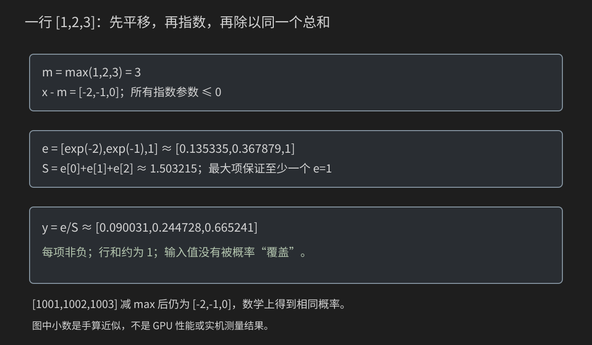
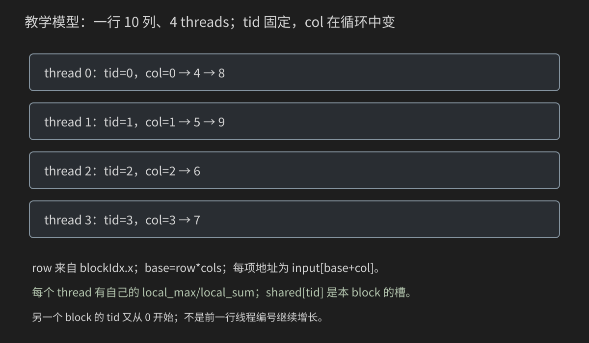
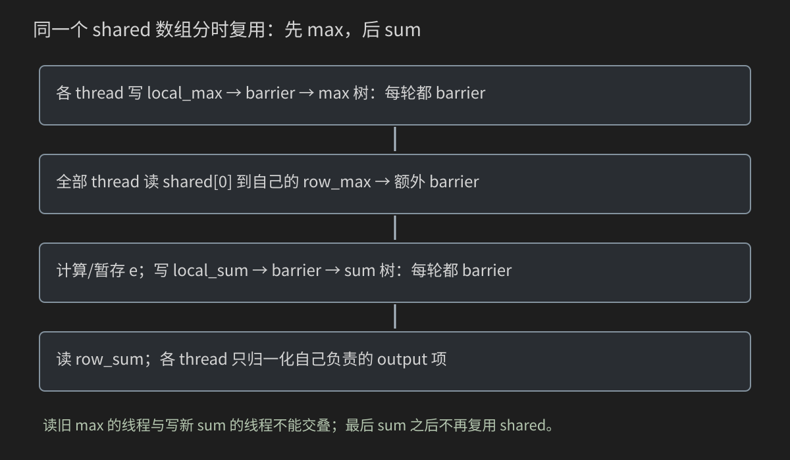

# 25 综合项目：一步一步写出稳定的 GPU Softmax

本章把前面数学、二维索引、归约、同步、浮点验证和工程组织连接起来。目标不是记住一个kernel，而是你能从空目录建立一个有CPU参考、边界测试和可信测量的算子项目。

按“先CPU、后GPU；先中间量、后完整算子；先正确、后比较”的顺序做。五个阶段程序和最终工程文件都给出全文，避免读到某一段时不知道文件里还缺什么。旧概念只说明此处的新作用，忘记时回看[第6章布局](06-二维索引与图像网格.md)、[第11章归约](11-并行归约-从错误到高效.md)、[第12章warp](12-Warp原语与分支发散.md)、[第23章工程](23-CMake-项目结构-测试与可复现构建.md)。

本章是教学FP32实现，不是覆盖所有形状/类型的生产库。本机没有工具链/GPU，以下命令、输出格式和性能实验是验收路线，不是已运行结果。

## 25.0 先写规格：本章到底要算什么

输入X是rows×cols的连续row-major float矩阵；每行互相独立，输出Y同shape。每个输出表示该行对应输入的归一化权重。

本章契约：

- rows和cols都正；空行/零列拒绝，不定义“零个元素的概率分布”。
- 所有输入有限，不接受NaN、±Inf，也不顺便定义mask/all-masked语义。
- input/output是不同、不重叠的有效device范围；输入只读，输出全部覆盖。
- 稳定float计算；CPU double参考；有限/非负/逐元素容差/行和/guard/输入不变均验证。
- 教学预算rows<=65535，cols<=16384，总元素<=4194304。
- block版threads为32/64/128/256/512且设备支持；warp版仅cols<=32、warpSize=32。

预算为了控制CPU参考与多份缓冲，不是CUDA硬上限。约束先写清才能判定“正确”“拒绝”“尚不支持”。不把一个示例的任意整数循环描述成无限形状都可支持。

## 25.1 数学符号先变成三列的动作

对一行x=(x₀,x₁,...,xₙ₋₁)，定义：

$$
y_i=\frac{e^{x_i}}{\sum_{j=0}^{n-1}e^{x_j}}.
$$

i是当前输出的位置，j是分母把整行扫一遍时的索引；e是自然对数底数，不是代码里的某个数组名。分母是一个总和，每项都除同一个总和。

x=[1,2,3]时，不是[1/6,2/6,3/6]。先指数，得到约[2.718,7.389,20.086]，再除总和。指数使相对分数差异影响权重，最终每项非负、行和为1。

它也不是argmax：argmax只给最大位置；Softmax保留所有位置的权重。权重常用于分类/attention等，但“Softmax输出”不自动证明概率已校准或模型预测可靠；本章只讨论数值算子。

## 25.2 为什么减最大值不改变数学答案

直接算exp(1000)会超出float可表示范围。设m=max_j x_j：

$$
\frac{e^{x_i-m}}{\sum_j e^{x_j-m}}
=\frac{e^{-m}e^{x_i}}{e^{-m}\sum_j e^{x_j}}
=\frac{e^{x_i}}{\sum_j e^{x_j}}.
$$

每项乘同一因子，分子分母约掉，所以答案不变。选择max使x_i-m<=0，指数不会向正方向爆炸；至少一个最大项有exp(0)=1，分母至少包含1。



对[1,2,3]，m=3，指数变为[exp(-2),exp(-1),1]，S≈1.503215，y≈[0.090031,0.244728,0.665241]。将整行都加1000后得到同一组差值，数学上答案相同。

**数学等价不等于所有浮点步骤逐位一样**：输入加大常数可能先舍入丢掉小差值；指数/累加也有近似。本章使用double参考和容差，而非追求CPU/GPU位模式相同。

## 25.3 稳定并不是不会出现任何小概率零值

相差很大的项，例如[-1000,1000]，减max后[-2000,0]。很小的指数会下溢到0，输出近似[0,1]，只要满足数值契约，可以接受。这与溢出产生Inf/Inf→NaN不同。

全相等一行的e全部为1，S=cols，每项约1/cols。cols=1则输出1。全负数同样有效，不需要先把输入截为非负。

本章拒绝±Inf/NaN。若未来加入mask用-Inf，必须另外定义“全部被mask”时怎么办；不能套用有限输入的S>=1证明。温度、scale、mask、dropout和backward也都是新的算子规格，不隐式加入当前实现。

## 25.4 目录是学习顺序，不是必须一次创建全部文件

```text
code/25_softmax_walkthrough/
  stages/01_dimensions.cpp
  stages/02_fill_input.cpp
  stages/03_reference_demo.cpp
  stages/04_row_max.cu
  stages/05_exp_sum.cu
  include/softmax_reference.h
  include/input_patterns.h
  include/softmax.h
  include/cuda_check.h
  src/softmax_reference.cpp
  src/softmax.cu
  src/main.cpp
  tests/test_reference.cpp
  tests/reject_cli.cmake
  CMakeLists.txt
```

先做01/02；创建参考头与实现后做03；再做04/05观察中间量；最后创建GPU接口和最终main。stages是独立实验，不在一个executable里把五个main一起编译。

namespace gpu只是名字空间，里面普通参考函数仍在CPU运行。是否device函数取决于编译/声明限定符，不由命名决定。头文件的guard/pragma和include职责已在第23章讲过，这里只提醒：每个文件明确包含使用的声明，头也要自包含。

## 25.5 阶段一：shape、元素数、字节与vector

stages/01_dimensions.cpp：

```cpp
#include <cstddef>
#include <iostream>
#include <vector>

int main() {
    const int rows = 257;
    const int cols = 1003;
    const std::size_t elements = static_cast<std::size_t>(rows) * cols;
    const std::size_t bytes = elements * sizeof(float);
    std::vector<float> h_input(elements);
    std::vector<float> h_output(elements);
    std::cout << "elements=" << elements << ", bytes=" << bytes
              << ", first=" << h_input[0] << '\n';
    return 0;
}
```

rows=257、cols=1003：元素数257771；float字节数1031084（本例sizeof(float)=4的CUDA环境）。h_input是拥有这些host元素的std::vector，构造时元素值初始化；cudaMalloc创建的device内存则不能靠这一点假设为零。

size_t是容量/索引类型，static_cast先把rows转为宽的无符号类型再乘。它不是“额外复制数组”，也不是CUDA关键字。最终项目会检查维度、乘积、字节溢出和预算，不只做强制转换。

运行：

```bash
g++ -std=c++17 -O2 code/25_softmax_walkthrough/stages/01_dimensions.cpp -o softmax_dimensions
./softmax_dimensions
```

预计输出elements、bytes、first=0。此时没有GPU指针、kernel或CUDA依赖。先能解释这三个数，别急着写cudaMalloc。

## 25.6 阶段二：填的是副本还是原数组

stages/02_fill_input.cpp：

```cpp
#include <cstddef>
#include <iostream>
#include <vector>

int main() {
    std::vector<float> input(6);
    for(float value:input) { value=7.0F;(void)value; } // Each value is a copy.
    std::cout<<"copy loop first="<<input[0]<<" (expected 0)\n";
    for(float& value:input) value=7.0F;
    std::cout<<"reference loop first="<<input[0]<<" (expected 7)\n";
    for(std::size_t i=0;i<input.size();++i) input[i]=static_cast<float>(i)-2.0F;
    for(float value:input) std::cout<<value<<' ';
    std::cout<<"\nDeterministic CPU input only; no GPU executed.\n";
    return input==std::vector<float>({-2,-1,0,1,2,3})?0:1;
}
```

for(float value:input)每轮得到副本，给value赋值不会改vector。for(float& value:input)用引用，赋值才改原元素。循环结束后用const float或float读取打印都不会因读取而修改输入。

最终采用确定公式输入，不依赖随机分布实现/状态来猜结果。seed固定并不意味着跨所有C++标准库的uniform_real_distribution输出逐位一致；需要复现原数据时保存输入生成规则或数据文件。

运行：

```bash
g++ -std=c++17 -O2 code/25_softmax_walkthrough/stages/02_fill_input.cpp -o softmax_fill
./softmax_fill
```

预计copy loop first=0，reference loop first=7，随后[-2,-1,0,1,2,3]。注意这个练习是解释引用，不是GPU性能案例。

## 25.7 先讲参考接口，不能让它躲在工程里

include/softmax_reference.h：

```cpp
#pragma once
#include <cstddef>
#include <string>
#include <vector>

namespace gpu {
// Host-side helpers; the namespace name does not make these GPU functions.
std::size_t checked_elements(int rows, int cols);
std::vector<double> softmax_reference(const float* input, int rows, int cols);

struct ValidationResult {
    bool ok = false;
    double max_abs_error = 0.0;
    double max_rel_error = 0.0;  // Diagnostic only, denominator clamped to 1e-12.
    double max_row_sum_error = 0.0;
    std::string message;
};

ValidationResult validate_softmax(
    const float* gpu_output, const std::vector<double>& reference,
    int rows, int cols, double atol = 1e-5, double rtol = 1e-4,
    double row_sum_tol = 1e-4);
}  // namespace gpu
```

checked_elements把维度变成经过检查的元素数。softmax_reference借用host输入，返回自己拥有的double vector。它不读取device地址；不能把d_input直接传给普通CPU函数并期待CUDA自动回传。

ValidationResult不是一个bool而已：ok用于退出判定，其余字段帮助定位误差。max_rel_error只作诊断，分母有小值保护；真正通过规则不是“最大相对误差低于某数”这一条。

默认atol=1e-5、rtol=1e-4、row_sum_tol=1e-4是本章FP32教学验收候选，不是任何Softmax实现/应用都合适的通用标准。修改数据类型、列数或fast math时重新核对。

## 25.8 CPU参考：三遍扫行，各遍负责一件事

src/softmax_reference.cpp：

```cpp
#include "softmax_reference.h"
#include <algorithm>
#include <cmath>
#include <limits>
#include <stdexcept>

namespace gpu {
std::size_t checked_elements(int rows, int cols) {
    if (rows <= 0 || cols <= 0) throw std::invalid_argument("rows and cols must be positive");
    const auto r = static_cast<std::size_t>(rows);
    const auto c = static_cast<std::size_t>(cols);
    if (r > std::numeric_limits<std::size_t>::max() / c)
        throw std::overflow_error("element count overflow");
    const std::size_t n = r * c;
    if (rows > 65535 || cols > 16384 || n > 4194304)
        throw std::invalid_argument("teaching budget exceeded: rows<=65535, cols<=16384, elements<=4194304");
    if (n > std::numeric_limits<std::size_t>::max() / sizeof(float))
        throw std::overflow_error("float byte count overflow");
    return n;
}

std::vector<double> softmax_reference(const float* input, int rows, int cols) {
    const std::size_t n = checked_elements(rows, cols);
    if (!input) throw std::invalid_argument("null input");
    for (std::size_t i = 0; i < n; ++i)
        if (!std::isfinite(input[i])) throw std::invalid_argument("input must be finite");
    std::vector<double> result(n);
    for (int row = 0; row < rows; ++row) {
        const std::size_t base = static_cast<std::size_t>(row) * cols;
        double maximum = -std::numeric_limits<double>::infinity();
        for (int col = 0; col < cols; ++col)
            maximum = std::max(maximum, static_cast<double>(input[base + col]));
        double sum = 0.0;
        for (int col = 0; col < cols; ++col) {
            result[base + col] = std::exp(static_cast<double>(input[base + col]) - maximum);
            sum += result[base + col];
        }
        for (int col = 0; col < cols; ++col) result[base + col] /= sum;
    }
    return result;
}

ValidationResult validate_softmax(const float* gpu_output,
    const std::vector<double>& reference, int rows, int cols,
    double atol, double rtol, double row_sum_tol) {
    const std::size_t n = checked_elements(rows, cols);
    if (!gpu_output || reference.size() != n)
        throw std::invalid_argument("output/reference size mismatch or null pointer");
    if (!std::isfinite(atol) || !std::isfinite(rtol) || !std::isfinite(row_sum_tol) ||
        atol < 0 || rtol < 0 || row_sum_tol < 0)
        throw std::invalid_argument("tolerances must be finite and nonnegative");
    ValidationResult report;
    bool ok = true;
    for (int row = 0; row < rows; ++row) {
        const std::size_t base = static_cast<std::size_t>(row) * cols;
        double row_sum = 0.0;
        for (int col = 0; col < cols; ++col) {
            const double got = gpu_output[base + col];
            const double expected = reference[base + col];
            if (!std::isfinite(got) || !std::isfinite(expected)) {
                report.message = "non-finite value at row=" + std::to_string(row) +
                                 " col=" + std::to_string(col);
                return report;
            }
            const double error = std::fabs(got - expected);
            report.max_abs_error = std::max(report.max_abs_error, error);
            report.max_rel_error = std::max(report.max_rel_error,
                error / std::max(std::fabs(expected), 1e-12));
            if (got < 0 || expected < 0 || error > atol + rtol * std::fabs(expected)) ok = false;
            row_sum += got;
        }
        const double row_error = std::fabs(row_sum - 1.0);
        report.max_row_sum_error = std::max(report.max_row_sum_error, row_error);
        if (!std::isfinite(row_sum) || row_error > row_sum_tol) ok = false;
    }
    report.ok = ok;
    report.message = ok ? "PASS" : "element tolerance, nonnegativity, or row-sum check failed";
    return report;
}
}  // namespace gpu
```

每行base=row*cols。第一遍找double maximum；第二遍求每项指数、存result并累加sum；第三遍除sum。它没有在每项都重复求整行max/sum，因此不变成O(cols²)。

for(int row...)是普通CPU循环，for(int col...)也不是CUDA线程。double参考与GPU不同累加次序很正常；它提供更高精度的基线，但仍是有限精度，不是任意精度数学证明。

checked_elements先检查正数再转size_t；先检查r>max/c，再做乘法；再检查n*sizeof(float)可表示，最后检查教学预算。**转换为更大类型不能替代范围检查**。数据有限性也在参考函数中检查，避免让无效输入悄悄进入GPU比较。

## 25.9 阶段三：先运行CPU参考与验证器

stages/03_reference_demo.cpp：

```cpp
#include "softmax_reference.h"
#include <iostream>
#include <vector>

int main() {
    const std::vector<float> input{1, 2, 3, -5, -5, -5};
    const auto reference = gpu::softmax_reference(input.data(), 2, 3);
    for (int row = 0; row < 2; ++row) {
        for (int col = 0; col < 3; ++col) std::cout << reference[row * 3 + col] << ' ';
        std::cout << '\n';
    }
    // CPU-rounded stand-in to exercise validation; not a GPU result.
    const std::vector<float> rounded(reference.begin(), reference.end());
    const auto report = gpu::validate_softmax(rounded.data(), reference, 2, 3);
    std::cout << report.message << " (CPU-only demonstration)\n";
    return report.ok ? 0 : 1;
}
```

两行分别[1,2,3]和[-5,-5,-5]；第一行约[.090031,.244728,.665241]，第二行各1/3。

rounded是从double参考转为float的CPU替身，用来先测试validator，不是GPU输出。该程序打印CPU-only demonstration，防止“数值验证器通过”被说成“CUDA跑过”。

```bash
g++ -std=c++17 -O2 -Icode/25_softmax_walkthrough/include code/25_softmax_walkthrough/stages/03_reference_demo.cpp code/25_softmax_walkthrough/src/softmax_reference.cpp -o softmax_reference_demo
./softmax_reference_demo
```

-I后是头文件搜索目录；两个.cpp分别提供main和参考定义，链接成一个程序。不要把.h当第三个需要独立链接的源文件。

## 25.10 只看行和会漏掉哪些错误

一行输出[.090,.245,.665]和交换首末项的[.665,.245,.090]，行和都约1。后者对应位置错误，必须逐元素比较。

通过条件至少同时满足：

$$
|got_i-ref_i|\le atol+rtol\,|ref_i|,
\quad got_i\ge0,\quad got_i\text{有限},
\quad\left|\sum_i got_i-1\right|\le row\_sum\_tol.
$$

接近零的小概率主要靠atol，较大值结合rtol；不能只用error/expected，否则expected≈0时比值失去意义。行和检查也是误差标准，不强求float加起来逐位等于1。

验证器自己也会写错。因此测试包括交换元素而行和仍1、NaN、非法容差、参考长度/空指针前提；输出initial NaN sentinel帮助发现漏写。guard检测相邻范围，Compute Sanitizer再检测更一般的非法访问，两者不是同一种证据。

## 25.11 输入模式与CLI解析另有一份完整小头

include/input_patterns.h：

```cpp
#ifndef BOOK25_INPUT_PATTERNS_H
#define BOOK25_INPUT_PATTERNS_H
#include "softmax_reference.h"
#include <charconv>
#include <stdexcept>
#include <string>
#include <system_error>
#include <vector>
namespace gpu {
inline bool parse_positive(const char* text,int maximum,int& value) {
    if(!text || !*text) return false;
    const char* end=text;while(*end) { if(*end<'0' || *end>'9') return false;++end; }
    int candidate=0;const auto result=std::from_chars(text,end,candidate);
    if(result.ec!=std::errc{} || result.ptr!=end || candidate<1 || candidate>maximum) return false;
    value=candidate;return true;
}
inline std::vector<float> make_input(int rows,int cols,const std::string& pattern) {
    if(pattern!="mixed" && pattern!="equal" && pattern!="negative" && pattern!="extreme")
        throw std::invalid_argument("unknown input pattern");
    std::vector<float> input(checked_elements(rows,cols));
    for(int row=0;row<rows;++row) for(int col=0;col<cols;++col) {
        const auto index=static_cast<std::size_t>(row)*cols+col;
        if(pattern=="equal") input[index]=-5.0F;
        else if(pattern=="negative") input[index]=-1.0F-static_cast<float>((row+col)%31);
        else if(pattern=="extreme") input[index]=col%3==0?1000.0F:(col%3==1?-1000.0F:999.0F);
        else input[index]=static_cast<float>((row*13+col*17)%101-50)/8.0F;
    }
    return input;
}
}
#endif
```

mixed包含一般正负分数；equal测试统一分布；negative防止max单位元误用；extreme含1000/-1000/999，检查稳定性与小概率下溢。

parse_positive与第23/24章的“可接受0”不同：此算子要求正维度，所以0拒绝。函数名直接反映契约。生成公式中row/col是整数坐标；这里预算限制使row*13+col*17安全，不把它推广到无限shape。

input_patterns是CPU工具，inline供多个翻译单元使用，不表示函数必定被机器码展开。为什么在头里定义，回看第23章ODR，不在这里重复整套链接理论。

## 25.12 GPU接口承诺的是提交，不是完成

include/softmax.h：

```cpp
#ifndef BOOK25_SOFTMAX_H
#define BOOK25_SOFTMAX_H
#include <cuda_runtime.h>
namespace gpu {
// Device ranges must be separate/non-overlapping and contain rows*cols floats.
// Caller guarantees finite input, positive dimensions, and valid lifetimes.
// These wrappers report SUBMISSION status, not execution completion.
cudaError_t launch_softmax(const float* input,float* output,int rows,int cols,
                           cudaStream_t stream=nullptr,int threads=256);
cudaError_t launch_serial_softmax(const float* input,float* output,int rows,int cols,
                                  cudaStream_t stream=nullptr);
cudaError_t launch_warp_softmax(const float* input,float* output,int rows,int cols,
                                cudaStream_t stream=nullptr);
}
#endif
```

三个函数都接收device地址、shape和stream，返回cudaError_t提交检查结果。返回cudaSuccess并不说明GPU算完；调用方仍需完成点再回传/验证。

cudaStream_t是Runtime定义的队列句柄，所以该公开CUDA头直接include cuda_runtime.h。src/softmax.cu也直接使用Runtime API，明确include它不矛盾；guard避免重复展开，与重复生成普通函数定义是不同问题。

input/output非重叠是调用前提。wrapper只检查null和完全相同地址，不能自动证明任意两个部分重叠范围合法；内存所有权和容量属于host组织责任。本例main用不同allocation确保它们分开。

## 25.13 一行一个block，线程循环领列



教学小模型rows=2、cols=10、threads=4：

```text
block0负责row0；block1负责row1
每个block：
tid0 → col0,4,8
tid1 → col1,5,9
tid2 → col2,6
tid3 → col3,7
```

tid是该线程在block内的固定身份，**它不会“轮回成下一个线程编号”**。变化的是循环变量col，依次加blockDim.x。另一个block的tid也从0开始，它们属于另一组执行实例。

base=row*cols。row1,col2就是1*10+2=12；访问input[12]。本章无需用二维grid，因为一维block编号已足够表示行，线程在行内负责列。物理SM如何承载这些blocks由GPU调度，不能假设均匀、一行永久绑定某SM或两个blocks的shared可互访。

## 25.14 普通变量、shared槽与global结果分别有几份

local_max、local_sum、row_max、row_sum都是kernel中普通局部变量，每thread有自己的逻辑值。源码只声明一次，不表示整个block只存在一份。

extern __shared__ float shared[]指定动态shared对象；shared这个名字可换成scratch，真正限定符是__shared__。每个block有自己的数组实例，启动第三参数给每block字节数。本例threads=256时需要256*sizeof(float)=1024字节。

input/output指向device global memory。不同blocks使用不同base，即不同的行范围；同block不同thread写不同列。shared物理资源在SM上，并不改变其本章block作用域。位置基础回看第8/10章，这里关注各阶段读写职责。

## 25.15 阶段四：先把行max写成可运行完整程序

stages/04_row_max.cu：

```cpp
#include "cuda_check.h"
#include <cuda_runtime.h>
#include <math_constants.h>
#include <cmath>
#include <exception>
#include <iostream>
#include <limits>
#include <vector>

__global__ void row_max(const float* input,float* maximum,int cols) {
    extern __shared__ float shared[];
    const int row=static_cast<int>(blockIdx.x),tid=static_cast<int>(threadIdx.x);
    const int base=row*cols;
    float local=-CUDART_INF_F;
    for(int col=tid;col<cols;col+=static_cast<int>(blockDim.x)) local=fmaxf(local,input[base+col]);
    shared[tid]=local;__syncthreads();
    for(unsigned stride=blockDim.x/2;stride>0;stride/=2) {
        if(threadIdx.x<stride) shared[tid]=fmaxf(shared[tid],shared[tid+stride]);
        __syncthreads();
    }
    if(tid==0) maximum[row]=shared[0];
}

int main() {
    const std::vector<float> input{1,2,3,-5,-5,-5};
    std::vector<float> output(2,std::numeric_limits<float>::quiet_NaN());
    float *d_input=nullptr,*d_output=nullptr;int result=1;
    try {
        int devices=0;const auto probe=cudaGetDeviceCount(&devices);
        if(probe==cudaErrorNoDevice || probe==cudaErrorInsufficientDriver || (probe==cudaSuccess && devices==0)) {
            std::cout<<"NOT RUN: no usable CUDA device/driver.\n";return 77;
        }
        check_cuda(probe,"device count");
        check_cuda(cudaMalloc(&d_input,input.size()*sizeof(float)),"allocate input");
        check_cuda(cudaMalloc(&d_output,output.size()*sizeof(float)),"allocate output");
        check_cuda(cudaMemcpy(d_input,input.data(),input.size()*sizeof(float),cudaMemcpyHostToDevice),"upload");
        check_cuda(cudaMemcpy(d_output,output.data(),output.size()*sizeof(float),cudaMemcpyHostToDevice),"output sentinel");
        row_max<<<2,4,4*sizeof(float)>>>(d_input,d_output,3);
        check_cuda(cudaGetLastError(),"max launch");check_cuda(cudaDeviceSynchronize(),"max complete");
        check_cuda(cudaMemcpy(output.data(),d_output,2*sizeof(float),cudaMemcpyDeviceToHost),"max download");
        if(output[0]!=3.0F || output[1]!=-5.0F) throw std::runtime_error("max oracle mismatch");
        std::cout<<"PASS row maxima: 3, -5; four threads, three columns.\n";
        result=0;
    } catch(const std::exception& error) { std::cerr<<error.what()<<'\n'; }
    auto cleanup=[&](cudaError_t status) {
        if(status!=cudaSuccess) { std::cerr<<"cleanup: "<<cudaGetErrorString(status)<<'\n';result=1; }
    };
    if(d_input || d_output) cleanup(cudaDeviceSynchronize());
    if(d_output) cleanup(cudaFree(d_output));
    if(d_input) cleanup(cudaFree(d_input));
    return result;
}
```

启动2个blocks、每block4threads，输入两行各3项。tid3没有列，所以local保持-Inf；它仍写单位元到shared并参加所有barrier。不能因为col>=cols就让该thread提前return。

两行最大值应该是3、-5。注意4threads是为了观察树，不是最终性能选择；GPU允许小于warp的block，这里没有使用full-mask shuffle。最终block版采用32..512的候选。

```bash
nvcc -std=c++17 -O2 -lineinfo -Icode/25_softmax_walkthrough/include code/25_softmax_walkthrough/stages/04_row_max.cu -o softmax_row_max
./softmax_row_max
```

API/launch/完成/D2H均检查；预期PASS行max。只测这一阶段就能区分“max树错误”与后续exp/sum错误。

## 25.16 每轮树到底合并谁

对4threads的教学局部最大值[7,5,9,4]：

| 阶段 | 更新者 | 读取对 | 有用结果 |
|---|---|---|---|
| 初始 | 全部 | 各自local | [7,5,9,4] |
| stride=2 | tid0/1 | (0,2)、(1,3) | shared0=9，shared1=5 |
| stride=1 | tid0 | (0,1) | shared0=9 |

stride是当前通信距离，不是线程编号。stride/=2让4线程模型依次2、1、退出；无符号整数stride>>=1在这里同样是除2，但不意味着“线程自己移位”。

每轮读前一轮结果，因此每轮结束都要barrier。若只有最后一次barrier，tid0可能在另一线程尚未写完shared1时读取它。把__syncthreads放进if(tid<stride)也错误：参与整个block屏障的线程不能只剩更新者。

树要求本实现threads是2次幂。48→24→12→6→3→1会遗漏一个子结果，不因为“48是32的附近”就合法。本章明确拒绝48，而不是静默计算错误。

## 25.17 max单位元0的陷阱要说精确

max的单位元是-Inf：max(x,-Inf)=x。若全负输入[-5,-2,-9]从0开始，求出的“max”是0而非-2，中间量错误。

在精确实数数学里减任意共同常数仍能算同一Softmax，所以不是“只要max误成0就一定概率完全错误”；真正失去的是减真实最大值的稳定性保证。全为-1000时用0移位，float指数可能全下溢到0，最后0/0得到NaN。

行max校验和negative/extreme测试主动暴露这种错误，避免只用含正值输入侥幸通过。没有参与任何列的线程必须写-Inf，不能写0或不初始化shared。

## 25.18 阶段五：输出指数与总和，还不归一化

stages/05_exp_sum.cu：

```cpp
#include "cuda_check.h"
#include <cuda_runtime.h>
#include <math_constants.h>
#include <cmath>
#include <exception>
#include <iostream>
#include <limits>
#include <vector>

__global__ void exp_and_sum(const float* input,float* exponentials,float* stats,int cols) {
    extern __shared__ float shared[];
    const int row=static_cast<int>(blockIdx.x),tid=static_cast<int>(threadIdx.x),base=row*cols;
    float local_max=-CUDART_INF_F;
    for(int col=tid;col<cols;col+=static_cast<int>(blockDim.x)) local_max=fmaxf(local_max,input[base+col]);
    shared[tid]=local_max;__syncthreads();
    for(unsigned stride=blockDim.x/2;stride>0;stride/=2) {
        if(threadIdx.x<stride) shared[tid]=fmaxf(shared[tid],shared[tid+stride]);
        __syncthreads();
    }
    const float maximum=shared[0];__syncthreads();
    float local_sum=0.0F;
    for(int col=tid;col<cols;col+=static_cast<int>(blockDim.x)) {
        const float e=expf(input[base+col]-maximum);exponentials[base+col]=e;local_sum+=e;
    }
    shared[tid]=local_sum;__syncthreads();
    for(unsigned stride=blockDim.x/2;stride>0;stride/=2) {
        if(threadIdx.x<stride) shared[tid]+=shared[tid+stride];
        __syncthreads();
    }
    if(tid==0) { stats[row*2]=maximum;stats[row*2+1]=shared[0]; }
}

int main() {
    const std::vector<float> input{1,2,3,-5,-5,-5};
    std::vector<float> output(6,std::numeric_limits<float>::quiet_NaN()),stats(4,std::numeric_limits<float>::quiet_NaN());
    float *d_input=nullptr,*d_output=nullptr,*d_stats=nullptr;int result=1;
    try {
        int devices=0;const auto probe=cudaGetDeviceCount(&devices);
        if(probe==cudaErrorNoDevice || probe==cudaErrorInsufficientDriver || (probe==cudaSuccess && devices==0)) {
            std::cout<<"NOT RUN: no usable CUDA device/driver.\n";return 77;
        }
        check_cuda(probe,"device count");
        check_cuda(cudaMalloc(&d_input,input.size()*sizeof(float)),"allocate input");
        check_cuda(cudaMalloc(&d_output,output.size()*sizeof(float)),"allocate output");
        check_cuda(cudaMalloc(&d_stats,stats.size()*sizeof(float)),"allocate stats");
        check_cuda(cudaMemcpy(d_input,input.data(),input.size()*sizeof(float),cudaMemcpyHostToDevice),"upload");
        check_cuda(cudaMemcpy(d_output,output.data(),output.size()*sizeof(float),cudaMemcpyHostToDevice),"output sentinel");
        check_cuda(cudaMemcpy(d_stats,stats.data(),stats.size()*sizeof(float),cudaMemcpyHostToDevice),"stats sentinel");
        exp_and_sum<<<2,4,4*sizeof(float)>>>(d_input,d_output,d_stats,3);
        check_cuda(cudaGetLastError(),"exp/sum launch");check_cuda(cudaDeviceSynchronize(),"exp/sum complete");
        check_cuda(cudaMemcpy(output.data(),d_output,output.size()*sizeof(float),cudaMemcpyDeviceToHost),"exp download");
        check_cuda(cudaMemcpy(stats.data(),d_stats,stats.size()*sizeof(float),cudaMemcpyDeviceToHost),"stats download");
        for(int row=0;row<2;++row) {
            const double maximum=row==0?3.0:-5.0;double sum=0;
            for(int col=0;col<3;++col) {
                const double expected=std::exp(static_cast<double>(input[row*3+col])-maximum);sum+=expected;
                if(!std::isfinite(output[row*3+col]) || std::fabs(output[row*3+col]-expected)>1e-6)
                    throw std::runtime_error("exponential oracle mismatch");
            }
            if(stats[row*2]!=maximum || !std::isfinite(stats[row*2+1]) || std::fabs(stats[row*2+1]-sum)>1e-6)
                throw std::runtime_error("max/sum oracle mismatch");
        }
        std::cout<<"PASS intermediate exponentials, maxima and sums; not normalized yet.\n";
        result=0;
    } catch(const std::exception& error) { std::cerr<<error.what()<<'\n'; }
    auto cleanup=[&](cudaError_t status) {
        if(status!=cudaSuccess) { std::cerr<<"cleanup: "<<cudaGetErrorString(status)<<'\n';result=1; }
    };
    if(d_input || d_output || d_stats) cleanup(cudaDeviceSynchronize());
    if(d_stats) cleanup(cudaFree(d_stats));
    if(d_output) cleanup(cudaFree(d_output));
    if(d_input) cleanup(cudaFree(d_input));
    return result;
}
```

第一行e≈[.135335,.367879,1]、sum≈1.503215；第二行e=[1,1,1]、sum=3。stats每行两个值：max与sum，不是最终概率。程序逐项检查指数和两份统计，不只检查最终打印。

```bash
nvcc -std=c++17 -O2 -lineinfo -Icode/25_softmax_walkthrough/include code/25_softmax_walkthrough/stages/05_exp_sum.cu -o softmax_exp_sum
./softmax_exp_sum
```

output在这一阶段是暂存e的global数组；local_sum是每thread私有累加。把各thread的local_sum放入shared再做sum树，得到整行S。没有col的线程用0参与sum，这次单位元与max不同。

## 25.19 为什么读完max后还有一个barrier



max树的最后barrier保证shared[0]已生成，但并不保证随后所有thread都已经把它读进自己的row_max。

假设threadA刚离开屏障就读取旧max并开始写local_sum到shared[0]；threadB较晚读shared[0]，可能读到A的新sum。这就是读旧阶段与写新阶段的竞争。

因此顺序必须是：

```text
max树完成
每thread：row_max = shared[0]
全block屏障
允许把shared改成local_sum
```

这是第10章“reuse前保护读者”在Softmax里的具体作用，不是无目的再加一次屏障。barrier同时安排阶段会合和相应shared可见性；fence或atomic不能直接替代全部threads的阶段协议。

## 25.20 最后归一化为什么不需要再改变tid

sum树后每thread读取row_sum=shared[0]，再循环自己的同一串列：

```cpp
for (int col=tid; col<cols; col+=blockDim.x)
    output[base+col] /= row_sum;
```

每项前面已由相同thread写为e，这里除整行同一个S。/=是原位置读取、除法、写回，不是遍历所有threads，也不修改col/tid身份。

本实现sum之后不再覆盖shared，直接用shared[0]作分母也可以；保存row_sum让语义更清楚。不能把它推广到“shared读完从不需要barrier”：max→sum复用时需要，25.19已给反例。

输出只被对应thread读改写，无需global atomic。不同block负责不同行，不用跨block屏障；此算法的整行通信范围正好是一个block。

## 25.21 最终全部GPU算法与wrapper全文

src/softmax.cu：

```cpp
#include "softmax.h"
#include <cuda_runtime.h>
#include <math_constants.h>
#include <cstddef>

namespace {
__global__ void serial_rows(const float* input,float* output,int rows,int cols) {
    const int row=static_cast<int>(blockIdx.x*blockDim.x+threadIdx.x);
    if(row>=rows) return;
    const std::size_t base=static_cast<std::size_t>(row)*cols;
    float maximum=-CUDART_INF_F;
    for(int col=0;col<cols;++col) maximum=fmaxf(maximum,input[base+col]);
    float sum=0.0F;
    for(int col=0;col<cols;++col) { const float e=expf(input[base+col]-maximum);output[base+col]=e;sum+=e; }
    for(int col=0;col<cols;++col) output[base+col]/=sum;
}
__global__ void block_rows(const float* input,float* output,int cols) {
    extern __shared__ float shared[];
    const int row=static_cast<int>(blockIdx.x),tid=static_cast<int>(threadIdx.x);
    const std::size_t base=static_cast<std::size_t>(row)*cols;
    float local_max=-CUDART_INF_F;
    for(int col=tid;col<cols;col+=static_cast<int>(blockDim.x)) local_max=fmaxf(local_max,input[base+col]);
    shared[tid]=local_max;
    __syncthreads();
    for(unsigned stride=blockDim.x/2;stride>0;stride/=2) {
        if(threadIdx.x<stride) shared[tid]=fmaxf(shared[tid],shared[tid+stride]);
        __syncthreads();
    }
    const float row_max=shared[0];
    __syncthreads(); // Every thread has read the old shared[0] before reuse.
    float local_sum=0.0F;
    for(int col=tid;col<cols;col+=static_cast<int>(blockDim.x)) {
        const float e=expf(input[base+col]-row_max);
        output[base+col]=e;local_sum+=e;
    }
    shared[tid]=local_sum;
    __syncthreads();
    for(unsigned stride=blockDim.x/2;stride>0;stride/=2) {
        if(threadIdx.x<stride) shared[tid]+=shared[tid+stride];
        __syncthreads();
    }
    const float row_sum=shared[0];
    for(int col=tid;col<cols;col+=static_cast<int>(blockDim.x)) output[base+col]/=row_sum;
}
__global__ void warp_rows(const float* input,float* output,int rows,int cols) {
    const unsigned lane=threadIdx.x%32,warp=threadIdx.x/32;
    const int row=static_cast<int>(blockIdx.x*4+warp);
    if(row>=rows) return; // Uniform decision for the entire warp.
    const std::size_t base=static_cast<std::size_t>(row)*cols;
    float maximum=lane<static_cast<unsigned>(cols)?input[base+lane]:-CUDART_INF_F;
    for(int offset=16;offset>0;offset/=2) maximum=fmaxf(maximum,__shfl_down_sync(0xffffffffU,maximum,offset));
    maximum=__shfl_sync(0xffffffffU,maximum,0);
    const float e=lane<static_cast<unsigned>(cols)?expf(input[base+lane]-maximum):0.0F;
    float sum=e;
    for(int offset=16;offset>0;offset/=2) sum+=__shfl_down_sync(0xffffffffU,sum,offset);
    sum=__shfl_sync(0xffffffffU,sum,0);
    if(lane<static_cast<unsigned>(cols)) output[base+lane]=e/sum;
}
cudaError_t properties(const float* input,float* output,int rows,int cols,cudaDeviceProp& prop) {
    if(!input || !output || input==output || rows<=0 || rows>65535 || cols<=0 || cols>16384 ||
       static_cast<std::size_t>(rows)*static_cast<std::size_t>(cols)>4194304U) return cudaErrorInvalidValue;
    int device=0;cudaError_t status=cudaGetDevice(&device);
    if(status!=cudaSuccess) return status;
    return cudaGetDeviceProperties(&prop,device);
}
}
namespace gpu {
cudaError_t launch_softmax(const float* input,float* output,int rows,int cols,cudaStream_t stream,int threads) {
    cudaDeviceProp prop{};auto status=properties(input,output,rows,cols,prop);
    if(status!=cudaSuccess) return status;
    if(threads<32 || threads>512 || (threads&(threads-1)) || threads>prop.maxThreadsPerBlock ||
       rows>prop.maxGridSize[0] || static_cast<std::size_t>(threads)*sizeof(float)>prop.sharedMemPerBlock)
        return cudaErrorInvalidConfiguration;
    block_rows<<<rows,threads,static_cast<std::size_t>(threads)*sizeof(float),stream>>>(input,output,cols);
    return cudaGetLastError();
}
cudaError_t launch_serial_softmax(const float* input,float* output,int rows,int cols,cudaStream_t stream) {
    cudaDeviceProp prop{};auto status=properties(input,output,rows,cols,prop);
    if(status!=cudaSuccess) return status;
    const int blocks=(rows+127)/128;
    if(prop.maxThreadsPerBlock<128 || blocks>prop.maxGridSize[0]) return cudaErrorInvalidConfiguration;
    serial_rows<<<blocks,128,0,stream>>>(input,output,rows,cols);return cudaGetLastError();
}
cudaError_t launch_warp_softmax(const float* input,float* output,int rows,int cols,cudaStream_t stream) {
    cudaDeviceProp prop{};auto status=properties(input,output,rows,cols,prop);
    if(status!=cudaSuccess) return status;
    const int blocks=(rows+3)/4;
    if(cols>32) return cudaErrorInvalidValue;
    if(prop.warpSize!=32 || prop.maxThreadsPerBlock<128 || blocks>prop.maxGridSize[0]) return cudaErrorInvalidConfiguration;
    warp_rows<<<blocks,128,0,stream>>>(input,output,rows,cols);return cudaGetLastError();
}
}
```

serial_rows是每GPU thread独立算整行的正确基线：它在行内串行max/exp/sum/divide，不是CPU函数。block_rows就是前面max→复用→sum→normalize流程。

properties只核对地址/shape/预算/当前设备属性，不能检查device数组每项有限或证明容量；main的CPU参考预检和分配保障这些前提。wrapper检查设备grid/block/shared限制，然后launch并返回cudaGetLastError。实际执行错误在后续完成点才能观察。

这里没有RDC需求：device kernel与其host launch wrapper在同一.cu，main.cpp跨文件调用的是host函数。第23章“普通host跨文件”和“device跨.cu引用”区别仍适用。

## 25.22 窄行warp版：32个lane都参加，不只有效列

warp_rows每warp一行，一block128threads即4个warps，blocks=ceil(rows/4)。lane是threadIdx.x%32，warp是threadIdx.x/32，row=blockIdx.x*4+warp。

cols=7时，仅lane0..6读取有效元素，但lane7..31仍进入shuffle：max贡献-Inf，sum贡献0。full mask描述32lane collective参与集合，不是仅“有数据的lane”。不能让无列lane提前return，然后仍用0xffffffff。

最后几个不存在的行可以整warp统一return，因为同一warp的row相同，它们全部不参与；其他warp的独立shuffle不依赖该warp。没有跨warp共享数据，所以不使用block barrier。

down shuffle树的lane0得到整行max/sum，随后shfl从lane0广播给全部lane。局部寄存器e避免这一版的中间global暂存；它也只覆盖cols<=32，不能替代所有宽行。资源/访存/布局变了，是否快仍需测量。[warp语义（CUDA12.6.3归档）](https://docs.nvidia.com/cuda/archive/12.6.3/cuda-c-programming-guide/index.html#warp-shuffle-functions)

## 25.23 Host错误工具与完整main

include/cuda_check.h：

```cpp
#pragma once
#include <cuda_runtime.h>
#include <stdexcept>
#include <string>

inline void check_cuda(cudaError_t error, const char* operation) {
    if (error != cudaSuccess)
        throw std::runtime_error(std::string(operation) + ": " + cudaGetErrorString(error));
}
// Explicit function instead of a macro in this slow-paced project.
```

check_cuda把API错误变为C++异常，让正常代码顺序可读，main的catch负责报告，随后显式收尾。不强制你先写DeviceBuffer/复杂RAII；更成熟工程可以再封装，但接口和完成契约不能消失。

src/main.cpp：

```cpp
#include "cuda_check.h"
#include "softmax.h"
#include "softmax_reference.h"
#include "input_patterns.h"
#include <cuda_runtime.h>
#include <algorithm>
#include <chrono>
#include <cstddef>
#include <exception>
#include <iostream>
#include <limits>
#include <string>
#include <vector>

int main(int argc,char** argv) {
    int rows=257,cols=1003,threads=256,samples=3;
    const std::string pattern=argc>3?argv[3]:"mixed",requested=argc>4?argv[4]:"block";
    if(argc>7 || (argc>1 && !gpu::parse_positive(argv[1],65535,rows)) ||
       (argc>2 && !gpu::parse_positive(argv[2],16384,cols)) ||
       (argc>5 && !gpu::parse_positive(argv[5],512,threads)) ||
       (argc>6 && !gpu::parse_positive(argv[6],100,samples)) || threads<32 || (threads&(threads-1)) ||
       static_cast<std::size_t>(rows)*cols>4194304U ||
       (pattern!="mixed" && pattern!="equal" && pattern!="negative" && pattern!="extreme") ||
       (requested!="serial" && requested!="block" && requested!="warp" && requested!="compare")) {
        std::cerr<<"Usage: softmax [rows:1..65535] [cols:1..16384] [mixed|equal|negative|extreme] "
                 <<"[serial|block|warp|compare] [block_threads:32|64|128|256|512] [samples:1..100]; elements<=4194304\n";return 2;
    }
    if(requested=="warp" && cols>32) { std::cout<<"NOT RUN: warp implementation requires cols<=32.\n";return 77; }
    float *input_storage=nullptr,*output_storage=nullptr;
    cudaStream_t stream{};cudaEvent_t begin{},end{};int exit_code=1;
    std::vector<float> host_input,host_output,after; // Outlive catch and cleanup wait.
    try {
        const std::size_t elements=gpu::checked_elements(rows,cols);
        const auto input=gpu::make_input(rows,cols,pattern);
        const auto reference=gpu::softmax_reference(input.data(),rows,cols);
        int devices=0;const auto probe=cudaGetDeviceCount(&devices);
        if(probe==cudaErrorNoDevice || probe==cudaErrorInsufficientDriver || (probe==cudaSuccess && devices==0)) {
            std::cout<<"NOT RUN: no usable CUDA device/driver.\n";return 77;
        }
        check_cuda(probe,"device count");check_cuda(cudaSetDevice(0),"select device");
        cudaDeviceProp prop{};check_cuda(cudaGetDeviceProperties(&prop,0),"properties");
        int runtime=0,driver=0;check_cuda(cudaRuntimeGetVersion(&runtime),"runtime version");
        check_cuda(cudaDriverGetVersion(&driver),"driver version");
        std::cout<<"GPU="<<prop.name<<" runtime="<<runtime<<" driver_api="<<driver
                 <<" rows="<<rows<<" cols="<<cols<<" pattern="<<pattern<<" block_threads="<<threads<<'\n';
        std::vector<std::string> methods=requested=="compare"?std::vector<std::string>{"serial","block"}:std::vector<std::string>{requested};
        if(requested=="compare" && cols<=32) methods.push_back("warp");
        if(requested=="compare" && cols>32) std::cout<<"warp not included: width outside its contract.\n";
        constexpr float guard=-1234.5F;
        const auto storage_bytes=(elements+2)*sizeof(float);
        host_input.assign(elements+2,guard);host_output.resize(elements+2);after.resize(elements+2);
        std::copy(input.begin(),input.end(),host_input.begin()+1);
        check_cuda(cudaStreamCreateWithFlags(&stream,cudaStreamNonBlocking),"create stream");
        check_cuda(cudaEventCreate(&begin),"create begin");check_cuda(cudaEventCreate(&end),"create end");
        check_cuda(cudaMalloc(&input_storage,storage_bytes),"allocate guarded input");
        check_cuda(cudaMalloc(&output_storage,storage_bytes),"allocate guarded output");
        check_cuda(cudaMemcpyAsync(input_storage,host_input.data(),storage_bytes,cudaMemcpyHostToDevice,stream),"upload input");
        float* d_output=output_storage+1;const float* d_input=input_storage+1;
        auto launch=[&](const std::string& method) {
            if(method=="serial") return gpu::launch_serial_softmax(d_input,d_output,rows,cols,stream);
            if(method=="warp") return gpu::launch_warp_softmax(d_input,d_output,rows,cols,stream);
            return gpu::launch_softmax(d_input,d_output,rows,cols,stream,threads);
        };
        auto reset_output=[&] {
            std::fill(host_output.begin(),host_output.end(),std::numeric_limits<float>::quiet_NaN());
            host_output.front()=guard;host_output.back()=guard;
            check_cuda(cudaMemcpyAsync(output_storage,host_output.data(),storage_bytes,cudaMemcpyHostToDevice,stream),"upload sentinel");
        };
        auto validate=[&](const std::string& method) {
            check_cuda(cudaMemcpyAsync(host_output.data(),output_storage,storage_bytes,cudaMemcpyDeviceToHost,stream),"download output guards");
            check_cuda(cudaMemcpyAsync(after.data(),input_storage,storage_bytes,cudaMemcpyDeviceToHost,stream),"download input snapshot");
            check_cuda(cudaStreamSynchronize(stream),"complete validation transfers");
            const auto report=gpu::validate_softmax(host_output.data()+1,reference,rows,cols);
            if(!report.ok || host_output.front()!=guard || host_output.back()!=guard || after!=host_input)
                throw std::runtime_error(method+": output/guard/input validation failed: "+report.message);
            std::cout<<"PASS "<<method<<" max_abs="<<report.max_abs_error<<" max_rel_diag="<<report.max_rel_error
                     <<" row_sum_error="<<report.max_row_sum_error<<'\n';
        };
        for(const auto& method:methods) {
            reset_output();check_cuda(launch(method),"precheck launch");validate(method);
            for(int warm=0;warm<3;++warm) check_cuda(launch(method),"warm-up launch");
            check_cuda(cudaStreamSynchronize(stream),"warm-up complete");
        }
        constexpr int iterations=10;
        std::vector<std::vector<double>> event_samples(methods.size()),host_samples(methods.size());
        for(int sample=0;sample<samples;++sample) for(std::size_t step=0;step<methods.size();++step) {
            const std::size_t index=(static_cast<std::size_t>(sample)+step)%methods.size();
            const auto& method=methods[index];
            reset_output();check_cuda(cudaStreamSynchronize(stream),"sentinel ready outside timing");
            const auto start=std::chrono::steady_clock::now();
            check_cuda(cudaEventRecord(begin,stream),"record begin");
            for(int repeat=0;repeat<iterations;++repeat) check_cuda(launch(method),"timed launch");
            check_cuda(cudaEventRecord(end,stream),"record end");check_cuda(cudaEventSynchronize(end),"timed completion");
            const double host_ms=std::chrono::duration<double,std::milli>(std::chrono::steady_clock::now()-start).count();
            float event_ms=0;check_cuda(cudaEventElapsedTime(&event_ms,begin,end),"elapsed");
            event_samples[index].push_back(event_ms/iterations);host_samples[index].push_back(host_ms/iterations);
            validate(method); // Transfers and CPU oracle are outside both timed ranges.
        }
        for(std::size_t i=0;i<methods.size();++i) {
            std::sort(event_samples[i].begin(),event_samples[i].end());std::sort(host_samples[i].begin(),host_samples[i].end());
            std::cout<<"method="<<methods[i]<<" samples="<<samples<<" iterations="<<iterations
                     <<" event_median_ms="<<event_samples[i][samples/2]<<" event_min_ms="<<event_samples[i].front()
                     <<" event_max_ms="<<event_samples[i].back()<<" host_complete_median_ms="<<host_samples[i][samples/2]<<'\n';
        }
        std::cout<<"All methods read identical immutable input; no H2D/D2H/allocation in timed span.\n";
        exit_code=0;
    } catch(const std::exception& error) { std::cerr<<"FAIL: "<<error.what()<<'\n'; }
    auto cleanup=[&](cudaError_t status,const char* operation) {
        if(status!=cudaSuccess) { std::cerr<<operation<<": "<<cudaGetErrorString(status)<<'\n';exit_code=1; }
    };
    if(stream) cleanup(cudaStreamSynchronize(stream),"cleanup wait");
    if(end) cleanup(cudaEventDestroy(end),"destroy end");
    if(begin) cleanup(cudaEventDestroy(begin),"destroy begin");
    if(output_storage) cleanup(cudaFree(output_storage),"free output");
    if(input_storage) cleanup(cudaFree(input_storage),"free input");
    if(stream) cleanup(cudaStreamDestroy(stream),"destroy stream");
    return exit_code;
}
```

主程序比数学kernel长，原因不是Softmax数学复杂，而是它明确承担CLI、参考、资源、GPU可用性、guard、错误、完成、比较与计时。分阶段先学每项职责，再读完整main，避免把这些都当成“可以略去的样板”。

这里auto launch/reset_output/validate/cleanup是host端C++ lambda，[&]按引用借用作用域内实际使用的变量，分别封装提交、复位、验证与收尾；定义对象不执行它，调用才执行。语法初次解释见[第22章22.8](22-Thrust-CUB-cuBLAS与库优先原则.md)。它们没有自动变成GPU kernel，也不是Graph capture。

## 25.24 沿main的数据流读，不沿行数死记

读取顺序：

1. 解析shape/pattern/method/block_threads/samples；非法先返回2，不初始化GPU。
2. warp宽度超约定返回77；compare宽行只包含serial/block并打印排除原因。
3. 生成host input，计算double参考，查询并选择GPU。
4. 建stream/event，分配两个独立device storage。
5. storage前后各留一项guard；传给kernel的是storage+1，只包含中间有效n项。
6. 先单次预检，再每方法3次warm-up；每轮都读取相同原input，不让上轮概率成为下轮logits。
7. 样本循环轮换方法；每样本10次launch，完成后验证完整输出/guard/input。
8. 最后报告统计，任何普通错误与成功都走清理。

guard=-1234.5是易观察的有限标记，不是万能越界检测。kernel有本地边界、guard保邻接范围、Sanitizer查非法访问，三层一起使用。

after把整个device input storage回传，与host_input比较；不是只检查CPU原数组没变化。host sentinel在GPU每个样本前上传并完成，之后才开始计时，避免漏写因上轮正确结果而被掩盖。

## 25.25 Event与host时间各测什么

本章比较**device已有输入、重复调用算子**，不包含分配/CPU参考/H2D/D2H。输出NaN复位、下载与验证也在计时区间外。三种方法都使用同一只读input、同shape/精度、完整覆盖output。

Event begin→10次launch→end给队列跨度，每次平均event_ms/10；host_start→end完成给host complete范围，也除10。wrapper的设备属性查询/提交可能造成队列空档，因此Event跨度不应被宣称为“只累计某一条GPU指令执行时间”。

methods按(sample+step)%count轮换，减少总是最后一个方法受温度/状态影响。每方法输出排序后的中位样本、min/max；偶数samples采用上中位项，报告规则已固定，不伪称算术平均。默认3samples只是快速演示，正式报告需要足够样本和重复实验。

未计时拷贝不意味着可以忽略应用端到端成本。若实际应用每次上传/下载，应另测那个工作流，并与相同范围的库/框架路径比较。

## 25.26 CPU参考与验证器的自动测试全文

tests/test_reference.cpp：

```cpp
#include "softmax_reference.h"
#include "input_patterns.h"
#include <algorithm>
#include <cmath>
#include <iostream>
#include <limits>
#include <stdexcept>
#include <vector>

int main() {
    for(int rows:{1,2,7}) for(int cols:{1,3,31,32,33,255,256,257,1003,16384})
        for(const char* pattern:{"mixed","equal","negative","extreme"}) {
            const auto input=gpu::make_input(rows,cols,pattern);
            const auto expected=gpu::softmax_reference(input.data(),rows,cols);
            const std::vector<float> rounded(expected.begin(),expected.end());
            if(!gpu::validate_softmax(rounded.data(),expected,rows,cols).ok) return 1;
            if(std::string(pattern)=="equal") for(double value:expected)
                if(std::fabs(value-1.0/cols)>1e-12) return 1;
        }
    const std::vector<float> input{1,2,3};
    const auto reference=gpu::softmax_reference(input.data(),1,3);
    std::vector<float> wrong(reference.begin(),reference.end());
    std::swap(wrong[0],wrong[2]); // Row sum still one: element checks must fail.
    if(gpu::validate_softmax(wrong.data(),reference,1,3).ok) return 1;
    wrong[0]=std::numeric_limits<float>::quiet_NaN();
    if(gpu::validate_softmax(wrong.data(),reference,1,3).ok) return 1;
    int rejected=0;
    try { gpu::checked_elements(0,3); } catch(const std::invalid_argument&) { ++rejected; }
    try { gpu::checked_elements(65535,16384); } catch(const std::invalid_argument&) { ++rejected; }
    try { gpu::softmax_reference(nullptr,1,3); } catch(const std::invalid_argument&) { ++rejected; }
    const float infinity=std::numeric_limits<float>::infinity();
    try { gpu::softmax_reference(&infinity,1,1); } catch(const std::invalid_argument&) { ++rejected; }
    try { gpu::validate_softmax(input.data(),reference,1,3,-1); } catch(const std::invalid_argument&) { ++rejected; }
    if(rejected!=5) return 1;
    int parsed=0;for(const char* bad:{"0","-1","+1","2x","999999999999999999"})
        if(gpu::parse_positive(bad,65535,parsed)) return 1;
    std::cout<<"PASS 120 CPU-reference cases and validator/rejection tests; no GPU executed.\n";return 0;
}
```

120组是3种rows×10种cols×4种pattern。把double参考转float后验证，只证明CPU数学/验证器通路，不是GPU精度。另有5种异常、CLI拒绝与“行和正确但位置错误”等反例。

测试不使用会在NDEBUG下消失的assert替代运行验收。Release测试必须仍真执行检查，不因为编译优化配置把校验去掉。

```bash
g++ -std=c++17 -O2 -Icode/25_softmax_walkthrough/include code/25_softmax_walkthrough/tests/test_reference.cpp code/25_softmax_walkthrough/src/softmax_reference.cpp -o softmax_test_reference
./softmax_test_reference
```

预计PASS CPU-reference cases，不要求GPU存在。

## 25.27 完整CMake：CPU路径无需CUDA

CMakeLists.txt：

```cmake
cmake_minimum_required(VERSION 3.24)
project(book25 LANGUAGES CXX)
option(BOOK25_ENABLE_CUDA "Build CUDA softmax stages and application" OFF)
include(CTest)
add_library(book25_reference STATIC src/softmax_reference.cpp)
target_include_directories(book25_reference PUBLIC "${CMAKE_CURRENT_SOURCE_DIR}/include")
target_compile_features(book25_reference PUBLIC cxx_std_17)
foreach(stage 01_dimensions 02_fill_input 03_reference_demo)
  add_executable(book25_${stage} stages/${stage}.cpp)
  target_link_libraries(book25_${stage} PRIVATE book25_reference)
  if(BUILD_TESTING)
    add_test(NAME book25_${stage} COMMAND book25_${stage})
  endif()
endforeach()
add_executable(book25_test_reference tests/test_reference.cpp)
target_link_libraries(book25_test_reference PRIVATE book25_reference)
if(BUILD_TESTING)
  add_test(NAME book25_reference_tests COMMAND book25_test_reference)
endif()
if(BOOK25_ENABLE_CUDA)
  if(NOT DEFINED CMAKE_CUDA_ARCHITECTURES OR "${CMAKE_CUDA_ARCHITECTURES}" STREQUAL "")
    message(FATAL_ERROR "Set a verified CMAKE_CUDA_ARCHITECTURES list")
  endif()
  enable_language(CUDA)
  find_package(CUDAToolkit REQUIRED)
  add_executable(book25_app src/main.cpp src/softmax.cu)
  target_link_libraries(book25_app PRIVATE book25_reference CUDA::cudart)
  set_target_properties(book25_app PROPERTIES CUDA_RUNTIME_LIBRARY Shared)
  foreach(stage 04_row_max 05_exp_sum)
    add_executable(book25_${stage} stages/${stage}.cu)
    target_link_libraries(book25_${stage} PRIVATE book25_reference)
    if(BUILD_TESTING)
      add_test(NAME book25_${stage} COMMAND book25_${stage})
      set_tests_properties(book25_${stage} PROPERTIES SKIP_RETURN_CODE 77 RUN_SERIAL TRUE TIMEOUT 90)
    endif()
  endforeach()
  foreach(target book25_app book25_04_row_max book25_05_exp_sum)
    set_target_properties(${target} PROPERTIES CUDA_STANDARD 17 CUDA_STANDARD_REQUIRED ON)
    target_compile_options(${target} PRIVATE $<$<COMPILE_LANGUAGE:CUDA>:-lineinfo>)
  endforeach()
  if(BUILD_TESTING)
    foreach(shape "1;1" "2;3" "7;31" "7;32" "7;33" "3;255" "3;256" "3;257" "257;1003")
      list(GET shape 0 rows)
      list(GET shape 1 cols)
      foreach(pattern mixed equal negative extreme)
        add_test(NAME book25_${rows}_${cols}_${pattern} COMMAND book25_app ${rows} ${cols} ${pattern} block 256 1)
        set_tests_properties(book25_${rows}_${cols}_${pattern} PROPERTIES SKIP_RETURN_CODE 77 RUN_SERIAL TRUE TIMEOUT 90)
      endforeach()
    endforeach()
    add_test(NAME book25_compare_narrow COMMAND book25_app 7 31 mixed compare 128 1)
    add_test(NAME book25_compare_wide COMMAND book25_app 7 257 negative compare 64 1)
    add_test(NAME book25_warp_unsupported COMMAND book25_app 7 33 mixed warp 256 1)
    set_tests_properties(book25_compare_narrow book25_compare_wide book25_warp_unsupported
      PROPERTIES SKIP_RETURN_CODE 77 RUN_SERIAL TRUE TIMEOUT 90)
    foreach(case rows cols method pattern threads samples budget)
      add_test(NAME book25_reject_${case} COMMAND "${CMAKE_COMMAND}" "-DAPP=$<TARGET_FILE:book25_app>"
        "-DCASE=${case}" -P "${CMAKE_CURRENT_SOURCE_DIR}/tests/reject_cli.cmake")
    endforeach()
  endif()
endif()
```

book25_reference普通C++静态库提供CPU函数/公共include/C++17。各CPU stages与test链接它；GPU开关启用后再创建最终app与GPU阶段。

GPU目标用CUDA_STANDARD17，-lineinfo只传给CUDA编译。main.cpp没有三尖括号，也不用作为.cu编译。CMake在最终链接处理CUDA Runtime依赖；不手写你机器CUDA绝对安装路径。

CTest中shape字符串用分号表示两个列表项，list(GET shape...)取rows/cols；不是把"2;3"直接当程序一个维度参数。GPU测试RUN_SERIAL仅约束此CTest，不防止其他服务器作业占卡。

## 25.28 CLI拒绝测试不能“任何失败都成功”

tests/reject_cli.cmake：

```cmake
if(NOT DEFINED APP OR NOT DEFINED CASE)
  message(FATAL_ERROR "APP and CASE required")
endif()
set(args 2 3 mixed block 256 1)
if(CASE STREQUAL "rows")
  set(args 0 3 mixed block 256 1)
elseif(CASE STREQUAL "cols")
  set(args 2 0 mixed block 256 1)
elseif(CASE STREQUAL "method")
  set(args 2 3 mixed unknown 256 1)
elseif(CASE STREQUAL "pattern")
  set(args 2 3 unknown block 256 1)
elseif(CASE STREQUAL "threads")
  set(args 2 3 mixed block 48 1)
elseif(CASE STREQUAL "samples")
  set(args 2 3 mixed block 256 0)
elseif(CASE STREQUAL "budget")
  set(args 65535 16384 mixed block 256 1)
else()
  message(FATAL_ERROR "unknown CASE")
endif()
execute_process(COMMAND "${APP}" ${args} RESULT_VARIABLE result OUTPUT_VARIABLE output ERROR_VARIABLE error TIMEOUT 15)
if(NOT "${result}" STREQUAL "2" OR NOT error MATCHES "Usage:")
  message(FATAL_ERROR "Expected exact exit 2 and Usage; got ${result}: ${output} ${error}")
endif()
```

固定每个CASE，要求exit恰为2且stderr含Usage。若GPU不可用为77、程序崩溃、执行错误为1，都不是正确拒绝参数。TIMEOUT也不是“期待的失败”。

GPU正常路径返回0；已定义不可用路径77；不合法数据形状/模式/样本/block参数2；实际API、异步执行、验证或清理错误1。warp宽33在本实现明确未支持，不能被计成warp correctness pass。

## 25.29 逐步构建命令与合法参数

CPU-only：

```bash
cmake -S code/25_softmax_walkthrough -B build-book25-cpu -DCMAKE_BUILD_TYPE=Release
cmake --build build-book25-cpu --config Release
ctest --test-dir build-book25-cpu -C Release --output-on-failure
```

手动最终工程：

```bash
nvcc -std=c++17 -O3 -lineinfo -Icode/25_softmax_walkthrough/include code/25_softmax_walkthrough/src/main.cpp code/25_softmax_walkthrough/src/softmax_reference.cpp code/25_softmax_walkthrough/src/softmax.cu -o softmax
./softmax 2 3 mixed block 256 1
./softmax 7 31 mixed compare 128 5
./softmax 7 257 negative compare 64 5
./softmax 257 1003 extreme block 256 3
```

三个输入分别提供host main、CPU参考、CUDA kernel/host wrapper；-I给头搜索目录；-O3优化host代码，-lineinfo给CUDA源码定位；编译/链接成功后才运行。

最后六个CLI角色依次是rows、cols、input pattern、method、block threads、samples。serial/warp有自己的固定线程布局，block_threads只控制block算法，但统一CLI仍验证合法候选，输出字段也叫block_threads，避免以为warp启动了256threads。

GPU CMake构建时添加BOOK25_ENABLE_CUDA=ON及核对后的CMAKE_CUDA_ARCHITECTURES。Windows多配置程序常在Release子目录；本书主线命令按Linux写，别误跑另一个build tree的旧二进制。

## 25.30 边界与Sanitizer要覆盖哪些情形

正确性矩阵：

- rows=1/2/7/257，cols=1/3/31/32/33/255/256/257/1003；
- equal/negative/mixed/extreme；
- block threads32/64/128/256/512中的设备支持值；
- warp widths1/7/31/32，以及33的明确拒绝支持路径；
- 维度0、非法线程48、超预算、非法mode/样本。

```bash
compute-sanitizer --tool memcheck --error-exitcode 99 ./softmax 7 257 mixed block 64 1
compute-sanitizer --tool racecheck --error-exitcode 99 ./softmax 7 257 negative block 128 1
compute-sanitizer --tool synccheck --error-exitcode 99 ./softmax 7 31 mixed compare 128 1
compute-sanitizer --tool initcheck --error-exitcode 99 ./softmax 7 257 extreme block 256 1
```

先memcheck，再分析shared hazards与同步。工具未安装/无GPU/warp被排除都需记录NOT RUN，不补一行虚构通过。[Compute Sanitizer各工具](https://docs.nvidia.com/compute-sanitizer/ComputeSanitizer/index.html)

## 25.31 优化前先写一个可被证伪的猜想

例如：cols=7时block256有大量线程没有有效列，warp版可能减少屏障/暂存成本。验证方法是相同rows/cols/pattern比较serial/block/warp，并用Compute观察资源/访存/同步，而不是一句“warp一定更快”。

另一例：cols=1003时threads128→256→512减少每thread列循环，可能增加/改变驻留与归约开销；不能只数loop轮数推速度。每种threads都重新检验正确性和相同范围时间。

```bash
nsys profile --trace=cuda,osrt -o book25_compare ./softmax 257 31 mixed compare 128 5
ncu --kernel-name regex:block_rows --launch-count 1 --set basic ./softmax 257 1003 mixed block 256 1
```

profiler可能捕获预检/预热而非计时样本，要按第18章确认匹配与launch位置。报告里区分未profile正常运行时间与profile干扰后的数据。公式请求字节不等于DRAM实际流量；三遍逻辑读/暂存可能命中cache。

## 25.32 现成API、精度与后续算法边界

Runtime提供执行/内存/同步机制，不是一个通用的整套数学算子库。已有cuDNN等提供Softmax相关算子接口；需核对安装版本、descriptor布局、算法/精度、stream、错误与验证。[cuDNN Softmax相关接口](https://docs.nvidia.com/deeplearning/cudnn/backend/v9.8.0/api/cudnn-ops-library.html)

CUB可以帮做block/warp归约，但完整Softmax还要组织max、指数、sum、归一化和形状契约。Thrust的transform/reduce组合也不自动变成每行高效融合kernel。库优先与理解算法不矛盾；不要求你生产环境总手写本章实现。

本章不用--use_fast_math，也不随意把expf换成__expf。intrinsic/fast math可能改变精度与特殊值行为，必须重测契约与收益。[浮点与fast math官方规则](https://docs.nvidia.com/cuda/cuda-programming-guide/05-appendices/mathematical-functions.html)

更宽行可多block、多kernel与workspace；低精度常需要明确累加精度；online/two-pass/fused算法改变数据流，不能只剪掉一个barrier。可进一步读[Two-Pass Softmax论文](https://arxiv.org/abs/2001.04438)，先明确它与本章算法的区别，再实现对照，不把论文标题当成已完成优化。

## 25.33 最容易误解的地方回到具体证据

| 问题 | 本章对应证据 |
|---|---|
| 不知道n/bytes从哪来 | rows*cols与checked_elements，阶段01 |
| vector循环赋值没变化 | value副本与value&引用，阶段02 |
| namespace gpu以为全GPU | CPU参考实现/CPU-only程序 |
| tid是不是随轮次变 | cols10/threads4责任表 |
| shared是否“整个SM共享” | 每block实例与动态字节数 |
| 全负max误用0 | 阶段04与negative/extreme |
| barrier为何在for里 | 每轮消费上一轮的树结果 |
| max后为何多屏障 | shared从max复用为sum的读写冲突 |
| sum=1但位置错 | validator交换元素反例 |
| API返回0就读output | 提交/完成/回传各自检查 |
| 每次benchmark输出作下次输入 | immutable device input与独立输出 |
| 只改threads就算优化 | correctness+相同范围多样本+profiler |

这张表是当前算子的知识点索引，不把私人对话问答拼进教材。

## 25.34 递进练习

1. 手算[0,0,0,0]与[0]的输出。
2. 用指数/分母推导[0,ln2]，不是直接除输入和。
3. 证明任意共同平移在实数数学中不改Softmax。
4. 为什么选择最大值而不是任意平移常数？
5. 为何本章拒绝全部-Inf，不能套S>=1？
6. rows3/cols5时row2/col4线性位置与总字节是多少？
7. 写value与value&填数组的对照。
8. namespace gpu的CPU函数为何仍CPU？
9. softmax_reference.h为什么必须讲清返回所有权？
10. 把[1,2,3]的CPU参考结果按行打印并检查行和。
11. 行和正确却逐元素错的反例是什么？
12. atol/rtol各保护什么规模的值？
13. cols10/threads4每thread列序列是什么？
14. cols3/threads4的空闲thread在max/sum贡献什么？
15. 全负输入max从0起为何损失稳定性？
16. 手算8项max树offset4/2/1。
17. stride是线程号吗？>>=1在这里为何等价于/=2？
18. 为何每轮barrier不能放在if内？
19. 给出max读者未完成就写sum的交错。
20. output指数暂存为何不需要global atomic？
21. sum之后直接用shared[0]归一化何时合法？
22. warp cols7为何仍用32lane collective？
23. rows7/4warp每block怎样处理最后不存在行？
24. wrapper的cudaSuccess为什么不等于输出已完成？
25. guard和input snapshot各检测什么？
26. 计时区外sentinel与回传为何还必须完成？
27. 10次重复为何不会变成Softmax的递推？
28. 写shape/模式/threads/NaN/非法参数验收矩阵。
29. compare宽行为什么没有warp数值结果？
30. event median和host complete median有哪些范围差别？
31. 怎样公平比较cuDNN/框架与本章实现？
32. 改为masked Softmax，先补哪些数学/输入/失败契约？

逐题答案见[附录C](附录-C-练习答案.md)。

## 25.35 本项目完成的标准与最后一章

能运行一次PASS不是毕业标准。请从空目录重建CPU参考、GPU接口和host组织；解释每份变量/内存/屏障的范围；独立测试错误/尾部/极端数据；保存工具链与测量范围；能说清“不支持”和“没测”的部分。

最后进入[第26章：从初学者到CUDA工程师的路线](26-从初学者到CUDA工程师的路线.md)。那里给出完整毕业项目的规格、阶段、验收、实验记录与独立开发要求，帮助你把“看懂教材”变成“自己能写、能验证、能解释”。
