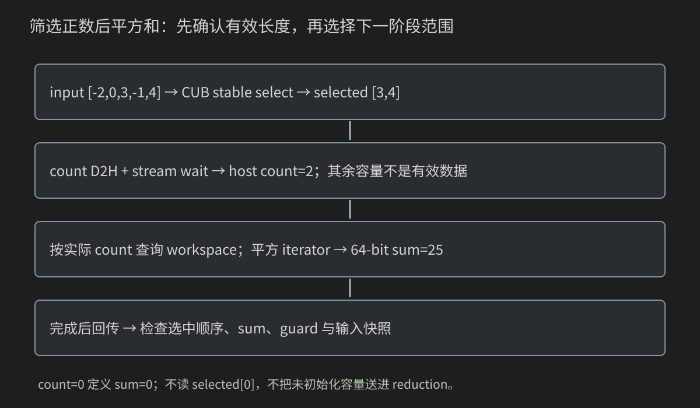
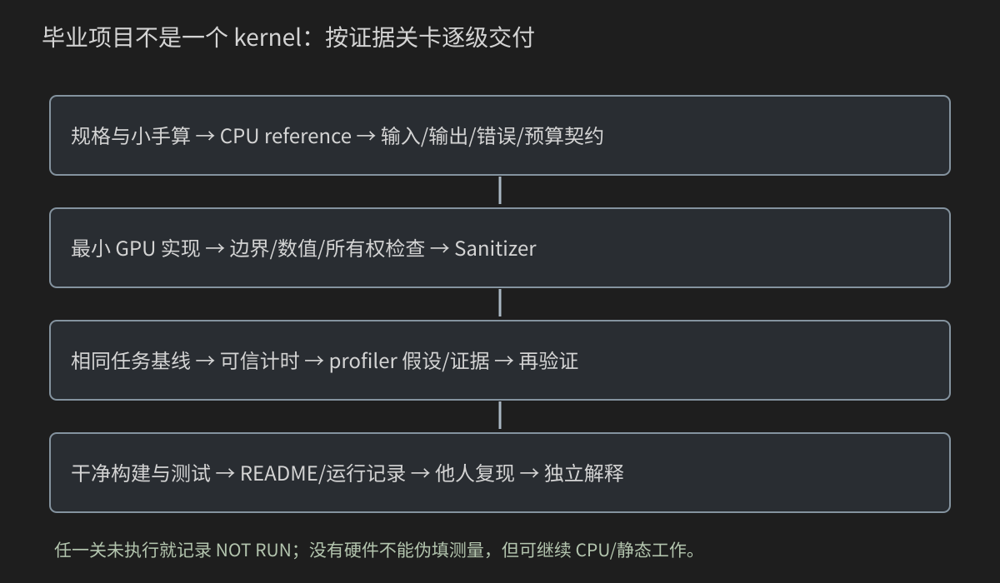

# 26 从初学者到 CUDA 工程师：完成、验证与交付一个项目

这是主线最后一章，但不是“读完26章就成为性能专家”的宣言。本章教你把前面学到的零件组织成能解释、能测试、能复现的作品，并给出独立开发的验收标准。

先跟着完成“稳定筛选正数后求平方和”工程，再从图像、线性代数、神经网络三个毕业项目中选一个独立实现。指导项目提供完整文件；独立项目提供规格、手算、阶段和验收，不替你省掉独立设计。

前置：[第14章Scan/压缩](14-Scan前缀和与流压缩.md)、[第22章库](22-Thrust-CUB-cuBLAS与库优先原则.md)、[第23章工程](23-CMake-项目结构-测试与可复现构建.md)、[第25章Softmax](25-综合项目-GPU-Softmax.md)。本机没有C++/CUDA工具链和GPU，以下工程未声称已编译/实机通过；静态证据、CPU模型、实际运行必须分别记录。

## 26.0 “完成”包含哪些层次

一个项目至少有四种完成状态：

- 规格完成：输入/输出/范围/错误/数学定义清楚。
- 实现完成：完整源码、构建文件、验证器、测试和文档齐备。
- 功能验收完成：实际编译、正常/边界/非法参数、GPU、相关Sanitizer验证。
- 性能结论完成：统一范围、多样本、环境记录、基线与profiler证据。

有源码不等于后三项；只有一台没有GPU的机器，也可以完成前两项和CPU/静态工作，但GPU验收要保留NOT RUN。不要为了让报告“像完成了”而填入虚构性能数字。

本书教材化编写完成指正文、源码、图、练习与答案齐备，不自动等于所有案例在读者GPU上都验收通过。

## 26.1 从一个小任务开始，不先造框架

任务输入：一段int数组；选择所有严格大于0的项，保持原顺序；然后求这些正数的平方和。

固定手算：

```text
input       [-2,0,3,-1,4]
predicate   [ 0,0,1, 0,1]
selected    [3,4]
count       2
square_sum  3²+4²=25
```

稳定顺序是规格的一部分，不是“只要找出同样集合就行”。[4,3]的平方和也25，却不符合selected输出契约。最终因此要同时验证序列和标量。

零不是正数；输入空或没有正数时，selected为空、sum=0。all模式检查全部被选中；none模式检查空选择；mixed检查一般位置/长度。先写这三种行为，再决定库调用。

## 26.2 范围、类型、所有权与完成语义

本工程约定：

| 项目 | 契约 |
|---|---|
| 输入 | int，项数0..1048576，每值[-1000,1000] |
| 选择条件 | value>0，稳定原顺序 |
| 结果 | vector<int> selected、64-bit signed square_sum |
| 输入所有权 | 调用方host vector拥有，后端借用，不修改 |
| 输出所有权 | Result拥有host selected，返回后可读 |
| 后端 | CPU或使用逻辑GPU0的CUB |
| 接口完成 | run_cub是完整同步host往返，不是仅提交 |
| 状态 | 0完成、1真实失败、2CLI拒绝、77不可用 |

平方最大1000000，总和上界1048576*1000000=1048576000000，超出32-bit signed范围，低于64-bit signed上限。乘法前先转换到Sum，不能先用int溢出再把错误结果转64位。

本实现预算很克制，不支持无限大数组。增加范围需重新推导乘积、计数类型、CUB接口范围、字节容量和CPU参考成本。

## 26.3 用一张图检查真正的数据流



CUB选择输出有“容量n”和“有效count”两个长度。d_selected分配最坏n项，但只前count项是结果。

count在device，host不能把d_count这个指针数值当作数量。把count回传并等完成后，才能给下一步归约传有效长度。这个host往返使接口有显式同步，不能宣传整条链为无host依赖的capture流程。

如果count=0，直接定义sum=0，跳过读不存在的selected[0]和非空归约。这是应用空契约，不靠某段未初始化内存刚好为0。

## 26.4 第一关：把CPU核心写成独立模块

include/core.h：

```cpp
#ifndef BOOK26_CORE_H
#define BOOK26_CORE_H
#include <cstddef>
#include <string>
#include <vector>
namespace book26 {
using Sum=long long;
static_assert(sizeof(Sum)==8,"This example needs a 64-bit signed sum type");
struct Result { std::vector<int> selected;Sum square_sum=0; };
bool parse(const char* text,int maximum,int& value);
std::vector<int> make_input(int n,const std::string& mode);
Result reference(const std::vector<int>& input);
bool verify(const Result& actual,const Result& expected,std::string& detail);
}
#endif
```

src/core.cpp：

```cpp
#include "core.h"
#include <charconv>
#include <stdexcept>
#include <system_error>
namespace book26 {
bool parse(const char* text,int maximum,int& value) {
    if(!text || !*text) return false;
    const char* end=text;while(*end) { if(*end<'0' || *end>'9') return false;++end; }
    int candidate=0;const auto result=std::from_chars(text,end,candidate);
    if(result.ec!=std::errc{} || result.ptr!=end || candidate>maximum) return false;
    value=candidate;return true;
}
std::vector<int> make_input(int n,const std::string& mode) {
    if(n<0 || n>1048576 || (mode!="mixed" && mode!="none" && mode!="all"))
        throw std::invalid_argument("invalid count/mode");
    std::vector<int> input(static_cast<std::size_t>(n));
    for(int i=0;i<n;++i) input[i]=mode=="none"?-(i%1000+1):(mode=="all"?i%1000+1:(i*17)%2001-1000);
    return input;
}
Result reference(const std::vector<int>& input) {
    if(input.size()>1048576U) throw std::invalid_argument("count budget");
    Result result;
    for(int value:input) {
        if(value< -1000 || value>1000) throw std::invalid_argument("value budget");
        if(value>0) { result.selected.push_back(value);result.square_sum+=static_cast<Sum>(value)*value; }
    }
    return result;
}
bool verify(const Result& actual,const Result& expected,std::string& detail) {
    detail.clear();
    if(actual.selected!=expected.selected) { detail="selected length/values/stable order mismatch";return false; }
    if(actual.square_sum!=expected.square_sum) { detail="square sum mismatch";return false; }
    return true;
}
}
```

Result把selected和square_sum绑为同一任务结果，避免一个来自旧输入、另一个来自新输入。Sum别名使host/device和接口共享同一类型约定，static_assert核对本例64位布局。

make_input确定生成mixed/none/all；reference按顺序push正数，并用64位乘加。verify比较selected全部长度/值/顺序，然后比较sum。detail解释失败，不只回一个模糊false。

不要把reference“重构优化”到调用同一个GPU后端：参考的价值是独立路径。真实项目可保留更简单CPU oracle，再另写高性能CPU基线，不混淆它们。

## 26.5 第二关：CPU测试不靠一次打印

tests/test_core.cpp：

```cpp
#include "core.h"
#include <iostream>
#include <stdexcept>
#include <string>
#include <vector>
int main() {
    const auto fixed=book26::reference({-2,0,3,-1,4});
    if(fixed.selected!=std::vector<int>({3,4}) || fixed.square_sum!=25) return 1;
    for(int n:{0,1,7,255,256,257,1031,65537}) for(const char* mode:{"mixed","none","all"}) {
        const auto input=book26::make_input(n,mode);const auto result=book26::reference(input);
        book26::Sum independent=0;std::vector<int> selected;
        for(int value:input) if(value>0) { selected.push_back(value);independent+=static_cast<book26::Sum>(value)*value; }
        if(result.selected!=selected || result.square_sum!=independent) return 1;
    }
    auto wrong=fixed;wrong.selected={4,3};std::string detail;
    if(book26::verify(wrong,fixed,detail)) return 1;
    wrong=fixed;wrong.square_sum=24;if(book26::verify(wrong,fixed,detail)) return 1;
    int value=0;for(const char* bad:{"-1","+1","1x","1048577","999999999999999999"})
        if(book26::parse(bad,1048576,value)) return 1;
    int rejected=0;
    try { book26::reference({1001}); } catch(const std::invalid_argument&) { ++rejected; }
    try { book26::make_input(1,"unknown"); } catch(const std::invalid_argument&) { ++rejected; }
    if(rejected!=2) return 1;
    std::cout<<"PASS fixed 25, 24 CPU cases, order/sum rejection; no GPU executed.\n";return 0;
}
```

固定25手算，24组输入模式/规模，错误顺序但同sum、错误sum、非法输入/解析各有检查。CPU路由无需GPU，可最先完成。

测试参考/验证器时，可用手算与更直接的独立循环交叉核对，不仅让同一reference生成expected又验证自己。某些共享算法漏洞仍可能穿过自动测试，所以固定oracle和数学范围推导保留。

```bash
g++ -std=c++17 -O2 -Wall -Wextra -Icode/26_capstone/include code/26_capstone/tests/test_core.cpp code/26_capstone/src/core.cpp -o capstone_test_core
./capstone_test_core
```

预计PASS fixed25/24CPUcases；不是GPU结果。

## 26.6 第三关：让backend接口只暴露host契约

include/backend.h：

```cpp
#ifndef BOOK26_BACKEND_H
#define BOOK26_BACKEND_H
#include "core.h"
#include <string>
#include <vector>
namespace book26 {
// Synchronous complete host roundtrip using logical GPU0, not a launch-only API.
// input immutable, size<=1048576, each value in [-1000,1000].
// 0=completed, 1=real failure, 77=unavailable; caller still verifies mathematics.
int run_cub(const std::vector<int>& input,Result& output,std::string& detail);
}
#endif
```

没有把CUDA指针、workspace、stream直接暴露给main；run_cub管理完整往返，返回Result中已完成的host数据。调用方仍做数学verify，不因为status0就省验证。

本例明确使用逻辑GPU0；若改为库供其他程序调用，需增加设备/stream参数与当前设备恢复协议，不能把这个教学函数直接宣传成任意上下文透明的通用库。

CPU-only的src/backend_stub.cpp：

```cpp
#include "backend.h"
namespace book26 {
int run_cub(const std::vector<int>&,Result&,std::string& detail) {
    detail="CUB backend not built; CPU reference is not a GPU fallback";return 77;
}
}
```

stub返回77，不用CPU参考假装CUB成功。你可以先验证CLI/项目布局，再到具备CUDA的环境启用后端。编译依赖和运行能力是不同关卡。

## 26.7 第四关：读懂库的类型，不只是复制函数名

本例Positive(value)回答是否选中；Square(value)先转Sum，再平方。它们是可在host/device调用的函数对象，供模板接口使用。

TransformInputIterator不是一份平方数组。它把d_selected的读取映射为Square(value)，DeviceReduce从该逻辑范围取值，输出Sum。它减少显式中间数组/单独转换步骤，**不保证整个库没有workspace或一定只启动一个kernel**。

接口核对采用[NVIDIA CCCL v2.5.0选择源码](https://raw.githubusercontent.com/NVIDIA/cccl/v2.5.0/cub/cub/device/device_select.cuh)、[归约源码](https://github.com/NVIDIA/cccl/blob/v2.5.0/cub/cub/device/device_reduce.cuh)、[变换iterator源码](https://github.com/NVIDIA/cccl/blob/v2.5.0/cub/cub/iterator/transform_input_iterator.cuh)。实际使用Toolkit配套头；不要把不同版本include目录随意拼在一起。

库的count类型、输出类型、stream、query和有效范围都要对应规格。即使函数名看起来像“Sum”，也不帮你决定正数条件或稳定序列的验收。

## 26.8 第五关：完整CUB后端全文

src/cub_backend.cu：

```cpp
#include "backend.h"
#include <cuda_runtime.h>
#include <cub/device/device_reduce.cuh>
#include <cub/device/device_select.cuh>
#include <cub/iterator/transform_input_iterator.cuh>
#include <cub/version.cuh>
#include <algorithm>
#include <cstddef>
#include <exception>
#include <stdexcept>
#include <string>
#include <vector>

namespace {
struct Positive { __host__ __device__ bool operator()(int value) const { return value>0; } };
struct Square { __host__ __device__ book26::Sum operator()(int value) const { return static_cast<book26::Sum>(value)*value; } };
void check(cudaError_t status,const char* operation) {
    if(status!=cudaSuccess) throw std::runtime_error(std::string(operation)+": "+cudaGetErrorString(status));
}
}
namespace book26 {
int run_cub(const std::vector<int>& input,Result& output,std::string& detail) {
    detail.clear();output=Result{};
    if(input.empty()) { detail="empty contract; no CUB execution";return 0; }
    if(input.size()>1048576U) { detail="count budget";return 1; }
    for(int value:input) if(value< -1000 || value>1000) { detail="value budget";return 1; }
    int devices=0;const auto probe=cudaGetDeviceCount(&devices);
    if(probe==cudaErrorNoDevice || probe==cudaErrorInsufficientDriver || (probe==cudaSuccess && devices==0)) {
        detail="no usable CUDA device/driver";return 77;
    }
    if(probe!=cudaSuccess) { detail=cudaGetErrorString(probe);return 1; }
    int *d_input=nullptr,*selected_storage=nullptr,*d_count=nullptr;
    Sum* d_sum=nullptr;void* scratch=nullptr;cudaStream_t stream{};
    std::size_t capacity=0;int count=-1,status=1;
    constexpr int guard=-2000000000;
    std::vector<int> selected_host(input.size()+2,guard),after(input.size());
    Sum sum_sentinel=-1; // Host buffers/sentinels outlive catch and cleanup wait.
    try {
        check(cudaSetDevice(0),"select GPU0");
        const int n=static_cast<int>(input.size());const auto bytes=input.size()*sizeof(int);
        check(cudaStreamCreateWithFlags(&stream,cudaStreamNonBlocking),"stream");
        check(cudaMalloc(&d_input,bytes),"input");
        check(cudaMalloc(&selected_storage,selected_host.size()*sizeof(int)),"guarded selected");
        check(cudaMalloc(&d_count,sizeof(int)),"selected count");
        check(cudaMemcpyAsync(d_input,input.data(),bytes,cudaMemcpyHostToDevice,stream),"upload input");
        check(cudaMemcpyAsync(selected_storage,selected_host.data(),selected_host.size()*sizeof(int),cudaMemcpyHostToDevice,stream),"selected sentinel");
        check(cudaMemcpyAsync(d_count,&count,sizeof(int),cudaMemcpyHostToDevice,stream),"count sentinel");
        int* d_selected=selected_storage+1;
        auto ensure=[&](std::size_t required) {
            required=std::max(required,std::size_t{1});
            if(required<=capacity) return;
            if(scratch) { void* old=scratch;scratch=nullptr;capacity=0;check(cudaFree(old),"grow: free completed workspace"); }
            check(cudaMalloc(&scratch,required),"allocate workspace");capacity=required;
        };
        std::size_t required=0;
        check(cub::DeviceSelect::If(nullptr,required,d_input,d_selected,d_count,n,Positive{},stream),"select query");
        ensure(required);std::size_t available=capacity;
        check(cub::DeviceSelect::If(scratch,available,d_input,d_selected,d_count,n,Positive{},stream),"select execute");
        check(cudaGetLastError(),"select launch state");
        check(cudaMemcpyAsync(&count,d_count,sizeof(int),cudaMemcpyDeviceToHost,stream),"count D2H");
        check(cudaStreamSynchronize(stream),"count ready and select workspace no longer in use");
        if(count<0 || count>n) throw std::runtime_error("selected count outside [0,n]");
        if(count>0) {
            check(cudaMalloc(&d_sum,sizeof(Sum)),"sum");
            check(cudaMemcpyAsync(d_sum,&sum_sentinel,sizeof(Sum),cudaMemcpyHostToDevice,stream),"sum sentinel");
            using Iterator=cub::TransformInputIterator<Sum,Square,const int*>;
            Iterator squares(d_selected,Square{});
            required=0;check(cub::DeviceReduce::Sum(nullptr,required,squares,d_sum,count,stream),"reduce actual count query");
            ensure(required);available=capacity;
            check(cub::DeviceReduce::Sum(scratch,available,squares,d_sum,count,stream),"square reduce execute");
            check(cudaGetLastError(),"reduce launch state");
            check(cudaMemcpyAsync(&output.square_sum,d_sum,sizeof(Sum),cudaMemcpyDeviceToHost,stream),"sum D2H");
            check(cudaStreamSynchronize(stream),"sum complete; sentinel lifetime ends");
        }
        check(cudaMemcpyAsync(selected_host.data(),selected_storage,selected_host.size()*sizeof(int),cudaMemcpyDeviceToHost,stream),"selected and guards D2H");
        check(cudaMemcpyAsync(after.data(),d_input,bytes,cudaMemcpyDeviceToHost,stream),"input snapshot D2H");
        check(cudaStreamSynchronize(stream),"complete result transfers");
        if(selected_host.front()!=guard || selected_host.back()!=guard || after!=input)
            throw std::runtime_error("guard or immutable input violated");
        output.selected.assign(selected_host.begin()+1,selected_host.begin()+1+count);
        status=0;
    } catch(const std::exception& error) { detail=error.what(); }
    auto cleanup=[&](cudaError_t code,const char* operation) {
        if(code!=cudaSuccess) { if(detail.empty()) detail=std::string(operation)+": "+cudaGetErrorString(code);status=1; }
    };
    if(stream) cleanup(cudaStreamSynchronize(stream),"cleanup wait");
    if(scratch) cleanup(cudaFree(scratch),"free workspace");
    if(d_sum) cleanup(cudaFree(d_sum),"free sum");
    if(d_count) cleanup(cudaFree(d_count),"free count");
    if(selected_storage) cleanup(cudaFree(selected_storage),"free selected");
    if(d_input) cleanup(cudaFree(d_input),"free input");
    if(stream) cleanup(cudaStreamDestroy(stream),"destroy stream");
    if(status==0) detail="CUB_VERSION="+std::to_string(CUB_VERSION)+" count="+std::to_string(count)+" workspace_capacity="+std::to_string(capacity);
    return status;
}
}
```

它做query→allocate→select→count完成→按实际count query→reduce→结果完成。不是把两份独立示例main粘在一起。

selected_host前后guard验证容量边界，after验证device输入不变；只有有效前count项赋给Result，不拿未选中的剩余容量作有效数据。程序只读取无选中前缀之外的值以保留guard/容量快照，**不把这些未使用项传给归约**。

host selected_host/after/sum_sentinel的生命周期跨过catch与cleanup wait；即使异常退出try，队列中仍可能使用它们，不能提前销毁。raw device资源同样在收尾前尝试完成。设备失效/清理失败仍报真实失败，不声称保证恢复一切状态。

## 26.9 count改变后为什么再查询workspace

选择的n与归约的count不同，后者运行前才知道。不要未经保证假设“以最大n查过的workspace必然适合任意更小count的所有算法”。

本例在select/count已完成后，按**实际count**查询Reduce需求。ensure只在需要时扩容量，旧scratch已不再被select使用；每次execute的available从真实capacity重新设置。

如果scratch还被别的stream并发使用，不能直接free/grow。此程序只单stream顺序操作，count完成点明确；扩到流水线时每槽要有独立workspace或有可证明的复用依赖。

ensure/cleanup使用第22章讲过的[host lambda](22-Thrust-CUB-cuBLAS与库优先原则.md)：按引用借用scratch/capacity或错误状态，在当前调用期间管理资源，不把这个对象当device算法或异步回调。变量和Async缓冲的生命周期仍由前述完成协议保证。

这个设计优先清楚与正确，不是优化count往返。若性能需求要去掉host依赖，必须重新设计device count消费/Graph节点/容量协议，并保留原baseline作为对照。

## 26.10 main把前置检查、执行、证据分开

src/main.cpp：

```cpp
#include "core.h"
#include "backend.h"
#include <chrono>
#include <exception>
#include <iostream>
#include <string>
int main(int argc,char** argv) {
    int n=1031;const std::string mode=argc>2?argv[2]:"mixed",backend=argc>3?argv[3]:"cpu";
    if(argc>4 || (argc>1 && !book26::parse(argv[1],1048576,n)) ||
       (mode!="mixed" && mode!="none" && mode!="all") || (backend!="cpu" && backend!="cub")) {
        std::cerr<<"Usage: capstone [n:0..1048576] [mixed|none|all] [cpu|cub]\n";return 2;
    }
    try {
        const auto input=book26::make_input(n,mode),before=input;
        const auto expected=book26::reference(input);
        book26::Result output;std::string detail;int status=0;
        if(n==0) { std::cout<<"PASS empty contract: count=0 sum=0; no backend executed.\n";return 0; }
        const auto start=std::chrono::steady_clock::now();
        if(backend=="cpu") { output=book26::reference(input);detail="CPU-only route"; }
        else status=book26::run_cub(input,output,detail);
        const double ms=std::chrono::duration<double,std::milli>(std::chrono::steady_clock::now()-start).count();
        if(status==77) { std::cout<<"NOT RUN: "<<detail<<'\n';return 77; }
        if(status!=0) { std::cerr<<"FAIL backend: "<<detail<<'\n';return 1; }
        std::string problem;
        if(input!=before || !book26::verify(output,expected,problem)) { std::cerr<<"FAIL: "<<problem<<'\n';return 1; }
        std::cout<<"PASS backend="<<backend<<" n="<<n<<" mode="<<mode<<" selected="<<output.selected.size()
                 <<" square_sum="<<output.square_sum<<"; "<<detail<<'\n';
        std::cout<<"backend_call_sample_ms="<<ms<<" (one correctness run, not a fair performance comparison)\n";return 0;
    } catch(const std::exception& error) { std::cerr<<"FAIL: "<<error.what()<<'\n';return 1; }
}
```

CPU backend用于参考/构建通路；cub backend是GPU往返。n=0在main直接说明没有backend执行。NOT RUN分支在数学验证前返回，避免未生成Result被误验。

backend_call_sample_ms仅一次正确性运行的函数范围：CPU包含CPU reference计算，CUB包含分配/query/传输/依赖/验证快照/清理等。它不是公平CPU/GPU性能基准；源input创建与expected计算在区间外。记录字段名字和旁边说明共同定义范围，不因为输出单位ms就可以拿来排名。

CLI合法先于GPU初始化；mode/backend/n错误返回2并打印Usage。所有真实异常/API/验证错误失败，不为“继续运行”而吞错误。

## 26.11 第六关：完整构建与拒绝测试

CMakeLists.txt：

```cmake
cmake_minimum_required(VERSION 3.24)
project(book26 LANGUAGES CXX)
option(BOOK26_ENABLE_CUDA "Build CUB capstone backend" OFF)
include(CTest)
add_library(book26_core STATIC src/core.cpp)
target_include_directories(book26_core PUBLIC "${CMAKE_CURRENT_SOURCE_DIR}/include")
target_compile_features(book26_core PUBLIC cxx_std_17)
if(BOOK26_ENABLE_CUDA)
  if(NOT DEFINED CMAKE_CUDA_ARCHITECTURES OR "${CMAKE_CUDA_ARCHITECTURES}" STREQUAL "")
    message(FATAL_ERROR "Set a verified CMAKE_CUDA_ARCHITECTURES list")
  endif()
  enable_language(CUDA)
  find_package(CUDAToolkit REQUIRED)
  add_library(book26_backend STATIC src/cub_backend.cu)
  target_link_libraries(book26_backend PRIVATE CUDA::cudart)
  set_target_properties(book26_backend PROPERTIES CUDA_STANDARD 17 CUDA_STANDARD_REQUIRED ON CUDA_RUNTIME_LIBRARY Shared)
  target_compile_options(book26_backend PRIVATE $<$<COMPILE_LANGUAGE:CUDA>:-lineinfo>)
else()
  add_library(book26_backend STATIC src/backend_stub.cpp)
endif()
target_include_directories(book26_backend PUBLIC "${CMAKE_CURRENT_SOURCE_DIR}/include")
target_compile_features(book26_backend PUBLIC cxx_std_17)
add_executable(book26_app src/main.cpp)
target_link_libraries(book26_app PRIVATE book26_core book26_backend)
if(BOOK26_ENABLE_CUDA)
  set_target_properties(book26_app PROPERTIES CUDA_RUNTIME_LIBRARY Shared)
endif()
add_executable(book26_test_core tests/test_core.cpp)
target_link_libraries(book26_test_core PRIVATE book26_core)
if(BUILD_TESTING)
  add_test(NAME book26_core COMMAND book26_test_core)
  foreach(n 0 1 7 255 256 257 1031)
    foreach(mode mixed none all)
      foreach(backend cpu cub)
        add_test(NAME book26_${backend}_${n}_${mode} COMMAND book26_app ${n} ${mode} ${backend})
        set_tests_properties(book26_${backend}_${n}_${mode} PROPERTIES SKIP_RETURN_CODE 77 RUN_SERIAL TRUE TIMEOUT 90)
      endforeach()
    endforeach()
  endforeach()
  foreach(case negative mode backend budget)
    add_test(NAME book26_reject_${case} COMMAND "${CMAKE_COMMAND}" "-DAPP=$<TARGET_FILE:book26_app>"
      "-DCASE=${case}" -P "${CMAKE_CURRENT_SOURCE_DIR}/tests/reject_cli.cmake")
  endforeach()
endif()
```

tests/reject_cli.cmake：

```cmake
set(args 7 mixed cpu)
if(CASE STREQUAL "negative")
  set(args -1 mixed cpu)
elseif(CASE STREQUAL "mode")
  set(args 7 unknown cpu)
elseif(CASE STREQUAL "backend")
  set(args 7 mixed unknown)
elseif(CASE STREQUAL "budget")
  set(args 1048577 mixed cpu)
else()
  message(FATAL_ERROR "unknown CASE")
endif()
execute_process(COMMAND "${APP}" ${args} RESULT_VARIABLE result OUTPUT_VARIABLE output ERROR_VARIABLE error TIMEOUT 15)
if(NOT "${result}" STREQUAL "2" OR NOT error MATCHES "Usage:")
  message(FATAL_ERROR "Expected exit2 + Usage, got ${result}: ${output} ${error}")
endif()
```

工程默认CPU-only，选择stub；CUDA开启后切到真实CUB实现，且仅一份run_cub定义。CPU core/headers不要求CUDA。FindCUDAToolkit提供cudart依赖，最终host executable仍需要正确Runtime链接。

拒绝测试要exit2+Usage，不能把无GPU77或崩溃当作预期非法参数处理。GPU测试skip77；CPU-only下cub正n跳过，而empty没有GPU，不等于CUB验收通过。

## 26.12 从干净build tree运行，而不是依赖旧缓存

```bash
cmake -S code/26_capstone -B build-book26-cpu -DCMAKE_BUILD_TYPE=Release
cmake --build build-book26-cpu --config Release
ctest --test-dir build-book26-cpu -C Release --output-on-failure
./build-book26-cpu/book26_app 1031 mixed cpu
./build-book26-cpu/book26_app 1031 mixed cub
```

最后一条在CPU-only应NOT RUN/77。CUDA路线使用新目录，以下80只在已确认CC8.0+Toolkit支持sm_80时适用：

```bash
cmake -S code/26_capstone -B build-book26-gpu -DCMAKE_BUILD_TYPE=Release -DBOOK26_ENABLE_CUDA=ON -DCMAKE_CUDA_ARCHITECTURES=80
cmake --build build-book26-gpu --config Release --verbose
ctest --test-dir build-book26-gpu -C Release --output-on-failure
./build-book26-gpu/book26_app 1031 mixed cub
./build-book26-gpu/book26_app 1031 none cub
./build-book26-gpu/book26_app 1031 all cub
```

手动编译真实后端：

```bash
nvcc -std=c++17 -O3 -lineinfo -Icode/26_capstone/include code/26_capstone/src/main.cpp code/26_capstone/src/core.cpp code/26_capstone/src/cub_backend.cu -o capstone
./capstone 1031 mixed cub
```

输入三个源提供main、CPU定义、CUDA库后端，不另加stub。命令分解见第23章；构建选择错误造成重复/缺定义，要先检查源列表，而非随机改include。

## 26.13 第七关：验收矩阵与工具

最少覆盖：

| 类别 | 输入 |
|---|---|
| 数学 | [-2,0,3,-1,4]→[3,4]/25 |
| 空/小 | 0、1、7 |
| 边界/尾部 | 255、256、257、1031、65537 |
| 有效长度 | mixed、none、all |
| 拒绝 | 负n、超预算、非法mode/backend |
| 序列 | 错顺序但平方和相同 |
| 范围 | [-1000,1000]、不合法1001 |
| 运行能力 | CPU-only、无GPU、真实GPU |

```bash
compute-sanitizer --tool memcheck --error-exitcode 99 ./capstone 1031 mixed cub
compute-sanitizer --tool initcheck --error-exitcode 99 ./capstone 1031 none cub
nsys profile --trace=cuda,osrt -o capstone_flow ./capstone 1031 mixed cub
```

none必须经过真实select得count0，区别于n0完全不执行库。用Systems确认count回传/host等待/后续reduce范围；工具结果按实际支持记录，不猜测CUB内部固定kernel数量。

## 26.14 第八关：一份可交付README应回答什么

README至少包含：

1. 精确任务、输入/输出/范围/空语义。
2. 前置C++/CUDA/架构/库版本，CPU-only与GPU路线。
3. 从仓库根目录的configure/build/test/run命令。
4. 退出0/1/2/77，哪些正常测试可能跳过。
5. 已验收平台与未执行清单。
6. 数值/序列/guard/input checks，工具报告位置。
7. benchmark范围、预热、统计与基线公平性。
8. 当前限制与下一步，而非“任何GPU/任意shape都支持”。

不要共享build/cache、账号/令牌、私人服务器地址与绝对本机路径。需要数据集时给出合法来源/下载方法/格式与摘要，别让读者必须知道你桌面目录才能运行。

## 26.15 交付证据必须分层，不能拼成一行PASS



用状态表：

| 证据 | 状态示例 | 可得出的结论 |
|---|---|---|
| 数学手算/独立模型 | 已核对 | 预期与范围推导 |
| 源码/链接/镜像检查 | 已检查 | 文档与文件一致、无已知缺项 |
| C++/CMake构建 | 未执行 | 不能声称实际编译成功 |
| GPU oracle | 未执行/跳过/通过/失败 | 仅对应所测配置/输入 |
| Sanitizer | 未安装/未跑/通过/失败 | 对应工具覆盖范围 |
| profiler/benchmark | 未采集/已采集 | 不能把没有报告写成速度结论 |

工具可能改变运行时间，static可能遗漏编译/API错误，oracle可能遗漏数据竞争；证据互相补充，不互相替代。每项记录命令、返回码、平台和日期。

本书附带的是待填写[项目记录模板](code/26_capstone/project_record_template.md)，不是写满虚构数据的“验收报告”。

## 26.16 毕业项目A：图像处理管线的完整规格

做灰度图：输入H×W float连续row-major，有限值；先Gaussian blur，再Sobel梯度，再阈值。起步不用文件读取/图像库，生成小数组，把核心算子先验证。

约定第一版：

- Gaussian取可分离核[1,2,1]/4，两次一维滤波。
- 图像外按零处理；横纵两遍边界策略一致。
- Sobel使用明确给出的相关模板，不暗中翻转。
- Gx=[[-1,0,1],[-2,0,2],[-1,0,1]]；Gy=[[-1,-2,-1],[0,0,0],[1,2,1]]。
- magnitude=sqrt(Gx²+Gy²)，output为magnitude>=threshold的0/1。
- CPU使用double中间参考；先验证blur/Gx/Gy/magnitude，再验证阈值。

为什么不只比最终0/1？阈值会隐藏小误差或在临界点放大误差。定义浮点容差和临界阈值政策，否则CPU/GPU都合理却可能在最后一位标签不同。

## 26.17 图像项目的小手算与阶段路线

5×5图中心只有一个1，其余0，做可分离Gaussian：中心3×3区域的权重为

```text
1/16  2/16  1/16
2/16  4/16  2/16
1/16  2/16  1/16
```

其余为0；小图边界也要按零处理核对。先只实现blur并打印25项，不一开始加入文件I/O、多stream和多GPU。

阶段：

1. CPU三阶段参考与固定25项oracle。
2. naive GPU，逐阶段独立缓冲、全量校验。
3. constant/filter与shared halo对照，复用第17章技术。
4. 正确后再加入chunk/slot，先证明跨chunk halo与缓冲复用。
5. Systems验证实际重叠，统一完整workflow范围计时。
6. 多GPU仅作为选做，必须按第24章重新设计halo交换。

独立交付至少测H/W=1/2/3、奇数、非整tile、threshold临界；默认不得运行故意坏sync kernel。是否加载真实图像是外围能力，不应掩盖核心数学还没正确。

## 26.18 毕业项目B：小型线性代数工具的完整规格

第一版只提供三个命令：vector SAXPY、transpose、GEMM。各自定义shape/layout/type/alpha/beta，不把接口混成一堆无单位参数。

要求：

- SAXPY y=alpha*x+y_old，明确非零初始y。
- transpose输出[N,M]，不原地写重叠。
- GEMM C=alpha*A*B+beta*C_old，先明确row-major与库映射。
- CPU double参考；精确小整数与一般分数两套输入。
- 手写教学baseline与cuBLAS生产候选，均全量验证输入/输出/guard。
- CLI非法shape拒绝，库未构建/已定义不可用跳过，真实失败不能fallback掩盖。

固定GEMM可以用A=[[1,2,3],[4,5,6]]，B=[[1,2],[3,4],[5,6]]，AB=[[22,28],[49,64]]。取alpha2、beta0.5、C_old全为2，结果[[45,57],[99,129]]。只测beta0容易漏掉旧C初始化/恢复错误。

## 26.19 线性代数项目的工程关卡

先建立shape/reference/validator普通C++库，再建立CUDA/cuBLAS后端；公共接口说明输入所有权和完成语义。暂不要求写通用tensor、表达式模板或插件系统。

自定义DeviceBuffer可作为第二版练习，但必须回答：拷贝是否禁止？move后旧对象什么状态？异步消费者何时完成？析构失败如何报告？RAII不能替你消除stream中尚在访问内存的操作。

GEMM比较保持同一A/B/C_old、每轮恢复C、相同精度、相同范围。调用库不免除布局/leading dimension/padding的解释，回看第16/22章，不再次重写整套算法。

验收M/K/N=1、不规则37/29/23、各维tile前后、padding、alpha/beta；输出每项及guard不能只看norm/总和。报告中把库启动/配置和稳态重复分别标注。

## 26.20 毕业项目C：神经网络算子的完整规格

建议从第25章Softmax开始独立重写，不直接复制目录。完成后选择一个新增需求：masked Softmax、temperature、LayerNorm或fused bias+activation；第一轮只选一个。

例如LayerNorm，对每行n项：

$$
\mu=\frac1n\sum_i x_i,\qquad
v=\frac1n\sum_i(x_i-\mu)^2,\qquad
y_i=\frac{x_i-\mu}{\sqrt{v+\epsilon}}\gamma_i+\beta_i.
$$

先定义epsilon>0、gamma/beta布局、float累加、有限输入、单列与constant行行为。若gamma1/beta0，constant行结果为0。单列也应0，不能除零。

这是新算法，不能把Softmax的exp/sum改两个名字就当作实现。CPU先用上述直观两遍方差参考；GPU若用不同稳定算法，要说明数值差异。是否提供backward是另一任务，不暗中假设forward项目包含训练全部功能。

## 26.21 算子项目的公平比较

基线可以是手写serial/block、成熟库或框架，但比较必须匹配：

- 数学：Softmax vs log-softmax、mask、temperature、归一化维度。
- 布局/类型：contiguous vs stride、FP32 vs低精度、累加精度。
- 生命周期：分配/转换/传输是否纳入范围。
- 同步：host提交 vs实际完成。
- 工作量：一次forward vsforward/backward。
- 数据：固定同一原输入，不把输出当下一次输入。

一个框架总耗时可能含语言调度/张量创建，raw CUDA kernel time不包含；分别报告或统一相同范围，不能用不同层级数字给“自写比框架快十倍”结论。

结果正确也需看应用价值：单个小kernel快了，但整个端到端增加更多传输/转换，可能总体变慢。优化对象必须是实际瓶颈，不是收藏尽量多的CUDA技巧。

## 26.22 从“看懂”变成独立实现的训练方法

对任一指导项目，做四遍：

1. 按教材构建，预测每个小输入，再核对输出。
2. 合上代码，只保留规格和数据流，从空文件重写CPU与最小GPU。
3. 换shape、模式和一个参数，先推导影响，再测试。
4. 给自己一个新需求，写新契约、CPU参考、测试，再改GPU。

如果卡在某API名称，可查文档；如果卡在“每thread负责什么”，必须回到算法图。能查API不代表不会写，不能设计依赖才是真正缺口。

每次复盘记录三句话：我以为会怎样；实际证据是什么；我改了哪个假设。不要只记“修好了”。这个过程能让相同错误下次被前置检查拦住。

## 26.23 错误处理：把失败分类，不掩盖

错误至少分为输入错误、环境不可用、编译/链接、API提交、异步执行、数值/范围、资源清理。日志记录阶段/设备/shape/操作，按第7章方法从第一条关键错误定位。

已知没有GPU可以skip；实际非法地址不是“GPU不支持”。先不要增加retry、reset和fallback，它们可能隐藏错误或让共享资源状态更复杂。特别是分布式程序中某rank失败，其他rank可能等待；要设计协调终止，而非单rank吞错继续collective。

检查脚本应该明确失败返回非零，工具timeout/未安装也不等于PASS。公开仓库不要依赖私人Python维护脚本替读者构建；用源码内验证、CMake/CTest和明确工具命令作学习入口。

## 26.24 性能报告：写一个能被别人反驳的结论

不用“显然更快”“内存优化很好”代替证据。按这个结构写：

```text
问题与数学：……
输入shape/类型/生成规则：……
baseline与候选：……
相同/不同的实现因素：……
计时范围与完成点：……
预热/样本/方法轮换：……
GPU/driver/Toolkit/库/构建commit：……
实际统计：待实测
profiler观察：待采集
正确性/Sanitizer：待验收
仍未执行与限制：……
结论适用范围：……
```

合成模型可帮估计上界，不能当真实测量。指标变化只能支持相应假设，不自动证明因果；必要时做控制实验，一次只改一件事。

CUB capstone当前含count往返与分配，若要benchmark稳态library workflow，就把资源常驻、明确查询/分配范围，再保持数学/验证不变。不能把移出计时区的真实应用成本“优化消失”而不解释。

## 26.25 测试设计：成功路径不能覆盖所有风险

用维度和模式相互组合，优先覆盖独特风险，不只增加随机样本数量。

例如Softmax cols31/32/33检验warp支持边界；Scan非2次幂检验树与多阶段；stencil单像素检验边界；GEMM beta非0检验旧输出；stream多chunk少slot检验复用；多GPU奇数检验分片。

测试证据分为算法oracle、范围/所有权、状态/拒绝、同步工具、性能范围。每个优化先回归正确性，再重新profile，避免速度提升来自漏算、少验证或无意改变规格。

静态工具无法取代真实编译/API/GPU验证；实机测试也无法枚举所有输入。保留数学证明与代码契约，写出未覆盖风险，而非宣称“测试全绿所以任何输入都没问题”。

## 26.26 接下来怎样读官方Guide与专题

现在能从具体问题选择资料，而不是按高级术语收集清单：

| 需求 | 先复习本书 | 后续主资料 |
|---|---|---|
| 执行/同步行为 | 4、7、10、12、20 | Programming Guide/Runtime API |
| 性能瓶颈 | 9、15—19 | Best Practices/Nsight |
| 库契约 | 16、22、26 | CCCL/cuBLAS/相应库官方文档 |
| 设备与通信 | 24 | 多GPU章节/NCCL |
| 自定义编译/加载 | 2、3、23 | Driver API/NVRTC/NVCC |
| 领域算子 | 25、26 | cuDNN/CUTLASS/应用原始论文 |

Driver API、NCCL、UMD是后续专题，不是本书全部入门技能的前置条件。UMD/驱动源码学习和CUDA应用编程是不同层次，按你项目兴趣再另开路线；不把其他厂商驱动内容混入这份纯CUDA教材。

[官方Programming Guide](https://docs.nvidia.com/cuda/cuda-programming-guide/)的高级/技术附录不是本书逐页译本。读到正在使用的功能时核对签名、作用域、支持、生命周期、版本；不要把未覆盖的高级特性当作“已经掌握”。本书完成的是明确范围的应用编程主线。

## 26.27 版本、实验日志与资料来源

用对应Toolkit归档文档核对，不从最新版网页推断旧服务器所有API可用。记录Toolkit、driver、GPU CC、库版本、CMake/host compiler、构建flags和commit，它们共同定义一个实验。

本书源码和图为教学重写；事实以各章官方链接为依据。若从公开项目选代码，检查其许可证/版本和上下文，保留必要出处，不把一句博客经验改写为语言保证。

不需要把私有聊天、账号、硬件登录资料放进读者仓库。学习中遇到的障碍可以转为每章知识点和验收，但技术结论必须另行核对。

## 26.28 一份分阶段学习计划，不设虚假的统一速度

第一阶段：能从空文件写带oracle的一维/二维程序，解释bytes、索引、launch和完成。第二阶段：独立完成归约/Scan/转置/stencil中的两种，说明同步与尾部。第三阶段：用profiler完成一次有证据的优化，再比较成熟库。第四阶段：用CMake/CTest交付一个毕业项目。

每阶段以能力关卡结束，不以“每天看完一章”强迫推进。有的读者还在补C++，有的熟悉CPU但不懂CUDA并发，所需时间不同。

遇到困难回到最小数据，不一次引入模板封装、Tensor Core、TMA、PTX和多节点。高级主题只有在回答具体需求时才有价值；它们不是看完主线后必须立刻逐个实现的清单。

## 26.29 递进练习与交付题

1. 写出稳定筛选与“集合相同”的区别。
2. 固定[-2,0,3,-1,4]的count/selected/sum。
3. 推导本工程sum的上界与所需类型。
4. 为什么转换要发生在乘法前？
5. none与n0在GPU执行证据上有何区别？
6. output容量n与有效count有何区别？
7. count D2H后为何必须完成再决定reduce长度？
8. 实际count查询workspace解决哪种假设风险？
9. 为什么同stream复用不等于跨stream可共用workspace？
10. TransformInputIterator是否保证完全无workspace？
11. guard与stable-order oracle分别保护什么？
12. 主机Async源缓冲为什么需要活过catch？
13. CPU-only stub为什么返回77而不计算CPU结果？
14. backend status0后为何还做数学verify？
15. 一次backend_call_sample_ms能否给CPU/GPU排名？
16. 为图像项目推导中心脉冲Gaussian权重。
17. 只检查最终threshold为何不够？
18. 多chunk stencil应该怎样处理halo？
19. 手算给定alpha2/beta0.5的非零C_old GEMM。
20. 只测beta0会漏掉什么？
21. LayerNorm constant行/单列在gamma1/beta0下是什么？
22. 框架端到端与raw kernel时间如何公平比较？
23. 写一份“实现完成，但GPU尚未验收”的诚实状态表。
24. 给你的项目设计八类最小验收输入。
25. 对一次优化写可被证伪的假设与控制实验。
26. 新增设备/stream参数时，backend契约要改哪些项？
27. 从空目录交付一个独立项目，哪些文件/证据必需？
28. 用自己的话总结：给你一个CPU循环，怎样走到可靠CUDA实现？

参考答案与验收标准见[附录C](附录-C-练习答案.md)，开放项目不提供虚构唯一性能结论。

## 26.30 最终毕业验收：给别人，不给自己的记忆兜底

请让另一位读者只拿仓库和README，在兼容环境：

- 找到CPU/GPU前提与明确版本。
- 从新目录构建，不依赖旧cache/你的绝对路径。
- 执行正常/边界/拒绝测试，区分pass/skip/fail。
- 核对小输入oracle、工具状态和真实报告。
- 复现测量范围，知道哪些数字不可跨机器比较。
- 看见限制、未测项目和后续实验，而非隐含承诺。

然后合上代码回答输入、线程责任、地址、资源所有权、同步范围、完成点、验证与瓶颈。能查文档、能承认未测、能解释为何正确，都是工程能力的一部分。

## 26.31 主线到这里结束，但练习循环继续

从普通C++变量/数组/终端，到GPU线程、内存、并行模式、工具、库、工程、多卡与完整算子，你已经有一条可以反复实践的路径。下一步不是重复抄一遍26章，而是选择一个清楚问题，保留CPU参考，独立设计、验证、测量、复盘。

回到[阅读地图](00-阅读地图.md)选择要复习的章节；命令、诊断、答案、资料与术语见附录。完成教材阅读不等于完成所有服务器验收，但你应该知道每个尚未完成的关卡是什么，以及用什么证据去完成它。
