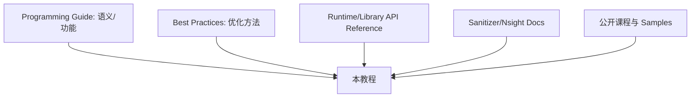

# 附录 D：资料来源与继续学习

## 资料体系

本书没有逐字翻译或大段复制这些资料，而是重新组织教学顺序、图示、代码和练习。版本敏感的 API、限制与数值始终以你服务器 Toolkit 对应文档为准。

## NVIDIA 官方核心文档

- [CUDA Programming Guide](https://docs.nvidia.com/cuda/cuda-programming-guide/)
- [CUDA C++ Best Practices Guide](https://docs.nvidia.com/cuda/cuda-c-best-practices-guide/)
- [CUDA Runtime API](https://docs.nvidia.com/cuda/cuda-runtime-api/)
- [NVCC Compiler Driver](https://docs.nvidia.com/cuda/cuda-compiler-driver-nvcc/)
- [Linux Installation Guide](https://docs.nvidia.com/cuda/cuda-installation-guide-linux/)
- [Compute Sanitizer](https://docs.nvidia.com/compute-sanitizer/ComputeSanitizer/)
- [Nsight Systems User Guide](https://docs.nvidia.com/nsight-systems/UserGuide/)
- [Nsight Compute](https://docs.nvidia.com/nsight-compute/)
- [CUDA Math API](https://docs.nvidia.com/cuda/cuda-math-api/)
- [cuBLAS Documentation](https://docs.nvidia.com/cuda/cublas/)
- [CCCL Documentation](https://nvidia.github.io/cccl/)

## 官方教程与代码

- [An Even Easier Introduction to CUDA（2025 更新）](https://developer.nvidia.com/blog/even-easier-introduction-cuda/)
- [CUDA Platform / Guided Learning](https://developer.nvidia.com/cuda)
- [NVIDIA CUDA Samples](https://github.com/NVIDIA/cuda-samples)
- [Using CUDA Warp-Level Primitives](https://developer.nvidia.com/blog/using-cuda-warp-level-primitives/)

CUDA Samples 是功能样例库，不是性能验证套件，也不适合不加选择地按目录顺序学习。建议先读本书，再挑与当前主题匹配的 sample。

## 公开课程

- [ORNL/NERSC CUDA Training Series](https://www.olcf.ornl.gov/cuda-training-series/)
- [配套练习仓库](https://github.com/olcf/cuda-training-series)
- [NVIDIA DLI/Training](https://www.nvidia.com/en-us/training/)

ORNL 课程共 13 个主题，基础概念扎实，但部分 2020–2021 集群命令和工具界面可能过时；把讲义用于理解，把实际命令替换为服务器当前环境。

## 书籍

- Wen-mei W. Hwu、David B. Kirk、Izzat El Hajj：《Programming Massively Parallel Processors: A Hands-on Approach》，第 4 版。

它适合系统学习并行模式、GPU 架构和算法。阅读时仍需用当前 Programming Guide 核对新版本行为。

## 按主题继续

| 方向 | 下一步 |
|---|---|
| 通用高性能 kernel | CUB、CCCL、CUTLASS、Best Practices |
| 深度学习算子 | cuBLASLt、cuDNN、CUTLASS、framework custom op |
| 多 GPU | NCCL、MPI、NVSHMEM、拓扑与 NUMA |
| 稀疏计算 | cuSPARSE、图算法、load balancing |
| 科学计算 | cuFFT、cuSOLVER、domain decomposition |
| 编译器/底层 | PTX ISA、NVVM、SASS 分析 |

## 本书工程与通信的补充官方出处

- [CMake3.24命令与构建系统](https://cmake.org/cmake/help/v3.24/manual/cmake.1.html)：第23章配置/构建、目标使用要求、Presets与CTest；工具行为按相应版本核对。
- [CUDA多GPU系统](https://docs.nvidia.com/cuda/cuda-programming-guide/03-advanced/multi-gpu-systems.html)：第24章设备归属、事件与peer/平台边界。
- [NCCL集体通信](https://docs.nvidia.com/deeplearning/nccl/user-guide/docs/usage/collectives.html)：AllReduce/AllGather等操作的数学与参与者约定。
- [CCCL v2.5.0](https://github.com/NVIDIA/cccl/tree/v2.5.0)：第22/26章核对的稳定接口源码；实际头文件随安装的Toolkit选择。
- [CUDA浮点函数规则](https://docs.nvidia.com/cuda/cuda-programming-guide/05-appendices/mathematical-functions.html)：第25章exp/fast math与误差契约。
- [cuDNN9.8算子API归档](https://docs.nvidia.com/deeplearning/cudnn/backend/v9.8.0/api/cudnn-ops-library.html)：Softmax库路线示例；不承诺当前所有安装版本完全相同。

## 阅读版本的方法

当前在线文档会更新。服务器若使用 CUDA 12.x，应打开 NVIDIA 文档的 Archive/相应版本，而不是盲用最新 13.x API。保存以下组合：Toolkit version + driver + GPU Compute Capability + 文档版本。
